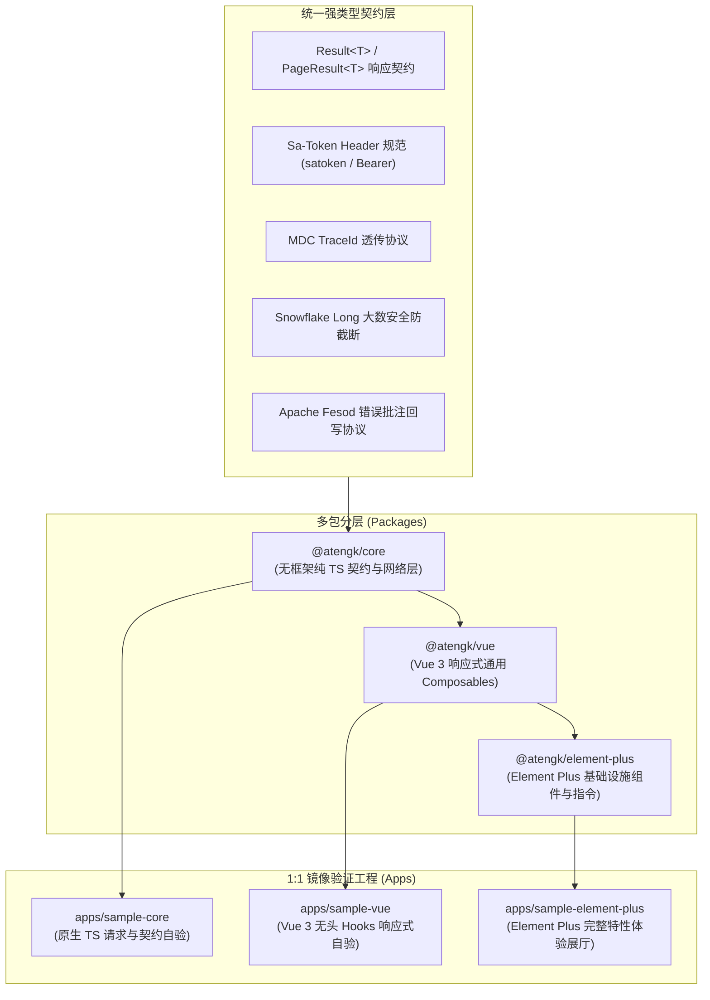

# Context Map: ateng-ui

`ateng-ui` 遵循多上下文（Multi-context）架构设计，各子包职责边界清晰、严格正交、高内聚且低耦合。本映射表定义所有上下文的职责边界、术语表索引与其协同依赖关系。

---

## Contexts (上下文边界与术语表)

- **[Core 核心契约与网络底座](./packages/core/CONTEXT.md)**（`@atengk/core`）：
  无框架纯 TypeScript 核心基础设施。提供统一强类型契约（`Result<T>`、`PageResult<T>`、`PageQuery`）、工业级 Axios 客户端管道、Sa-Token 凭据门面（`AuthManager`）、全链路 `traceId` 透传与提取、雪花 Long ID 大数防精度截断转换器、单体/微服务多网关路由机制（Multi-Service Gateway Routing）、数据展示脱敏与业务安全断言工具。
- **[Vue 响应式通用 Hooks](./packages/vue/CONTEXT.md)**（`@atengk/vue`）：
  面向现代 Web 应用的 Vue 3 通用 Composables/Hooks 基础设施。无头（Headless）状态管理，提供 `useRequest`（防抖/节流/轮询）、`usePagination`（零样板分页）、`useAuth`（权限/角色响应式门面）、`useTenant`（多租户状态切换）、`useStorage`（多源上传/直传/下载抽象）、`useExcel`（流式导出与错误批注弹窗驱动）以及 `useIdempotent`（前端防重幂等触发器）。
- **[Element Plus 基础设施组件库](./packages/element-plus/CONTEXT.md)**（`@atengk/element-plus`）：
  基于 Element Plus 封装的企业级高频基础设施组件与指令集。提供 `AtengTable`（高度整合契约的分页表格容器）、`AtengExcelFeedback`（Excel 导入标红批注错误在线预览与回写弹窗）、`AtengUpload`（存储直传与断点上传下载组件）、`v-permission`（细粒度按钮权限指令）、`v-role`（角色指令）以及 `v-idempotent`（按键防刷防重指令）。
- **[Sample Core 原生自验工程](./apps/sample-core/README.md)**（`sample-core`）：
  原生纯 TypeScript 验证沙箱。1:1 对标 `@atengk/core`，以零 UI 框架依赖完成网络请求管道、大数转换、Token 注入与 TraceId 透传的端到端集成测试与验证。
- **[Sample Vue 响应式自验工程](./apps/sample-vue/README.md)**（`sample-vue`）：
  Vue 3 极简应用沙箱。1:1 对标 `@atengk/vue`，验证全套无头 Hooks 的响应式状态机、生命周期销毁与多租户切片能力。
- **[Sample Element Plus 全特性体验展厅](./apps/sample-element-plus/README.md)**（`sample-element-plus`）：
  企业级高保真全特性交互展厅。1:1 对标 `@atengk/element-plus`，搭配内置全量 Mock 服务，提供表格、导入批注错误弹窗、文件上传下载及权限指令的可视化交互体验。

---

## Relationships (上下文协作拓扑)

- **Core → Vue**：`@atengk/vue` 依赖 `@atengk/core` 的契约（`Result`、`PageResult`、`PageQuery`）、网络客户端管道与凭据门面，将其升维包装为响应式 ref / reactive 状态机，绝不反向依赖 Vue 框架实现。
- **Vue → Element Plus**：`@atengk/element-plus` 依赖 `@atengk/vue` 提供的响应式通用 Hooks 驱动组件状态，并结合 Element Plus 呈现高阶交互，UI 表现层与底层状态彻底解耦。
- **Packages → Samples (1:1 镜像对标)**：各核心包分别有对应的 `sample-*` 沙箱工程，保证每个特性都具备开箱即用的测试覆盖与体验入口。

---

## Architectural Decisions (架构决策看板)

系统级全生命周期架构演进与重大决策详见 [架构决策记录看板 (docs/adr/README.md)](./docs/adr/README.md)：

- [ADR-0001: 工程工具链与 pnpm 版本基线锁定](./docs/adr/0001-toolchain-and-pnpm-version-baseline.md)
- [ADR-0002: Vue 3.5 核心基线升级与响应式解构传参契约](./docs/adr/0002-vue-3-5-baseline-and-reactive-props-contract.md)
- [ADR-0003: 基于 Axios 原始转换管道的雪花 Long ID 大数防截断方案](./docs/adr/0003-snowflake-long-id-raw-json-transform.md)
- [ADR-0004: Blob 异常双态识别防御与 Apache Fesod Excel 协议对接](./docs/adr/0004-blob-error-dual-state-and-fesod-excel-protocol.md)
- [ADR-0005: Element Plus 版本基线演进与双轨兼容策略](./docs/adr/0005-element-plus-version-baseline-and-peer-strategy.md)
- [ADR-0006: 依赖版本基线锁定与升级治理策略](./docs/adr/0006-dependency-baseline-and-upgrade-governance-strategy.md)
