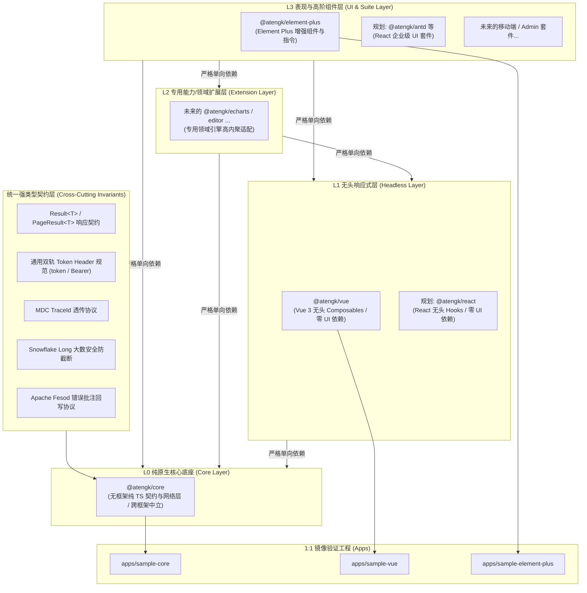

# Context Map: ateng-ui

`ateng-ui` 遵循多上下文（Multi-context）架构设计，各子包职责边界清晰、严格正交、高内聚且低耦合。本映射表定义系统四层洋葱拓扑、所有上下文的职责边界、术语表索引与其协同依赖关系。

---

## Contexts (上下文边界与分层定义)

系统所有模块（现有及未来扩展包）严格归入以下四层单向拓扑结构，**依赖方向只能自顶向下单向流动（L3 ➔ L2 ➔ L1 ➔ L0）**：

### L0 纯原生核心底座 (Core Layer)

- **[Core 核心契约与网络底座](./packages/core/CONTEXT.md)**（`@atengk/core`）：
  纯 TypeScript 无框架核心基础设施，保持平台中立与跨框架中立，**零 UI、零 Vue、零 React 依赖**。提供统一强类型契约（`Result<T>`、`PageResult<T>`、`PageQuery`）、工业级 Axios 客户端管道、Web 原生流式客户端（`StreamClient`）、全双工长连接客户端（`WebSocketClient`）、幂等安全重试与飞行中请求合并、通用 Token 与多租户凭据门面（`AuthManager` / `TenantManager`）、带时效缓存（`CacheStorage`）、大文件分片切片与受控并发上传协调器（`UploadCoordinator`）、全链路 `traceId` 透传与提取、雪花 Long ID 与高精度金额保真转换器、单体/微服务多网关路由机制（Multi-Service Gateway Routing）、数据展示脱敏与业务安全断言工具。

### L1 无头响应式层 (Headless Layer)

- **[Vue 响应式通用 Hooks](./packages/vue/CONTEXT.md)**（`@atengk/vue`，当前活跃）：
  面向现代 Web 应用的 Vue 3 通用 Composables/Hooks 基础设施。无头（Headless）状态管理，仅依赖 L0 与 Vue，绝对严禁物理依赖任何具体 UI 库。提供 `useRequest`（防抖/节流/轮询）、`usePagination`（零样板分页）、`useLatest`（异步抗竞态状态机）、`useAuth`（权限/角色响应式门面）、`useTenant`（多租户状态切换）、`useStorage`（多源上传/直传/下载抽象）、`useExcel`（流式导出与错误批注驱动）以及 `useIdempotent`（前端防重幂等触发器）。
- **React 响应式通用 Hooks**（`@atengk/react`，架构预留规划）：
  未来面向 React 生态的无头 Hooks 与状态机基础设施，对标 `@atengk/vue` 镜像能力，纯 Hooks 驱动，零具体 UI 依赖。

### L2 专用能力/领域扩展层 (Extension Layer)

- **领域引擎适配与专业能力扩展包**（未来扩展，如 `@atengk/echarts`、`@atengk/editor` 等）：
  封装特定图表、富文本、流程图等专用引擎，仅依赖 L0/L1 与对应的第三方专业核心，保持领域高内聚。

### L3 表现与高阶组件套件层 (UI & Suite Layer)

- **[Element Plus 基础设施组件库](./packages/element-plus/CONTEXT.md)**（`@atengk/element-plus`，当前活跃）：
  基于 Element Plus 封装的企业级高频基础设施组件与指令集，组装下层 L0~L2 能力。提供 `AtengTable`（高度整合契约的分页表格容器）、`AtengExcelFeedback`（Excel 导入标红批注错误在线预览与回写弹窗）、`AtengUpload`（存储直传与断点上传下载组件）、`v-permission`（细粒度按钮权限指令）、`v-role`（角色指令）以及 `v-idempotent`（按键防刷防重指令）。
- **React 企业级组件套件**（如 `@atengk/antd` 等，架构预留规划）：
  未来面向 React 生态的高阶组件套件，组装下层 L0 及 `@atengk/react` 能力。

### 1:1 镜像验证工程 (Apps)

- **[Sample Core 原生自验工程](./apps/sample-core/README.md)**（`sample-core`）：纯 TS 沙箱，1:1 对标 `@atengk/core`，验证网络管道、雪花大数与凭据注入。
- **[Sample Vue 响应式自验工程](./apps/sample-vue/README.md)**（`sample-vue`）：Vue 3 应用沙箱，1:1 对标 `@atengk/vue`，验证无头 Hooks 状态机、抗竞态与销毁清理。
- **[Sample Element Plus 全特性体验展厅](./apps/sample-element-plus/README.md)**（`sample-element-plus`）：交互展厅，1:1 对标 `@atengk/element-plus`，搭配 Mock 服务验证组件、弹窗与指令交互。

---

## Relationships (四层洋葱拓扑协作图)

### 拓扑流动与防线铁律

1. **单向无环流动律 (L3 ➔ L2 ➔ L1 ➔ L0)**：任何下层模块（如 L0、L1）严禁物理反向引用上层模块代码与组件；严禁跨包循环依赖；
2. **纯状态机无头契约**：L1 无头层（`@atengk/vue` 及未来的 `@atengk/react`）严禁依赖或直接调用任何具体 UI 弹窗（如 `ElMessage` / `Antd message`），异常反馈统一由表现层接管；
3. **百模块准入登记硬门禁**：任何新建子包必须在此上下文映射表中显式声明归属层级与合法依赖范围，未登记直接阻断准出；
4. **1:1 镜像自验铁律**：核心包必须具备对应的 `apps/sample-*` 沙箱，特性 100% 具备端到端测试覆盖与真机体验；
5. **双轨多框架解耦架构**：坚守“一套 L0 纯 TS 原生核心底座，双轨响应式驱动（Vue / React），多套 UI 表现套件”格局。底层 L0 绝对严禁渗入 Vue 或 React 专有类型与钩子，确保未来 React 零成本镜像扩展。

---

## Architectural Decisions (架构决策看板)

系统级全生命周期架构演进与重大决策详见 [架构决策记录看板 (docs/adr/README.md)](./docs/adr/README.md)：

- [ADR-0001: 工程工具链与 pnpm 版本基线锁定](./docs/adr/0001-toolchain-and-pnpm-version-baseline.md)
- [ADR-0002: Vue 3.5 核心基线升级与响应式解构传参契约](./docs/adr/0002-vue-3-5-baseline-and-reactive-props-contract.md)
- [ADR-0003: 基于 Axios 原始转换管道的雪花 Long ID 大数防截断方案](./docs/adr/0003-snowflake-long-id-raw-json-transform.md)
- [ADR-0004: Blob 异常双态识别防御与 Apache Fesod Excel 协议对接](./docs/adr/0004-blob-error-dual-state-and-fesod-excel-protocol.md)
- [ADR-0005: Element Plus 版本基线演进与双轨兼容策略](./docs/adr/0005-element-plus-version-baseline-and-peer-strategy.md)
- [ADR-0006: 依赖版本基线锁定与升级治理策略](./docs/adr/0006-dependency-baseline-and-upgrade-governance-strategy.md)
- [ADR-0007: 代码规范与静态代码分析治理策略](./docs/adr/0007-code-specification-and-static-analysis-governance.md)
- [ADR-0008: 单元测试引擎与轻量 DOM 运行环境选型](./docs/adr/0008-unit-testing-engine-and-lightweight-dom-environment.md)
- [ADR-0009: Monorepo 多模块四层洋葱拓扑与单向依赖治理架构](./docs/adr/0009-monorepo-four-layer-onion-topology-and-dependency-governance.md)
