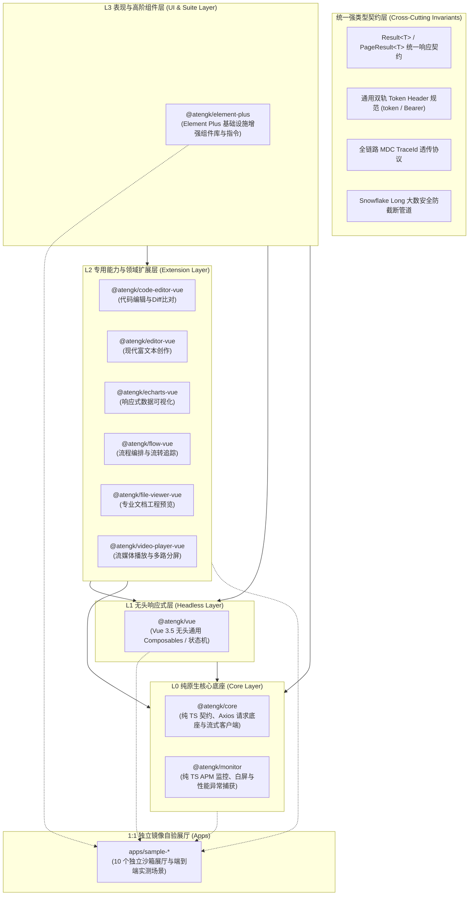

# ateng-ui

> 面向现代 Web 应用与企业级系统的工业级前端基础设施与核心套件。
> Industrial-grade frontend infrastructure and core toolkit for modern web applications.

[](https://www.npmjs.com/package/@atengk/element-plus)
[](https://github.com/atengk/ateng-ui/discussions)
[](LICENSE)
[](https://pnpm.io/)
[](https://turbo.build/)
[](https://www.typescriptlang.org/)
[](https://vuejs.org/)
[](https://element-plus.org/)
[](https://vitest.dev/)
[](https://eslint.org/)

---

## 1. 核心特性亮点 (Features)

- 🛡️ **强类型网络契约与平台中立核心底座 (`@atengk/core` & `@atengk/monitor`)**：
  - **显式强类型契约**：严格对齐企业级统一响应规范，标准化支持 `Result<T>` 解包、`PageQuery` 与 `PageResult<T>` 分页流转；
  - **雪花 Long ID 防失真**：基于 Axios `transformResponse` 纳秒级正则预处理（[ADR-0003](./docs/adr/0003-snowflake-long-id-raw-json-transform.md)），将 16 位以上超大整型加双引号转换为字符串，彻底杜绝 V8 原生解析精度截断；
  - **双态 Blob 异常识别**：下载文件遇到业务异常 JSON 时自动识别并转译为 `BusinessException`（[ADR-0004](./docs/adr/0004-blob-error-dual-state-and-fesod-excel-protocol.md)），杜绝产生伪损坏文件；
  - **全链路追踪与凭据注入**：内置通用鉴权凭据门面（`AuthManager`），自动注入双轨请求头（`token` / `Bearer`）、多租户切片及全局 `traceId` 链路追踪；
  - **原生流式与长连接**：标配 Web 原生 SSE 流式打字机客户端（`StreamClient`）与全双工长连接客户端（`WebSocketClient`），支持心跳保活、指数退避重连与受控离线缓冲（[ADR-0011](./docs/adr/0011-l0-core-resilience-and-capability-enhancement-architecture.md)、[ADR-0012](./docs/adr/0012-websocket-client-architecture-and-l0-convergence.md)）；
  - **微内核 APM 监控打点**：提供无框架纯 TypeScript 监控微内核（`@atengk/monitor`），覆盖全维异常捕获、Web Vitals 性能感知、视口白屏检测、脱敏行为轨迹与 Beacon 高可用上报。
- ⚡ **响应式通用无头状态机 (`@atengk/vue`)**：
  - **Vue 3.5 原生解构契约**：严格遵循响应式解构入参规范（[ADR-0002](./docs/adr/0002-vue-3-5-baseline-and-reactive-props-contract.md)），公共 Hooks 统一采用 `MaybeRefOrGetter<T>` 与 `toValue()` 解包，彻底消除响应性丢失；
  - **全方位抗竞态防线**：内置 `useLatest` 与请求取消协调器，保障高频异步搜索、快速翻页数据时序单调递增，杜绝时序倒挂；
  - **确定性生命周期清理**：物理事件监听、定时器与网络请求句柄在 `onScopeDispose` 或 `onUnmounted` 中 100% 确定性销毁释放，坚决消灭内存泄漏。
- 🧩 **领域能力专业扩展套件群 (L2 Extensions)**：
  - **代码与 Diff 比对 (`@atengk/code-editor-vue`)**：Monaco Editor 驱动，支持代码智能补全、SQL 美化、JSON Schema 语法校验与双模 Diff 差异比对；
  - **现代富文本排版 (`@atengk/editor-vue`)**：TipTap 2.x 驱动，支持块级斜杠命令、划词气泡、表格上下文菜单、字数拦截与拖拽截图直传；
  - **数据可视化大盘 (`@atengk/echarts-vue`)**：ECharts 5 响应式容器，内置 6 大高频业务图表卡片、行政区划三级地图下钻与全屏脱壳导出；
  - **企业级流程编排 (`@atengk/flow-vue`)**：LogicFlow 驱动，支持可视化拖拽编排、BPMN 2.0 XML 双向转译、DAG 规则链拓扑校验与运行态五态轨迹追踪；
  - **专业文档工程预览 (`@atengk/file-viewer-vue`)**：多格式文档统一表现容器，内置 Office/PDF/图片/OFD 预览、三级资产寻址与防泄密水印；
  - **流媒体与分屏播放 (`@atengk/video-player-vue`)**：支持富媒体点播、HLS/FLV 低延迟直播、1/4/9/16 对称及非对称分屏矩阵、云台 PTZ 控制与安全防篡改水印。
- 🎨 **工业级组件库与高阶表现套件 (`@atengk/element-plus`)**：
  - **基础设施级增强**：提供高级企业级布局套件（`AtengLayout` / `AtengProLayout`）、多标签导航（`AtengTabsNav`）、高度契约整合的分页表格（`AtengTable`）、响应式高级检索表单（`AtengQueryForm`）、脱敏详情容器（`AtengDescriptions`）、全局去重字典三件套（`AtengDict*`）与全套微骨架屏和防重指令；
  - **严格单向流与空安全保底**：组件严禁突变 Props；列表与分页查询统一保底返回空数组 `[]`，彻底杜绝白屏崩溃；
  - **命名空间与主题隔离**：所有组件强制限定在 `at-` 独立命名空间并开启 `<style scoped>`，支持暗黑模式与 Theme Pro 多色系动态切换。
- 🧪 **全自洽现代工程防线**：
  - **规范职责正交解耦**：ESLint 9 Flat Config 专职查代码质量，Prettier 3.x 独占排版美化（[ADR-0007](./docs/adr/0007-code-specification-and-static-analysis-governance.md)）；
  - **极速轻量单测守护**：基于 Vitest 2.x + `happy-dom` 搭建 100% 离线自洽单测体系（[ADR-0008](./docs/adr/0008-unit-testing-engine-and-lightweight-dom-environment.md)）；
  - **增量构建编排**：依托 Turborepo 2.x 实现毫秒级任务缓存与增量并发编译。

---

## 2. 架构拓扑与分层关系 (Architecture)

系统面向未来百模块级扩展，所有子包严格遵循**四层单向拓扑洋葱模型（L3 ➔ L2 ➔ L1 ➔ L0）**，严禁跨层逆向依赖：



---

## 3. 模块全景速查矩阵 (Packages & Apps)

### 生产核心包 (Packages)

| 层级   | 模块目录                                                   | npm 包名                   | 定位与核心职责                                                            | 文档真理源                                                          |
| :----- | :--------------------------------------------------------- | :------------------------- | :------------------------------------------------------------------------ | :------------------------------------------------------------------ |
| **L0** | [`packages/core`](./packages/core)                         | `@atengk/core`             | 纯 TS 跨框架网络底座、强类型契约、雪花大数防截断、流式/长连接客户端       | [core/README.md](./packages/core/README.md)                         |
| **L0** | [`packages/monitor`](./packages/monitor)                   | `@atengk/monitor`          | 纯 TS 前端 APM 监控、白屏感知、Web Vitals 性能打点与高可用上报队列        | [monitor/README.md](./packages/monitor/README.md)                   |
| **L1** | [`packages/vue`](./packages/vue)                           | `@atengk/vue`              | Vue 3.5 纯无头响应式 Hooks、只读状态机、分页/抗竞态/防刷编排              | [vue/README.md](./packages/vue/README.md)                           |
| **L2** | [`packages/code-editor-vue`](./packages/code-editor-vue)   | `@atengk/code-editor-vue`  | Monaco Editor 代码编辑、SQL 智能美化、Schema 校验与双模 Diff 比对         | [code-editor-vue/README.md](./packages/code-editor-vue/README.md)   |
| **L2** | [`packages/echarts-vue`](./packages/echarts-vue)           | `@atengk/echarts-vue`      | ECharts 5 响应式大盘容器、6 大高频图表预设、区划下钻与全屏脱壳导出        | [echarts-vue/README.md](./packages/echarts-vue/README.md)           |
| **L2** | [`packages/editor-vue`](./packages/editor-vue)             | `@atengk/editor-vue`       | TipTap 现代富文本、斜杠命令、气泡菜单、全中文表格与拖拽粘贴截图直传       | [editor-vue/README.md](./packages/editor-vue/README.md)             |
| **L2** | [`packages/file-viewer-vue`](./packages/file-viewer-vue)   | `@atengk/file-viewer-vue`  | 专业多格式文档/工程预览、Office/PDF/图片、三级弹性资产寻址与安全水印      | [file-viewer-vue/README.md](./packages/file-viewer-vue/README.md)   |
| **L2** | [`packages/flow-vue`](./packages/flow-vue)                 | `@atengk/flow-vue`         | LogicFlow 流程编排设计器、BPMN 双向转译、DAG 排版与运行态流转追踪         | [flow-vue/README.md](./packages/flow-vue/README.md)                 |
| **L2** | [`packages/video-player-vue`](./packages/video-player-vue) | `@atengk/video-player-vue` | 音视频点播与直播、1~16 路分屏协同矩阵、PTZ 云台解耦控制与防录屏水印       | [video-player-vue/README.md](./packages/video-player-vue/README.md) |
| **L3** | [`packages/element-plus`](./packages/element-plus)         | `@atengk/element-plus`     | Element Plus 基础设施组件库、ProLayout、表格/检索容器、字典三件套与指令集 | [element-plus/README.md](./packages/element-plus/README.md)         |

### 1:1 镜像验证沙箱 (Apps)

| 工程目录                                                         | 应用标识                            | 服务端口 | 核心实测场景                                                      | 体验指南                                                                      |
| :--------------------------------------------------------------- | :---------------------------------- | :------- | :---------------------------------------------------------------- | :---------------------------------------------------------------------------- |
| [`apps/sample-core`](./apps/sample-core)                         | `sample-core` (private)             | 3001     | 原生 TS 网络请求、大数转换、Token 注入与流式通信实测              | [sample-core/README.md](./apps/sample-core/README.md)                         |
| [`apps/sample-vue`](./apps/sample-vue)                           | `sample-vue` (private)              | 3002     | Vue 3 纯无头 Hooks 驱动、请求状态机、抗竞态与销毁实测             | [sample-vue/README.md](./apps/sample-vue/README.md)                           |
| [`apps/sample-element-plus`](./apps/sample-element-plus)         | `sample-element-plus` (private)     | 3000     | Element Plus 高阶组件库全特性交互展厅与 Mock 服务集成             | [sample-element-plus/README.md](./apps/sample-element-plus/README.md)         |
| [`apps/sample-echarts-vue`](./apps/sample-echarts-vue)           | `sample-echarts-vue` (private)      | 3003     | ECharts 响应式大盘、暗黑模式切换、地图下钻自验展厅                | [sample-echarts-vue/README.md](./apps/sample-echarts-vue/README.md)           |
| [`apps/sample-file-viewer-vue`](./apps/sample-file-viewer-vue)   | `sample-file-viewer-vue` (private)  | 3004     | Office/PDF/图片文档全保真预览、Token 注入与水印自验展厅           | [sample-file-viewer-vue/README.md](./apps/sample-file-viewer-vue/README.md)   |
| [`apps/sample-video-player-vue`](./apps/sample-video-player-vue) | `sample-video-player-vue` (private) | 3005     | 点播/直播流媒体、1~16 分屏协同矩阵与云台 PTZ 控制自验展厅         | [sample-video-player-vue/README.md](./apps/sample-video-player-vue/README.md) |
| [`apps/sample-flow-vue`](./apps/sample-flow-vue)                 | `sample-flow-vue` (private)         | 3006     | 流程设计器编排、BPMN XML 导出与运行态轨迹高亮自验展厅             | [sample-flow-vue/README.md](./apps/sample-flow-vue/README.md)                 |
| [`apps/sample-code-editor-vue`](./apps/sample-code-editor-vue)   | `sample-code-editor-vue` (private)  | 3008     | Monaco 编辑器、SQL 美化、Schema 校验与 Diff 差异比对自验展厅      | [sample-code-editor-vue/README.md](./apps/sample-code-editor-vue/README.md)   |
| [`apps/sample-editor-vue`](./apps/sample-editor-vue)             | `sample-editor-vue` (private)       | 3009     | TipTap 富文本创作、斜杠命令、表格上下文菜单与截图直传自验展厅     | [sample-editor-vue/README.md](./apps/sample-editor-vue/README.md)             |
| [`apps/sample-monitor`](./apps/sample-monitor)                   | `sample-monitor` (private)          | 3010     | APM 故障注入（JS/Promise/404）、白屏采样、Web Vitals 实时打点展厅 | [sample-monitor/README.md](./apps/sample-monitor/README.md)                   |

---

## 4. 工程脚本速查矩阵 (Scripts Matrix)

根工作区由 Turborepo 统一调度并发流水线与全缓存加速：

| 命令                     | 描述                   | 底层工具与核心行为                                                  |
| :----------------------- | :--------------------- | :------------------------------------------------------------------ |
| `pnpm run build`         | 全项目增量构建         | 调度 Turborepo 并发执行 tsup 双模编译 (ESM+CJS+DTS) 与 Vite 打包    |
| `pnpm run dev`           | 本地协同监听开发       | 启动各子包 tsup 源码监听与自验展厅实时热重载 (HMR)                  |
| `pnpm run typecheck`     | 全量严格类型检查       | 执行 `tsc --noEmit` 基于 Monorepo Project References 进行全类型校验 |
| `pnpm run test`          | 全自洽离线单元测试     | 调度 Vitest 2.x 并行执行各子包单元测试（纯离线环境守护）            |
| `pnpm run test:coverage` | 单元测试覆盖率统计     | 基于 `@vitest/coverage-v8` 输出全套件结构化覆盖率报告               |
| `pnpm run lint`          | 静态代码分析与质量扫描 | 调度 ESLint 9 Flat Config 执行代码质量与工业级防线扫描              |
| `pnpm run format`        | 规范化全代码自动排版   | 调度 Prettier 3.x 统一美化与格式化全库代码                          |
| `pnpm run format:check`  | 排版规范合规性校验     | 校验全项目排版格式是否符合 Prettier 工业基线                        |
| `pnpm run changeset`     | 交互式生成变更记录     | 调度 Changesets 记录本次变更对语义化版本（semver）的影响            |

---

## 5. 核心架构决策记录 (Architecture Decisions)

本项目严格践行重大技术选型透明化与 ADR 架构治理，所有关键决策均沉淀于 [`docs/adr/`](./docs/adr/)：

| 编号                                                                                        | 决策标题                                             | 核心摘要                                                                                    |
| :------------------------------------------------------------------------------------------ | :--------------------------------------------------- | :------------------------------------------------------------------------------------------ |
| [ADR-0001](./docs/adr/0001-toolchain-and-pnpm-version-baseline.md)                          | 工程工具链与 pnpm 版本基线锁定                       | 锁定 `pnpm@9.12.3` 与 Node `>=20.18.0`，规避 pnpm 10 脚本白名单阻断                         |
| [ADR-0002](./docs/adr/0002-vue-3-5-baseline-and-reactive-props-contract.md)                 | Vue 3.5 核心基线升级与响应式解构传参契约             | 升级基线至 `^3.5.0`，Hooks 入参强制规范为 `MaybeRefOrGetter<T>`                             |
| [ADR-0003](./docs/adr/0003-snowflake-long-id-raw-json-transform.md)                         | 基于 Axios 原始转换管道的雪花 Long ID 大数防截断方案 | `transformResponse` 阶段正则预处理加双引号，零依赖、原生 V8 极速解析                        |
| [ADR-0004](./docs/adr/0004-blob-error-dual-state-and-fesod-excel-protocol.md)               | Blob 异常双态识别防御与 Apache Fesod Excel 协议对接  | 拦截器识别 Blob 中的 JSON 业务错误，消灭假文件，规范 Fesod 批注回写                         |
| [ADR-0005](./docs/adr/0005-element-plus-version-baseline-and-peer-strategy.md)              | Element Plus 版本基线演进与双轨兼容策略              | 库 peer 声明 `>=2.8.0` 宽泛包容，自验展厅锁定 `2.14.7` 与 `vue: 3.5.44` 最新守护            |
| [ADR-0006](./docs/adr/0006-dependency-baseline-and-upgrade-governance-strategy.md)          | 依赖版本基线锁定与升级治理策略                       | 主干稳态优先、成熟体系补丁及时跟进、双轨依赖隔离（库宽进/沙箱严出）与全量准出红线           |
| [ADR-0007](./docs/adr/0007-code-specification-and-static-analysis-governance.md)            | 代码规范与静态代码分析治理策略                       | ESLint 9 Flat Config + Prettier 3 职责解耦，固化工业防线硬规则，CI 零缺陷硬门禁             |
| [ADR-0008](./docs/adr/0008-unit-testing-engine-and-lightweight-dom-environment.md)          | 单元测试引擎与轻量 DOM 运行环境选型                  | Vitest 2.x 工作区调度，happy-dom 轻量提速 70%，node/DOM 分层隔离与全自洽单测铁律            |
| [ADR-0009](./docs/adr/0009-monorepo-four-layer-onion-topology-and-dependency-governance.md) | Monorepo 多模块四层洋葱拓扑与单向依赖治理架构        | L0~L3 四层单向无环流动，无头与 UI 彻底解耦，为百模块扩展确立准入与拓扑硬防线                |
| [ADR-0010](./docs/adr/0010-http-client-architecture-and-response-unwrapping.md)             | HTTP 客户端分层架构、响应解包与因果异常转译契约      | 工厂与单例双轨，默认解包 Promise<T> 与配置逃生门，统一 BusinessException 因果转译           |
| [ADR-0011](./docs/adr/0011-l0-core-resilience-and-capability-enhancement-architecture.md)   | L0 核心底座高可用韧性、流式通信与数据安全增强架构    | 原生 StreamClient、幂等重试、飞行中请求去重合并、原生高精度金额、切片上传与防重放签名       |
| [ADR-0012](./docs/adr/0012-websocket-client-architecture-and-l0-convergence.md)             | WebSocket 全双工长连接客户端架构与 L0 最终收敛决策   | 原生双向心跳探针、断线指数退避重连、受控容量离线缓冲、双轨凭据注入，封顶 L0 核心底座        |
| [ADR-0013](./docs/adr/0013-vue-headless-architecture-and-reactivity-contracts.md)           | Vue 3.5 无头响应式基础设施架构与状态单向契约         | 10 大核心 Composables、严格只读导出、usePagination 组合式契约、双重抗竞态与零重型第三方依赖 |
| [ADR-0014](./docs/adr/0014-project-positioning-and-scope-generalization.md)                 | 项目定位松绑与广义 Web 基础设施范畴演进决策          | 面向现代 Web 应用与企业级系统，去中后台化与去强绑定微服务化，重塑全场景基础设施底座定位     |

---

## 6. Git 协作、锁步发版与社区交流 (Workflow & Community)

- **提交规约**：遵循 Conventional Commits 规范，统一通过项目门面助手提交（覆盖四层洋葱架构全量 Scope 与 Issue 关联）：
  ```bash
  bash scripts/commit.sh
  ```
- **多包统一锁步发版向导**：采用 Changesets 工业级多包统一锁步模式（Fixed Mode）与单 Tag 聚合发布流水线，全仓库统一版本演进，彻底杜绝碎片化 Tag：
  ```bash
  bash scripts/release.sh
  ```
- **社区交流与答疑**：欢迎在 [GitHub Discussions](https://github.com/atengk/ateng-ui/discussions) 中畅所欲言，分享使用体验、提出设计建议或探讨技术细节。

---

## 7. 开源协议 (License)

本项目遵循 [Apache License 2.0](LICENSE) 开源协议。
