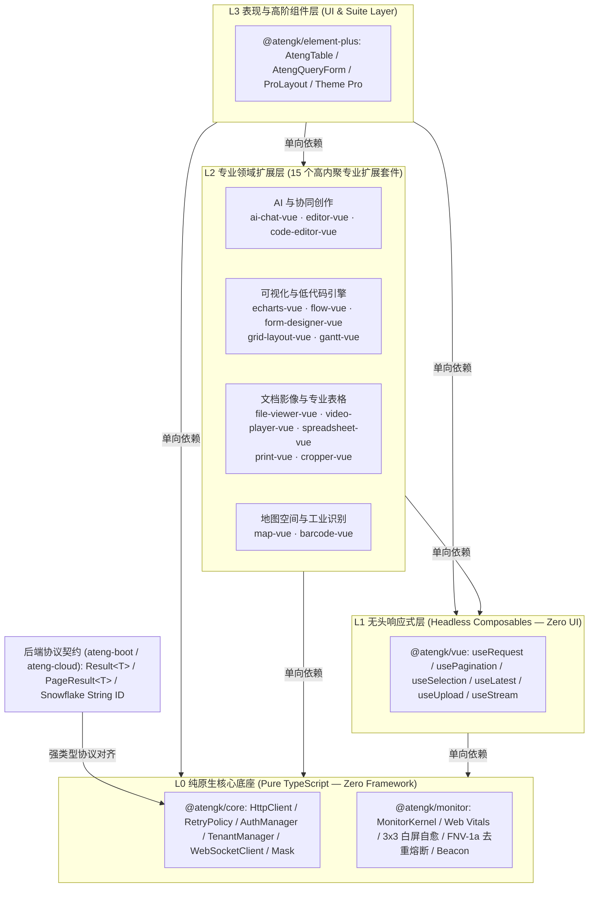

# ateng-ui

> **企业级全链路前端基础设施 Monorepo 套件** — 基于 Vue 3.5 + TypeScript 构建，严守四层洋葱单向拓扑（`L3 ➔ L2 ➔ L1 ➔ L0`）、零臃肿依赖与前后端强类型契约对称设计；与 `ateng-boot` / `ateng-cloud` 后端 `Result<T>`、分页及雪花 ID 协议原生闭环，内置 **19 个正交子包** 与 **19 个 1:1 可运行交互自验展厅**。

<p align="left">

[](https://www.npmjs.com/package/@atengk/element-plus)
[](./CONTEXT-MAP.md)
[](./llms.txt)
[](https://github.com/atengk/ateng-ui/discussions)
[](LICENSE)
[](https://www.typescriptlang.org/)
[](https://vuejs.org/)
[](https://element-plus.org/)
[](https://pnpm.io/)
[](https://turbo.build/)

</p>

---

## ✨ 为什么选择 `ateng-ui`？

- **洋葱四层严格单向解耦**：`L0` 纯 TS 核心与全链路监控彻底框架中立（零 Vue/React 耦合）；`L1` 无头响应式 Composables 零 UI 弹窗耦合；`L2` 15 个专业领域套件按需独立接入；`L3` Element Plus 高阶表现套件开箱即用。
- **前后端强类型闭环**：原生匹配 `Result<T>`（默认自动解包、`{ unwrap: false }` 逃生门）与 `PageQuery` / `PageResult<T>` 契约；HTTP 响应前置正则固化 16 位以上雪花 Long ID 为 `string`，彻底消除 $2^{53}-1$ 精度丢失；下载流前置识别 Blob-JSON 异常帧。
- **全生命周期确定性防卫**：`useLatest` + `AbortSignal` 双重消灭异步竞态脏写；`useIdempotent` + `v-idempotent` 防止表单重复提交；所有定时器、监听器、`Observer`、WebSocket/SSE 与 `URL.createObjectURL` 句柄在 `onScopeDispose` 100% 自动销毁清理。
- **19 套 1:1 可视化自验展厅 + AI-Ready**：每个 `@atengk/*` 子包 1:1 配套 `apps/sample-*` 多场景交互看板（支持离线 Mock 与 `.env.local` 真实网关双模切换），根目录提供 [`llms.txt`](./llms.txt) 让 AI 编程助手零幻觉检索全仓契约。

---

## 1. 四层洋葱架构全景 (Architecture)



> **依赖红线**：严格恪守 `L3 ➔ L2 ➔ L1 ➔ L0` 单向无环流动；L0 绝不引入 Vue/React，L1 绝不调用 `ElMessage` 等具体 UI 弹窗，L2 绝不逆向依赖 L3。全量边界定义见 [领域限界上下文地图 (`CONTEXT-MAP.md`)](./CONTEXT-MAP.md)。

---

## 2. 全景包生态矩阵（19 包 + 19 展厅 100% 覆盖）

### 2.1 核心基础底座（L0 / L1 / L3 — 4 包）

| npm 坐标                   | 层级与定位                   | 核心能力与代表导出                                                                                                                                                                                         | 文档与 1:1 展厅 (`3001~3010`)                                                                       |
| :------------------------- | :--------------------------- | :--------------------------------------------------------------------------------------------------------------------------------------------------------------------------------------------------------- | :-------------------------------------------------------------------------------------------------- |
| **`@atengk/core`**         | L0 纯 TS 核心契约与网络底座  | `http`、`Result<T>`、`PageResult<T>`、雪花 ID 防截断、`RetryPolicy`、`AuthManager`、`TenantManager`、`StreamClient`、`WebSocketClient`、`UploadCoordinator`、`formatMask*`                                 | [包文档](./packages/core/README.md) \| [展厅 `:3001`](./apps/sample-core/README.md)                 |
| **`@atengk/monitor`**      | L0 纯 TS 全链路可观测底座    | `initMonitor`、`MonitorKernel`、JS/Promise/Vue 异常采集、3×3 视口白屏复验、Web Vitals、URL/DOM 三级脱敏、FNV-1a 去重熔断、`sendBeacon` 冲刷                                                                | [包文档](./packages/monitor/README.md) \| [展厅 `:3010`](./apps/sample-monitor/README.md)           |
| **`@atengk/vue`**          | L1 Vue 3.5 无头响应式层      | `createAtengVue`、`useRequest`、`usePagination`、`useSelection`、`useLatest`、`useIdempotent`、`useAuth`/`useTenant`、`useExcel`、`useUpload`、`useStream`、`useWebSocket`、`useAntiFlicker`、`useTabsNav` | [包文档](./packages/vue/README.md) \| [展厅 `:3002`](./apps/sample-vue/README.md)                   |
| **`@atengk/element-plus`** | L3 Element Plus 增强表现套件 | `AtengTable`、`AtengQueryForm`、`AtengProLayout`、`AtengTabsNav`、`AtengPageContainer`、`AtengSplitLayout`、`AtengDialog`、`AtengDrawer`、权限/防重/水印/骨架指令与 Theme Pro 主题                         | [包文档](./packages/element-plus/README.md) \| [展厅 `:3003`](./apps/sample-element-plus/README.md) |

### 2.2 专业领域扩展层（L2 — 15 包按场景聚类）

#### 🤖 AI 与协同创作（3 包）

| npm 坐标                      | 领域定位                       | 核心能力与底层引擎                                                             | 文档与 1:1 展厅                                                                                           |
| :---------------------------- | :----------------------------- | :----------------------------------------------------------------------------- | :-------------------------------------------------------------------------------------------------------- |
| **`@atengk/ai-chat-vue`**     | AI 智能体会话与 Artifacts 协同 | 多轮流式对话容器 `AiChat`、思考链折叠、工具调用卡片与 Artifacts 产物侧边栏协同 | [包文档](./packages/ai-chat-vue/README.md) \| [展厅 `:3011`](./apps/sample-ai-chat-vue/README.md)         |
| **`@atengk/editor-vue`**      | 现代富文本与内容创作           | 基于 TipTap / ProseMirror 封装，提供结构化文档排版、微工具栏与全屏沉浸编辑     | [包文档](./packages/editor-vue/README.md) \| [展厅 `:3009`](./apps/sample-editor-vue/README.md)           |
| **`@atengk/code-editor-vue`** | 代码编辑与结构化 Diff 比对     | 基于 Monaco Editor，面向 SQL 审计、YAML/JSON 配置发布与双栏结构化差异比对      | [包文档](./packages/code-editor-vue/README.md) \| [展厅 `:3008`](./apps/sample-code-editor-vue/README.md) |

#### 📊 可视化与低代码引擎（5 包）

| npm 坐标                        | 领域定位                     | 核心能力与底层引擎                                                                                     | 文档与 1:1 展厅                                                                                               |
| :------------------------------ | :--------------------------- | :----------------------------------------------------------------------------------------------------- | :------------------------------------------------------------------------------------------------------------ |
| **`@atengk/echarts-vue`**       | 响应式数据可视化大盘         | 基于 ECharts 5，内置几何自愈、暗黑无损热切换、高频业务预设图表与 GeoJSON 地图下钻                      | [包文档](./packages/echarts-vue/README.md) \| [展厅 `:3006`](./apps/sample-echarts-vue/README.md)             |
| **`@atengk/flow-vue`**          | 企业审批流与状态机编排       | 流程可视化编排设计器 `FlowDesigner` 与只读流转追踪运行视图 `FlowViewer`                                | [包文档](./packages/flow-vue/README.md) \| [展厅 `:3007`](./apps/sample-flow-vue/README.md)                   |
| **`@atengk/form-designer-vue`** | 动态表单设计器与 Schema 引擎 | 可视化拖拽设计器 `FormDesigner`、JSON Schema 渲染引擎 `FormRenderer` 与流程权限联动                    | [包文档](./packages/form-designer-vue/README.md) \| [展厅 `:3012`](./apps/sample-form-designer-vue/README.md) |
| **`@atengk/grid-layout-vue`**   | 大屏仪表盘与拖拽网格布局     | 基于 GridStack 10.x，碰撞避让、多列断点自适应与双向 JSON 布局状态流（`AtengGridLayout`）               | [包文档](./packages/grid-layout-vue/README.md) \| [展厅 `:3013`](./apps/sample-grid-layout-vue/README.md)     |
| **`@atengk/gantt-vue`**         | 项目甘特图与资源排程         | 基于 VisActor VTable-Gantt 1.26.x，TreeGrid 双向同步滚动、工期拖拽、依赖连线与基线对比（`AtengGantt`） | [包文档](./packages/gantt-vue/README.md) \| [展厅 `:3018`](./apps/sample-gantt-vue/README.md)                 |

#### 📄 文档影像与专业表格（5 包）

| npm 坐标                       | 领域定位                   | 核心能力与底层引擎                                                                         | 文档与 1:1 展厅                                                                                             |
| :----------------------------- | :------------------------- | :----------------------------------------------------------------------------------------- | :---------------------------------------------------------------------------------------------------------- |
| **`@atengk/file-viewer-vue`**  | 纯前端多格式文档与图纸预览 | 支持 Word/Excel/PPT/PDF/OFD/CAD/3D 离线渲染、三阶智能嗅探、DLP 水印与弹窗预览              | [包文档](./packages/file-viewer-vue/README.md) \| [展厅 `:3004`](./apps/sample-file-viewer-vue/README.md)   |
| **`@atengk/video-player-vue`** | 流媒体与安防多路视频播放   | 支持点播、HLS/FLV 低延迟直播、1~16 路分屏矩阵、云台控制、矢量防篡改水印与双态异常拦截      | [包文档](./packages/video-player-vue/README.md) \| [展厅 `:3005`](./apps/sample-video-player-vue/README.md) |
| **`@atengk/spreadsheet-vue`**  | 在线电子表格与批量填报     | 基于 Univer 1.4.x，多 Sheet 协同、公式实时计算、行列冻结与多模式切换（`AtengSpreadsheet`） | [包文档](./packages/spreadsheet-vue/README.md) \| [展厅 `:3017`](./apps/sample-spreadsheet-vue/README.md)   |
| **`@atengk/print-vue`**        | 静默打印调度与精准排版     | 标准纸张与热敏小票预设、分页防撕裂截断与高保真 PDF 导出（`AtengPrintSheet`）               | [包文档](./packages/print-vue/README.md) \| [展厅 `:3014`](./apps/sample-print-vue/README.md)               |
| **`@atengk/cropper-vue`**      | 工业级图片裁剪与图像处理   | 基于 Cropper.js，支持比例锁定、缩放旋转、响应式裁剪与弹窗裁剪容器（`AtengCropper`）        | [包文档](./packages/cropper-vue/README.md) \| [展厅 `:3016`](./apps/sample-cropper-vue/README.md)           |

#### 🗺️ 地图空间与工业识别（2 包）

| npm 坐标                  | 领域定位               | 核心能力与底层引擎                                                                         | 文档与 1:1 展厅                                                                                   |
| :------------------------ | :--------------------- | :----------------------------------------------------------------------------------------- | :------------------------------------------------------------------------------------------------ |
| **`@atengk/map-vue`**     | 多源地图与空间地理计算 | 默认离线免密 Leaflet 引擎 + 高德/百度 SPI 插拔、坐标拾取、电子围栏与轨迹回放（`AtengMap`） | [包文档](./packages/map-vue/README.md) \| [展厅 `:3019`](./apps/sample-map-vue/README.md)         |
| **`@atengk/barcode-vue`** | 条码、艺术二维码与扫码 | 基于 `jsbarcode` / `qr-code-styling` / `html5-qrcode`，支持 SVG/Canvas 渲染与仓储扫码      | [包文档](./packages/barcode-vue/README.md) \| [展厅 `:3015`](./apps/sample-barcode-vue/README.md) |

> **本地启动任意展厅**：例如 `pnpm install && pnpm --filter sample-element-plus dev`（默认内置离线 Mock，无需后端即可体验全交互）。

---

## 3. 60 秒极速上手 (Quick Start)

### 3.1 安装核心依赖

```bash
pnpm add @atengk/core @atengk/vue @atengk/element-plus element-plus vue axios
```

_(具体 `peerDependencies` 兼容基线与可选 L2 扩展包依赖，请查阅 [根 package.json](./package.json) 与各子包 `README.md`。)_

### 3.2 全局入口注册（`src/main.ts`）

```ts
import { createApp } from 'vue';
import ElementPlus from 'element-plus';
import 'element-plus/dist/index.css';

import { createAtengVue } from '@atengk/vue';
import AtengElementPlus from '@atengk/element-plus';
import '@atengk/element-plus/style.css';
// 可选：启用 Theme Pro 现代极客科技多主题样式（含 Slate 深空暗黑基底）
import '@atengk/element-plus/theme-pro.css';

import App from './App.vue';

const app = createApp(App);
app.use(ElementPlus);
app.use(createAtengVue({ defaultPageSize: 20 }));
app.use(AtengElementPlus);
app.mount('#app');
```

### 3.3 零胶水企业级分页列表实战（`UserList.vue`）

代码模式取自 [`TableCrudView.vue`](./apps/sample-element-plus/src/views/table/TableCrudView.vue)，内置 `PageQuery` / `PageResult<T>` 协议对接、雪花 `string` 主键与跨页多选记忆：

```vue
<script setup lang="ts">
import { reactive, ref } from 'vue';
import { ElFormItem, ElInput, ElTableColumn, ElTag } from 'element-plus';
import { http, type PageQuery, type PageResult } from '@atengk/core';
import { usePagination } from '@atengk/vue';
import { AtengQueryForm, AtengTable } from '@atengk/element-plus';

interface UserItem {
  id: string; // 雪花 Long ID 由 @atengk/core 自动转为 string 防精度丢失
  username: string;
  role: string;
  status: 'active' | 'disabled';
}

const queryForm = reactive({ username: '' });
const selectedKeys = ref<string[]>([]);

const fetchUsers = (params: PageQuery & { username?: string }) =>
  http.get<PageResult<UserItem>>('/api/system/users', { params });

const pagination = usePagination(fetchUsers, { defaultPageSize: 10 });
</script>

<template>
  <AtengTable
    v-model:selected-keys="selectedKeys"
    :pagination="pagination"
    reserve-selection
    row-key="id"
    border
  >
    <template #query>
      <AtengQueryForm :model="queryForm" label-width="80px">
        <ElFormItem label="用户姓名" prop="username">
          <ElInput v-model="queryForm.username" placeholder="请输入姓名检索" clearable />
        </ElFormItem>
      </AtengQueryForm>
    </template>

    <ElTableColumn type="selection" width="55" />
    <ElTableColumn prop="id" label="分布式雪花 ID" width="200" />
    <ElTableColumn prop="username" label="用户姓名" min-width="140" />
    <ElTableColumn prop="role" label="岗位角色" width="140" />
    <ElTableColumn prop="status" label="状态" width="100">
      <template #default="{ row }">
        <ElTag :type="row.status === 'active' ? 'success' : 'info'" size="small">
          {{ row.status === 'active' ? '正常' : '禁用' }}
        </ElTag>
      </template>
    </ElTableColumn>
  </AtengTable>
</template>
```

---

## 4. 🤖 AI 编程助手与 Agent 协同指南

使用 Cursor / Copilot / Windsurf / Claude Code 等工具基于 `ateng-ui` 开发时，推荐按以下索引检索仓库上下文：

| AI / Agent 核心入口                              | 用途与定位                                                                               |
| :----------------------------------------------- | :--------------------------------------------------------------------------------------- |
| **[`llms.txt`](./llms.txt)**                     | 遵循 `llmstxt.org` 的纯相对路径机器索引，一跳直达全部 19 个子包文档、`CONTEXT.md` 与展厅 |
| **[`CONTEXT-MAP.md`](./CONTEXT-MAP.md)**         | 全仓四层洋葱拓扑边界、子包职责说明与 19 个展厅端口规划                                   |
| **[`AGENTS.md`](./AGENTS.md)**                   | 12 道工业级前端防线、单测三铁律与提交准出规范                                            |
| **[`docs/adr/README.md`](./docs/adr/README.md)** | 技术基线、雪花 ID 防截断、Theme Pro、各 L2 架构选型决策看板                              |

### 📋 可直接复制的 AI 规则配置 (.cursorrules / Agent Prompt)

```markdown
你正在基于 `ateng-ui` (Vue 3.5 + TypeScript + Element Plus 四层基础设施) 编写前端代码，请严格遵守：

1. 生成或修改任何包代码前，先读取 `./llms.txt`、根 `./package.json` 及目标 `packages/<name>/README.md`（第 0 节全景速查矩阵），严禁臆测包版本号或未导出的 API。
2. 严守四层洋葱单向流 `L3 -> L2 -> L1 -> L0`：L0（`@atengk/core`, `@atengk/monitor`）严禁引入 Vue/UI；L1（`@atengk/vue`）严禁直接调用 `ElMessage` 等 UI 弹窗；L2 严禁逆向依赖 `@atengk/element-plus`。
3. 后端响应严格对齐 `Result<T>`（默认自动解包、`{ unwrap: false }` 保留完整信封）与 `PageQuery`（`pageNum`/`pageSize`）+ `PageResult<T>`（`list`/`total`）；所有雪花 Long ID 字段强制使用 `string`。
4. 二进制下载须先经 `checkBlobForJsonError` 拦截 JSON 业务异常；幂等重试仅限 GET/HEAD，禁止对 POST/PUT/DELETE 自动重试；高频搜索/切换必须使用 `useLatest` + `AbortSignal`。
5. Vue 3.5 Composables 入参统一 `MaybeRefOrGetter<T>` + `toValue()`，状态 `readonly()` 导出；所有定时器、监听、Observer、WS/SSE 与 ObjectURL 须在 `onScopeDispose`/`onUnmounted` 100% 释放；组件根类名使用 `at-` 前缀 + `<style scoped>` + `--el-*`/`--at-*` Token，严禁裸 `any` 与硬编码破坏暗黑模式的色值；列表无数据统一保底返回 `[]`。
```

> 💡 **全量架构规约**：欲查阅全量 12 道工业级防线、防时序竞态、Blob 双态嗅探与测试自洽准则，请参阅根目录 [AGENTS.md](./AGENTS.md)。

---

## 5. 延伸阅读与参与贡献 (Resources & Contributing)

- **领域边界与架构演进**：[领域限界上下文地图 (`CONTEXT-MAP.md`)](./CONTEXT-MAP.md) · [架构决策记录看板 (`docs/adr/README.md`)](./docs/adr/README.md)
- **研发与文档规范**：[Agent 行为契约 (`AGENTS.md`)](./AGENTS.md) · [前端文档与样例规范 (`docs/agents/documentation-specification.md`)](./docs/agents/documentation-specification.md) · [新子包孵化 SOP (`docs/agents/modular-extensibility.md`)](./docs/agents/modular-extensibility.md)
- **开源协作与许可**：[贡献与提交规范 (`CONTRIBUTING.md`)](./CONTRIBUTING.md) · [Apache-2.0 License](./LICENSE)
