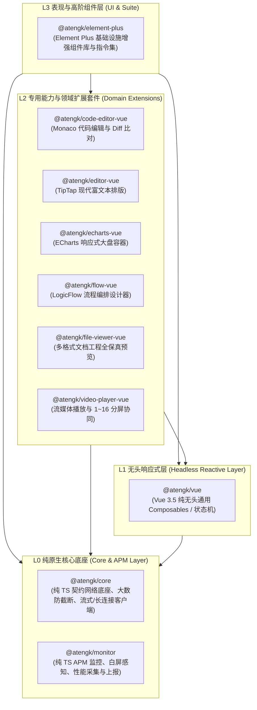

# ateng-ui

> 面向现代 Web 应用与企业级系统的工业级前端基础设施与核心套件。  
> Industrial-grade frontend infrastructure and core toolkit for modern web applications.

[](https://www.npmjs.com/package/@atengk/element-plus)
[](https://github.com/atengk/ateng-ui/discussions)
[](LICENSE)
[](https://www.typescriptlang.org/)
[](https://vuejs.org/)
[](https://element-plus.org/)
[](https://pnpm.io/)
[](https://turbo.build/)

---

## 💡 为什么选择 ateng-ui？

在中后台与现代 Web 系统开发中，前端团队经常陷入**重复搭建脚手架、频繁踩坑大数截断、异步数据时序倒挂、重度依赖第三方庞大黑盒库**的泥潭。`ateng-ui` 坚持“**纯原生 TypeScript 契约底座 + 无头响应式状态机 + 领域专用扩展 + 高阶 UI 套件**”的设计理念，专治企业级开发顽疾：

- 🛡️ **雪花 Long ID 大数零截断**：基于 Axios 转换管道纳秒级正则预处理，在 V8 反序列化前自动将 16 位以上超大整型加引号转为安全字符串，彻底终结分布式主键精度丢失噩梦。
- ⚡ **原生抗竞态与防响应性丢失**：严格遵循 Vue 3.5 响应式解构入参规范（`MaybeRefOrGetter` 与 `toValue`），内置高频搜索/翻页抗竞态状态机与请求取消协调器，杜绝时序倒挂与内存泄漏。
- 🧩 **领域级专业能力开箱即用**：开箱集成 Monaco 代码编辑、TipTap 现代富文本、ECharts 5 响应式大盘、LogicFlow 流程编排、多格式文档工程预览与多路流媒体分屏矩阵，领域能力全面解耦。
- 🎨 **Element Plus 基础设施级增强**：高级企业布局（`AtengProLayout`）、全契约融合的分页表格（`AtengTable`）、响应式高级检索表单、全局去重字典三件套，组件统一隔离在 `at-` 命名空间，完美支持暗黑与 Theme Pro 多主题。

---

## 🏛️ 四层洋葱拓扑架构 (Architecture)

系统面向未来百模块级扩展，所有套件严格遵循**四层单向拓扑洋葱模型（L3 ➔ L2 ➔ L1 ➔ L0）**，依赖单向流动，保持领域高内聚与跨框架纯粹解耦：



---

## 📦 核心套件速查与安装 (Packages)

每个子包均支持独立按需安装，均经过极致 Tree-Shaking 优化，产物同时输出标准 ESM、CJS 与 DTS 类型声明：

| 层级   | 模块包名                                                  | 核心定位与能力说明                                               | 极速安装命令                        | 详细文档                                          |
| :----- | :-------------------------------------------------------- | :--------------------------------------------------------------- | :---------------------------------- | :------------------------------------------------ |
| **L0** | [`@atengk/core`](./packages/core)                         | 跨框架纯 TS 网络底座、雪花大数防截断、SSE/WebSocket 客户端       | `pnpm add @atengk/core`             | [查看文档](./packages/core/README.md)             |
| **L0** | [`@atengk/monitor`](./packages/monitor)                   | 纯 TS 前端 APM 监控微内核、视口白屏检测、Web Vitals 性能采集     | `pnpm add @atengk/monitor`          | [查看文档](./packages/monitor/README.md)          |
| **L1** | [`@atengk/vue`](./packages/vue)                           | Vue 3.5 纯无头响应式 Hooks、只读状态机、抗竞态翻页与防刷编排     | `pnpm add @atengk/vue`              | [查看文档](./packages/vue/README.md)              |
| **L2** | [`@atengk/code-editor-vue`](./packages/code-editor-vue)   | Monaco Editor 代码编辑、SQL 智能格式化、JSON 校验与双模 Diff     | `pnpm add @atengk/code-editor-vue`  | [查看文档](./packages/code-editor-vue/README.md)  |
| **L2** | [`@atengk/echarts-vue`](./packages/echarts-vue)           | ECharts 5 响应式容器、6 大高频图表预设、区划下钻与全屏脱壳导出   | `pnpm add @atengk/echarts-vue`      | [查看文档](./packages/echarts-vue/README.md)      |
| **L2** | [`@atengk/editor-vue`](./packages/editor-vue)             | TipTap 现代富文本、斜杠命令、划词气泡、全中文表格与截图直传      | `pnpm add @atengk/editor-vue`       | [查看文档](./packages/editor-vue/README.md)       |
| **L2** | [`@atengk/file-viewer-vue`](./packages/file-viewer-vue)   | 专业多格式文档工程预览 (Office/PDF/图片/OFD) 与安全防泄密水印    | `pnpm add @atengk/file-viewer-vue`  | [查看文档](./packages/file-viewer-vue/README.md)  |
| **L2** | [`@atengk/flow-vue`](./packages/flow-vue)                 | LogicFlow 流程编排设计器、BPMN 2.0 转译、DAG 校验与流转高亮      | `pnpm add @atengk/flow-vue`         | [查看文档](./packages/flow-vue/README.md)         |
| **L2** | [`@atengk/video-player-vue`](./packages/video-player-vue) | 点播/直播多协议播放、1~16 路多路分屏协同矩阵与 PTZ 云台解耦      | `pnpm add @atengk/video-player-vue` | [查看文档](./packages/video-player-vue/README.md) |
| **L3** | [`@atengk/element-plus`](./packages/element-plus)         | Element Plus 基础设施组件库、ProLayout、高级分页表格与字典三件套 | `pnpm add @atengk/element-plus`     | [查看文档](./packages/element-plus/README.md)     |

---

## ⚡ 30 秒快速上手 (Quick Start)

以最典型的“**后端 API 强类型调用 + 企业级响应式分页表格**”联动为例，仅需数行代码即可享受防大数溢出、自适应加载与分页防抖编排：

### 1. 安装核心套件

```bash
pnpm add @atengk/core @atengk/vue @atengk/element-plus element-plus
```

### 2. 引入样式与组件 (main.ts)

```ts
import { createApp } from 'vue';
import ElementPlus from 'element-plus';
import 'element-plus/dist/index.css';
import '@atengk/element-plus/style.css'; // ateng-ui 样式命名空间
import App from './App.vue';

createApp(App).use(ElementPlus).mount('#app');
```

### 3. 开箱编写页面 (UserList.vue)

```vue
<script setup lang="ts">
import { ref } from 'vue';
import { http } from '@atengk/core';
import type { PageQuery, PageResult } from '@atengk/core';
import { AtengTable } from '@atengk/element-plus';
import type { AtengTableColumn } from '@atengk/element-plus';

interface UserItem {
  id: string; // 64位雪花ID已自动安全转换为 string，绝不失真
  username: string;
  createTime: string;
}

// 1. 列配置声明
const columns: AtengTableColumn[] = [
  { prop: 'id', label: '用户ID', width: 220 },
  { prop: 'username', label: '用户名', minWidth: 140 },
  { prop: 'createTime', label: '注册时间', width: 180 },
];

// 2. 契约化分页数据源请求（返回类型自动解包并受 PageResult<T> 保护）
const fetchUserData = async (query: PageQuery): Promise<PageResult<UserItem>> => {
  return await http.get('/api/users/page', { params: query });
};
</script>

<template>
  <div class="user-page">
    <!-- AtengTable 自带分页联动、自适应撑满、空状态保底与 Loading 状态机 -->
    <AtengTable :columns="columns" :data-source="fetchUserData" row-key="id" stripe />
  </div>
</template>
```

---

## 🤖 AI 编程助手与 Agent 接入友好 (AI-Ready & LLM-Friendly)

`ateng-ui` 在设计之初便全面融入 **AI 原生编程（Agentic Coding）** 理念，无论是人类开发者编写代码，还是通过 **Cursor, GitHub Copilot, Claude Code, Antigravity** 等 AI 助手协作，均具备极高的一致性与可预测性：

### 🎯 给 AI 助手的快速心智模型 (AI Context Guide)

若您在 AI 编程环境中开发，可将以下契约特征添加至 `.cursorrules`、Prompt 或上下文中：

1. **强类型网络与大数安全**：核心层（`@atengk/core`）网络请求已内置雪花 ID 正则转字符串管道，所有 ID 字段类型均为 `string`，**严禁要求调用方再手动进行 `BigInt` 转换**；
2. **Vue 3.5 响应式解构规则**：`@atengk/vue` 导出的公共 Hooks 入参统一声明为 `MaybeRefOrGetter<T>`，组件层传参时若传递响应式属性，**必须使用 Getter 箭头函数（例如 `() => pageSize`）**，内部通过 `toValue()` 解包；
3. **样式隔离与命名空间**：`@atengk/element-plus` 及所有 UI 组件根样式均严格限定在 `at-` 独立命名空间（如 `.at-table`）并在 SFC 中使用 `<style scoped>`，**严禁裸写标签全局重写样式**；
4. **纯声明式入口导入**：所有公共方法、类型和组件一律直接从包入口（如 `@atengk/element-plus`）具名导出，**严禁提示深层内部路径导入**。

> 💡 **项目规则库**：更详尽的架构防线与代码准则请参阅根目录 [AGENTS.md](./AGENTS.md)。

---

## 📚 进阶架构与开发生态 (Ecosystem & Deep Dive)

- 🏛️ **架构决策推演**：本项目践行全面架构决策透明化，想了解雪花大数、双态 Blob 异常识别、无头解耦等技术推演？请参阅 [架构决策记录库 (ADR)](./docs/adr/)。
- 🧪 **1:1 独立镜像自验展厅**：各子包在 [`apps/sample-*`](./apps) 目录下均配备开箱即用的沙箱应用，包含真实场景模拟与 Mock 服务，支持极速自验与功能对照。

<details>
<summary><b>🛠️ Monorepo 内部维护与贡献指令 (点击展开)</b></summary>

```bash
# 安装 Monorepo 全局依赖
pnpm install

# 增量并发构建所有包与展厅
pnpm run build

# 全量严格类型检查 (Typecheck)
pnpm run typecheck

# 离线自洽单元测试
pnpm run test

# 静态代码质量检查与排版美化
pnpm run lint
pnpm run format
```

</details>

---

## 💬 社区交流与反馈 (Community)

欢迎加入我们的开源交流，无论是提问、分享实际落地案例，还是提出新特性需求：

- 💡 **功能建议与问题探讨**：前往 [GitHub Discussions](https://github.com/atengk/ateng-ui/discussions) 畅所欲言；
- 🐛 **Bug 报告与代码贡献**：欢迎在 [GitHub Issues](https://github.com/atengk/ateng-ui/issues) 提交工单或创建 Pull Request。

---

## 📄 开源协议 (License)

本项目遵循 [Apache License 2.0](LICENSE) 开源协议。
