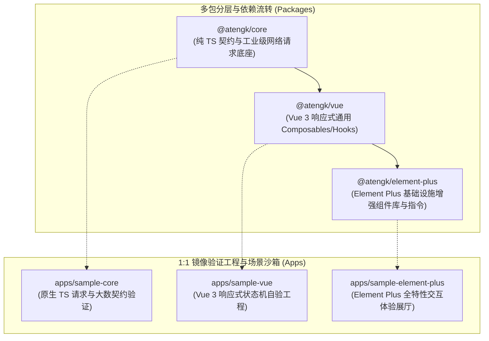

# ateng-ui

> 面向现代企业级中后台与微服务架构的工业级前端基础设施与中间件套件。

[](LICENSE)
[](https://pnpm.io/)
[](https://turbo.build/)
[](https://www.typescriptlang.org/)
[](https://vuejs.org/)
[](https://element-plus.org/)
[](https://vitest.dev/)
[](https://eslint.org/)

---

## 1. 核心特性亮点 (Features)

- 🛡️ **强类型网络契约与大数安全 (`@atengk/core`)**：
  - **显式强类型契约**：严格对齐企业级响应协议，标准化支持 `Result<T>` 解包、`PageQuery` 与 `PageResult<T>` 分页流转；
  - **雪花 Long ID 防截断**：基于 Axios `transformResponse` 纳秒级正则预处理（[ADR-0003](./docs/adr/0003-snowflake-long-id-raw-json-transform.md)），将 16 位以上超大整型加引号转为字符串，消除 V8 原生解析精度截断；
  - **双态 Blob 异常识别**：下载文件遇业务异常 JSON 时自动识别并转译为 `BusinessException`（[ADR-0004](./docs/adr/0004-blob-error-dual-state-and-fesod-excel-protocol.md)），杜绝伪损坏文件；
  - **双轨凭据注入**：内置通用鉴权凭据门面（`AuthManager`），自动注入双轨请求头（`token` / `Bearer`）与全链路 `traceId` 追踪。
- ⚡ **响应式通用状态机 (`@atengk/vue`)**：
  - **Vue 3.5 原生解构契约**：遵循 Vue 3.5 响应式解构入参规范（[ADR-0002](./docs/adr/0002-vue-3-5-baseline-and-reactive-props-contract.md)），公共 Hooks 统一采用 `MaybeRefOrGetter<T>` 与 `toValue()` 解包，杜绝响应性丢失；
  - **确定性生命周期回收**：物理监听、定时器与网络请求句柄在 `onScopeDispose` 或 `onUnmounted` 中确定性 100% 释放，彻底消灭内存泄漏。
- 🎨 **工业级组件库与指令集增强 (`@atengk/element-plus`)**：
  - **双轨依赖包容机制**：面向下游消费库声明 `peerDependencies: >=2.8.0` 宽泛包容，自验展厅与沙箱锁定最新稳态 Patch（[ADR-0005](./docs/adr/0005-element-plus-version-baseline-and-peer-strategy.md) 与 [ADR-0006](./docs/adr/0006-dependency-baseline-and-upgrade-governance-strategy.md)）；
  - **严格单向流与空安全**：组件严禁直接就地突变 Props；列表与表格查询统一保底返回空数组 `[]`，彻底杜绝空指针导致白屏崩溃。
- 🧪 **全自洽现代工程防线**：
  - **规范职责正交解耦**：ESLint 9 Flat Config 专职查代码质量，Prettier 3.x 独占排版美化（[ADR-0007](./docs/adr/0007-code-specification-and-static-analysis-governance.md)）；
  - **极速轻量单测守护**：基于 Vitest 2.x + `happy-dom` 搭建全自洽离线单测体系（[ADR-0008](./docs/adr/0008-unit-testing-engine-and-lightweight-dom-environment.md)）；
  - **增量构建编排**：依托 Turborepo 2.x 实现毫秒级任务缓存与增量并发构建。

---

## 2. 架构拓扑与分层关系 (Architecture)

本项目采用深模块解耦设计，下辖三大核心子包（`packages/*`）以及对标消费场景的 1:1 独立验证展厅（`apps/*`）：



---

## 3. 模块全景速查矩阵 (Packages & Apps)

| 模块目录                                                 | npm 包名                        | 定位说明                        | 核心对外产出                                                             | 文档真理源                                                  |
| :------------------------------------------------------- | :------------------------------ | :------------------------------ | :----------------------------------------------------------------------- | :---------------------------------------------------------- |
| [`packages/core`](./packages/core)                       | `@atengk/core`                  | 纯 TypeScript 网络与数据底座    | Result 响应契约、Axios 强类型请求管道、雪花大数安全转换、通用 Token 门面 | [core/README.md](./packages/core/README.md)                 |
| [`packages/vue`](./packages/vue)                         | `@atengk/vue`                   | Vue 3 响应式通用 Hooks 设施     | `useRequest`、`usePagination`、响应式状态机、生命周期回收                | [vue/README.md](./packages/vue/README.md)                   |
| [`packages/element-plus`](./packages/element-plus)       | `@atengk/element-plus`          | Element Plus 基础设施级组件增强 | 分页表格容器、Excel 批注反馈组件、存储上传器、防重指令                   | [element-plus/README.md](./packages/element-plus/README.md) |
| [`apps/sample-core`](./apps/sample-core)                 | `sample-core` (private)         | 原生 TS 网络与数据契约自验沙箱  | 原生网络请求联调与大数精度端到端自验                                     | -                                                           |
| [`apps/sample-vue`](./apps/sample-vue)                   | `sample-vue` (private)          | Vue 3 响应式 Hooks 视图驱动沙箱 | 极简 Vue 视图驱动验证与生命周期销毁实测                                  | -                                                           |
| [`apps/sample-element-plus`](./apps/sample-element-plus) | `sample-element-plus` (private) | 基础设施组件库全特性交互展厅    | 高保真组件与指令全交互体验展厅                                           | -                                                           |

---

## 4. 工程脚本速查矩阵 (Scripts Matrix)

根工作区由 Turborepo 统一调度并行流水线与增量缓存：

| 命令                     | 描述                         | 底层工具与行为                                                   |
| :----------------------- | :--------------------------- | :--------------------------------------------------------------- |
| `pnpm run build`         | 全项目增量构建               | 调度 Turborepo 并发执行 tsup 双模编译 (ESM+CJS+DTS) 与 Vite 打包 |
| `pnpm run dev`           | 本地协同监听开发             | 启动各子包 tsup 源码监听与自验展厅实时热重载                     |
| `pnpm run typecheck`     | 全量 TypeScript 严格类型检查 | 执行 `tsc --noEmit` 基于 Project References 进行类型验证         |
| `pnpm run test`          | 全自洽离线单元测试           | 调度 Vitest 2.x 并行执行各子包单元测试（node / happy-dom）       |
| `pnpm run test:coverage` | 单元测试覆盖率统计           | 基于 `@vitest/coverage-v8` 输出结构化覆盖率报告                  |
| `pnpm run lint`          | 静态代码分析与质量扫描       | 调度 ESLint 9 Flat Config 执行代码质量与成熟度防线扫描           |
| `pnpm run format`        | 规范化全代码自动排版         | 调度 Prettier 3.x 统一美化代码格式                               |
| `pnpm run format:check`  | 排版规范合规性校验           | 校验全项目排版格式是否符合 Prettier 规范                         |
| `pnpm run changeset`     | 交互式生成变更集             | 调度 Changesets 记录本次变更对语义化版本（semver）的影响         |

---

## 5. 核心架构决策记录 (Architecture Decisions)

本项目严格践行重大技术选型透明化与 ADR 架构治理，所有关键决策均沉淀于 [`docs/adr/`](./docs/adr/)：

| 编号                                                                               | 决策标题                                             | 核心摘要                                                                          |
| :--------------------------------------------------------------------------------- | :--------------------------------------------------- | :-------------------------------------------------------------------------------- |
| [ADR-0001](./docs/adr/0001-toolchain-and-pnpm-version-baseline.md)                 | 工程工具链与 pnpm 版本基线锁定                       | 锁定 `pnpm@9.12.3` 与 Node `>=20.18.0`，规避 pnpm 10 脚本白名单阻断               |
| [ADR-0002](./docs/adr/0002-vue-3-5-baseline-and-reactive-props-contract.md)        | Vue 3.5 核心基线升级与响应式解构传参契约             | 升级基线至 `^3.5.0`，Hooks 入参强制规范为 `MaybeRefOrGetter<T>`                   |
| [ADR-0003](./docs/adr/0003-snowflake-long-id-raw-json-transform.md)                | 基于 Axios 原始转换管道的雪花 Long ID 大数防截断方案 | `transformResponse` 阶段正则预处理加引号，零依赖、原生 V8 极速解析                |
| [ADR-0004](./docs/adr/0004-blob-error-dual-state-and-fesod-excel-protocol.md)      | Blob 异常双态识别防御与 Apache Fesod Excel 协议对接  | 拦截器识别 Blob 中的 JSON 业务错误，消灭假文件，规范 Fesod 批注回写               |
| [ADR-0005](./docs/adr/0005-element-plus-version-baseline-and-peer-strategy.md)     | Element Plus 版本基线演进与双轨兼容策略              | 库 peer 声明 `>=2.8.0` 宽泛包容，自验展厅锁定 `2.14.7` 与 `vue: 3.5.44` 最新守护  |
| [ADR-0006](./docs/adr/0006-dependency-baseline-and-upgrade-governance-strategy.md) | 依赖版本基线锁定与升级治理策略                       | 主干稳态优先、成熟体系补丁及时跟进、双轨依赖隔离（库宽进/沙箱严出）与全量准出红线 |
| [ADR-0007](./docs/adr/0007-code-specification-and-static-analysis-governance.md)   | 代码规范与静态代码分析治理策略                       | ESLint 9 Flat Config + Prettier 3 职责解耦，固化工业防线硬规则，CI 零缺陷硬门禁   |
| [ADR-0008](./docs/adr/0008-unit-testing-engine-and-lightweight-dom-environment.md) | 单元测试引擎与轻量 DOM 运行环境选型                  | Vitest 2.x 工作区调度，happy-dom 轻量提速 70%，node/DOM 分层隔离与全自洽单测铁律  |

---

## 6. Git 协作与受控发版 (Workflow & Release)

- **提交规约**：遵循 Conventional Commits 规范，统一通过项目门面助手提交（支持双分支守卫与 Issue 关联）：
  ```bash
  bash scripts/commit.sh
  ```
- **独立发版向导**：采用 Changesets 多包独立版本发布流转模式（Independent Mode），统一通过发版门面助手发布：
  ```bash
  bash scripts/release.sh
  ```

---

## 7. 开源协议 (License)

本项目遵循 [Apache License 2.0](LICENSE) 开源协议。
