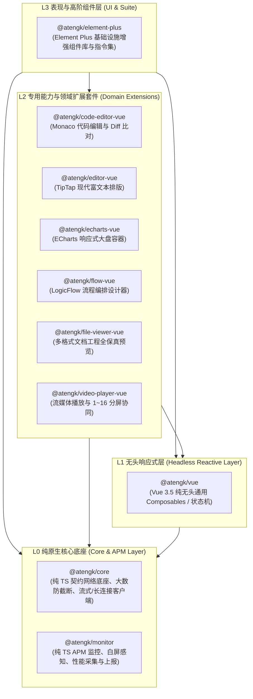

# ateng-ui

> 面向现代 Web 应用与企业级系统的高阶前端基础设施与核心套件。  
> Empowering Human Engineers, Optimized for AI Agents.

[](https://www.npmjs.com/package/@atengk/element-plus)
[](https://github.com/atengk/ateng-ui/discussions)
[](LICENSE)
[](https://www.typescriptlang.org/)
[](https://vuejs.org/)
[](https://element-plus.org/)
[](https://pnpm.io/)
[](https://turbo.build/)

---

## 💡 为什么选择 ateng-ui？

在中后台与现代 Web 系统开发中，前端团队经常陷入**重复搭建脚手架、频繁踩坑大数截断、异步数据时序倒挂、重度依赖第三方庞大黑盒库**的泥潭。`ateng-ui` 坚持“**纯原生 TypeScript 契约底座 + 无头响应式状态机 + 领域专用扩展 + 高阶 UI 套件**”的设计理念，专治企业级研发顽疾：

- 🛡️ **后端契约无缝对齐**：雪花 Long ID 纳秒级正则预处理，在 V8 反序列化前自动加双引号转为安全 `string`，彻底终结分布式主键精度丢失；内置 HTTP 客户端默认对齐 `Result<T>` 与 `PageResult<T>` 自动剥壳；401 并发续期队列无感刷新与自动重放。
- ⚡ **纯原生无头响应式状态机**：严格遵循 Vue 3.5 响应式解构入参规范（`MaybeRefOrGetter` 与 `toValue`），杜绝响应性丢失；内置高频搜索/翻页抗竞态状态机（`AbortController` + `useLatest`），从根源杜绝先发后至时序覆盖。
- 🎨 **Element Plus 企业级基础设施增强**：提供高级企业布局（`AtengProLayout`）、契约化分页表格（`AtengTable`，一行绑定数据源，内置加载、自适应伸缩、抗抖与空状态保底）、全局防重字典三件套；组件全量隔离在 `at-` 独立命名空间，原生无缝适配深色模式与 Theme Pro 多主题。
- 🧩 **领域级即插即用扩展套件**：代码编辑 (Monaco)、现代富文本 (TipTap)、响应式大盘 (ECharts 5)、流程编排设计器 (LogicFlow)、多格式文档工程预览与防泄密水印、流媒体 1~16 路分屏矩阵与前端 APM 监控微内核全系覆盖，领域能力开箱即用，按需独立引入。

---

## 🏛️ 四层洋葱拓扑架构 (Architecture)

系统面向未来百模块级扩展，所有套件严格遵循**四层单向拓扑洋葱模型（L3 ➔ L2 ➔ L1 ➔ L0）**，依赖单向流动，保持领域高内聚与跨框架纯粹解耦：



---

## 📦 核心套件生态与选用指南 (Ecosystem Packages)

每个子包均支持独立按需安装，经过极致 Tree-Shaking 优化，产物同时输出标准 ESM、CJS 与 DTS 类型声明：

### 🌟 核心基石套件（Core Foundation - 推荐企业级项目标配）

| 模块包名                                          | 层级   | 核心定位与能力说明                                                              | 极速安装命令                    | 详细契约文档                                  |
| :------------------------------------------------ | :----- | :------------------------------------------------------------------------------ | :------------------------------ | :-------------------------------------------- |
| [`@atengk/core`](./packages/core)                 | **L0** | 跨框架纯 TS 网络底座、雪花大数防截断、SSE/WebSocket 客户端与双 Token 并发续期   | `pnpm add @atengk/core`         | [查看文档](./packages/core/README.md)         |
| [`@atengk/vue`](./packages/vue)                   | **L1** | Vue 3.5 纯无头响应式 Hooks、只读状态机、契约分页、时序抗竞态与防刷互斥锁        | `pnpm add @atengk/vue`          | [查看文档](./packages/vue/README.md)          |
| [`@atengk/element-plus`](./packages/element-plus) | **L3** | Element Plus 基础设施增强库、ProLayout 企业布局、契约化 AtengTable 与字典三件套 | `pnpm add @atengk/element-plus` | [查看文档](./packages/element-plus/README.md) |

> 💡 **快速起步建议**：在中后台业务工程中，直接运行 `pnpm add @atengk/core @atengk/vue @atengk/element-plus element-plus` 即可获得完整基础设施支撑。

### 🧩 领域专用扩展插件（Domain Extensions - 按需即插即用）

| 业务领域       | 模块包名                                                  | 层级   | 核心能力亮点                                                         | 极速安装命令                        | 详细文档                                          |
| :------------- | :-------------------------------------------------------- | :----- | :------------------------------------------------------------------- | :---------------------------------- | :------------------------------------------------ |
| **代码编辑**   | [`@atengk/code-editor-vue`](./packages/code-editor-vue)   | **L2** | Monaco Editor 代码编辑、SQL 智能格式化、JSON 校验与双模 Diff 比对    | `pnpm add @atengk/code-editor-vue`  | [查看文档](./packages/code-editor-vue/README.md)  |
| **现代富文本** | [`@atengk/editor-vue`](./packages/editor-vue)             | **L2** | TipTap 现代富文本排版、斜杠命令、划词气泡、全中文表格与截图直传      | `pnpm add @atengk/editor-vue`       | [查看文档](./packages/editor-vue/README.md)       |
| **数据大盘**   | [`@atengk/echarts-vue`](./packages/echarts-vue)           | **L2** | ECharts 5 响应式容器、6 大高频图表预设、区划下钻与全屏脱壳导出       | `pnpm add @atengk/echarts-vue`      | [查看文档](./packages/echarts-vue/README.md)      |
| **流程编排**   | [`@atengk/flow-vue`](./packages/flow-vue)                 | **L2** | LogicFlow 流程编排设计器、BPMN 2.0 转译、DAG 校验与流转高亮          | `pnpm add @atengk/flow-vue`         | [查看文档](./packages/flow-vue/README.md)         |
| **多格式预览** | [`@atengk/file-viewer-vue`](./packages/file-viewer-vue)   | **L2** | 专业多格式文档工程预览 (Office/PDF/图片/OFD) 与安全防泄密水印        | `pnpm add @atengk/file-viewer-vue`  | [查看文档](./packages/file-viewer-vue/README.md)  |
| **流媒体播放** | [`@atengk/video-player-vue`](./packages/video-player-vue) | **L2** | 点播/直播多协议播放、1~16 路多路分屏协同矩阵与 PTZ 云台解耦          | `pnpm add @atengk/video-player-vue` | [查看文档](./packages/video-player-vue/README.md) |
| **前端 APM**   | [`@atengk/monitor`](./packages/monitor)                   | **L0** | 纯 TS 前端 APM 监控微内核、3×3 视口点阵白屏感知、Web Vitals 性能采集 | `pnpm add @atengk/monitor`          | [查看文档](./packages/monitor/README.md)          |

---

## ⚡ 30 秒极速上手 (Quick Start)

以企业级高频场景“**后端强类型分页接口 + AtengTable 响应式表格联动**”为例：只需声明数据源与列配置，即可自动享有大数精度守护、自适应高度伸缩、分页加载状态机与时序防抖编排：

### 1. 安装核心套件

```bash
pnpm add @atengk/core @atengk/vue @atengk/element-plus element-plus
```

### 2. 引入样式与组件 (main.ts)

```ts
import { createApp } from 'vue';
import ElementPlus from 'element-plus';
import 'element-plus/dist/index.css';
import '@atengk/element-plus/style.css'; // ateng-ui 样式命名空间
import App from './App.vue';

createApp(App).use(ElementPlus).mount('#app');
```

### 3. 开箱编写业务页面 (UserList.vue)

```vue
<script setup lang="ts">
import { http } from '@atengk/core';
import type { PageQuery, PageResult } from '@atengk/core';
import { AtengTable } from '@atengk/element-plus';
import type { AtengTableColumn } from '@atengk/element-plus';

interface UserItem {
  id: string; // 64位雪花长整型已在网络层纳秒级转换为 safe string，绝无精度丢失
  username: string;
  createTime: string;
}

// 1. 声明表格列契约
const columns: AtengTableColumn[] = [
  { prop: 'id', label: '用户ID', width: 220 },
  { prop: 'username', label: '用户名', minWidth: 140 },
  { prop: 'createTime', label: '创建时间', width: 180 },
];

// 2. 契约化分页请求：返回 Promise<PageResult<T>>，网络层已自动完成解包校验
const fetchUserData = async (query: PageQuery): Promise<PageResult<UserItem>> => {
  return await http.get('/api/users/page', { params: query });
};
</script>

<template>
  <div class="user-page">
    <!-- AtengTable 一行绑定数据源，自动编排翻页、Loading、抗竞态逻辑与空状态保底 -->
    <AtengTable :columns="columns" :data-source="fetchUserData" row-key="id" stripe />
  </div>
</template>
```

---

## 🤖 AI 编程助手与 Agent 协同指南 (AI-Ready & LLM Context Guide)

`ateng-ui` 在设计之初便全面融入 **AI 原生编程（Agentic Coding）** 理念。无论您使用 **Cursor, GitHub Copilot, Claude Code, Antigravity** 还是各类 Agent 协作，均能产生高度一致、高可预测且无风格漂移的高质量代码。

### 🎯 AI 协同黄金契约四原则 (The 4 Golden Invariants)

在与 AI 编程助手协作时，可直接参考或注入以下核心心智模型：

1. **雪花大数免转律**：底层网络层（`@atengk/core`）已在原始 JSON 字符串阶段完成大数正则转换，所有 ID 字段类型均为 `string`，**严禁要求调用方再手动进行 `BigInt` 转换**；
2. **响应式传参解构律**：`@atengk/vue` 导出的公共 Hooks 动态入参统一声明为 `MaybeRefOrGetter<T>`，组件层传参若包含响应式变量，**必须使用 Getter 箭头函数（例如 `() => pageSize`）**，内部统一使用 Vue 3.5 原生 `toValue()` 解包；
3. **UI 隔离与作用域律**：`@atengk/element-plus` 及所有扩展组件根类名严格限定在 `at-` 独立命名空间（如 `.at-table`），SFC 必须声明 `<style scoped>`，**严禁裸写标签污染全局样式**；
4. **四层洋葱纯净律**：L0 底座（`@atengk/core`、`@atengk/monitor`）与 L1 无头层（`@atengk/vue`）保持纯粹解耦，**严禁在 L0/L1 引入任何 Element Plus 组件（如 `ElMessage`）或具体 UI 依赖**。

### 📋 可直接复制的 AI 规则配置 (.cursorrules / Agent Prompt)

```markdown
<!-- 可以直接将下方内容粘贴到您的 .cursorrules、Copilot Instructions 或 Agent Prompt 中 -->

### ateng-ui 编码规约

- 强类型网络与雪花 ID：使用 @atengk/core 的 http 客户端，后端 64 位雪花 ID 自动转为 string，严禁手动引入 BigInt 转换。
- Vue 3.5 响应式解构：调用 @atengk/vue 的 Hooks 时，动态属性统一传 Getter 箭头函数（() => state），内部通过 toValue() 解包。
- 样式隔离：UI 组件根类名强制以 at- 为前缀，Vue SFC 必须开启 <style scoped>，颜色强制使用 --el-* 或 --at-* CSS 变量。
- 洋葱拓扑防线：L0/L1 严禁导入 UI 表现层组件，UI 交互逻辑收敛于 @atengk/element-plus。
- 详细架构与全量规范：参考项目根目录 AGENTS.md。
```

> 💡 **全量架构规约**：欲查阅全量 12 道工业级防线、防时序竞态、Blob 双态嗅探与测试自洽准则，请参阅根目录 [AGENTS.md](./AGENTS.md)。

---

## 📚 进阶生态与开发者资源 (Ecosystem Resources)

- 🧪 **1:1 独立场景展厅**：各子包在 [`apps/sample-*`](./apps) 目录下均配备开箱即用的沙箱应用与可视化看板，支持极速自验。
- 🏛️ **架构决策推演**：欲了解全量架构决策演进（雪花纳秒正则、Blob 双态嗅探、无头解耦等），请参阅 [架构决策记录库 (ADR)](./docs/adr/)。
- 🤝 **参与贡献与本地开发**：欲了解环境基线、全自洽测试、构建命令与提交规范，请参阅 [贡献指南 (CONTRIBUTING.md)](./CONTRIBUTING.md)。

---

## 💬 社区交流与反馈 (Community)

欢迎加入我们的开源交流，无论是提问、分享实际落地案例，还是提出新特性需求：

- 💡 **功能建议与问题探讨**：前往 [GitHub Discussions](https://github.com/atengk/ateng-ui/discussions) 畅所欲言；
- 🐛 **Bug 报告与代码贡献**：欢迎在 [GitHub Issues](https://github.com/atengk/ateng-ui/issues) 提交工单或创建 Pull Request。

---

## 📄 开源协议 (License)

本项目遵循 [Apache License 2.0](LICENSE) 开源协议。
