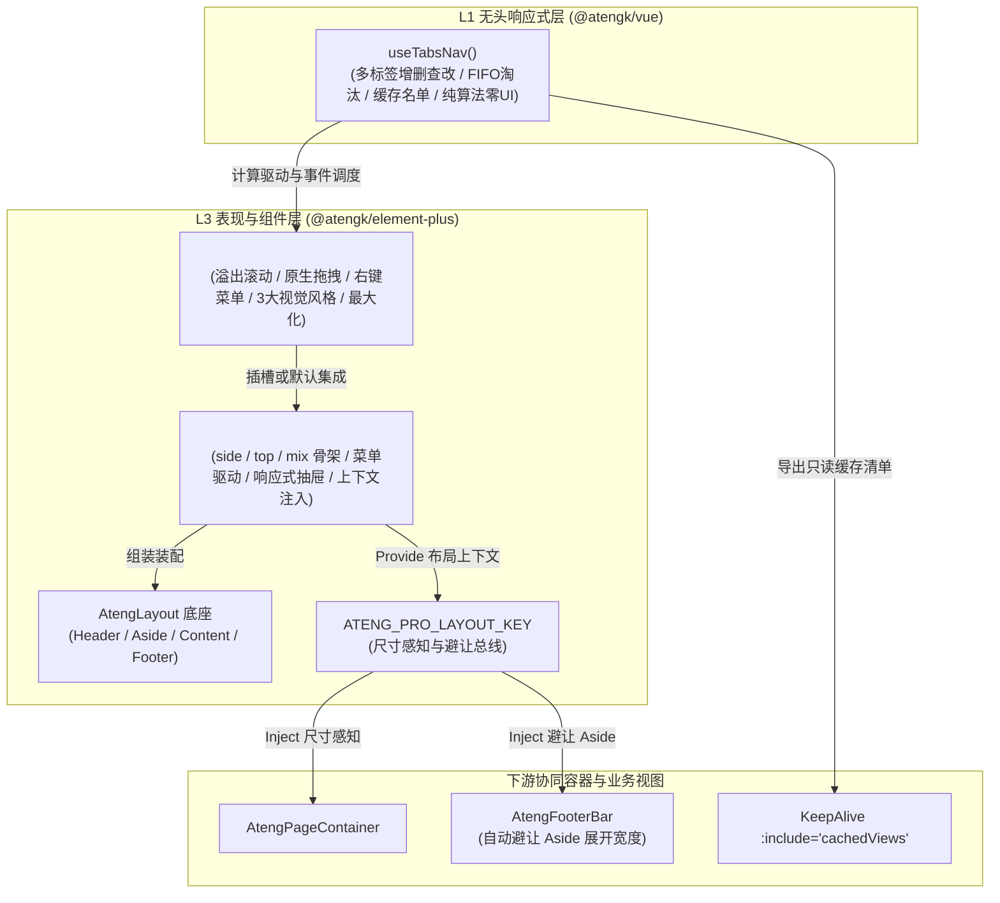

# 0034. ProLayout 与 TabsNav 企业级框架布局架构规范与契约设计

- **状态**: accepted
- **日期**: 2026-10-29
- **作者**: Ateng

## 背景与上下文

在《ateng-ui 模块化生态扩展全景蓝图与演进路线图》（`module-expansion-blueprint.md`）确立的阶段一规划中，`@atengk/element-plus` 承担着中后台框架级基础设施的增量深化任务，需重点落地 `<AtengProLayout />` 与 `<AtengTabsNav />`。

中后台系统的框架骨架历来存在以下核心痛点与架构诉求：

1. **基础设施与业务工程混淆**：许多传统开源 Admin 将业务路由（vue-router 强绑定）、动态鉴权接口、Pinia 全局状态与多语言字典强行打包进布局框架中，导致通用型基础设施蜕变为沉重且难以定制的业务模板，违背了 `ateng-ui` 纯技术基础设施的设计哲学；
2. **多标签页状态维护繁琐**：多标签页（TabsNav）通常包含复杂的数组增删查改、首部固定（Affix）、右键快捷上下文菜单、横向溢出平滑滚动、拖拽排序、以及与 `<KeepAlive :include="cachedViews">` 页面缓存清理和局部刷新的深层联动；
3. **布局形态碎片化与响应式体验断层**：不同业务在中后台场景对布局骨架（经典侧边导航、顶部通栏导航、顶左分栏混合模式）有差异化诉求，而在移动端或窄屏小屏下若缺乏确定性的抽屉遮罩降级（Mobile Drawer Overlay），极易造成表格与表单挤压变形；
4. **外部重型依赖滥用**：为了实现拖拽和右键菜单，很多开源项目盲目引入 `sortablejs`、`vuedraggable` 等重型依赖，这直接物理突变真实 DOM，引发虚拟 DOM 渲染竞争与状态错乱。

为此，经过严格的 `/grill-with-docs` 推演，制定本架构规范，确保一次性全维交付到位。

---

## 架构决策矩阵 (Architecture Decisions)

### 1. 四层洋葱拓扑与无头状态解耦 (Layering & Headless Decoupling)

- **L1 无头状态机（`@atengk/vue` ➔ `useTabsNav()`）**：
  将多标签页的纯算法与内存状态下沉至 L1 无头响应式层，零 UI、零 DOM 依赖。负责标签数组维护（`tabs`）、激活态（`activeKey`）、最大打开数保护（`maxTabs`，超限按 FIFO 淘汰最旧非固定标签）、固定防关逻辑、KeepAlive 缓存视图计算（`cachedViews`）、局部刷新调度（`refreshTab`）与可选 Storage 持久化（`persistKey`）。
- **L3 表现组件（`@atengk/element-plus` ➔ `<AtengTabsNav />` 与 `<AtengProLayout />`）**：
  `<AtengTabsNav />` 作为独立高阶 UI 组件，负责具体的 DOM 布局、横向滚动、原生拖拽排序、右键上下文菜单、以及卡片/胶囊/下划线三种风格渲染；既可被 `<AtengProLayout />` 声明式组装，亦可在任意自定义布局中独立消费。

### 2. 三大中后台经典布局形态 (Layout Modes)

`<AtengProLayout />` 原生支持三大经典中后台模式切换（`layout` 属性）：

1. **`side`（经典侧边导航）**：左侧树形主菜单 + 顶部工具栏，适用于绝大多数标准业务后台；
2. **`top`（顶部通栏导航）**：顶部横向一级菜单 + 工具栏，最大化垂直内容展示空间，适用于宽屏门户或大盘总览；
3. **`mix`（顶左混合分栏）**：顶部展示一级模块大类，左侧动态联动展示所选模块下的二级/三级树形菜单。内置 `mixAutoSelectFirstLeaf` 属性（默认 `true`），点击顶部大类自动导航并选中首个有效叶子节点。

### 3. 数据驱动与插槽双模兼备 (Data-Driven `menuData` & Slots Inversion)

为杜绝“纯插槽导致业务重复写上百行胶水代码”与“纯数据驱动导致极端定制困难”的双重缺陷，推行双模架构：

- **标准 `ProMenuItem` 契约**：
  包含 `path`、`title`、`icon`、`children`、`badge`、`disabled`、`hidden`、`affix`、`target`、`meta` 标准字段；
- **`fieldNames` 字段别名映射**：
  对齐后端异构字段（`{ path?: string; title?: string; children?: string; icon?: string; badge?: string }`），框架在内部自动读取，彻底杜绝业务层手写递归转换；
- **细粒度插槽覆盖**：
  提供 `#logo`、`#headerLeft`、`#breadcrumb`、`#headerCenter`、`#headerRight`、`#headerActions`、`#user`、`#menu`、`#menuItem`、`#asideFooter`、`#tabs`、`#default`、`#footer` 13 个独立插槽，极端场景支持 100% 替换。

### 4. 零额外依赖与原生优先原则 (Zero-Bloat Invariant)

坚决执行零臃肿依赖铁律，全套组件不引入任何额外第三方 npm 依赖：

- **拖拽排序**：采用纯原生 HTML5 Drag & Drop（约 40 行纯 TS），直接响应式切片数组（`splice`），杜绝 `sortablejs` 破坏虚拟 DOM 导致的警告与重渲染冲突；且严格实施防呆规则：标记为 `affix: true` 的固定标签禁止拖动，普通标签禁止拖动至固定标签左侧；
- **右键上下文菜单**：直接基于 Element Plus 原生 `ElDropdown` 实现，天然继承系统主题色、暗黑模式切换、动画与 Z-Index 堆叠层级；
- **视口全屏与小屏响应**：采用原生 Web API（`document.fullscreenElement`、`matchMedia`），并在组件卸载时确定性解绑。

### 5. `<AtengTabsNav />` 全维特性矩阵

1. **溢出滚动与平滑居中**：标签超出可视宽度时自动展示左右切换箭头，支持鼠标滚轮在标签栏横向平滑滚动；切换激活标签时，组件自动调用 `scrollIntoView` 使目标标签平滑滚动至可视区域中央；
2. **固定与防关 (Affix / Pin)**：核心主页（如工作台）可标记为 `affix: true`，不显示关闭图标，禁止通过任何快捷动作关闭，始终锁定在首部；
3. **右键快捷上下文菜单 (Context Menu)**：在任意标签上右键呼出菜单：刷新当前、关闭当前、关闭其他、关闭左侧、关闭右侧、全部关闭；
4. **快捷操作下拉面板 (Quick Actions)**：标签栏右侧提供功能下拉按钮，与右键菜单语义对称；
5. **视口最大化协同 (Maximize)**：点击全屏放大按钮，自动派发事件并通知 `<AtengProLayout />` 隐藏顶栏与侧边栏，将内容可视区最大化；
6. **三种视觉风格 (Visual Styles)**：支持 `card`（经典卡片边框风）、`pill`（圆角胶囊轻量风）、`line`（极简下划线风）。

### 6. 缓存与 KeepAlive 协同闭环 (`cachedViews` & `refreshTab`)

- `useTabsNav()` 提供只读的 `cachedViews: ComputedRef<string[]>`，业务层直接供给 `<KeepAlive :include="cachedViews">`；
- **局部刷新调度**：调用 `refreshTab(key)` 时，状态机先通过 `nextTick` 从 `cachedViews` 中将该组件临时剔除，触发其销毁与重新挂载，下一帧再纳管回 `cachedViews`，彻底解决多标签页“刷新无反应”或必须刷新整页的弊端。

### 7. 响应式断点与移动端抽屉遮罩 (Responsive Mobile Drawer)

- 内置响应式断点（默认预设 `< 768px` 为移动端，`< 992px` 为平板小屏）；
- 当屏幕宽度 `< 768px` 时，侧边栏自动收起，展开时以**抽屉遮罩浮层（Mobile Drawer Overlay）**形态呈现，点击遮罩或菜单项后自动关闭；
- 允许通过 `responsive: false` 或受控属性 `v-model:collapsed` 由业务完全接管。

### 8. 视口滚动锁定与上下文避让总线 (Provide/Inject Synergy)

- 默认采用视口固定排版（Viewport Fixed Mode）：Header（高度 56px 可调）、Aside（展开 220px、折叠 56px 可调）、TabsNav（高度 38px 可调）固定，内容区弹性自适应；
- `<AtengProLayout />` 通过 `provide(ATENG_PRO_LAYOUT_KEY, ...)` 向下派发布局状态；
- 下层的 `<AtengFooterBar />`（吸底操作栏）可通过 Inject 自动读取当前侧边栏展开状态与宽度，**实现吸底栏宽度的自动智能避让**，免除业务手写样式计算。

---

## 决策后果 (Consequences)

- **收益**：
  1. 彻底补齐了 `ateng-ui` 在框架级骨架上的关键版图，使开发者可以在 20 行代码内搭建出具备顶尖交互的企业级管理界面；
  2. 保持纯技术套件定位，零业务工程侵入，支持任意路由与权限体系；
  3. 零额外依赖，打包体积轻量且无第三方依赖冲突。
- **治理与验证要求**：
  1. 必须在 `@atengk/vue` 补齐 `useTabsNav` 及其对抗性单元测试（覆盖 FIFO 淘汰、固定防关、左右关闭算法、持久化加载）；
  2. 必须在 `@atengk/element-plus` 导出完整的类型定义与组件实例类型；
  3. 必须在 `apps/sample-element-plus` 的 `views/layout` 建立多标签与高级布局的全真端到端交互展厅（覆盖三大模式、拖拽排序、右键刷新与 KeepAlive 实测联动）。
