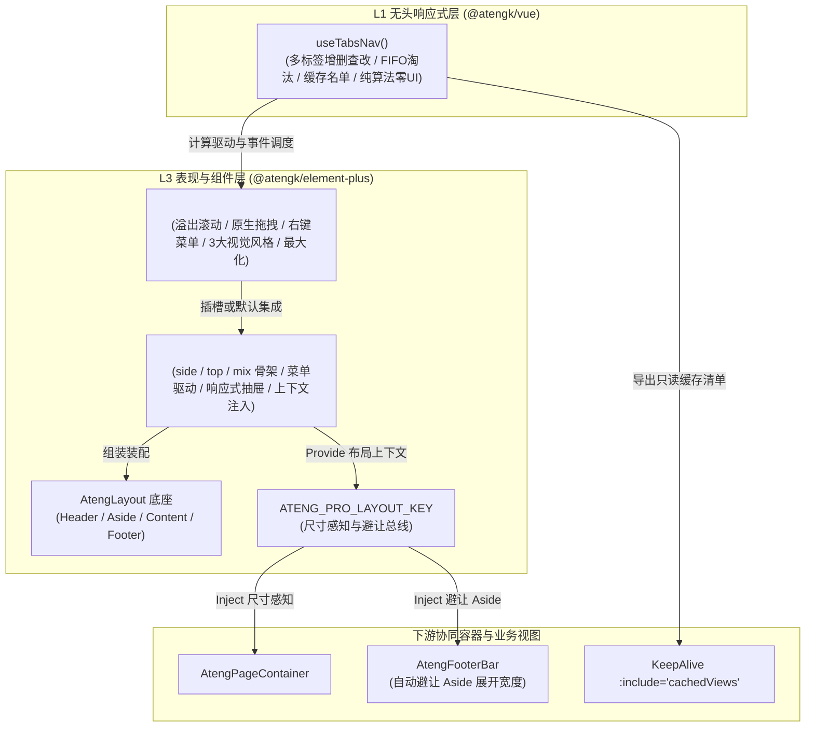

# 0034. ProLayout 与 TabsNav 企业级框架布局架构规范与契约设计

- **状态**: accepted
- **日期**: 2026-10-29
- **作者**: Ateng

## 背景与上下文

在《ateng-ui 模块化生态扩展全景蓝图与演进路线图》（`module-expansion-blueprint.md`）确立的阶段一规划中，`@atengk/element-plus` 承担着中后台框架级基础设施的增量深化任务，需重点落地 `<AtengProLayout />` 与 `<AtengTabsNav />`。

中后台系统的框架骨架历来存在以下核心痛点与架构诉求：

1. **基础设施与业务工程混淆**：许多传统开源 Admin 将业务路由（vue-router 强绑定）、动态鉴权接口、Pinia 全局状态与多语言字典强行打包进布局框架中，导致通用型基础设施蜕变为沉重且难以定制的业务模板，违背了 `ateng-ui` 纯技术基础设施的设计哲学；
2. **多标签页状态维护繁琐**：多标签页（TabsNav）通常包含复杂的数组增删查改、首部固定（Affix）、右键快捷上下文菜单、横向溢出平滑滚动、拖拽排序、以及与 `<KeepAlive :include="cachedViews">` 页面缓存清理和局部刷新的深层联动；
3. **布局形态碎片化与响应式体验断层**：不同业务在中后台场景对布局骨架（经典侧边导航、顶部通栏导航、顶左分栏混合模式）有差异化诉求，而在移动端或窄屏小屏下若缺乏确定性的抽屉遮罩降级（Mobile Drawer Overlay），极易造成表格与表单挤压变形；
4. **外部重型依赖滥用**：为了实现拖拽和右键菜单，很多开源项目盲目引入 `sortablejs`、`vuedraggable` 等重型依赖，这直接物理突变真实 DOM，引发虚拟 DOM 渲染竞争与状态错乱。

为此，经过严格的 `/grill-with-docs` 推演，制定本架构规范，确保一次性全维交付到位。

---

## 架构决策矩阵 (Architecture Decisions)

### 1. 四层洋葱拓扑与无头状态解耦 (Layering & Headless Decoupling)

- **L1 无头状态机（`@atengk/vue` ➔ `useTabsNav()`）**：
  将多标签页的纯算法与内存状态下沉至 L1 无头响应式层，零 UI、零 DOM 依赖。负责标签数组维护（`tabs`）、激活态（`activeKey`）、最大打开数保护（`maxTabs`，超限按 FIFO 淘汰最旧非固定标签）、固定防关逻辑、KeepAlive 缓存视图计算（`cachedViews`）、局部刷新调度（`refreshTab`）与可选 Storage 持久化（`persistKey`）。
- **L3 表现组件（`@atengk/element-plus` ➔ `<AtengTabsNav />` 与 `<AtengProLayout />`）**：
  `<AtengTabsNav />` 作为独立高阶 UI 组件，负责具体的 DOM 布局、横向滚动、原生拖拽排序、右键上下文菜单、以及卡片/胶囊/下划线三种风格渲染；既可被 `<AtengProLayout />` 声明式组装，亦可在任意自定义布局中独立消费。

### 2. 三大中后台经典布局形态 (Layout Modes)

`<AtengProLayout />` 原生支持三大经典中后台模式切换（`layout` 属性）：

1. **`side`（经典侧边导航）**：左侧树形主菜单 + 顶部工具栏，适用于绝大多数标准业务后台；
2. **`top`（顶部通栏导航）**：顶部横向一级菜单 + 工具栏，最大化垂直内容展示空间，适用于宽屏门户或大盘总览；
3. **`mix`（顶左混合分栏）**：顶部展示一级模块大类，左侧动态联动展示所选模块下的二级/三级树形菜单。内置 `mixAutoSelectFirstLeaf` 属性（默认 `true`），点击顶部大类自动导航并选中首个有效叶子节点。

### 3. 数据驱动与插槽双模兼备 (Data-Driven `menuData` & Slots Inversion)

为杜绝“纯插槽导致业务重复写上百行胶水代码”与“纯数据驱动导致极端定制困难”的双重缺陷，推行双模架构：

- **标准 `ProMenuItem` 契约**：
  包含 `path`、`title`、`icon`、`children`、`badge`、`disabled`、`hidden`、`affix`、`target`、`meta` 标准字段；
- **`fieldNames` 字段别名映射**：
  对齐后端异构字段（`{ path?: string; title?: string; children?: string; icon?: string; badge?: string }`），框架在内部自动读取，彻底杜绝业务层手写递归转换；
- **字符串图标解析钩子 (`iconResolver` & `#menuIcon`)**：
  在保持 `@atengk/element-plus` 零重型图标库依赖的前提下，支持通过 `iconResolver?: ProMenuIconResolver`（或 `#menuIcon` 作用域插槽）按需将后端下发的字符串图标名映射为 Vue 图标组件或 CSS 类名，保留内置缩进、Badge 与折叠态居中适配，免除业务层整树预处理；
- **细粒度插槽覆盖**：
  提供 `#logo`、`#headerLeft`、`#breadcrumb`、`#headerCenter`、`#headerRight`、`#headerActions`、`#user`、`#menu`、`#menuItem`、`#menuIcon`、`#asideFooter`、`#tabs`、`#default`、`#footer` 14 个独立插槽，极端场景支持 100% 替换。

### 4. 零额外依赖与原生优先原则 (Zero-Bloat Invariant)

坚决执行零臃肿依赖铁律，全套组件不引入任何额外第三方 npm 依赖：

- **拖拽排序**：采用纯原生 HTML5 Drag & Drop（约 40 行纯 TS），直接响应式切片数组（`splice`），杜绝 `sortablejs` 破坏虚拟 DOM 导致的警告与重渲染冲突；且严格实施防呆规则：标记为 `affix: true` 的固定标签禁止拖动，普通标签禁止拖动至固定标签左侧；
- **右键上下文菜单**：直接基于 Element Plus 原生 `ElDropdown` 实现，天然继承系统主题色、暗黑模式切换、动画与 Z-Index 堆叠层级；
- **视口全屏与小屏响应**：采用原生 Web API（`document.fullscreenElement`、`matchMedia`），并在组件卸载时确定性解绑。

### 5. `<AtengTabsNav />` 全维特性矩阵

1. **溢出滚动与平滑居中**：标签超出可视宽度时自动展示左右切换箭头，支持鼠标滚轮在标签栏横向平滑滚动；切换激活标签时，组件自动调用 `scrollIntoView` 使目标标签平滑滚动至可视区域中央；
2. **固定与防关 (Affix / Pin)**：核心主页（如工作台）可标记为 `affix: true`，不显示关闭图标，禁止通过任何快捷动作关闭，始终锁定在首部；
3. **右键快捷上下文菜单 (Context Menu)**：在任意标签上右键呼出菜单：刷新当前、关闭当前、关闭其他、关闭左侧、关闭右侧、全部关闭；
4. **快捷操作下拉面板 (Quick Actions)**：标签栏右侧提供功能下拉按钮，与右键菜单语义对称；
5. **视口最大化协同 (Maximize)**：点击全屏放大按钮，自动派发事件并通知 `<AtengProLayout />` 隐藏顶栏与侧边栏，将内容可视区最大化；
6. **三种视觉风格 (Visual Styles)**：支持 `card`（经典卡片边框风）、`pill`（圆角胶囊轻量风）、`line`（极简下划线风）。

### 6. 缓存与 KeepAlive 协同闭环 (`cachedViews` & `refreshTab`)

- `useTabsNav()` 提供只读的 `cachedViews: ComputedRef<string[]>`，业务层直接供给 `<KeepAlive :include="cachedViews">`；
- **局部刷新调度**：调用 `refreshTab(key)` 时，状态机先通过 `nextTick` 从 `cachedViews` 中将该组件临时剔除，触发其销毁与重新挂载，下一帧再纳管回 `cachedViews`，彻底解决多标签页“刷新无反应”或必须刷新整页的弊端。

### 7. 响应式断点与移动端抽屉遮罩 (Responsive Mobile Drawer)

- 内置响应式断点（默认预设 `< 768px` 为移动端，`< 992px` 为平板小屏）；
- 当屏幕宽度 `< 768px` 时，侧边栏自动收起，展开时以**抽屉遮罩浮层（Mobile Drawer Overlay）**形态呈现，点击遮罩或菜单项后自动关闭；
- 允许通过 `responsive: false` 或受控属性 `v-model:collapsed` 由业务完全接管。

### 8. 视口锁定与 sticky 混合模型及上下文避让协同 (Flex Viewport Lock, Sticky Hybrid & Provide/Inject Synergy)

- **混合排版状态机**：
  - `fixedHeader && fixedAside`（默认全固定且未最大化）时启用 **Flex 视口锁定模式**：根容器锁定 `100vh`（受父定高沙箱 `max-height: 100%` 约束不溢出），主区移除阻断后代粘滞的 `overflow: hidden` 并由 `__content` 承载内部垂直滚动；
  - 任一设为 `false` 时切换为**自然文档流 + `position: sticky` 模式**：固定顶栏与内置标签栏贴顶吸顶（标签栏自动读取 `--at-pro-header-height`），固定侧栏以 `100vh` 粘滞随行；
  - 通过 `--at-pro-header-height` CSS 变量保证 `.at-pro-layout__logo` 高度严格跟随 `headerHeight` 变化，并新增 `contentPadding`（默认 `'16px'`）与 `escExit`（默认 `true`，监听 `Escape` 且尊重内层 `e.defaultPrevented`）；
- **全量转发与下游总线扩展**：
  - `ProLayoutTabs` 与 `AtengProLayout` 全量补齐 `tabsHeight`（`tabsProps?.height ?? tabsHeight`）、`update:modelValue`、`batchClose` 与 `#tab`/`#prefix`/`#suffix`/`#extra` 四插槽透传，同时补齐 `mix` 模式 `#menu`/`#asideFooter`/折叠触发器对称性；
  - `ATENG_PRO_LAYOUT_KEY` 增补 `fixedHeader`、`fixedAside`、`tabsHeight` 字段：`<AtengFooterBar>` 在 `fixedAside === false` 时停止盲目左偏留白；`<AtengPageContainer fixedHeader>` 弱注入该总线，仅当外层处于文档流吸顶模式时自动累加外层顶栏与标签栏避让偏移，独立使用或局部滚动时保持 `top: 0`；
- **TabsNav 渐进兼容批量关闭与矢量图标定制**：
  - 批量关闭命令默认保留 `tabClose` + `update:tabs` + `update:modelValue` 100% 向后兼容，同时新增语义化 `@batch-close` 事件（载荷 `{ command, closedTabs, remainingTabs, nextActiveKey }`）与可选 `emitCloseOnBatch?: boolean`（默认 `true`）；
  - 将右键与快捷菜单硬编码 Emoji 全部替换为可配置/隐藏的纯矢量 SVG 图标（支持 `menuIcons` / `#menuIcon`），补全快捷下拉面板 5 项 `:disabled` 状态判定；完善 `TabItem.icon` 对函数式组件（`typeof === 'function'`）的支持，新增 `iconResolver` 与 `#tabIcon` 插槽。

### 9. WAI-ARIA 无障碍结构收敛与右键菜单虚拟触发解耦 (Accessibility & Shared Context Menu)

针对 Lighthouse / Axe-core `aria-required-children`、`aria-allowed-attr` 与 `nested-interactive` 无障碍审计规约，确立以下刻意权衡与结构不变量（**禁止后续将其回退为外层 `tablist` 或嵌套 `<button>`**）：

- **`role="tablist"` 严格收口至轨道节点**：`role="tablist"` 与默认 `aria-label="页面标签栏"` 仅挂载于真正承载页签列表的 `.at-tabs-nav__track`（且仅在 `tabs.length > 0` 时挂载，规避空 `tablist` 违规）；`#prefix`、`#suffix`、`#extra`、左右滚动按钮、快捷操作菜单与最大化按钮全部置于 `tablist` 之外。因 `AtengTabsNav` 仅作为无面板绑定的导航条使用，不伪造指向不存在 DOM ID 的 `aria-controls`。
- **扁平 `tablist > tab` 层次与非交互关闭图标**：`.at-tabs-nav__item` 直接作为 `.at-tabs-nav__track` 的子元素承担 `role="tab"`、`:aria-selected` 与 Roving `tabindex`（`0` / `-1`），支持 `ArrowLeft` / `ArrowRight` / `Home` / `End` 自动激活导航、`Enter` / `Space` 激活与 `Delete` / `Backspace` 键盘关闭（对齐 Element Plus `ElTabs` 并放行 `#tab` 自定义插槽内嵌编辑控件按键）；行内关闭触发器 `.at-tabs-nav__close` 刻意采用非交互 ``，防止在 `role="tab"` 内嵌套 `<button>` 引发 `nested-interactive` 或 `aria-required-children` 报错。
- **轨道外共享 `virtual-triggering` 右键菜单**：Element Plus `ElDropdown` 在默认包裹模式下会生成 `.el-dropdown` 包装节点并通过 `ElOnlyChild` 向子节点强行注入 `role="button"` 与 `aria-haspopup`/`aria-controls` 覆盖 `role="tab"`。因此将右键菜单提升至轨道外单个共享 `<ElDropdown virtual-triggering>`，配合非 Element 位置代理对象（`{ getBoundingClientRect }`）规避 `ElPopperTrigger` 识别可聚焦节点并篡改页签 ARIA 属性，同时将 Popper 实例开销从 $O(N)$ 降至 $O(1)$。

---

## 决策后果 (Consequences)

- **收益**：
  1. 彻底补齐了 `ateng-ui` 在框架级骨架上的关键版图，使开发者可以在 20 行代码内搭建出具备顶尖交互的企业级管理界面；
  2. 保持纯技术套件定位，零业务工程侵入，支持任意路由与权限体系；
  3. 零额外依赖，打包体积轻量且无第三方依赖冲突。
- **治理与验证要求**：
  1. 必须在 `@atengk/vue` 补齐 `useTabsNav` 及其对抗性单元测试（覆盖 FIFO 淘汰、固定防关、左右关闭算法、持久化加载）；
  2. 必须在 `@atengk/element-plus` 导出完整的类型定义与组件实例类型；
  3. 必须在 `apps/sample-element-plus` 的 `views/layout` 建立多标签与高级布局的全真端到端交互展厅（覆盖三大模式、拖拽排序、右键刷新与 KeepAlive 实测联动）。
