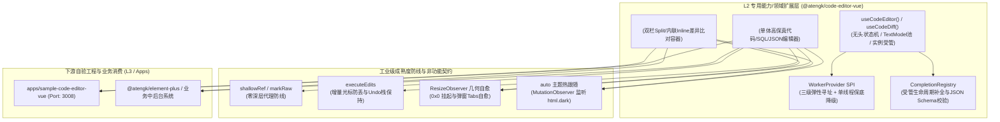

# 0035. CodeEditorVue L2 扩展层架构与 Monaco 工业级治理规范

- **状态**: accepted
- **日期**: 2026-10-29
- **作者**: Ateng

## 背景与上下文

在《ateng-ui 模块化生态扩展全景蓝图与演进路线图》（`module-expansion-blueprint.md`）确立的阶段二规划中，`@atengk/code-editor-vue` 作为代码与内容创作工具攻坚战役的首发核心子包，承担着为低代码平台、SQL 审计中心、配置管理平台与发布比对系统提供工业级代码编辑与高保真 Diff 差异比对基础设施的重任。

在中后台系统中集成前端代码编辑器，传统做法普遍面临以下严重痛点：

1. **引擎选型摇摆与功能残缺**：使用轻量级编辑器往往难以支撑双栏/内联平滑切换的复杂 Diff 比对、代码折叠与工业级语法提示；
2. **Web Worker 资产打包冲突与内网瘫痪**：Monaco 强依赖 Web Worker，若在库内部强行硬打包会导致下游打包器冲突；若只依赖外部公共 CDN，内网私有化或离线环境直接白屏不可用；
3. **响应式深度代理引发性能雪崩**：Monaco 实例对象结构庞大且高度可变，若被 Vue 3 的 `ref()` 或 `reactive()` 深度 Proxy 劫持，将引发严重的内存泄露与打字卡顿；
4. **外部值更新冲垮光标与历史栈**：`v-model` 同步如果简单采用 `editor.setValue()`，会导致光标每次都跳回行首并丢失撤销/重做（Undo/Redo）历史记录；
5. **弹窗与标签页 `0x0` 几何崩溃**：编辑器渲染于 `<el-dialog>` 或 `<el-tab-pane>` 中初次渲染时处于 `display: none`（0x0 像素），导致内部 Canvas 错位、文本不可见或行号重叠；
6. **补全提供者全局泄漏**：Monaco 语言补全提供者为全局单例，未受管生命周期的注册会导致跨页面污染与内存泄漏。

为此，依循 `ateng-ui` 模块化扩展规范（`docs/agents/modular-extensibility.md`）与四层洋葱拓扑（ADR-0009），经过严格的 `/grill-with-docs` 推演，制定本架构规范。

---

## 架构决策矩阵 (Architecture Decisions)

### 1. 核心定位与技术栈决选 (Monaco Editor As Core)

- **选型决议**：全面锁定 **Monaco Editor**（`monaco-editor`）作为唯一底层核心驱动，不引入多引擎抽象，保证 100% 对齐 VS Code 级语法高亮、代码折叠、多光标、双栏 Diff 与智能补全体验；
- **分层归属**：严格归入 **L2 专用能力/领域扩展层**，纯 Vue 3 驱动，仅依赖 L0 (`@atengk/core`)、L1 (`@atengk/vue`) 与第三方核心 `monaco-editor`。

### 2. 双轨高阶容器与 L2 零 UI 依赖契约 (Zero-UI & Slot Inversion)

- **双轨表现容器**：
  1. `<AtengCodeEditor />`：面向单一代码/SQL/JSON 文本的编辑、浏览、格式化与只读审计高阶容器；
  2. `<AtengCodeDiffEditor />`：面向原始与修改两份文本的差异对比容器，原生支持双栏并排（Split）与行间内联（Inline）双模无损切换；
- **零 UI 依赖与插槽反转**：
  - 严禁依赖 Element Plus 等具体 UI 库，内部以 `.at-code-editor-*` 独立命名空间提供轻量原生微工具栏；
  - 对外 100% 暴露具名插槽（`#toolbar`、`#extra`、`#statusbar`），上层业务系统可无缝使用 `<el-button>`、`<el-select>` 或 `<el-dropdown>` 完整定制操作流。

### 3. 三级弹性 Web Worker 加载与离线单线程降级 SPI (Worker Provider SPI)

针对企业中后台私有化部署与离线内网环境，设计三级弹性 Worker 加载治理：

1. **优先本地原生 Worker**：提供零配置助手（基于 Vite 原生 `new Worker(new URL(..., import.meta.url))` 语法），推荐下游在构建时打包本地 Worker；
2. **支持静态资产路径覆盖**：允许通过全局配置或组件 Prop 注入 `workerBaseUrl`，指向企业内网私有 CDN 镜像；
3. **单线程静默降级防线**：若加载 Worker 失败或受浏览器 CSP 严格拦截，自动平稳降级至主线程单线程模式运行，保障核心编辑与 Diff 渲染绝对不出现白屏崩溃。

### 4. Vue 3 响应式解耦与增量光标防丢契约 (Reactivity & Incremental Edits)

- **零深层代理铁律**：Monaco 实例（`IStandaloneCodeEditor` / `IStandaloneDiffEditor`）与底层 `ITextModel` 内部强制使用 `shallowRef` 与 `markRaw` 封装，绝对严禁被 Vue `reactive` 或深度 `ref` 劫持；
- **增量更新不变量**：`v-model` 双向同步时，当监听到外部 Prop 变化，内部首先对比内容哈希/字符串等价性；若确实发生外部修改，使用 `executeEdits` / `pushEditOperations` 应用增量变更，彻底杜绝调用 `setValue()` 导致的光标跳回首行与 Undo 历史清空问题；
- **长文本保护机制**：对于行数超过设定阈值（如 > 50,000 行）超大文件，自动关闭 minimap 与全量高开销装饰项，防止主线程冻结。

### 5. 暗黑模式无感热跟随 (Theme Auto-Sync)

- 支持 `theme: 'auto' | 'vs' | 'vs-dark' | string`；
- 默认 `'auto'` 模式下，组件通过轻量 `MutationObserver` 监听 `document.documentElement` 的类名（如 `dark`）及系统 `prefers-color-scheme` 媒体查询；
- 主题变更时直接执行 `monaco.editor.setTheme()`，实现 0ms 视觉热切换，无需任何 DOM 销毁重绘。

### 6. `0x0` 几何自愈与确定性生命周期治理 (0x0 Glitch Self-Healing & Cleanup)

- **尺寸感知与挂起**：内部基于 `ResizeObserver` 持续监听宿主容器。当检测到容器隐藏（`clientWidth === 0 || clientHeight === 0`）时，自动挂起渲染与重排；当容器因弹窗打开或 Tabs 切换恢复可见尺寸时，自动触发防抖 `editor.layout()`，杜绝错位和黑屏；
- **确定性四步清理**：在 `onUnmounted` 中严格解绑 Resize 监听、注销补全提供者、销毁非共享 TextModel、显式调用 `editor.dispose()` 并置空引用，杜绝内存泄漏。

### 7. 自定义补全提供者受管 SPI 与 JSON Schema 校验 (Completion SPI)

- 封装生命周期受管的 `registerCompletionProvider` 辅助工具与 Prop，所有业务字段建议项（如 SQL 表名/字段提示、模版变量）由容器统管生命周期，在组件卸载时 100% 自动调用 `IDisposable.dispose()`，杜绝跨页面污染；
- 针对 JSON 场景提供声明式 `jsonSchema` 校验配置，一键实现属性悬停文档、类型错误红浪线与智能自动补全。

### 8. Diff 编辑器双向契约与差异人体工学 (Diff Ergonomics)

- **双向数据流**：支持 `v-model:original` 与 `v-model:modified` 双轨绑定；
- **人体工学导航**：默认操作栏内置差异跳转指示器（上一处差异 ⬆️、下一处差异 ⬇️、当前差异序号与总数），支持在 Split 双栏与 Inline 行间比对之间无损切换。

### 9. 多模型（TextModel）轻量池化复用 (Multi-Model Pool)

- 在 `useCodeEditor()` 中暴露受管的 Model 管理 API：`createModel(uri, content, lang)`、`setModel(uri)` 与 `disposeModel(uri)`；
- 在多文件切换或脚本标签页场景中，通过复用同一底座 Canvas 实例切换底层 Model，实现 0 闪烁极速切换并保留各文件独立的撤销历史与滚动位置。

### 10. 1:1 镜像自验工程与 6 大标杆业务场景 (Sample Coverage)

配套建立独立沙箱工程 `apps/sample-code-editor-vue`（分配固定端口 `3008`），首期必须 100% 交付并跑通以下 6 大标杆业务场景：

1. `BasicCodeEditorScenario`：代码高亮、常用语言（TS/JS/JSON/SQL/HTML/CSS）、亮暗模式无损热切换、字号与只读控制；
2. `CodeDiffCompareScenario`：配置版本比对、双栏与内联切换、差异导航与只读比对；
3. `SqlFormattingScenario`：SQL 代码编写、关键字自动提示与一键格式化美化；
4. `JsonSchemaValidationScenario`：JSON 配置声明式 Schema 校验与悬停提示；
5. `AuditReadOnlyScenario`：配置回滚审计、敏感数据标记、指定行（`highlightLines`）高亮显示；
6. `DialogTabsLifecycleScenario`：在 `<el-dialog>` 与多标签页中挂载，实测几何尺寸自愈、脱壳全屏与生命周期彻底清理。

---

## 决策后果

- **收益**：为 `ateng-ui` 生态补齐了工业级代码编辑与高保真 Diff 对比能力，以纯 L2 架构保持了零 UI 依赖的极致纯净度，彻底攻克了 Monaco 实例深层代理、Worker 离线分发、增量光标防丢与弹窗 0x0 坍塌四大行业通病；
- **约束**：子包必须严格满足“工业级新模块自举六件套”，所有对外公开功能必须在 `apps/sample-code-editor-vue` 中提供 100% 端到端真实可运行用例，并通过类型检查、Lint 与自动化测试。
