# 0036. EditorVue L2 扩展层架构与 TipTap 工业级治理规范

- **状态**: accepted
- **日期**: 2026-10-30
- **作者**: Ateng

## 背景与上下文

在《ateng-ui 模块化生态扩展全景蓝图与演进路线图》（`module-expansion-blueprint.md`）确立的阶段二规划中，`@atengk/editor-vue` 作为内容创作工具攻坚战役的核心子包，承担着为知识库中心、公告发布平台、工单系统、CMS 与中后台表单提供现代化富文本与内容排版基础设施的重任。

在企业级中后台系统中集成前端富文本编辑器，传统做法普遍面临以下严重工程痛点：

1. **引擎选型重型且与现代块级排版割裂**：传统富文本（如 TinyMCE、CKEditor、UEditor）依赖庞大的 iframe 或重度 DOM 注入，难以支撑现代化类 Notion/飞书的选区悬浮微浮层（Bubble Menu）与块级斜杠命令（Slash Command）；
2. **响应式深度代理引发性能雪崩**：TipTap / ProseMirror 拥有复杂的内部文档树（Doc/Node）与事务（Transaction）状态机，若被 Vue 3 的 `ref()` 或 `reactive()` 深度 Proxy 劫持，在长文打字时会触发递归依赖收集，引发打字掉帧、光标卡顿甚至内存泄漏；
3. **内容格式多轨诉求与光标丢失**：后台 CMS 依赖 HTML，技术工单与知识库依赖 Markdown，低代码审计平台依赖 ProseMirror JSON。若双向绑定粗暴采用 `editor.commands.setContent()`，会导致输入中光标频繁跳回首行并彻底冲垮撤销/重做（Undo/Redo）历史栈；
4. **表格操控笨重与滚动折返跑**：长文档表格缺乏光标上下文感知，用户在表格下部操作增删行列或合并单元格时，必须频繁滚回顶部固定工具栏，且缺乏直接拖拽列宽的能力；
5. **媒体上传协议缺失与拖拽粘贴黑盒**：传统富文本对复制粘贴截图、拖拽本地文件缺乏标准可插拔拦截管道，若将大图直接转为数百 KB 的 Base64 会导致数据库膨胀与接口堵塞；
6. **表单硬限制与状态栏缺失**：数据库字段通常对富文本有字数限制，但传统实现往往混淆了 HTML 字符数与纯文本字数，无法做到精准字数统计与键盘输入硬拦截；
7. **弹窗挂载 `0x0` 几何坍塌与全屏裁剪**：编辑器嵌入 `<el-dialog>` 或 `<el-tab-pane>` 时初次处于 `display: none`（0x0 像素），导致行高错位；且在弹窗内全屏时会被 CSS `transform` 裁剪，无法真正铺满视口。

为此，依循 `ateng-ui` 模块化扩展规范（`docs/agents/modular-extensibility.md`）与四层洋葱拓扑（ADR-0009），经过两轮严格的 `/grill-with-docs` 推演，制定本架构规范。

---

## 架构决策矩阵 (Architecture Decisions)

```mermaid
flowchart TD
    subgraph L2["L2 专用能力/领域扩展层 (@atengk/editor-vue)"]
        EC["<AtengEditor /><br/>(现代富文本与内容创作高阶表现容器)"]
        HOOK["useEditor()<br/>(无头状态机 / 事务包装 / 实例受管)"]
        TOOLBAR["AtengEditorToolbar<br/>(纯中文原生微工具栏 + 全插槽反转)"]
        BUBBLE["BubbleMenu / TableBubbleMenu<br/>(选区浮层 + 表格上下文操控 + 列宽拖拽)"]
        SLASH["SlashCommand<br/>(键入 '/' 唤起纯中文块级物料面板)"]
        UPLOAD["UploadHandler SPI<br/>(粘贴/拖拽拦截 + 骨架占位 + Base64降级)"]
    end

    subgraph INVARIANTS["工业级成熟度防线与非功能契约"]
        SHALLOW["shallowRef / markRaw<br/>(零深层代理防线)"]
        TX["增量事务 Transaction<br/>(多轨绑定 + 光标防丢 + Undo栈保持)"]
        RESIZE["ResizeObserver 几何自愈<br/>(0x0 挂起与弹窗自愈)"]
        THEME["auto 主题热跟随<br/>(MutationObserver 监听 html.dark)"]
        TELEPORT["脱壳全屏 Teleport<br/>(突破 el-dialog 裁剪层级)"]
        LIMIT["CharacterCounter<br/>(纯文本字数统计 + 键盘输入硬拦截)"]
    end

    subgraph DOWNSTREAM["下游自验工程与业务消费 (L3 / Apps)"]
        SAMPLE["apps/sample-editor-vue (Port: 3009)"]
        L3_EP["@atengk/element-plus / 业务中后台系统"]
    end

    EC --> SHALLOW
    EC --> TX
    EC --> RESIZE
    EC --> THEME
    EC --> TELEPORT
    EC --> LIMIT
    EC --> TOOLBAR
    EC --> BUBBLE
    EC --> SLASH
    EC --> UPLOAD
    HOOK --> SHALLOW
    EC --> SAMPLE
    EC --> L3_EP
```

### 1. 核心定位与技术栈决选 (TipTap 2.x As Core)

- **选型决议**：全面锁定 **TipTap 2.x**（基于 ProseMirror）作为唯一底层核心驱动，不引入多引擎抽象，保证现代化无头扩展架构、模块化排版、纯中文微工具栏与现代类 Notion 交互体验；
- **分层归属**：严格归入 **L2 专用能力/领域扩展层**，纯 Vue 3 驱动，仅依赖 L0 (`@atengk/core`)、L1 (`@atengk/vue`) 与第三方核心 `@tiptap/vue-3`、`@tiptap/starter-kit` 及配套官方扩展。

### 2. 双轨高阶表现容器与 L2 零 UI 依赖契约 (Zero-UI & Slot Inversion)

- **表现容器形态**：
  提供 `<AtengEditor />` 统一高阶表现容器与 `useEditor()` 无头状态机；
- **L2 零 UI 依赖与全中文交互**：
  - 严禁硬编码依赖 Element Plus 等具体 UI 库，内部基于 `.at-editor-*` 独立命名空间提供轻量纯 CSS 原生微工具栏、选区浮动菜单（BubbleMenu）、表格操作浮层（TableBubbleMenu）与斜杠命令面板（SlashCommand）；
  - **默认 100% 地道中文交互**：所有操作按钮 Tooltip、斜杠物料名称与说明、空状态占位提示（Placeholder）、表格操作标签与状态栏文案默认全部为地道中文；
  - **100% 插槽反转**：对外提供 `#toolbar`、`#bubble-menu`、`#table-menu`、`#slash-command`、`#statusbar` 等具名插槽，业务层可无缝使用 `<el-button>`、`<el-dropdown>` 完整替换反转。

### 3. 核心扩展预设与弹性扩展注入 SPI (Built-in Extensions & Extensibility)

- **高频预设开箱即用**：内置覆盖企业后台 90% 以上排版场景的核心扩展：
  - 排版与文档基础：`StarterKit`（标题、粗体、斜体、列表、引用、分割线、历史撤销重做）；
  - 高级表格支持：`Table` 家族（`TableRow`、`TableCell`、`TableHeader`），默认开启列宽拖拽手柄（`resizable: true`）；
  - 富媒体与链接：`Image`（图片对齐与尺寸）、`Link`（链接自动识别与安全属性）；
  - 细节与增强：`TaskList` / `TaskItem`（待办清单）、`Highlight`（高亮色块）、`Underline`（下划线）、`TextAlign`（多向对齐）、`Placeholder`（中文占位）、`CharacterCount`（字符统计）、`CodeBlockLowlight`（代码块高亮）；
- **弹性扩展注入 SPI**：通过 `extensions?: AnyExtension[]` 属性，允许使用者无缝追加第三方扩展（如数学公式、协同 y-js 扩展）。

### 4. 多轨数据流双向绑定与增量事务同步 (Multi-Format Dual-Way Binding)

- **多轨数据流绑定**：
  - `v-model`: 默认双向绑定净化后的标准 HTML 字符串；
  - `v-model:markdown`: 双向绑定 Markdown 文本（内置双向转译管道，满足技术文档/工单协同）；
  - `v-model:json`: 双向绑定 ProseMirror 结构化 JSON 节点树（满足低代码与版本审计需求）；
  - 保底支持 `outputFormat?: 'html' | 'markdown' | 'json'` 单一声明模式；
- **增量事务同步不变量 (Incremental Transaction Invariant)**：
  外部 Prop 更新时，内部首先比对内容等价性；若确实发生外部修改，基于 ProseMirror 事务（Transaction）进行差异更新，杜绝全量 `setContent()` 造成的光标跳回文档首部与 Undo/Redo 历史栈冲垮。

### 5. 媒体资产上传拦截器 SPI 与骨架占位 (UploadHandler SPI)

- **拦截器抽象契约**：
  提供属性 `uploadHandler?: (file: File) => Promise<string | { url: string; alt?: string }>`：
  - 自动拦截来自键盘粘贴截图（Clipboard Paste）、本地文件拖拽放置（Drag & Drop）以及点击微工具栏插入图片的操作；
  - 上传期间文档内自动插入轻量骨架加载占位块（Uploading Placeholder），防止重复提交；
  - 若调用方未传入 `uploadHandler`，自动优雅降级为 Base64 内联格式或触发业务事件。

### 6. 表格动态上下文气泡菜单与列宽自由拖拽 (Table Ergonomics)

- 当光标移入表格内部时，自动唤起专用的 **`TableBubbleMenu`（全中文）**，直观提供：➕向左/右加列、➕向上/下加行、❌删除行/列、🔲合并/拆分单元格、🗑️清空表格；
- 深度开启列宽拖拽调节手柄，支持鼠标悬停列边框拖拽重设单元格宽度。

### 7. 纯文本字数统计、输入硬限制与吸底状态栏 (Character Count & Limit)

- 提供 `showStatusBar?: boolean`（默认 `true`），吸底呈现纯文本字数、段落数；
- 提供 `maxLength?: number` 属性：一旦达到字数上限，通过 ProseMirror 事务拦截后续物理键盘输入与粘贴（文本超长截断），状态栏呈现醒目警示色。

### 8. 脱壳全屏 (Teleport Fullscreen)、暗黑跟随与 `0x0` 几何自愈 (Resilience)

- **脱壳全屏**：支持通过全屏按钮将编辑器容器脱壳提升至 `document.body` 顶层（配备 `z-index: 3000`），彻底摆脱 `<el-dialog>` 等局部容器 `transform` 导致的视口裁剪；
- **0x0 挂起自愈**：通过 `ResizeObserver` 感知容器尺寸，当从隐藏弹窗中激活恢复时，自动重排编辑器布局，消除几何错位；
- **主题无损热跟随**：全面采用 `--at-editor-*` 变量体系，基于 `MutationObserver` 监听 `document.documentElement` 的 `dark` 类名，实现 0ms 亮暗主题无损热切换。

### 9. 表单双态支持：禁用 (Disabled) vs 纯净阅读模式 (ReadOnly)

- 显式解耦 `disabled` 与 `readOnly` 状态：
  - `disabled`: 表单禁用模式，锁定输入但保留编辑器边框与置灰底色；
  - `readOnly`: 纯净文章阅读模式，自动隐藏顶部工具栏、浮动气泡、状态栏与外边框，完美充当高保真富文本内容查看器。

### 10. 1:1 镜像自验工程与 6 大标杆企业场景矩阵 (Sample Scenarios)

配套建立独立沙箱工程 `apps/sample-editor-vue`（分配固定端口 **`3009`**），首期 100% 交付并跑通以下 6 大标杆业务场景：

1. `BasicEditorScenario`: 基础排版、字号色板、代码块高亮，HTML/Markdown/JSON 三轨数据实时联动回显；
2. `TableErgonomicsScenario`: 表格行列增删、单元格合并拆分、列宽自由拖拽与动态气泡上下文操控；
3. `AssetUploadScenario`: 复制截图粘贴、拖入多图、网络延迟占位动效、成功置换真实 URL 与 Base64 降级；
4. `SlashAndBubbleScenario`: 划词选区气泡浮层、键入 `/` 唤起全中文块级斜杠面板；
5. `FormValidationScenario`: 表单联动、`maxLength=500` 键盘硬拦截、字数统计指示器与暗黑模式无损热切换；
6. `DialogReadOnlyScenario`: 在 `<el-dialog>` 中挂载实测 0x0 几何自愈、脱壳全屏与纯净文章阅读态。

---

## 决策后果

- **收益**：为 `ateng-ui` 生态补齐了工业级现代富文本与内容排版核心基础设施，以纯 L2 架构坚守了零 UI 依赖与全插槽反转契约，彻底攻克了富文本实例深层代理、长文光标跳变、复杂表格难以操作、媒体上传黑盒以及弹窗全屏裁剪五大行业通病；
- **约束**：子包必须严格满足“工业级新模块自举六件套”，所有对外公开功能必须在 `apps/sample-editor-vue` 中提供 100% 端到端真实可运行用例，并通过类型检查、Lint 与自动化测试。
