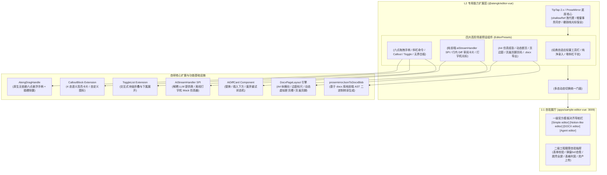

# 0037. EditorVue 四大场景预设体系、块级拖拽、AI 流式协议与 DOCX 分页排版架构

- **状态**: accepted
- **日期**: 2026-10-30
- **作者**: Ateng

## 背景与上下文

在工单 #184 及其 6 个子工单中，`@atengk/editor-vue` 成功交付了基于 TipTap 2.x 的通用企业级富文本底座 `<AtengEditor />`（参见 [ADR-0036](./0036-editor-vue-l2-architecture-and-tiptap-governance.md)）。然而，在现代企业级多样化业务需求与官方前沿体验对标中，单一的“工具栏 + 斜杠 + 气泡”混合形态存在明显的场景张力：

1. **常规表单与轻量录入（Simple 场景）**：博客、留言板、CRM 跟进与审批备注等场景，用户只需紧凑易用的顶部工具栏；键入 `/` 唤起斜杠面板或浮现拖拽手柄反而会对普通业务用户造成打字干扰；
2. **现代知识库与无界白板（Notion-like 场景）**：产品需求文档（PRD）、团队知识库、在线笔记等场景，追求无顶部大工具栏的纯净无界画布，核心依赖**左侧块级悬浮拖拽手柄（Drag Handle）**、**`/` 斜杠命令**、**选区微气泡**，以及 **Callout 提示卡片**、**Toggle 折叠列表** 等结构化物料；
3. **公文拟发与正规合同报告（DOCX 场景）**：标书、合规公文、法律合同等场景，有极其严格的 **A4 物理纸张仿真**、**页边距设置**、**真实动态跨页断行**、**页眉页脚与动态页码** 以及导出合规 Word 二进制文件的刚性诉求，无界滚动流无法满足打印排版合规；
4. **AI-Native 辅助创作（Agent 场景）**：智能文案助理、研报生成、辅助润色等场景，要求在行内（Inline）唤起 AI 交互，具备流式打字生成、双轨对比与一键“采纳/替换/丢弃”决策，而不是割裂的外部侧边栏对话。

为了彻底覆盖上述 99% 的企业级实际内容创作场景，经由多轮 `/grill-with-docs` 严格推演与领域建模，确立本系统级架构决策。

---

## 架构决策矩阵 (Architecture Decisions)



---

## 核心机制与技术契约

### 1. 契约继承体系与类型闭环 (Contract Inheritance & Type Safety)

所有 4 大预设组件统一继承标准化基线接口 `EditorBaseProps`，保证双向绑定、只读状态、字数限制与资产上传 SPI 高度一致；同时特化声明各场景专属强类型配置：

```typescript
// 统一基线接口
export interface EditorBaseProps {
  modelValue?: string;
  markdown?: string;
  json?: Record<string, any>;
  readonly?: boolean;
  disabled?: boolean;
  placeholder?: string;
  maxLength?: number;
  uploadHandler?: UploadHandler;
}

// 1. Simple 预设配置
export interface SimpleEditorProps extends EditorBaseProps {
  tools?: SimpleToolbarItem[];
  dense?: boolean;
}

// 2. Notion-like 预设配置
export interface NotionEditorProps extends EditorBaseProps {
  dragHandle?: boolean;
  slashCommand?: boolean;
  callout?: boolean;
  toggle?: boolean;
}

// 3. Agent 预设配置
export interface AgentEditorProps extends EditorBaseProps {
  aiStreamHandler?: AiStreamHandler;
  aiPrompts?: AiPromptAction[];
  showDiff?: boolean;
}

// 4. DOCX 预设配置
export interface DocxEditorProps extends EditorBaseProps {
  layout?: DocxPageLayoutConfig;
  showRuler?: boolean;
  orientation?: 'portrait' | 'landscape';
}
```

每个预设组件均显式导出各自专属的 Ref 实例类型（如 `export type AtengSimpleEditorInstance = InstanceType<typeof AtengSimpleEditor>`）。

---

### 2. Notion-like 块级引擎与自研扩展 (Zero-Bloat Block Invariants)

- **原生六点拖拽手柄 (`AtengDragHandle`)**：
  - 基于原生 DOM/SVG 实现，随鼠标垂直位置贴合悬浮于视口块左侧；
  - 原生绑定 ProseMirror 块级 NodeSelection 与拖拽事务；
  - 严格恪守 L2 零 UI 框架依赖红线，点击呼出的块级菜单基于纯 CSS 样式，并提供 `#drag-handle` 与 `#block-menu` 插槽允许下游业务使用 Element Plus `<el-dropdown>` 无缝接管。
- **纯原生自研物料扩展**：
  - `CalloutBlock`：基于 `@tiptap/core` 的 `Node.create` 纯原生编写，内置 4 态语义（info, warning, error, success），支持切换预设 Emoji，遵循 `--at-editor-callout-*` 主题变量；
  - `ToggleList`：纯原生实现可折叠列表块，支持 Tab 键缩进子内容与点击折叠三角展开/收起。

---

### 3. Agent Editor 纯前端通信 SPI 与行内 Diff 审阅 (AI Stream & Diff State Machine)

- **解耦通信 SPI 协议**：
  - 核心定义 `aiStreamHandler: (payload: AiStreamPayload) => AsyncIterable<string> | ReadableStream`；
  - 严禁内置硬编码任何后端端点或密钥，业务系统可自由对接内网大模型网关、SSE、WebSocket 或公网大模型；
  - 框架内置纯前端打字机延迟仿真器（Mock SPI），保证单测与开箱演示 100% 离线自洽，杜绝网络泄露。
- **行内原位 Diff 状态机 (`AiDiffCard`)**：
  - 双通道唤起：选中文字弹出 AI 浮动气泡（润色、扩写、缩短、翻译、总结）或空白行空格唤起；
  - 生成过程中使用 ProseMirror Decoration 渲染闪烁打字机光标与加载态；
  - 生成完毕后在行内卡片呈现原内容与变更内容的颜色比对（绿色高亮追加、红色划线删除），提供【全部替换】、【插入下方】与【放弃重试】三态闭环操作。

---

### 4. DOCX Editor A4 分页仿真与标准二进制导出 (PageCanvas & Docx Generation)

- **A4 物理仿真容器 (`PageCanvas`)**：
  - 标准 A4 画布规格（纵向 210mm × 297mm，横向 297mm × 210mm），背景仿真纸张阴影；
  - 动态高度测量与虚拟断页槽：实时监听文档高度，超出单页可用物理高度时在视觉上插入分页缝隙，支持智能保持跨页表格标题行；
  - 页眉页脚体系：双击进入编辑态，支持居左/中/右布局与动态页码标记（`第 X 页 / 共 Y 页`）；
  - 仿真标尺：顶部可选悬浮像素/毫米标尺，直观反馈页边距与有效打印边界。
- **标准二进制 `.docx` 纯前端转译与打印**：
  - 基于轻量纯前端 `docx` 库实现 AST 映射（`prosemirrorJsonToDocxBlob`），将 ProseMirror JSON 转换为真实 OpenXML 二进制数据，生成合规 `.docx` 文件并通过内存受管的 `URL.createObjectURL` 触发直接下载；
  - 优化 `@media print` 样式，保证浏览器原生打印与导出 PDF 时精确按 A4 纸张 1:1 分页输出。

---

### 5. 三阶段递进演进路线图 (Evolution Roadmap)

| 阶段                                              | 交付核心                                                                                                                                                                                                                                                  | 包含模块与产物                                                                                              | 质量准出门槛                                                                        |
| :------------------------------------------------ | :-------------------------------------------------------------------------------------------------------------------------------------------------------------------------------------------------------------------------------------------------------- | :---------------------------------------------------------------------------------------------------------- | :---------------------------------------------------------------------------------- |
| **Phase 1: 基础夯实与 Simple / Notion-like 预设** | 1. 拆分暴露 `<AtengSimpleEditor />` 与紧凑自适应工具栏；<br/>2. 研发 `<AtengDragHandle />` 块级拖拽手柄；<br/>3. 原生实现 `CalloutBlock` 与 `ToggleList` 扩展；<br/>4. 交付 `<AtengNotionEditor />` 纯净无顶栏预设。                                      | `AtengSimpleEditor.vue`<br/>`AtengNotionEditor.vue`<br/>`AtengDragHandle.vue`<br/>`callout.ts`, `toggle.ts` | 单元测试全自洽覆盖；<br/>自验展厅完成前两大多态切换；<br/>Typecheck & Lint 0 错误。 |
| **Phase 2: Agent Editor AI 交互赋能**             | 1. 抽象 `aiStreamHandler` SPI 与离线打字机 Mock 仿真器；<br/>2. 研发选区 AI 气泡菜单与空白行沉浸式唤起面板；<br/>3. 研发行内 `AiDiffCard` 审阅卡片与状态机；<br/>4. 交付 `<AtengAgentEditor />` 智能体预设。                                              | `AtengAgentEditor.vue`<br/>`AtengAiBubbleMenu.vue`<br/>`AtengAiDiffCard.vue`<br/>`ai-stream.ts`             | 离线打字机单测 100% 通过；<br/>自验展厅提供真实模型配置抽屉。                       |
| **Phase 3: DOCX Editor 分页公文攻坚与导出**       | 1. 研发 `DocxPageLayout` A4 物理纸张容器与虚拟断页槽；<br/>2. 研发双击交互式页眉页脚与动态页码计算器；<br/>3. 研发标尺辅助组件与页边距调节；<br/>4. 研发 `prosemirrorJsonToDocxBlob` 客户端 OpenXML 导出器；<br/>5. 交付 `<AtengDocxEditor />` 公文预设。 | `AtengDocxEditor.vue`<br/>`AtengPageCanvas.vue`<br/>`AtengRuler.vue`<br/>`export-docx.ts`                   | 导出真实 `.docx` 经由 Word 正常打开；<br/>打印预览与虚拟分页 1:1 对齐。             |

---

## 影响评估与遵循不变量 (Invariants)

1. **L2 纯净零 UI 依赖红线**：
   四大预设组件及新增的 `AtengDragHandle`、`AiDiffCard`、`AtengPageCanvas` 内部禁止硬编码 Element Plus 组件，全部采用 Scoped 原生 CSS/SVG 驱动，并提供完备的插槽倒置（Slot Inversion）；
2. **测试离线自洽红线**：
   Agent 预设与 DOCX 导出必须基于纯内存与 Mock 打字机流式仿真器运行单测，绝对严禁外部真实网络发起请求；
3. **撤销栈与光标保全不变量**：
   无论在哪个预设中，外部多轨数据变更必须继续通过 ProseMirror 增量事务更新，杜绝冲垮用户光标与历史记录。
