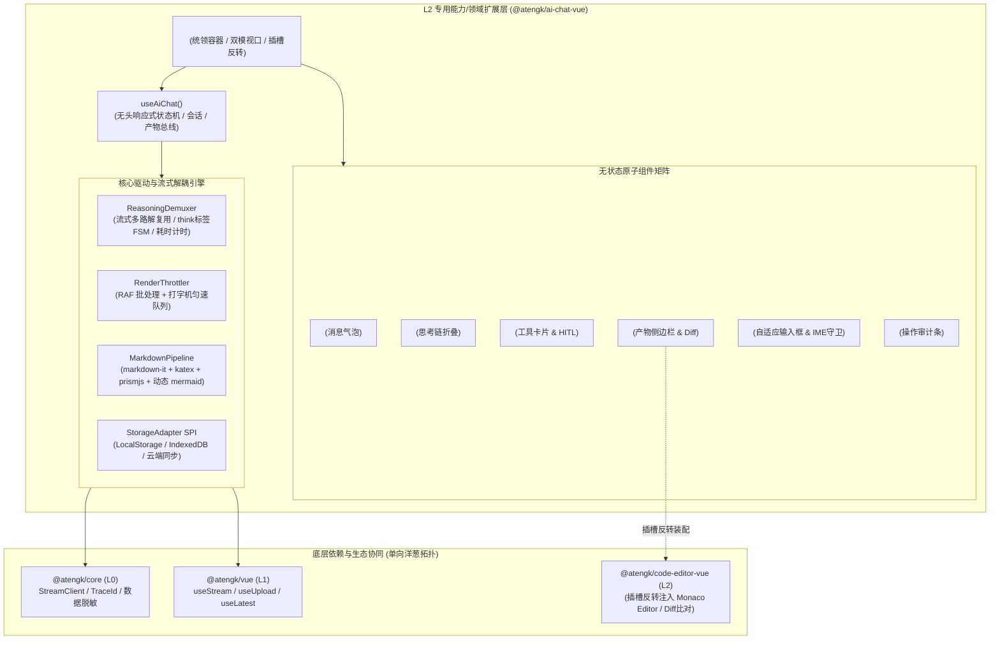

# 0043. AiChatVue L2 扩展层架构、思考链流式多路解复用与 Artifacts 治理规范

- **状态**: accepted
- **日期**: 2026-11-09
- **作者**: Ateng

## 背景与上下文

在《ateng-ui 模块化生态扩展全景蓝图与演进路线图》（`module-expansion-blueprint.md`）确立的阶段四（P0 第一优先级）规划中，`@atengk/ai-chat-vue` 作为 No. 1 王牌扩展子包，承担着为企业级中后台、智能客服、知识库检索与 Copilot 协同平台提供全功能大模型对话、深度推理与交互产物基础设施的重任。

在现代 Web 前端集成大模型流式对话时，传统开源组件普遍存在以下严重痛点：

1. **协议割裂与状态机污染**：不同大模型（OpenAI、Anthropic、DeepSeek、Ollama、Spring AI、Dify）的流式 chunk 格式五花八门；特别是以 DeepSeek R1 为代表的推理模型，部分端点输出 `reasoning_content` 字段，部分直接在正文中内嵌 `<think>` 标签，前端若无流式解复用，将导致正文充斥杂乱标签或逻辑混乱；
2. **UI 强绑定与洋葱拓扑破坏**：多数 AI 对话库强行硬依赖特定版本的 UI 库（如全量依赖 Element Plus 或 Ant Design），严重违背 L2 扩展层平台中立与洋葱拓扑单向依赖律（ADR-0009），难以适配定制主题或微前端环境；
3. **高频流式刷屏引发 CPU 飙升与 DOM 抖动**：当大模型以每秒 50+ token 涌入时，每次 chunk 均触发全量 Markdown 重新解析与重排重绘，造成浏览器主线程严重卡顿；
4. **缺失 Artifacts 独立产物看板**：类似 Claude / ChatGPT 的独立代码、设计图、文档生成与预览沙箱，传统组件多以长文本内嵌代码块混排，无法支持代码版本追溯与横向 Diff 比对；
5. **人机协同（HITL）与工具调用脱节**：Function Calling / MCP 工具调用仅支持单向静默执行，无法针对高危写操作弹出人机确认审批（Human-in-the-Loop）；
6. **交互细节翻车频发**：中文输入法（IME）在候选词阶段按 Enter 导致半截拼音被误发；流式长输出强行把正在查阅历史的用户拉回底部；缺乏单条异常重试。

为此，依循 `ateng-ui` 模块化扩展通用标准（`docs/agents/modular-extensibility.md`），经过严格的 `/grill-with-docs` 三轮 16 问推演，制定本架构决策。

---

## 架构决策矩阵 (Architecture Decisions)



---

## 核心设计决策细则

### 1. 统一强类型领域契约与 MessageAdapter (Q1)

- 内部建立严格自洽的高内聚领域实体体系：
  - `ChatMessage`：标准化唯一 `id`、`role: 'system' | 'user' | 'assistant' | 'tool'`、`status: 'pending' | 'streaming' | 'completed' | 'error'`、`content: string`；
  - `ReasoningContent`：`text: string`、`elapsedMs: number`、`collapsed: boolean`、`isStreaming: boolean`；
  - `ToolCallPayload`：`callId: string`、`name: string`、`arguments: Record<string, unknown>`、`state: 'calling' | 'success' | 'error'`、`result?: unknown`；
  - `ArtifactPayload`：`identifier: string`、`title: string`、`language: string`、`versions: ArtifactVersion[]`；
- 设立 `MessageAdapter` 转换规约，对外双向转译 OpenAI、Anthropic、Spring AI 与 Dify 等外部报文，隔离外部协议对内部状态机的侵蚀。

### 2. L2 表现表现与零 UI 依赖纯净律 (Q2)

- 模块 100% 遵守四层洋葱拓扑，**绝对严禁物理依赖 `@atengk/element-plus` 或其组件/指令**；
- 组件全部采用 `.at-ai-chat-*` 命名空间与 CSS 变量（`--at-chat-primary`, `--at-chat-bg`, `--at-chat-border` 等），支持主题与暗黑模式无损渗透；
- 内置零外部依赖原生 SVG 图标（发送、停止、复制、勾选、折叠、工具、刷新等）；
- 核心节点 100% 暴露具名插槽（`#header`、`#input`、`#code-block`、`#tool-call`、`#artifact-action`），供 L3 宿主按需注入 Element Plus 控件。

### 3. ReasoningDemuxer 思考链流式多路解复用器 (Q3)

- 针对 DeepSeek R1、OpenAI o1 等推理模型，在流式接收阶段构建流式有限状态自动机（FSM）：
  - 自动嗅探 chunk 中独立的 `delta.reasoning_content`；
  - 若不存在独立字段，流式匹配正文中 `<think>` 开启标签与 `</think>` 闭合标签，将数据透明路由至 `reasoningText` 与 `contentText`；
  - 思考流开始时启动毫秒级精确计时，闭合时固化 `elapsedMs`；
  - `<AtengReasoningBlock />` 原生支持思考中骨架屏动效、耗时标签（如 `深度思考用时 12.4 秒`）并在正文开始流出时默认自动折叠。

### 4. 渲染流水线与重型引擎动态懒加载 (Q4)

- 核心引入轻量且确定性高的解析依赖：`markdown-it` `^14.1.0` + `katex` `^0.16.11` + `prismjs`；
- **Mermaid 架构图 Tree-Shaking 治理**：`mermaid` 作为可选 `peerDependencies`，仅在正文检测到 ` ```mermaid ` 代码块时，通过原生 `import('mermaid')` 异步动态加载，不使用图表场景产物 0 字节打入；
- 代码块预留 `#code-block` 插槽反转，外部可一键将已竣工的 `@atengk/code-editor-vue`（Monaco）作为代码容器嵌入。

### 5. Artifacts 不可变版本链与 Monaco 双模 Diff (Q5, Q10)

- 引入全局产物总线，`useAiChat` 维护 `activeArtifact: Ref<Artifact | null>` 与 `artifacts: Ref<Artifact[]>`；
- `<AtengArtifactSidebar />` 在宽屏呈现右侧分栏（支持拖拽调节宽度、全屏最大化），在窄屏自适应降级为抽屉；
- 每个 Artifact 记录不可变版本链 `versions: ArtifactVersion[]`；
- 侧边栏提供“预览 / 源码 / Diff 比对”三模切换，Diff 模式通过插槽反转直接接入 `@atengk/code-editor-vue` 的 `<AtengCodeDiffEditor />`。

### 6. 流式渲染节流与平滑打字机队列 (Q7)

- 建立 `RenderThrottler` 渲染节流器：采用 `requestAnimationFrame`（16~32ms 批处理窗口）合并高速到达的文本增量；
- 支持 `typewriterSpeed` 配置：
  - `0`：全速批处理渲染（大段代码生成极快）；
  - `>0`：字符缓冲队列匀速吐字；
- 暴露 `flushTypewriter()` 支持用户随时点击跳过打字动效，瞬间吐出全量内容。

### 7. 多会话状态机与声明式持久化适配器 (Q8)

- 维护 `ChatSession`（会话列表）与 `currentSessionId` 切换；
- 提供 `StorageAdapter` SPI 接口，内置 `LocalStorageAdapter`（支持命名空间与容量保护），支持接入 IndexedDB 或后端 REST 数据库同步；
- 暴露 `v-model:messages` 支持外层完全受控。

### 8. 工具调用全双工与人机协同审批 (HITL) (Q9)

- 工具定义支持 `mode: 'auto' | 'confirm'` 双模：
  - `auto`：大模型发起调用后前端自动执行并回传；
  - `confirm`：高危操作流式挂起，卡片渲染“允许执行”与“拒绝执行”按钮，支持参数审阅与拒批原因回传。

### 9. 视口滚动锚定与抗打扰算法 (Q11)

- 容器监听 `scroll`，计算视口底与内容底差值 $\Delta$；
- 阈值判定（默认 `60px`）：
  - $\Delta \le 60\text{px}$：保持底部锚定滚动；
  - 用户向上翻阅（$\Delta > 60\text{px}$）：立即解除滚底锁定，浮现“有新消息 ⬇”未读胶囊；
- 点击胶囊或手动滑回底部后重新自动锁定。

### 10. 多模态附件、操作审计与工程化交互 (Q12 ~ Q16)

- **多模态附件 (Q12)**：`ChatAttachment` 支持图片、文档、音频，支持文件选择、拖拽与剪贴板 `Ctrl+V` 图片粘贴，抽象 `uploadHandler` SPI；
- **操作工具栏 (Q13)**：一键复制、重新生成、用户原位编辑重发、点赞点踩反馈 SPI（`onFeedback`）、Web Speech API 朗读与 Markdown/JSON 全量导出；
- **新手引导与追问 (Q14)**：空状态 `starterPrompts` 卡片网关 + 回答完毕横向滚动的 `suggestedQuestions` 胶囊；
- **输入法合成守卫 (Q15)**：严格监听 `compositionstart/end`，硬拦截拼音未确认阶段的 Enter 误发；Textarea 1~6 行自适应伸缩；输入 `/` 触发斜杠快捷命令面板；
- **安全与弱网自愈 (Q16)**：`beforeSend` 前置合规拦截与 DLP 数据脱敏；网络中断单条消息标红并提供“🔄 重新尝试此请求”单点自愈。

---

## 1:1 自验展厅与测试基线 (Q6)

- 展厅坐标：`apps/sample-ai-chat-vue`，固定端口 **`3011`**；
- 零外网纯离线流式模拟器：内置 `MockStreamEngine`，支持分块延迟模拟、DeepSeek R1 思考过程模拟、MCP 工具调用模拟与 Artifacts 产物联动；
- 四合一质量准出门禁：
  ```bash
  pnpm --filter @atengk/ai-chat-vue --filter sample-ai-chat-vue typecheck && \
  pnpm --filter @atengk/ai-chat-vue --filter sample-ai-chat-vue lint && \
  pnpm --filter @atengk/ai-chat-vue --filter sample-ai-chat-vue test && \
  pnpm --filter @atengk/ai-chat-vue --filter sample-ai-chat-vue build
  ```
