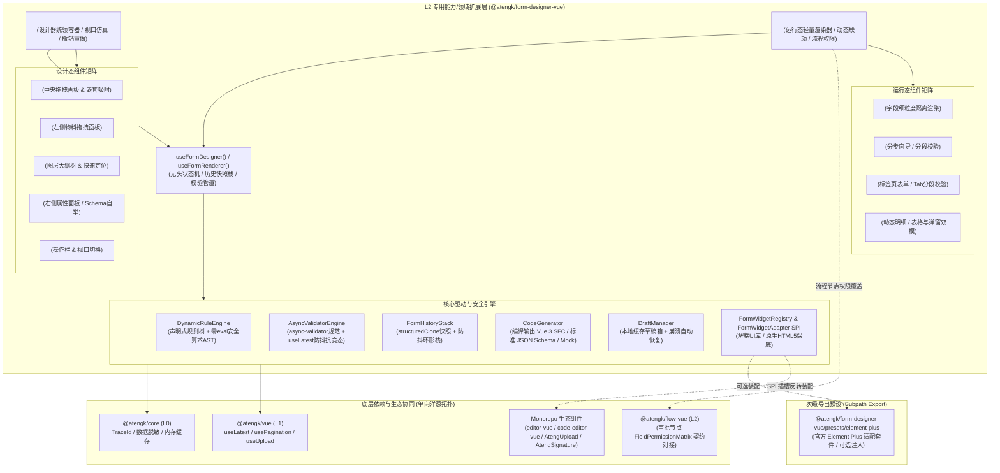

# 0044. FormDesignerVue L2 扩展层架构、三段式 Schema 引擎与流程权限治理规范

- **状态**: accepted
- **日期**: 2026-11-09
- **作者**: Ateng

## 背景与上下文

在《ateng-ui 模块化生态扩展全景蓝图与演进路线图》（`module-expansion-blueprint.md`）确立的阶段四（P0 第一优先级）规划中，`@atengk/form-designer-vue` 作为 No. 2 王牌扩展子包，承担着为企业级中后台、低代码平台、OA 协同与 BPMN 审批流转提供全功能无头动态表单设计器、JSON Schema 渲染引擎与节点权限矩阵协同基础设施的重任。

在现代 Web 前端与企业级系统中，动态表单与设计器普遍存在以下核心架构与工程痛点：

1. **表现层硬编码耦合与洋葱拓扑破坏**：传统开源表单设计器（如 Form-Generator、Variant Form、Avue）通常物理强依赖特定版本 UI 库（如 Element Plus 或 Ant Design），严重违背 L2 扩展层平台中立与洋葱拓扑单向依赖律（ADR-0009），导致前台轻量填报页面必须打包引入庞大且耦合的设计器依赖；
2. **Schema 协议割裂与两极分化**：标准 JSON Schema 偏向数据校验而极度缺乏 UI 排版表现力，嵌套栅格布局必须用冗长 `x-ui` 胶水包装；而轻量表单设计器则往往自创随意的平铺 JSON，无法优雅表示深层嵌套栅格与动态明细数组（SubForm）；
3. **动态联动安全与灵活性矛盾**：为了支持“字段显隐联动”和“单价×数量=总额”等联动计算，大量表单库直接采用 `eval` 或 `new Function` 动态求值，直接触碰企业级系统 CSP（Content Security Policy）安全红线并埋下 XSS 漏洞；而纯静态配置又无法满足复杂运算；
4. **与审批流转权限割裂**：在 OA 与工单审批流中，表单字段在不同审批节点拥有动态权限（可编辑、只读文本、隐藏、强制必填），现有方案多在业务层手动编写数十个 `v-if`/`disabled`，缺乏标准的流程权限矩阵（`FieldPermissionMatrix`）覆盖与只读脱壳渲染契约；
5. **超大表单全量重渲染性能劣化**：当单据字段达到 50~100+ 时，外层全局对象深层 watch 会在单字符输入时触发全表单 DOM Diff，引发主线程卡顿；
6. **多端自适应、远程数据源与草稿容灾缺失**：移动端（钉钉/飞书）审批占比极高但设计器缺乏移动视口仿真；异步下拉选项级联缺乏统一 DataSource 规约；长时间填报未保存缺乏本地崩溃恢复机制。

为此，依循 `ateng-ui` 模块化扩展通用标准（`docs/agents/modular-extensibility.md`），经过严格的 `/grill-with-docs` 三轮 18 问推演，制定本架构决策。

---

## 架构决策矩阵 (Architecture Decisions)



---

## 核心设计决策细则

### 1. 三段式专用表单 AST Schema 与双向转译器 (Q1)

- 采用面向表单的专用三段式抽象语法树（AST）结构定义 `FormSchema`：
  ```ts
  interface FormSchema {
    version: '1.0';
    formConfig: {
      layout: 'horizontal' | 'vertical' | 'inline';
      labelWidth: number | string;
      labelPosition: 'left' | 'right' | 'top';
      size: 'large' | 'default' | 'small';
      disabled?: boolean;
      colon?: boolean;
      scrollToError?: boolean;
    };
    widgetList: FormWidget[];
  }
  ```
- 每个控件 `FormWidget` 标准化具备：
  `id`（唯一标识）、`type`（控件标识）、`modelKey`（字段路径，如 `userInfo.address`）、`label`、`placeholder`、`props`（控件传参）、`rules`（校验规则数组）、`layout`（栅格几何，含 `span`, `offset`, `xs`, `sm`, `md`）、`dynamicRules`（联动规则树）；
- 内置 `toStandardJsonSchema()` 与 `fromStandardJsonSchema()` 双向转译器，确保数据可与标准 JSON Schema draft-07 互通。

### 2. L2 微内核纯净律与次级预设导出 (Q2)

- 模块 100% 遵守四层洋葱拓扑单向依赖律，主包入口 `src/index.ts` **绝对严禁反向物理依赖 `@atengk/element-plus` 或其组件/样式**；
- 核心包默认内置一套基于纯 CSS 与原生 HTML5 的保底控件（`<input>`, `<select>`, `<textarea>`, `<input type="checkbox">`, 原生栅格），保障 L2 具备 100% 独立无头单测能力；
- 将 `element-plus` 声明为可选的 `peerDependencies`（`optional: true`），通过独立次级路径 `@atengk/form-designer-vue/presets/element-plus` 导出 `registerElementPlusWidgets()`，外部宿主一键完成全量 Element Plus 控件与高级业务组件适配；
- 透出统一的 `FormWidgetAdapter` SPI，供开发者自由扩展任意第三方或自定义业务组件。

### 3. 双轨分离容器与无头状态机 API (Q3)

- **`<AtengFormRenderer />`（运行态）**：聚焦于表单填报、数据双向绑定（`v-model="formData"`）、动态规则联动与校验，体积轻巧，无拖拽依赖，专供前台千百个业务填报页面极速加载；
- **`<AtengFormDesigner />`（设计态）**：集成拖拽画板、物料库、属性自举面板、图层大纲树与代码预览，专供管理端低代码编排；
- 提供两个纯无头状态机：
  - `useFormRenderer(options)`：提供 `formData`、`validate()`、`validateField()`、`resetFields()`、`setFieldValue()`、`getFieldValue()` 与有效脏检查；
  - `useFormDesigner(initialSchema)`：提供 `schema`、`activeWidgetId`、`selectWidget()`、`addWidget()`、`removeWidget()`、`moveWidget()`、`undo()`、`redo()`、`exportSchema()`。

### 4. 零 eval 动态规则树与安全算术 AST 引擎 (Q4)

- 杜绝 `eval()` 与 `new Function()`，100% 满足严苛 CSP（Content Security Policy）安全策略；
- **声明式条件规则树（Condition Rules）**：
  ```ts
  interface DynamicRule {
    conditions: {
      sourceKey: string;
      operator: 'eq' | 'ne' | 'gt' | 'gte' | 'lt' | 'lte' | 'in' | 'notIn' | 'empty' | 'notEmpty';
      value: any;
    }[];
    logic: 'and' | 'or';
    actions: {
      target: 'visible' | 'disabled' | 'required' | 'value';
      value: any;
    }[];
  }
  ```
- **安全算术 AST 解释器（Safe Math Evaluator）**：
  针对联动计算（如 `total = price * quantity * (1 - discount)`），内置基于词法分词与递归下降分析的算术 AST 解释器，仅允许加减乘除模、圆括号与路径变量解析，严格阻断全局 Window、原型链与函数执行；
- **函数式逃生门**：支持代码层直接传入原生闭包 `(formData) => boolean | any`。

### 5. 与 `@atengk/flow-vue` 审批节点权限协同契约 (Q5)

- `<AtengFormRenderer />` 原生支持注入流程节点权限矩阵：
  ```ts
  type FieldPermission = 'editable' | 'readonly' | 'hidden' | 'required';
  type FieldPermissionMatrix = Record<string, FieldPermission>; // 键为 modelKey
  ```
- **权限覆盖仲裁原则（Node Overrides Schema）**：
  流程节点权限具备最高决策权。若节点声明 `hidden`，表单自动忽略该字段渲染与校验；若节点声明 `readonly`，即使 Schema 标记为必填编辑，表单亦强制转为只读态；若声明 `required`，自动追加非空校验；
- **只读态无框脱壳渲染**：只读模式下控件自动切换为纯文本展示（去除边框与背景色），规避传统表单 disabled 置灰导致文字辨识度极低的体验痛点。

### 6. 容器严格二分与 SortableJS 多层拖拽守卫 (Q6)

- **容器类型二分法**：
  - `LayoutContainer`（栅格 Grid、卡片 Card、折叠 Collapse、分步向导 Wizard、标签页 Tabs）：仅影响页面几何排版，内部控件平铺绑定至根 `formData`；
  - `DataContainer`（子表单 SubForm、明细表格）：产生独立数组数据模型（`formData.items = [...]`），包含行级作用域；
- **拖拽类型守卫（`validateDropTarget`）**：
  SortableJS 统一配置拖拽分组，并在 `onMove` 钩子实施类型守卫拦截：禁止在 `DataContainer` 内部再次拖入全量 Tabs 或 Wizard 级容器，彻底杜绝跨层拖拽死锁与 DOM 结构撕裂。

### 7. 属性面板 Schema 自举渲染与插槽扩展 (Q7)

- `FormWidgetAdapter` 声明纯 JSON 结构的 `propsConfigSchema`；
- `<AtengFormPropertyPanel />` 内部直接调用 `<AtengFormRenderer />` 递归自举渲染出属性配置表单，实现“渲染器自举渲染配置器”的高内聚优雅架构；
- 暴露 `#custom-property` 具名插槽，供宿主为极端复杂配置（如可视化选择弹窗、复杂图标网格）提供定制渲染逃生门。

### 8. `async-validator` 对齐与防抖抗竞态校验 (Q8)

- 校验体系全面对齐 `async-validator` 标准规范；
- 针对异步网络校验（如用户名唯一性、编码防重校验），前置集成 `@atengk/vue` 的 `useLatest` 与 300ms 防抖延迟；以递增逻辑序列号丢弃过期响应，根除“先发后至”导致校验状态被覆盖的竞态 BUG；
- 对称暴露 `validate()`、`validateField(modelKey)`、`clearValidate()` 与 `resetFields()` 实例方法。

### 9. 基于 `structuredClone` 的不可变快照历史栈 (Q9)

- 设计态采用原生 `structuredClone` 捕获 `FormSchema` 不可变快照；
- 连续属性变更采用 300ms 防抖合并；
- 快照栈限制最大容量为 30 步（环形截断），防止长时间拖拽发生内存泄漏；
- 响应式暴露 `canUndo` 与 `canRedo` 状态供工具栏一键绑定。

### 10. 多目标代码与工程生成器 (Q10)

- 内置 `CodeGenerator` 编译器，提供四大一键导出交付物：
  1. `FormSchema` 结构化 AST JSON；
  2. 标准 JSON Schema draft-07 协议 JSON；
  3. 独立 Vue 3 SFC 单文件组件（含 `<script setup lang="ts">`、响应式状态、rules 与提交函数）；
  4. 符合表单数据结构的 Mock 填报虚假数据 JSON；
- 在设计器内置代码预览抽屉，插槽反转直接接入 `@atengk/code-editor-vue`（Monaco）进行语法高亮与复制。

### 11. 路径级细粒度依赖收集大表单性能防线 (Q11)

- 表单状态机维护基于点路径（Dot Notation，如 `order.items[0].price`）的扁平发布订阅通道；
- `<AtengFormItemRenderer />` 仅精准订阅自身 `modelKey` 及其 `dynamicRules` 中显式依赖的 `sourceKey`；
- 无关字段输入打字时跳过非相关控件渲染，保障 100~200 个复杂字段大型表单持续稳定运行在 60 FPS。

### 12. 多端视口仿真与响应式断点排版 (Q13)

- 设计态顶部工具栏内置画布视口切换器：`PC (100%)` | `Pad (768px)` | `Mobile (375px 真实手机壳仿真)`；
- 控件排版支持栅格断点语法（`span: 12, xs: 24, md: 12, lg: 8`）；
- `<AtengFormRenderer />` 在移动端或小尺寸容器中自动无损降级为单列垂直流动。

### 13. 统一远程数据源 (DataSource) 与级联重拉规约 (Q14)

- 规范化抽象 `DataSourceConfig`：支持静态选项、`DictManager` 字典编码与异步 REST API；
- API 请求参数支持 `{{ formData.parentId }}` 变量插值；
- 当上游依赖字段变更时，下游下拉框自动防抖发起新请求，并自动清空历史脏数据。

### 14. 分步向导 (Wizard) 与多标签页 (Tabs) 分段校验 (Q15)

- 提供高阶容器 `<AtengFormWizard />` 与 `<AtengFormTabs />`；
- 状态机提供 `validateStep(stepIndex)` 与 `validateTab(tabName)` 分步校验 API，向导流转时仅拦截当前分步字段，提交时执行全局汇总校验。

### 15. 子表单 (SubForm) 紧凑表格与弹窗收集双模 (Q16)

- 针对数组型明细数据，提供 `displayMode: 'table' | 'dialog-list'` 双模切换：
  - 字段较少（3~5 列）时采用行内紧凑编辑表格；
  - 字段较多（10+ 列或含富文本/长文本）时采用卡片列表 + 点击弹出弹窗表单填报；
- 移动端视口下自动由表格自适应降级为卡片抽屉，彻底杜绝表格横向挤爆。

### 16. 表单草稿箱与崩溃自动恢复护栏 (Q17)

- 支持 `:enable-draft="true"` 与 `:draft-key="key"`；
- 输入时以 500ms 防抖静默将数据暂存至 LocalStorage；
- 重新进入表单时检测到草稿主动弹出可恢复提示浮层；
- 校验通过并触发 `submit` 成功后自动清理草稿。

### 17. 图层大纲树与 Monorepo 兄弟子包生态装配 (Q18)

- 设计器左侧提供物料面板与 **【图层大纲树（Outline Tree）】** 双 Tab，树状展现深层父子结构，支持折叠、深层精准选中、重命名与拖拽调序；
- 通过 `FormWidgetAdapter` SPI 预置桥接声明，开箱支持将 `@atengk/editor-vue`（富文本）、`@atengk/code-editor-vue`（Monaco 代码）、`@atengk/element-plus`（手写签名 `<AtengSignature />`、切片上传 `<AtengUpload />`）作为表单物料无缝拖拽装配。

---

## 1:1 自验展厅与测试基线 (Q12)

- 展厅坐标：`apps/sample-form-designer-vue`，固定端口 **`3012`**；
- 设立 5 大多场景可视化交互看板：
  1. **`VisualDesignerBoard`**：全功能可视化设计器，验证拖拽排版、撤销重做、三端视口切换与代码生成；
  2. **`WorkflowSynergyBoard`**：模拟 BPMN 流程节点（发起、主管审核、财务复核），验证 `FieldPermissionMatrix` 动态切换与只读脱壳展示；
  3. **`DynamicLinkageBoard`**：验证显隐联动、级联异步拉取与安全公式计算；
  4. **`SubFormTableBoard`**：验证栅格/卡片嵌套，以及子表单行内表格与弹窗填报双模；
  5. **`CustomWidgetBoard`**：验证通过 `FormWidgetAdapter` SPI 接入富文本与自定义业务组件。
- 四合一质量准出门禁：
  ```bash
  pnpm --filter @atengk/form-designer-vue --filter sample-form-designer-vue typecheck && \
  pnpm --filter @atengk/form-designer-vue --filter sample-form-designer-vue lint && \
  pnpm --filter @atengk/form-designer-vue --filter sample-form-designer-vue test && \
  pnpm --filter @atengk/form-designer-vue --filter sample-form-designer-vue build
  ```
