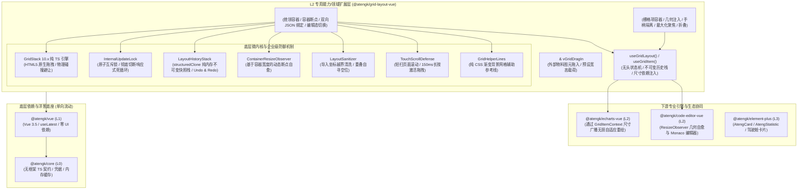

# 0045. GridLayoutVue L2 扩展层架构、GridStack 引擎双向响应式协同与驾驶舱治理规范

- **状态**: accepted
- **日期**: 2026-11-09
- **作者**: Ateng

## 背景与上下文

在《ateng-ui 模块化生态扩展全景蓝图与演进路线图》（`module-expansion-blueprint.md`）确立的阶段四（P0 第一优先级）规划中，`@atengk/grid-layout-vue` 作为 No. 3 王牌扩展子包，承担着为企业级中后台、千人千面自定义工作台、数据大盘与工业驾驶舱提供现代响应式拖拽网格布局与无头状态机治理基础设施的重任。

在现代 Web 前端与企业级系统中，可拖拽网格布局组件长期存在以下核心架构与工程痛点：

1. **历史开源生态断代与 Vue 3.5 响应式失配**：早期的 `vue-grid-layout` 等经典开源包早已年久失修（停滞在 Vue 2 或 Vue 3 早期非规范兼容层），内部充斥过时的鼠标位置计算、裸 DOM 操作与未经防抖的响应式递归，在 Vue 3.5+ 响应式解构传参契约（ADR-0002）与单向数据流规则下极易引发状态污染或白屏；
2. **命令式 DOM 与响应式状态死循环（Feedback Loops）**：拖拽网格底层（如 GridStack、Muuri）属于典型以原生 DOM 几何计算为核心的命令式引擎。在接入 Vue 响应式数据流时，极易陷入“用户拖拽 ➔ 底层引擎抛出 `change` 事件 ➔ `emit('update:layout')` 触发 Vue 响应式更新 ➔ Vue 属性变更触发网格全量 `batchUpdate` ➔ 引擎再次抛出 `change`”的无限更新风暴与掉帧雪崩；
3. **视口断点与容器隔离割裂**：传统网格库普遍硬编码基于 `window.innerWidth` 监听媒体查询切换列数。而在现代企业级系统（如带有 `AtengProLayout` 可折叠侧边栏、`AtengSplitLayout` 分栏抽屉或弹窗）中，页面容器宽度的改变往往与浏览器窗口尺寸无关，导致侧边栏折叠/展开时网格无法感知断点变化产生几何撕裂；
4. **下游重型图表（ECharts/Monaco）尺寸感知脱节**：网格项（GridItem）在被拖拽、缩放或受碰撞避让顺延时，内部包裹的 `@atengk/echarts-vue` 图表或 `@atengk/code-editor-vue` 编辑器无法及时感知真实物理尺寸变动，造成图表文字变形、Canvas 模糊或白边；
5. **外部物料拖入（Drag-In）与撤销重做（Undo/Redo）基础设施缺失**：低代码工作台建设中，用户极度依赖从左侧物料抽屉向网格自由拖入新卡片，并在排版失误时按 `Ctrl+Z` 撤销。现有方案多为业务层编写数百行黑盒胶水代码，缺乏标准化的物料图元与不可变快照栈支持；
6. **企业级运行态只读锁控与触控误触冲突**：绝大多数报表在普通浏览态下必须严格禁用拖拽，且在 iPad/平板触控设备上不能因为滑动页面而误触发卡片挪移；同时需要应对脏数据坐标越界与隐藏 Tab 切换几何恢复自愈；
7. **生命周期双重销毁（Double-Unmount）崩溃**：底层命令式库在调用 `.destroy(true)` 时会强行从 DOM 树中移除容器节点，与 Vue 自身的 VNode 卸载生命周期产生致命竞态碰撞，导致页面切换时抛出 `NotFoundError: Failed to execute 'removeChild' on 'Node'` 未捕获异常。

为此，依循 `ateng-ui` 模块化扩展通用标准（`docs/agents/modular-extensibility.md`），经过严格的 `/grill-with-docs` 三轮极限架构推演，制定本架构决策。

---

## 架构决策矩阵 (Architecture Decisions)



---

## 核心设计规范与契约落地

### 1. 双轨架构与对外暴露契约

`@atengk/grid-layout-vue` 坚守 `ateng-ui` 贯穿 L1/L2 的“**高阶表现容器 + 无头响应式状态机**”双轨制设计：

- **声明式组件套件**：提供 `<AtengGridLayout />`、`<AtengGridItem />`、`<AtengGridPaletteItem />` 与 `vGridDragIn` 指令；
- **无头状态机 Composable**：提供 `useGridLayout()` 与 `useGridItem()`；
- **双向驱动契约**：`<AtengGridLayout />` 支持通过 `controller?: UseGridLayoutReturn` Prop 接收外部由 `useGridLayout()` 初始化的控制器；若外部缺省，组件内部自动自举一个默认控制器并通过 `defineExpose` 100% 完整透出，两种调用姿势体验与能力完全对等。

### 2. 强类型泛型数据模型 `GridLayoutItem<T>` 与自动寻空

```typescript
export interface GridLayoutItem<T = Record<string, unknown>> {
  /** 布局项唯一标识符 (主键) */
  id: string | number;
  /** 网格 X 坐标 (列索引，从 0 开始；缺省或 autoPosition 时由引擎自动寻空) */
  x?: number;
  /** 网格 Y 坐标 (行索引，从 0 开始；缺省或 autoPosition 时由引擎自动寻空) */
  y?: number;
  /** 网格宽度跨度 (占据的列数，默认 1) */
  w?: number;
  /** 网格高度跨度 (占据的行数，默认 1) */
  h?: number;
  /** 最小允许宽度跨度 */
  minW?: number;
  /** 最小允许高度跨度 */
  minH?: number;
  /** 最大允许宽度跨度 */
  maxW?: number;
  /** 最大允许高度跨度 */
  maxH?: number;
  /** 是否锁定位置与尺寸 (禁止任何移动与缩放) */
  locked?: boolean;
  /** 是否禁止调整尺寸 */
  noResize?: boolean;
  /** 是否禁止拖拽移动 */
  noMove?: boolean;
  /** 是否标记为静态项 (脱离拖拽计算，但参与碰撞阻挡) */
  static?: boolean;
  /** 是否开启自动寻找空位插入 (当 x, y 缺省或为 true 时生效) */
  autoPosition?: boolean;
  /** 业务自定义强类型载荷数据 */
  data?: T;
}
```

### 3. 原子互斥锁（`InternalUpdateLock`）阻断更新死循环

为彻底切断 GridStack 原生 DOM 事件与 Vue 响应式 `v-model:layout` 之间的循环反馈风暴：

1. **内部上锁**：当用户在界面拖拽或拉伸卡片触发 GridStack 原生的 `dragstop`、`resizestop` 或 `change` 事件时，控制器立即激活原子互斥锁 `isInternalUpdating = true`；
2. **发射事件**：在互斥锁保护下采集最新节点坐标，发射 `emit('update:layout', nextLayout)` 与 `emit('change', nextLayout)`，并压入不可变历史快照栈；
3. **静默响应**：外部 `v-model:layout` 响应式数据变更回流时，先检查 `isInternalUpdating`。若锁处于激活态，则判定为自身操作触发的回流，静默跳过；若锁未激活（说明是外部业务代码主动通过编程方式调用重置或加载布局），则进行布局指纹比对（基于 ID 与坐标进行轻量比较），仅在发生实质性变更时调用 `grid.batchUpdate()`，并在下一帧释放互斥锁。

### 4. 布局物理学：垂直紧凑吸附（Gravity Compacting）与自由浮动（Float）

- **默认垂直重力紧凑（`float: false`）**：默认启用企业级仪表盘与工作台高频诉求，当上方出现空间时卡片自动向上挤压补齐，消除视觉悬空留白；
- **自由浮动模式（`float: true`）**：支持一键切换为自由画板模式，卡片可停留在网格任意物理坐标，允许任意空白留存；
- **动态碰撞避让（Collision Push）**：卡片在拖拽至已有卡片位置时，受挤压卡片依据重力规则向下顺延避让。

### 5. 容器自适应断点（Container Query Breakpoints）与行高策略

- **基于容器 `ResizeObserver`**：摒弃脆弱的 `window.innerWidth` 视口监听，以容器自身的真实像素宽度驱动响应式多列断点：
  ```typescript
  export interface GridResponsiveBreakpoints {
    /** 超小屏断点 (默认 < 576px，列数 1) */
    xs?: number;
    /** 小屏断点 (默认 < 768px，列数 2) */
    sm?: number;
    /** 中屏断点 (默认 < 992px，列数 6) */
    md?: number;
    /** 大屏断点 (默认 >= 1200px，列数 12) */
    lg?: number;
  }
  ```
- **行高（`cellHeight`）**：默认黄金基线为 `'80px'`，支持像素数值、百分比或 `'auto'`，支持 Prop 响应式热更新。

### 6. 外部物料拖入（Drag-In）与手柄防误触隔离

- **外部图元声明**：提供 `<AtengGridPaletteItem :item="{ w: 4, h: 3, data: { ... } }" />` 组件与 `v-grid-drag-in` 指令，底层对接 GridStack 原生 `setupDragIn`，在鼠标释放时自动完成坐标计算并插入网格；
- **拖拽手柄安全防线**：默认设置 `handle: '.at-grid-drag-handle, .at-grid-item__header'`。卡片内容区（包含 ECharts 图表、Monaco 编辑器、表格翻页与表单输入控件）天然隔离，绝不因用户日常点击或划词选择而误触发卡片整体位移；提供 `draggableEntireItem` 全局配置作为特殊简易看板的逃生门。

### 7. 下游引擎尺寸感知总线（`useGridItem`）与生命周期确定性清理

- **依赖注入上下文**：`<AtengGridItem />` 向其子树注入 `GridItemContext`（包含当前卡片的像素宽高 `width, height`、栅格坐标跨度、`isDragging` 与 `isResizing` 状态），并在每次尺寸稳定后发射广播；
- **ECharts 天然自愈**：插槽内包裹的 `@atengk/echarts-vue` 既可通过自身的 `ResizeObserver` 捕获 DOM 变动，亦可通过 `useGridItem()` 监听尺寸变更完成防抖 `resize()`；
- **保留 DOM 销毁铁律**：在 `<AtengGridLayout />` 的 `onUnmounted` 生命周期中，严格调用底层 `grid.destroy(false)`（强制保留 DOM 节点由 Vue SFC 自行安全卸载），断开所有 ResizeObserver 监听器与全局事件绑定，彻底消除双重卸载引起的 `removeChild` 浏览器控制台致命报错。

### 8. 样式隔离、CSS Tokens 与纯 CSS 辅助线

- **BEM 规范命名**：全量子包类名收敛于 `.at-grid-layout`、`.at-grid-item`、`.at-grid-palette-item` 等；
- **CSS Tokens 体系**：
  ```scss
  :root {
    --at-grid-gap: 12px;
    --at-grid-line-color: rgba(0, 0, 0, 0.06);
    --at-grid-placeholder-bg: rgba(var(--el-color-primary-rgb, 64, 158, 255), 0.1);
    --at-grid-placeholder-border: 2px dashed var(--el-color-primary, #409eff);
    --at-grid-border-radius: 8px;
  }
  ```
- **纯 CSS 网格对齐参考线（Grid Helper Lines）**：开启 `showGridLines: true` 时，通过容器 background 的 `linear-gradient` 与 `background-size` 渲染辅助虚线，编辑态开启、预览态隐藏，零 DOM 节点开销。

### 9. 单卡片聚焦最大化（CardMaximize）与手风琴高度折叠（CardCollapse）

- **最大化聚焦（Maximize）**：支持调用 `maximize(id)` 或插槽内部 `toggleMaximize()`。激活时记录卡片原始几何快照（`originalRect: { x, y, w, h }`），将其临时提升为脱壳覆盖层（覆盖网格全视口，`w: 12, h: full`），并广播尺寸变更触发内部 ECharts 极速无损自适应重绘；还原（`restore()`）时无缝回填原始坐标；
- **高度折叠（Collapse）**：支持调用 `collapse(id)` 或插槽内部 `toggleCollapse()`。折叠时将 `h` 置为 `1` 并设置 `noResize: true`，仅露出头部标题栏，下方垂直空间自动被重力吸附挤占补齐；再次展开时恢复原高度。

### 10. 全局编辑/运行双模治理（EditViewDualMode）与细粒度权限锁

- **运行态只读安全（`editable: false`）**：组件默认为只读运行态，全局禁用所有拖拽、缩放、手柄与虚线，鼠标保持正常指针，保障报表查看态 0 误触；
- **编辑态按需激活（`editable: true`）**：显式开启后方展示参考虚线、激活手柄与缩放锚点，解锁外部物料拖入；
- **细粒度卡片锁覆盖**：即便在 `editable: true` 下，显式标注 `locked: true` 或 `static: true` 的特定系统卡片依然保持锁定，不可拖动或删除，满足企业多级权限治理需求。

### 11. 布局 Schema 导入防越界、自动去重与坐标自愈器（LayoutSanitizer）

在外部 JSON 注入网格之前执行纯函数数据清洗：

- **越界纠偏**：若 `x + w > column`，自动将 `x` 纠偏或将 `w` 裁剪至安全列数范围内；
- **极值兜底**：若 `w <= 0` 或缺失，重置为 `minW` 或默认值 `1`；
- **重叠自愈**：若检测到两张卡片具有完全重叠的 `x` 与 `y`，自动将后继卡片标记为 `autoPosition: true`，由 GridStack 核心算法自动扫描空位插入，彻底杜绝坐标冲突白屏。

### 12. 触控设备页面滚动与卡片拖拽防冲突护栏（TouchScrollDefense）

针对 iPad 及移动端大盘查看场景实施三层手势防线：

1. `editable: false` 运行态下触控完全不拦截事件，原生丝滑上下惯性滚动；
2. 编辑态下严格遵循手柄隔离，在卡片主体滑动 100% 响应页面原生滚动；
3. 手柄触控增加防抖长按延时 `touch: { delay: 150 }`，轻扫一律视为页面滚动，唯有手柄长按超过 150ms 才激活拖拽并触发微触感反馈。

### 13. 一键智能规整（AutoTidyCompacting）与隐藏 Tab / KeepAlive 唤醒自愈（TabWakeupHealing）

- **一键消除空洞（`tidyLayout()`）**：在自由浮动或多次删除卡片后，支持调用 `tidyLayout()`，在保持卡片横纵相对顺序的前提下一键向上压缩排实，消除零碎间隙；
- **隐藏 Tab 唤醒自愈**：当网格置于 `<el-tab-pane>` 或 `<KeepAlive>` 中由 `display: none`（`0x0`）恢复显示时，容器 `ResizeObserver` 捕获非零几何恢复事件，自动触发 `grid.onParentResize()` 并广播子树自适应重绘，彻底解决切 Tab 后的尺寸坍塌问题。

---

## 1:1 独立体验展厅规划 (`sample-grid-layout-vue`)

展厅固定分配端口 **`3013`**，构建 5 大分层实测可视化看板：

1. **基础栅格与双向 JSON 绑定看板**：动态增删卡片、12 列/6 列实时切换、数据流双向双同步实测；
2. **物理排版模式切换看板**：垂直重力紧凑（Gravity Compact）与自由悬浮（Float）即时切换，静态锁定（Static/Locked）碰撞防御演示；
3. **ECharts 千人千面驾驶舱看板**：真实嵌入 `@atengk/echarts-vue` 趋势图、漏斗图与极值仪表盘，实测拖拽/缩放全流程中的图表自适应无损重绘，并演示单卡片最大化聚焦与高度折叠；
4. **外部物料抽屉拖拽入网格看板**：左侧物料库面板提供“统计指标、图表部件、列表部件”，实测无缝拖入网格并自动寻空补位；
5. **企业级治理与持久化看板**：实测 `editable` 编辑/运行双模切换、脏数据导入自愈校验、`Ctrl+Z` / `Ctrl+Y` 撤销重做快照栈，以及 `localStorage` 布局保存与一键规整（Auto-Tidy）。

---

## 准出红线与十二道防线守护

1. **空安全保底**：`layout` 为空或初始化异常时统一保底返回 `[]`，严禁抛出 undefined；
2. **单向洋葱拓扑**：本子包仅依赖 L0 (`@atengk/core`)、L1 (`@atengk/vue`) 与第三方核心 `gridstack`，严禁物理硬编码依赖 L3 (`@atengk/element-plus`)；
3. **确定性销毁**：`grid.destroy(false)` 守卫生命周期，无内存泄漏与孤儿监听器；
4. **零 any 与双模构建**：全接口采用强类型与泛型设计，构建输出 ESM + CJS + DTS。
