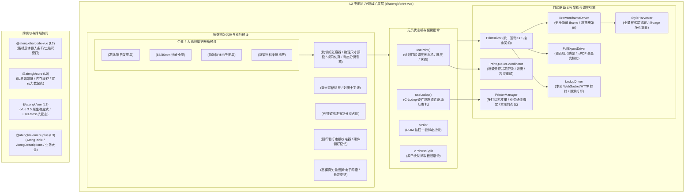

# 0046. PrintVue L2 扩展层架构、多驱动打印调度与精准单据排版治理规范

- **状态**: accepted
- **日期**: 2026-11-10
- **作者**: Ateng

## 背景与上下文

在《ateng-ui 模块化生态扩展全景蓝图与演进路线图》（`module-expansion-blueprint.md`）确立的阶段五（P1 第二优先级）规划中，`@atengk/print-vue` 作为 No. 4 企业高频生产力核心扩展子包，承担着为企业级中后台、仓储物流（WMS/TMS）、零售收银（POS）、政企财务报销与医疗处方提供专业静默打印、多规格纸张精准排版、分页防撕裂截断与高保真 PDF 矢量导出的基础设施重任。

在传统 Web 前端与企业级生产系统中，文档与票据打印领域长期存在以下深层次工程与架构痛点：

1. **样式抓取丢失与浏览器页眉页脚污染**：现代 Vue 3 + Vite 工程多采用 Scoped CSS 或 CSS Modules，常规调用隐藏 iframe 打印时克隆出的 DOM 节点脱离了宿主环境，由于丢失样式呈现为未排版的裸 HTML；同时，浏览器原生打印弹窗默认在纸张边缘强制打印灰色 URL、网页标题、时间与页码，严重破坏严肃单据的美观性与合规性；
2. **长单据表格跨页撕裂与动态页码失真**：当发货单或明细表格超过一页时，原生浏览器打印经常将一行文字、条形码或表格行从物理纸张底端切成两半（文字上半截在第一页，下半截在第二页）；此外，原生 DOM 打印无法精准动态获取并渲染“第 X 页 / 共 Y 页”的准确物理页码；
3. **缺少工业级静默打印与硬件直连协议**：仓储打包台与商超收银台要求出库单或热敏小票绕过操作系统的打印预览弹窗，直接毫秒级发送给指定物理打印机。传统前端缺乏统一的 C-Lodop / 本地硬件驱动封装与端口心跳探针，在 HTTPS 生产站点下频繁遭遇 Mixed Content 混合内容拦截或离线挂起；
4. **针式打印机连续打孔多联单跳页故障**：财务发票与出入库三联单普遍采用 Epson 等针式打印机与链式打孔连续纸（如 241×140mm 二等分单）。若驱动层缺少精确走纸指令，打印机每打完一张就会默认空走纸至 297mm（A4 纸高度）才停止，造成大量特种连续复写纸报废；
5. **预印套打单据机械走纸偏差无校准能力**：在预印防伪税票、特种运单套打场景中，不同物理打印机的进纸机械滚轮存在 1~3 毫米物理走纸误差。若缺乏微调偏移模型与持久化校准工具，打印文字与金额无法对准预印格子；
6. **多打印机协同路由混乱**：同一工作站通常并存 A4 激光机、热敏条码机与针式票据机，缺乏按单据业务类型定向绑定目标打印机并持久化偏好的无头管理器；
7. **纯前端 PDF 导出 Canvas 内存崩溃与跨域图片污损**：使用 `html2canvas` 导出包含数十页的长单据时，巨大单体 Canvas 会瞬间突破浏览器尺寸上限引发显存 OOM 崩溃；且一旦单据包含远端 OSS/CDN 电子印章或 Logo，Canvas Tainting 跨域安全报错会导致整个导出任务彻底中断；
8. **UI 库强耦合破坏四层洋葱拓扑**：社区现有打印组件往往在底层直接硬编码调用 `ElMessage`、`ElNotification` 或 `ElDialog`，违反了 L2 领域扩展包零 UI 强依赖与跨框架平台中立性红线。

为此，依循 `ateng-ui` 模块化扩展通用标准（`docs/agents/modular-extensibility.md`），经过深入的 `/grill-with-docs` 三轮极限架构推演，制定本架构决策。

---

## 架构决策矩阵 (Architecture Decisions)



---

## 核心架构设计与工程防线细则

### 1. 多驱动打印 SPI 体系与 C-Lodop 优雅降级契约

`@atengk/print-vue` 彻底摒弃单一硬编码打印模式，确立策略模式驱动的 `PrintDriver` SPI 插件化架构：

```ts
export interface PrintOptions {
  driver?: 'browser' | 'pdf' | 'lodop' | string;
  printer?: string;
  copies?: number;
  orientation?: 'portrait' | 'landscape';
  autoPaginate?: boolean;
  extraCss?: string | string[];
  fallbackToBrowser?: boolean;
  onProgress?: (progress: PrintProgress) => void;
  onSuccess?: () => void;
  onError?: (error: PrintException) => void;
}

export interface PrintDriver {
  readonly name: string;
  isAvailable(): Promise<boolean>;
  print(target: HTMLElement | string, options?: PrintOptions): Promise<void>;
  cancel?(): void;
}
```

- **三大内置核心驱动**：
  1. **`BrowserIframeDriver`**：构建零外部侵入的隐藏 `iframe`，挂载克隆 DOM 节点并调用 `window.print()`，适配所有现代 PC/移动端浏览器；
  2. **`PdfExportDriver`**：基于 `jspdf` 与 `html2canvas` 构建纯前端离线光栅化与矢量导出，输出可供归档与传输的 `Blob` 或一键触发本地下载；
  3. **`LodopDriver`**：面向工控与仓储，建立与本地 C-Lodop 服务的通信信道，支持完全无弹窗的静默打印。
- **C-Lodop 双轨探针与离线降级熔断**：
  - 针对 HTTPS 站点混合内容安全策略，自动优先探测 `https://localhost:8443/CLodopfuncs.js`，降级探测 `http://localhost:8000` / `18000`，单次探测配置 2000ms 快速超时；
  - 提供 `fallbackToBrowser` 降级逃生门：当 C-Lodop 未安装或未启动时，若开启降级则自动退回至 `BrowserIframeDriver` 唤起浏览器弹窗打印，杜绝业务流程死锁；若关闭降级则抛出携带驱动下载引导 URL 的强类型 `PrintException`。

### 2. 纸张排版容器、毫米物理尺寸模型与动态分页防撕裂引擎

- **物理尺寸预设与视口仿真**：
  - `<AtengPrintSheet />` 内置企业主流物理纸张规格：`a4` (210×297mm)、`a5` (148×210mm)、`receipt-80` (80mm 宽连续卷纸)、`receipt-58` (58mm 宽连续卷纸)、`continuous-241-140` (241×140mm 针式二等分多联单) 与 `continuous-241-93` (241×93mm 三等分单)，同时开放 `width`、`height` 自定义毫米入参；
  - 屏幕预览态下自动计算 1:1 物理白底黑字阴影纸张仿真，配合 `<AtengPrintRuler />` 提供毫米级坐标刻度与十字辅助线。
- **双模动态分页与防截断算法**：
  - **原生 CSS 模式**：通过标准 `@media print` 隔离样式与 `@page { size: ...; margin: ... }` 驱动基础换页；
  - **动态分页引擎（`autoPaginate: true`）**：在 DOM 挂载时，根据物理纸张净有效高度（`height - marginTop - marginBottom - headerHeight - footerHeight`）遍历子节点：
    - 当扫描到被指令 `vPrintNoSplit`（或 `.at-print-no-split`）标记的行/卡片时，若当前块跨越了分页切割线，则自动将该块完整推入下一物理页作为首个元素；
    - 在分页处自动无缝闭合上一页，并在每页底部通过插槽动态注入当前页码与总页数 `{ pageIndex, totalPages }`，彻底根除跨页文字被横切撕裂的顽疾。

### 3. 逐页 DOM 切片渲染与 PDF 导出内存防爆保护

为解决超长单据 `html2canvas` 导致超大 Canvas 崩溃（WebGL / Canvas 尺寸上限）与内存泄露问题，`PdfExportDriver` 实行**逐页 DOM 隔离切片管线（Per-Page Slicing）**：

1. 将被打印内容按物理页拆解为独立的 Page DOM 集合；
2. 循环处理各个单页：执行 `html2canvas(pageDom, { scale: window.devicePixelRatio || 2, useCORS: true })`；
3. 将生成的独立页面 Canvas 图像写入 `jsPDF.addImage(...)`；
4. 立即调用 `canvas.width = 0; canvas.height = 0` 显式销毁 Canvas 上下文与图形显存；
5. 插入下一页 `pdf.addPage()` 直至全部页面完成，最终流式组装为统一的 PDF 二进制 Blob。

### 4. 样式深度抓取与页眉页脚彻底净化 (StyleHarvester)

- **自动抓取机制**：`StyleHarvester` 在唤起隐藏 iframe 打印时，自动遍历当前宿主主文档 `<head>` 中所有的 `<style>` 与 `<link rel="stylesheet">`，将其完整克隆至打印沙箱，保证单据在任何 CSS 预处理器与 UI 库下 100% 高保真还原；
- **全网零污染净化**：向打印环境显式注入 `@page { margin: 0; size: auto; }` 与统一的 Reset 样式，彻底清除浏览器在页面四角默认附加的 URL、日期与页面标题；单据的内边距由 `<AtengPrintSheet>` 的 `padding` 物理属性严格受控管理。

### 5. 批量打印并发队列调度器 (PrintQueueCoordinator)

针对批量出库单、物流面单等高频连续打印场景：

- 提供 `printBatch<T>(items: T[], renderFn: (item: T) => HTMLElement, options?: BatchPrintOptions)` 编程接口；
- **受控并发限流（Concurrency Limit）**：默认受控并发调度，防止 100+ 单据并发提交引发浏览器主线程严重卡死与 C-Lodop 本地服务连接风暴；
- **响应式状态感知与容灾重试**：实时分发 `progress: { current, total, percentage, successCount, failedCount }` 事件；单任务遇到驱动异常时支持独立重试或安全熔断跳过，并在批处理结束时输出结构化报告。

### 6. 预印单据毫米套打校准器与硬件偏好记忆 (AtengPrintCalibrator)

- **毫米微调位移模型**：`<AtengPrintSheet />` 声明式接收 `offsetX` / `offsetY`（单位 mm），对整个打印图元实施平移变换；
- **可视化十字基准校准组件**：提供 `<AtengPrintCalibrator />` 辅助组件，可一键在目标打印机上输出带有十字标尺与毫米坐标网格的物理校准样张；操作员测量误差后在界面输入校正值；
- **本地硬件存储绑定**：支持 `storageKey`（如 `at_print_calib_waybill`），自动将校准参数固化在当前终端的 `localStorage`，不同工位或不同打印机各存一套物理偏好，永久有效。

### 7. 业务多打印机路由与偏好管理 (PrinterManager)

- 无头单例管理器 `PrinterManager` 负责调用 C-Lodop 原生探针扫描本地操作系统已安装的物理打印机列表（包含驱动名、物理端口与系统默认标记）；
- 支持业务命名通道映射：`printerManager.bind('express', 'Zebra-GK888t')`、`printerManager.bind('invoice', 'EPSON-LQ-690K')`，并将映射持久化至本地存储；在提交打印任务时自动按业务标识命中目标硬件。

### 8. 电子印章容器与跨域图片防污损保护 (AtengPrintSeal)

- **`<AtengPrintSeal />` 表现容器**：内置纯矢量 SVG 动态印章渲染器（支持五角星、环形单位名称、防伪编码与业务章专用字体），亦支持透明 PNG 图片加载；原生支持 `-15deg` 等拟真倾斜角度与 `pointer-events: none` 浮动悬浮覆盖；
- **Canvas 跨域防污损卫语句**：在 PDF 导出管道前置执行图片资源探测，支持配置 `useCORS: true`；遇缺失 CORS 响应头的第三方图片时自动降级或代理清洗，杜绝 `SecurityError: The operation is insecure` 崩溃。

### 9. 4 大高频企业单据开箱即用预设矩阵

为杜绝业务工程师从零手写复杂单据 CSS，包内收敛 4 大高频开箱即用预设组件：

1. **`<AtengInvoiceSheet />`**：标准发货与销售发票单，内置企业表头、客户信息网格、明细条目表格、金额自动转大写（复用 `@atengk/core` 工具库）与三联经手人盖章栏；
2. **`<AtengReceiptSheet />`**：连续热敏小票单据，内置 58/80mm 宽度自适应、居中抬头、点单条目列表与底部锯齿虚线切纸符；
3. **`<AtengWaybillSheet />`**：标准三段码物流快递电子面单，网格化布局预留条码/二维码插槽（与 `@atengk/barcode-vue` 插槽解耦联动）；
4. **`<AtengLabelSheet />`**：仓储货架物料条码标签，支持自定义行列数与微小字号排版。

---

## 四层洋葱拓扑与成熟度十二道防线对齐

1. **单向依赖与 L2 纯净律（防线 6、11）**：
   - 依赖严格收敛为：`@atengk/core` (L0) + `@atengk/vue` (L1) + `print-js` / `jspdf` / `html2canvas`；
   - 生产代码 100% 严禁物理依赖或直接调用 Element Plus 等具体 UI 库组件（如 `ElMessage`、`ElNotification`、`ElDialog`），所有弹窗与提示交由事件抛出或由宿主/Sample 接管。
2. **确定性资源清理与生命周期闭环（防线 2）**：
   - 隐藏打印 `iframe` 在 `onafterprint` 或超时后 100% 自动从 DOM 中 `removeChild` 移除；
   - 临时生成的 Blob URL（如 `URL.createObjectURL(pdfBlob)`）在打印完毕或下载后 100% 调用 `URL.revokeObjectURL` 释放；
   - 导出中生成的临时 Canvas 对象显式将宽高置零释放显存，杜绝单据连打时的内存泄露。
3. **因果异常体系与空安全保底（防线 1、7）**：
   - 所有网络探测错误、C-Lodop 离线、Canvas 跨域异常均转译为强类型 `PrintException`，保留原始 `cause` 链；
   - 打印机列表、任务队列集合等均以空数组 `[]` 保底返回，杜绝 NPE。

---

## 1:1 自验展厅 `apps/sample-print-vue` 看板规划

独立展厅按 ADR-0039 规范落地，分配固定端口 **3014**，包含 5 大可视化交互看板路由：

1. **`/sheets` — 多规格纸张标尺与排版仿真看板**：动态切换 A4、A5、58/80mm 热敏卷纸、241mm 针式三联单，实时体验毫米网格标尺、缩放比例与辅助线；
2. **`/drivers` — 多驱动调度与样式保真看板**：无头 iframe 浏览器打印 vs 高保真 PDF 导出实时对比，验证 StyleHarvester 样式抓取与页眉页脚净化；
3. **`/pagination` — 长单据分页防撕裂与页码看板**：100 行动态采购明细表，对比开启/关闭 `autoPaginate` 与 `vPrintNoSplit` 的效果，观察跨页行完整保护与总页数计算；
4. **`/batch-queue` — 批量单据并发调度大盘**：模拟 50 张批量发货单调度，可视化展示并发限流、进度百分比、暂停/继续与失败故障隔离；
5. **`/lodop-terminal` — C-Lodop 硬件探针与模拟控制台**：本地服务探测模拟、打印机设备枚举、多打印机业务路由、预印套打十字校准器 `<AtengPrintCalibrator />` 交互与电子印章 `<AtengPrintSeal />` 渲染。

---

## 结论与后续演进

本架构决策确立了 `@atengk/print-vue` 作为企业级专业打印基础设施的核心蓝图，全面攻克了现代 Web 打印领域中的样式丢失、长表格撕裂、C-Lodop 离线悬挂、连续纸跳页、预印套打走纸误差与超大 PDF 导出内存崩溃等全部关键痛点。

在后续实施阶段，遵循阶梯二四合一准出验证门禁与 Sample-First 铁律推进子包代码自举、单元测试编写、1:1 展厅搭建与五维文档交付。
