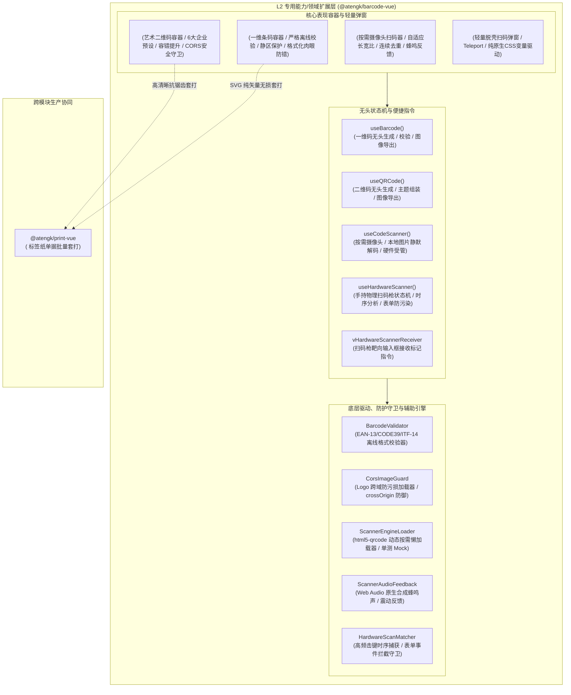

# 0047. BarcodeVue L2 扩展层架构、全场景条码生成与按需扫码治理规范

- **状态**: accepted
- **日期**: 2026-11-10
- **作者**: Ateng

## 背景与上下文

在《ateng-ui 模块化生态扩展全景蓝图与演进路线图》（`module-expansion-blueprint.md`）确立的阶段五（P1 第二优先级）规划中，`@atengk/barcode-vue` 作为 No. 5 高频企业生产力核心扩展子包，承担着为企业级仓储物流（WMS/TMS）、零售收银（POS）、智能制造生产线、医药追溯、资产盘点以及与 `@atengk/print-vue` 协同进行单据/标签套打提供一维条码、高保真艺术二维码与按需动态扫码器的基础设施重任。

在传统 Web 前端与工控边缘系统中，条形码、二维码与视觉扫码领域长期存在以下深层次工程与架构痛点：

1. **渲染模式混乱导致单据打印模糊与高分屏失真**：传统条码库多依赖单一 Canvas 绘制，在嵌入 `@atengk/print-vue` 进行毫米级矢量单据打印或缩放看板时，条码边缘严重模糊、锯齿失真，导致工业扫码枪拒读；
2. **条码编码校验缺失引发全站未捕获崩溃**：底层 `jsbarcode` 在遇到非法字符（如 EAN-13 传入非 12/13 位纯数字、CODE39 传入小写或特殊字符、动态接口返回空串 `""`）时，会**直接同步抛出未捕获异常**，导致业务表格与页面大面积白屏崩溃；
3. **艺术二维码配置碎片化与 Logo 跨域防污损缺失**：`qr-code-styling` 虽然支持高保真定制，但配置深层繁琐。业务若直接传入大尺寸 Logo 且未提升纠错级别，会导致二维码无法被物理扫码设备识别；更严重的是，当远端 CDN/OSS 图片未配置 CORS 时，Canvas 会发生 `Tainted` 污损，导致后续前端图片导出抛出 `SecurityError` 阻断业务；
4. **扫码库体积庞大（150KB+）引发主产物打包膨胀**：`html5-qrcode` 包含完整的解码引擎与 WebRTC 采集能力。绝大多数中后台业务仅需条码生成，若静态打包会导致不使用扫码的页面被迫下载沉重的冗余依赖，严重违反零臃肿底座原则；
5. **摄像头流与解码 Worker 缺乏确定性销毁机制**：扫码组件卸载（`unmount`）、Tab 切换（`visibilitychange`）或弹窗关闭后，底层视频流未彻底停轨，导致移动端和工业平板摄像头红灯常亮、电池发热与内存泄漏；
6. **手持物理扫码枪（HID 虚拟键盘）疯狂污染业务表单**：在车间与仓库现场，80% 以上的作业使用 USB/蓝牙扫码枪，本质是模拟高速键盘敲击。若当前用户光标正聚焦于普通表单输入框，扫码枪输出的高速字符串会强行打入文本框，造成严重的数据污染；
7. **缺少流水线连续高速过机与去重冷却窗口**：在流水线打包或盘点场景下，需要连续不间断扫码。若缺乏同码去重冷却机制（如 1.5 秒内同码不重复上报）与异码即刻触发机制，会导致单件商品瞬间被重复录入数十次；
8. **破坏四层洋葱拓扑硬编码 UI 库组件**：社区现有扫码库往往直接在底层强行引入 `ElButton`、`ElDialog` 或 `ElMessage`，破坏了 L2 专用能力扩展层的跨框架平台中立性与零 UI 强依赖契约。

为此，依循 `ateng-ui` 模块化扩展通用标准（`docs/agents/modular-extensibility.md`），经过深入的 `/grill-with-docs` 两轮极限架构推演，制定本架构决策。

---

## 架构决策矩阵 (Architecture Decisions)

---

## 核心架构原则与技术契约

### 1. SVG 优先与智能高分屏自适应双模渲染 (Q1 决议)

- `<AtengBarcode />` 与 `<AtengQRCode />` 默认采用 `render-type="svg"` 纯矢量渲染模式：
  - 完美契合 `@atengk/print-vue`，在标签纸、物流面单与发票上物理放大 100% 锐利无失真；
  - 消除 DOM 尺寸未就绪时的 Canvas 宽高失真与拉伸变形。
- 当配置 `render-type="canvas"` 时，容器自动绑定 `window.devicePixelRatio` 进行 2x/3x 画布物理缩放与 CSS 像素补偿，彻底杜绝 Retina 视网膜屏上的模糊锯齿。
- 提供抹平底层差异的图像导出工具函数 `exportAsImage(format: 'png' | 'jpeg' | 'svg' | 'blob')`，内部原生处理 SVG 转栅格 Canvas 及图片下载。

### 2. 前置离线防崩溃校验引擎与多态优雅降级 (Q2 决议)

- 内置轻量、零依赖的纯 TS 校验引擎 `BarcodeValidator`：
  - 前置校验 EAN-13、EAN-8、CODE39、ITF-14 等格式的字符合法性、偶数位约束与奇偶校验码；
  - 面对空值 `""`、未定义或非法入参时，严格拦截并触发 `onError` 事件，**绝对严禁直接抛出未捕获运行时异常导致页面白屏**；
  - 提供 `#error="{ message, value }"` 具名插槽与默认骨架灰色占位条块，实现优雅降级。

### 3. 二维码 6 大企业级主题预设与安全容错护栏 (Q3、Q8 决议)

- 封装开箱即用 6 大企业级设计主题预设（`preset`）：
  1. `standard`：纯黑白直角（高保真打印与极端工业现场首选）；
  2. `industrial`：高对比冷灰钛金（设备铭牌与资产标签专用）；
  3. `tech-blue`：现代科技蓝微圆角渐变（SaaS 平台与企业中台）；
  4. `elegant-dots`：柔和点阵圆角风格（对外营销宣传与单页）；
  5. `classy`：典雅商务风格（高端商务与证书凭据）；
  6. `minimal-fluid`：流体微圆角渐变（移动端 Web 交互）。
- **容错级别自动提升与尺寸安全护栏**：只要检测到传入 `logo`，且用户配置的纠错级别低于 `Q`（25% 容错），系统自动智能提升为 `Q` 或 `H`（30% 容错），且限制 Logo 尺寸默认不超过二维码总宽高的 25%，自动清空 Logo 下方码点（`hideBackgroundDots: true`）并包裹白色防干扰保护圈。
- **跨域防污损加载器（`CorsImageGuard`）**：自动注入 `crossOrigin="anonymous"`；若检测到跨域未放行，降级为 SVG 嵌入或触发安全告警，绝不让 Canvas 产生 `Tainted` 污损阻断导出。

### 4. 一维条码工业级文字排版与肉眼防错分组 (Q7 决议)

- 提供全功能文本排版控制：`displayValue`、`textPosition: 'bottom' | 'top'`、`textAlign: 'center' | 'left' | 'right'`、`font`、`fontSize` 与 `textMargin`。
- **肉眼防错格式化管道（`formatText`）**：支持传入自定义格式化函数 `formatText?: (code: string) => string`，在不破坏条码实际机器扫描内容的前提下，将展示文本按空格或短划线分段展示（如 `690 1234 56789 0`），内置 EAN-13、ITF-14、ISBN 等标准分组模板。
- **工业静区（Quiet Zone）保护**：强制管控条码四周留白（默认 10px 边距），保证在深色底纸或金属材质上依然保有充足的激光反射区。

### 5. 扫码引擎动态按需懒加载与确定性生命周期治理 (Q4 决议)

- `<AtengCodeScanner />` 与 `useCodeScanner()` 底层依赖的 `html5-qrcode` 强制通过动态 `import('html5-qrcode')` 进行异步懒加载，生成端打包产物实现**零冗余打入**。
- **确定性硬件生命周期闭环**：
  - 在组件 `onUnmounted`、`onScopeDispose` 或页面进入后台（`document.visibilitychange` 且 `hidden`）时，**100% 强制停止并释放摄像头视频轨道（`track.stop()`）与 Worker 解码线程**，杜绝摄像头指示灯常亮与后台发热；
  - 内置离线与自动化测试 Mock 驱动模式，在 Vitest / happy-dom 无物理摄像头的环境下自洽完成状态流转测试。

### 6. 扫码构型自适应与本地图片静默解码 (Q9 决议)

- **自适应长宽比扫码框**：支持 `scanMode: 'qr-code' | 'barcode' | 'all'`。当指定 `scanMode="barcode"` 时，取景器自动切换为 3:1 或狭长宽屏矩形，并将解码器算法收敛为一维码解码集，大幅提升帧率并降低 CPU 功耗。
- **多模态文件与剪贴板解码**：`<AtengCodeScanner />` 原生支持直接向取景框拖入图片、点击上传图片文件、以及监听 `Ctrl+V` 剪贴板截图进行快速静默解码；无头状态机对外提供 `decodeFile(fileOrBlob)` 纯函数 API。

### 7. 单次核销 vs 流水线连续高速扫码双模 (Q10 决议)

- 支持 `mode: 'single' | 'continuous'`：
  - `single`（单次模式）：扫码成功后立即停止采集流，派发结果并执行自动关闭或流转；
  - `continuous`（连续模式）：视频流不中断，标配 `duplicateIntervalMs`（同码去重冷却时间，默认 1500ms），即同条码短时间内只上报一次；但只要检测到不同的新条码，**零延迟立即响应（Zero Delay for New Codes）**，完美支撑传送带与批量盘点。
- **零外部静态依赖音频反馈**：扫码成功时，基于 Web 原生 Web Audio API 动态合成短促清脆的蜂鸣声（880Hz / 150ms BEEP），并协同 `navigator.vibrate` 触发震动。

### 8. 手持工业扫码枪（HID）状态机与表单防污染守卫 (Q5、Q11 决议)

- 提供 `useHardwareScanner(options)` 工业级手持扫码枪无头监听器：
  - **毫秒级脉冲时序捕获**：以连续击键时间阈值（默认 `< 30ms`）与结束符（`Enter`/`Tab`）算法，严格区分人类手动打字（> 80ms）与扫码枪高频脉冲输入；
  - **表单防污染守卫（Form Guard）**：当检测到扫码枪脉冲且当前激活焦点（`activeElement`）为普通输入框时，若该输入框未标记 `vHardwareScannerReceiver`，自动在捕获阶段调用 `event.preventDefault()` 和 `event.stopPropagation()`，彻底拦截条码字符打入无关文本框造成脏数据；
  - 提供 `vHardwareScannerReceiver` 指令，实现全页面任意焦点状态下扫码结果定向投递至指定输入框。

### 9. 四层洋葱拓扑合规与表现形态解耦 (Q6 决议)

- `@atengk/barcode-vue` 归属 L2 专用能力/领域扩展层，严格遵循单向无环依赖律，**100% 严禁物理依赖或逆向引用 L3（`@atengk/element-plus`）**。
- 表现层全部采用 `.at-barcode-*`、`.at-qrcode-*`、`.at-code-scanner-*` CSS 命名空间与 Scoped 样式隔离，完全基于 CSS 变量驱动。
- 提供轻量脱壳扫码弹窗 `<AtengCodeScannerModal />`（纯原生 CSS 变量 + Teleport 驱动），可直接在无 UI 库环境下独立运行；若在 L3 消费，宿主可通过默认插槽将其无缝包装入 `AtengDialog` 或 `ElDialog`。

---

## 工业级成熟度十二道防线对照表

| 防线条目                                | 落地设计与防御契约                                                                                                               |
| :-------------------------------------- | :------------------------------------------------------------------------------------------------------------------------------- |
| **1. 空安全保底返回**                   | 入参为空串或空数组时统一返回兜底结构，设备列表查询无可用摄像头时保证返回 `[]`，严禁抛出 `null` 或 `undefined`。                  |
| **2. 确定性生命周期与句柄清理**         | 扫码器摄像头 `MediaStreamTrack.stop()`、解码 Worker 销毁、`keydown` 监听器、`AudioContext` 关闭在组件卸载时 100% 确定性销毁。    |
| **3. 严格无状态与单向数据流**           | 组件严禁直接突变外部传入的 Props，扫码状态通过 `emit` 或 `defineModel` 回传，无头 Hooks 状态内部通过 `readonly()` 保护。         |
| **4. 对称语义完备性**                   | 扫描器提供对称的 `start() / stop()`、`pause() / resume()`、`openTorch() / closeTorch()`、`listen() / unlisten()` 完备门面。      |
| **5. 分层防卫与快速失败**               | `BarcodeValidator` 在前置阶段校验非法字符与非法长度，非法状态触发 `onError` 与友好兜底，阻断底层异常外抛。                       |
| **6. 平台与跨框架中立防御**             | L2 包保持中立，零 Element Plus 依赖；纯 TypeScript 工具类与校验引擎保持 100% 纯中立。                                            |
| **7. 因果异常体系与驱动解耦**           | 底层扫码权限拒绝（`NotAllowedError`）、找不到设备（`NotFoundError`）统一转译为领域异常并附带明确中文诊断提示与原始 cause 链。    |
| **8. 原生优先与零臃肿底座**             | 优先复用 Web 原生 API（Web Audio、WebRTC、Canvas、ResizeObserver），动态懒加载 `html5-qrcode`，严禁引入 lodash 等臃肿库。        |
| **9. 对抗性极限单测与 1:1 Sample 守护** | 单测覆盖非法条码容错、Logo 跨域防污损、扫码枪时序识别、同码去重冷却与卸载硬件释放，配套 `apps/sample-barcode-vue`（端口 3015）。 |
| **10. 零 any、禁裸非空断言与显式导出**  | 生产代码 100% 严禁裸 `any` 与裸断言 `!`，子包顶层 `src/index.ts` 100% 显式具名导出所有公开组件、Hooks 与 TypeScript 接口。       |
| **11. 无头层与 UI 表现彻底解耦**        | 无头 Hooks（`useBarcode`、`useCodeScanner` 等）纯状态机运转，严禁直接调用或弹出具体 UI 库弹窗。                                  |
| **12. 受管整洁代码与文档注释**          | SFC 文件不超过 400 行，TS 文件不超过 500 行，公开 API 标配中文 JSDoc、`@author Ateng` 与 `@since 2026-11-10`。                   |

---

## 结论与后续演进

本架构决策确立了 `@atengk/barcode-vue` 的核心设计树、API 规范与非功能质量防线。所有决策均通过两轮 `/grill-with-docs` 严格推演与评审，将作为后续模块实施的不可违背之基准。
