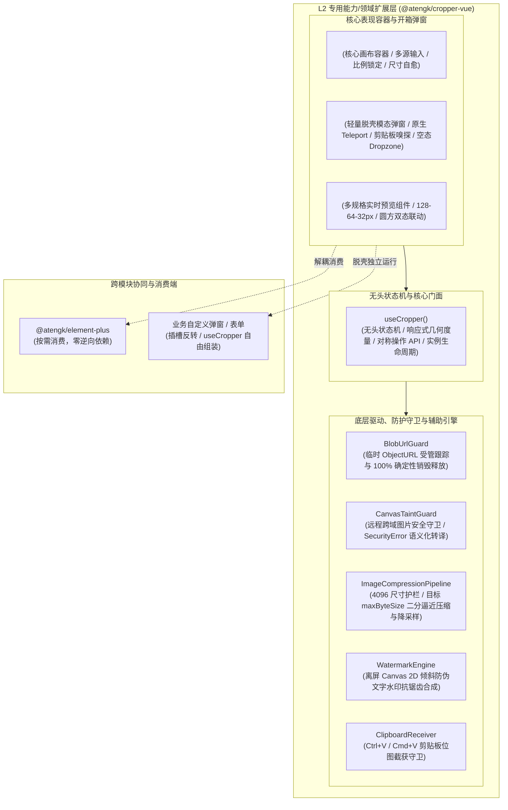

# 0048. CropperVue L2 扩展层架构、物理透明切片与多轨导出治理规范

- **状态**: accepted
- **日期**: 2026-11-10
- **作者**: Ateng

## 背景与上下文

在《ateng-ui 模块化生态扩展全景蓝图与演进路线图》（`module-expansion-blueprint.md`）确立的阶段五（P1 第二优先级）规划中，`@atengk/cropper-vue` 作为 No. 6 企业级高频视觉处理扩展子包，承担着为个人中心头像设置、电商平台商品主图/详情图规范化裁切、内容横幅（Banner）制作以及政企金融敏感资质证件审核提供工业级图片裁剪与图像处理基础设施的重任。

在传统 Web 前端与企业级应用中，图片裁剪与处理领域长期存在以下深层次工程与架构痛点：

1. **强耦合重型 UI 库导致架构拓扑污染**：社区现有 Vue 裁剪封装往往直接强依赖 Element Plus、Ant Design 的 `el-dialog` 或 `a-modal`，破坏了 `ateng-ui` 四层洋葱拓扑的单向无环依赖律（ADR-0009），使得轻量化业务或无 UI 纯状态机场景无法独立复用；
2. **多源输入适配脆弱与临时 ObjectURL 内存泄漏**：业务中图片输入形态多样（本地 `File`、二进制 `Blob`、Base64 DataURL、HTTP 远程链接及 `blob:` URL）。开发者手动调用 `URL.createObjectURL` 极易遗漏 `revokeObjectURL`，在高频换图、列表切换或快速弹窗关闭时引发严重内存泄漏；
3. **圆形头像裁剪黑角与虚假透明**：业界绝大多数封装仅通过 CSS `border-radius: 50%` 实现了 DOM 视口上的视觉圆形遮罩，导出时依然输出带有底色或黑角的正方形图片，迫使后端存储和多端渲染承担额外的圆角处理与兼容成本；
4. **超大图片爆显存与接口 413 载荷超限**：用户上传几十兆（如 4800 万像素、8000×6000）的高清单反原图时，Canvas 导出容易触碰浏览器内存上限导致白屏崩溃，或者导出的 Blob 巨大导致后端接口拒绝；
5. **缺少企业级敏感防伪与微调治理**：在敏感证件（如身份证、营业执照）审核流转中，缺乏前端一步到位的倾斜防伪水印合成管道；对于纸质单据微小倾斜（2°~5°）缺乏细粒度的角度调平滑块，降低了操作效率；
6. **交互闭环割裂与剪贴板支持缺失**：传统裁剪器通常要求调用方预先选择好图片再打开弹窗，无法支持在弹窗内直接拖拽上传或通过 `Ctrl+V` / `Cmd+V` 剪贴板快速截获系统截图，运营与审核操作链路冗长。

为此，依循 `ateng-ui` 模块化扩展通用标准（`docs/agents/modular-extensibility.md`），经过深入的 `/grill-with-docs` 架构推演，制定本架构决策。

---

## 架构决策矩阵 (Architecture Decisions)



---

## 核心架构原则与设计细则

### 1. 四层洋葱拓扑定型与 `<AtengCropperModal />` 脱壳模态解耦

- `@atengk/cropper-vue` 归属于四层洋葱拓扑之 **L2 专用能力/领域扩展层**，遵循单向依赖律（ADR-0009）：仅单向依赖 L0（`@atengk/core`）、L1（`@atengk/vue`）与底层核心 `cropperjs ^1.6.2`；
- **坚决杜绝依赖 L3**：严禁物理依赖 `@atengk/element-plus`，严禁在包内使用 `el-dialog`、`el-button` 或 `ElMessage`；
- **脱壳模态弹窗机制**：开箱即用弹窗统一命名为 `<AtengCropperModal />`，底层基于纯原生 Vue 3 `<Teleport to="body">` 与 `--at-cropper-*` CSS 变量构建半透明遮罩与浮动面板，既保证开发者开箱即用无需手写弹窗胶水代码，又确保 100% 跨 UI 框架中立。

### 2. `BlobUrlGuard` 对象 URL 闭环跟踪与确定性生命周期清理

- 遵循工业级防线 2（确定性生命周期与句柄清理），创建专职守卫 `BlobUrlGuard`；
- **智能跟踪**：内部通过 `Set<string>` 严格跟踪由组件内部接管 `File`/`Blob` 生成的临时 `blob:` URL；
- **释放时机**：当图片源切换（`replace`）、容器重置（`reset`）或组件卸载（`onScopeDispose` / `onUnmounted`）时，自动遍历并执行 `URL.revokeObjectURL`；
- **外部安全**：外部调用方直接传入的已存在 `blob:` 字符串或 HTTP URL 严格不做被动强行销毁，杜绝 Double Free。

### 3. 物理圆形透明 Alpha 切片与输出格式收敛

- 当启用圆形模式（`shape: 'circle'` 或预设 `avatar`）时，摒弃单纯 CSS 视觉圆角遮罩的妥协做法；
- 导出管道在原始 Canvas 导出后，通过离屏 Canvas 执行：
  ```ts
  ctx.save();
  ctx.beginPath();
  ctx.arc(centerX, centerY, radius, 0, Math.PI * 2);
  ctx.clip();
  ctx.drawImage(rawCanvas, 0, 0);
  ctx.restore();
  ```
- 物理切除四角像素并形成透明通道；
- **格式自适应收敛**：若用户未指定输出格式，圆形切片模式下自动将格式从 `image/jpeg` 收敛为 `image/png`，防止因 JPEG 不支持透明通道而在四角呈现黑色底边；同时开放 `clipCircle: false` 逃生门供特定场景兼容正方形原图。

### 4. 多轨结构化导出契约 `CropperResult`

- 导出管道提供多轨导出方法：
  - `exportBlob(options)`: 输出二进制 `Blob`，适配标准 Multipart 文件直传；
  - `exportFile(fileName, options)`: 输出标准 `File`，自动对齐真实 MIME 类型与文件后缀；
  - `exportDataUrl(options)`: 输出 Base64 字符串，用于轻量即时回显；
  - `exportCanvas(options)`: 输出原生 `HTMLCanvasElement`，供外部高级二次绘制；
- `<AtengCropperModal />` 点击“确认”时派发结构化强类型 `CropperResult`：
  ```ts
  export interface CropperResult {
    blob: Blob;
    file: File;
    dataUrl: string;
    data: CropperCropData; // 包含 x, y, width, height, rotate, scaleX, scaleY
    cropBoxData: CropperBoxData; // 视口物理坐标
  }
  ```

### 5. 4096 尺寸护栏与目标文件体积 `maxByteSize` 二分逼近自动压缩

- **尺寸安全护栏**：内置最大尺寸上限（默认 `maxWidth: 4096, maxHeight: 4096`），防止超大单反原图直接进入 Canvas 绘制导致移动端/旧版浏览器显存溢出（OOM）崩溃；
- **目标体积收敛管道（`ImageCompressionPipeline`）**：支持配置 `maxByteSize`（例如限制 1MB）。当导出 Blob 体积超限时，自动执行 Canvas 压缩质量二分逼近算法（`quality: 0.92 ➔ 0.4`）；若在最低质量下仍超限，则按步进 `0.85` 等比降采样重绘，直到严格收敛于目标体积内，消除业务胶水压缩代码。

### 6. 离屏 Canvas 防伪倾斜水印合成引擎 (`WatermarkEngine`)

- 面向金融、政企敏感资质证件（如身份证、营业执照）防泄密诉求，导出管道内置轻量 `WatermarkEngine`；
- 支持声明式配置 `CropperWatermarkOptions`（文字、颜色透明度、倾斜角度、网格平铺）；
- 在离屏 Canvas 阶段一步合成，零外部依赖，输出不可逆防篡改的带水印合规照片。

### 7. 剪贴板监听嗅探 `ClipboardReceiver` 与空状态 Dropzone

- `<AtengCropper />` 与 `<AtengCropperModal />` 在 `source` 为空时，不展示破损图片，而是呈现美观的“拖拽图片入内或点击上传”交互卡片（Dropzone）；
- 支持配置 `pasteable?: boolean`（默认为 `true`），通过 `ClipboardReceiver` 捕获窗口聚焦时的 `Ctrl+V` / `Cmd+V` 击键，自动提取剪贴板位图并无缝初始化裁切，大幅提效审核作业。

### 8. 1:1 独立展厅 `apps/sample-cropper-vue` 分层看板体系

- 配套展厅位于 `apps/sample-cropper-vue`，固定分配独立端口 **`3016`**；
- 遵循 ADR-0039 与 `documentation-specification.md` 规范，拆分为 4 大分层多场景交互看板：
  1. `BasicCropperView.vue`（基础交互、自由/固定比例切换、精细角度微调滑块、多轨导出回显）；
  2. `AvatarCropperView.vue`（开箱弹窗、圆形透明 Alpha 裁剪、多尺寸 128/64/32px 实时缩略预览、上传接口联动）；
  3. `ProductWatermarkView.vue`（电商商品 1:1/3:4/16:9 预设、证件防伪倾斜水印、1MB 二分压缩）；
  4. `AdvancedStressView.vue`（8000×6000 超大像素防爆、空态拖拽与剪贴板粘贴、跨域 CORS 拦截模拟、确定性销毁零泄漏检测）。

---

## 影响与后果

### 积极影响 (Positive)

- **拓扑严谨纯净**：L2 扩展包完全与具体 UI 库脱耦，轻量化业务无需引入 Element Plus 即可开箱使用；
- **企业级健壮性**：`BlobUrlGuard`、`CanvasTaintGuard`、4096 护栏与 `maxByteSize` 压缩全面覆盖极端生产边界，杜绝内存泄漏与大图崩溃；
- **全链路场景闭环**：圆形物理切片、敏感水印防伪与剪贴板截图粘贴彻底解决中后台图片流转的真实痛点。

### 消极影响与妥协 (Negative & Trade-offs)

- 二分质量逼近压缩在极端超大图片上可能产生数百毫秒的计算开销，通过异步 Promise 封装并向外暴露 `loading` 响应式状态提示平抑等待感。
