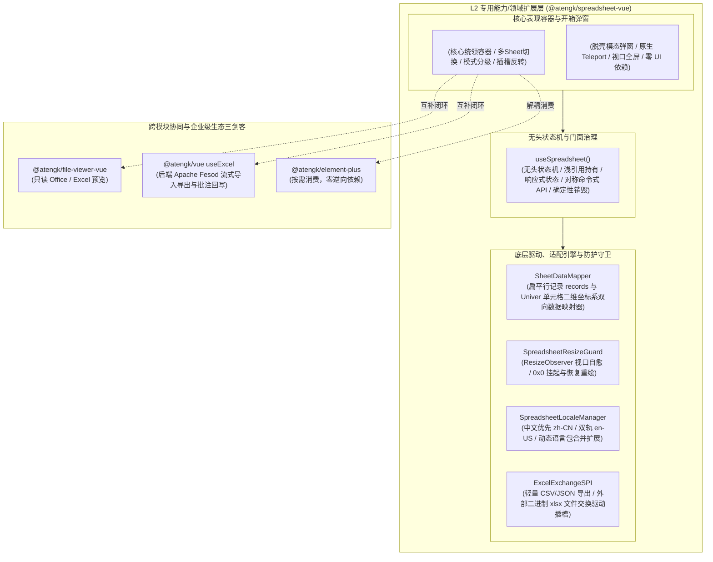

# 0049. SpreadsheetVue L2 扩展层架构、双轨数据驱动与 Univer 电子表格治理规范

- **状态**: accepted
- **日期**: 2026-11-10
- **作者**: Ateng

## 背景与上下文

在《ateng-ui 模块化生态扩展全景蓝图与演进路线图》（`module-expansion-blueprint.md`）确立的阶段六（P2 第三优先级）规划中，`@atengk/spreadsheet-vue` 作为 No. 7 企业级重型数据处理扩展子包，承担着在线多工作表交互编辑、复杂 Excel 公式实时联动计算、批量填报录入以及与 `@atengk/file-viewer-vue`（只读文档预览）、`@atengk/vue` 的 `useExcel`（后端流式导出与批注回写）协同合拢“**企业级表格三剑客闭环**”的战略重任。

在传统 Web 前端与企业级中后台系统中，电子表格领域长期面临以下深层次架构与工程治理痛点：

1. **跨框架断层与依赖黑盒失控**：新一代高性能电子表格引擎（如 Univer 1.4+）底层基于 Canvas 2D/WebGL 与 TypeScript 微内核构建，但其 UI 交互层（Ribbon 工具栏、浮层菜单）默认深度依赖 React 生态（`react`, `react-dom`, `rxjs`）。在纯 Vue 3 企业项目中强行整合时，极易因依赖声明不当迫使业务方显式安装 React 造成技术栈混淆与心智负担，或因插件拼装散乱导致版本错位；
2. **深度响应式代理（Proxy）引发的性能灾难与崩溃**：Vue 3 的 `ref` 或 `reactive` 会递归代理对象的每个属性。Univer 内部维护了极其庞大的画布渲染树、命令总线与私有状态，若直接将其放入 Vue 响应式代理，将引发灾难性的内存暴涨、帧率断崖以及私有属性访问拒绝（`TypeError: Cannot read private member`）；
3. **数据契约鸿沟与胶水代码泛滥**：Univer 底层原生采用高保真全量 JSON 快照（`IWorkbookData`，涵盖格式、合并单元格、公式与全部工作表元数据）。然而在常规 ERP、供应链或财务批量填报场景中，业务层交互的核心是平铺的对象列表（`records: Record<string, any>[]`）。缺乏开箱即用的双向映射器，迫使业务开发者手工编写数百行脆弱的行列坐标遍历与转换胶水代码；
4. **视觉与交互密度场景不分级**：传统封装往往一刀切呈现庞大的类 Office Ribbon 菜单栏，在业务弹窗或紧凑表单中严重挤占视口面积；同时缺乏面向审批查看的“纯只读审阅模式”与面向快速填报的“紧凑模式”；
5. **视口隐藏导致的 0x0 几何失效与暗黑失衡**：在 Element Plus 弹窗（`ElDialog`）、抽屉（`ElDrawer`）或多标签页导航（`AtengTabsNav`）中延迟挂载时，容器初始宽高常为 `0x0`（`display: none`），导致底层 Canvas 无法计算真实像素比产生空白或严重拉伸模糊；同时原生引擎与宿主暗黑模式脱节；
6. **Worker 与 Canvas 句柄残留导致的内存泄漏**：电子表格启动了 Canvas 上下文、大量全局键盘/鼠标事件侦听器以及公式计算任务。在组件销毁或路由切换时若未执行严格销毁，将导致游离的 Worker 线程与 DOM 内存常驻不退。

为此，依循 `ateng-ui` 模块化扩展通用标准（`docs/agents/modular-extensibility.md`）与十二道代码成熟度防线，经过深入的 `/grill-with-docs` 架构推演，制定本架构决策。

---

## 架构决策矩阵 (Architecture Decisions)

---

## 核心规约与技术选型细则

### 1. 底座依赖自洽律与 Presets 架构锁定

- **内核版本基线**：锁定 Univer `^1.4.0` 现代化稳定基准；
- **预设包集成范式**：采用官方经过严格回归验证的 `@univerjs/presets` + `@univerjs/preset-sheets-core` 组合，一次性内置排版、数据格式化、渲染引擎与公式计算能力，严禁散落拼装 10 余个底层碎片插件包；
- **隐式内部自洽**：将底层 UI 必须的 `react`、`react-dom` 与 `rxjs` 作为 `@atengk/spreadsheet-vue` 的直接生产依赖（`dependencies`）纳入构建管理，对外输出纯粹标准的 Vue 3 组件与 Hooks，业务方无需显式安装 React 即可享受 100% 完整的原生电子表格能力。

### 2. 双轨数据驱动契约 (`SpreadsheetSnapshot` vs `SpreadsheetRecord`)

针对不同复杂度业务场景，确立双轨数据绑定模型：

1. **全量快照轨 (`v-model:snapshot`)**：直接绑定 `SpreadsheetSnapshot`（对齐 Univer `IWorkbookData`），用于高保真多 Sheet 报表设计、带复杂公式样式的工作簿存储与回显；
2. **轻量扁平数据轨 (`v-model:data`)**：支持直接绑定结构化行对象数组 `records: SpreadsheetRecord[]`（如 `[{ id: 1, name: '商品A', price: 99 }]`）。内部通过 `SheetDataMapper` 提供双向转译：
   - **动态列推断**：当未显式指定 `columns` 时，自动从 `records[0]` 提取字段生成默认表头与列宽；显式提供 `columns` 时按列定义注入列宽、必填约束与单元格下拉验证；
   - **防抖回写保全**：单元格编辑时，内部经防抖（200ms）将最新数据逆向映射并触发 `update:data`；对未在表格呈现的内部业务字段（如隐藏状态码）通过行索引保全，严禁属性丢失。

### 3. 场景交互模式分级 (`mode: 'full' | 'compact' | 'readonly'`)

提供开箱即用的三大交互场景模式，并辅以原子开关覆盖：

- `full`（默认）：全功能 Office 模式，展现 Ribbon 工具栏、公式栏、Sheet 标签页栏与底部状态栏；
- `compact`：紧凑批量填报模式，隐藏顶部复杂 Ribbon 工具栏，仅保留公式栏与网格区域，最大化提升业务屏幕利用率；
- `readonly`：只读审阅模式，禁用一切单元格编辑与修改快捷键，仅保留选区高亮、只读公式查看、复制与导出。

### 4. 严格浅响应与状态机门面治理 (`useSpreadsheet`)

- **零深层代理铁律**：底层 Univer 实例与 UniverAPI 门面仅在闭包或 `shallowRef` 中持有，**100% 严禁被 Vue `ref()` 或 `reactive()` 包装**；
- **只读响应式度量**：对外仅暴露 `Readonly<Ref<T>>` 包装的轻量响应式状态（`ready`、`loading`、`activeSheetId`、`sheetList`、`selection`、`isDirty`）；
- **完备对称命令 API**：提供包含快照读写（`getSnapshot`/`setSnapshot`）、扁平数据读写（`getData`/`setData`）、Sheet 增删切（`addSheet`/`removeSheet`/`activateSheet`）、只读切换（`setReadOnly`）、重做撤销（`undo`/`redo`）、CSV/JSON 导出（`exportCsv`/`exportJson`）、尺寸自愈（`resize`）与销毁（`destroy`）等对称操作方法。

### 5. 样式隔离、暗黑热跟随与 0x0 几何自愈

- **样式隔离与 Design Tokens**：根类名强制以 `.at-spreadsheet-*` 为前缀，排版颜色与边框全面绑定 `--at-spreadsheet-*` 与 `--el-*` CSS 变量；
- **冷钛暗黑热跟随**：支持 `theme: 'auto' | 'light' | 'dark'`，在 `auto` 下监听宿主 `html.dark` 类名变化，动态调用 Univer 主题更新 API 无损切换；
- **`SpreadsheetResizeGuard` 几何自愈**：组件挂载时内置 `ResizeObserver` 守卫。当初始处于 `display: none`（`0x0` 几何）时静默挂起，一旦恢复为有效宽高立即自动触发内部 Canvas `resize()` 重绘，彻底消除白屏与模糊拉伸。

### 6. 确定性生命周期与内存防线

在 Vue 组件 `onBeforeUnmount` / `onScopeDispose` 钩子中，按以下严格时序执行清理：

1. 断开 `ResizeObserver` 监听并取消防抖定时器；
2. 调用底层 `univer.dispose()` 确定性销毁 Canvas 上下文与公式运算管道；
3. 清空 DOM 挂载节点与 Facade 引用，确保内存 100% 自净。

### 7. 1:1 独立体验展厅标准 (`sample-spreadsheet-vue`)

- **端口对齐**：独立沙箱运行于固定端口 **`3017`**，标配 `"private": true` 与 `.env.example`；
- **四大分层多场景看板**：
  1. `FullWorkbookView.vue`（全功能工作簿：公式计算、多 Sheet 切换、样式排版、暗黑模式切换与快照持久化）；
  2. `CompactGridView.vue`（紧凑业务批量填报：行对象数组双向绑定、动态列推断、下拉校验与变更回显）；
  3. `ReadOnlyAuditView.vue`（只读审阅报表：选区聚合、禁用编辑、CSV 导出）；
  4. `ModalDialogView.vue`（脱壳模态弹窗：全屏切换、0x0 挂起自愈、弹窗编辑确认回传）。

---

## 实施后果与权衡 (Consequences)

### 正向收益 (Pros)

1. **填补生态空白**：补齐了 `@atengk/file-viewer-vue`（只读预览）与 `@atengk/vue` `useExcel`（后端流）之间缺失的“**在线复杂编辑与填报**”拼图，正式合拢表格三剑客闭环；
2. **纯 Vue 3 友好体验**：抹平了底层 React 依赖，使 Vue 开发者以熟悉的模板语法、双向数据流与无头 Hook 即可驱动专业级 Canvas 电子表格；
3. **架构安全健壮**：通过浅响应引用、0x0 几何自愈与确定性生命周期清理，根绝了内存泄漏与界面崩溃风险。

### 权衡与约束 (Trade-offs & Constraints)

1. **产物体积考量**：电子表格引擎属于专业级重型能力（打包产物通常在数兆级别）。生产部署推荐配合路由级异步懒加载（`defineAsyncComponent`），按需调取；
2. **二进制 Excel 转换边界**：本包核心专注于原生 JSON 快照与结构化行数据的高性能编辑；对于复杂的完整 `.xlsx` 格式双向解析，推荐通过 `ExcelExchangeSPI` 或协同已有的 `@atengk/file-viewer-vue` / `useExcel` 完成。
