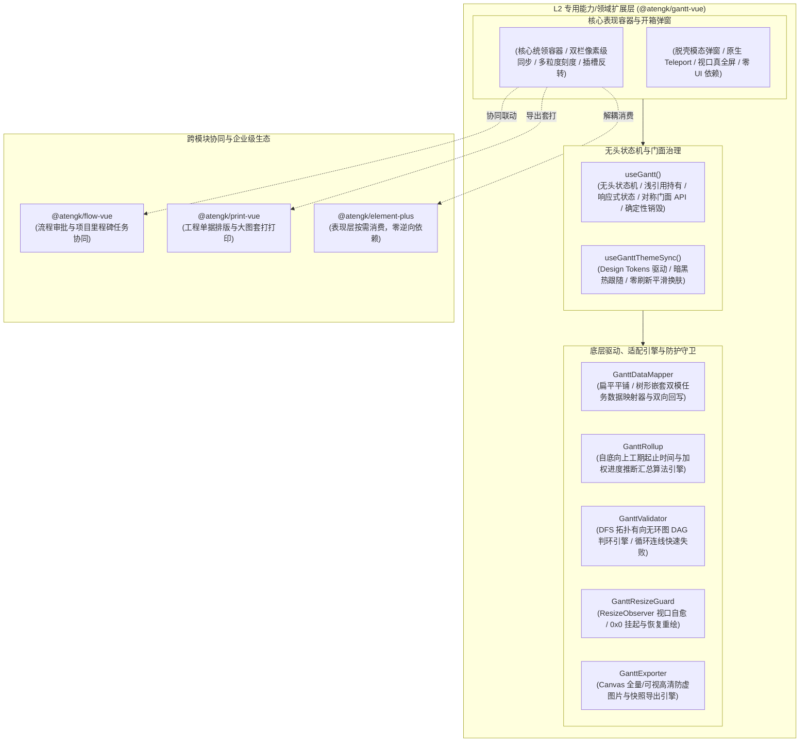

# 0050. GanttVue L2 扩展层架构、VTable-Gantt Canvas 引擎协同与企业级排程治理规范

- **状态**: accepted
- **日期**: 2026-11-11
- **作者**: Ateng

## 背景与上下文

在《ateng-ui 模块化生态扩展全景蓝图与演进路线图》（`module-expansion-blueprint.md`）确立的阶段六（P2 第三优先级）规划中，`@atengk/gantt-vue` 作为 No. 8 企业级重型排程与资源调度扩展子包，承担着攻克“左侧多列可编辑任务树表（TreeGrid） + 右侧多粒度时间轴（日/周/月/季/年）画布”双栏像素级同步滚动、拖拽调期、进度拉伸、关键里程碑、前后置依赖连线（FS/SS/FF/SF）与计划基线（Baseline）偏差比对的战略使命。

在现代 Web 前端与企业级工程管理（如 EPC 工程建设、研发敏捷排程、制造 MES 生产排产、能源调度）中，甘特图领域长期面临以下深层次痛点：

1. **DOM 渲染瓶颈与万级节点性能雪崩**：基于常规 DOM/SVG 实现的开源甘特图组件（如 Frappe Gantt、传统 Vue-Gantt），在任务量超过 500~1000 条或展示跨数年的日颗粒度时间轴时，DOM 节点数瞬间突破数万个，导致滚动掉帧、拖拽卡顿甚至浏览器内存溢出崩溃；
2. **左表右图分栏滚动失步与错位断层**：甘特图天然由左侧结构化任务树列表与右侧连续时间轴画布组合而成。传统分层实现常通过监听 DOM `scroll` 事件进行二次位置补偿，在高频滚轮或触控板惯性滚动下极易产生“左慢右快”或高度微差累计导致的像素级错位断层；
3. **数据模型孤岛与 WBS 工期汇总推断缺失**：企业真实排程数据形态各异（有的源自平铺带 `parentId` 的关系型数据库，有的源自树形嵌套 JSON）。更关键的是，当底层子任务拖拽调整工期或进度时，父级汇总任务（Summary Task）往往缺乏严格的工期起止范围与加权完成进度自底向上汇总（Rollup）算法，迫使业务编写大量繁复脆弱的计算胶水代码；
4. **依赖连线闭环与死锁失控**：复杂工程中任务依赖关系错综复杂（FS、SS、FF、SF）。若缺乏前端拓扑排序与有向无环图（DAG）快速失败判环校验，用户在画布拖拽连线时极易引入循环依赖（`A ➔ B ➔ A`），导致排程算法进入死循环；
5. **视口隐藏导致的 0x0 几何失效与暗黑失衡**：在多标签页（`AtengTabsNav`）、折叠面板或模态弹窗延迟挂载时，容器初始宽高常为 `0x0`（`display: none`），导致底层 Canvas 无法计算真实像素比产生空白或严重拉伸模糊；同时 Canvas 自绘图表与宿主主题（暗黑模式）割裂严重；
6. **Canvas 句柄残留导致的内存泄漏**：Canvas 上下文、大量全局键盘/鼠标拖拽侦听器、以及高分辨率离屏渲染缓冲在组件卸载或路由切换时若未执行严格销毁，将造成严重的内存泄漏。

为此，依循 `ateng-ui` 模块化扩展通用标准（`docs/agents/modular-extensibility.md`）与十二道代码成熟度防线，经过深入的 `/grill-with-docs` 架构推演，制定本架构决策。

---

## 架构决策矩阵 (Architecture Decisions)

---

## 核心规约与技术选型细则

### 1. 底座核心引擎锁定与纯 Vue 3 封装

- **核心驱动选型**：锁定字节跳动 VisActor 旗下纯 TypeScript 高性能 Canvas 甘特图引擎 `@visactor/vtable-gantt`（锁定 `^1.26.8`，MIT 协议完全免费商用）；
- **拓扑分层纯净律**：`@atengk/gantt-vue` 归属于 **L2 专用能力/领域扩展层**，严格单向依赖 L0 (`@atengk/core`)、L1 (`@atengk/vue`) 与 `@visactor/vtable-gantt`，**绝对严禁物理反向引入 L3（`@atengk/element-plus`）的任何组件或类型（如 `ElMessage`、`ElDialog`）**；
- **脱壳弹窗原生化**：提供 `<AtengGanttModal />` 轻量模态弹窗，通过 Vue 3 原生 `<Teleport>`、`--at-gantt-*` CSS 变量与绝对定位驱动，实现免 UI 库的独立全屏排程工作台。

### 2. 双模数据适配与 `v-model:tasks` 双向增量回写

为抹平业务端不同数据结构的鸿沟，确立双模数据驱动契约：

- **自适应数据映射 (`GanttDataMapper`)**：
  - 支持“带 `parentId` 的扁平一维数组”与“嵌套 `children` 的树形对象数组”自适应输入；
  - 规范统一任务强类型契约 `GanttTaskRecord`（`id`, `name`, `startDate`, `endDate`, `progress`, `dependencies`, `baseline`, `collapsed` 等标准属性）；
  - 保全任意未在左表展示的业务扩展字段，在转换与回写过程中 100% 杜绝属性丢弃；
- **双向增量回写契约**：
  - 支持 `v-model:tasks` 双向驱动。当用户在左表内联编辑单元格、或在右侧画布拖拽任务条位移/拉伸工期/调整进度时，内部由 `GanttDataMapper` 增量回写并触发 `update:tasks`；
  - 同时抛出细粒度语义化事件：`@task-change`（携带变更类型 `'move' | 'resize' | 'progress' | 'table_edit'`）、`@dependency-create`、`@dependency-delete`，方便上层业务按需与后端保存接口对接。

### 3. WBS 父子任务联动与自底向上加权汇总 (`GanttRollup`)

企业项目排程中，父任务（汇总任务）具有天然的聚合属性：

- **自动汇总算法**：内置 `GanttRollup` 算法，在 `rollup: true`（默认启用）下生效：
  - **工期范围汇总**：父任务的 `startDate` 自动取其全部直接子任务的最小开始时间；`endDate` 自动取其全部直接子任务的最大结束时间；
  - **加权进度计算**：父任务的完成进度依据子任务的工期天数加权平均计算：
    $$\text{Progress}_{\text{parent}} = \frac{\sum (\text{Duration}_i \times \text{Progress}_i)}{\sum \text{Duration}_i}$$
- **逃生开关**：支持传入 `rollup: false` 禁用自动推算，由外部业务或后端全权接管父级聚合数值。

### 4. 依赖连线防呆与有向无环图 (DAG) 快速失败校验 (`GanttValidator`)

为防止任务之间建立自循环或间接回路，建立纯前端 DAG 校验守卫：

- **实时判环拦截**：在画布拖拽生成连线（或业务批量写入连线）的瞬间，调用 `GanttValidator.validateDAG()` 基于轻量 DFS 遍历依赖关系图；
- **快速失败 (Fail-Fast)**：
  - 一旦发现新连线构成回路（如 `A ➔ B ➔ A`）或指向自身，立即拒绝建立连线并中断操作；
  - 触发 `@dependency-invalid` 语义化事件，向外暴露 `{ sourceId, targetId, reason: 'circular_dependency' }`；
  - 在全量初始化数据集时，若检测到存量数据存在循环依赖，通过受管控制台警告明确指出拓扑环节点。

### 5. 计划基线 (Baseline) 对比与里程碑 (Milestone) 渲染

- **计划基线对比**：在 `GanttTaskRecord.baseline` 中定义 `{ startDate, endDate }`，任务条下方以半透明/虚线对比条形式并行渲染基准计划；自动对比实际工期与基准工期，发生滞后延误时按 `--at-gantt-delay-color` 变量着色预警；
- **里程碑节点收敛**：当任务满足 `startDate === endDate` 或显式声明 `type: 'milestone'` 时，画布自动收敛为醒目的菱形（Diamond）高亮图标与标记点；
- **时间标线 (`markLines`)**：支持传入多根关键时间节点标线（`GanttMarkLine`），默认激活跟随本地真实日期的“今天指示线（Today MarkLine）”。

### 6. 多时间粒度缩放与插槽反转微工具栏

- **5 大标准时间尺度**：收敛时间轴刻度类型为 `'day' | 'week' | 'month' | 'quarter' | 'year'`，支持 `v-model:scale` 双向绑定；
- **内置微工具栏与插槽反转**：顶部默认渲染包含刻度切换分段器、一键定位今天（`Today`）、全部展开/折叠、模式切换按钮的轻量微工具栏；100% 暴露 `#toolbar` 与 `#toolbar-extra` 插槽供业务定制或隐藏；
- **单元格与浮层插槽**：左侧表格暴露 `#cell` 与 `#cell-[field]` 作用域插槽，支持在单元格内自由嵌入 Element Plus 标签（`ElTag`）、头像或操作按钮；右侧画布悬停暴露 `#tooltip` 作用域插槽，支持自定义工期浮层卡片。

### 7. 严格浅响应与实例门面治理 (`useGantt` & `defineExpose`)

- **非响应式浅引用持有**：VTable-Gantt 实例极其复杂，**严禁使用 Vue `ref()` 或 `reactive()` 进行深层递归代理**，统一在闭包或 `shallowRef` 中持有；
- **实例暴露完备对称性**：`<AtengGantt />` 通过 `defineExpose` 显式暴露与 `useGantt()` 完全对齐的高阶门面方法：
  - `scrollToDate(date)` / `scrollToToday()` / `scrollToTask(taskId)`：定位视口；
  - `zoomIn()` / `zoomOut()`：步进切换刻度；
  - `expandAll()` / `collapseAll()`：展开/折叠节点；
  - `exportImage(options)`：高清图片导出；
  - `getTask(taskId)`：检索标准化任务实体；
  - `getRawGanttInstance()`：底层逃生门；
  - `resize()`：触发尺寸重算。

### 8. 样式隔离、Design Tokens 与 0x0 视口几何自愈

- **BEM 命名空间与变量驱动**：组件根类名统领于 `.at-gantt`，颜色与度量 100% 绑定 `--at-gantt-*` CSS 变量；SFC 强制开启 `<style scoped>`；
- **暗黑模式无损热跟随 (`useGanttThemeSync`)**：支持 `theme: 'auto' | 'light' | 'dark'`，在 `auto` 模式下监听 `html.dark` 变化，通过 `ganttInstance.updateOption()` 动态同步 Canvas 网格、背景与字体色阶，消除页面刷新震荡；
- **`GanttResizeGuard` 0x0 几何自愈**：内置 `ResizeObserver` 守卫，针对弹窗、抽屉或非激活 Tab 中渲染导致的 `0x0`（`display: none`）尺寸挂起，在尺寸恢复后毫秒级触发 Canvas 自适应重绘，根除白屏与模糊拉伸。

### 9. 高清防虚全景导出与防线一空安全保底

- **高清全景图导出 (`GanttExporter`)**：通过 `exportImage()` 支持将全量排程图或当前可视窗口导出为指定像素比（自动兼容 Retina 高分屏）的高保真 PNG/JPEG 图像或二进制 Blob；
- **空安全保底**：当任务数据为 `[]` 或异常空值时，严格遵循防线一（保底空数组），渲染整洁的网格占位并暴露 `#empty` 插槽，严禁报空指针异常。

### 10. 确定性生命周期与资源清理

在 Vue 组件 `onBeforeUnmount` / `onScopeDispose` 钩子中，按以下严格时序执行清理：

1. 断开 `GanttResizeGuard` 的 `ResizeObserver` 监听；
2. 移除 DOM 主题热跟随与拖拽悬停的事件监听器；
3. 显式调用 `ganttInstance.dispose()` 销毁 VTable-Gantt 引擎内部 Canvas 绘制管线与事件总线；
4. 清空 `shallowRef` 实例引用并重置内部数据字典，杜绝内存泄漏。

---

## 影响与推论 (Consequences)

### 正向收益 (Positive)

- **万级节点极限性能**：依托 VisActor 高性能 Canvas 虚拟化引擎，轻松承载上万条任务与数年跨度时间轴，滚动如丝顺滑；
- **双模开箱即用**：抹平扁平数组与嵌套树形的数据差异，自动处理父子任务工期汇总，大幅削减业务端胶水代码；
- **工业级防呆与自愈**：DAG 判环避免排程死锁，`ResizeObserver` 守卫根治 0x0 弹窗白屏，暗黑模式 100% 平滑跟随；
- **纯粹中立架构**：L2 扩展包零逆向依赖 L3 UI 库，纯原生脱壳弹窗与插槽反转确保架构正交与长久生命力。

### 权衡与取舍 (Trade-offs)

- **底层 Canvas 定制门槛**：相较于纯 DOM/HTML 渲染，完全自定义任务条内部复杂富交互需通过插槽反转或特定 Canvas CustomRender 接口扩展；
- **包体积基线**：引入 `@visactor/vtable-gantt` 约增加数十 KB Gzip 生产体积，但作为专业重型排程模块，这是换取工业级渲染性能与完备功能的必要权衡。
