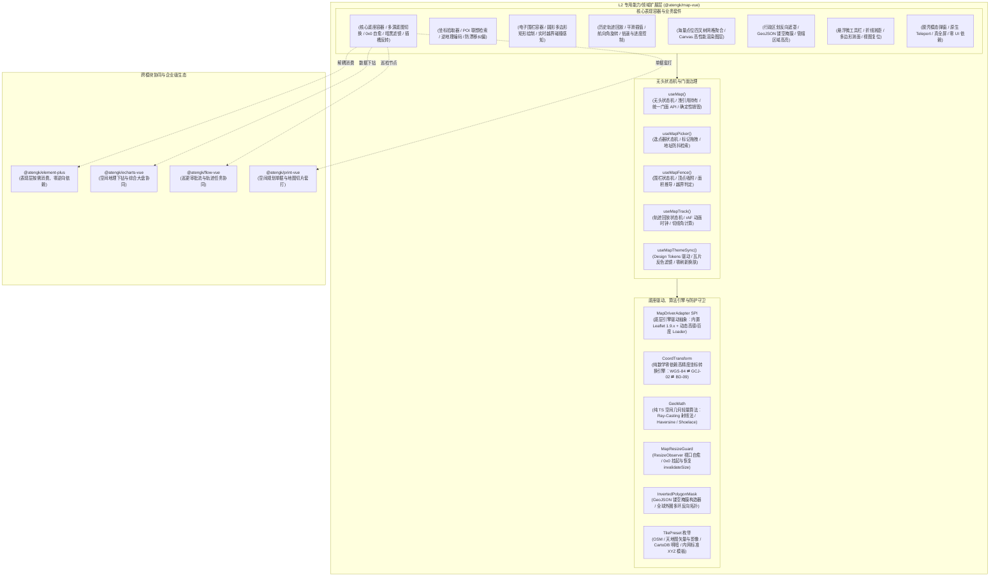

# 0051. MapVue L2 扩展层架构、多源驱动 SPI 与空间地理治理规范

- **状态**: accepted
- **日期**: 2026-11-11
- **作者**: Ateng

## 背景与上下文

在《ateng-ui 模块化生态扩展全景蓝图与演进路线图》（`module-expansion-blueprint.md`）确立的阶段六（P2 第三优先级）规划中，`@atengk/map-vue` 作为 No. 9 空间地理与通用地图扩展子包，承担着构建“多源底图热插拔、坐标拾取器、空间电子围栏、历史轨迹回放、海量点聚合、行政掩膜遮罩与空间几何量测”全场景能力闭环的战略使命。

在现代 Web 前端与企业级应用（如智慧物流 WMS/TMS、网格化安防巡检、IoT 车载物联网监控、智能制造厂区管理、零售门店全景大盘）中，空间地理与地图集成长期面临以下深层次痛点：

1. **商业 SDK 强绑定与离线/私有化断网瘫痪**：业界许多前端地图组件直接硬编码绑定特定商业地图 SDK（如高德或百度），不仅要求强依赖开发者申请商业 API Key，且在政企涉密内网、离线涉外大屏或 CI 自动化单测环境下因无法连通外网而彻底瘫痪；
2. **多源坐标系混用引发严重地图漂移**：中国地理信息存在 GPS/国际开源标准（WGS-84）、国测局火星加密坐标（GCJ-02）与百度坐标（BD-09）三大割裂体系。车载硬件上传原始 WGS-84 坐标若未经纠偏直接渲染在高德底图上，将产生 300~500 米致命偏移，迫使业务编写大量碎片化的转换补丁；
3. **空间几何算法依赖膨胀与打包体积失控**：电子围栏（点在多边形判定、进出越界告警）与空间测距/测面常直接引入体积高达数兆的重型 GIS 库（如 `@turf/turf`），严重违背基础设施轻量化原则；
4. **海量点标记导致的 DOM 爆炸与页面假死**：在管理数万个传感器、路灯或网格资产时，为每个标记渲染原生 DOM 节点会导致浏览器 DOM 节点数瞬间突破上限，造成拖拽卡顿、内存暴涨甚至标签页崩溃；
5. **轨迹回放算法复杂与航向角旋转生硬**：业务自行基于 `setInterval` 实现巡检轨迹回放时，普遍存在大圆切线方位角计算不准、车头旋转突兀生硬、倍速切换掉帧以及进度条拖拽失步的缺陷；
6. **隐藏容器视口 0x0 几何失效与暗黑模式割裂**：地图挂载在非激活标签页（`AtengTabsNav`）或模态弹窗延迟展现时，由于初始几何尺寸为 `0x0`，恢复可见后极易产生瓦片大面积灰屏与中心偏移；同时公开瓦片多为刺眼明亮白色，与宿主暗黑模式格格不入。

为此，依循 `ateng-ui` 模块化扩展通用标准（`docs/agents/modular-extensibility.md`）与十二道代码成熟度防线，经过深入的 `/grill-with-docs` 架构推演，制定本架构决策。

---

## 架构决策矩阵 (Architecture Decisions)



---

## 核心架构决策细则

### 1. 多源底图驱动 SPI 架构（内置 Leaflet + 动态商业 Loader）

- **默认离线免密基底**：子包直接依赖 `leaflet` 1.9.x，零配置即具备完整的平移、缩放、图层组与切片渲染能力，确保在内网完全物理隔离或自动化测试（Vitest / happy-dom）环境下 100% 独立自洽运行；
- **动态商业驱动 SPI (`MapDriverAdapter`)**：抽象跨引擎统一接口（`init`、`destroy`、`setCenter`、`setZoom`、`addMarker`、`addLayer` 等）。高德地图 2.0（基于 `@amap/amap-jsapi-loader`）与百度地图作为 SPI 插件按需动态异步加载 SDK，不在主包体打包臃肿体积，亦严禁硬编码商业秘钥；
- **内置标准瓦片预设 (`TilePreset`)**：封装常用开放瓦片源（`OSM`、`TIANDITU_VEC`、`TIANDITU_IMG`、`CARTODB_LIGHT`、`CARTODB_DARK`、`AMAP_VECTOR`），同时原生支持内网离线切片服务传入标准 XYZ URL 模板（如 `http://intranet-ip/tiles/{z}/{x}/{y}.png`）。

### 2. 坐标系防漂移转换引擎 (`CoordTransform`)

- **坐标系规范契约 (`CoordType`)**：明确支持 `'WGS84' | 'GCJ02' | 'BD09'` 三种标准体系，组件内部默认以在国内使用最广泛的 `'GCJ02'` 作为交互基准；
- **纯数学零依赖高精度算法**：内置高斯投影与偏心率椭球体修正算法，提供 `wgs84ToGcj02`、`gcj02ToWgs84`、`gcj02ToBd09`、`bd09ToGcj02` 等双向纳秒级坐标纠偏，彻底消灭硬件 GPS 导入与商业地图之间的 300~500 米错位显示问题。

### 3. 空间几何轻量算法引擎 (`GeoMath`)

- **零外部大体积依赖原则**：不引入动辄数兆的 `@turf/turf`，在底座以纯 TS 实现轻量 `GeoMath` 算法（代码量小于 150 行）：
  1. **点在多边形判定（Ray-Casting 射线法）**：通过射线与多边形边缘相交奇偶性，毫秒级支撑点位是否位于电子围栏内的判定；
  2. **球面大圆测距（Haversine Formula）**：精确计算两点经纬度之间的地表物理直线与折线距离（米/公里）；
  3. **多边形物理面积（Shoelace 鞋带公式 + 球面投影）**：计算多边形包围区域的真实物理地表面积（平方米/平方公里）；
- **Turf SPI 逃生门**：预留空间计算 SPI，允许超大型地理信息项目接入完整 Turf 进行缓冲区（Buffer）或复杂拓扑相交推导。

### 4. 高频核心业务表现组件矩阵

- **`<AtengMapPicker />`（坐标与地址拾取器）**：提供地图中心准星十字或拖拽 Marker，支持 POI 搜索联想与逆地理编码反查解析，自动格式化省市区街道并回传标准坐标实体；
- **`<AtengMapFence />`（电子围栏套件）**：可视化绘制与编辑圆形、多边形与矩形围栏，实时展示半径与面积标尺，动态接收外部点位流执行实时越界报警检测；
- **`<AtengMapTrack />`（轨迹回放器）**：输入时序点序列，基于 `requestAnimationFrame` 进行坐标平滑插值插帧，自动推导相邻线段切线航向角（Bearing）使图标顺畅转向，支持 0.5x~8x 倍速播放与进度条拖拽；
- **`<AtengMapCluster />`（海量点网格聚合）**：基于四叉树与网格切片算法，支持 50,000+ 点位在宏观视野自动聚合成数量气泡，点击平滑扩散（Spiderfy），并支持 Canvas 纯画布高性能渲染模式；
- **`<AtengMapMask />`（行政区划镂空遮罩）**：接收 GeoJSON 行政边界，自动构建反向多环多边形，将管辖区域外部全局压暗半透明遮罩，高亮目标责任区；
- **`<AtengMapToolbar />`（微工具栏与测量工具链）**：提供折线连续测距（在各拐点展示段落距离与总长）与多边形测面工具，支持全屏与重置复位；
- **`<AtengMapModal />`（轻量脱壳模态弹窗）**：基于原生 Vue 3 Teleport 驱动，支持真全屏切换，100% 物理脱耦具体 UI 库。

### 5. 0x0 视口几何自愈、生命周期与暗黑瓦片滤镜

- **`MapResizeGuard` 视口自愈**：利用 `ResizeObserver` 监听容器几何尺寸，在容器从 `display: none`（`0x0` 尺寸）恢复有效显示时，自动通过 `requestAnimationFrame` 调度底层引擎的 `invalidateSize()` / `resize()`，消灭切片灰屏与中心偏移顽疾；
- **确定性生命周期治理**：在组件 `onUnmounted` 钩子中 100% 销毁地图实例（调用 `.remove()` / `.destroy()`），清空 DOM 事件监听、切片缓存与自定义浮层，杜绝内存泄漏；
- **暗黑模式无损反色滤镜**：内置 `useMapThemeSync()` 响应式监听宿主 `.dark` 类名，针对 Leaflet 明亮瓦片自动注入 CSS 变量反色滤镜（`invert(100%) hue-rotate(180deg) brightness(95%) contrast(90%)`），使免费开源瓦片瞬间转为高品质深色极客底图，并同步高德原生暗黑主题。

---

## 1:1 场景体验展厅规划 (`apps/sample-map-vue`)

展厅固定分配端口 **3019**，遵循分层可视化交互看板规范，划分四大场景看板：

1. **多源底图与瓦片预设看板 (Multi-source Tile & Dark Hot-Switch)**：展示 Leaflet 默认 OSM、天地图矢量与影像、CartoDB 明暗预设以及高德地图动态驱动切换，验证暗黑模式一键热切换与内网 XYZ 瓦片切片适配；
2. **坐标拾取与逆地理编码看板 (POI Picker & Anti-Drift Sandbox)**：交互式选点器体验，对比 WGS-84、GCJ-02 与 BD-09 坐标自动纠偏前后效果，验证十字准星拾取、地址搜索与确定回传；
3. **空间电子围栏与碰撞感知看板 (Geo-Fence & Point-in-Polygon)**：圆形/多边形/矩形围栏的可视化绘制与顶点微调，展示实时面积与半径标尺，并模拟外部多车辆坐标流触发越界进入/离开声光报警；
4. **历史轨迹回放与海量点聚合看板 (Track Playback & Marker Cluster)**：展示带有时间与航向角的车辆轨迹平滑回放（倍速调节与进度拖拽），以及 20,000+ 点标记四叉树聚合与 Canvas 高性能图层流畅缩放。

---

## 质量门禁与准出验证

新模块孵化严格遵循阶梯二四合一准出：

```bash
pnpm --filter @atengk/map-vue --filter sample-map-vue typecheck && \
pnpm --filter @atengk/map-vue --filter sample-map-vue lint && \
pnpm --filter @atengk/map-vue --filter sample-map-vue test && \
pnpm --filter @atengk/map-vue --filter sample-map-vue build
```
