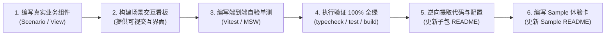

# 前端工业级文档与样例工程标准规范 (Documentation & Sample Specification)

## 1. 核心定位与设计哲学 (Mission & Scope)

在 `ateng-ui` 基础设施套件中，**文档与场景样例工程（Sample）是连接前端底层工程能力与终端业务开发者的第一生命线**。如果文档表述模糊、Props 声明与实战代码脱节、示例充斥着脱离现实的单元测试桩或纯控制台打印，再优雅的底层架构也将沦为无法落地的空中楼阁。

本规范确立框架所有子包文档（`packages/*/README.md`）与配套样例工程（`apps/sample-*`）的工业级工程标准与双向锚定体系，作为代码审查（`/code-review`）的一票否决红线（Red Card Block）。

---

## 2. 子模块 `README.md` 规范 (The Submodule Document Invariant)

子包根目录下的 `README.md` 是该模块对外唯一权威的**“全功能契约真理源”**。每个子包的 `README.md` 必须严格遵循以下全局结构骨架与内容规范：

### 2.1 标准大纲骨架 (Standard Outline Architecture)

```markdown
# @atengk/<module> <中文功能全称>

> 一句话核心价值宣言：阐明核心技术栈定位、所属四层拓扑层级（L0~L3）与面向的典型企业级前端交互场景。

---

## 0. 特性与公共 API 全景速查矩阵 (100% 覆盖)

## 1. 模块定位与 pnpm 坐标 (包名、版本、安装命令与 peerDependencies 契约)

## 2. 核心架构与设计不变量 (四层拓扑位置 / 响应式状态机 / 核心交互图 / 关键不变量)

## 3. <能力领域大章一> (按领域聚合收敛)

### 3.1 <核心子特性A>

### 3.2 <核心子特性B>

## 4. <能力领域大章二> (按领域聚合收敛)

...

## N. 完整 TypeScript 接口/Props/CSS 变量速查清单 (全量速查附录)
```

---

### 2.2 章节“三要素就近闭环”铁律 (Co-located 3-Element Invariant)

**【红线阻断项】** 严禁出现“正文只展示组件调用或 Hook 调用，而关键 Props/Options 强类型接口却扔在几百行后文末”的割裂现象！

每个具体的业务特性章节（二级或三级小节），必须且只能在**当前屏幕内**实现以下“三要素”自洽闭环：

1. **本节专属 TypeScript 契约/配置片段**：
   - 仅展示当前特性所需的关键 Props/Emits/Slots 泛型接口、Hook Options 配置项或 CSS 变量 Design Tokens；
   - 标配清晰的 JSDoc 中文单行注释与生产合理默认值；
   - 属性名与类型必须与源码导出的 TypeScript 接口逐字对齐。
2. **面向实战的业务 Vue/TS 代码示例**：
   - 展示如何通过 Vue SFC（`<script setup lang="ts">` + `<template>`）或 TS 门面调用该特性；
   - 代码必须 100% 逆向提取自已在对应 Sample 中跑通的真实业务看板代码。
3. **核心机制与生产边界防御说明**：
   - 显式讲透底层机制与防御考量（如 `MaybeRefOrGetter` 响应性解构防丢失、`onScopeDispose` 确定性生命周期清理、抗竞态逻辑丢弃、雪花 Long ID 大数防失真、样式 `at-` 隔离与 Design Tokens 继承等）；
   - 提示生产注意事项，消除非功能黑盒。

> **注**：文档末尾的《完整 TypeScript 接口/Props/CSS 变量速查清单》仅作为全量属性的集中速查字典，**绝对严禁**作为该模块配置或 Props 的唯一暴露点！

---

### 2.3 “能力领域大章”收敛架构 (Capability Domain Aggregation)

**【红线阻断项】** 严禁因为开发批次不同而在文档末尾随意追加零碎散落的小章节！

必须按技术领域或业务交互主线将同类功能收敛为**一级大章**，并在大章下合理划分二级小节。例如：

- **正确示范**：
  - `@atengk/vue`：`第 3 章：契约分页与时序竞态套件`（下设：3.1 双向契约分页状态机 `usePagination`、3.2 异步时序竞态双重防御 `useLatest`、3.3 提交防刷与幂等互斥锁 `useIdempotent`）
  - `@atengk/element-plus`：`第 4 章：企业级数据表格与检索协同套件`（下设：4.1 契约集成高级表格 `AtengTable`、4.2 响应式检索表单 `AtengQueryForm`、4.3 表格与表单联动编排）
- **错误反例**：
  - 第 3 章讲分页，第 9 章讲搜索表单，第 15 章又讲表格多选，中间夹杂各种孤立组件，结构七零八落。

---

### 2.4 真实业务语义场景驱动 (Real-World Business Semantics)

**【红线阻断项】** 坚决严禁将单元测试中的测试桩假数据（Test Stubs）无脑复制到文档中！

- **反面教材（禁止出现在文档中）**：
  - 变量命名如 `test1`、`dummyData`、`foo`、`bar`；
  - 返回生硬的测试字符串如 `"TEST_SUCCESS_" + id`；
  - 在纯单测中使用的极简无意义 DOM 片段（如单一文本节点、无样式裸按钮）。
- **正面范式（必须演化为真实高频前端业务模型）**：
  - **表格与分页**：电商商品列表分页检索（`ProductItem`）、用户账户管理（`UserAccount`）；
  - **异步竞态与搜索**：客户档案实时联想搜索（`CustomerSearch`）、快速切换 Tab 档案卡片；
  - **大文件与上传**：高清教学视频分片断点续传（`VideoChunkPayload`）、批量员工证件上传；
  - **流式与长连**：AI 大模型智能助手流式问答（`ChatMessage`）、全双工实时告警看板（`AlertEvent`）；
  - **复杂布局与交互**：多标签页管理后台（`DashboardLayout`）、表单向导与抽屉详情联动。

**演化原则**：以单元测试验证底层算法边界（白盒与对抗性验证），但暴露在 Sample 与文档中的代码，必须演进为具备真实业务语义、清晰交互反馈与企业级生产参考价值的高频场景范式！

---

## 3. Sample 场景样例工程规范 (The Sample Engineering Invariant)

场景样例工程（`apps/sample-*`）是面向开发者的**“最小可运行沙箱与开箱体验展厅”**。为了让开发者“启动即可直接在浏览器中可视化交互与自验”，Sample 工程必须遵守以下铁律：

### 3.1 全模块可视化与分层多场景看板 (Multi-Scenario Visual Dashboards)

Sample 严禁出现白屏或仅靠浏览器控制台 `console.log` 敷衍！必须根据四层拓扑架构弹性适配多场景可视化呈现：

1. **分层弹性场景形态**：
   - **L0 纯 TS 原生工程 (`sample-core`, `sample-monitor`)**：
     保持纯 TypeScript 原生环境，严禁引入 Vue/UI 库；在 `src/scenarios/*` 或独立脚本中编写真实场景逻辑，页面挂载原生 DOM 协议触发器（触发模拟请求、雪花大数对比、Token 注入、故障模拟等），高亮展示执行前后数据契约；
   - **L1 无头响应式 / L2 扩展工程 (`sample-vue`, `sample-file-viewer-vue`, `sample-echarts-vue` 等)**：
     在 `src/components/*Scenario.vue`（或 `*Demo.vue`）按业务领域拆分为多个自洽的场景看板组件；页面通过 Tab 或折叠卡片形式挂载，直观监视状态机的 `loading`、`data`、`error`、并发竞态与销毁注销状态；
   - **L3 UI 表现层工程 (`sample-element-plus`)**：
     基于 `vue-router` 在 `src/views/*` 中按领域构建独立路由视图（如 `views/table/TableCrudView.vue`、`views/upload/UploadView.vue`），高保真展示组件组合、弹窗交互与样式表现。
2. **主动操作 vs 被动监听的可视化呈现**：
   - **主动操作类**（分页、查询、表单提交、文件切片上传、图表动态刷新）：提供直观的交互表单、触发按钮与操作反馈提示；
   - **被动流式/长连/监控类**（SSE 打字机、WebSocket 心跳保活、APM 异常捕获、白屏检测）：提供模拟投递触发器与实时数据日志/状态流看板。
3. **严禁单一臃肿文件**：
   严禁将模块的所有场景逻辑塞在单一庞大的 `App.vue` 中，必须按领域拆解为小巧、高内聚的场景组件。

---

### 3.2 离线自洽 Mock 与网关双模机制 (Dual-Mode Architecture)

为了兼顾 CI 云端极速构建与本地物理环境真机联调，Sample 统一标配双模机制：

1. **默认/CI 模式（离线自洽）**：
   - 默认通过 Vite Mock 插件或 MSW 拦截虚拟网络请求，提供 100% 离线自洽的模拟数据；
   - 无需依赖任何外部物理网络或真实后端服务，克隆代码后直接启动或运行单测即 100% 全绿。
2. **Local/网关模式（真实联调）**：
   - 若需连接真实后端（如单体 Spring Boot 或微服务网关），在工程根目录复制 `.env.example` 为 `.env.local` 并配置 `VITE_API_BASE_URL`；
   - 开发服务自动切换为代理直连真实服务；该文件已被 `.gitignore` 严格忽略，保证 CI 零风险。

---

### 3.3 Sample 模块 `README.md` 四段式极简体验卡模板 (The 4-Part Minimal Experience Card)

Sample 自身的 `README.md` 必须从“长篇技术文档”彻底松绑，**严禁重复堆砌对应子包的全景矩阵与底层原理**，统一定位为**“启动与场景交互体验卡”**，严格采用以下四段式模板：

````markdown
# sample-<module> <场景全称>体验展厅

> 专注于演示与自验 `@atengk/<module>` 核心特性在真实业务场景下的开箱使用与交互自验。

---

## 1. 快速启动与服务端口

- **默认固定端口**：`300X` (严格遵守 ADR-0001 / ADR-0009 端口契约)
- **启动方式**：
  ```bash
  pnpm --filter sample-<module> dev
  ```
- 启动后浏览器访问：`http://localhost:300X`

---

## 2. 运行环境与 Mock 双模切换

- **默认/CI 模式**：内置离线自洽 Mock 数据，无需启动任何外部后端服务即可直接体验完整交互与跑通自动化测试；
- **Local 真实网关模式**：若需连接真实后端服务，复制 `.env.example` 为 `.env.local` 并修改 `VITE_API_BASE_URL`，重启开发服务即可直连真实接口（该文件已被 Git 忽略，CI 零风险）。

---

## 3. 核心场景看板与交互路由表

应用启动后，可通过以下场景看板或页面路由进行直观交互体验：

| 场景分类           | 场景看板组件 / 路由路径                    | 核心可视化交互操作                       | 验证重点                                 |
| :----------------- | :----------------------------------------- | :--------------------------------------- | :--------------------------------------- |
| **双向契约分页**   | `PaginationDemo.vue` (`/table/pagination`) | 点击上下页、切换条数下拉、模拟空数据查询 | 验证 5 维原子动作流转与空数组保底        |
| **异步时序竞态**   | `LatestDemo.vue` (`/async/anti-race`)      | 高频连续点击“慢请求”与“快请求”按钮       | 验证在途请求物理中断与过期数据丢弃       |
| **大文件分片上传** | `UploadDemo.vue` (`/file/chunk-upload`)    | 选择大文件、点击暂停与断点恢复           | 验证 Web 原生分片、受控并发 (3) 与状态机 |

---

## 4. 全真自动化回归命令

```bash
pnpm --filter @atengk/<module> --filter sample-<module> typecheck && \
pnpm --filter @atengk/<module> --filter sample-<module> lint && \
pnpm --filter @atengk/<module> --filter sample-<module> test && \
pnpm --filter sample-<module> build
```

> 详细原理机制、Props/Options 接口清单与生产边界，请参阅核心子包文档：[@atengk/<module> README](../../packages/<module>/README.md)。
````

---

## 4. “Sample-First” 逆向研发流与审查红线 (Review Redlines)

任何新特性的研发或存量特性的重构，必须严格按照以下顺序单向流动，前道工序未完成，严禁进入后道工序：



### 🚨 文档与 Sample 审查一票否决红线 (Red Card Checklist)

在 `/code-review` 审查中，凡触碰以下任一缺陷，直接出具 Red Card 阻断本次交付准出：

1. **【类型/配置脱节红线】**：子包 README 章节中仅展示调用代码，未就近声明关键 Props/Options 强类型接口或 CSS 变量规范；
2. **【章节散落割裂红线】**：同一技术领域或组件族的功能因分批开发被切分为分散的多章，未按领域大章收敛聚合；
3. **【测试桩生搬硬套红线】**：文档或 Sample 中充斥着 `test1`、`dummy`、`foo`、`bar` 等无现实意义的测试桩假数据，未演化为真实高频业务语义模型（如表格 CRUD、大文件切片、抗竞态搜索、权限切换等）；
4. **【缺少场景看板或单文件臃肿红线】**：Sample 工程缺少可视化场景看板、仅靠 `console.log` 敷衍，或将全量功能塞在单个庞大臃肿的 `App.vue` 中未进行场景解耦；
5. **【Sample 文档膨胀红线】**：Sample 自身的 `README.md` 未遵循四段式极简体验卡模板，存在冗余的原理抄录或全景矩阵；
6. **【伪代码凭空脑补红线】**：文档中的 Vue/TS 示例代码或配置未真实在 Sample 中编译通过并验证。
