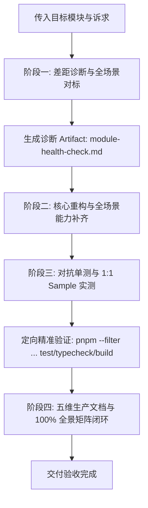

# 存量前端模块加固与全场景演进规范 (Module Hardening & Scenario Expansion SOP)

> 💡 **极简对话调用契约**：
> 在会话中直接引用本规范并传入目标模块名（及可选关注点）即可启动全流程：
> `@docs/agents/module-hardening-and-expansion.md <module-name> [optional-focus]`
> _示例：`@docs/agents/module-hardening-and-expansion.md core 补齐长连接心跳保活与幂等请求合并`_

本规范作为 `ateng-ui` 官方工程标准之一，专职规范**存量子模块从 1 到 N 的工业级深度体检、行业主流场景对标、缺失能力补齐、鲁棒性加固与交付文档闭环**。凡对既有前端子包进行重构或演进，一律受本协议约束。

_(注：若需从 0 到 1 孵化全新模块，请参阅 [模块孵化与扩展通用标准](./modular-extensibility.md)。)_

---

## 1. 演进原则与场景全覆盖定位

1. **行业全场景覆盖 (Full-Scenario Coverage)**：
   - 子模块必须对标该技术领域业界成熟标杆方案：
     - **L0 纯 TS 核心底座**：对标 Axios / Ky / Fetch 生产网络管道（自动重试与退避、飞行中请求去重合并、长整数雪花防精度截断、双态 Blob 异常拦截、WebSSE 打字机流、全双工 WS 保活重连）；
     - **L1 无头响应式层**：对标 VueUse / ahooks / TanStack Query 企业级状态机（防抖/节流、无感轮询、前置取消/后发先至竞态防御、乐观更新、内存与定时器确定性清理）；
     - **L2 专业扩展层**：对标行业顶尖原生文件与流媒体引擎（Office 多格式解析、Blob 内存泄露防御、HLS/FLV 监控级低延迟播放、1/4/9/16 对称与非对称多路分屏矩阵、PTZ 协议解耦、动态防篡改水印）；
     - **L3 UI 基础设施层**：对标 Element Plus / Ant Design / VxeTable 企业级交互（双模滚动布局、响应式高级检索表单、契约分页表格、导入批注错误双向协议、防刷防重指令等）；
   - 主动推演并覆盖排名前 80%~90% 的企业级典型高频生产场景，杜绝“代码漂亮但业务场景捉襟见肘”的半残套件。
2. **原生算力挖掘优先与零臃肿底座 (Native-First & Zero-Bloat)**：
   - 坚持纯原生 TypeScript / ES 标准与 Vue 3 原生能力优先，坚决杜绝在底层引入 `lodash`、`moment` 等重型第三方全量工具库；
   - 复杂扩展场景通过专职 SPI、插槽或组合式函数扩展暴露，确保底座极速轻量。
3. **对称完备与开箱即用 (Symmetric & Out-of-the-Box)**：
   - 门面 API 与 Hooks 必须对称（监听与注销对称、订阅与取消对称、存取对称、创建与销毁对称），提供一句话开箱即用的高阶门面与 Composables。

---

## 2. 核心红线与成熟度铁律 (Review Redlines)

执行本 SOP 时，触碰任一红线直接触发代码审查红牌阻断：

1. **十二道成熟度防线**：
   - **空安全保底与防御性返回**：查询列表/集合无匹配时统一保底返回空数组 `[]`，严禁返回 `undefined` 或 `null`；
   - **确定性生命周期与资源清理**：瞬态物理资源（事件监听、定时器、Observer、Axios 取消令牌、`URL.createObjectURL` 临时句柄）必须且只能在 `onUnmounted` 或 `onScopeDispose` 中 100% 释放；
   - **严格无状态与单向数据流**：单例管理器保持纯净，组件严禁突变 Props，响应式状态按需以 `readonly` 导出；
   - **对称语义完备性**：门面与 Hooks 操作完备对称，严禁只管监听不管解绑或残缺门面；
   - **分层防卫与快速失败**：核心逻辑前置卫语句严格校验入参（URL、必填项、分页负数）；
   - **环境宿主与跨框架中立防御**：`@atengk/core` 必须平台中立与框架中立，严禁引入 Vue/React 专有响应式类型（`Ref`/`State`）与运行时钩子；
   - **因果异常体系**：严禁吞咽异常，网络底层错误统一转译为类型安全的 `BusinessException`，完整封装 `code`、`msg`、`traceId` 并保留原始 `cause`；
   - **原生优先与零臃肿**：通用原语优先复用 `@atengk/core` 与 `@atengk/vue`，杜绝跨包私造垃圾桶模块；
   - **对抗性极限单测守护**：覆盖大雪花数截断、空结果集、并发竞态与网络中断极限场景；
   - **零 `any` 与强类型闭环**：生产代码零裸 `any`，未知数据用 `unknown` + 类型守卫，公共 API 100% 显式导出类型；
   - **无头表现彻底解耦**：`@atengk/vue` 绝对严禁直接引用或物理调用 `ElMessage` 等 UI 组件；
   - **受管整洁代码**：组件建议不超过 400 行，源码模块不超过 500 行，标配规范 JSDoc、`@author Ateng` 与真实日期 `@since`。
2. **样式隔离与无侵入铁律**：UI 组件根样式强制以 `at-` 为命名空间，强制开启 `<style scoped>`，变量复用 `--el-*` 或 `--at-*` Design Tokens。
3. **雪花 Long ID 大数防失真铁律**：16 位以上无引号数字在反序列化前必须加双引号转为字符串，杜绝使用破坏序列化的低效库。
4. **极致 Tree-Shaking 铁律**：`package.json` 标配 `"sideEffects": false`（或仅限定样式），包顶级入口纯声明式导出。
5. **干净 Diff 守卫与回滚止损准则**：严禁大面积格式化无关代码；重构若引发连续排查受阻的大面积次生错误，立即 `git checkout` 回滚至干净状态重新推导方案。

---

## 3. 四阶段流水线标准协议 (The 4-Phase Pipeline)



### 【阶段一：差距诊断与全场景对标（Gap Diagnosis & Scenario Benchmarking）】

1. **源码探查与标杆对标**：
   - 扫描目标模块 `packages/[MODULE_NAME]` 源码、类型定义、单测以及配套样例 `apps/sample-[MODULE_NAME]`；
   - 深入调研该技术领域业界成熟实践，推演出该领域排名前 80%~90% 的企业生产高频场景清单。
2. **生成专职诊断报告**：在 Artifact 目录创建 `module-health-check.md`，必须包含：
   - **前端企业级全场景矩阵**（核心章节）：
     | 典型企业业务场景 | 业界主流与生产最佳实践 | 当前模块现状 (已具备 / 缺失待补齐 / 超出边界应拆分) | 拟补齐落地方案 (原生算力/无头状态机/轻量实现) |
     | :--------------- | :--------------------- | :-------------------------------------------------- | :-------------------------------------------- |
   - **十二道防线合规差距对照表**（现状 vs 规范要求）；
   - **待补齐公共门面、Hooks 与扩展点 SPI 清单**；
   - **潜在生产隐患分析**（并发竞态、资源与句柄泄漏、大数精度截断、样式污染）；
   - **破坏性变更与兼容性风险评估**；
   - **实施路线图**。
3. 诊断报告落盘后，在会话中输出《全场景对标摘要与加固路线图》，随后流水线自动推进至阶段二。

---

### 【阶段二：核心重构与全场景能力补齐（Core Hardening & Scenario Expansion）】

执行源码级加固与特性补齐：

1. **全场景能力补齐**：落地阶段一梳理的缺失业务场景，打造开箱即用的高阶门面与无头状态机（如自动轮询、前置取消、并发互斥锁等）；
2. **对称门面与扩展能力**：补齐缺失的对称方法与自定义插槽/SPI，全量代码标配规范 JSDoc、`@author Ateng` 与真实日期 `@since`；
3. **防御加固**：彻底修复资源泄漏与并发竞态隐患，规范因果异常链抛出，消除裸 `any`；
4. **打包与构建规范**：完善 `tsup` 导出配置，确保 `package.json` 的 `sideEffects` 边界明确，入口纯声明式导出。

---

### 【阶段三：对抗单测与 1:1 Sample 实测（Testing & Verification）】

1. **全自洽对抗单测**：
   - 恪守 DOM 清理、状态零污染与 100% 离线 Mock 铁律；
   - 编写极端边缘场景用例（大数溢出、空结果集响应、401/403 权限降级、时序倒挂并发竞态）。
2. **1:1 Sample 场景化实装**：在 `apps/sample-[MODULE_NAME]` 中实装所有新增与加固的场景：
   - **业务场景命名驱动**：用例与组件必须按真实业务场景命名（如 `ChunkedUploadScenario`、`AntiRaceSearchScenario`、`SnowflakeLongIdScenario` 等）；
   - **分层沙箱定位**：L0 纯 TS 原生看板（3001）、L1 无头状态机看板（3002）、L2 专业渲染沙箱、L3 UI 交互展厅（3003）。
3. **定向精准加速测试与构建验证**：必须执行定向命令，验证类型检查、代码规范、测试与构建 100% 全绿：
   ```bash
   pnpm --filter @atengk/[MODULE_NAME] --filter sample-[MODULE_NAME] typecheck && \
   pnpm --filter @atengk/[MODULE_NAME] --filter sample-[MODULE_NAME] lint && \
   pnpm --filter @atengk/[MODULE_NAME] --filter sample-[MODULE_NAME] test && \
   pnpm --filter @atengk/[MODULE_NAME] build
   ```

---

### 【阶段四：五维生产文档与 100% 全景矩阵闭环（5D Documentation）】

对齐已跑通的源码与测试，全面更新子模块 `README.md`，达成五维交付：

1. **维度零：100% 全景速查矩阵**：以标准 Markdown 表格收录该模块**所有对外暴露的公共门面、方法、Hooks、组件 Props/Emits/Slots、类型定义与指令**（100% 全覆盖，彻底杜绝隐形死代码）；
2. **维度一：最小起步体验**：直击场景痛点与开箱即用的极简实战代码；
3. **维度二：生产扩展接管**：企业级定制接入、配置注入与拦截扩展范式；
4. **维度三：核心生产边界与非功能语义**：并发竞态控制、大数安全防截断、重试与取消令牌销毁、内存确定性释放底层机制；
5. **维度四：全真代码逆向提取**：示例代码与配置 100% 逆向提取自已跑通的 Sample 与单测，表格反引号规范转义防破损；
6. 同步维护模块内词汇表 `packages/[MODULE_NAME]/CONTEXT.md` 与根目录 `CONTEXT-MAP.md`。

---

## 4. 交付准出校验单 (Exit Criteria)

执行本 SOP 结束前，必须逐项自检并满足以下条件：

- [ ] 阶段一《前端企业级全场景矩阵》与诊断报告已在 Artifact 目录生成；
- [ ] 梳理出的缺失高频场景功能与核心 API 加固完成，十二道防线无红线触碰；
- [ ] 样例工程按真实业务场景命名，100% 覆盖新增/加固特性的可运行用例；
- [ ] 定向精准加速测试（`typecheck` + `lint` + `test` + `build`）全部 PASS；
- [ ] 子模块 `README.md` 包含 100% 覆盖度的全景速查矩阵，示例代码完全真实可运行且 1:1 逆向提取；
- [ ] 领域词汇表 `CONTEXT.md` 与全局 `CONTEXT-MAP.md` 同步更新完毕。
