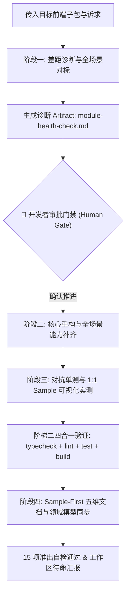

# 存量前端模块加固与全场景演进规范 (Module Hardening & Scenario Expansion SOP)

> 💡 **极简对话调用契约**：
> `@docs/agents/module-hardening-and-expansion.md <module-name> [optional-focus]`
> _示例：`@docs/agents/module-hardening-and-expansion.md core 补齐长连接心跳保活与幂等请求合并`_

本规范专职约束 `ateng-ui` **存量子包（`packages/<name>`）从 1 到 N 的工业级深度体检、行业主流场景对标、缺失能力补齐、鲁棒性加固与交付文档闭环**。

_(注：若需从 0 到 1 孵化全新子包，请参阅 [前端模块孵化与扩展通用标准](./modular-extensibility.md)。)_

---

## 1. 演进原则与红线约束

1. **行业全场景覆盖与原生零臃肿**：对标所属层级（L0~L3）业界成熟标杆方案，覆盖排名前 80%~90% 的企业级高频前端交互场景；坚持原生 TypeScript / ES 标准与 Vue 3.5 原生能力优先，严禁引入 `lodash`、`moment` 等重型第三方工具包。
2. **全面继承核心架构红线**：演进全过程严格受 [`AGENTS.md`](../../AGENTS.md) 中的 **四层洋葱单向拓扑（`L3 ➔ L2 ➔ L1 ➔ L0`）**、**十二道代码成熟度防线**、**样式 `at-` 隔离与 Design Tokens 契约**、**雪花 Long ID 防失真** 与 **极致 Tree-Shaking** 约束。
3. **干净 Diff 守卫与回滚止损准则**：严禁对无关代码进行大面积格式化重排；若重构导致连续排查受阻的大面积次生错误，必须立即使用 `git checkout` 回滚受影响文件至干净状态，退回设计树重新推导方案。

---

## 2. 四阶段流水线标准协议 (The 4-Phase Pipeline)



### 阶段一：差距诊断与全场景对标 (Gap Diagnosis & Scenario Benchmarking)

1. **源码探查与标杆对标**：深度扫描 `packages/<name>` 源码、类型导出、单测以及配套展厅 `apps/sample-<name>`，对照行业最佳实践梳理排名前 80%~90% 的高频场景。
2. **生成专职诊断报告**：在 Artifact 目录创建 `module-health-check.md`，包含：
   - **前端企业级全场景对标矩阵**（典型场景 vs 业界标杆 vs 当前现状 vs 拟补齐原生方案）；
   - **十二道成熟度防线合规差距表**（资源/句柄泄漏、异步竞态、大数截断、裸 `any`、样式污染等）；
   - **待补齐公共门面、Hooks、组件 Props/Slots/Expose 与实施路线图**。
3. **🚨 强制人工审批门禁（Human Gate）**：诊断报告落盘并向开发者展示摘要后，**必须立即停下等待开发者审批确认**，严禁未经确认擅自进入阶段二修改业务源码。

### 阶段二：核心重构与全场景能力补齐 (Core Hardening & Scenario Expansion)

- 按开发者确认的方案落地缺失业务场景、对称门面、响应式 `MaybeRefOrGetter<T>` 解包、`onScopeDispose` 确定性清理、因果 `BusinessException` 转译与显式类型导出；
- 确保 `package.json` 的 `sideEffects` 声明准确，单文件规模受控（SFC $\le 400$ 行，TS $\le 500$ 行），保持向后兼容。

### 阶段三：对抗单测与 1:1 Sample 可视化实测 (Testing & Visual Verification)

- 在 `packages/<name>` 内补齐白盒与对抗性极限单测（严格遵守 `wrapper.unmount()` DOM 还原、状态清零与 100% 离线 Mock 三铁律）；
- 在 `apps/sample-<name>` 中实装真实业务语义的可视化多场景交互看板（遵循 [`documentation-specification.md`](./documentation-specification.md) 第 3 章分层展厅规范）；
- 执行阶梯二定向四合一验证命令，确保 100% 全绿通过：
  ```bash
  pnpm --filter @atengk/<name> --filter sample-<name> typecheck && \
  pnpm --filter @atengk/<name> --filter sample-<name> lint && \
  pnpm --filter @atengk/<name> --filter sample-<name> test && \
  pnpm --filter @atengk/<name> --filter sample-<name> build
  ```

### 阶段四：Sample-First 五维文档与领域模型同步 (5D Docs & Domain Sync)

- 严格遵循 [`documentation-specification.md`](./documentation-specification.md)，从已跑通的 Sample 看板源码中 1:1 逆向提取更新子包五维 `README.md`（100% 全景速查矩阵、“类型-代码-原理”三要素就近闭环、能力大章收敛）与 Sample 四段式体验卡 `README.md`；
- 按 [`domain.md`](./domain.md) 同步维护 `packages/<name>/CONTEXT.md`、[`CONTEXT-MAP.md`](../../CONTEXT-MAP.md) 及对应 ADR（遵循存量 ADR 增量修订原则）。

---

## 3. 交付准出判据 (Exit Criteria)

完成阶段四后，必须逐项通过 [`documentation-specification.md`](./documentation-specification.md) 第 4 章的 **《交付前 15 项强制自检清单》**，并在工作区向开发者汇报变更摘要（未收到明确提交/推送指令前严禁擅自执行 Git 提交）。
