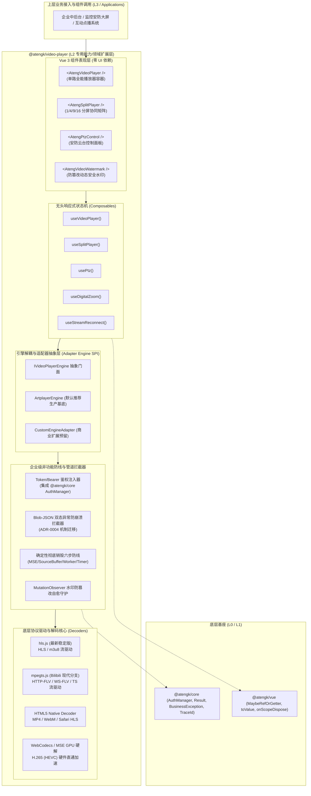
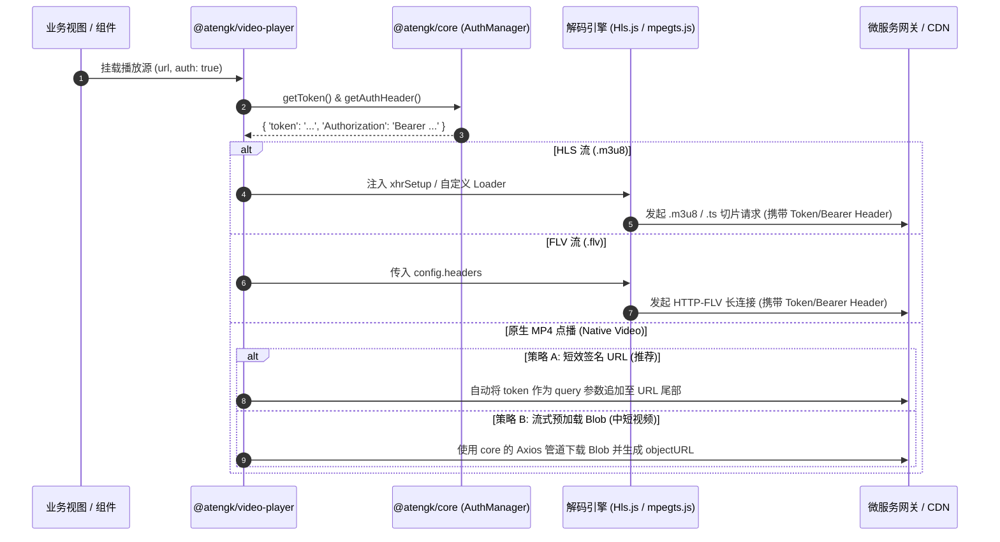
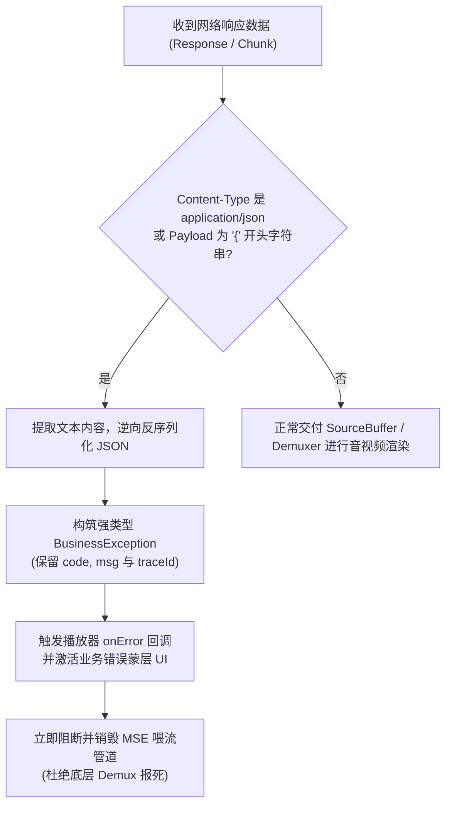
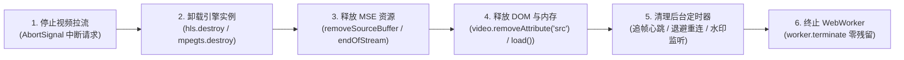
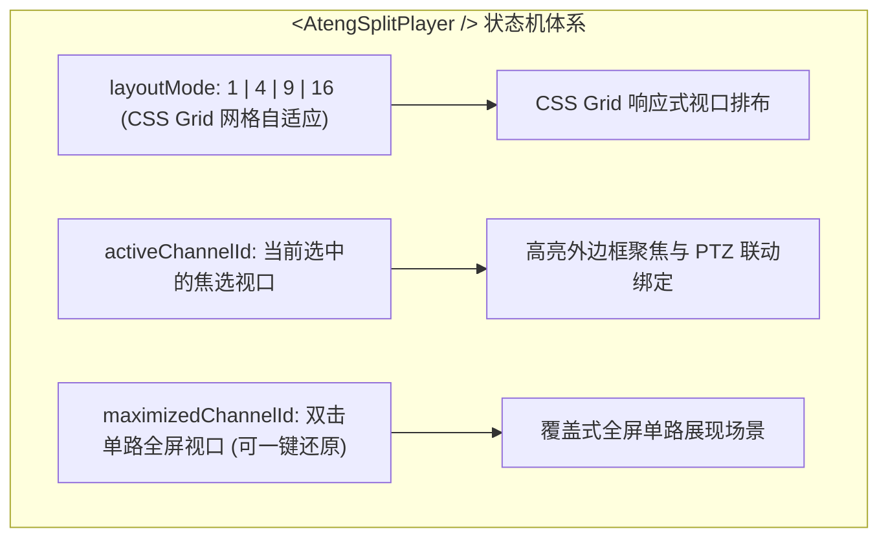
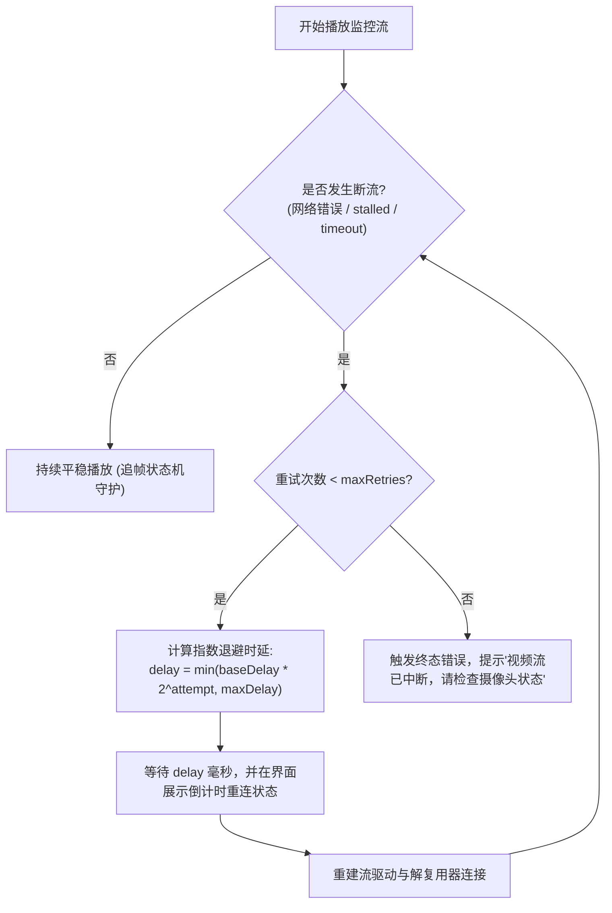

# Web 视频播放器底层引擎与流媒体技术栈深度调研与架构评估报告

**调研执行方**：前端架构研究团队（Research Subagent）  
**调研日期**：2026-10-26  
**面向项目**：`ateng-ui` 前端基础设施套件（L2 专用能力/领域扩展层 `@atengk/video-player`）  
**权威信源**：W3C HTML5 Media Source Extensions (MSE) Spec、W3C WebCodecs API Spec、Hls.js Official Docs & Releases、mpegts.js (Bilibili) Repo & RFCs、Artplayer.js Official Docs、XGplayer v3 (ByteDance) Official Docs、Chrome Platform Status (HEVC Hardware Decoding Chrome 107+)、Jessibuca Official License & Whitepaper。

---

## 1. 执行摘要与最终技术选型推荐 (Executive Summary)

经过对全网主流 Web 视频播放器引擎、流媒体解封装核心库、现代浏览器编解码技术栈及企业级工业契约的深度调研与全维推演，针对 `ateng-ui` 企业级套件的 L2 扩展层模块 **`@atengk/video-player`**（纯 Vue 3 驱动，严格 UI 库中立），确立以下核心技术选型结论与技术栈矩阵：



### 推荐选型核心矩阵

| 维度 / 技术模块                | 推荐技术方案                     | 备选 / 淘汰方案                      | 选型核心理由与决策裁决                                                                                                                                                                                          |
| :----------------------------- | :------------------------------- | :----------------------------------- | :-------------------------------------------------------------------------------------------------------------------------------------------------------------------------------------------------------------- |
| **基础播放器底座**             | **Artplayer.js (`^5.1.0`)**      | XGplayer v3、DPlayer、Video.js       | **轻量（~25KB Gzip）、MIT 协议干净、TS 契约完备、解耦插件与 Layer 体系健全、分屏多实例内存极低、销毁彻底。** 淘汰 DPlayer（年久失修）、Video.js（包袱过重 >100KB）、XGplayer（自研解封装库兼容性与文档割裂）。  |
| **HLS 流驱动**                 | **`hls.js` (`^1.5.0`)**          | videojs-http-streaming、xgplayer-hls | 行业事实标准，针对跨厂商编码推流的容错性无出其右。支持微秒级切片自适应、低延迟 LL-HLS，具备完善的 `xhrSetup` 与自定义 `pLoader`/`fLoader` 拦截管道。                                                            |
| **FLV / TS 流驱动**            | **`mpegts.js` (`^1.7.0`)**       | `flv.js` (已归档停更)、xgplayer-flv  | Bilibili 官方现代活跃分支，原生支持 HTTP-FLV 与 WebSocket-FLV，内置 `liveBufferLatencyChasing` 毫秒级追帧防延迟堆积，具备 `autoCleanupSourceBuffer` 内存泄露防御。                                              |
| **H.265 (HEVC) 编解码**        | **WebCodecs + MSE GPU 硬解直通** | WASM 软解 (libde265 / ffmpeg.wasm)   | 现代浏览器（Chrome 107+、Edge、Safari、移动端）已全线开通 HEVC GPU 硬解。**坚决放弃在多路分屏中默认打包庞大 WASM 软解**（16 路分屏会导致 CPU 瞬间 100% 熔断崩溃），对于不支持硬解的极少数旧设备推行服务端转码。 |
| **安防专有播放器 (Jessibuca)** | **架构隔离，不作为默认内核**     | 直接捆绑 Jessibuca 开源版            | **GPL-3.0 传染性开源协议红线**。Jessibuca 开源版为 GPL-3.0，商业企业级引入会面临强制开源闭环风险，Pro 版为付费商业授权。设计 `IVideoPlayerEngine` 接口供用户在业务工程自行按需注入。                            |
| **Token 鉴权注入**             | **分层三轨拦截注入机制**         | URL 硬编码 Token、Cookie 裸传        | 封装 `TokenInjector`：HLS 走 `xhrSetup`/`pLoader`；FLV 走 `mpegts.js` 的 `headers`；MP4 点播走统一鉴权短链接或 Blob 直传，标准化对接 `@atengk/core` 的 `AuthManager`。                                          |
| **Blob-JSON 双态防崩溃**       | **双态响应探测与异常转译**       | 交付解复用器裸解码（引发黑屏崩溃）   | 移植 ADR-0004 机制：流媒体接口在 401/403/500 或鉴权失效返回 `application/json` 时，前置拦截逆向提取 JSON，封装为 `BusinessException`，杜绝二进制投喂导致 MSE Demuxer 报死。                                     |
| **多路分屏协同矩阵**           | **CSS Grid + 单向状态机驱动**    | 裸写 16 个绝对定位 DOM               | 原生 CSS Grid 自适应布局，状态机收敛 `activeChannel`、单路双击全屏放大/还原、PTZ 联动，所有分屏默认 `muted: true` 兼顾浏览器自动播放策略与性能。                                                                |

---

## 2. 主流 Web 视频播放器引擎全景深度对比 (Engines Evaluation)

针对当前前端生态中最具代表性的 6 款视频播放器引擎，从开源合规、工业成熟度、架构扩展性等 10 个关键维度进行全景对比：

### 2.1 全景对比分析矩阵

| 评估维度                 | **Artplayer.js** (Harvey Zack)                | **XGplayer v3** (ByteDance)                  | **DPlayer** (DIYgod)                  | **Video.js** (Brightcove)                 | **NPlayer** (woopen)               | **Jessibuca** (langhuihui)                     |
| :----------------------- | :-------------------------------------------- | :------------------------------------------- | :------------------------------------ | :---------------------------------------- | :--------------------------------- | :--------------------------------------------- |
| **开源协议**             | **MIT** (无商业限制)                          | **MIT** (无商业限制)                         | MIT (无商业限制)                      | Apache-2.0 (无商业限制)                   | MIT (无商业限制)                   | **GPL-3.0 (开源版) / 商业授权 (Pro版)**        |
| **GPL 传染风险**         | 🟢 **零风险**                                 | 🟢 **零风险**                                | 🟢 **零风险**                         | 🟢 **零风险**                             | 🟢 **零风险**                      | 🔴 **极高风险 (开源版强制传染代码库)**         |
| **打包体积 (Gzip)**      | 🟢 **~25 KB** (极度轻量)                      | 🟡 ~60 KB (核心) / >150KB (含流驱动)         | 🟡 ~45 KB                             | 🔴 >100 KB (庞大臃肿)                     | 🟢 ~30 KB                          | 🔴 >3 MB (含 WASM 核心)                        |
| **TypeScript 支持**      | 🟢 **原生 TS，类型契约健全**                  | 🟡 v3 转向 TS，部分插件类型松散              | 🔴 外部社区 `@types`，断更残缺        | 🟡 外部维护 `@types/video.js`             | 🟢 原生 TS 编写                    | 🟡 声明文件简陋                                |
| **流媒体解耦架构**       | 🟢 **纯解耦** (`customType` 桥接标准库)       | 🔴 **自研绑定** (强制捆绑 xgplayer-*)        | 🟡 早期包装 `flv.js` / `hls.js`       | 🟡 插件包装 (`videojs-http-streaming`)    | 🟡 简单回调包装                    | 🔴 高度黑盒内聚                                |
| **流驱动稳定性**         | 🟢 **高** (直接采用 hls.js / mpegts.js)       | 🟡 **中** (私有解复用器遇特殊安防流易出 Bug) | 🔴 **低** (底层依赖老旧版本)          | 🟡 **中** (HLS 尚可，FLV 生态落后)        | 🟡 **中** (仅提供接入钩子)         | 🟢 **高** (专注安防，但受制于 WASM)            |
| **多实例分屏性能**       | 🟢 **卓越** (DOM 极简，16 分屏内存平稳)       | 🟡 **中** (内部 EventBus 与组件树较重)       | 🔴 **较差** (内存释放不彻底)          | 🔴 **恶劣** (DOM 结构庞大，16 路易卡死)   | 🟢 **良好** (架构干净)             | 🔴 **极差** (WASM 软解多路 CPU 爆表)           |
| **组件/图层扩展机制**    | 🟢 **极佳** (`layers`, `controls`, `setting`) | 🟢 **完备** (插件组件化体系)                 | 🔴 **差** (定制能力薄弱，配置硬编码)  | 🟡 **复杂** (旧式面向对象 Component 继承) | 🟡 **良好** (支持配置化注入)       | 🔴 **极差** (UI 简陋甚至需要完全自绘)          |
| **弹幕与互动插件**       | 🟢 官方插件成熟且高性能 (Canvas 弹幕)         | 🟢 官方配套 `xgplayer-danmu`                 | 🟢 早期优势，现已停滞                 | 🟡 社区插件质量参差不齐                   | 🟢 内置高性能弹幕引擎              | 🔴 无弹幕设计                                  |
| **销毁彻底度 (Destroy)** | 🟢 **完美** (提供事件解绑与外部协同清理)      | 🟡 需手动协同注销各插件状态机                | 🔴 存在 EventListener 幽灵泄露        | 🟡 历史包袱易残留 MediaSource 句柄        | 🟢 良好                            | 🟡 WASM 内存释放容易残留                       |
| **社区与维护活跃度**     | 🟢 **极高** (GitHub 持续高频提交、发版)       | 🟡 **中** (文档脱节，Issue 积压严重)         | 🔴 **停滞** (已近 3 年无实质功能迭代) | 🟡 **平稳** (进入维护期，架构老化)        | 🔴 **停滞** (个人项目，已停止演进) | 🟡 **分化** (开源版基本停滞，转向商业商业推销) |

---

### 2.2 重点候选引擎深度剖析

#### 1. Artplayer.js：首选的轻量全能基底

- **设计哲学**：轻量级微内核设计，所有非必要能力（如 HLS 控制、DASH 控制、Danmaku 弹幕、缩略图等）均作为纯外部插件解耦独立存在；
- **核心优势**：
  1. **体积极致精简**：核心库压缩仅 25KB，几乎不占用打包配额；
  2. **开放的 `customType` 适配机制**：不闭门造车重复造解封装轮子，而是通过 `customType` 规范把 HLS、FLV、MPEG-TS 的解码权完全交给全球公认最好的专业库（`hls.js`、`mpegts.js`），并在自身 `destroy()` 生命周期中提供协同销毁回调；
  3. **层级与自定义组件（Layers & Controls）**：提供类似现代微前端的 UI 插槽体系（`art.layers.add`、`art.controls.add`、`art.setting.add`、`art.contextmenu.add`），允许轻松把 Vue 3 渲染的虚拟 DOM 或真实 DOM 挂载至任意层级，为水印、云台面板、画质切换菜单提供了无缝接入支持；
  4. **完备的 TypeScript 契约**：全部源码采用原生 TypeScript 编写，对外导出数百个精确类型接口，极其符合 `ateng-ui` 的强类型防线（零 `any` 红线）。

#### 2. XGplayer v3（西瓜播放器）：重量级企业级产品

- **设计哲学**：字节跳动全量线上海量并发打磨的组件化播放器框架，强调一切皆插件；
- **核心短板与风险**：
  1. **自研解流引擎的生态陷阱**：XGplayer 在 v2/v3 中为了追求闭环，自研了 `xgplayer-flv` 与 `xgplayer-hls`。然而在面对泛安防领域极其复杂的私有推流设备（海康、大华、宇视、各类软网关推出的乱序时间戳、非标准 SEI 帧、缺失关键帧的流）时，往往会触发奇怪的音视频不同步或花屏，而这些边界 Case 在开源十几年的 `hls.js` 与 `mpegts.js` 中早已被全球工程师修复；
  2. **文档脱节与开源协同成本**：官方文档站点存在断链、API 参数缺失、TypeScript 类型定义落后于实现等问题，排查底层 Bug 往往需要深翻内部复杂的 Plugin 生命周期源码；
  3. **体积过大**：全量打包后体积远超 Artplayer，在多屏矩阵场景下内存基线偏高。

#### 3. Jessibuca：安防领域专用播放器的“阿喀琉斯之踵”

- **设计哲学**：专门针对安防 GB28181、RTSP、WebRTC、H.265 监控流设计的 Web 播放器；
- **核心红线**：
  1. **GPL-3.0 协议核污染**：Jessibuca 开源版本严格基于 GNU GPL-3.0 协议发布。根据开源合规法务要求，任何引入 GPL-3.0 库的商业分发软件或库必须将其全部源码按照 GPL-3.0 开源。这与 `ateng-ui` 的 MIT/Apache-2.0 商业友好定位完全冲突，绝对严禁直接作为依赖写入 `package.json`；
  2. **商业版与开源版严重分化**：Jessibuca 团队将硬件加速解码（WebCodecs / MSE 硬解 H.265）、多路低开销分屏等高价值特性全部收归至闭源的商业 Pro 版本，开源版仅提供高 CPU 开销的 WASM 软解；
  3. **WASM 软解的多路灾难**：在 4/9/16 路分屏场景下，如果依赖 WASM 软解 H.265，单个 1080P 视频流便会占满单核 CPU，4 路以上直接导致浏览器掉帧至 2~3 FPS，主线程冻结崩溃。

---

## 3. 流媒体协议解码核心库深度评测 (Protocol Decoders)

现代浏览器原生 `<video>` 仅支持 MP4、WebM 及部分 Ogg 格式，无法直接播放流媒体协议（HLS `.m3u8`、HTTP-FLV / WS-FLV `.flv`）。底层必须依赖 **Media Source Extensions (MSE)** 或 **WebCodecs API** 将切片数据在前端实时解封装（Demux）为 ISO-BMFF (fMP4) 片段，再投递至 `SourceBuffer`。

### 3.1 HLS 协议核心：`hls.js`

`hls.js` 是全网最为成熟、被各大流媒体巨头（Twitter、Vimeo、Dailymotion、Canal+）官方背书的 HLS 客户端。

#### 1. 核心关键能力

- **自适应码率流（ABR）**：自动基于客户端带宽、屏幕尺寸与帧丢失率平滑切换最高性价比分辨率码流；
- **低延迟 HLS (LL-HLS)**：支持 HLS 社区规范的切片分块（Part）、提前声明与 Delta Playlists，延迟可降至 1~3 秒；
- **请求管道精细劫持**：提供完备的 `xhrSetup` 钩子以及自定义 `pLoader` (Playlist Loader) / `fLoader` (Fragment Loader)，允许拦截每一跳请求与响应。

#### 2. 自定义 Loader 与双态拦截原理

在 `ateng-ui` 体系中，`hls.js` 的自定义 Loader 是落实 Token 鉴权注入与 Blob-JSON 异常拦截的核心支柱：

```typescript
import Hls from 'hls.js';

/**
 * 企业级定制 HLS 片段加载器：注入 MDC TraceId、鉴权 Token 与拦截 JSON 报错
 */
export class EnterpriseHlsFragmentLoader extends Hls.DefaultConfig.loader {
  load(context: Hls.LoaderContext, config: Hls.LoaderConfig, callbacks: Hls.LoaderCallbacks) {
    const originalOnSuccess = callbacks.onSuccess;

    // 劫持成功回调：识别 Blob-JSON 双态异常
    callbacks.onSuccess = (response, stats, ctx, networkDetails) => {
      const { data } = response;
      // 探测服务端是否在 HTTP 200/403 下违规返回了 application/json 错误载荷
      if (typeof data === 'string' && data.trim().startsWith('{')) {
        try {
          const jsonErr = JSON.parse(data);
          callbacks.onError(
            { code: jsonErr.code || 500, text: jsonErr.msg || '流媒体服务器鉴权或业务异常' },
            ctx,
            networkDetails,
          );
          return;
        } catch {
          // 非 JSON，继续走正常分片处理
        }
      }
      originalOnSuccess(response, stats, ctx, networkDetails);
    };

    super.load(context, config, callbacks);
  }
}
```

---

### 3.2 FLV / TS 协议核心：`mpegts.js` vs `flv.js`

在安防监控与低延迟直播（视频监控摄像头通过 RTSP/RTMP 转推 HTTP-FLV 或 WebSocket-FLV）场景中，FLV 拥有远优于 HLS 的延迟表现（通常在 500ms ~ 1.5s）。

#### 1. 历史沿革与演进分支

- **`flv.js` (Bilibili / xqq)**：早期开拓者。但该仓库已于数年前实质性归档停更，不支持现代 WebCodecs、缺乏完善的 HEVC 支持，且在处理持续数天的长连接流时极易发生内存膨胀溢出；
- **`mpegts.js` (Bilibili / xqq & Community)**：`flv.js` 的官方正统现代继任者。不仅重构了流式解封装架构，全面支持 MPEG-2 TS 与 FLV 双容器，而且原生支持了 Enhanced FLV 四字符码（FourCC）的 H.265 / HEVC 封装，是目前国内生产环境播放 HTTP-FLV/WS-FLV 的绝对第一基线。

#### 2. 毫秒级追帧防延迟状态机 (`liveBufferLatencyChasing`)

长连接 FLV 直播在弱网抖动、浏览器后台挂起或多任务切换时，前端未播放的缓冲区会悄然持续累积，导致摄像头画面从原本的 1 秒延迟恶化为数分钟甚至更久。`mpegts.js` 内部提供了精密的追帧算法：

```typescript
const player = mpegts.createPlayer(
  {
    type: 'flv',
    isLive: true,
    url: 'https://cctv.company.com/live/ch01.flv',
  },
  {
    enableWorker: true, // 开启 WebWorker 异步多线程解封装
    lazyLoad: false, // 直播模式关闭懒加载
    autoCleanupSourceBuffer: true, // 必须开启：自动修剪前序过期切片，防止内存溢出
    autoCleanupMaxBackwardDuration: 30, // 保留最近 30 秒倒退缓存
    autoCleanupMinBackwardDuration: 15,
    liveBufferLatencyChasing: true, // 核心：启用直播追帧机制
    liveBufferLatencyMaxLatency: 1.5, // 当缓冲区落后超过 1.5 秒时触发追帧
    liveBufferLatencyMinRemain: 0.3, // 追赶后保留 0.3 秒安全缓冲水位
    headers: {
      token: 'YOUR_AUTH_TOKEN', // 原生支持注入企业鉴权请求头
    },
  },
);
```

---

### 3.3 H.265 (HEVC) 编解码技术选型与多路分屏性能裁决

在智慧园区、安防监控、无人机巡检等视频流中，H.265 凭借比 H.264 高出 50% 的压缩比已成为 IPC 摄像头的标配推流格式。然而在 Web 浏览器端的解码曾是长期痛点。

#### 1. 现代浏览器 H.265 硬件解码支持现状（Chrome 107+ 时代）

自 **Chrome 107**（2022 年底发布，当前 2026 年现代浏览器内核版本普遍在 120+ 以上）起，Google 正式在 Windows、macOS、Android、ChromeOS 等平台全面默认开启了 **HEVC (H.265) 硬件加速解码** 支持。

- **Windows**：调用系统 D3D11VA 硬件直通管线（Intel HD Graphics、NVIDIA GeForce、AMD Radeon 均原生支持 HEVC 8-bit/10-bit 硬解）；
- **macOS / iOS**：Safari 与 Mac Chrome 调用 Apple VideoToolbox，全系 Apple Silicon 与近十年的 Intel Mac 均完美硬解；
- **探测代码契约**：
  ```typescript
  export async function checkHevcHardwareSupport(): Promise<boolean> {
    // 1. 优先通过 WebCodecs 官方标准 API 探测硬解就绪度
    if (typeof VideoDecoder !== 'undefined') {
      try {
        const result = await VideoDecoder.isConfigSupported({
          codec: 'hev1.1.6.L93.B0', // HEVC Main Profile, Level 3.1
          hardwareAcceleration: 'prefer-hardware',
        });
        if (result.supported) return true;
      } catch {
        // 忽略探测异常
      }
    }
    // 2. 降级通过 MediaSource 探测
    if (typeof MediaSource !== 'undefined') {
      return MediaSource.isTypeSupported('video/mp4; codecs="hev1.1.6.L93.B0"');
    }
    return false;
  }
  ```

#### 2. WASM 软解 vs GPU 硬解在 16 路安防分屏中的极限性能对照

| 指标                    | **现代浏览器 GPU 硬解 (MSE / WebCodecs)**    | **WASM 软解 (libde265 / ffmpeg.wasm)**            |
| :---------------------- | :------------------------------------------- | :------------------------------------------------ |
| **单路 1080P CPU 占用** | **~2% - 5%** (负载完全交由 GPU 专有解码芯片) | **45% - 85%** (严重消耗 CPU 算力与指令周期)       |
| **4 路分屏 CPU 占用**   | **~8% - 15%** (流畅平稳，主线程无压力)       | **100% 满载** (频繁触发限频，界面开始掉帧)        |
| **16 路分屏 CPU 占用**  | **~15% - 25%** (完全支撑，流畅 25 FPS)       | 🔴 **浏览器直接崩溃 / OOM 崩溃卡死 (0~2 FPS)**    |
| **前端打包体积包袱**    | **0 KB** (直接利用浏览器原生 C++ 核心与驱动) | **+3.5 MB ~ 12 MB** (必须下载庞大 wasm 二进制)    |
| **内存开销**            | 极小 (显存直通)                              | 极大 (每路分屏需要独立开辟 WebAssembly.Memory)    |
| **商业许可合规风险**    | 🟢 **纯净** (无任何代码传染)                 | 🔴 **极高** (绝大多数开源 WASM 软解库为 GPL/LGPL) |

#### 3. 架构裁决结论

1. **坚决拥抱 GPU 硬解直通**：`@atengk/video-player` 默认利用 `mpegts.js` + 浏览器原生 MSE 硬解管线处理 H.265；
2. **严禁在前端内置笨重的 WASM 软解核心**：杜绝因追求虚幻的“全兼容”导致生产环境 16 分屏瞬间雪崩；
3. **极少数旧设备的架构级兜底策略**：在流媒体服务器端（如 ZLMediaKit、SRS）开启动态转码旁路。前端通过 `checkHevcHardwareSupport()` 自动向上报送终端能力，若检测到客户端硬件不支持 H.265 硬解，服务端透明下发转码后的 H.264 流。

---

## 4. 企业级非功能契约与工业级防线落地蓝图 (Enterprise Invariants)

立足于 `ateng-ui` 企业级架构规范，`@atengk/video-player` 必须 100% 落地以下四项企业级非功能契约：

### 4.1 Token 鉴权双轨注入机制 (Token & MDC Propagation)

企业级微服务网关通常对媒体流进行权限拦截。流媒体播放器必须支持在每一跳切片与清单请求中携带用户凭据（对接 `@atengk/core` 的 `AuthManager`）：



#### 落地规范：

1. **HLS 管道**：在 `Hls` 初始化时配置 `xhrSetup`，同步设置 `xhr.setRequestHeader('token', token)` 与 `xhr.setRequestHeader('Authorization', 'Bearer ' + token)`；
2. **FLV 管道**：在 `mpegts.createPlayer` 第二参配置 `headers` 对象；
3. **原生 MP4 点播**：由于 HTML `<video src="...">` 无法直接通过 JS 修改底层 GET 请求的 HTTP Headers，提供双模式支持：
   - **模式一（标准生产，推荐）**：自动追加 URL Token 参数（`https://api.com/video.mp4?token=xxx`）；
   - **模式二（敏感受控小视频）**：配置 `authMode: 'blob'`，底层调用 `@atengk/core` 标准 Axios 管道发起二进制下载，经过拦截器注入 Headers，随后转为内存安全的临时 `Blob ObjectURL`。

---

### 4.2 Blob-JSON 双态异常识别防崩溃协议 (Blob-JSON Dual-State Guard)

#### 1. 行业致命痛点

在安防监控与权限视频系统中，当用户的 Token 过期、账号被顶登、或设备下线不可达时，后端微服务网关或媒体服务器通常会返回 HTTP 401/403/500，或者返回带业务错误载荷的 JSON 数据：
`{"code": 40101, "msg": "视频流鉴权已过期，请重新登录", "traceId": "trace-xxx-123"}`。
由于播放器预设接收二进制音视频数据，如果直接将这段 JSON 文本交付给 `hls.js`、`mpegts.js` 或浏览器的 MediaSource，会导致解复用器触发 `DEMUX_ERROR` 或 `PARSE_SYNTAX_ERROR`，播放器界面陷入**永久黑屏或转圈 Loading**，业务层无法捕获到任何可读的错误提示！

#### 2. 双态防御流水线

`@atengk/video-player` 完整移植并落地 [ADR-0004](./docs/adr/0004-blob-error-dual-state-and-fesod-excel-protocol.md) 设计原则，构筑前置双态拦截管道：



---

### 4.3 确定性彻底销毁六步防线 (Deterministic Teardown Invariant)

在安防监控系统中，操作员频繁在“1分屏 ➔ 4分屏 ➔ 16分屏 ➔ 切换机房分组”之间高速跳转。如果单次切换未能 100% 释放旧连接与句柄，16 个视频流每分钟可吞噬数 GB 显存与内存，导致页面在几分钟内崩溃（OOM）。

`@atengk/video-player` 严格遵循**确定性生命周期与资源清理防线**，确立不可逾越的“销毁六步 SOP”：



#### 销毁契约实现代码模版：

```typescript
export function deterministicDestroyPlayer(context: PlayerRuntimeContext): void {
  // 1. 中断飞行中的网络加载与重试调度
  if (context.abortController) {
    context.abortController.abort();
    context.abortController = null;
  }
  if (context.reconnectTimer) {
    clearTimeout(context.reconnectTimer);
    context.reconnectTimer = null;
  }

  // 2. 销毁协议解码器实例 (Hls / mpegts)
  if (context.hlsInstance) {
    context.hlsInstance.detachMedia();
    context.hlsInstance.destroy();
    context.hlsInstance = null;
  }
  if (context.mpegtsInstance) {
    context.mpegtsInstance.unload();
    context.mpegtsInstance.detachMediaElement();
    context.mpegtsInstance.destroy();
    context.mpegtsInstance = null;
  }

  // 3. 彻底释放原生 HTMLMediaElement 资源 (解绑 src 触发 V8 GC)
  if (context.videoElement) {
    context.videoElement.pause();
    context.videoElement.removeAttribute('src');
    context.videoElement.load(); // 强制触发浏览器原生内核资源卸载
  }

  // 4. 清理防篡改 MutationObserver 与 Canvas 水印
  if (context.watermarkObserver) {
    context.watermarkObserver.disconnect();
    context.watermarkObserver = null;
  }

  // 5. 调用 Artplayer 核心销毁
  if (context.artInstance) {
    context.artInstance.destroy(false); // 干净清除全部自定义 Controls 与 Layers
    context.artInstance = null;
  }
}
```

---

### 4.4 防篡改动态安全水印体系 (Anti-Tamper Security Watermark)

面向企业涉密视频审计、安防监控防泄密，播放器必须提供不可擦除的安全水印。

#### 1. 全屏层级穿透陷阱与破解之道

- **传统陷阱**：直接调用 `<video>` 元素的 `video.requestFullscreen()` 原生全屏时，浏览器视口仅将裸 `<video>` 抬升至顶层硬件渲染图层，**原本覆盖在播放器上方的所有 DOM 水印层、弹幕层都会被浏览器底层隐形丢弃**！
- **破解标准**：播放器统一对**外层容器（Container Element）** 发起全屏调用：`container.requestFullscreen()`，确保控制栏、动态安全水印、弹幕层在全屏模式下依然 100% 完整常驻。

#### 2. MutationObserver 防篡改自愈机制

防范涉密人员通过浏览器 F12 控制台篡改 DOM 样式（例如添加 `display: none`、`opacity: 0` 或直接 `remove()` 节点）：

```typescript
export function mountAntiTamperWatermark(
  container: HTMLElement,
  watermarkEl: HTMLElement,
  onTamperAttempt?: () => void,
): MutationObserver {
  const observer = new MutationObserver(mutations => {
    for (const mutation of mutations) {
      // 监测到水印元素被移除或属性被恶意篡改
      if (
        (mutation.type === 'childList' &&
          Array.from(mutation.removedNodes).includes(watermarkEl)) ||
        (mutation.type === 'attributes' && mutation.target === watermarkEl)
      ) {
        // 1. 触发审计日志警告
        onTamperAttempt?.();
        // 2. 毫秒级自愈复原：将水印节点重新克隆挂回容器
        if (!container.contains(watermarkEl)) {
          container.appendChild(watermarkEl);
        }
        watermarkEl.style.display = 'block';
        watermarkEl.style.opacity = '0.85';
        watermarkEl.style.pointerEvents = 'none';
        watermarkEl.style.position = 'absolute';
      }
    }
  });

  observer.observe(container, {
    childList: true,
    subtree: true,
    attributes: true,
    attributeFilter: ['style', 'class', 'hidden'],
  });

  return observer;
}
```

---

## 5. 安防监控与 IoT 专用场景深度设计 (Surveillance & IoT)

### 5.1 1 / 4 / 9 / 16 多路视频分屏协同矩阵架构

安防大屏核心要求灵活无缝切换 1、4、9、16 分屏，具备选路聚焦、双击最大化与全局键盘联动控制：



#### 关键技术规范：

1. **CSS Grid 极速排布**：采用现代 CSS 网格布局，通过属性动态切换网格列数，实现极速布局过渡且零 DOM 重建开销：
   ```css
   .at-split-matrix {
     display: grid;
     gap: 2px;
     background-color: #000;
   }
   .at-split-matrix[data-layout='1'] {
     grid-template-columns: 1fr;
   }
   .at-split-matrix[data-layout='4'] {
     grid-template-columns: repeat(2, 1fr);
   }
   .at-split-matrix[data-layout='9'] {
     grid-template-columns: repeat(3, 1fr);
   }
   .at-split-matrix[data-layout='16'] {
     grid-template-columns: repeat(4, 1fr);
   }
   ```
2. **静音自动播放铁律**：除用户当前显式激活（`activeChannel`）并手动开启声音的唯一视口外，其余 15 路分屏在初始化时**强制设置 `muted: true`**。这既彻底满足浏览器非静音自动播放阻断策略（Autoplay Policy），又防止 16 路杂乱音频交叉污染。

---

### 5.2 云台 PTZ 软控制面板协议设计

通过纯 CSS 与 SVG 构建轻量级云台方向盘（8 方向、变倍、变焦、光圈、预置位），通过标准 API 与摄像头硬件联动：

```typescript
export interface PtzCommandPayload {
  channelId: string | number;
  command:
    | 'UP'
    | 'DOWN'
    | 'LEFT'
    | 'RIGHT'
    | 'LEFT_UP'
    | 'LEFT_DOWN'
    | 'RIGHT_UP'
    | 'RIGHT_DOWN'
    | 'ZOOM_IN'
    | 'ZOOM_OUT' // 变倍 (焦距大小)
    | 'FOCUS_NEAR'
    | 'FOCUS_FAR' // 聚焦 (清晰度调节)
    | 'IRIS_OPEN'
    | 'IRIS_CLOSE' // 光圈调节
    | 'STOP'; // 停止运动 (鼠标松开触发)
  speed: number; // 运动速度步长 (1 ~ 8)
}

export interface PtzPresetPayload {
  channelId: string | number;
  action: 'SET' | 'CALL' | 'DELETE'; // 设定预置位 / 调用预置位 / 删除预置位
  presetId: number;
}
```

---

### 5.3 电子放大 (Digital Zoom) 状态机

对于缺乏机械云台变倍功能的固定角度摄像头，提供纯前端的高性能电子放大：

- **实现原理**：在播放器 `<video>` 上方叠加透明交互层，监听 `wheel`（滚轮缩放，范围 1.0x ~ 5.0x）与 `pointerdown` / `pointermove`（拖拽平移）；
- **硬件加速渲染**：利用 CSS3 `transform: matrix(...)` 或 `translate3d() scale()` 实现 60 FPS 硬件平滑变换，并在四周设置严格的物理边界碰撞限制，防止放大后的画面拖出视口黑边。

---

### 5.4 低延迟直播追帧与断流指数退避重连算法



---

## 6. 最终推荐落地架构与模块设计方案 (`@atengk/video-player`)

### 6.1 模块分层与依赖流向

新建模块严格归入 **L2 专用能力/领域扩展层 (Extension Layer)**，必须遵守无单点 UI 绑定的工业级契约：

```
L3 表现层 (apps/sample-video-player / @atengk/element-plus 业务封装)
  │
  ▼
L2 扩展层 (@atengk/video-player)
  │  ├── 依赖：@atengk/core (L0 纯 TS 核心底座: 鉴权/异常/TraceId)
  │  ├── 依赖：@atengk/vue  (L1 纯无头 Hooks: 响应式解构/生命周期清理)
  │  ├── 依赖：artplayer (基础播放器微内核)
  │  ├── 依赖：hls.js (HLS 协议解封装)
  │  ├── 依赖：mpegts.js (FLV/TS 协议解封装)
  │  └── peerDependencies: vue (>= 3.5.0)
  │  └── 严格禁止依赖：@atengk/element-plus 或任何其他第三方具体 UI 库！
```

---

### 6.2 模块工程结构树规划

在 `packages/video-player/` 中原子化齐备“新模块自举六件套”：

```
packages/video-player/
├── CONTEXT.md                    # 模块专属领域词汇表与设计边界
├── README.md                     # 五维生产就绪交付说明书
├── package.json                  # 元数据、构建脚本与 exports 双模声明
├── tsconfig.json                 # 严格 TypeScript 编译配置
├── vite.config.ts                # 打包配置 (输出 ESM+CJS+DTS，外部化 Vue/Core)
├── src/
│   ├── index.ts                  # 统一公共导出总入口 (纯声明式导出，零副作用)
│   ├── types/                    # 强类型契约定义
│   │   ├── player.ts             # 播放器配置、事件与实例类型
│   │   ├── split.ts              # 分屏矩阵与视口类型
│   │   ├── ptz.ts                # 云台与预置位协议类型
│   │   └── exception.ts          # 视频专用异常体系
│   ├── core/                     # 播放器内核抽象与适配层
│   │   ├── engine-interface.ts   # IVideoPlayerEngine 统一 SPI 接口
│   │   ├── artplayer-engine.ts   # Artplayer.js 官方推荐生产适配器实现
│   │   └── registry.ts           # 引擎工厂与注册中心
│   ├── drivers/                  # 底层流媒体协议驱动集成
│   │   ├── hls-driver.ts         # hls.js 初始化、xhrSetup 与异常拦截
│   │   ├── mpegts-driver.ts      # mpegts.js 追帧、Worker 配置与 Headers
│   │   └── native-driver.ts      # MP4 / WebM 原生驱动
│   ├── invariants/               # 企业级非功能防线管道
│   │   ├── token-injector.ts     # Token 自动注入器 (对接 core AuthManager)
│   │   ├── blob-json-guard.ts    # Blob-JSON 双态异常前置探测识别
│   │   ├── teardown-guard.ts     # 确定性彻底销毁六步防线
│   │   └── watermark-guard.ts    # MutationObserver 防篡改自愈水印
│   ├── composables/              # Vue 3.5 无头响应式状态机
│   │   ├── useVideoPlayer.ts     # 单路播放器核心生命周期与控制
│   │   ├── useSplitPlayer.ts     # 1/4/9/16 分屏协同矩阵状态机
│   │   ├── usePtz.ts             # 云台长按与步进控制状态机
│   │   ├── useDigitalZoom.ts     # 电子放大平移缩放状态机
│   │   └── useStreamReconnect.ts # 断流退避自动重连状态机
│   └── components/               # Vue 3 纯原生表现组件 (统一 at- 命名空间与 Scoped)
│       ├── AtengVideoPlayer.vue  # 单路全能播放器容器
│       ├── AtengSplitPlayer.vue  # 多路分屏网格容器
│       ├── AtengPtzControl.vue   # 8 向云台与变焦控制盘
│       └── AtengVideoWatermark.vue # 防篡改动态安全水印组件
└── tests/                        # 单元测试 (遵循离线自洽 3 铁律)
    ├── useVideoPlayer.spec.ts
    ├── blob-json-guard.spec.ts
    └── teardown-guard.spec.ts
```

---

### 6.3 核心组件对外接口 (Props / Emits) 规范设计

```typescript
/**
 * AtengVideoPlayer 组件入参契约
 */
export interface AtengVideoPlayerProps {
  /** 视频播放地址 (MP4, HLS .m3u8, FLV .flv) */
  url: string;
  /** 明确流类型，默认依据 url 后缀自动嗅探 */
  type?: 'auto' | 'mp4' | 'm3u8' | 'flv' | 'ts';
  /** 是否为直播流 */
  isLive?: boolean;
  /** 是否自动播放 (默认 true，非静音受浏览器策略限制) */
  autoplay?: boolean;
  /** 是否静音播放 (多路分屏强力建议为 true) */
  muted?: boolean;
  /** 播放器封面海报 */
  poster?: string;
  /** 是否启用 Token 鉴权自动注入 (默认 true，对接 @atengk/core) */
  auth?: boolean;
  /** 安全水印文本 (支持手机尾号、姓名、工号等，不传则不显示) */
  watermark?: string;
  /** 是否开启防篡改自愈防护 (默认 true) */
  antiTamper?: boolean;
  /** 是否启用直播追帧 (仅 isLive 为 true 时生效，默认 true) */
  latencyChasing?: boolean;
  /** 自定义控制栏项配置 */
  controls?: boolean | PlayerControlItemConfig[];
}

/**
 * AtengSplitPlayer 多路分屏组件入参契约
 */
export interface AtengSplitPlayerProps {
  /** 分屏模式：1 | 4 | 9 | 16 (支持 v-model:layout) */
  layout?: 1 | 4 | 9 | 16;
  /** 多路分屏播放数据源列表 */
  channels: Array<{
    id: string | number;
    title: string;
    url: string;
    type?: 'auto' | 'mp4' | 'm3u8' | 'flv';
    isLive?: boolean;
  }>;
  /** 当前焦选视口 ID (支持 v-model:activeId) */
  activeId?: string | number;
  /** 是否支持双击单路全屏放大 (默认 true) */
  allowDoubleClickZoom?: boolean;
}
```

---

## 7. 实施路线图与后续规划建议 (Roadmap & Action Items)

为确保 `@atengk/video-player` 高质量落地并顺畅接入 `ateng-ui` 单体工程与 CI 矩阵，建议分阶段推进：

### 阶段一：模块脚手架与基础设施准备 (Day 1)

1. **新建子包**：在 `packages/video-player` 初始化标准 `package.json`（名称 `@atengk/video-player`，配置构建脚本、导出映射、peer 依赖）；
2. **拓扑登记**：在根目录 [CONTEXT-MAP.md](./CONTEXT-MAP.md) 登记 L2 扩展层入驻，确认依赖流向合法合规；
3. **自验工程准备**：在 `apps/sample-video-player` 搭建极简自验沙箱工程，接入 Turborepo 2.x 任务流水线。

### 阶段二：核心适配器与企业级防线实现 (Day 2 - Day 3)

1. **适配器 SPI**：实现 `IVideoPlayerEngine`，封装 `ArtplayerEngine`，对接 `hls.js` 与 `mpegts.js`；
2. **防线落地**：落地 `TokenInjector`、`BlobJsonGuard` 与 `DeterministicTeardown` 彻底销毁机制；
3. **单元测试守护**：针对 Blob-JSON 双态拦截、销毁句柄清理编写 100% 离线自洽对抗性测试。

### 阶段三：无头 Hooks 与表现组件构建 (Day 4 - Day 5)

1. **Hooks 研发**：实现 `useVideoPlayer`、`useSplitPlayer`、`usePtz`、`useDigitalZoom`；
2. **组件开发**：构建 `<AtengVideoPlayer />`、`<AtengSplitPlayer />`、`<AtengPtzControl />`、`<AtengVideoWatermark />`，统一样式隔离命名空间 `at-`；
3. **自验展厅呈现**：在 `apps/sample-video-player` 还原点播、直播、1/4/9/16 分屏切换、云台联动、鉴权模拟及全屏水印全真交互，完成两段式人机验收。
