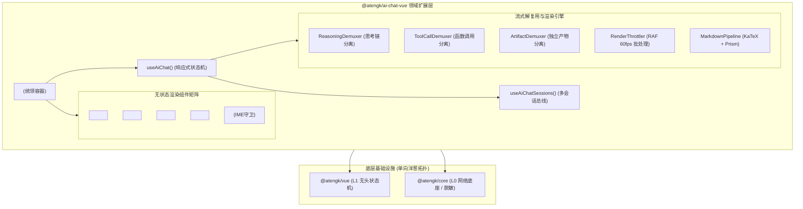

# @atengk/ai-chat-vue 企业级 AI 智能体会话与 Artifacts 产物协同基础设施

> 面向现代 Web 应用与大语言模型交互的企业级 AI 智能体对话、深度思考链折叠与 Artifacts 产物协同响应式扩展基础设施，纯 Vue 3 驱动，归属于四层洋葱拓扑之 L2 专用能力/领域扩展层。

---

## 0. 特性与公共 API 全景速查矩阵

| API 标识                    | 类别       | 核心职责                                                            | 关键 Props / 入参 / 返回值                                                 | 对应章节                                         |
| :-------------------------- | :--------- | :------------------------------------------------------------------ | :------------------------------------------------------------------------- | :----------------------------------------------- |
| `<AtengAiChat />`           | 表现组件   | 智能对话全功能统领容器，组装消息流、输入框与操作栏                  | `messages`, `isStreaming`, `starterPrompts`, `slashCommands`, `beforeSend` | [第 8 章](#8-交互工程防护与多会话持久化大章)     |
| `<AtengChatMessage />`      | 表现组件   | 结构化单条消息气泡容器，含思考链、工具卡片、产物卡片与重试自愈      | `message`, `isStreaming`, `enableFeedback`, `enableRegenerate`             | [第 3 章](#3-流式多路解复用与思考链折叠大章)     |
| `<AtengChatInput />`        | 表现组件   | 具备 CompositionGuard 与 1~6 行高度自适应伸缩的输入框，支持斜杠指令 | `modelValue`, `minRows`, `maxRows`, `disabled`, `slashCommands`            | [第 8 章](#8-交互工程防护与多会话持久化大章)     |
| `<AtengReasoningBlock />`   | 表现组件   | DeepSeek R1 深度思考链折叠卡片，支持计时与骨架动画                  | `reasoning`, `isStreaming`, `defaultExpanded`                              | [第 3 章](#3-流式多路解复用与思考链折叠大章)     |
| `<AtengToolCallCard />`     | 表现组件   | Function Calling 与 MCP 工具调用全生命周期卡片与人机审批            | `toolCall`, `interactive`, `@approve`, `@reject`                           | [第 6 章](#6-mcp-工具调用与人机协同审批大章)     |
| `<AtengArtifactCard />`     | 表现组件   | 消息流内紧凑产物卡片，显示产物版本并支持一键唤起工作台              | `artifact`, `version`, `@open`                                             | [第 7 章](#7-artifacts-产物侧边栏与版本比对大章) |
| `<AtengArtifactSidebar />`  | 表现组件   | 独立产物工作台抽屉/分栏，支持 Monaco Diff 插槽反转                  | `visible`, `artifact`, `activeVersion`, `#diff` 插槽                       | [第 7 章](#7-artifacts-产物侧边栏与版本比对大章) |
| `<AtengMarkdownRenderer />` | 表现组件   | 高保真 Markdown 渲染器，集成 KaTeX、Prism 与动态 Mermaid            | `content`, `enableKatex`, `enableMermaid`, `enablePrism`                   | [第 4 章](#4-富文本渲染与动态图表大章)           |
| `<AtengCodeBlock />`        | 表现组件   | 独立语法高亮代码块，支持语言识别与一键复制                          | `code`, `language`, `filename`                                             | [第 4 章](#4-富文本渲染与动态图表大章)           |
| `<AtengMermaidBlock />`     | 表现组件   | Mermaid 架构流程图渲染卡片，支持暗黑模式自适应                      | `chart`, `theme`                                                           | [第 4 章](#4-富文本渲染与动态图表大章)           |
| `<AtengMessageToolbar />`   | 表现组件   | 消息操作微交互工具栏（复制、朗读、点赞、踩理由、导出）              | `content`, `enableFeedback`, `status`, `@feedback`                         | [第 8 章](#8-交互工程防护与多会话持久化大章)     |
| `useAiChat()`               | 无头状态机 | AI 对话通用响应式状态机，编排消息流、产物总线与流式打字机           | `UseAiChatOptions` ➔ `UseAiChatReturn`                                     | [第 3 章](#3-流式多路解复用与思考链折叠大章)     |
| `useAiChatSessions()`       | 无头状态机 | 多会话持久化状态机，支持创建、切换、重命名、删除与防溢出            | `UseAiChatSessionsOptions` ➔ `UseAiChatSessionsReturn`                     | [第 8 章](#8-交互工程防护与多会话持久化大章)     |
| `LocalStorageAdapter`       | 存储驱动   | LocalStorage 会话持久化驱动，提供内存安全降级与防溢出保护           | `StorageAdapter` 接口实现                                                  | [第 8 章](#8-交互工程防护与多会话持久化大章)     |
| `ReasoningDemuxer`          | 流式引擎   | 状态机流式提取 `<think>` 思考过程与正文多路解复用                   | `feed(chunk)` ➔ `{ content, reasoningChunk, state }`                       | [第 3 章](#3-流式多路解复用与思考链折叠大章)     |
| `ToolCallDemuxer`           | 流式引擎   | 状态机流式提取 `<tool_call>` 标签与执行参数                         | `feed(chunk)` ➔ `{ content, toolCalls }`                                   | [第 6 章](#6-mcp-工具调用与人机协同审批大章)     |
| `ArtifactDemuxer`           | 流式引擎   | 状态机流式提取 `<artifact>` 产物标签并剥离主内容                    | `feed(chunk)` ➔ `{ content, artifacts }`                                   | [第 7 章](#7-artifacts-产物侧边栏与版本比对大章) |
| `RenderThrottler`           | 渲染节流器 | 基于 RAF 与字符缓冲队列的流式渲染打字机                             | `RenderThrottlerOptions`, `push()`, `flush()`                              | [第 5 章](#5-渲染节流与视口动态锚定大章)         |
| `MarkdownPipeline`          | 文本解析器 | 聚合 markdown-it、katex 与 prism 的文本解析管道                     | `render(markdown)` ➔ `MarkdownChunk[]`                                     | [第 4 章](#4-富文本渲染与动态图表大章)           |

---

## 1. 模块定位与 pnpm 坐标

`@atengk/ai-chat-vue` 位于 `ateng-ui` 四层洋葱拓扑之 **L2 专用能力/领域扩展层**。它纯原生基于 Vue 3.5 构建，与具体 UI 表现库（Element Plus 等）完全解耦，可独立在任意现代前端架构、微前端或中后台工程中使用。

```bash
pnpm add @atengk/ai-chat-vue
```

### peerDependencies 依赖契约

```json
{
  "peerDependencies": {
    "vue": "^3.5.0",
    "mermaid": "^11.0.0 || ^12.0.0"
  },
  "peerDependenciesMeta": {
    "mermaid": {
      "optional": true
    }
  }
}
```

> **注意**：`mermaid` 声明为可选依赖（optional）。若工程无需动态渲染 Mermaid 流程图/架构图，可免装 `mermaid`，包内运行时将自动优雅降级为高亮代码块。

---

## 2. 核心架构与设计不变量



### 关键设计不变量

1. **L2 平台中立律（零 Element Plus 依赖）**：子包内部 100% 纯 Vue 3 原生实现，严禁引入 `ElMessage`、`ElButton` 等具体 UI 库组件，所有视觉呈现通过原生 CSS 与 `--at-chat-*` 变量隔离。
2. **多路解复用流式流水线（Demuxer Pipeline）**：在数据帧接收阶段，通过流式有限状态机将混合流无损解耦为正文内容、思考过程（Reasoning）、工具调用（ToolCall）与独立产物（Artifact）。
3. **输入法中文防走火（CompositionGuard）**：监听输入法拼音候选组装阶段，硬拦截 Enter 提交，确保回车选词绝不误发。
4. **不可变产物版本链（Immutable Artifact Chain）**：同一 identifier 产物多次迭代自动形成不可变版本链快照（v1 ➔ v2），为 Monaco Diff 比对提供数据基石。

---

## 3. 流式多路解复用与思考链折叠大章

### 3.1 思考链流式多路解复用契约

```typescript
export interface ReasoningContent {
  /** 思考链纯文本内容 */
  content: string;
  /** 推理计算耗时（秒） */
  durationSeconds?: number;
  /** 是否仍在流式思考中 */
  isStreaming?: boolean;
}

export interface DemuxResult {
  /** 剥离思考链后的正式回复正文 */
  content: string;
  /** 提取的思考链增量或完整载荷 */
  reasoning?: ReasoningContent;
}
```

### 3.2 深度推理折叠实战示例

```vue
<script setup lang="ts">
import { ref } from 'vue';
import { AtengAiChat, useAiChat } from '@atengk/ai-chat-vue';

const { messages, isStreaming, sendMessage, abort } = useAiChat({
  initialMessages: [
    {
      id: 'msg_welcome',
      role: 'assistant',
      content: '请提出需要深度推理的技术课题，我将为您展开思考与分析。',
      status: 'completed',
      createdAt: Date.now(),
    },
  ],
  streamHandler: async (prompt, onChunk, signal) => {
    // 模拟 DeepSeek R1 <think> 流式分块传输
    const chunks = [
      '<think>\n正在分析用户需求...\n推导时间复杂度与边界状态...\n</think>\n',
      '根据深度推导分析，快速排序在最坏情况下的时间复杂度为 $O(n^2)$。',
    ];
    for (const chunk of chunks) {
      if (signal.aborted) break;
      await new Promise(r => setTimeout(r, 200));
      onChunk(chunk);
    }
  },
});
</script>

<template>
  <AtengAiChat
    :messages="messages"
    :is-streaming="isStreaming"
    height="500px"
    placeholder="输入课题，体验 DeepSeek R1 思考链折叠..."
    @send="content => sendMessage(content)"
    @stop="abort"
  />
</template>
```

### 3.3 状态机流转与骨架计时机制

`ReasoningDemuxer` 采用状态机追踪流式文本：

1. **未就绪态**：嗅探 `<think>` 标签开始标记；
2. **思考态**：捕获思考增量，主线程定时器按 100ms 频率累加 `durationSeconds`，并在气泡顶端呈现呼吸感骨架动效；
3. **完成态**：嗅探到 `</think>` 结束标记时冻结计时，默认自动平滑折叠思考区域，保证终端用户首屏优先阅读正式正文。

---

## 4. 富文本渲染与动态图表大章

### 4.1 富文本管道契约与动态渲染

```typescript
export interface AtengMarkdownRendererProps {
  /** 待渲染的 Markdown 字符串 */
  content: string;
  /** 是否启用 KaTeX 数学公式解析，默认为 true */
  enableKatex?: boolean;
  /** 是否启用 Mermaid 架构图动态渲染，默认为 true */
  enableMermaid?: boolean;
  /** 是否启用 Prism 语法高亮，默认为 true */
  enablePrism?: boolean;
}
```

### 4.2 数学公式与架构流程图实战示例

```vue
<script setup lang="ts">
import { AtengMarkdownRenderer } from '@atengk/ai-chat-vue';

const sampleMarkdown = `
### 算法公式与系统架构全景

1. **正态分布概率密度函数**：
$$f(x) = \\frac{1}{\\sigma \\sqrt{2\\pi}} e^{-\\frac{1}{2}\\left(\\frac{x-\\mu}{\\sigma}\\right)^2}$$

2. **微服务流转时序图**：
\`\`\`mermaid
sequenceDiagram
    Client->>Gateway: 发起 API 业务请求
    Gateway->>AuthService: 校验 Token Header
    AuthService-->>Gateway: 验签通过 (UID: 1001)
    Gateway->>BusinessService: 路由转发处理
    BusinessService-->>Client: 200 OK 业务数据
\`\`\`
`;
</script>

<template>
  <div class="markdown-preview-card">
    <AtengMarkdownRenderer :content="sampleMarkdown" />
  </div>
</template>

<style scoped>
.markdown-preview-card {
  padding: 16px;
  background: var(--at-chat-surface, #ffffff);
  border-radius: 8px;
}
</style>
```

### 4.3 Prism 高亮与 Mermaid 懒加载机制

- **KaTeX 数学渲染**：管道内置 `katex` 渲染器，支持行内公式 `$E=mc^2$` 与块级公式 `$$\dots$$`，遇到非法 LaTeX 语法时静默降级为源码排版，杜绝白屏崩溃；
- **Mermaid 动态懒加载**：仅当正文中出现 ````mermaid`代码块时，异步动态调用`import('mermaid')`进行 DOM 挂载；若未安装`mermaid` 依赖，无缝降级为 Prism 高亮展示。

---

## 5. 渲染节流与视口动态锚定大章

### 5.1 节流批处理与视口锚定契约

```typescript
export interface RenderThrottlerOptions {
  /** 打字机仿真速率（ms/字符），为 0 时启用全速 requestAnimationFrame 节流 */
  typewriterSpeed?: number;
  /** 字符刷新回调函数 */
  onFlush: (bufferedText: string) => void;
}
```

### 5.2 60fps 批处理打字机实战示例

```vue
<script setup lang="ts">
import { ref } from 'vue';
import { AtengAiChat, useAiChat } from '@atengk/ai-chat-vue';

// 动态切换打字速率：0 全速 RAF，20 仿真实时打字
const typewriterSpeed = ref<number>(20);

const { messages, isStreaming, sendMessage, abort, flushTypewriter } = useAiChat({
  typewriterSpeed,
});
</script>

<template>
  <div>
    <div class="control-bar">
      <button type="button" @click="typewriterSpeed = 0">全速 60fps 批处理</button>
      <button type="button" @click="typewriterSpeed = 20">打字机 (20ms/字)</button>
      <button v-if="isStreaming" type="button" @click="flushTypewriter">⚡ 立即刷盘</button>
    </div>

    <AtengAiChat
      :messages="messages"
      :is-streaming="isStreaming"
      height="520px"
      @send="c => sendMessage(c)"
      @stop="abort"
    />
  </div>
</template>
```

### 5.3 RAF 渲染循环与离底阈值锁定原理

1. **高频防抖打字队列**：外部流式 chunk 写入环形缓冲区，内部基于 `window.requestAnimationFrame` 在每秒 60 帧生命周期内按需批量刷新 DOM，避免频繁 `innerHTML` 重排重绘；
2. **智能视口离底锚定（`ScrollAnchoring`）**：计算滚动容器 `scrollHeight - scrollTop - clientHeight`。若差值 $\le 60\text{px}$，判定为“处于底部”，流式输出时自动贴底；若用户主动向上滚动查阅历史，锚定立即释放，并在右下角浮现“有新消息 ⬇”胶囊提示。

---

## 6. MCP 工具调用与人机协同审批大章

### 6.1 工具定义与审批状态机契约

```typescript
export interface ToolDefinition {
  /** 工具全局唯一名称（如 get_weather、drop_database_table） */
  name: string;
  /** 工具功能描述 */
  description?: string;
  /** 执行模式：auto 自动执行；confirm 人机协同审批确认 (HITL) */
  mode: 'auto' | 'confirm';
  /** 工具核心执行回调 */
  execute: (args: Record<string, unknown>) => Promise<unknown>;
}
```

### 6.2 全双工工具调用与审批实战示例

```vue
<script setup lang="ts">
import { AtengAiChat, useAiChat, type ToolDefinition } from '@atengk/ai-chat-vue';

const tools: ToolDefinition[] = [
  {
    name: 'query_order_status',
    description: '查询电商订单当前物流状态',
    mode: 'auto',
    execute: async args => ({ orderId: args.orderId, status: 'DELIVERED', carrier: 'SF-Express' }),
  },
  {
    name: 'refund_payment',
    description: '执行原路退款敏感操作（需人工审批）',
    mode: 'confirm',
    execute: async args => ({
      refundId: `RF_${Date.now()}`,
      amount: args.amount,
      result: 'SUCCESS',
    }),
  },
];

const { messages, isStreaming, sendMessage, approveToolCall, rejectToolCall } = useAiChat({
  tools,
});
</script>

<template>
  <AtengAiChat
    :messages="messages"
    :is-streaming="isStreaming"
    height="540px"
    @send="c => sendMessage(c)"
    @approve-tool="id => approveToolCall(id)"
    @reject-tool="id => rejectToolCall(id, '管理员拒绝退款')"
  />
</template>
```

### 6.3 权限阻断与全双工回写机制

当大模型吐出 `<tool_call>` 时：

- `mode: 'auto'`：直接执行 `execute`，将结果自动格式化为 `role: 'tool'` 消息发回模型；
- `mode: 'confirm'`：进入挂起审批状态，气泡内渲染结构化卡片与 JSON 入参。点击“批准”后方才执行回调；点击“驳回”则直接生成拦截错误帧，确保生产高危写操作受控。

---

## 7. Artifacts 产物侧边栏与版本比对大章

### 7.1 产物载荷与版本链契约

```typescript
export interface ArtifactPayload {
  /** 产物唯一标识符（如 user-profile-card） */
  identifier: string;
  /** 产物标题 */
  title: string;
  /** 编程语言或格式标识（如 vue, typescript, json） */
  language: string;
  /** 当前版本号 */
  currentVersion: number;
  /** 不可变历史版本切片数组 */
  versions: ArtifactVersion[];
}
```

### 7.2 独立产物工作台与 Diff 比对实战示例

```vue
<script setup lang="ts">
import { AtengAiChat, AtengArtifactSidebar, useAiChat } from '@atengk/ai-chat-vue';
import { AtengCodeDiffEditor } from '@atengk/code-editor-vue';

const {
  messages,
  isStreaming,
  sendMessage,
  activeArtifact,
  activeArtifactVersion,
  isArtifactSidebarOpen,
  openArtifact,
} = useAiChat();
</script>

<template>
  <div class="workbench">
    <AtengAiChat
      :messages="messages"
      :is-streaming="isStreaming"
      height="600px"
      @send="c => sendMessage(c)"
      @open-artifact="art => openArtifact(art.identifier)"
    />

    <!-- 侧边栏插槽反转装配 Monaco Diff 编辑器 -->
    <AtengArtifactSidebar
      v-if="isArtifactSidebarOpen"
      v-model:visible="isArtifactSidebarOpen"
      v-model:active-version="activeArtifactVersion"
      :artifact="activeArtifact"
      :width="560"
    >
      <template #diff="{ originalCode, modifiedCode, language }">
        <AtengCodeDiffEditor
          :original="originalCode"
          :modified="modifiedCode"
          :language="language === 'vue' ? 'html' : language"
          height="100%"
        />
      </template>
    </AtengArtifactSidebar>
  </div>
</template>

<style scoped>
.workbench {
  display: flex;
  gap: 16px;
}
</style>
```

### 7.3 不可变版本链与 Monaco 插槽反转机制

- **不可变版本追溯**：流式管道检测到相同 `identifier` 的 `<artifact>` 标签时，自动将新源码压入版本历史栈（`v1` ➔ `v2` ➔ `v3`），保留每次生成的完整源码切片；
- **插槽反转（Slot Inversion）**：`<AtengArtifactSidebar />` 自身不强行打包庞大的 Monaco Editor，而是暴露 `#diff` 具名插槽，由使用方反转装配 `@atengk/code-editor-vue`，实现严格解耦与按需分包。

---

## 8. 交互工程防护与多会话持久化大章

### 8.1 交互防护与会话持久化契约

```typescript
export interface SlashCommand {
  /** 快捷指令前缀（如 /clear, /code-review） */
  name: string;
  /** 指令描述说明 */
  description: string;
  /** 指令图标 */
  icon?: string;
  /** 自动填入输入框的代码模板 */
  snippet?: string;
  /** 自定义立即执行动作 */
  action?: (ctx: SlashCommandContext) => void;
}

export type BeforeSendHook = (
  content: string,
) => boolean | BeforeSendResult | Promise<boolean | BeforeSendResult>;
```

### 8.2 多会话管理与合规拦截实战示例

```vue
<script setup lang="ts">
import { watch } from 'vue';
import {
  AtengAiChat,
  useAiChat,
  useAiChatSessions,
  LocalStorageAdapter,
  type SlashCommand,
  type BeforeSendHook,
} from '@atengk/ai-chat-vue';

// 1. 初始化多会话状态机与持久化驱动
const {
  sessions,
  currentSessionId,
  currentSession,
  createSession,
  switchSession,
  updateSessionMessages,
} = useAiChatSessions({
  defaultTitle: '新会话',
  storage: new LocalStorageAdapter({ prefix: 'my_app_chats:' }),
});

// 2. 斜杠指令配置
const slashCommands: SlashCommand[] = [
  {
    name: '/clear',
    description: '清空会话消息',
    icon: '🗑️',
    action: ctx => {
      clearMessages();
      ctx.close();
    },
  },
  {
    name: '/review',
    description: '插入代码评审提示词',
    icon: '🔍',
    snippet: '请对以下代码进行安全审查与性能分析：\n',
  },
];

// 3. 前置 DLP 合规过滤与手机号脱敏
const beforeSend: BeforeSendHook = content => {
  if (content.includes('删库') || content.includes('密码明文')) {
    return { allow: false, reason: '触发企业 DLP 合规安全审查阻断！' };
  }
  const phoneRegex = /1[3-9]\d{9}/g;
  if (phoneRegex.test(content)) {
    return {
      allow: true,
      sanitizedContent: content.replace(phoneRegex, m => `${m.slice(0, 3)}****${m.slice(7)}`),
    };
  }
  return true;
};

const { messages, isStreaming, sendMessage, clearMessages, regenerate } = useAiChat({
  initialMessages: currentSession.value?.messages || [],
  beforeSend,
});

watch(
  messages,
  msgs => {
    if (currentSessionId.value) updateSessionMessages(currentSessionId.value, msgs);
  },
  { deep: true },
);
</script>

<template>
  <AtengAiChat
    :messages="messages"
    :is-streaming="isStreaming"
    :min-rows="1"
    :max-rows="6"
    :slash-commands="slashCommands"
    :before-send="beforeSend"
    height="560px"
    @send="c => sendMessage(c)"
    @regenerate="id => regenerate(id)"
  />
</template>
```

### 8.3 IME 拼音防走火、自适应伸缩与 504 原位自愈机制

1. **`CompositionGuard`（输入法防误发）**：通过同时监听 `compositionstart` 与 `compositionend` 事件，在中文拼音输入选词阶段拦截 Enter 提交，彻底根除拼音误触走火；
2. **1~6 行高度自适应伸展**：Textarea 随文字内容增高在 `minRows` 至 `maxRows` 间平滑自适应扩展，超出后开启垂直滚动条，清空时精准复原；
3. **504 超时原位自愈**：流式连接中断时气泡标红显示，并挂载“🔄 重新尝试此请求”单点自愈卡片，点击即可发起原位重新生成，不污染历史上下文。

---

## 9. 生产环境避坑与生命周期/性能治理指南

### 9.1 四层洋葱拓扑与 UI 表现彻底解耦 (L2 纯净律)

- `@atengk/ai-chat-vue` 坚持纯 Vue 3 原生渲染，**严禁物理引入任何 UI 库组件**；
- 统领容器与原子组件内置 `--at-chat-*` 级联 CSS 变量，企业项目可通过覆盖 CSS 变量或覆盖类名实现与宿主设计系统 100% 融合。

### 9.2 确定性生命周期与句柄清理

- `useAiChat` 在组件卸载（`onScopeDispose`）时，自动触发 `AbortController.abort()` 释放未完成的网络流，并销毁 `RenderThrottler` 的 `requestAnimationFrame` 循环；
- 附件上传若产生 `URL.createObjectURL` 临时句柄，必须在不需要时显式调用 `URL.revokeObjectURL`，杜绝内存泄漏。

### 9.3 内存真明文与 DLP 展示脱敏隔离

- 遵循 `ADR-0017` 前端数据安全契约，业务表单与底层消息状态链保持原始输入契约，敏感字段脱敏收敛于 `beforeSend` 钩子或展示管道，避免不可逆数据篡改。

### 9.4 存储配额超出防崩溃安全降级

- 内置 `LocalStorageAdapter` 深度封装了 `try-catch` 防御，当遇到浏览器隐私模式禁用 Storage 或历史消息累积达到 5MB 配额上限（`QuotaExceededError`）时，自动向控制台告警并安全降级至内存 Map，保证应用绝不抛出未捕获崩溃。

---

## 10. 完整 TypeScript 接口/Props/CSS 变量速查清单

### 10.1 核心类型索引字典

- `MessageRole`: `'system' | 'user' | 'assistant' | 'tool'`
- `MessageStatus`: `'pending' | 'streaming' | 'completed' | 'error'`
- `ChatMessage`: 消息实体契约（含 `id`, `role`, `content`, `status`, `reasoning`, `toolCalls`, `artifacts`, `attachments` 等）
- `UseAiChatOptions`: 状态机配置选项
- `UseAiChatReturn`: 状态机对外暴露响应式引用与方法集合
- `AtengAiChatProps` / `AtengAiChatEmits`: 统领组件 Props 与 Emits 契约

### 10.2 CSS 变量 Design Tokens

| CSS 变量名                | 默认值 (浅色) | 默认值 (深色) | 作用说明                   |
| :------------------------ | :------------ | :------------ | :------------------------- |
| `--at-chat-primary`       | `#2563eb`     | `#3b82f6`     | 核心主题色与主操作按钮背景 |
| `--at-chat-primary-hover` | `#1d4ed8`     | `#2563eb`     | 核心主题色悬停态           |
| `--at-chat-bg`            | `#f8fafc`     | `#0f172a`     | 会话区域底色               |
| `--at-chat-surface`       | `#ffffff`     | `#1e293b`     | 消息气泡与输入框卡片背景色 |
| `--at-chat-border`        | `#e2e8f0`     | `#334155`     | 边框与分割线颜色           |
| `--at-chat-text`          | `#0f172a`     | `#f8fafc`     | 正文主文本颜色             |
| `--at-chat-text-muted`    | `#64748b`     | `#94a3b8`     | 次级与提示文本颜色         |
| `--at-chat-error`         | `#ef4444`     | `#f87171`     | 错误态气泡与自愈重试提示色 |
