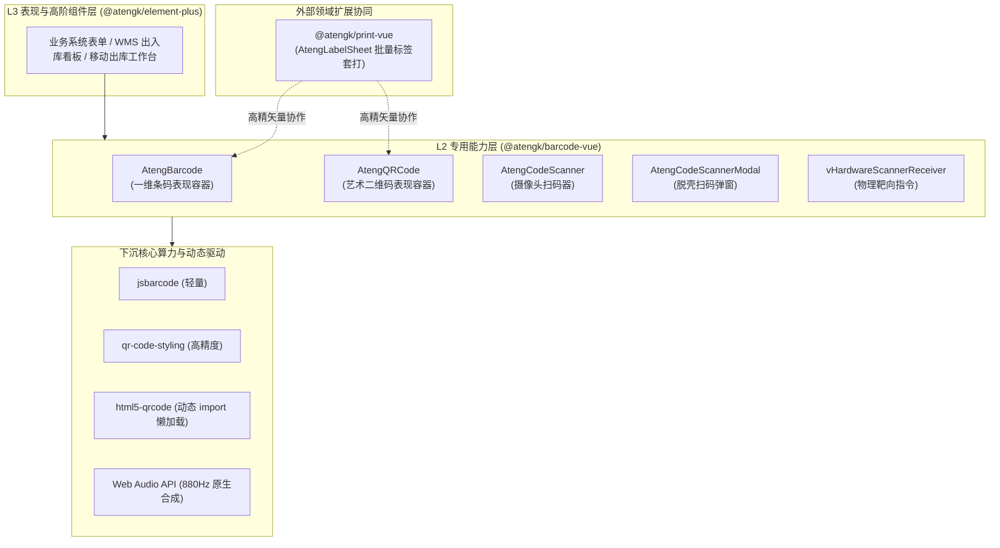

# @atengk/barcode-vue 条码、艺术二维码与动态扫码套件

> 面向现代 Web 应用、仓储物流（WMS/TMS）、零售收银、智能制造与标签单据套打的工业级条码、艺术二维码与动态扫码基础设施，纯 Vue 3 驱动，四层洋葱拓扑之 L2 专用能力/领域扩展层。

---

## 0. 特性与公共 API 全景速查矩阵

| API 分类           | 导出符号 / 名称               | 契约形态   | 核心职责与业务能力                                                                       | 源码位置 / 关键出口                                                                          |
| :----------------- | :---------------------------- | :--------- | :--------------------------------------------------------------------------------------- | :------------------------------------------------------------------------------------------- |
| **表现容器组件**   | `AtengBarcode`                | SFC 组件   | 一维条码表现容器，支持 SVG/Canvas 双模、前置防崩溃校验、文本分组排版与优雅降级插槽       | [`src/components/AtengBarcode.vue`](./src/components/AtengBarcode.vue)                       |
| **表现容器组件**   | `AtengQRCode`                 | SFC 组件   | 艺术二维码统领容器，内置 6 大企业级主题预设、Logo 自动升阻保护、CORS 预检与高分屏防模糊  | [`src/components/AtengQRCode.vue`](./src/components/AtengQRCode.vue)                         |
| **表现容器组件**   | `AtengCodeScanner`            | SFC 组件   | 摄像头与本地图像扫码容器，按需动态懒加载底层引擎、2.8:1 狭长取景框自适应、后台防发热释放 | [`src/components/AtengCodeScanner.vue`](./src/components/AtengCodeScanner.vue)               |
| **表现容器组件**   | `AtengCodeScannerModal`       | SFC 组件   | 轻量级脱壳扫码弹窗，纯原生 CSS 变量 + Vue Teleport 驱动，半透明毛玻璃遮罩、自愈关闭      | [`src/components/AtengCodeScannerModal.vue`](./src/components/AtengCodeScannerModal.vue)     |
| **无头状态机**     | `useBarcode`                  | Composable | 一维条码纯无状态无头状态机，提供离线校验、SVG/Canvas 渲染上下文提取、格式化与图像导出    | [`src/composables/useBarcode.ts`](./src/composables/useBarcode.ts)                           |
| **无头状态机**     | `useQRCode`                   | Composable | 艺术二维码无头状态机，提供企业预设合成、Logo 跨域防污损加载、纠错级别自动提升与图像导出  | [`src/composables/useQRCode.ts`](./src/composables/useQRCode.ts)                             |
| **无头状态机**     | `useCodeScanner`              | Composable | 摄像头与本地文件解码无头状态机，按需动态加载引擎、视频流受管生命周期、连续过机去重冷却   | [`src/composables/useCodeScanner.ts`](./src/composables/useCodeScanner.ts)                   |
| **无头状态机**     | `useHardwareScanner`          | Composable | 手持物理扫码枪无头状态机，< 30ms 击键时序聚类分析、Form Guard 表单防污染守卫             | [`src/composables/useHardwareScanner.ts`](./src/composables/useHardwareScanner.ts)           |
| **校验与排版管线** | `validateBarcode`             | Function   | 一维条码前置离线防崩溃校验算法，严格校验 EAN-13、CODE39、ITF-14 格式与校验码             | [`src/utils/validator.ts`](./src/utils/validator.ts)                                         |
| **校验与排版管线** | `formatEan13`                 | Function   | EAN-13 / GS1 零售条码人眼防错文本分组格式化管道（1-6-6 或 3-4-4-2）                      | [`src/utils/formatter.ts`](./src/utils/formatter.ts)                                         |
| **校验与排版管线** | `formatCustomGrouping`        | Function   | 通用自定义数字分段格式化工具（支持 `[4, 4, 4]` 等分组规则）                              | [`src/utils/formatter.ts`](./src/utils/formatter.ts)                                         |
| **安全与保护守卫** | `clampLogoSize`               | Function   | 二维码 Logo 面积硬限制管道（强制收敛在 10%~25% 安全阈值内）                              | [`src/utils/logoGuard.ts`](./src/utils/logoGuard.ts)                                         |
| **安全与保护守卫** | `elevateErrorCorrectionLevel` | Function   | 二维码 Logo 容错级别动态智能提升算法（含 Logo 时自动由 L/M 升阶至 Q/H）                  | [`src/utils/logoGuard.ts`](./src/utils/logoGuard.ts)                                         |
| **安全与保护守卫** | `CorsImageGuard`              | Class      | 外部图片跨域安全预检防污损加载器，注入 `anonymous` 凭证并提供 SVG 优雅占位降级           | [`src/utils/corsGuard.ts`](./src/utils/corsGuard.ts)                                         |
| **导出与原生反馈** | `exportBarcodeAsImage`        | Function   | 一维码矢量 SVG / Canvas 栅格转 PNG/JPEG/WEBP 图像导出工具                                | [`src/utils/exporter.ts`](./src/utils/exporter.ts)                                           |
| **导出与原生反馈** | `exportQRCodeAsImage`         | Function   | 艺术二维码高保真图像导出工具（支持 SVG / PNG / WEBP / JPEG）                             | [`src/utils/exporter.ts`](./src/utils/exporter.ts)                                           |
| **导出与原生反馈** | `ScannerAudioFeedback`        | Object     | 基于原生 Web Audio API 动态合成 880Hz 短促蜂鸣音与设备震动反馈，零静态 MP3 依赖          | [`src/utils/audio.ts`](./src/utils/audio.ts)                                                 |
| **响应式指令**     | `vHardwareScannerReceiver`    | Directive  | 物理扫码枪定向靶向注入指令，指定唯一有效输入框，隔离页面其他元素焦点                     | [`src/directives/vHardwareScannerReceiver.ts`](./src/directives/vHardwareScannerReceiver.ts) |
| **核心类型契约**   | `BarcodeFormat`               | Type       | 支持的一维条码格式类型联合（`'CODE128' \| 'EAN13' \| 'CODE39' \| ...`）                  | [`src/types/barcode.ts`](./src/types/barcode.ts)                                             |
| **核心类型契约**   | `QRCodePreset`                | Type       | 企业级艺术二维码主题预设联合（`'standard' \| 'industrial' \| 'tech-blue' \| ...`）       | [`src/types/qrcode.ts`](./src/types/qrcode.ts)                                               |
| **核心类型契约**   | `ScannerConfig`               | Interface  | 摄像头运行态配置项（扫码格式过滤、取景框构型、同码去重冷却、音频震动）                   | [`src/types/scanner.ts`](./src/types/scanner.ts)                                             |
| **核心类型契约**   | `HardwareScannerOptions`      | Interface  | 手持扫码枪监听器选项（击键间隔阈值、前缀后缀、防表单污染守卫、目标容器）                 | [`src/types/hardware.ts`](./src/types/hardware.ts)                                           |

---

## 1. 模块定位与 pnpm 坐标

- **包名分发坐标**：`@atengk/barcode-vue`
- **当前工程基线**：Vue `^3.5.0`，TypeScript `^5.6.0`（Strict Mode），tsup `8.x` 双模打包（ESM + CJS + DTS）
- **拓扑归属**：**L2 专用能力/领域扩展层**。向下依赖 L0（`@atengk/core`）与 L1（`@atengk/vue`），**严禁直接反向依赖 L3（`@atengk/element-plus`）**。
- **安装命令**：
  ```bash
  pnpm add @atengk/barcode-vue
  ```
- **Peer Dependencies 契约**：
  ```json
  {
    "peerDependencies": {
      "vue": "^3.5.0"
    }
  }
  ```

---

## 2. 核心架构与设计不变量

### 2.1 四层洋葱拓扑与模块依赖关系



### 2.2 核心设计不变量 (Core Invariants)

1. **离线防崩溃优先校验 (Fail-Fast Offline Validation)**：一维码渲染前必须经由离线纯算法校验（如 EAN-13 奇偶加权校验和、ITF-14 长度与纯数字约束）。非法输入立即触发优雅降级插槽，严禁因底层库抛出未捕获异常导致前端页面白屏崩溃。
2. **Logo 安全护栏与 CORS 防污损防线 (Logo Security Guard)**：中心 Logo 自动约束面积比例（$\le 25\%$），纠错级别自动升阶至 Q/H；网络图片由 `CorsImageGuard` 预检注入跨域凭据，彻底杜绝 Canvas 污损（Tainted Canvas）引发的导出阻断。
3. **按需懒加载与 2.8:1 狭长宽屏构型 (Lazy Loaded Vision Scanner)**：底层解码重型引擎（`html5-qrcode`）采用动态 `import()` 按需加载，初始 Bundle 零负担；针对一维条码提供 2.8:1 狭长黄金构型取景框，大幅收敛边缘噪点并降低移动端计算发热。
4. **工业流水线连续扫码 1.5s 滑窗去重 (Pipeline Deduping Window)**：提供单次核销与流水线连续扫码双模；连续扫码内置 1.5 秒同码去重冷却滑窗，同时支持异码毫秒级即刻过机响应。
5. **手持物理扫码枪 < 30ms 击键时序聚类与 Form Guard**：手持扫码枪击键间隔严格聚类分析，精准区分人手打字（通常 $> 50\text{ms}$）与工业扫码枪连续脉冲（$\le 30\text{ms}$）；配合 Form Guard 阻止未授权表单输入框内容被意外污染。
6. **纯原生脱壳扫码弹窗与打印套打协同 (Headless Modal & Print Synergy)**：`<AtengCodeScannerModal />` 仅依赖纯 CSS 变量与 Vue 3 原生 `<Teleport>`，脱壳运行，零 Element Plus 耦合；与 `@atengk/print-vue` 矢量 SVG 级无缝协同，保障工业扫码枪高阶可读性。

---

## 3. 一维条码体系与离线防崩溃校验 (AtengBarcode & useBarcode)

### 3.1 核心 TypeScript 契约与 Props

```ts
export type BarcodeFormat =
  | 'CODE128'
  | 'CODE39'
  | 'EAN13'
  | 'EAN8'
  | 'UPC'
  | 'ITF14'
  | 'ITF'
  | 'MSI'
  | 'pharmacode'
  | 'codabar';

export interface AtengBarcodeProps {
  /** 条码内容值 */
  value: string;
  /** 条码格式编码，默认 'CODE128' */
  format?: BarcodeFormat;
  /** 渲染底层形态，默认 'svg' */
  renderType?: 'svg' | 'canvas';
  /** 单条条宽倍率（px），默认 2 */
  width?: number;
  /** 条码图形高度（px），默认 80 */
  height?: number;
  /** 静区（Quiet Zone）内边距（px），默认 10 */
  margin?: number;
  /** 是否在条码下方显示可读文本，默认 true */
  displayValue?: boolean;
  /** 人眼可读文本格式化管道函数 */
  formatText?: (text: string) => string;
  /** 背景色，默认透明 'transparent' */
  background?: string;
  /** 条码与文字前景色，默认 '#000000' */
  lineColor?: string;
}
```

### 3.2 离线前置校验与优雅降级容错实战

```vue
<script setup lang="ts">
import { ref } from 'vue';
import { AtengBarcode, validateBarcode } from '@atengk/barcode-vue';

// 模拟动态输入的 EAN-13 商品条码
const barcodeVal = ref('6901234567895');

// 手动校验或在状态机中自动防护
const validation = validateBarcode(barcodeVal.value, 'EAN13');
if (!validation.valid) {
  console.warn(`条码格式不合规: ${validation.message}`);
}
</script>

<template>
  <div class="barcode-card">
    <!-- 当输入的条码校验不通过时，组件自动展示 fallback 插槽，不中断页面渲染 -->
    <AtengBarcode
      :value="barcodeVal"
      format="EAN13"
      render-type="svg"
      :width="2"
      :height="75"
      :margin="12"
      display-value
    >
      <template #fallback="{ error }">
        <div class="custom-error">
          <span class="warning-icon">⚠️</span>
          <span>条码无效: {{ error.message }} ({{ barcodeVal }})</span>
        </div>
      </template>
    </AtengBarcode>
  </div>
</template>

<style scoped>
.barcode-card {
  padding: 16px;
  background: var(--el-bg-color, #ffffff);
  border: 1px solid var(--el-border-color-light, #e4e7ed);
  border-radius: 6px;
}
.custom-error {
  display: flex;
  align-items: center;
  gap: 8px;
  padding: 12px;
  background: #fef0f0;
  color: #f56c6c;
  border-radius: 4px;
}
</style>
```

### 3.3 工业排版、文本分组与零依赖图像导出

```vue
<script setup lang="ts">
import { ref } from 'vue';
import { AtengBarcode, formatEan13, exportBarcodeAsImage } from '@atengk/barcode-vue';

const ean13Code = ref('6921357900128');
const barcodeRef = ref<InstanceType<typeof AtengBarcode> | null>(null);

// 导出为高清 PNG 图像供打印或下发
const handleExport = async () => {
  if (!barcodeRef.value) return;
  const result = await exportBarcodeAsImage(barcodeRef.value, {
    format: 'png',
    fileName: `EAN13-${ean13Code.value}.png`,
    scale: 3, // 3倍高分屏抗锯齿导出
  });
  console.log(`导出成功: 大小 ${result.blob.size} 字节`);
};
</script>

<template>
  <div class="typography-container">
    <AtengBarcode
      ref="barcodeRef"
      :value="ean13Code"
      format="EAN13"
      render-type="svg"
      :format-text="formatEan13"
      :margin="16"
    />
    <button class="export-btn" @click="handleExport">📥 导出 3x 高清条码</button>
  </div>
</template>
```

---

## 4. 艺术二维码体系与跨域安全防污损 (AtengQRCode & useQRCode)

### 4.1 核心 TypeScript 契约与 6 大企业预设

```ts
export type QRCodePreset =
  | 'standard' // 标准黑白极简风格
  | 'industrial' // 工业加粗高对比度风格（适合物流标签）
  | 'tech-blue' // 科技商务蓝风格（适合企业品牌宣传）
  | 'elegant-dots' // 优雅柔和圆点风格（适合消费互联网）
  | 'classy' // 典雅圆角矩形风格
  | 'minimal-fluid'; // 现代极简流线风格

export interface AtengQRCodeProps {
  /** 二维码文本或跳转 URL 载荷 */
  value: string;
  /** 企业级主题预设，默认 'standard' */
  preset?: QRCodePreset;
  /** 尺寸宽度与高度（px），默认 200 */
  size?: number;
  /** 纠错等级：'L' (7%), 'M' (15%), 'Q' (25%), 'H' (30%) */
  errorCorrectionLevel?: 'L' | 'M' | 'Q' | 'H';
  /** 中心 Logo 图片 URL */
  logoUrl?: string;
  /** Logo 占二维码整体尺寸比例，默认 0.2 (20%) */
  logoSize?: number;
  /** 是否开启 Logo 面积智能收敛与纠错级别自动提升，默认 true */
  autoElevateLevel?: boolean;
}
```

### 4.2 艺术二维码与跨域图片防污损实战

```vue
<script setup lang="ts">
import { ref } from 'vue';
import { AtengQRCode, exportQRCodeAsImage } from '@atengk/barcode-vue';

const qrValue = ref('https://ateng-ui.dev/product/SKU-99281');
const qrRef = ref<InstanceType<typeof AtengQRCode> | null>(null);

const onDownload = async () => {
  if (!qrRef.value) return;
  // 经由 CorsImageGuard 安全预检，导出时永不抛出 SecurityError
  await exportQRCodeAsImage(qrRef.value, {
    format: 'png',
    fileName: 'SKU-99281-QR.png',
  });
};
</script>

<template>
  <div class="qrcode-wrapper">
    <!-- 选用 tech-blue 企业科技蓝预设，并嵌入跨域 Logo -->
    <AtengQRCode
      ref="qrRef"
      :value="qrValue"
      preset="tech-blue"
      :size="240"
      logo-url="https://images.unsplash.com/photo-1618005182384-a83a8bd57fbe"
      :logo-size="0.22"
      auto-elevate-level
    />
    <button class="dl-btn" @click="onDownload">💾 保存高清二维码</button>
  </div>
</template>
```

---

## 5. 摄像头视觉扫码与 2.8:1 狭长构型 (AtengCodeScanner & useCodeScanner)

### 5.1 核心 TypeScript 契约与 Props

```ts
export interface ScannerConfig {
  /** 识别格式过滤：'all' | 'barcode' | 'qr-code' */
  formats?: 'all' | 'barcode' | 'qr-code';
  /** 取景框构型：'auto' | 'square' | 'wide' 或自定义宽高级别 */
  qrbox?: 'auto' | 'square' | 'wide' | { width: number; height: number };
  /** 每秒解码帧率，默认 10 */
  fps?: number;
  /** 扫码交互模式：'single' (单次核销) | 'continuous' (流水线连续扫码) */
  scanMode?: 'single' | 'continuous';
  /** 连续扫码模式下同码冷却时间（毫秒），默认 1500ms */
  duplicateIntervalMs?: number;
  /** 扫码成功时是否播放短促蜂鸣声，默认 true */
  beepOnSuccess?: boolean;
  /** 扫码成功时是否触发设备触觉震动，默认 true */
  vibrateOnSuccess?: boolean;
  /** 摄像头朝向：'environment' (后置镜头) | 'user' (前置自拍) */
  facingMode?: 'environment' | 'user';
}

export interface AtengCodeScannerProps extends ScannerConfig {
  /** 扫码容器高度（px 或 CSS 单位），默认 '320px' */
  height?: string | number;
  /** 是否自动启动摄像头，默认 false */
  autoStart?: boolean;
}
```

### 5.2 2.8:1 狭长宽屏自适应与后台防发热实战

```vue
<script setup lang="ts">
import { ref } from 'vue';
import { AtengCodeScanner, type ScannerScanResult } from '@atengk/barcode-vue';

const scannerRef = ref<InstanceType<typeof AtengCodeScanner> | null>(null);
const lastCode = ref('');

const onScanSuccess = (result: ScannerScanResult) => {
  lastCode.value = result.text;
  console.log(`解码成功: 格式 ${result.format}, 文本: ${result.text}`);
};

const onScanError = (err: Error) => {
  console.warn(`解码瞬态异常: ${err.message}`);
};
</script>

<template>
  <div class="scanner-box">
    <!-- 选用 wide 取景框构型（2.8:1 狭长长宽比），专为快递物流一维条码优化 -->
    <AtengCodeScanner
      ref="scannerRef"
      formats="barcode"
      qrbox="wide"
      scan-mode="single"
      height="360px"
      facing-mode="environment"
      beep-on-success
      @scan-success="onScanSuccess"
      @scan-error="onScanError"
    />
    <div class="result-bar">
      <span>最近扫描结果: </span>
      <strong>{{ lastCode || '等待对准条码...' }}</strong>
    </div>
  </div>
</template>
```

---

## 6. 工业流水线连续扫码与无依赖蜂鸣反馈

### 6.1 连续过机扫码模式与 1.5s 滑窗同码去重冷却

在仓储流水线过机出库等场景下，需要流水线工人连续刷入包裹。如果每次扫码都立即停止摄像头或产生反复弹窗，将极大降低作业效率。

`@atengk/barcode-vue` 原生支持 `scanMode="continuous"` 模式：

- **同码 1.5 秒冷却滑窗**：同一个条码在 `duplicateIntervalMs`（默认 1500ms）内只触发一次成功回调，杜绝重复入库；
- **异码毫秒级无缝过机**：一旦视野中切入下一个不同的条码，冷却滑窗立即重置，实现 0 延迟连续采集。

### 6.2 原生 Web Audio 动态音频发生器与设备触觉震动

传统方案往往在静态资产中内嵌 `beep.mp3`，在内网、无网络或跨域限制下极易因资源 404 或 CORS 产生报错。
本组件库内置纯原生 `ScannerAudioFeedback`：

- **零静态资源依赖**：通过 Web 原生 `AudioContext` 实时产生 $880\text{Hz}$（高 A 音阶）短促正弦波（时长 $120\text{ms}$），带有 $10\text{ms}$ 平滑衰减包络线，清脆悦耳不刺耳；
- **移动端触觉震动**：调用 `navigator.vibrate([100])` 触发工业手持 PDA 或手机触觉回馈；
- **全平台自愈保底**：若运行于不支持 AudioContext 或被浏览器安全策略挂起的环境，底层自动静默捕获，绝不中断核心业务主流程。

---

## 7. 手持物理扫码枪与表单防污染守卫 (useHardwareScanner & vHardwareScannerReceiver)

### 7.1 核心机制与 < 30ms 击键时序聚类算法

工业手持 USB / 蓝牙无线条码扫码枪本质上是标准的 **HID 虚拟键盘输入设备**。
当扫码枪扫过条码时，会以极高频率（每个字符间隔通常在 $1\text{ms}\sim 25\text{ms}$ 之间）连续触发键盘 `keydown` 事件，并在末尾附加一个回车符（`Enter`）。

```mermaid
sequenceDiagram
    autonumber
    actor Worker as 仓库员工 / 收银员
    participant Gun as 手持物理扫码枪 (HID)
    participant Window as DOM Window (Capture Phase)
    participant Guard as Form Guard (防污染守卫)
    participant Receiver as vHardwareScannerReceiver (定向目标)

    Worker->>Gun: 扣动扳机扫描条码
    Gun->>Window: 高速爆发按键脉冲 (&lt; 30ms / 字符)
    Window->>Guard: 捕获击键事件序列
    Guard->>Guard: 时序聚类: 识别为硬件脉冲流!
    alt 启用了 preventInputPollution
        Guard->>Window: 拦截 preventDefault / 阻止焦点文本框污染
    end
    Gun->>Window: 发送结束符 (Enter)
    Guard->>Receiver: 结构化回填完整条码值
    Receiver->>Worker: 触发 @scan 回调并完成定向录入
```

### 7.2 物理扫码枪与定向靶向指令实战

```vue
<script setup lang="ts">
import { ref } from 'vue';
import { useHardwareScanner, vHardwareScannerReceiver } from '@atengk/barcode-vue';

const targetSkuInput = ref('');
const scanHistory = ref<string[]>([]);

// 使用无头状态机 useHardwareScanner 监听硬件输入
const { isScanning } = useHardwareScanner({
  maxIntervalMs: 35, // 击键间隔阈值，超过 35ms 判定为人手慢速敲击
  preventInputPollution: true, // 开启 Form Guard，防止污染当前可能聚焦的备注输入框
  onScan: barcode => {
    targetSkuInput.value = barcode;
    scanHistory.value.unshift(`[${new Date().toLocaleTimeString()}] ${barcode}`);
  },
});
</script>

<template>
  <div class="hardware-station">
    <div class="status-indicator">
      <span>扫码枪脉冲状态: </span>
      <span :class="['pulse-dot', { active: isScanning }]"></span>
    </div>

    <!-- 使用 v-hardware-scanner-receiver 指令将该输入框标记为扫码专用接收靶向 -->
    <div class="field-item">
      <label>商品条码专用框（仅接受扫码枪录入）：</label>
      <input
        v-model="targetSkuInput"
        v-hardware-scanner-receiver
        type="text"
        placeholder="请对准条码扣动扫码枪扳机..."
      />
    </div>

    <!-- 普通文本框，由于 Form Guard 开启，绝不会被高速扫码字符乱码打扰 -->
    <div class="field-item">
      <label>日常备注框（人手键盘输入）：</label>
      <input type="text" placeholder="随意输入备注文字..." />
    </div>
  </div>
</template>
```

---

## 8. 轻量脱壳扫码弹窗与打印套打协同 (AtengCodeScannerModal & @atengk/print-vue)

### 8.1 轻量脱壳扫码弹窗 AtengCodeScannerModal

`AtengCodeScannerModal` 是针对移动出库、桌面快速核销打造的**零 UI 库依赖脱壳弹窗**：

- **纯原生驱动**：基于 Vue 3 `<Teleport :to="teleportTo">` 挂载至 `document.body`，样式 100% 绑定 `--at-code-scanner-modal-*` Design Tokens；
- **全景毛玻璃遮罩**：配备工业四角定位高亮框、激光扫描线动效与半透明暗黑遮罩；
- **扫码完成自愈关闭**：提供 `autoCloseOnSuccess` 开关，扫码成功后自动触发震动并优雅关闭弹窗。

```vue
<script setup lang="ts">
import { ref } from 'vue';
import { AtengCodeScannerModal, type ScannerScanResult } from '@atengk/barcode-vue';

const isModalVisible = ref(false);
const scannedItem = ref('');

const handleScanSuccess = (result: ScannerScanResult) => {
  scannedItem.value = result.text;
  console.log(`弹窗录入成功: ${result.text}`);
};
</script>

<template>
  <div>
    <button @click="isModalVisible = true">📷 开启扫码录入弹窗</button>

    <AtengCodeScannerModal
      v-model:visible="isModalVisible"
      title="📦 仓储包裹快速扫码核销"
      scan-mode="single"
      auto-close-on-success
      @scan-success="handleScanSuccess"
    />
  </div>
</template>
```

### 8.2 与 @atengk/print-vue 批量标签单据毫米级排版套打

在智能制造与 WMS 系统中，条码/二维码的生成最终需要打印到不干胶标签纸（如三防热敏纸 70mm × 40mm）上。
传统方案中 Canvas 生成的栅格图像在打印机 $300\text{DPI}$ 解析度下往往产生严重边缘发虚、锯齿毛边，导致手持工业扫码枪拒读。

`@atengk/barcode-vue` 全面支持 **SVG 矢量无损渲染**，可直接作为子元素嵌入 `@atengk/print-vue` 的 `<AtengLabelSheet />` 标签网格中：

```vue
<script setup lang="ts">
import { ref } from 'vue';
import { AtengBarcode, AtengQRCode } from '@atengk/barcode-vue';
import { AtengLabelSheet, usePrint } from '@atengk/print-vue';

// 批量物流单据列表
const packageLabels = ref([
  { id: '1', code: 'SF1092837465', sku: 'SKU-001-BLU', title: '智能无线降噪耳机' },
  { id: '2', code: 'SF1092837466', sku: 'SKU-002-RED', title: '机械键盘青轴定制版' },
]);

const { print } = usePrint();
const handleBatchPrint = () => {
  print({ target: '#print-area' });
};
</script>

<template>
  <div class="print-suite-demo">
    <button @click="handleBatchPrint">🖨️ 批量套打工业不干胶标签</button>

    <div id="print-area">
      <!-- 采用 AtengLabelSheet 进行毫米级物理网格分页排版 -->
      <AtengLabelSheet
        :items="packageLabels"
        :label-width="80"
        :label-height="45"
        :columns="2"
        :gap-x="3"
        :gap-y="3"
      >
        <template #default="{ item }">
          <div class="label-sheet-card">
            <div class="label-header">
              <span class="sku-tag">{{ item.sku }}</span>
              <span class="title-text">{{ item.title }}</span>
            </div>
            <!-- 采用 render-type="svg" 纯矢量渲染，打印机缩放 0 模糊失真 -->
            <AtengBarcode
              :value="item.code"
              format="CODE128"
              render-type="svg"
              :height="36"
              :width="1.8"
              :margin="4"
              display-value
            />
          </div>
        </template>
      </AtengLabelSheet>
    </div>
  </div>
</template>

<style scoped>
.label-sheet-card {
  box-sizing: border-box;
  padding: 4mm;
  display: flex;
  flex-direction: column;
  justify-content: space-between;
}
.label-header {
  display: flex;
  justify-content: space-between;
  font-size: 11px;
}
</style>
```

---

## 9. 生产环境避坑与生命周期/性能治理指南

1. **工业打印场景必须严格使用 SVG 矢量渲染**：在热敏不干胶标签打印时，务必设置 `render-type="svg"`。Canvas 生成的位图受屏幕像素比（DPR）影响，在 $300\sim 600\text{DPI}$ 打印头下容易发虚模糊，引发扫码枪拒读。
2. **大数 ID 严格使用 String 字符串传递**：一维码与二维码数据载荷如果包含 16 位以上数据库雪花 Long ID，在前端必须使用原生 `string` 类型传递，严禁转为 `number` 导致低位精度丢失截断。
3. **避免底层扫码库初始打包体积膨胀**：摄像头扫码器底层引入了 `html5-qrcode`，该库已由组件库内部 `ScannerEngineLoader` 实现动态 `import()` 懒加载。只有在用户实际挂载扫码组件或调用解码函数时才会异步拉取相关 JS 分包，不影响首页加载速度。
4. **确定性释放摄像头硬件流与后台防发热**：浏览器调用 `getUserMedia` 占用摄像头时，硬件 ISP 处于持续工作状态，发热和耗电量大。本套件在 `onScopeDispose` 及 `onUnmounted` 中会自动执行 `stop()` 释放硬件；当配合 Vue Router 路由切换或浏览器 Tab 切换至后台（`document.hidden === true`）时，内置防发热机制会自动挂起流捕获。
5. **外部网络 Logo 跨域策略配置**：在二维码中引入远程图片 Logo 时，宿主 CDN 服务器必须配置 `Access-Control-Allow-Origin: *`。本库内置 `CorsImageGuard` 会自动注入 `anonymous` 凭证；若无法跨域，将自动退化为保底占位符，避免导出图片时抛出 Canvas Tainted 异常。
6. **物理扫码枪拦截策略阈值调整**：`useHardwareScanner` 默认脉冲阈值为 $30\text{ms}$。个别老旧蓝牙无线扫码枪在电量不足或传输拥塞时，击键延迟可能偶发抖动至 $40\sim 50\text{ms}$，可通过配置 `maxIntervalMs: 50` 提高容错率。
7. **脱壳弹窗层级（z-index）与 Body 滚动穿透**：`<AtengCodeScannerModal />` 默认 `z-index: 2000`。在复杂后台或嵌套弹窗中，若存在更高的 Modal，可通过 `--at-code-scanner-modal-z-index` CSS 变量覆盖；弹窗打开时会自动添加类名阻止底页滚动。
8. **批量文件解码与大图内存占用治理**：调用 `decodeFile` 解码手机拍摄的高清原图（如 $4000\times 3000$ 像素）时，大图解码极其消耗内存与 CPU。建议在业务层前置进行 Canvas 缩放，将长边压缩至 $1200\text{px}$ 左右再送入解码器。

---

## 10. 完整 TypeScript 接口/Props/CSS 变量速查清单

### 10.1 组件 Props 速查清单

#### `<AtengBarcode />` Props

| 属性名         | 类型                       | 默认值          | 描述说明                     |
| :------------- | :------------------------- | :-------------- | :--------------------------- |
| `value`        | `string`                   | **必填**        | 条码数据内容                 |
| `format`       | `BarcodeFormat`            | `'CODE128'`     | 条码标准格式                 |
| `renderType`   | `'svg' \| 'canvas'`        | `'svg'`         | 渲染底层载体形态             |
| `width`        | `number`                   | `2`             | 单条条宽倍率（px）           |
| `height`       | `number`                   | `80`            | 条码高度（px）               |
| `margin`       | `number`                   | `10`            | 静区四周留白边距（px）       |
| `displayValue` | `boolean`                  | `true`          | 是否在条码下方显示可读文字   |
| `formatText`   | `(text: string) => string` | `undefined`     | 文本分组与人眼友好格式化函数 |
| `background`   | `string`                   | `'transparent'` | 条码背景色                   |
| `lineColor`    | `string`                   | `'#000000'`     | 条码与文字前景色             |

#### `<AtengQRCode />` Props

| 属性名                 | 类型                       | 默认值       | 描述说明                         |
| :--------------------- | :------------------------- | :----------- | :------------------------------- |
| `value`                | `string`                   | **必填**     | 二维码内容或跳转 URL             |
| `preset`               | `QRCodePreset`             | `'standard'` | 企业级主题预设风格               |
| `size`                 | `number`                   | `200`        | 二维码宽高尺寸（px）             |
| `errorCorrectionLevel` | `'L' \| 'M' \| 'Q' \| 'H'` | `'M'`        | 纠错容错等级                     |
| `logoUrl`              | `string`                   | `undefined`  | 中心嵌入的 Logo 图像 URL         |
| `logoSize`             | `number`                   | `0.2`        | Logo 占整体宽度的安全比例        |
| `autoElevateLevel`     | `boolean`                  | `true`       | 是否在带有 Logo 时自动提升纠错级 |

#### `<AtengCodeScanner />` Props

| 属性名                | 类型                                     | 默认值          | 描述说明                           |
| :-------------------- | :--------------------------------------- | :-------------- | :--------------------------------- |
| `formats`             | `'all' \| 'barcode' \| 'qr-code'`        | `'all'`         | 解码识别格式范围过滤               |
| `qrbox`               | `'auto' \| 'square' \| 'wide' \| object` | `'auto'`        | 取景框几何构型（wide 为 2.8:1）    |
| `fps`                 | `number`                                 | `10`            | 每秒扫描解码帧率                   |
| `scanMode`            | `'single' \| 'continuous'`               | `'single'`      | 交互模式：单次核销或流水线连续扫码 |
| `duplicateIntervalMs` | `number`                                 | `1500`          | 连续扫码模式下同码冷却时间（ms）   |
| `beepOnSuccess`       | `boolean`                                | `true`          | 扫码成功是否播放短促蜂鸣音         |
| `vibrateOnSuccess`    | `boolean`                                | `true`          | 扫码成功是否触发设备震动           |
| `facingMode`          | `'environment' \| 'user'`                | `'environment'` | 摄像头朝向（后置/前置）            |
| `height`              | `string \| number`                       | `'320px'`       | 扫描器视口高度                     |
| `autoStart`           | `boolean`                                | `false`         | 组件挂载后是否自动启动镜头         |

#### `<AtengCodeScannerModal />` Props

| 属性名               | 类型                       | 默认值       | 描述说明                               |
| :------------------- | :------------------------- | :----------- | :------------------------------------- |
| `visible`            | `boolean`                  | `false`      | 弹窗显隐状态（支持 `v-model:visible`） |
| `title`              | `string`                   | `'扫码识别'` | 弹窗顶部标题文字                       |
| `teleportTo`         | `string \| HTMLElement`    | `'body'`     | Vue Teleport 挂载靶向                  |
| `autoCloseOnSuccess` | `boolean`                  | `true`       | 扫码识别成功后是否自动关闭弹窗         |
| `scanMode`           | `'single' \| 'continuous'` | `'single'`   | 扫码核销交互模式                       |

### 10.2 CSS 变量 Design Tokens 速查清单

```scss
/* 一维条码容器变量 */
--at-barcode-bg: transparent;
--at-barcode-color: #000000;

/* 艺术二维码容器变量 */
--at-qrcode-bg: #ffffff;
--at-qrcode-border-color: #e4e7ed;

/* 摄像头取景器变量 */
--at-code-scanner-bg: #000000;
--at-code-scanner-border: #409eff;
--at-code-scanner-laser: #67c23a;

/* 脱壳弹窗变量 */
--at-code-scanner-modal-z-index: 2000;
--at-code-scanner-modal-mask-bg: rgba(0, 0, 0, 0.65);
--at-code-scanner-modal-card-bg: #1f2329;
--at-code-scanner-modal-text-color: #ffffff;
--at-code-scanner-modal-radius: 12px;
```
