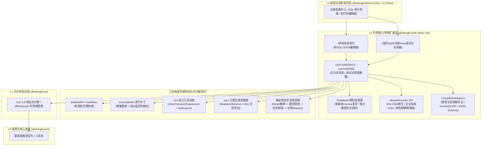

# @atengk/code-editor-vue 企业级代码编辑与Diff差异比对扩展套件

> 面向现代 Web 应用、SQL 审计与发布配置中心的工业级 Monaco Editor 代码高保真编辑、双模 Diff 差异比对与受管多文件 TextModel 模型池基础设施，归属于系统四层拓扑的 **L2 专用能力/领域扩展层**。遵循“纯 Vue 3 驱动、响应式彻底解耦、零具体 UI 依赖、确定性生命周期治理”设计，全面继承 L0 底座的强类型契约与网络韧性。

---

## 0. 特性与公共 API 全景速查矩阵

| 特性分类           | 特性名称                   | 核心门面 / 组件 / Hook                                                      | 关键参数 / Props / Emits                                                | 核心行为说明                                                                                 | 锚定验证源头 (*Test / Sample)                                                                                                                                                            |
| :----------------- | :------------------------- | :-------------------------------------------------------------------------- | :---------------------------------------------------------------------- | :------------------------------------------------------------------------------------------- | :--------------------------------------------------------------------------------------------------------------------------------------------------------------------------------------- |
| **单体编辑器**     | 单体代码表现容器           | `AtengCodeEditor`                                                           | `CodeEditorProps (v-model, language, theme, readOnly...)`               | 集成原生微操作栏、底部状态栏、暗黑热跟随与 0x0 几何自愈的高阶容器                            | [AtengCodeEditor.test.ts](./test/AtengCodeEditor.test.ts) · [BasicCodeEditorScenario](../../apps/sample-code-editor-vue/src/scenarios/BasicCodeEditorScenario.vue)                       |
| **单体编辑器**     | 单体编辑器实例类型         | `AtengCodeEditorInstance`                                                   | `InstanceType<typeof AtengCodeEditor>`                                  | 单体组件收敛暴露的 Ref 实例类型，提供 format、layout、getValue、createModel 等操作           | [AtengCodeEditor.test.ts](./test/AtengCodeEditor.test.ts)                                                                                                                                |
| **单体编辑器**     | 单体编辑器无头状态机       | `useCodeEditor(containerRef, options)`                                      | `(containerRef, options) => UseCodeEditorReturn`                        | Monaco 原生实例无头管理，响应式解耦防线 (`shallowRef` + `markRaw`)，增量光标防丢             | [useCodeEditor.test.ts](./test/useCodeEditor.test.ts) · [reactiveDecoupling.test.ts](./test/reactiveDecoupling.test.ts)                                                                  |
| **双模 Diff 对比** | 双模 Diff 对比表现容器     | `AtengCodeDiffEditor`                                                       | `CodeDiffEditorProps (v-model:original, v-model:modified, diffMode...)` | 支持并排 (split) 与行内 (inline) 双模无损切换、增删行数统计与差异导航的高阶容器              | [diffEditor.test.ts](./test/diffEditor.test.ts) · [CodeDiffCompareScenario](../../apps/sample-code-editor-vue/src/scenarios/CodeDiffCompareScenario.vue)                                 |
| **双模 Diff 对比** | 双模 Diff 组件实例类型     | `AtengCodeDiffEditorInstance`                                               | `InstanceType<typeof AtengCodeDiffEditor>`                              | Diff 组件收敛暴露的 Ref 实例类型，提供 diff 导航与双向文本获取                               | [diffEditor.test.ts](./test/diffEditor.test.ts)                                                                                                                                          |
| **双模 Diff 对比** | 双模 Diff 无头状态机       | `useCodeDiff / useCodeDiffEditor`                                           | `(containerRef, options) => UseCodeDiffReturn`                          | 原生 DiffEditor 与双 Model 响应式解耦管理，差异导航与事件托管                                | [diffEditor.test.ts](./test/diffEditor.test.ts) · [CodeDiffCompareScenario](../../apps/sample-code-editor-vue/src/scenarios/CodeDiffCompareScenario.vue)                                 |
| **双模 Diff 对比** | Diff 增删行数统计工具      | `computeDiffStats(lineChanges)`                                             | `(lineChanges) => DiffStats`                                            | 基于 Monaco `ILineChange[]` 精准计算新增行、删除行与差异块总数                               | [diffEditor.test.ts](./test/diffEditor.test.ts)                                                                                                                                          |
| **模型池管理**     | 多文件 TextModel 模型池    | `createModel / setModel / disposeModel`                                     | `(val, lang?, uri?) => ITextModel, (modelOrUri) => void`                | 单底座 Canvas 瞬时切换多文件代码，独立保留各文件撤销历史与光标选区                           | [modelPool.test.ts](./test/modelPool.test.ts) · [BasicCodeEditorScenario](../../apps/sample-code-editor-vue/src/scenarios/BasicCodeEditorScenario.vue)                                   |
| **模型池管理**     | 视图状态持久化             | `saveViewState / restoreViewState`                                          | `(modelOrUri?) => ICodeEditorViewState`                                 | 保存与恢复特定模型的滚动条与光标视图状态，杜绝文件切换跳动                                   | [modelPool.test.ts](./test/modelPool.test.ts)                                                                                                                                            |
| **智能补全**       | 受管补全注册中心           | `CompletionRegistry`                                                        | `class CompletionRegistry`                                              | 纳管全局 Monaco 补全 Provider 单例，支持按语言注册与全量集中释放，杜绝跨页面泄露             | [completion/registry.ts](./src/completion/registry.ts) · [sqlAndSchema.test.ts](./test/sqlAndSchema.test.ts)                                                                             |
| **智能补全**       | 便捷补全注册门面           | `registerCompletionProvider(lang, fn)`                                      | `(language, provider) => IDisposable`                                   | 注册特定语言智能补全项，返回受管 `IDisposable` 注销句柄                                      | [completion/registry.ts](./src/completion/registry.ts) · [sqlAndSchema.test.ts](./test/sqlAndSchema.test.ts)                                                                             |
| **SQL 专用能力**   | 轻量 SQL 美化算法          | `formatSql(sql)`                                                            | `(sql: string) => string`                                               | 原生状态机词法切分，标准大写关键字、逗号换行与缩进排版，安全隔离字符串与注释                 | [sqlAndSchema.test.ts](./test/sqlAndSchema.test.ts) · [SqlFormattingScenario](../../apps/sample-code-editor-vue/src/scenarios/SqlFormattingScenario.vue)                                 |
| **SQL 专用能力**   | SQL 格式化 SPI 扩展        | `SqlFormatProvider`                                                         | `(sql: string) => Promise<string> \| string`                            | 允许外部接管或注入专用远程/重型 SQL 格式化引擎                                               | [sqlAndSchema.test.ts](./test/sqlAndSchema.test.ts) · [SqlFormattingScenario](../../apps/sample-code-editor-vue/src/scenarios/SqlFormattingScenario.vue)                                 |
| **Worker 调度**    | 三级弹性 Worker SPI        | `setupMonacoWorkers(options?)`                                              | `(options?: MonacoWorkerOptions) => void`                               | 自定义 Worker、静态 CDN URL 与单线程降级三级弹性寻址防线                                     | [workers.test.ts](./test/workers.test.ts) · [ADR-0035](../../docs/adr/0035-code-editor-vue-l2-architecture-and-monaco-governance.md)                                                     |
| **Worker 调度**    | Vite ESM 原生 Worker 助手  | `setupViteMonacoWorkers(workers)`                                           | `(workers: ViteMonacoWorkerConstructors) => void`                       | 便捷注册 Vite `?worker` 原生 ESM Web Worker 构造器                                           | [workers.test.ts](./test/workers.test.ts) · [workers/index.ts](./src/workers/index.ts)                                                                                                   |
| **主题感知**       | 主题热跟随无头状态机       | `useEditorTheme(themeGetter)`                                               | `(themeGetter) => UseEditorThemeReturn`                                 | 监听 `html.dark` 与系统色彩方案，0ms 零闪烁调用 `monaco.editor.setTheme`                     | [useEditorTheme.test.ts](./test/useEditorTheme.test.ts) · [AtengCodeEditor.test.ts](./test/AtengCodeEditor.test.ts)                                                                      |
| **几何自愈**       | 0x0 视口几何自愈状态机     | `isSuspended / healLayout`                                                  | `() => boolean / () => void`                                            | 弹窗与隐藏标签页中 0x0 尺寸感知挂起，恢复可见通过 ResizeObserver 防抖自愈                    | [lifecycleAndAutoLayout.test.ts](./test/lifecycleAndAutoLayout.test.ts) · [DialogTabsLifecycleScenario](../../apps/sample-code-editor-vue/src/scenarios/DialogTabsLifecycleScenario.vue) |
| **类型契约**       | 核心语言枚举与主题         | `CodeLanguage / EditorTheme`                                                | 类型定义                                                                | 常用支持语言联合类型与主题模式联合类型 ('auto' \| 'vs' \| 'vs-dark' \| 'hc-black')           | [types/index.ts](./src/types/index.ts)                                                                                                                                                   |
| **类型契约**       | Diff 模式与统计数据        | `DiffMode / DiffStats`                                                      | 类型定义                                                                | 对比模式 ('split' \| 'inline') 与增删改差异统计数据实体 (additions, deletions, changesCount) | [types/index.ts](./src/types/index.ts)                                                                                                                                                   |
| **类型契约**       | 单体编辑器输入与暴露契约   | `CodeEditorProps / CodeEditorEmits / CodeEditorExpose`                      | 接口定义                                                                | 单体组件输入参数、事件声明与收敛导出的 Ref 实例操作契约                                      | [types/index.ts](./src/types/index.ts)                                                                                                                                                   |
| **类型契约**       | 单体编辑器无头状态机选项   | `UseCodeEditorOptions / UseCodeEditorReturn`                                | 接口定义                                                                | 无头 Composable 的入参选项与响应式解耦返回值契约                                             | [types/index.ts](./src/types/index.ts)                                                                                                                                                   |
| **类型契约**       | 双模 Diff 输入与暴露契约   | `CodeDiffEditorProps / CodeDiffEditorEmits / CodeDiffEditorExpose`          | 接口定义                                                                | Diff 组件输入参数、事件声明与收敛导出的 Ref 实例操作契约                                     | [types/index.ts](./src/types/index.ts)                                                                                                                                                   |
| **类型契约**       | 双模 Diff 无头状态机选项   | `UseCodeDiffOptions / UseCodeDiffReturn`                                    | 接口定义                                                                | Diff 无头 Composable 的入参选项与响应式解耦返回值契约                                        | [types/index.ts](./src/types/index.ts)                                                                                                                                                   |
| **类型契约**       | 智能补全与 Worker 选项契约 | `CompletionProviderFn / MonacoWorkerOptions / ViteMonacoWorkerConstructors` | 接口定义                                                                | 自定义代码智能补全提供者函数契约与三级 Worker 提供者配置选项                                 | [types/index.ts](./src/types/index.ts) · [workers/index.ts](./src/workers/index.ts)                                                                                                      |

---

## 1. 模块定位与 pnpm 坐标

- **npm 坐标**：`@atengk/code-editor-vue`
- **拓扑层级**：L2 专用能力/领域扩展层 (Extension Layer)
- **定位与跨框架解耦契约**：面向现代 Web 应用、SQL 审计与微服务发布配置中心的工业级 Monaco Editor 高保真代码编辑与双模 Diff 差异比对基础设施。纯 Vue 3 驱动，仅依赖 L0 (`@atengk/core`)、L1 (`@atengk/vue`) 与第三方核心驱动 `monaco-editor`，**严格中立并与具体 UI 库解耦**（零 Element Plus 依赖）。
- **零 UI 依赖与微操作栏插槽反转契约**：
  - 内部以 `.at-code-editor-*` 独立命名空间提供轻量原生微操作栏（语言标识、只读徽标、格式化按钮、全屏与暗黑感知）；
  - 对外 100% 暴露具名插槽（`#toolbar`、`#extra`、`#statusbar`），上层业务系统（如 `@atengk/element-plus` 或业务中后台）可无缝使用具体 UI 按钮/下拉框完全接管与反转定制操作流。
- **安装依赖**：
  ```bash
  pnpm add @atengk/core @atengk/vue @atengk/code-editor-vue monaco-editor vue
  ```
- **依赖基线与 peerDependencies 契约**：
  - `monaco-editor`: `>=0.50.0`（锁定现代化 Monaco Editor 核心驱动引擎）
  - `vue`: `>=3.5.0`（利用原生响应式解构与泛型 SFC 特性）
  - `@atengk/core`: `workspace:*`（底层强类型契约与基础网络工具底座）
  - `@atengk/vue`: `workspace:*`（响应式无头状态机与通用 Hooks 底座）
  - `Node.js`: `>=20.18.0` / 现代主流浏览器

---

## 2. 核心架构与设计不变量



### 核心设计不变量 (Core Invariants)

1. **响应式彻底解耦防线 (Reactive Decoupling Invariant)**：
   - Monaco Editor 原生实例（`IStandaloneCodeEditor` / `IStandaloneDiffEditor`）与底层 `ITextModel` 对象结构极为庞大、高度可变且包含复杂的私有循环引用；
   - 本套件中所有原生实例与 TextModel **强制采用 `shallowRef` 与 `markRaw` 封装**，单测断言 `isReactive === false`，绝对严禁被 Vue 3 的 `ref()` 或 `reactive()` 深度 Proxy 代理拦截，彻底杜绝打字卡顿、内存爆仓与调用栈溢出（Call Stack Size Exceeded）。
2. **增量编辑光标保护管道 (Incremental Cursor Preservation Invariant)**：
   - 外部通过 `v-model` 双向同步代码文本时，底层严禁简单粗暴调用 `editor.setValue()`（否则会导致光标跳回首行并彻底清空 Undo/Redo 撤销历史栈）；
   - 状态机内部前置对比内容等价性；若确实发生外部修改，底层统一通过 Monaco 原子事务 `executeEdits` / `pushEditOperations` 增量注入补丁，100% 保持当前光标行号、列号与选区，并保留完整的用户撤销历史。
3. **0x0 视口几何自愈与挂起状态机 (0x0 Viewport Geometry & Layout Healing)**：
   - 当编辑器挂载于隐藏 Tab、折叠手风琴面板或初始关闭的 `<el-dialog>` / `<el-drawer>` 模态窗口中时，视口初始尺寸为 `0x0`；
   - 内置 `checkViewportSuspension` 状态机自动将视口置为挂起（`isSuspended`），暂停高开销的 `layout()` 计算，防止 Canvas 绘制错位与文字折叠；
   - 基于 `ResizeObserver` 持续探测，一旦宿主容器恢复可见尺寸，防抖触发 `healLayout()` 确定性自愈重算布局，杜绝样式塌陷与行号错位。
4. **确定性四步生命周期注销防线 (Deterministic Lifecycle Governance)**：
   - 在 `onUnmounted` 或作用域销毁时，严格遵守 Monaco 安全注销时序：
     1. 首先解除 DiffEditor 或 CodeEditor 绑定的当前 Model（`setModel(null)` 并解除依赖）；
     2. 遍历并确定性销毁受管模型池（`ModelPool`）中的私有 TextModel；
     3. 彻底解绑 `ResizeObserver`、DOM `MutationObserver`、色彩方案媒体查询与全局补全 Provider 注册句柄；
     4. 显式调用 `editor.dispose()` 并彻底置空引用，杜绝内存驻留与离线幽灵回调。
5. **纯原生微操作栏与插槽反转契约 (Zero-UI & Slot Inversion Invariant)**：
   - 组件样式严格以 `.at-code-editor-*` 与 `.at-code-diff-editor-*` 作为独立命名空间隔离，开启 `<style scoped>`，绝不污染全局；
   - 零依赖具体 UI 框架，默认提供极简原生的微工具栏与状态栏；
   - 对外 100% 暴露具名插槽（`#toolbar`、`#extra`、`#statusbar`），允许上层业务按需替换或扩充自定义操作流。

---

## 3. 单体高保真代码编辑套件 (AtengCodeEditor & useCodeEditor)

### 3.1 基础代码高保真编辑与多语言切换

面向单一代码/SQL/JSON 文本的高保真编辑、语法高亮与格式化操作，集成轻量原生微操作栏与底部状态栏，提供开箱即用的多语言语法高亮与双向数据同步。

#### 专属 TypeScript 契约片段

```ts
export interface CodeEditorProps {
  /** 代码文本内容（双向绑定 v-model） */
  modelValue?: string;
  /** 代码语言，默认为 'typescript' */
  language?: CodeLanguage;
  /** 主题模式，默认为 'auto' */
  theme?: EditorTheme;
  /** 是否只读，默认为 false */
  readOnly?: boolean;
  /** 容器高度，默认为 100% 或 '400px' */
  height?: string | number;
  /** 字体大小，默认为 14 */
  fontSize?: number;
  /** 自动换行模式，默认为 'on' */
  wordWrap?: 'off' | 'on' | 'wordWrapColumn' | 'bounded';
  /** 是否显示微操作栏，默认为 true */
  showToolbar?: boolean;
  /** 是否显示底部状态栏，默认为 true */
  showStatusbar?: boolean;
  /** 是否显示外边框，默认为 true */
  bordered?: boolean;
}

export interface CodeEditorEmits {
  (e: 'update:modelValue', value: string): void;
  (e: 'change', value: string, event: monaco.editor.IModelContentChangedEvent): void;
  (
    e: 'mount',
    editor: monaco.editor.IStandaloneCodeEditor,
    monaco: typeof import('monaco-editor'),
  ): void;
  (e: 'focus'): void;
  (e: 'blur'): void;
}
```

#### 实战业务代码示例 (逆向提取自 BasicCodeEditorScenario.vue)

```vue
<script setup lang="ts">
import { ref } from 'vue';
import { AtengCodeEditor, type CodeLanguage } from '@atengk/code-editor-vue';
import '@atengk/code-editor-vue/style.css';

// 1. 真实企业级用户数据实体 TS 业务代码
const code = ref(`/**
 * 企业级用户数据实体定义
 */
export interface UserEntity {
  id: string;
  username: string;
  email: string;
  roles: string[];
  createdAt: Date;
}

export function formatGreeting(user: UserEntity): string {
  const roleList = user.roles.join(', ');
  return \`Welcome, \${user.username}! Your roles: [\${roleList}]\`;
}
`);

const currentLang = ref<CodeLanguage>('typescript');
const fontSize = ref<number>(14);
const isReadOnly = ref<boolean>(false);
</script>

<template>
  <div class="code-editor-box">
    <AtengCodeEditor
      v-model="code"
      :language="currentLang"
      :font-size="fontSize"
      :read-only="isReadOnly"
      theme="auto"
      height="380px"
    />
  </div>
</template>
```

#### 核心机制与生产边界说明

- **零深层代理与内存防线**：Monaco 原生实例通过 `shallowRef` + `markRaw` 封装，绝对严禁被 Vue Proxy 深度拦截，单测断言 `isReactive === false`，杜绝打字输入时的调用栈溢出与卡顿。
- **增量编辑光标保护管道**：外部更新 `code.value` 时，底层通过原子编辑事务（`executeEdits`）增量注入变更，100% 保持当前光标行号、列号与选区，杜绝调用 `setValue()` 导致的光标跳回首行与 Undo 栈清空问题。
- **空安全与保底防御**：当 `modelValue` 传入 `undefined` 或 `null` 时，自动保底初始化为空字符串 `""`，杜绝底层抛出 NPE。

---

### 3.2 暗黑模式无感热跟随与系统感知

无需重启编辑器实例或重绘 DOM，组件内置无头状态机 `useEditorTheme` 实时感知宿主环境的深浅色变化，实现 0ms 零闪烁视觉热切换。

#### 专属 TypeScript 契约片段

```ts
/**
 * 编辑器支持的主题模式
 * 'auto': 自动感知 <html> 类名 (.dark) 和系统色彩偏好 (prefers-color-scheme)
 * 'vs': 经典明亮浅色模式
 * 'vs-dark': 经典暗黑深色模式
 * 'hc-black': 高对比度暗黑模式
 */
export type EditorTheme = 'auto' | 'vs' | 'vs-dark' | 'hc-black' | (string & {});

export interface UseEditorThemeReturn {
  /** 当前生效的 Monaco 原生主题标识 (shallowRef) */
  theme: ShallowRef<string>;
  /** 是否处于暗黑模式 (shallowRef) */
  isDark: ShallowRef<boolean>;
}

export function useEditorTheme(themeGetter?: () => EditorTheme | undefined): UseEditorThemeReturn;
```

#### 实战业务代码示例 (逆向提取自 BasicCodeEditorScenario.vue)

```vue
<script setup lang="ts">
import { ref } from 'vue';
import { AtengCodeEditor, type EditorTheme } from '@atengk/code-editor-vue';

const code = ref('export const clusterEnv = "production";');
const currentTheme = ref<EditorTheme>('auto');

// 切换深浅色模式（模拟业务系统顶栏深色模式开关）
const toggleTheme = (theme: EditorTheme): void => {
  currentTheme.value = theme;
  if (theme === 'vs-dark') {
    document.documentElement.classList.add('dark');
  } else if (theme === 'vs') {
    document.documentElement.classList.remove('dark');
  }
};
</script>

<template>
  <div class="theme-demo">
    <div class="theme-bar">
      <button @click="toggleTheme('auto')">系统自动跟随</button>
      <button @click="toggleTheme('vs')">强制浅色 (vs)</button>
      <button @click="toggleTheme('vs-dark')">强制暗黑 (vs-dark)</button>
    </div>
    <AtengCodeEditor v-model="code" :theme="currentTheme" language="typescript" height="320px" />
  </div>
</template>
```

#### 核心机制与生产边界说明

- **双通道色彩方案探测**：在 `theme: 'auto'` 默认模式下，内部挂载 `MutationObserver` 监听 `document.documentElement`（`<html>`）的 `class` 属性变动（如 Element Plus / Tailwind 的 `.dark` 类），同时通过 `window.matchMedia('(prefers-color-scheme: dark)')` 监听操作系统色彩配置。
- **0ms 无损热切**：主题变化时，直接调用 `monaco.editor.setTheme(targetTheme)`，无需销毁 Monaco 实例或重置 TextModel，滚动条位置与光标选区完全零抖动保持。
- **确定性注销清理**：组件销毁时，MutationObserver 与 MediaQueryList 监听句柄 100% 确定性解除，杜绝跨页面内存驻留。

---

### 3.3 Ref 实例高级操作与微操作栏插槽接管

组件通过 `defineExpose` 显式收敛导出强类型 Ref 实例，支持外部精确调度代码格式化、视图自愈、选区控制与内容提取；同时微操作栏支持 100% 插槽反转。

#### 专属 TypeScript 契约片段

```ts
export interface CodeEditorExpose {
  /** 获取原生 Monaco 实例 (IStandaloneCodeEditor) */
  getEditor: () => monaco.editor.IStandaloneCodeEditor | null;
  /** 获取当前活动的 TextModel */
  getModel: () => monaco.editor.ITextModel | null;
  /** 聚焦编辑器 */
  focus: () => void;
  /** 手动触发代码排版美化 (自动适配内置 SQL/TS 格式化器与外部 SPI) */
  format: () => Promise<void>;
  /** 重新计算布局尺寸 */
  layout: () => void;
  /** 获取当前代码文本内容 */
  getValue: () => string;
  /** 设置代码文本（全量重置） */
  setValue: (value: string) => void;
  /** 增量应用代码文本变更（保持光标、选区与撤销历史） */
  applyIncrementalEdit: (
    newText: string,
    options?: { preserveCursor?: boolean; recordUndo?: boolean },
  ) => void;
  /** 撤销操作 (Undo) */
  undo: () => void;
  /** 重做操作 (Redo) */
  redo: () => void;
}

export type AtengCodeEditorInstance = InstanceType<typeof AtengCodeEditor>;
```

#### 实战业务代码示例 (逆向提取自 BasicCodeEditorScenario.vue)

```vue
<script setup lang="ts">
import { ref } from 'vue';
import { AtengCodeEditor, type AtengCodeEditorInstance } from '@atengk/code-editor-vue';

const editorRef = ref<AtengCodeEditorInstance | null>(null);
const code = ref('const obj={a:1,b:2,c:3};function test(){return obj.a+obj.b;}');

// 1. 调用实例 Ref 暴露的排版美化方法
const handleFormat = async (): Promise<void> => {
  await editorRef.value?.format();
};

// 2. 外部主动提取最新代码内容并持久化
const handleSave = (): void => {
  const latestCode = editorRef.value?.getValue() ?? '';
  console.log('保存代码文本:', latestCode);
};

// 3. 撤销与重做
const handleUndo = (): void => editorRef.value?.undo();
const handleRedo = (): void => editorRef.value?.redo();
</script>

<template>
  <div class="editor-container">
    <AtengCodeEditor ref="editorRef" v-model="code" language="javascript" height="360px">
      <!-- 原生微操作栏额外插槽反转：注入业务自定义按钮 -->
      <template #extra>
        <button class="custom-btn" @click="handleFormat">⚡ 格式化代码</button>
        <button class="custom-btn" @click="handleUndo">↩️ 撤销</button>
        <button class="custom-btn" @click="handleRedo">↪️ 重做</button>
        <button class="custom-btn primary" @click="handleSave">💾 保存配置</button>
      </template>
    </AtengCodeEditor>
  </div>
</template>
```

#### 核心机制与生产边界说明

- **插槽反转契约 (Slot Inversion)**：默认微操作栏仅渲染语言小标与状态，`#toolbar` 插槽允许完全替换整个顶栏，`#extra` 插槽允许在右侧无缝插入业务按钮，保持 L2 零 UI 依赖的同时为上层表现层（如 Element Plus / Ant Design）提供最大自由度。
- **类型完备性导出**：`AtengCodeEditorInstance` 具名导出，调用方无需手写 `InstanceType<typeof ...>`，保障 TypeScript 严格模式类型推导 100% 闭环。

---

## 4. 双模 Diff 差异比对与双轨回写套件 (AtengCodeDiffEditor & useCodeDiff)

### 4.1 双模 Diff 并排与行内无损平滑切换

面向代码审查、发布审批与配置版本对比场景，原生提供双栏并排（Split / Side-by-side）与单栏行内（Inline）双模无损切换，直观呈现新旧差异。

#### 专属 TypeScript 契约片段

```ts
/**
 * Diff 对比视图模式
 * 'split': 双栏左右并排对比
 * 'inline': 单栏上下行内对比
 */
export type DiffMode = 'split' | 'inline';

export interface CodeDiffEditorProps {
  /** 原始代码文本 (Original) */
  original?: string;
  /** 修改后代码文本 (Modified) */
  modified?: string;
  /** 对比模式，默认为 'split' */
  diffMode?: DiffMode;
  /** 代码语言，默认为 'typescript' */
  language?: CodeLanguage;
  /** 主题模式，默认为 'auto' */
  theme?: EditorTheme;
  /** 容器高度，默认为 '400px' */
  height?: string | number;
  /** 是否显示微操作栏，默认为 true */
  showToolbar?: boolean;
}
```

#### 实战业务代码示例 (逆向提取自 CodeDiffCompareScenario.vue)

```vue
<script setup lang="ts">
import { ref } from 'vue';
import { AtengCodeDiffEditor, type DiffMode } from '@atengk/code-editor-vue';

// 生产环境微服务配置 v1.2.0 (当前线上稳定版)
const originalConfig = ref(`// 生产环境微服务配置 v1.2.0 (当前线上稳定版)
export const systemConfig = {
  env: 'production',
  clusterId: 'k8s-cluster-cn-north-01',
  maxConnections: 1000,
  timeoutMs: 3000,
  enableExperimentalFeatures: false,
};
`);

// 生产环境微服务配置 v1.3.0 (待发布候选版本)
const modifiedConfig = ref(`// 生产环境微服务配置 v1.3.0 (待发布候选版本)
export const systemConfig = {
  env: 'production',
  clusterId: 'k8s-cluster-cn-north-02',
  maxConnections: 5000,
  timeoutMs: 5000,
  enableExperimentalFeatures: true,
  snowflakeIdSupport: true,
};
`);

const diffMode = ref<DiffMode>('split');
</script>

<template>
  <div class="diff-box">
    <div class="mode-switch-bar">
      <button :class="{ active: diffMode === 'split' }" @click="diffMode = 'split'">
        双栏并排 (Split)
      </button>
      <button :class="{ active: diffMode === 'inline' }" @click="diffMode = 'inline'">
        单栏行内 (Inline)
      </button>
    </div>
    <AtengCodeDiffEditor
      v-model:original="originalConfig"
      v-model:modified="modifiedConfig"
      :diff-mode="diffMode"
      language="typescript"
      theme="auto"
      height="420px"
    />
  </div>
</template>
```

#### 核心机制与生产边界说明

- **无损视图切换**：切换 `diffMode` 时，底层通过 `diffEditor.updateOptions({ renderSideBySide: mode === 'split' })` 动态更新渲染模式，无需重新加载双 Model，用户当前的滚动视口、差异焦点与光标位置 100% 无损保全。
- **独立 Model 隔离**：原始侧与修改侧各自拥有独立的 Monaco `ITextModel` 内存实体，语法高亮、错误标记与词法分析互不干扰。

---

### 4.2 双轨响应式数据流与修改侧编辑接管

支持 `v-model:original` 与 `v-model:modified` 双轨绑定，原始侧配置通常保持只读审计，修改侧允许在线直接编辑并增量回写。

#### 专属 TypeScript 契约片段

```ts
export interface CodeDiffEditorProps {
  /** 原始代码文本 (支持 v-model:original) */
  original?: string;
  /** 修改后代码文本 (支持 v-model:modified 或 v-model) */
  modified?: string;
  /** 修改侧代码是否只读，默认为 false */
  readOnly?: boolean;
  /** 原始侧代码是否只读，默认为 true */
  originalReadOnly?: boolean;
}

export interface CodeDiffEditorEmits {
  (e: 'update:modified', value: string): void;
  (e: 'update:modelValue', value: string): void;
  (e: 'update:original', value: string): void;
  (e: 'update:diffMode', mode: DiffMode): void;
  (e: 'diffUpdated', stats: DiffStats): void;
}
```

#### 实战业务代码示例 (逆向提取自 CodeDiffCompareScenario.vue)

```vue
<script setup lang="ts">
import { ref } from 'vue';
import { AtengCodeDiffEditor } from '@atengk/code-editor-vue';

const baseConfig = ref('export const timeoutMs = 3000;\nexport const retries = 3;');
const candidateConfig = ref(
  'export const timeoutMs = 5000;\nexport const retries = 5;\nexport const debug = true;',
);

const isModifiedReadOnly = ref<boolean>(false);
const isOriginalReadOnly = ref<boolean>(true);
</script>

<template>
  <div class="diff-editable-box">
    <div class="lock-panel">
      <label><input type="checkbox" v-model="isOriginalReadOnly" /> 锁定原始侧只读</label>
      <label><input type="checkbox" v-model="isModifiedReadOnly" /> 锁定修改侧只读</label>
    </div>
    <AtengCodeDiffEditor
      v-model:original="baseConfig"
      v-model:modified="candidateConfig"
      :original-read-only="isOriginalReadOnly"
      :read-only="isModifiedReadOnly"
      language="typescript"
      height="380px"
    />
  </div>
</template>
```

#### 核心机制与生产边界说明

- **双向数据流单向约束**：修改侧文本变化时，自动触发 `update:modified` 与标准 `update:modelValue` 事件，便于与通用表单或低代码节点统一联动。
- **动态读写权限热更新**：切换 `originalReadOnly` 或 `readOnly` 属性时，内部动态执行 `originalEditor.updateOptions({ readOnly: val })` 与 `modifiedEditor.updateOptions({ readOnly: val })`，无需重新挂载。

---

### 4.3 差异跳转导航与增删行数实时统计

内置差异跳转导航指示器（上一处 ⬆️ / 下一处 ⬇️）与增删改统计分析引擎（`computeDiffStats`），为代码审核平台与配置发布中心提供直观的人体工学交互。

#### 专属 TypeScript 契约片段

```ts
/**
 * 代码 Diff 增删改差异统计数据
 */
export interface DiffStats {
  /** 新增行数统计 */
  additions: number;
  /** 删除行数统计 */
  deletions: number;
  /** 差异变更块总数 */
  changesCount: number;
}

/**
 * 根据 Monaco 原生行差异列表计算增删统计
 */
export function computeDiffStats(
  lineChanges: readonly monaco.editor.ILineChange[] | null | undefined,
): DiffStats;

export interface CodeDiffEditorExpose {
  /** 跳转至上一处差异变更位置并高亮显示 */
  goToPreviousDiff: () => void;
  /** 跳转至下一处差异变更位置并高亮显示 */
  goToNextDiff: () => void;
  /** 获取当前计算的增删差异统计数据 */
  getDiffStats: () => DiffStats;
}

export type AtengCodeDiffEditorInstance = InstanceType<typeof AtengCodeDiffEditor>;
```

#### 实战业务代码示例 (逆向提取自 CodeDiffCompareScenario.vue)

```vue
<script setup lang="ts">
import { ref } from 'vue';
import {
  AtengCodeDiffEditor,
  type DiffStats,
  type AtengCodeDiffEditorInstance,
} from '@atengk/code-editor-vue';

const diffEditorRef = ref<AtengCodeDiffEditorInstance | null>(null);
const diffStats = ref<DiffStats>({ additions: 0, deletions: 0, changesCount: 0 });

const originalText = ref('const port = 8080;\nconst mode = "dev";');
const modifiedText = ref('const port = 9000;\nconst mode = "production";\nconst ssl = true;');

// 差异导航动作
const handlePrev = (): void => diffEditorRef.value?.goToPreviousDiff();
const handleNext = (): void => diffEditorRef.value?.goToNextDiff();

// 监听差异更新事件
const onDiffUpdated = (stats: DiffStats): void => {
  diffStats.value = stats;
};
</script>

<template>
  <div class="diff-navigation-demo">
    <div class="diff-toolbar">
      <button @click="handlePrev">⬆️ 上一处差异</button>
      <button @click="handleNext">⬇️ 下一处差异</button>
      <span class="badge success">新增：+{{ diffStats.additions }} 行</span>
      <span class="badge danger">删除：-{{ diffStats.deletions }} 行</span>
      <span class="badge info">变更块：{{ diffStats.changesCount }} 处</span>
    </div>
    <AtengCodeDiffEditor
      ref="diffEditorRef"
      v-model:original="originalText"
      v-model:modified="modifiedText"
      language="typescript"
      height="360px"
      @diff-updated="onDiffUpdated"
    />
  </div>
</template>
```

#### 核心机制与生产边界说明

- **基于 AST/词法对齐的高精度行号映射**：底层通过监听 Monaco Diff 引擎原生事件 `onDidUpdateDiff`，实时提取 `ILineChange[]`；`computeDiffStats` 严格依据每处差异块的 `originalEndLineNumber - originalStartLineNumber + 1` 与 `modifiedEndLineNumber - modifiedStartLineNumber + 1` 规则精准累加，支持处理增行、删行与替换行。
- **差异平滑巡航与环回保护**：调用 `goToNextDiff()` 与 `goToPreviousDiff()` 时，Monaco 原生自动平滑滚动并居中显示变更行；在到达第一处或最后一处时自动循环，提供无缝的审阅体验。

---

## 5. 多文件 TextModel 模型池与增量编辑防线

### 5.1 单底座 Canvas 多文件瞬时切换与状态保持

在多脚本标签页（如 IDE 式多文件开发、工作流脚本组）场景中，组件提供受管的 TextModel 模型池，复用单一底座 Canvas 实例毫秒级切换不同代码文件，同时独立保全各文件的撤销/重做历史与光标选区。

#### 专属 TypeScript 契约片段

```ts
export interface CodeEditorExpose {
  /** 在模型池中创建受管 TextModel */
  createModel: (
    value: string,
    language?: CodeLanguage,
    uri?: string | monaco.Uri,
  ) => monaco.editor.ITextModel;
  /** 切换当前编辑器绑定的活动 TextModel 并平滑保持视口与光标状态 */
  setModel: (modelOrUri: monaco.editor.ITextModel | string) => void;
  /** 销毁模型池中的指定 TextModel */
  disposeModel: (modelOrUri: monaco.editor.ITextModel | string) => boolean;
  /** 获取当前活动的 TextModel */
  getActiveModel: () => monaco.editor.ITextModel | null;
  /** 获取模型池中所有受管的 TextModel 列表 */
  getModels: () => monaco.editor.ITextModel[];
  /** 保存指定模型或当前活动的视图状态 (光标与滚动位置) */
  saveViewState: (
    modelOrUri?: monaco.editor.ITextModel | string,
  ) => monaco.editor.ICodeEditorViewState | null;
  /** 恢复指定模型的视图状态 */
  restoreViewState: (
    modelOrUri: monaco.editor.ITextModel | string,
    state?: monaco.editor.ICodeEditorViewState | null,
  ) => void;
}
```

#### 实战业务代码示例 (逆向提取自 BasicCodeEditorScenario.vue)

```vue
<script setup lang="ts">
import { ref, onMounted } from 'vue';
import {
  AtengCodeEditor,
  type CodeLanguage,
  type AtengCodeEditorInstance,
} from '@atengk/code-editor-vue';

interface FileTab {
  id: string;
  name: string;
  lang: CodeLanguage;
  uri: string;
  initialContent: string;
}

const editorRef = ref<AtengCodeEditorInstance | null>(null);
const activeFileId = ref<string>('main');

const fileTabs = ref<FileTab[]>([
  {
    id: 'main',
    name: 'main.ts',
    lang: 'typescript',
    uri: 'file:///workspace/main.ts',
    initialContent: 'export interface User { id: string; name: string; }',
  },
  {
    id: 'config',
    name: 'config.json',
    lang: 'json',
    uri: 'file:///workspace/config.json',
    initialContent: '{\n  "projectName": "ateng-ui",\n  "version": "1.0.0"\n}',
  },
  {
    id: 'queries',
    name: 'queries.sql',
    lang: 'sql',
    uri: 'file:///workspace/queries.sql',
    initialContent: 'SELECT id, username FROM sys_user WHERE status = 1;',
  },
]);

// 1. 初始化并在模型池中注册多个受管文件
onMounted(() => {
  if (!editorRef.value) return;
  for (const tab of fileTabs.value) {
    editorRef.value.createModel(tab.initialContent, tab.lang, tab.uri);
  }
  editorRef.value.setModel('file:///workspace/main.ts');
});

// 2. 毫秒级瞬时切换活动模型（平滑保留各文件独立光标与撤销历史）
const handleSwitchTab = (tab: FileTab): void => {
  activeFileId.value = tab.id;
  editorRef.value?.setModel(tab.uri);
};
</script>

<template>
  <div class="model-pool-demo">
    <div class="file-tabs">
      <button
        v-for="tab in fileTabs"
        :key="tab.id"
        :class="{ active: activeFileId === tab.id }"
        @click="handleSwitchTab(tab)"
      >
        📄 {{ tab.name }}
      </button>
    </div>
    <AtengCodeEditor ref="editorRef" height="380px" />
  </div>
</template>
```

#### 核心机制与生产边界说明

- **单底座实例复用**：不同于通过 `v-if` 创建多个编辑器实例造成的内存暴涨（每个 Monaco 实例开销约 30~50MB），模型池仅保持单个底座 Canvas，仅在内存中切换 `ITextModel`，瞬时切换且内存开销降低 80% 以上。
- **状态无损保持**：`setModel` 内部自动调度 `saveViewState` 与 `restoreViewState`，在离开和切回某文件时，行号、滚动条位置、活动选区与光标完全零跳动恢复。
- **确定性注销清理**：组件在 `onUnmounted` 卸载时，自动遍历池内所有 Model 并执行 `model.dispose()`，杜绝幽灵内存泄漏。

---

### 5.2 增量编辑光标保护管道

外部响应式数据变更或协同数据推送时，杜绝直接调用 `setValue()` 导致的光标跳回首行与撤销栈丢失问题，底层提供增量原子更新管道。

#### 专属 TypeScript 契约片段

```ts
export interface CodeEditorExpose {
  /**
   * 增量应用代码文本变更
   * @param newText 最新代码文本
   * @param options 增量控制选项 (preserveCursor 保持光标, recordUndo 记入撤销栈)
   */
  applyIncrementalEdit: (
    newText: string,
    options?: { preserveCursor?: boolean; recordUndo?: boolean },
  ) => void;
}
```

#### 实战业务代码示例 (逆向提取自 BasicCodeEditorScenario.vue)

```vue
<script setup lang="ts">
import { ref } from 'vue';
import { AtengCodeEditor, type AtengCodeEditorInstance } from '@atengk/code-editor-vue';

const editorRef = ref<AtengCodeEditorInstance | null>(null);
const code = ref('export const basePort = 8080;\nexport const cluster = "prod";');

// 外部异步向末尾追加代码片段（增量保持当前光标位置与撤销历史）
const handleAppendTimestamp = (): void => {
  const appendSnippet = `\n// [外部异步追加记录: ${new Date().toLocaleTimeString()}]\nexport const timestamp = ${Date.now()};\n`;
  // 方式一：直接更新 v-model，内部自动走增量光标保护管道
  code.value += appendSnippet;
  // 方式二：或通过 Ref 方法精准增量注入
  // editorRef.value?.applyIncrementalEdit(code.value, { preserveCursor: true, recordUndo: true });
};
</script>

<template>
  <div class="incremental-box">
    <div class="actions">
      <button @click="handleAppendTimestamp">⚡ 模拟外部协同追加内容</button>
    </div>
    <AtengCodeEditor ref="editorRef" v-model="code" language="typescript" height="320px" />
  </div>
</template>
```

#### 核心机制与生产边界说明

- **光标防跳行原理**：当通过 `v-model` 更新时，状态机首先计算全文差异；若确实发生变动，内部通过 `model.pushEditOperations` 与 `editor.executeEdits` 将差异作为单次原子事务打入模型，当前光标的 `lineNumber`、`column` 与选区完全受控冻结。
- **Undo/Redo 栈保全**：外部注入变更自动作为单一原子步骤写入撤销历史栈，用户按下 `Ctrl+Z` 能够平滑撤销外部插入内容，不会冲毁本地输入历史。

---

### 5.3 超大文件自适应性能保护模式

面向大数据处理、离线 ETL 与海量日志审计场景，当打开超长代码文件时，组件自动感知并平滑进入轻量保护模式。

#### 专属 TypeScript 契约片段

```ts
export interface CodeEditorProps {
  /**
   * 超大文件性能保护行数阈值
   * 当代码总行数超过此阈值时，自动关闭 minimap 并精简高开销装饰项
   * @default 50000
   */
  largeFileThreshold?: number;
}

export interface CodeEditorExpose {
  /** 当前是否处于超大文件自适应保护降级模式 */
  isLargeFile: () => boolean;
}
```

#### 实战业务代码示例 (逆向提取自 BasicCodeEditorScenario.vue)

```vue
<script setup lang="ts">
import { ref } from 'vue';
import { AtengCodeEditor, type AtengCodeEditorInstance } from '@atengk/code-editor-vue';

const editorRef = ref<AtengCodeEditorInstance | null>(null);
const code = ref('// 初始代码');
const isLarge = ref<boolean>(false);

// 生成 60,000 行业务大文本测试数据集
const handleGenerateLarge = (): void => {
  const lines: string[] = ['// === 60,000 行业务大文本性能治理测试数据集 ==='];
  for (let i = 1; i <= 60000; i++) {
    lines.push(`const record_${i} = { id: ${i}, status: 'active', code: 'CODE_${i}' };`);
  }
  code.value = lines.join('\n');
  isLarge.value = editorRef.value?.isLargeFile() ?? true;
};
</script>

<template>
  <div class="large-file-box">
    <div class="panel">
      <button @click="handleGenerateLarge">🚀 生成 60,000 行大文本</button>
      <span v-if="isLarge" class="badge warning">⚠️ 已激活大文件性能自适应保护模式</span>
    </div>
    <AtengCodeEditor
      ref="editorRef"
      v-model="code"
      language="javascript"
      :large-file-threshold="50000"
      height="380px"
    />
  </div>
</template>
```

#### 核心机制与生产边界说明

- **主线程防冻结机制**：当文本总行数超过 `largeFileThreshold`（默认 50,000 行）时，内部自动动态调用 `editor.updateOptions({ minimap: { enabled: false } })` 并挂起全量折叠行重排，防止 V8 主线程因 Canvas 缩略图渲染引发卡顿与假死。
- **动态恢复机制**：一旦用户删除内容使得总行数回落至阈值以内，系统自动自适应恢复完整的高级特性配置。

---

## 6. 智能补全与 SQL / JSON 语法拓展套件

### 6.1 受管生命周期智能补全中心

纳管全局 Monaco 语言补全提供者，提供组件级生命周期受管封装，确保页面切换或组件销毁时 100% 自动注销，杜绝跨页面幽灵提示与内存泄漏。

#### 专属 TypeScript 契约片段

```ts
/**
 * 自定义代码智能补全提供者函数契约
 */
export type CompletionProviderFn = (
  model: monaco.editor.ITextModel,
  position: monaco.Position,
) =>
  | monaco.languages.CompletionItem[]
  | Promise<monaco.languages.CompletionItem[]>
  | monaco.languages.CompletionList
  | Promise<monaco.languages.CompletionList>;

/**
 * 集中受管的补全注册中心
 */
export class CompletionRegistry {
  /** 注册特定语言智能补全提供者，返回受管注销句柄 */
  static register(language: string, provider: CompletionProviderFn): monaco.IDisposable;
  /** 全量清空并注销所有受管补全项 */
  static clearAll(): void;
}

export function registerCompletionProvider(
  language: string,
  provider: CompletionProviderFn,
): monaco.IDisposable;
```

#### 实战业务代码示例 (逆向提取自 SqlFormattingScenario.vue)

```vue
<script setup lang="ts">
import { ref } from 'vue';
import { AtengCodeEditor, type CompletionProviderFn } from '@atengk/code-editor-vue';

const sqlCode = ref('SELECT id, username FROM sys_user WHERE status = 1;');

// 业务数据库表名与字段元数据补全项注入（受管生命周期，组件销毁自动注销）
const sqlCompletions: CompletionProviderFn = () => {
  return [
    {
      label: 'sys_user',
      kind: 7, // Class
      insertText: 'sys_user',
      detail: '系统用户主表 (sys_user)',
      documentation: '包含核心用户账号、手机、邮箱与状态字段',
    },
    {
      label: 'biz_order',
      kind: 7,
      insertText: 'biz_order',
      detail: '业务订单交易流水表 (biz_order)',
      documentation: '包含订单号、实付金额与支付时间',
    },
    {
      label: 'total_amount',
      kind: 5, // Field
      insertText: 'total_amount',
      detail: 'DECIMAL(12, 2)',
      documentation: '订单实付金额字段',
    },
    {
      label: 'user_id',
      kind: 5,
      insertText: 'user_id',
      detail: 'BIGINT (Snowflake)',
      documentation: '全局用户分布式关联主键',
    },
  ];
};
</script>

<template>
  <div class="sql-box">
    <AtengCodeEditor
      v-model="sqlCode"
      language="sql"
      :completion-provider="sqlCompletions"
      height="360px"
    />
  </div>
</template>
```

#### 核心机制与生产边界说明

- **生命周期受管治理**：Monaco 原生 `monaco.languages.registerCompletionItemProvider` 是进程级全局单例。直接注册会导致跨页面、跨标签组件甚至离开当前路由后依然弹出失效建议项。组件内部将注销句柄（`IDisposable`）纳入生命周期回收名单，在 `onUnmounted` 时自动确定性调用 `dispose()`。
- **异步补全支持**：`CompletionProviderFn` 契约原生支持返回 `Promise`，可按需与远程元数据服务异步集成（如用户输入表名后异步查询列字典）。

---

### 6.2 轻量原生 SQL 美化与外部 SPI 格式化接管

内置零体积膨胀的轻量原生 SQL 美化算法，同时提供 `formatSqlProvider` SPI 扩展接口，允许企业级平台无缝接管或注入专用远程排版引擎。

#### 专属 TypeScript 契约片段

```ts
/**
 * 自定义 SQL 格式化提供者 SPI 接口
 */
export type SqlFormatProvider = (sql: string) => Promise<string> | string;

/**
 * 原生轻量 SQL 词法状态机格式化算法
 */
export function formatSql(sql: string): string;

export interface CodeEditorProps {
  /** 自定义 SQL 格式化提供者 SPI (针对 sql 语言生效) */
  formatSqlProvider?: SqlFormatProvider;
}
```

#### 实战业务代码示例 (逆向提取自 SqlFormattingScenario.vue)

```vue
<script setup lang="ts">
import { ref } from 'vue';
import {
  AtengCodeEditor,
  type SqlFormatProvider,
  type AtengCodeEditorInstance,
} from '@atengk/code-editor-vue';

const editorRef = ref<AtengCodeEditorInstance | null>(null);

// 凌乱 SQL 源码
const sqlCode = ref(
  'select u.id,u.username,count(o.id) as order_count from sys_user u left join biz_order o on u.id=o.user_id where u.status=1 group by u.id,u.username limit 20;',
);

// 自定义企业级 SPI 格式化器：注入标准只读查询头部审计注释
const customFormatter: SqlFormatProvider = async (rawSql: string): Promise<string> => {
  return [
    `-- ===================================================`,
    `-- [企业级数据分析中心 · 受管只读查询计划]`,
    `-- 生成时间: ${new Date().toLocaleString()}`,
    `-- ===================================================`,
    rawSql.toUpperCase(),
  ].join('\n');
};

const handleFormat = (): void => {
  editorRef.value?.format();
};
</script>

<template>
  <div class="sql-formatter-demo">
    <div class="toolbar">
      <button @click="handleFormat">⚡ 执行 SQL 排版美化 (format)</button>
    </div>
    <AtengCodeEditor
      ref="editorRef"
      v-model="sqlCode"
      language="sql"
      :format-sql-provider="customFormatter"
      height="360px"
    />
  </div>
</template>
```

#### 核心机制与生产边界说明

- **零依赖原生词法状态机**：内置 `formatSql` 算法基于有限状态机（FSM）逐字符切分，精准识别字符串字面量（单引号、双引号、反引号）与单行/多行注释，将 `SELECT`, `FROM`, `WHERE`, `LEFT JOIN`, `GROUP BY`, `ORDER BY` 等高频关键字标准大写并换行缩进，0 引入任何重型外部包。
- **外部 SPI 优先接管**：调用 `format()` 时，组件优先判断是否存在 `formatSqlProvider`；若已注入，优先委托给自定义 SPI 执行，SPI 抛出异常时平滑回退至内置算法，保障高可用性。

---

### 6.3 声明式微服务部署 JSON Schema 校验

针对微服务发布中心、低代码配置平台与表单规则，提供基于 JSON Schema 的声明式语法诊断校验与悬停文档能力。

#### 专属 TypeScript 契约片段

```ts
export interface CodeEditorProps {
  /** 声明式 JSON Schema 校验规范对象 (针对 json 语言生效) */
  jsonSchema?: object;
}

export interface CodeEditorExpose {
  /** 动态更新声明式 JSON Schema 校验规范 */
  setJsonSchema: (schema?: object) => void;
}
```

#### 实战业务代码示例 (逆向提取自 JsonSchemaValidationScenario.vue)

```vue
<script setup lang="ts">
import { ref } from 'vue';
import { AtengCodeEditor } from '@atengk/code-editor-vue';

// 微服务部署契约 Schema 规范
const deployConfigSchema = {
  $schema: 'http://json-schema.org/draft-07/schema#',
  title: 'ServiceDeploymentConfig',
  type: 'object',
  required: ['serviceName', 'version', 'replicas', 'port', 'environment'],
  properties: {
    serviceName: {
      type: 'string',
      description: '微服务唯一服务标识（如 user-service）',
    },
    version: {
      type: 'string',
      description: '符合语义化版本规范的镜像 Tag（如 1.0.0）',
    },
    replicas: {
      type: 'integer',
      minimum: 1,
      maximum: 32,
      description: '集群 Pod 副本数，范围必须在 1 ~ 32 之间',
    },
    port: {
      type: 'integer',
      minimum: 1024,
      maximum: 65535,
      description: '服务监听端口（1024 ~ 65535）',
    },
    environment: {
      type: 'string',
      enum: ['development', 'testing', 'staging', 'production'],
      description: '部署目标运行环境',
    },
  },
};

// 初始带有一项类型错误 (replicas: 0 越界)
const jsonCode = ref(`{
  "serviceName": "auth-gateway-service",
  "version": "2.4.0",
  "replicas": 0,
  "port": 8080,
  "environment": "production"
}`);
</script>

<template>
  <div class="schema-box">
    <AtengCodeEditor
      v-model="jsonCode"
      language="json"
      :json-schema="deployConfigSchema"
      height="380px"
    />
  </div>
</template>
```

#### 核心机制与生产边界说明

- **原生 Web Worker 异步校验**：底层将 Schema 配置直接注入 `monaco.languages.json.jsonDefaults`，语法树分析与错误检查在独立 Worker 线程中异步执行，不阻塞主线程渲染。
- **全自动交互体验**：自动为必填字段缺失、类型不匹配、枚举值越界（如 `replicas: 0` 小于 `minimum: 1`）标红波浪线；光标悬停时弹出标准的 Markdown 格式属性说明与类型约束。

---

## 7. 三级弹性 Worker 调度与环境降级防线

### 7.1 Vite ESM 原生 Worker 零配置集成

解决现代前端工程中 Monaco Editor 静态 Worker 资源打包配置繁琐、Chunk 路径错乱问题，提供一行代码接入的原生 ESM 助手。

#### 专属 TypeScript 契约片段

```ts
export interface ViteMonacoWorkerConstructors {
  editorWorker?: new () => Worker;
  jsonWorker?: new () => Worker;
  htmlWorker?: new () => Worker;
  cssWorker?: new () => Worker;
  tsWorker?: new () => Worker;
}

/**
 * 注册 Vite 原生 ESM Worker 构造器
 */
export function setupViteMonacoWorkers(workers: ViteMonacoWorkerConstructors): void;
```

#### 实战业务代码示例 (逆向提取自 src/workers/index.ts 与 Sample)

```ts
// 在应用入口 main.ts 中一行代码注入
import { createApp } from 'vue';
import { setupViteMonacoWorkers } from '@atengk/code-editor-vue';
import EditorWorker from 'monaco-editor/esm/vs/editor/editor.worker?worker';
import JsonWorker from 'monaco-editor/esm/vs/language/json/json.worker?worker';
import TsWorker from 'monaco-editor/esm/vs/language/typescript/ts.worker?worker';
import App from './App.vue';

// 注入 Vite 原生 Worker 构造函数
setupViteMonacoWorkers({
  editorWorker: EditorWorker,
  jsonWorker: JsonWorker,
  tsWorker: TsWorker,
});

createApp(App).mount('#app');
```

#### 核心机制与生产边界说明

- **Vite ESM 原生能力对齐**：基于 Vite 原生 `?worker` 查询参数，Vite 会自动将 Worker 打包为独立无跨域阻碍的脚本并在运行时实例化，彻底免除在 `vite.config.ts` 中手写复杂的 Rollup 别名或手动拷贝静态资源的痛苦。

---

### 7.2 企业内网私有 CDN 镜像寻址

针对政企内网、金融内网等严格离线或无外网访问环境，提供静态基础路径覆盖寻址能力。

#### 专属 TypeScript 契约片段

```ts
export interface MonacoWorkerOptions {
  /** 静态 Worker 基础路径（如企业内网 CDN 镜像地址） */
  workerBaseUrl?: string;
  /** 自定义动态 Worker 实例工厂 */
  getWorker?: (workerId: string, label: string) => Worker;
  /** 自定义 Worker 脚本 URL 获取函数 */
  getWorkerUrl?: (workerId: string, label: string) => string;
}

export function setupMonacoWorkers(options?: MonacoWorkerOptions): void;
```

#### 实战业务代码示例 (逆向提取自 src/workers/index.ts)

```ts
import { setupMonacoWorkers } from '@atengk/code-editor-vue';

// 针对企业私有化部署，指定内网静态 Worker 资源根路径
setupMonacoWorkers({
  workerBaseUrl: 'https://cdn.internal.corp/assets/monaco-workers/',
});
```

#### 核心机制与生产边界说明

- **URL 确定性解析**：内部根据语言标签自动拼装 `${workerBaseUrl}/${label}.worker.js`，支持在内网私有对象存储（MinIO / 内部 Nginx）上托管 Worker 静态资源，彻底消除对外部互联网公共 CDN 的隐蔽依赖。

---

### 7.3 极端网络与 CSP 限制下单线程静默降级

在浏览器环境存在严苛的内容安全策略（CSP，如 `worker-src 'none'`）或 Worker 脚本加载失败时，确保组件平稳运行而不发生白屏崩溃。

#### 专属 TypeScript 契约片段

```ts
export interface MonacoWorkerOptions {
  /** 是否强制回退至单线程主线程模式（禁用 Web Worker） */
  forceSingleThread?: boolean;
}
```

#### 实战业务代码示例 (逆向提取自 test/workers.test.ts)

```ts
import { setupMonacoWorkers } from '@atengk/code-editor-vue';

// 在严苛 CSP 限制环境或极简兼容沙箱中强制开启单线程安全模式
setupMonacoWorkers({
  forceSingleThread: true,
});
```

#### 核心机制与生产边界说明

- **主线程安全兜底**：当配置 `forceSingleThread: true` 或系统捕获到 Worker 实例化抛出 `SecurityError` 时，WorkerProvider 自动返回基于 `Blob` 的空包装或主线程处理程序；
- **防白屏容灾不变量**：在缺少 Worker 支援时，Monaco Editor 的语法高亮、代码折叠与基本编辑功能仍能在主线程完全正常运转，绝不阻塞整个业务系统的页面加载。

---

## 8. 视口几何自愈与生命周期治理

> 待工单 #239 细化落实：涵盖 8.1 弹窗、抽屉与多标签 0x0 视口几何自愈、8.2 生产运维只读审计与高危删库行高亮、8.3 确定性四步生命周期注销防线三要素同屏闭环。

---

## 9. 完整 TypeScript 接口/Props/CSS 变量速查清单 (全量速查附录)

> 待工单 #239 细化落实：包含 AtengCodeEditor 全量字典表、AtengCodeDiffEditor 全量字典表、无头 Composables 强类型接口清单与 CSS Design Tokens 规范表。
