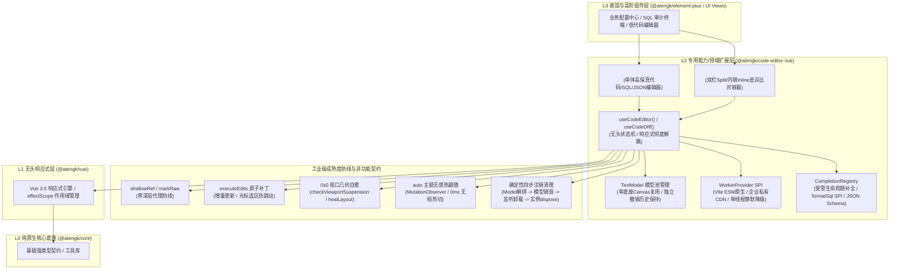

# @atengk/code-editor-vue 企业级代码编辑与Diff差异比对扩展套件

> 面向现代 Web 应用、SQL 审计与发布配置中心的工业级 Monaco Editor 代码高保真编辑、双模 Diff 差异比对与受管多文件 TextModel 模型池基础设施，归属于系统四层拓扑的 **L2 专用能力/领域扩展层**。遵循“纯 Vue 3 驱动、响应式彻底解耦、零具体 UI 依赖、确定性生命周期治理”设计，全面继承 L0 底座的强类型契约与网络韧性。

---

## 0. 特性与公共 API 全景速查矩阵

| 特性分类           | 特性名称                   | 核心门面 / 组件 / Hook                                                      | 关键参数 / Props / Emits                                                | 核心行为说明                                                                                 | 锚定验证源头 (*Test / Sample)                                                                                                                                                            |
| :----------------- | :------------------------- | :-------------------------------------------------------------------------- | :---------------------------------------------------------------------- | :------------------------------------------------------------------------------------------- | :--------------------------------------------------------------------------------------------------------------------------------------------------------------------------------------- |
| **单体编辑器**     | 单体代码表现容器           | `AtengCodeEditor`                                                           | `CodeEditorProps (v-model, language, theme, readOnly...)`               | 集成原生微操作栏、底部状态栏、暗黑热跟随与 0x0 几何自愈的高阶容器                            | [AtengCodeEditor.test.ts](./test/AtengCodeEditor.test.ts) · [BasicCodeEditorScenario](../../apps/sample-code-editor-vue/src/scenarios/BasicCodeEditorScenario.vue)                       |
| **单体编辑器**     | 单体编辑器实例类型         | `AtengCodeEditorInstance`                                                   | `InstanceType<typeof AtengCodeEditor>`                                  | 单体组件收敛暴露的 Ref 实例类型，提供 format、layout、getValue、createModel 等操作           | [AtengCodeEditor.test.ts](./test/AtengCodeEditor.test.ts)                                                                                                                                |
| **单体编辑器**     | 单体编辑器无头状态机       | `useCodeEditor(containerRef, options)`                                      | `(containerRef, options) => UseCodeEditorReturn`                        | Monaco 原生实例无头管理，响应式解耦防线 (`shallowRef` + `markRaw`)，增量光标防丢             | [useCodeEditor.test.ts](./test/useCodeEditor.test.ts) · [reactiveDecoupling.test.ts](./test/reactiveDecoupling.test.ts)                                                                  |
| **双模 Diff 对比** | 双模 Diff 对比表现容器     | `AtengCodeDiffEditor`                                                       | `CodeDiffEditorProps (v-model:original, v-model:modified, diffMode...)` | 支持并排 (split) 与行内 (inline) 双模无损切换、增删行数统计与差异导航的高阶容器              | [diffEditor.test.ts](./test/diffEditor.test.ts) · [CodeDiffCompareScenario](../../apps/sample-code-editor-vue/src/scenarios/CodeDiffCompareScenario.vue)                                 |
| **双模 Diff 对比** | 双模 Diff 组件实例类型     | `AtengCodeDiffEditorInstance`                                               | `InstanceType<typeof AtengCodeDiffEditor>`                              | Diff 组件收敛暴露的 Ref 实例类型，提供 diff 导航与双向文本获取                               | [diffEditor.test.ts](./test/diffEditor.test.ts)                                                                                                                                          |
| **双模 Diff 对比** | 双模 Diff 无头状态机       | `useCodeDiff / useCodeDiffEditor`                                           | `(containerRef, options) => UseCodeDiffReturn`                          | 原生 DiffEditor 与双 Model 响应式解耦管理，差异导航与事件托管                                | [diffEditor.test.ts](./test/diffEditor.test.ts) · [CodeDiffCompareScenario](../../apps/sample-code-editor-vue/src/scenarios/CodeDiffCompareScenario.vue)                                 |
| **双模 Diff 对比** | Diff 增删行数统计工具      | `computeDiffStats(lineChanges)`                                             | `(lineChanges) => DiffStats`                                            | 基于 Monaco `ILineChange[]` 精准计算新增行、删除行与差异块总数                               | [diffEditor.test.ts](./test/diffEditor.test.ts)                                                                                                                                          |
| **模型池管理**     | 多文件 TextModel 模型池    | `createModel / setModel / disposeModel`                                     | `(val, lang?, uri?) => ITextModel, (modelOrUri) => void`                | 单底座 Canvas 瞬时切换多文件代码，独立保留各文件撤销历史与光标选区                           | [modelPool.test.ts](./test/modelPool.test.ts) · [BasicCodeEditorScenario](../../apps/sample-code-editor-vue/src/scenarios/BasicCodeEditorScenario.vue)                                   |
| **模型池管理**     | 视图状态持久化             | `saveViewState / restoreViewState`                                          | `(modelOrUri?) => ICodeEditorViewState`                                 | 保存与恢复特定模型的滚动条与光标视图状态，杜绝文件切换跳动                                   | [modelPool.test.ts](./test/modelPool.test.ts)                                                                                                                                            |
| **智能补全**       | 受管补全注册中心           | `CompletionRegistry`                                                        | `class CompletionRegistry`                                              | 纳管全局 Monaco 补全 Provider 单例，支持按语言注册与全量集中释放，杜绝跨页面泄露             | [completion/registry.ts](./src/completion/registry.ts) · [sqlAndSchema.test.ts](./test/sqlAndSchema.test.ts)                                                                             |
| **智能补全**       | 便捷补全注册门面           | `registerCompletionProvider(lang, fn)`                                      | `(language, provider) => IDisposable`                                   | 注册特定语言智能补全项，返回受管 `IDisposable` 注销句柄                                      | [completion/registry.ts](./src/completion/registry.ts) · [sqlAndSchema.test.ts](./test/sqlAndSchema.test.ts)                                                                             |
| **SQL 专用能力**   | 轻量 SQL 美化算法          | `formatSql(sql)`                                                            | `(sql: string) => string`                                               | 原生状态机词法切分，标准大写关键字、逗号换行与缩进排版，安全隔离字符串与注释                 | [sqlAndSchema.test.ts](./test/sqlAndSchema.test.ts) · [SqlFormattingScenario](../../apps/sample-code-editor-vue/src/scenarios/SqlFormattingScenario.vue)                                 |
| **SQL 专用能力**   | SQL 格式化 SPI 扩展        | `SqlFormatProvider`                                                         | `(sql: string) => Promise<string> \| string`                            | 允许外部接管或注入专用远程/重型 SQL 格式化引擎                                               | [sqlAndSchema.test.ts](./test/sqlAndSchema.test.ts) · [SqlFormattingScenario](../../apps/sample-code-editor-vue/src/scenarios/SqlFormattingScenario.vue)                                 |
| **Worker 调度**    | 三级弹性 Worker SPI        | `setupMonacoWorkers(options?)`                                              | `(options?: MonacoWorkerOptions) => void`                               | 自定义 Worker、静态 CDN URL 与单线程降级三级弹性寻址防线                                     | [workers.test.ts](./test/workers.test.ts) · [ADR-0035](../../docs/adr/0035-code-editor-vue-l2-architecture-and-monaco-governance.md)                                                     |
| **Worker 调度**    | Vite ESM 原生 Worker 助手  | `setupViteMonacoWorkers(workers)`                                           | `(workers: ViteMonacoWorkerConstructors) => void`                       | 便捷注册 Vite `?worker` 原生 ESM Web Worker 构造器                                           | [workers.test.ts](./test/workers.test.ts) · [workers/index.ts](./src/workers/index.ts)                                                                                                   |
| **主题感知**       | 主题热跟随无头状态机       | `useEditorTheme(themeGetter)`                                               | `(themeGetter) => UseEditorThemeReturn`                                 | 监听 `html.dark` 与系统色彩方案，0ms 零闪烁调用 `monaco.editor.setTheme`                     | [useEditorTheme.test.ts](./test/useEditorTheme.test.ts) · [AtengCodeEditor.test.ts](./test/AtengCodeEditor.test.ts)                                                                      |
| **几何自愈**       | 0x0 视口几何自愈状态机     | `isSuspended / healLayout`                                                  | `() => boolean / () => void`                                            | 弹窗与隐藏标签页中 0x0 尺寸感知挂起，恢复可见通过 ResizeObserver 防抖自愈                    | [lifecycleAndAutoLayout.test.ts](./test/lifecycleAndAutoLayout.test.ts) · [DialogTabsLifecycleScenario](../../apps/sample-code-editor-vue/src/scenarios/DialogTabsLifecycleScenario.vue) |
| **类型契约**       | 核心语言枚举与主题         | `CodeLanguage / EditorTheme`                                                | 类型定义                                                                | 常用支持语言联合类型与主题模式联合类型 ('auto' \| 'vs' \| 'vs-dark' \| 'hc-black')           | [types/index.ts](./src/types/index.ts)                                                                                                                                                   |
| **类型契约**       | Diff 模式与统计数据        | `DiffMode / DiffStats`                                                      | 类型定义                                                                | 对比模式 ('split' \| 'inline') 与增删改差异统计数据实体 (additions, deletions, changesCount) | [types/index.ts](./src/types/index.ts)                                                                                                                                                   |
| **类型契约**       | 单体编辑器输入与暴露契约   | `CodeEditorProps / CodeEditorEmits / CodeEditorExpose`                      | 接口定义                                                                | 单体组件输入参数、事件声明与收敛导出的 Ref 实例操作契约                                      | [types/index.ts](./src/types/index.ts)                                                                                                                                                   |
| **类型契约**       | 单体编辑器无头状态机选项   | `UseCodeEditorOptions / UseCodeEditorReturn`                                | 接口定义                                                                | 无头 Composable 的入参选项与响应式解耦返回值契约                                             | [types/index.ts](./src/types/index.ts)                                                                                                                                                   |
| **类型契约**       | 双模 Diff 输入与暴露契约   | `CodeDiffEditorProps / CodeDiffEditorEmits / CodeDiffEditorExpose`          | 接口定义                                                                | Diff 组件输入参数、事件声明与收敛导出的 Ref 实例操作契约                                     | [types/index.ts](./src/types/index.ts)                                                                                                                                                   |
| **类型契约**       | 双模 Diff 无头状态机选项   | `UseCodeDiffOptions / UseCodeDiffReturn`                                    | 接口定义                                                                | Diff 无头 Composable 的入参选项与响应式解耦返回值契约                                        | [types/index.ts](./src/types/index.ts)                                                                                                                                                   |
| **类型契约**       | 智能补全与 Worker 选项契约 | `CompletionProviderFn / MonacoWorkerOptions / ViteMonacoWorkerConstructors` | 接口定义                                                                | 自定义代码智能补全提供者函数契约与三级 Worker 提供者配置选项                                 | [types/index.ts](./src/types/index.ts) · [workers/index.ts](./src/workers/index.ts)                                                                                                      |

---

## 1. 模块定位与 pnpm 坐标

- **npm 坐标**：`@atengk/code-editor-vue`
- **拓扑层级**：L2 专用能力/领域扩展层 (Extension Layer)
- **定位与跨框架解耦契约**：面向现代 Web 应用、SQL 审计与微服务发布配置中心的工业级 Monaco Editor 高保真代码编辑与双模 Diff 差异比对基础设施。纯 Vue 3 驱动，仅依赖 L0 (`@atengk/core`)、L1 (`@atengk/vue`) 与第三方核心驱动 `monaco-editor`，**严格中立并与具体 UI 库解耦**（零 Element Plus 依赖）。
- **零 UI 依赖与微操作栏插槽反转契约**：
  - 内部以 `.at-code-editor-*` 独立命名空间提供轻量原生微操作栏（语言标识、只读徽标、格式化按钮、全屏与暗黑感知）；
  - 对外 100% 暴露具名插槽（`#toolbar`、`#extra`、`#statusbar`），上层业务系统（如 `@atengk/element-plus` 或业务中后台）可无缝使用具体 UI 按钮/下拉框完全接管与反转定制操作流。
- **安装依赖**：
  ```bash
  pnpm add @atengk/core @atengk/vue @atengk/code-editor-vue monaco-editor vue
  ```
- **依赖基线与 peerDependencies 契约**：
  - `monaco-editor`: `>=0.50.0`（锁定现代化 Monaco Editor 核心驱动引擎）
  - `vue`: `>=3.5.0`（利用原生响应式解构与泛型 SFC 特性）
  - `@atengk/core`: `workspace:*`（底层强类型契约与基础网络工具底座）
  - `@atengk/vue`: `workspace:*`（响应式无头状态机与通用 Hooks 底座）
  - `Node.js`: `>=20.18.0` / 现代主流浏览器

---

## 2. 核心架构与设计不变量



### 核心设计不变量 (Core Invariants)

1. **响应式彻底解耦防线 (Reactive Decoupling Invariant)**：
   - Monaco Editor 原生实例（`IStandaloneCodeEditor` / `IStandaloneDiffEditor`）与底层 `ITextModel` 对象结构极为庞大、高度可变且包含复杂的私有循环引用；
   - 本套件中所有原生实例与 TextModel **强制采用 `shallowRef` 与 `markRaw` 封装**，单测断言 `isReactive === false`，绝对严禁被 Vue 3 的 `ref()` 或 `reactive()` 深度 Proxy 代理拦截，彻底杜绝打字卡顿、内存爆仓与调用栈溢出（Call Stack Size Exceeded）。
2. **增量编辑光标保护管道 (Incremental Cursor Preservation Invariant)**：
   - 外部通过 `v-model` 双向同步代码文本时，底层严禁简单粗暴调用 `editor.setValue()`（否则会导致光标跳回首行并彻底清空 Undo/Redo 撤销历史栈）；
   - 状态机内部前置对比内容等价性；若确实发生外部修改，底层统一通过 Monaco 原子事务 `executeEdits` / `pushEditOperations` 增量注入补丁，100% 保持当前光标行号、列号与选区，并保留完整的用户撤销历史。
3. **0x0 视口几何自愈与挂起状态机 (0x0 Viewport Geometry & Layout Healing)**：
   - 当编辑器挂载于隐藏 Tab、折叠手风琴面板或初始关闭的 `<el-dialog>` / `<el-drawer>` 模态窗口中时，视口初始尺寸为 `0x0`；
   - 内置 `checkViewportSuspension` 状态机自动将视口置为挂起（`isSuspended`），暂停高开销的 `layout()` 计算，防止 Canvas 绘制错位与文字折叠；
   - 基于 `ResizeObserver` 持续探测，一旦宿主容器恢复可见尺寸，防抖触发 `healLayout()` 确定性自愈重算布局，杜绝样式塌陷与行号错位。
4. **确定性四步生命周期注销防线 (Deterministic Lifecycle Governance)**：
   - 在 `onUnmounted` 或作用域销毁时，严格遵守 Monaco 安全注销时序：
     1. 首先解除 DiffEditor 或 CodeEditor 绑定的当前 Model（`setModel(null)` 并解除依赖）；
     2. 遍历并确定性销毁受管模型池（`ModelPool`）中的私有 TextModel；
     3. 彻底解绑 `ResizeObserver`、DOM `MutationObserver`、色彩方案媒体查询与全局补全 Provider 注册句柄；
     4. 显式调用 `editor.dispose()` 并彻底置空引用，杜绝内存驻留与离线幽灵回调。
5. **纯原生微操作栏与插槽反转契约 (Zero-UI & Slot Inversion Invariant)**：
   - 组件样式严格以 `.at-code-editor-*` 与 `.at-code-diff-editor-*` 作为独立命名空间隔离，开启 `<style scoped>`，绝不污染全局；
   - 零依赖具体 UI 框架，默认提供极简原生的微工具栏与状态栏；
   - 对外 100% 暴露具名插槽（`#toolbar`、`#extra`、`#statusbar`），允许上层业务按需替换或扩充自定义操作流。

---

## 3. 单体高保真代码编辑套件 (AtengCodeEditor & useCodeEditor)

> 待工单 #237 细化落实：涵盖 3.1 基础代码高保真编辑与多语言切换、3.2 暗黑模式无感热跟随与系统感知、3.3 Ref 实例高级操作与微操作栏插槽接管三要素同屏闭环。

---

## 4. 双模 Diff 差异比对与双轨回写套件 (AtengCodeDiffEditor & useCodeDiff)

> 待工单 #237 细化落实：涵盖 4.1 双模 Diff 并排与行内平滑切换、4.2 双轨响应式数据流与修改侧编辑、4.3 差异跳转导航与增删行数实时统计三要素同屏闭环。

---

## 5. 多文件 TextModel 模型池与增量编辑防线

> 待工单 #238 细化落实：涵盖 5.1 单底座 Canvas 多文件瞬时切换、5.2 增量编辑光标保护管道、5.3 超大文件自适应性能保护模式三要素同屏闭环。

---

## 6. 智能补全与 SQL / JSON 语法拓展套件

> 待工单 #238 细化落实：涵盖 6.1 受管生命周期智能补全中心、6.2 轻量原生 SQL 美化与外部 SPI 接管、6.3 声明式微服务部署 JSON Schema 校验三要素同屏闭环。

---

## 7. 三级弹性 Worker 调度与环境降级防线

> 待工单 #238 细化落实：涵盖 7.1 Vite ESM 原生 Worker 零配置集成、7.2 企业内网私有 CDN 镜像寻址、7.3 极端网络单线程静默降级三要素同屏闭环。

---

## 8. 视口几何自愈与生命周期治理

> 待工单 #239 细化落实：涵盖 8.1 弹窗、抽屉与多标签 0x0 视口几何自愈、8.2 生产运维只读审计与高危删库行高亮、8.3 确定性四步生命周期注销防线三要素同屏闭环。

---

## 9. 完整 TypeScript 接口/Props/CSS 变量速查清单 (全量速查附录)

> 待工单 #239 细化落实：包含 AtengCodeEditor 全量字典表、AtengCodeDiffEditor 全量字典表、无头 Composables 强类型接口清单与 CSS Design Tokens 规范表。
