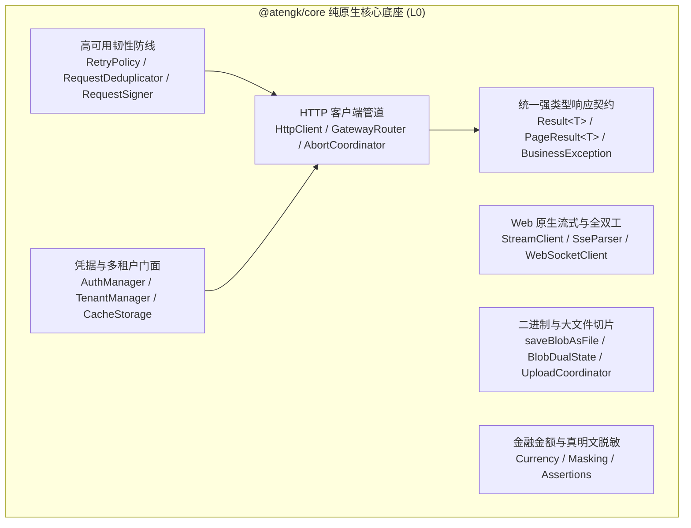

# @atengk/core 核心契约与网络底座

> 面向现代 Web 应用与企业级系统的无框架纯 TypeScript 强类型网络契约与工业级客户端基础设施，处于系统四层拓扑的 **L0 纯原生核心底座**，保持跨框架与平台中立，零 UI、零 Vue、零 React 依赖。

---

## 0. 特性与公共 API 全景速查矩阵

| 特性分类             | 特性名称            | 核心门面 / 方法 / 类型                                                                                               | 关键参数 / 返回类型                              | 核心行为说明                                                     | 锚定验证源头 (*Test / Sample)                                                                                     |
| :------------------- | :------------------ | :------------------------------------------------------------------------------------------------------------------- | :----------------------------------------------- | :--------------------------------------------------------------- | :---------------------------------------------------------------------------------------------------------------- |
| **基础导出**         | 基线版本标识        | `VERSION`                                                                                                            | `string`                                         | 导出当前模块编译版本基线                                         | [index.test.ts](./test/index.test.ts)                                                                             |
| **统一响应契约**     | 统一 API 响应载荷   | `Result<T>`                                                                                                          | `code, data, msg, traceId`                       | 统一泛型响应数据信封与链路追踪                                   | [contracts.test.ts](./test/contracts.test.ts) / [contracts.ts](../../apps/sample-core/src/scenarios/contracts.ts) |
| **统一响应契约**     | 分页查询与响应      | `PageResult<T>`, `PageQuery`                                                                                         | `list, total`, `pageNum, pageSize`               | 标准分页入参与出参实体契约                                       | [contracts.test.ts](./test/contracts.test.ts)                                                                     |
| **统一响应契约**     | 统一因果业务异常    | `BusinessException`                                                                                                  | `code, msg, traceId, cause`                      | 保留原始底层调用堆栈的因果业务异常类                             | [contracts.test.ts](./test/contracts.test.ts)                                                                     |
| **网络数据转换**     | 雪花 ID 大数防截断  | `parseSnowflakeJson`, `transformSnowflakeResponse`                                                                   | `json: string => unknown`                        | 纳秒级正则匹配 16 位以上无引号数字加引号固化                     | [snowflake.test.ts](./test/snowflake.test.ts) / [contracts.ts](../../apps/sample-core/src/scenarios/contracts.ts) |
| **网关多路由引擎**   | 路由调度引擎与工厂  | `GatewayRouter`, `createGatewayRouter`                                                                               | `routes, defaultTarget => ResolvedRoute`         | 多微服务网关前缀最长匹配与路径重写分发                           | [routing.test.ts](./test/routing.test.ts) / [http.ts](../../apps/sample-core/src/scenarios/http.ts)               |
| **网关多路由引擎**   | 路由纯函数门面      | `resolveGatewayRoute`                                                                                                | `url, routes, defaultTarget => ResolvedRoute`    | 开箱即用单次路由与服务覆盖解析                                   | [routing.test.ts](./test/routing.test.ts)                                                                         |
| **内存真明文脱敏**   | 通用文本掩码        | `formatMask`                                                                                                         | `(val, start, end, char?) => string`             | 底层通用前后保留文本掩码展示计算                                 | [mask.test.ts](./test/mask.test.ts)                                                                               |
| **内存真明文脱敏**   | 手机号脱敏          | `formatMaskPhone`                                                                                                    | `(phone, char?) => string`                       | 3-4-4 手机号掩码脱敏与分隔符容错                                 | [mask.test.ts](./test/mask.test.ts) / [security.ts](../../apps/sample-core/src/scenarios/security.ts)             |
| **内存真明文脱敏**   | 身份证号脱敏        | `formatMaskIdCard`                                                                                                   | `(idCard, start?, end?, char?) => string`        | 18位/15位二代与一代身份证出生日期脱敏                            | [mask.test.ts](./test/mask.test.ts) / [security.ts](../../apps/sample-core/src/scenarios/security.ts)             |
| **内存真明文脱敏**   | 邮箱地址脱敏        | `formatMaskEmail`                                                                                                    | `(email, char?) => string`                       | 用户名动态掩码并完整保留域名后缀                                 | [mask.test.ts](./test/mask.test.ts) / [security.ts](../../apps/sample-core/src/scenarios/security.ts)             |
| **内存真明文脱敏**   | 中文姓名脱敏        | `formatMaskName`                                                                                                     | `(name, char?) => string`                        | 2字末尾/3字居中/多字中间自适应脱敏                               | [mask.test.ts](./test/mask.test.ts) / [security.ts](../../apps/sample-core/src/scenarios/security.ts)             |
| **鉴权凭据门面**     | 鉴权凭据操作门面    | `AuthManager`, `createAuthManager`, `authManager`, `AuthManagerOptions`                                              | `getToken, setToken, clearToken, getHeaders`     | 双轨请求头注入 (`token` + `Bearer`) 与 401 自动清理广播          | [auth.test.ts](./test/auth.test.ts) / [auth.ts](../../apps/sample-core/src/scenarios/auth.ts)                     |
| **鉴权凭据门面**     | 跨宿主存储适配器    | `AuthStorage`, `MemoryAuthStorage`, `LocalStorageAuthStorage`, `createDefaultAuthStorage`, `isLocalStorageAvailable` | `getItem, setItem, removeItem, clear?`           | 浏览器 LocalStorage 与 Node/SSR 内存环境自适应探测存储契约       | [auth.test.ts](./test/auth.test.ts)                                                                               |
| **请求取消与防竞态** | 请求取消协调器      | `AbortCoordinator`, `createAbortCoordinator`, `RegisterAbortOptions`, `AbortRegistration`                            | `register, cancel, cancelAll, remove, isPending` | 未决请求生命周期托管、`cancelDuplicate` 防竞态中断与外部信号级联 | [abort.test.ts](./test/abort.test.ts) / [http.ts](../../apps/sample-core/src/scenarios/http.ts)                   |
| **请求取消与防竞态** | 指纹生成与错误判定  | `generateRequestKey`, `isAbortError`, `RequestKeyTarget`                                                             | `target => string`, `error => boolean`           | 基于 Method+URL+Params+Data 的确定性请求键生成与受控中断判定     | [abort.test.ts](./test/abort.test.ts)                                                                             |
| **文件与Blob处理**   | 文件名解析          | `parseContentDispositionFilename`                                                                                    | `disposition: string => string`                  | 优先解析 RFC 5987/6266 filename* 与常规 filename，支持容错清理   | [file.test.ts](./test/file.test.ts) / [upload.ts](../../apps/sample-core/src/scenarios/upload.ts)                 |
| **文件与Blob处理**   | Blob双态异常识别    | `checkBlobForJsonError`                                                                                              | `(data, contentType?, status?) => Promise<void>` | 探测 Blob 载荷是否为 JSON 业务错误并反序列化转译为业务异常       | [file.test.ts](./test/file.test.ts) / [upload.ts](../../apps/sample-core/src/scenarios/upload.ts)                 |
| **文件与Blob处理**   | 安全文件下载        | `saveBlobAsFile`, `SaveBlobOptions`                                                                                  | `(blob, filename, options?) => boolean`          | 平台环境守卫（Node/SSR降级）、内存确定性回收与安全触发浏览器下载 | [file.test.ts](./test/file.test.ts) / [upload.ts](../../apps/sample-core/src/scenarios/upload.ts)                 |
| **HTTP 客户端**      | 全局默认客户端      | `http`                                                                                                               | `HttpClient`                                     | 开箱即用的工业级单例，默认自动解包 `Promise<T>` 与统一拦截管道   | [http.test.ts](./test/http.test.ts) / [contracts.ts](../../apps/sample-core/src/scenarios/contracts.ts)           |
| **HTTP 客户端**      | 客户端工厂与门面    | `createHttpClient`, `DefaultHttpClient`, `HttpClient`, `HttpClientOptions`, `HttpRequestConfig`                      | `options => HttpClient`                          | 创建具备独立路由表、鉴权域与取消协调器的客户端实例               | [http.test.ts](./test/http.test.ts) / [http.ts](../../apps/sample-core/src/scenarios/http.ts)                     |
| **HTTP 客户端**      | 拦截器管道挂载      | `setupInterceptors`, `InterceptorContext`                                                                            | `(instance, context) => void`                    | 为自定义 Axios 实例挂载全套工业级请求与响应拦截器                | [http.test.ts](./test/http.test.ts)                                                                               |
| **高可用韧性防线**   | 幂等安全重试策略    | `RetryPolicy`, `isIdempotentMethod`, `isRetriableError`, `calculateBackoffDelay`                                     | `(method) => boolean, (error) => boolean`        | 安全重试不变量（GET/HEAD指数退避，POST/PUT/DELETE严禁重试）      | [retry.test.ts](./test/retry.test.ts) / [http.ts](../../apps/sample-core/src/scenarios/http.ts)                   |
| **高可用韧性防线**   | 飞行中请求合并去重  | `RequestDeduplicator`, `createRequestDeduplicator`, `requestDeduplicator`, `generateDedupeKey`, `DedupeTarget`       | `(key, task) => Promise<T>`                      | 基于 Method+URL+Params 指纹合并未决 Promise，N 次调用降为 1 次   | [dedupe.test.ts](./test/dedupe.test.ts) / [http.ts](../../apps/sample-core/src/scenarios/http.ts)                 |
| **金融级金额计算**   | 原生金额换算与格式  | `toCents`, `toYuan`, `formatCurrency`, `Currency`                                                                    | `(yuan) => number, (cents) => number`            | 纯原生位移补齐，彻底杜绝浮点数精度失真（元分互转、标准千分位）   | [currency.test.ts](./test/currency.test.ts) / [security.ts](../../apps/sample-core/src/scenarios/security.ts)     |
| **强类型条件断言**   | 业务断言与类型收窄  | `assert`, `assertNonNull`, `isEmpty`, `isNotEmpty`, `Assertions`                                                     | `(condition, msg) => asserts condition`          | 卫语句校验失败抛出 BusinessException，并在编译期实现类型安全收窄 | [assertions.test.ts](./test/assertions.test.ts) / [security.ts](../../apps/sample-core/src/scenarios/security.ts) |
| **多租户隔离门面**   | 多租户上下文操作    | `TenantManager`, `createTenantManager`, `tenantManager`, `TenantStorage`                                             | `getTenantId, setTenantId, clearTenantId`        | 自动化 `X-Tenant-Id` 请求头注入与多租户跨宿主隔离存储            | [tenant.test.ts](./test/tenant.test.ts) / [auth.ts](../../apps/sample-core/src/scenarios/auth.ts)                 |
| **时效命名空间缓存** | 带TTL本地键值缓存   | `CacheStorage`, `createCacheStorage`, `cacheStorage`, `CacheStorageOptions`                                          | `get, set(key, val, ttl?), remove, clear`        | 命名空间前缀隔离、毫秒级存活时间（TTL）与自动惰性垃圾清理        | [cache.test.ts](./test/cache.test.ts) / [auth.ts](../../apps/sample-core/src/scenarios/auth.ts)                   |
| **请求防重放与签名** | WebCrypto 签名门面  | `RequestSigner`, `DefaultRequestSigner`, `createRequestSigner`, `RequestSignerOptions`, `SignTarget`, `SignResult`   | `(target) => Promise<SignResult>`                | 基于原生 WebCrypto 计算 SHA-256 签名，注入时间戳与 Nonce 防重放  | [security.test.ts](./test/security.test.ts) / [http.ts](../../apps/sample-core/src/scenarios/http.ts)             |
| **请求防重放与签名** | 签名原语与字符串化  | `sha256Hex`, `generateNonce`, `defaultBuildCanonicalString`                                                          | `(msg) => Promise<string>, () => string`         | 原生哈希摘要、唯一排重随机数与键字典序规范化序列化               | [security.test.ts](./test/security.test.ts)                                                                       |
| **Web 原生流式响应** | 流式通信门面        | `StreamClient`, `DefaultStreamClient`, `createStreamClient`, `streamClient`, `StreamClientOptions`                   | `subscribe(url, opt), stream(url, opt)`          | 原生 fetch 与 ReadableStream 封装，支持打字机与指数退避重连      | [stream.test.ts](./test/stream.test.ts) / [stream-ws.ts](../../apps/sample-core/src/scenarios/stream-ws.ts)       |
| **Web 原生流式响应** | SSE 协议增量解析器  | `SseParser`, `SseEvent`, `StreamRequestOptions`                                                                      | `feed(chunk), flush(), reset() => SseEvent[]`    | W3C 标准 SSE 事件解析、换行合并、心跳过滤与抗网络撕裂分包        | [stream.test.ts](./test/stream.test.ts)                                                                           |
| **大文件切片上传**   | 纯原生文件切片      | `createFileChunks`, `DEFAULT_CHUNK_SIZE`, `FileChunk`                                                                | `(file, chunkSize?) => FileChunk[]`              | 原生 Blob.slice 安全字节区间切分与起始偏移计算                   | [upload.test.ts](./test/upload.test.ts) / [upload.ts](../../apps/sample-core/src/scenarios/upload.ts)             |
| **大文件切片上传**   | 受控并发上传协调器  | `UploadCoordinator`, `createUploadCoordinator`, `IUploadCoordinator`, `UploadCoordinatorOptions`                     | `upload(chunks, signal?), uploadFile(...)`       | 最大并发连接数限制、单调加权进度、分片局部重试与级联中断         | [upload.test.ts](./test/upload.test.ts) / [upload.ts](../../apps/sample-core/src/scenarios/upload.ts)             |
| **全双工长连接**     | WebSocket客户端门面 | `WebSocketClient`, `createWebSocketClient`, `WebSocketClientOptions`, `WebSocketStatus`, `destroy()`                 | `options => WebSocketClient`                     | 纯原生全双工长连接客户端，集成四态状态机、编解码与凭据自动透传   | [websocket.test.ts](./test/websocket.test.ts) / [stream-ws.ts](../../apps/sample-core/src/scenarios/stream-ws.ts) |
| **全双工长连接**     | 双向心跳保活探针    | `WebSocketHeartbeatOptions`                                                                                          | `interval, timeout, pingMessage, pongMessage`    | 定时应用层 Ping 发送、Pong 超时假死切断与确定性定时器回收        | [websocket.test.ts](./test/websocket.test.ts) / [stream-ws.ts](../../apps/sample-core/src/scenarios/stream-ws.ts) |
| **全双工长连接**     | 指数退避自动重连    | `WebSocketReconnectOptions`, `WebSocketEventMap`                                                                     | `baseDelay, maxDelay, factor, maxRetries`        | 异常断开与假死超时指数退避重连，支持主动 close 永久阻断          | [websocket.test.ts](./test/websocket.test.ts) / [stream-ws.ts](../../apps/sample-core/src/scenarios/stream-ws.ts) |
| **全双工长连接**     | 离线发送缓冲队列    | `bufferWhileConnecting`, `maxBufferSize`, `getBufferSize()`, `clearBuffer()`                                         | `send(data) => boolean`                          | 未连接排队暂存并在就绪后按序 Flush，容量溢出丢弃防内存泄露       | [websocket.test.ts](./test/websocket.test.ts) / [stream-ws.ts](../../apps/sample-core/src/scenarios/stream-ws.ts) |
| **全双工长连接**     | 主题订阅精准分发    | `subscribe<T>`                                                                                                       | `(type, handler) => unbind`                      | 按照业务载荷 `{ type, data: T }` 模式精准分发与安全注销          | [websocket.test.ts](./test/websocket.test.ts) / [stream-ws.ts](../../apps/sample-core/src/scenarios/stream-ws.ts) |

---

## 1. 模块定位与 pnpm 坐标

- **npm 坐标**：`@atengk/core`
- **拓扑层级**：L0 纯原生核心底座 (Core Layer)
- **跨框架契约**：纯 TypeScript 原生与 Web 标准 API 封装，平台弹性探测，零 UI、零 Vue、零 React 依赖。
- **安装依赖**：
  ```bash
  pnpm add @atengk/core axios
  ```
- **依赖基线与 peerDependencies**：
  - `axios`: `^1.7.7`（生产运行网络驱动）
  - `Node.js`: `>=20.18.0` / 现代主流浏览器（Chrome 90+, Edge 90+, Safari 14+, Firefox 90+）

---

## 2. 核心架构与设计不变量



### 核心不变量 (Core Invariants)

1. **显式强类型契约**：标准泛型响应 `Result<T>`、分页契约 `PageQuery` 与 `PageResult<T>`，因果链异常 `BusinessException`，严禁未经校验的裸 HTTP 实体穿透至业务层；
2. **雪花 Long ID 大数防失真**：在 Axios 原始反序列化前通过纳秒级正则匹配将 16 位以上无引号大数加双引号转换为字符串，彻底杜绝 $2^{53}-1$ 精度截断；
3. **平台与框架中立防御**：底层纯 TS 架构不依赖特定浏览器专有对象，不依赖 Vue/React 运行时或专有类型，支持 SSR 与 Node 降级；
4. **Blob 双态异常识别**：二进制流下载遇到业务异常 JSON 时，逆向转译为 `BusinessException` 抛出，彻底杜绝损坏伪文件下载落地；
5. **安全重试不变量**：仅针对 GET/HEAD 等幂等只读方法与 5xx、超时或网络中断实施指数退避重试；写操作（POST/PUT/DELETE）严格禁止自动重试，杜绝资金重复扣款与脏写；
6. **内存真明文不变量**：业务状态与数据模型在内存中始终保持 100% 原始真实明文，脱敏计算仅在渲染层动态调用纯函数，严禁在获取数据后就地篡改内存数据。

---

## 3. 统一强类型响应契约与因果异常体系 (Contracts & Exceptions)

### 3.1 统一 API 响应信封与解包逃生门

统一标准响应数据结构，开箱即用自动解包返回泛型业务数据，并提供 `{ unwrap: false }` 逃生门完整保留数据信封。

#### 专属 TypeScript 契约片段

```ts
export interface Result<T = unknown> {
  code: number;
  data: T;
  msg: string;
  traceId: string;
}

export interface HttpRequestConfig<D = unknown> extends AxiosRequestConfig<D> {
  /**
   * 是否自动解包 Result<T> 响应载荷。
   * - true (默认)：自动校验 code === 200 并返回 Promise<T>；非 200 抛出 BusinessException；
   * - false (逃生门)：保留完整统一信封，返回 Promise<Result<T>>。
   */
  unwrap?: boolean;
}
```

#### 实战业务 TS 代码示例

代码逆向提取自 [apps/sample-core/src/scenarios/contracts.ts](../../apps/sample-core/src/scenarios/contracts.ts)：

```ts
import { http, type Result } from '@atengk/core';

interface UserDetail {
  id: string;
  name: string;
  role: string;
}

// 1. 默认自动解包：直接拿到 Promise<UserDetail> 实体
const user = await http.get<UserDetail>('/api/user/detail');
console.log(`当前用户: ${user.name}`);

// 2. 逃生门：通过 { unwrap: false } 获取完整的 Result<UserDetail> 信封
const envelope = await http.get<Result<UserDetail>>('/api/user/detail', { unwrap: false });
console.log(`业务状态码: ${envelope.code}, TraceId: ${envelope.traceId}`);
```

#### 核心机制与生产边界

- **自动解包不变量**：当后端返回 `code === 200`（或业务合法成功码）时，响应拦截器自动将 `response.data.data` 返回给调用方，免除层层解构样板代码；
- **快速失败防卫**：当后端返回业务失败状态码（如 `code: 50001`）时，拦截器将自动将其构建为 `BusinessException` 抛出，绝不放任业务失败伪装为成功响应。

---

### 3.2 64 位雪花 Long ID 大数防截断

针对后端返回的 64 位整型（Snowflake ID、分布式主键），由于超过 JavaScript `Number.MAX_SAFE_INTEGER`（$2^{53}-1$）会发生精度截断。

#### 专属 TypeScript 契约片段

```ts
/**
 * 纳秒级正则匹配 JSON 文本中 16 位以上无引号数字并加引号固化为字符串。
 */
export function parseSnowflakeJson(rawJson: string): unknown;

/**
 * Axios transformResponse 管道专用转换器。
 */
export function transformSnowflakeResponse(data: unknown): unknown;
```

#### 实战业务 TS 代码示例

代码逆向提取自 [apps/sample-core/src/scenarios/contracts.ts](../../apps/sample-core/src/scenarios/contracts.ts)：

```ts
import { http } from '@atengk/core';

interface OrderDetail {
  orderId: string; // 64位雪花 ID: 9007199254740995123
  amount: number;
}

const order = await http.get<OrderDetail>('/api/snowflake/test');

// 原生 JSON.parse 会截断为 9007199254740995000
// @atengk/core 自动固化为字符串: "9007199254740995123"
console.log(typeof order.orderId); // 'string'
console.log(order.orderId); // '9007199254740995123'
```

#### 核心机制与生产边界

- **前置正则替换**：在反序列化前通过高精正则 `/(:\s*)(\d{16,})(?=[,\s}\]])/g` 将长数字安全包裹双引号，随后交付 V8 原生 `JSON.parse`；
- **零依赖与高性能**：无需引入笨重且破坏序列化的第三方 `json-bigint`，速度接近原生解析且天然兼容现有序列化库。

---

### 3.3 统一因果业务异常 (BusinessException) 与 TraceId 透传

统一封装业务状态码、错误信息、链路追踪标识与原始底层异常堆栈（`cause`）。

#### 专属 TypeScript 契约片段

```ts
export class BusinessException extends Error {
  readonly code: number;
  readonly msg: string;
  readonly traceId?: string;
  readonly cause?: unknown;

  constructor(code: number, msg: string, traceId?: string, cause?: unknown);
}
```

#### 实战业务 TS 代码示例

```ts
import { http, BusinessException } from '@atengk/core';

try {
  await http.get('/api/orders/invalid');
} catch (err) {
  if (err instanceof BusinessException) {
    console.error(`业务异常 [${err.code}]: ${err.msg}`);
    console.error(`诊断追踪 TraceId: ${err.traceId}`);
    console.error(`原始因果堆栈:`, err.cause);
  }
}
```

#### 核心机制与生产边界

- **全链路追踪**：自动从响应头 `X-Trace-Id`、`traceId` 或响应体 `traceId` 提取标识，挂载至异常实例，极大加速生产事故排查；
- **因果链保持**：完整保留原始底层 Axios 错误作为 `cause`，遵循“要么就地降级补偿，要么转换为业务异常向外抛出”原则。

---

## 4. 工业级 HTTP 客户端管道与请求调度治理 (HTTP & Routing)

### 4.1 客户端工厂与微服务网关前缀多路由调度

支持单体应用直连与微服务网关前缀最长匹配重写分发。

#### 专属 TypeScript 契约片段

```ts
export interface GatewayRoute {
  prefix: string; // 匹配 URL 路径前缀，如 '/order'
  target: string; // 目标服务基地址，如 'https://order-service.internal'
  rewritePrefix?: string; // 路径重写前缀，如 '/api/v1'
  service?: string; // 命名服务标识，支持显式定向分发
}

export interface HttpClientOptions {
  baseURL?: string;
  timeout?: number;
  routes?: GatewayRoute[];
  defaultTarget?: string;
  cancelDuplicate?: boolean;
  dedupeInFlight?: boolean;
}
```

#### 实战业务 TS 代码示例

代码逆向提取自 [apps/sample-core/src/scenarios/http.ts](../../apps/sample-core/src/scenarios/http.ts)：

```ts
import { createHttpClient } from '@atengk/core';

const client = createHttpClient({
  routes: [
    { prefix: '/order', target: 'https://order-service.cloud', rewritePrefix: '/api/v1' },
    { prefix: '/vip', target: 'https://vip-service.cloud', service: 'vip' },
  ],
});

// 1. 自动最长前缀匹配并重写分发至 https://order-service.cloud/api/v1/detail/100
await client.get('/order/detail/100');

// 2. 显式覆盖指定 service 路由
await client.get('/order/detail/100', { service: 'vip' });
```

#### 核心机制与生产边界

- **最长前缀优先**：多个前缀重叠时（如 `/api/v1/user` 与 `/api`），算法自动采用最长匹配优先策略分发；
- **单体与微服务平滑切换**：仅通过路由表配置即可在单体反代与分布式微服务网关之间无缝切换。

---

### 4.2 异步请求取消协调器与防竞态

高频搜索或快速翻页时，后发请求先回会导致数据倒挂。协调器支持自动物理中断在途未决请求。

#### 专属 TypeScript 契约片段

```ts
export interface AbortCoordinator {
  register(target: RequestKeyTarget, options?: RegisterAbortOptions): AbortRegistration;
  cancel(key: string, reason?: string): boolean;
  cancelAll(reason?: string): void;
  getPendingCount(): number;
}
```

#### 实战业务 TS 代码示例

代码逆向提取自 [apps/sample-core/src/scenarios/http.ts](../../apps/sample-core/src/scenarios/http.ts)：

```ts
import { createHttpClient, isAbortError } from '@atengk/core';

const client = createHttpClient({
  cancelDuplicate: true, // 开启防竞态自动中断旧未决请求
});

try {
  // 连续快速触发时，前一个未决请求会被底层 AbortSignal 即刻中断
  const res = await client.get('/api/search', { params: { q: 'slow' } });
  console.log('最新搜索结果:', res);
} catch (err) {
  if (isAbortError(err)) {
    console.warn('旧请求已被防竞态协调器自动取消，无需更新视图');
  }
}
```

#### 核心机制与生产边界

- **确定性请求键**：基于 `Method + URL + Params + Data` 计算确定性指纹，同指纹新请求触发时自动中断前序在途连接；
- **异常过滤**：提供 `isAbortError(err)` 辅助函数，帮助调用方安全忽略取消异常，杜绝控制台红字噪音。

---

### 4.3 幂等安全重试策略与飞行中请求合并去重

在弱网环境下提供韧性保障，并合并高频并发只读请求。

#### 专属 TypeScript 契约片段

```ts
export interface RetryPolicy {
  retry?: number; // 最大重试次数（默认 0，不重试）
  retryDelay?: number; // 基础重试延迟毫秒数（默认 500ms）
}

export interface HttpRequestConfig extends RetryPolicy {
  dedupeInFlight?: boolean; // 是否开启并发只读请求合并
}
```

#### 实战业务 TS 代码示例

代码逆向提取自 [apps/sample-core/src/scenarios/http.ts](../../apps/sample-core/src/scenarios/http.ts)：

```ts
import { http } from '@atengk/core';

// 1. GET 只读幂等请求：遭遇 5xx 瞬态抖动时执行指数退避重试 (最多2次)
const config = await http.get('/api/resilience/retry-transient', {
  retry: 2,
  retryDelay: 300,
});

// 2. 并发 5 个相同组件触发的只读请求，网络层合并为 1 次，其余复用同一 Promise
const [r1, r2, r3, r4, r5] = await Promise.all([
  http.get('/api/resilience/dedupe-flight', { dedupeInFlight: true }),
  http.get('/api/resilience/dedupe-flight', { dedupeInFlight: true }),
  http.get('/api/resilience/dedupe-flight', { dedupeInFlight: true }),
  http.get('/api/resilience/dedupe-flight', { dedupeInFlight: true }),
  http.get('/api/resilience/dedupe-flight', { dedupeInFlight: true }),
]);
```

#### 核心机制与生产边界

- **安全重试不变量**：仅针对 GET/HEAD 幂等方法重试；POST/PUT/DELETE 写操作严格禁止自动重试，杜绝资金重复扣款；
- **指数退避**：重试等待延迟按 $delay \times 2^{attempt}$ 曲线递增，防范雪崩共振；
- **飞行中内存清理**：无论去重请求成功还是失败，均在 `.finally` 中确定性注销指纹，杜绝内存泄漏。

---

### 4.4 WebCrypto 原生防重放签名 (RequestSigner)

基于 W3C 标准 WebCrypto 纯原生计算 SHA-256 签名，注入时间戳与唯一排重随机数防网络重放攻击。

#### 专属 TypeScript 契约片段

```ts
export interface RequestSignerOptions {
  secret: string; // 客户端签名密钥
  timestampHeader?: string; // 默认 'X-Timestamp'
  nonceHeader?: string; // 默认 'X-Nonce'
  signatureHeader?: string; // 默认 'X-Signature'
}

export function createRequestSigner(options: RequestSignerOptions): RequestSigner;
```

#### 实战业务 TS 代码示例

代码逆向提取自 [apps/sample-core/src/scenarios/http.ts](../../apps/sample-core/src/scenarios/http.ts)：

```ts
import { createHttpClient, createRequestSigner } from '@atengk/core';

const secureClient = createHttpClient({
  signer: createRequestSigner({
    secret: 'YOUR_PRODUCTION_SECRET',
  }),
});

// 写操作请求拦截器自动计算并注入 X-Timestamp、X-Nonce 与 X-Signature
const res = await secureClient.post('/api/order/pay', {
  goodsId: 'PROD-8888',
  price: 9900,
});
```

#### 核心机制与生产边界

- **字典序规范化**：按参数键名 ASCII 升序排列并拼接，确保相同载荷在各端计算的哈希指纹完全一致；
- **防重放保护**：结合服务端的 Nonce 缓存与时间戳滑动窗口（如 ±5 分钟），彻底封死网络抓包重放。

---

## 5. 企业级凭据管理、多租户上下文与时效本地缓存 (Auth & Storage)

### 5.1 双轨 Token 鉴权门面与 401 自动清理广播

管理登录凭据，请求时标准化注入双轨请求头（`token` 与 `Authorization: Bearer`），并在 401 时自动清理通知。

#### 专属 TypeScript 契约片段

```ts
export interface AuthManager {
  getToken(): string | null;
  setToken(token: string): void;
  clearToken(): void;
  getHeaders(): Record<string, string>;
  onUnauthorized(listener: () => void): () => void;
}
```

#### 实战业务 TS 代码示例

代码逆向提取自 [apps/sample-core/src/scenarios/auth.ts](../../apps/sample-core/src/scenarios/auth.ts)：

```ts
import { authManager } from '@atengk/core';

// 1. 用户登录成功：持久化 Token
authManager.setToken('YOUR_AUTH_TOKEN');

// 2. 请求自动携带双轨请求头:
// { "token": "YOUR_AUTH_TOKEN", "Authorization": "Bearer YOUR_AUTH_TOKEN" }

// 3. 监听凭据失效广播 (401)
const unbind = authManager.onUnauthorized(() => {
  console.warn('登录已过期，执行清空并跳转至登录页');
});
```

#### 核心机制与生产边界

- **跨宿主自适应存储**：浏览器环境下优先写入 `LocalStorage`，Node/SSR 环境平滑降级为 `MemoryAuthStorage`，保障平台中立；
- **防双重清理**：401 触发时原子化注销凭据，并调用所有注册的监听器，监听器内部异常不会中断主流程。

---

### 5.2 多租户隔离上下文与请求头自动注入

提供全局与局部多租户切片操作门面，自动注入 `X-Tenant-Id`。

#### 专属 TypeScript 契约片段

```ts
export interface TenantManager {
  getTenantId(): string | null;
  setTenantId(tenantId: string): void;
  clearTenantId(): void;
  getHeaders(): Record<string, string>;
}
```

#### 实战业务 TS 代码示例

代码逆向提取自 [apps/sample-core/src/scenarios/auth.ts](../../apps/sample-core/src/scenarios/auth.ts)：

```ts
import { tenantManager, http } from '@atengk/core';

// 切换当前租户标识
tenantManager.setTenantId('tenant-finance-001');

// 后续所有请求自动注入请求头: { "X-Tenant-Id": "tenant-finance-001" }
await http.get('/api/tenant/dashboard');
```

---

### 5.3 带 TTL 本地时效缓存与命名空间隔离

带命名空间前缀隔离、毫秒级存活时间（TTL）与自动惰性垃圾清理的通用本地缓存门面。

#### 专属 TypeScript 契约片段

```ts
export interface CacheStorageOptions {
  namespace?: string; // 默认 'at_cache:'
  driver?: CacheDriver;
}

export interface CacheStorage {
  get<T>(key: string): T | null;
  set<T>(key: string, value: T, ttl?: number): void;
  remove(key: string): void;
  clear(): void;
}
```

#### 实战业务 TS 代码示例

代码逆向提取自 [apps/sample-core/src/scenarios/auth.ts](../../apps/sample-core/src/scenarios/auth.ts)：

```ts
import { cacheStorage } from '@atengk/core';

// 写入 5000ms (5秒) 存活期的草稿数据
cacheStorage.set('order_draft_key', { orderId: 'ORD-2026-999' }, 5000);

// 5 秒内读取成功
const data = cacheStorage.get('order_draft_key');

// 5 秒后超时自动判定过期并惰性清除，返回 null
```

---

## 6. Web 原生流式打字机与全双工 WebSocket 长连接矩阵 (Stream & WebSocket)

### 6.1 Web 原生流式响应与 SSE 事件打字机

封装纯 Web 原生 `fetch` 与 `ReadableStream`，零 Axios 依赖，支持 AI 大模型逐块打字机消费与级联中断。

#### 专属 TypeScript 契约片段

```ts
export interface StreamRequestOptions {
  method?: string;
  headers?: Record<string, string>;
  body?: unknown;
  sse?: boolean; // 是否按 W3C SSE 规范解析，默认 true
  signal?: AbortSignal;
  onMessage?: (chunkText: string, event?: SseEvent) => void;
  onDone?: () => void;
  onError?: (error: unknown) => void;
}
```

#### 实战业务 TS 代码示例

代码逆向提取自 [apps/sample-core/src/scenarios/stream-ws.ts](../../apps/sample-core/src/scenarios/stream-ws.ts)：

```ts
import { streamClient } from '@atengk/core';

const controller = new AbortController();

await streamClient.subscribe('/api/llm/stream', {
  signal: controller.signal,
  onMessage: (chunkText, event) => {
    process.stdout.write(chunkText); // 实时增量渲染打字机
  },
  onDone: () => {
    console.log('\n[流式完成]');
  },
});

// 需要时随时调用中断
// controller.abort();
```

#### 核心机制与生产边界

- **抗网络撕裂**：内置 `SseParser`，针对 TCP 分包或字符撕裂实施跨块行缓冲区拼接，杜绝乱码；
- **锁的确定性释放**：在请求完成、报错或中断时，100% 确定性调用 `reader.releaseLock()` 释放流资源。

---

### 6.2 WebSocket 全双工长连接客户端与四态状态机

纯原生长连接客户端，集成四态状态机（`CONNECTING` / `OPEN` / `CLOSING` / `CLOSED`）、多主题订阅与自动凭据透传。

#### 专属 TypeScript 契约片段

```ts
export interface WebSocketClientOptions {
  url: WebSocketUrlResolver;
  authManager?: AuthManager;
  tenantManager?: TenantManager;
  heartbeat?: boolean | WebSocketHeartbeatOptions;
  reconnect?: boolean | WebSocketReconnectOptions;
  bufferWhileConnecting?: boolean;
  maxBufferSize?: number;
}
```

#### 实战业务 TS 代码示例

代码逆向提取自 [apps/sample-core/src/scenarios/stream-ws.ts](../../apps/sample-core/src/scenarios/stream-ws.ts)：

```ts
import { createWebSocketClient } from '@atengk/core';

const client = createWebSocketClient({
  url: 'ws://localhost:8080/ws',
  heartbeat: { interval: 4000, timeout: 2000 },
  reconnect: { baseDelay: 1000, maxRetries: 5 },
  bufferWhileConnecting: true,
  maxBufferSize: 5,
});

// 建立连接
await client.connect();
```

---

### 6.3 双向心跳保活、假死切断与指数退避自动重连

原生 WebSocket 缺少 JS 可感知的心跳探针。`WebSocketClient` 通过应用层定时 Ping 与 Pong 超时计时器判定长连接假死并主动切断重连。

#### 核心机制与生产边界

- **假死切断不变量**：若在 `timeout` 窗口内未收到对端合法 Pong 响应，判定长连接假死，主动切断底层物理连接触发重连；
- **指数退避重连**：按照 $baseDelay \times factor^{attempt}$ 曲线递增，受 `maxDelay` 钳制；
- **主动关闭永久阻断**：一旦调用方显式调用 `client.close()`，设置永久阻断标记，绝不发生非预期的幽灵重试。

---

### 6.4 受控容量 FIFO 离线缓冲队列与主题精准订阅

在握手阶段或重连抖动期间调用 `send()` 自动安全暂存并在就绪后按原序冲刷；超出 `maxBufferSize` 上限时安全剔除最旧数据。

#### 实战业务 TS 代码示例

```ts
// 1. 强类型主题订阅 (按载荷 { type: 'chat', data: T } 自动精准分发)
const unbind = client.subscribe<{ user: string; text: string }>('chat', payload => {
  console.log(`[${payload.user}]: ${payload.text}`);
});

// 2. 在连接就绪前后安全发送 (自动进入 FIFO 离线缓冲队列)
client.send({ type: 'chat', data: { user: 'Ateng', text: '你好！' } });

// 3. 注销订阅
unbind();
```

---

## 7. 二进制文件传输原语与大文件切片受控并发上传套件 (File & Upload)

### 7.1 安全文件下载与 RFC 5987 / 6266 中文文件名解析

自动解析 `Content-Disposition` 响应头中的 UTF-8 编码文件名，并在下载后由确定性定时器安全回收 ObjectURL 内存句柄。

#### 专属 TypeScript 契约片段

```ts
export function parseContentDispositionFilename(disposition: string): string;
export function saveBlobAsFile(blob: Blob, filename: string, options?: SaveBlobOptions): boolean;
```

#### 实战业务 TS 代码示例

代码逆向提取自 [apps/sample-core/src/scenarios/upload.ts](../../apps/sample-core/src/scenarios/upload.ts)：

```ts
import { http } from '@atengk/core';

// 自动解析中文文件名并触发浏览器安全下载
const success = await http.download('/api/download/normal');
console.log('下载触发状态:', success);
```

---

### 7.2 二进制流 Blob-JSON 双态异常识别防御

拦截器针对 `responseType: 'blob'` 实施双态识别：若服务端发生业务故障返回 JSON，自动反序列化为 `BusinessException` 抛出，彻底杜绝损坏伪文件落地。

#### 核心机制与生产边界

- **双态嗅探**：探测到 `Content-Type: application/json` 或载荷包含 JSON 格式时，通过 `FileReader` 异步提取文本解析为 `Result<never>`；
- **防虚假文件**：杜绝用户将包含 `{"code": 500, "msg": "系统繁忙"}` 的错误响应保存为损坏的 Excel/PDF 文件。

---

### 7.3 大文件切片与受控并发上传协调器 (UploadCoordinator)

纯原生切片计算，受控限制最大并发网络连接数，提供单调递增加权进度汇报、局部重试与级联中断。

#### 专属 TypeScript 契约片段

```ts
export interface UploadCoordinatorOptions {
  concurrency?: number; // 最大并发网络连接数，默认为 3
  maxRetries?: number; // 单片上传失败最大重试次数，默认为 2
  retryDelay?: number; // 重试基础延迟毫秒数
  onProgress?: (percent: number, loaded: number, total: number) => void;
  uploadChunk: (chunk: FileChunk, signal?: AbortSignal) => Promise<unknown>;
}
```

#### 实战业务 TS 代码示例

代码逆向提取自 [apps/sample-core/src/scenarios/upload.ts](../../apps/sample-core/src/scenarios/upload.ts)：

```ts
import { createFileChunks, createUploadCoordinator } from '@atengk/core';

const file = new File(['...'], 'video.mp4');
const chunks = createFileChunks(file, 3 * 1024 * 1024); // 3MB / 片

const coordinator = createUploadCoordinator({
  concurrency: 2, // 严格限制最多 2 个切片并发上传
  maxRetries: 2,
  onProgress: (percent, loaded, total) => {
    console.log(`上传总进度: ${percent}% (${loaded}/${total} 字节)`);
  },
  uploadChunk: async (chunk, signal) => {
    const formData = new FormData();
    formData.append('file', chunk.chunk);
    formData.append('index', String(chunk.index));
    const res = await fetch('/api/upload/chunk', { method: 'POST', body: formData, signal });
    return res.json();
  },
});

const results = await coordinator.upload(chunks);
```

---

## 8. 金融级高精度金额、内存真明文脱敏与业务安全断言 (Data Security & Arithmetic)

### 8.1 纯原生金融级高精度金额换算与千分位规整 (Currency)

基于纯原生整数位移补齐算法实现元分互转与千分位格式化，彻底杜绝浮点数计算失真（如 `0.1 + 0.2 !== 0.3`）。

#### 专属 TypeScript 契约片段

```ts
export function toCents(yuan: number | string): number;
export function toYuan(cents: number | string): number;
export function formatCurrency(amount: number | string, decimals?: number): string;
```

#### 实战业务 TS 代码示例

代码逆向提取自 [apps/sample-core/src/scenarios/security.ts](../../apps/sample-core/src/scenarios/security.ts)：

```ts
import { toCents, toYuan, formatCurrency } from '@atengk/core';

toCents(12.34); // 1234 (元转分，零浮点偏差)
toYuan(1234); // 12.34 (分转元)
formatCurrency(987654321.05); // "987,654,321.05" (标准千分位)
```

---

### 8.2 内存真明文纯函数脱敏展示矩阵 (Masking)

内存模型中数据始终保持 100% 原始真实明文，脱敏展示仅在视图层动态调用纯函数计算。

#### 专属 TypeScript 契约片段

```ts
export function formatMaskPhone(phone: string, maskChar?: string): string;
export function formatMaskIdCard(
  idCard: string,
  start?: number,
  end?: number,
  maskChar?: string,
): string;
export function formatMaskEmail(email: string, maskChar?: string): string;
export function formatMaskName(name: string, maskChar?: string): string;
```

#### 实战业务 TS 代码示例

代码逆向提取自 [apps/sample-core/src/scenarios/security.ts](../../apps/sample-core/src/scenarios/security.ts)：

```ts
import { formatMaskPhone, formatMaskIdCard, formatMaskEmail, formatMaskName } from '@atengk/core';

formatMaskPhone('13800138000'); // "138****8000"
formatMaskIdCard('110101199003072345'); // "110101********2345"
formatMaskEmail('zhuge.kongming@ateng.com'); // "z***g@ateng.com"
formatMaskName('诸葛孔明'); // "诸**明"
```

---

### 8.3 强类型业务前置卫语句断言 (Assertions)

校验失败快速失败抛出 `BusinessException`，并在编译期实现 TypeScript 类型安全收窄。

#### 实战业务 TS 代码示例

代码逆向提取自 [apps/sample-core/src/scenarios/security.ts](../../apps/sample-core/src/scenarios/security.ts)：

```ts
import { assert, assertNonNull, isEmpty, isNotEmpty } from '@atengk/core';

function processUser(userId: string | null) {
  // 1. 非空前置断言：失败直接抛出 BusinessException(400, '用户标识缺失')
  // 编译期将 userId 安全收窄为 string
  assertNonNull(userId, '用户标识缺失');

  // 2. 集合判空断言
  assert(isNotEmpty([1, 2, 3]), '数据集不应为空');
}
```

---

## 9. 完整 TypeScript 接口与类型字典速查清单 (Type Definitions Reference)

以下为 `@atengk/core` 导出的全量核心强类型接口清单，供全域研发查阅：

```ts
// ==================== 1. 响应契约与异常 ====================
export interface Result<T = unknown> {
  code: number;
  data: T;
  msg: string;
  traceId: string;
}

export interface PageResult<T = unknown> {
  list: T[];
  total: number;
  pageNum?: number;
  pageSize?: number;
}

export interface PageQuery {
  pageNum: number;
  pageSize: number;
  sortField?: string;
  sortAsc?: boolean;
}

export class BusinessException extends Error {
  readonly code: number;
  readonly msg: string;
  readonly traceId?: string;
  readonly cause?: unknown;
}

// ==================== 2. HTTP 客户端与路由 ====================
export interface GatewayRoute {
  prefix: string;
  target: string;
  rewritePrefix?: string;
  service?: string;
}

export interface HttpRequestConfig<D = unknown> extends AxiosRequestConfig<D>, RetryPolicy {
  service?: string;
  cancelDuplicate?: boolean;
  dedupeInFlight?: boolean;
  dedupeKey?: string;
  sign?: boolean;
  unwrap?: boolean;
}

export interface HttpClientOptions extends RetryPolicy {
  baseURL?: string;
  timeout?: number;
  routes?: GatewayRoute[];
  defaultTarget?: string;
  authManager?: AuthManager;
  tenantManager?: TenantManager;
  abortCoordinator?: AbortCoordinator;
  deduplicator?: RequestDeduplicator;
  signer?: RequestSigner;
  cancelDuplicate?: boolean;
  dedupeInFlight?: boolean;
  unwrap?: boolean;
  onUnauthorized?: () => void;
}

// ==================== 3. 凭据、租户与缓存 ====================
export interface AuthStorage {
  getItem(key: string): string | null;
  setItem(key: string, value: string): void;
  removeItem(key: string): void;
  clear?(): void;
}

export interface CacheStorageOptions {
  namespace?: string;
  driver?: CacheDriver;
}

// ==================== 4. 流式与 WebSocket ====================
export interface SseEvent {
  event?: string;
  data: string;
  id?: string;
  retry?: number;
}

export type WebSocketStatus = 'CONNECTING' | 'OPEN' | 'CLOSING' | 'CLOSED';

export interface WebSocketHeartbeatOptions {
  enabled?: boolean;
  interval?: number;
  timeout?: number;
  pingMessage?: string | object;
  pongMessage?: string | ((data: unknown) => boolean);
}

export interface WebSocketReconnectOptions {
  enabled?: boolean;
  baseDelay?: number;
  maxDelay?: number;
  factor?: number;
  maxRetries?: number;
}

export interface WebSocketClientOptions {
  url: string | (() => string | Promise<string>);
  authManager?: AuthManager;
  tenantManager?: TenantManager;
  heartbeat?: boolean | WebSocketHeartbeatOptions;
  reconnect?: boolean | WebSocketReconnectOptions;
  bufferWhileConnecting?: boolean;
  maxBufferSize?: number;
}

// ==================== 5. 文件与并发上传 ====================
export interface FileChunk {
  chunk: Blob;
  index: number;
  start: number;
  end: number;
  size: number;
  totalChunks: number;
}

export interface UploadCoordinatorOptions {
  concurrency?: number;
  maxRetries?: number;
  retryDelay?: number;
  onProgress?: (percent: number, loaded: number, total: number) => void;
  onChunkSuccess?: (chunk: FileChunk) => void;
  uploadChunk: (chunk: FileChunk, signal?: AbortSignal) => Promise<unknown>;
}
```
