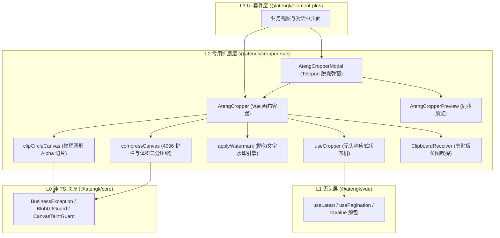
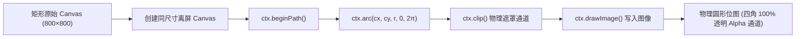

# @atengk/cropper-vue 图片裁剪与图像处理扩展模块

> 面向现代 Web 应用与企业级前端系统的工业级图片裁剪、物理圆形 Alpha 切片、防伪水印与智能体积压缩扩展基础设施（四层洋葱拓扑之 L2 专用能力/领域扩展层），基于 `cropperjs 1.6.x` 打造无头状态机与零 UI 库依赖的脱壳组件套件。

---

## 0. 特性与公共 API 全景速查矩阵

| API 标识                  | 类别            | 运行环境 / 契约  | 核心职责与设计特性                                                                         |
| :------------------------ | :-------------- | :--------------- | :----------------------------------------------------------------------------------------- |
| **`AtengCropper`**        | Vue 组件        | L2 UI 容器       | 基础图片裁剪容器，支持多源输入、自由/固定比例、双向翻转、细粒度调平与多轨导出              |
| **`AtengCropperModal`**   | Vue 组件        | L2 模态弹窗      | 基于 Vue 3 原生 `<Teleport>` 的脱壳弹窗，100% 物理脱耦具体 UI 库，内置预设与工具栏         |
| **`AtengCropperPreview`** | Vue 组件        | L2 预览视口      | 多尺寸（如 128/64/32px）无闪烁同步缩略图实时预览组件                                       |
| **`useCropper`**          | Composable      | L1/L2 无头状态机 | `shallowRef` 浅层代理原生 `cropperjs` 引擎，提供只读几何度量与响应式操作句柄               |
| **`BlobUrlGuard`**        | Class / 守卫    | L0/L2 资源治理   | 集中跟踪托管由 File/Blob 生成的临时 Object URL，销毁时 100% 释放，外部 URL 防误杀          |
| **`CanvasTaintGuard`**    | Class / 守卫    | L0/L2 安全治理   | 前置检测 Canvas 跨域污损（`SecurityError`），转译为标准因果异常 `BusinessException(40301)` |
| **`clipCircleCanvas`**    | Function / 工具 | 离屏 Canvas      | 离屏 `ctx.arc() + ctx.clip()` 物理剔除四角底色，生成纯净透明 Alpha 通道，收敛为 PNG        |
| **`applyWatermark`**      | Function / 工具 | 离屏 Canvas      | 倾斜防伪文字水印离屏抗锯齿平铺合成引擎，支持自定义字号、颜色、倾斜角与间距                 |
| **`compressCanvas`**      | Function / 工具 | 离屏 Canvas      | 4096 像素尺寸护栏、质量二分逼近与步进降采样（0.85）智能体积压缩流水线                      |
| **`ClipboardReceiver`**   | Class / 工具    | DOM / 剪贴板     | 拦截并提取系统粘贴事件（`Ctrl+V` / `Cmd+V`）中的首张位图文件（`File`）                     |
| **`CropperResult`**       | TypeScript 接口 | 数据契约         | 多轨导出结果载荷：包含 `dataUrl`、`blob`、`file`、`canvas`、`width`、`height`、`size`      |

---

## 1. 模块定位与 pnpm 坐标

`@atengk/cropper-vue` 遵循 `ateng-ui` 四层洋葱拓扑架构，归属于 **L2 专用能力与领域扩展层**：

- **单向流动依赖**：`@atengk/element-plus (L3)` ➔ **`@atengk/cropper-vue (L2)`** ➔ `@atengk/vue (L1)` ➔ `@atengk/core (L0)`；
- **零 UI 库耦合纯净律**：本模块 **严禁硬编码依赖 Element Plus 或任何第三方 UI 库**，模态弹窗采用纯原生 `<Teleport>` 挂载，视觉样式 100% 绑定 `--at-cropper-*` CSS 变量；
- **底层强类型引擎**：基于 `cropperjs ^1.6.2` 封装，开箱具备 Tree-Shaking 与 ESM + CJS + DTS 双模构建分发。

### 1.1 安装依赖与样式导入

```bash
# 安装核心扩展包与 peerDependencies
pnpm add @atengk/cropper-vue cropperjs
```

在应用入口文件（如 `main.ts`）中导入全局隔离样式：

```ts
import { createApp } from 'vue';
import App from './App.vue';

// 导入裁剪模块全局样式（包含 cropperjs 底层样式与 --at-cropper-* Tokens）
import '@atengk/cropper-vue/style.css';

const app = createApp(App);
app.mount('#app');
```

---

## 2. 核心架构与设计不变量



### 2.1 核心设计不变量

1. **零 UI 耦合与脱壳模态**：组件全部使用原生 HTML5 + CSS 变量实现，支持无缝嵌入纯原生 Vue、Element Plus、Ant Design Vue 或 Tailwind 体系；
2. **物理圆形透明切片（Alpha 通道）**：圆形头像切片严禁使用 CSS `border-radius: 50%` 假象敷衍，必须在离屏 Canvas 阶段调用 `ctx.arc()` 与 `ctx.clip()` 物理剔除四角底色，并将导出格式强制收敛为 `image/png`；
3. **确定性生命周期与零泄漏**：内部通过 `BlobUrlGuard` 对由 `File` 或 `Blob` 生成的临时 `URL.createObjectURL` 进行引用托管，在换图与组件卸载（`onScopeDispose` / `onUnmounted`）时 100% 确定性销毁释放；
4. **4096 像素护栏与双阶段防爆**：面对移动端或大屏加载 8K/10K 巨幅图片时，前置施加 `maxDimension: 4096` 护栏并按原比例等比降采样，杜绝 WebGL 上下文崩溃与 Canvas 内存溢出。

---

## 3. 基础画布与无头响应式状态机

### 3.1 基础容器与几何交互 AtengCropper

#### 1. TypeScript 契约与配置接口

```ts
export interface AtengCropperProps {
  /** 图片资源地址（支持 URL、DataURL、Blob、File） */
  src?: string | Blob | File;
  /** 裁剪区域固定宽高比（如 1、16/9；未指定或 NaN 为自由模式） */
  aspectRatio?: number;
  /** 裁剪视图模式（0: 无限制, 1: 限制裁剪框不超过画布, 2: 限制画布不小于容器, 3: 限制画布填满容器） */
  viewMode?: 0 | 1 | 2 | 3;
  /** 预设配置模式 */
  preset?: 'custom' | 'avatar' | 'banner' | 'idcard';
  /** 底层 cropperjs 高级选项覆盖 */
  options?: CropperOptions;
}

export interface AtengCropperExpose {
  /** 获取原生 cropperjs 实例 */
  cropper: Cropper | null;
  /** 旋转指定角度（累加） */
  rotate: (degree: number) => void;
  /** 旋转到指定绝对角度（-180 ~ 180） */
  rotateTo: (degree: number) => void;
  /** 水平镜像翻转 */
  flipX: () => void;
  /** 垂直镜像翻转 */
  flipY: () => void;
  /** 缩放画布 */
  zoom: (ratio: number) => void;
  /** 重置裁剪框与画布为初始状态 */
  reset: () => void;
  /** 动态更新裁剪框宽高比 */
  setAspectRatio: (aspectRatio: number) => void;
  /** 获取当前裁剪几何参数 */
  getData: () => CropperCropData | null;
  /** 获取当前裁剪框视口参数 */
  getCropBoxData: () => CropperBoxData | null;
  /** 导出离屏 HTMLCanvasElement */
  getCroppedCanvas: (options?: Cropper.GetCroppedCanvasOptions) => HTMLCanvasElement | null;
  /** 多轨一体化导出载荷结果 */
  exportResult: (options?: ExportOptions) => Promise<CropperResult>;
}
```

#### 2. 面向实战的业务 Vue SFC 示例

```vue
<script setup lang="ts">
import { ref } from 'vue';
import { AtengCropper, type AtengCropperExpose, type CropperResult } from '@atengk/cropper-vue';

const cropperRef = ref<AtengCropperExpose>();
const imageSrc = ref('https://example.com/assets/banner.jpg');
const currentRatio = ref<number | undefined>(16 / 9);

function handleRotate(deg: number) {
  cropperRef.value?.rotate(deg);
}

function handleFlipHorizontal() {
  cropperRef.value?.flipX();
}

async function handleExport() {
  if (!cropperRef.value) return;
  const result: CropperResult = await cropperRef.value.exportResult({
    format: 'image/jpeg',
    quality: 0.9,
  });
  console.log('导出成功:', result.width, result.height, result.size);
}
</script>

<template>
  <div class="crop-workbench">
    <div class="cropper-container">
      <AtengCropper ref="cropperRef" :src="imageSrc" :aspect-ratio="currentRatio" :view-mode="1" />
    </div>

    <div class="toolbar">
      <button type="button" @click="handleRotate(-90)">向左旋转 90°</button>
      <button type="button" @click="handleRotate(90)">向右旋转 90°</button>
      <button type="button" @click="handleFlipHorizontal">水平翻转</button>
      <button type="button" @click="handleExport">保存并导出</button>
    </div>
  </div>
</template>

<style scoped>
.crop-workbench {
  display: flex;
  flex-direction: column;
  gap: 12px;
}
.cropper-container {
  height: 480px;
  background: #0f172a;
  border-radius: 8px;
  overflow: hidden;
}
.toolbar {
  display: flex;
  gap: 8px;
}
</style>
```

#### 3. 核心机制与生产边界防御说明

- **`shallowRef` 浅层代理**：底层 `Cropper` 原生实例使用 `shallowRef` 进行引用隔离，严禁使用 `ref` 或 `reactive` 进行深度劫持，避免导致原型链循环代理崩溃与内存泄漏；
- **自适应 ResizeObserver 监听**：容器内部注入 `ResizeObserver`，在父容器尺寸缩放或窗口尺寸变更时，自动调用 `cropper.resize()` 进行画布重绘计算。

---

## 4. 脱壳模态弹窗与剪贴板快速拾取

### 4.1 零 UI 依赖脱壳弹窗 AtengCropperModal

#### 1. TypeScript 契约与配置接口

```ts
export interface AtengCropperModalProps {
  /** 弹窗是否显隐（支持 v-model） */
  modelValue?: boolean;
  /** 弹窗标题 */
  title?: string;
  /** 待裁剪图片地址或 File 对象 */
  src?: string | Blob | File;
  /** 预设场景：custom | avatar | banner | idcard */
  preset?: CropperPreset;
  /** 裁剪比例（未指定则取预设值） */
  aspectRatio?: number;
  /** 是否启用物理圆形透明切片 */
  clipCircle?: boolean;
  /** 弹窗挂载目标容器（默认 'body'） */
  teleportTo?: string;
}

export interface AtengCropperModalEmits {
  (e: 'update:modelValue', value: boolean): void;
  (e: 'confirm', result: CropperResult): void;
  (e: 'cancel'): void;
}
```

#### 2. 面向实战的业务 Vue SFC 示例

```vue
<script setup lang="ts">
import { ref } from 'vue';
import { AtengCropperModal, type CropperResult } from '@atengk/cropper-vue';

const isModalOpen = ref(false);
const rawFile = ref<File | null>(null);
const currentAvatarUrl = ref('');

function onFileSelected(e: Event) {
  const input = e.target as HTMLInputElement;
  if (!input.files?.[0]) return;
  rawFile.value = input.files[0];
  isModalOpen.value = true;
}

function onCropConfirm(result: CropperResult) {
  currentAvatarUrl.value = result.dataUrl;
  console.log('裁切头像 File 载荷:', result.file);
}
</script>

<template>
  <div class="user-profile">
    
    <input type="file" accept="image/*" @change="onFileSelected" />

    <AtengCropperModal
      v-model="isModalOpen"
      :src="rawFile ?? undefined"
      title="裁剪用户头像"
      preset="avatar"
      :aspect-ratio="1"
      :clip-circle="true"
      @confirm="onCropConfirm"
    />
  </div>
</template>
```

#### 3. 核心机制与生产边界防御说明

- **原生 Teleport 脱壳挂载**：弹窗通过 `<Teleport to="body">` 挂载，彻底摆脱外部父容器 `overflow: hidden` 与 `z-index` 层级压制问题；
- **全键盘与 Esc 对称监听**：弹窗开启时监听 `KeyDown (Escape)` 自动触发取消并释放副作用，弹窗关闭后立即注销监听，保证生命周期对称完备。

### 4.2 剪贴板位图嗅探 ClipboardReceiver

#### 1. TypeScript 契约与方法签名

```ts
export class ClipboardReceiver {
  /**
   * 从系统粘贴事件中智能提取首张位图文件。
   *
   * @param event 原生 ClipboardEvent 粘贴事件对象
   * @returns 匹配到的 File 位图对象；若未找到位图则安全保底返回 null
   */
  static extractImage(event: ClipboardEvent): File | null;
}
```

#### 2. 面向实战的业务调用示例

```ts
import { ClipboardReceiver } from '@atengk/cropper-vue';

function handleGlobalPaste(e: ClipboardEvent) {
  const file = ClipboardReceiver.extractImage(e);
  if (file) {
    console.log('成功嗅探并提取剪贴板位图:', file.name, file.size, file.type);
    // 载入画布或传入 AtengCropper
  }
}

window.addEventListener('paste', handleGlobalPaste);
```

#### 3. 核心机制说明

- **单向数据流与类型守卫**：遍历 `event.clipboardData.items`，过滤 `kind === 'file'` 且 `type.startsWith('image/')` 的首个条目并调用 `getAsFile()` 提取，阻断文本与无意义二进制输入。

---

## 5. 物理圆形透明切片与多轨导出

### 5.1 物理圆形与透明底色 clipCircleCanvas

#### 1. TypeScript 契约与函数签名

```ts
export interface CircleClipOptions {
  /** 导出 MIME 类型，默认收敛为 'image/png' 保障 Alpha 透明通道 */
  format?: string;
  /** 压缩质量（0.1 ~ 1.0） */
  quality?: number;
}

/**
 * 在离屏 Canvas 上通过路径裁切剔除四角底色，生成具备真实 Alpha 通道的物理圆形位图。
 *
 * @param sourceCanvas 原始裁剪所得 Canvas 画布
 * @param options 切片导出配置项
 * @returns 带有圆形 Alpha 透明通道的离屏 HTMLCanvasElement
 */
export function clipCircleCanvas(
  sourceCanvas: HTMLCanvasElement,
  options?: CircleClipOptions,
): HTMLCanvasElement;
```

#### 2. 面向实战的调用示例

```ts
import { clipCircleCanvas } from '@atengk/cropper-vue';

const sourceCanvas = cropperInstance.getCroppedCanvas();
if (sourceCanvas) {
  // 离屏物理裁剪圆形位图
  const circleCanvas = clipCircleCanvas(sourceCanvas);

  // 导出为带透明底色的 PNG Blob
  circleCanvas.toBlob(blob => {
    console.log('圆形位图 Blob (Alpha 通道):', blob?.type, blob?.size);
  }, 'image/png');
}
```

#### 3. 核心机制与原理流程



- **MIME 强制收敛原则**：由于 `image/jpeg` 物理协议不支持透明通道（四角会自动填充黑色或白色背景），当启用 `clipCircle: true` 时，导出管道自动将 MIME 类型强制收敛为 `image/png` 或 `image/webp`。

---

## 6. 智能体积二分压缩与防伪水印

### 6.1 倾斜抗锯齿防伪文字水印 applyWatermark

#### 1. TypeScript 契约与配置接口

```ts
export interface CropperWatermarkOptions {
  /** 防伪文字内容（如：仅供实名认证使用，复印无效） */
  text: string;
  /** 文字颜色（支持 RGBA 透明色，如 'rgba(255, 255, 255, 0.25)'） */
  color?: string;
  /** 字体大小（单位 px，默认 18） */
  fontSize?: number;
  /** 字体族（默认 'sans-serif'） */
  fontFamily?: string;
  /** 水印文字旋转角度（默认 -25 度） */
  rotate?: number;
  /** 水平平铺间距（单位 px，默认 80） */
  gapX?: number;
  /** 垂直平铺间距（单位 px，默认 80） */
  gapY?: number;
}
```

#### 2. 面向实战的代码调用

```ts
import { applyWatermark } from '@atengk/cropper-vue';

const canvas = cropperRef.value?.getCroppedCanvas();
if (canvas) {
  const watermarkedCanvas = applyWatermark(canvas, {
    text: '仅供平台实名认证使用',
    color: 'rgba(239, 68, 68, 0.28)',
    fontSize: 20,
    rotate: -30,
    gapX: 100,
    gapY: 100,
  });
  console.log('防伪水印平铺合成完毕');
}
```

---

### 6.2 质量二分与步进降采样压缩 compressCanvas

#### 1. TypeScript 契约与配置接口

```ts
export interface CropperCompressionOptions {
  /** 目标最大体积限制（字节数，例如 500 * 1024 代表 500KB） */
  maxByteSize: number;
  /** 初始尝试压缩质量（0.1 ~ 1.0，默认 0.92） */
  initialQuality?: number;
  /** 质量二分逼近最小步进阈值（默认 0.05） */
  minQualityStep?: number;
  /** 最大尺寸限制（单位 px，默认 4096 护栏） */
  maxDimension?: number;
  /** 当质量降至极限仍超标时的步进降采样缩放比（默认 0.85） */
  scaleStep?: number;
  /** 目标导出 MIME 类型（默认 'image/jpeg'） */
  format?: 'image/jpeg' | 'image/png' | 'image/webp';
}
```

#### 2. 面向实战的调用示例

```ts
import { compressCanvas } from '@atengk/cropper-vue';

const canvas = cropperRef.value?.getCroppedCanvas();
if (canvas) {
  // 将位图强制智能压缩至 300KB 以内
  const compressedBlob = await compressCanvas(canvas, {
    maxByteSize: 300 * 1024,
    format: 'image/jpeg',
    initialQuality: 0.9,
    maxDimension: 2048,
    scaleStep: 0.85,
  });

  console.log('压缩达成体积:', (compressedBlob.size / 1024).toFixed(1), 'KB');
}
```

#### 3. 核心机制说明

- **双阶段逼近状态机**：第一阶段固定画布尺寸，通过二分法（Binary Search）在 `[0.1, initialQuality]` 区间内寻找满足 `maxByteSize` 的最高质量系数；若最低质量仍超标，第二阶段自动启动步进降采样（离屏 Canvas 等比缩放 `scaleStep: 0.85`），直至彻底压入目标体积护栏。

---

## 7. 生产环境避坑与生命周期/内存治理指南

### 7.1 跨域 CORS 异常与 CanvasTaintGuard

- **避坑痛点**：当裁剪的图片来自跨域 CDN 但未正确配置 `Access-Control-Allow-Origin: *` 响应头时，原生 Canvas 在调用 `toDataURL()` 或 `getImageData()` 时会抛出致命的 `SecurityError: The operation is insecure`，导致控制台报错且生成损坏的空白图片。
- **治理策略**：内部通过 `CanvasTaintGuard.guard(canvas)` 在导出管道前置执行嗅探，捕获 `SecurityError` 并自动转译为框架标准因果异常 `BusinessException(40301, '跨域图片资源未配置 CORS 允许头，画布已被安全污损隔离')`，阻断不可预期的崩溃。

### 7.2 4096 像素尺寸护栏与防 GPU 崩溃

- **避坑痛点**：现代手机拍摄的照片分辨率常高达 8000×6000（4800 万像素），直接在浏览器创建数千万像素的 Canvas 会导致 iOS Safari 或低配 Android 设备的 WebGL/GPU 驱动崩溃、页面直接白屏刷新。
- **治理策略**：`compressCanvas` 默认施加 `maxDimension: 4096` 护栏，等比限制最大宽高，避免 GPU 显存耗尽。

### 7.3 BlobUrlGuard 临时 URL 内存泄漏治理

- **避坑痛点**：业务频繁切换图片或连续上传预览时，若频繁调用 `URL.createObjectURL(file)` 而未显式执行 `URL.revokeObjectURL(url)`，未被垃圾回收的临时 Blob 映射将持续霸占浏览器内存直至内存泄漏崩溃。
- **治理策略**：统一使用 `BlobUrlGuard` 管理所有临时生成的句柄：
  ```ts
  const guard = new BlobUrlGuard();

  // 仅托管由内部创建的临时 URL
  const tempUrl = guard.create(file);

  // 外部已存在的 URL 传入时安全透传，严禁误杀
  const externalUrl = guard.create('https://cdn.example.com/pic.jpg');

  // 换图或卸载时 100% 确定性销毁
  guard.revokeAll();
  ```

---

## 8. 完整 TypeScript 接口/Props/CSS 变量速查字典

### 8.1 AtengCropper 组件 Props

| 属性名        | 类型                     | 默认值      | 说明                                                         |
| :------------ | :----------------------- | :---------- | :----------------------------------------------------------- |
| `src`         | `string \| Blob \| File` | `undefined` | 待裁剪图像源，支持网络 URL、本地 File/Blob 或 DataURL        |
| `aspectRatio` | `number`                 | `undefined` | 裁剪区域比例（如 1、16/9；未传或 NaN 为自由比例模式）        |
| `viewMode`    | `0 \| 1 \| 2 \| 3`       | `1`         | 裁剪视口约束模式（0: 无约束, 1: 裁剪框不越出画布）           |
| `preset`      | `CropperPreset`          | `'custom'`  | 场景预设模式（`custom` \| `avatar` \| `banner` \| `idcard`） |
| `options`     | `CropperOptions`         | `{}`        | 透传给底层 `cropperjs` 引擎的高级配置项覆盖字典              |

### 8.2 AtengCropperModal 组件 Props

| 属性名        | 类型                     | 默认值       | 说明                                                        |
| :------------ | :----------------------- | :----------- | :---------------------------------------------------------- |
| `modelValue`  | `boolean`                | `false`      | 控制模态弹窗显隐状态（支持 `v-model`）                      |
| `title`       | `string`                 | `'图片裁剪'` | 弹窗头部标题文案                                            |
| `src`         | `string \| Blob \| File` | `undefined`  | 待裁剪的图片资源对象                                        |
| `preset`      | `CropperPreset`          | `'custom'`   | 业务场景预设模式                                            |
| `aspectRatio` | `number`                 | `undefined`  | 裁剪框宽高比                                                |
| `clipCircle`  | `boolean`                | `false`      | 是否启用物理圆形透明切片（`preset="avatar"` 时默认为 true） |
| `teleportTo`  | `string`                 | `'body'`     | 原生 Teleport 挂载的目标选择器                              |

### 8.3 CSS 变量与 Design Tokens 速查

| CSS 变量名                        | 默认值                             | 说明                                  |
| :-------------------------------- | :--------------------------------- | :------------------------------------ |
| `--at-cropper-bg`                 | `#0f172a`                          | 画布容器与预览视口的深色填充背景色    |
| `--at-cropper-border-color`       | `var(--el-border-color, #e2e8f0)`  | 容器与边框基准色彩                    |
| `--at-cropper-modal-z-index`      | `2000`                             | 脱壳模态弹窗遮罩层的基准层级深度      |
| `--at-cropper-modal-width`        | `840px`                            | 模态弹窗视口标准宽度                  |
| `--at-cropper-modal-radius`       | `8px`                              | 弹窗视口与按钮圆角参数                |
| `--at-cropper-primary-color`      | `var(--el-color-primary, #3b82f6)` | 主题动作高亮色与滑块导轨激活色彩      |
| `--at-cropper-checkerboard-light` | `#ffffff`                          | 物理透明 Alpha 通道检测棋盘格亮色基底 |
| `--at-cropper-checkerboard-dark`  | `#e2e8f0`                          | 物理透明 Alpha 通道检测棋盘格暗色基底 |
