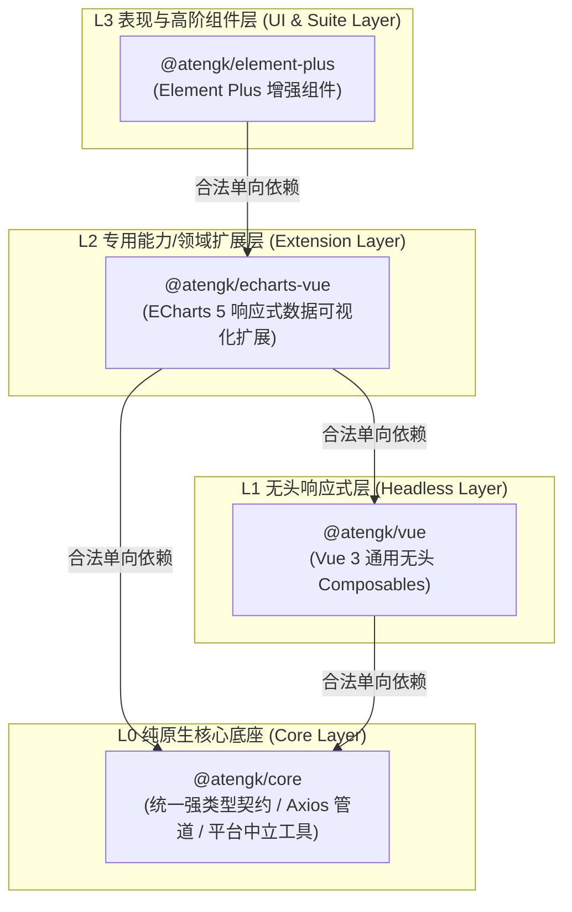
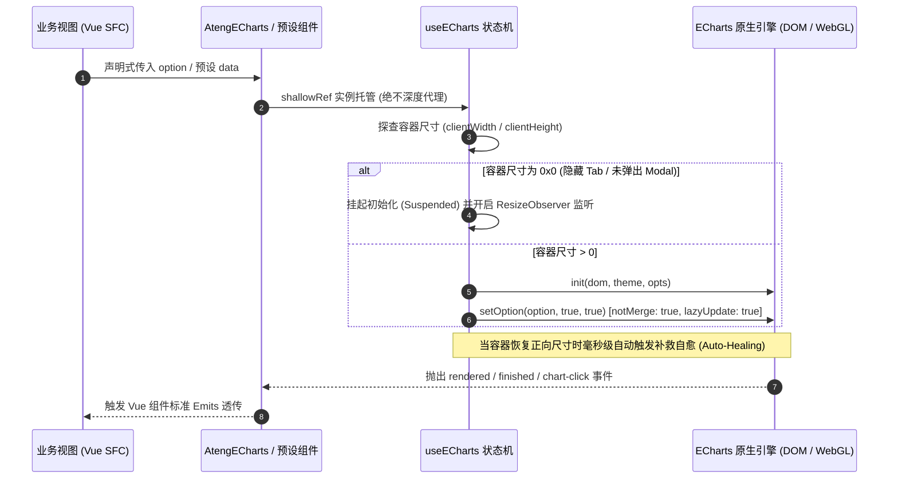
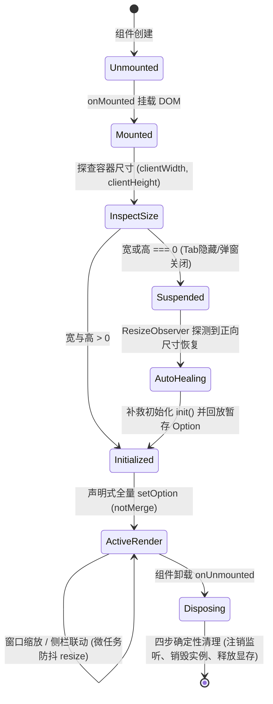

# @atengk/echarts-vue EChartsVue 响应式图表可视化扩展

> 面向现代 Web 应用与企业级工控大盘的工业级 ECharts 5 响应式数据可视化扩展基础设施，纯 Vue 3 驱动，基于轻量无头解耦内核构建。提供通用表现容器、几何感知自愈、声明式全量 Option 同步、DOM 级多态遮罩、暗黑模式无损热切换、六大高频业务预设图表、GeoJSON SPI 地图下钻状态机与脱壳全屏高清图片导出能力。

---

## 0. 特性与公共 API 全景速查矩阵 (100% 覆盖)

| 特性分类           | 特性名称           | 核心门面 / 组件 / Hook                                                 | 关键参数 / Props / Emits / Slots                                                                                                                                                                                                                                       | 核心行为说明                                                                                                                                                                                        | 锚定验证源头 (*Test / Sample)                                                                                                                                |
| :----------------- | :----------------- | :--------------------------------------------------------------------- | :--------------------------------------------------------------------------------------------------------------------------------------------------------------------------------------------------------------------------------------------------------------------- | :-------------------------------------------------------------------------------------------------------------------------------------------------------------------------------------------------- | :----------------------------------------------------------------------------------------------------------------------------------------------------------- |
| **通用表现容器**   | 核心图表容器       | `<AtengECharts />`                                                     | `Props: option, theme, autoResize, notMerge, loading, empty, error, allowFullscreen, allowExport...`<br>`Emits: rendered, finished, click, dblclick, legendselectchanged, datazoom, resize, retry, export...`<br>`Slots: #default, #loading, #empty, #error, #toolbar` | 包装 ECharts 实例，集成保底宽高、ResizeObserver 几何自感知、`0x0` 挂起自愈、全量同步、DOM 级三态遮罩与右上角浮动操作胶囊                                                                            | [AtengECharts.test.ts](./test/AtengECharts.test.ts) / [ContainerScenario.vue](../../apps/sample-echarts-vue/src/scenarios/ContainerScenario.vue)             |
| **无头状态机**     | ECharts 状态机     | `useECharts(elRef, options)`                                           | `theme, initOptions, autoResize, resizeDebounce, onThemeChange, onResize`                                                                                                                                                                                              | 纯无头生命周期管理，强制采用 `shallowRef` 托管实例防 Proxy 污染；封装 init, dispose, resize, setOption, showLoading, hideLoading, clear, getDataURL                                                 | [useECharts.test.ts](./test/useECharts.test.ts) / [ContainerScenario.vue](../../apps/sample-echarts-vue/src/scenarios/ContainerScenario.vue)                 |
| **高频业务预设**   | 趋势对比看板       | `<AtengTrendChart />`                                                  | `Props: data, dimension, metrics, yAxis, dataZoom, smooth, area...`<br>`Slots: #default, #loading, #empty, #error, #toolbar`                                                                                                                                           | 专职处理单/双 Y 轴折线、柱线混合与时序渐变面积，内置千分位 Tooltip 与最大/最小/平均线标线                                                                                                           | [trend.test.ts](./test/presets/trend.test.ts) / [TrendScenario.vue](../../apps/sample-echarts-vue/src/scenarios/TrendScenario.vue)                           |
| **高频业务预设**   | 趋势 Option 生成   | `createTrendOption(config)`                                            | `config: TrendChartConfig`                                                                                                                                                                                                                                             | 将维度字段、多指标数组、双 Y 轴与 DataZoom 配置转换为严谨的 EChartsOption                                                                                                                           | [trend.test.ts](./test/presets/trend.test.ts) / [TrendScenario.vue](../../apps/sample-echarts-vue/src/scenarios/TrendScenario.vue)                           |
| **高频业务预设**   | 分类占比环形图     | `<AtengDonutChart />`                                                  | `Props: data, nameKey, valueKey, radius, center, roseType, centerSummary...`<br>`Slots: #default, #loading, #empty, #error, #toolbar`                                                                                                                                  | 分类占比预设，支持居中 KPI 统计指标卡（自动求和/千分位）、南丁格尔玫瑰图与扇区圆角高亮                                                                                                              | [donut-funnel.test.ts](./test/presets/donut-funnel.test.ts) / [DonutFunnelScenario.vue](../../apps/sample-echarts-vue/src/scenarios/DonutFunnelScenario.vue) |
| **高频业务预设**   | 环形 Option 生成   | `createDonutOption(config)`                                            | `config: DonutChartConfig`                                                                                                                                                                                                                                             | 将分类数据、半径与中心指标卡配置转换为 EChartsOption                                                                                                                                                | [donut-funnel.test.ts](./test/presets/donut-funnel.test.ts) / [DonutFunnelScenario.vue](../../apps/sample-echarts-vue/src/scenarios/DonutFunnelScenario.vue) |
| **高频业务预设**   | 全链路转化漏斗     | `<AtengFunnelChart />`                                                 | `Props: data, nameKey, valueKey, unit, sort, gap, funnelAlign...`<br>`Slots: #default, #loading, #empty, #error, #toolbar`                                                                                                                                             | 营销与采纳漏斗预设，双轨自动按视觉流向计算相邻环节转化率与总体转化率                                                                                                                                | [donut-funnel.test.ts](./test/presets/donut-funnel.test.ts) / [DonutFunnelScenario.vue](../../apps/sample-echarts-vue/src/scenarios/DonutFunnelScenario.vue) |
| **高频业务预设**   | 漏斗 Option 生成   | `createFunnelOption(config)`                                           | `config: FunnelChartConfig`                                                                                                                                                                                                                                            | 自动计算前后转化率百分比并构造动态标签与对齐方式的 EChartsOption                                                                                                                                    | [donut-funnel.test.ts](./test/presets/donut-funnel.test.ts) / [DonutFunnelScenario.vue](../../apps/sample-echarts-vue/src/scenarios/DonutFunnelScenario.vue) |
| **高频业务预设**   | 目标达成率仪表盘   | `<AtengGaugeChart />`                                                  | `Props: value, min, max, unit, thresholds, progress, pointer, extremities...`<br>`Slots: #default, #loading, #empty, #error, #toolbar`                                                                                                                                 | 经营 KPI 达成率预设，支持多段阈值色阶、极值两端刻度、经典指针与现代环形圆角进度条双模切换                                                                                                           | [gauge-radar.test.ts](./test/presets/gauge-radar.test.ts) / [GaugeRadarScenario.vue](../../apps/sample-echarts-vue/src/scenarios/GaugeRadarScenario.vue)     |
| **高频业务预设**   | 仪表盘 Option 生成 | `createGaugeOption(config)`                                            | `config: GaugeChartConfig`                                                                                                                                                                                                                                             | 将当前数值、色阶阈值与指针/进度条样式映射为高适配度 EChartsOption                                                                                                                                   | [gauge-radar.test.ts](./test/presets/gauge-radar.test.ts) / [GaugeRadarScenario.vue](../../apps/sample-echarts-vue/src/scenarios/GaugeRadarScenario.vue)     |
| **高频业务预设**   | 多维画像雷达图     | `<AtengRadarChart />`                                                  | `Props: indicators, data, area, shape, splitNumber...`<br>`Slots: #default, #loading, #empty, #error, #toolbar`                                                                                                                                                        | 团队工程能力与业务多维分值对比预设，支持 polygon/circle 网格与渐变半透明填充                                                                                                                        | [gauge-radar.test.ts](./test/presets/gauge-radar.test.ts) / [GaugeRadarScenario.vue](../../apps/sample-echarts-vue/src/scenarios/GaugeRadarScenario.vue)     |
| **高频业务预设**   | 雷达 Option 生成   | `createRadarOption(config)`                                            | `config: RadarChartConfig`                                                                                                                                                                                                                                             | 将维度指示器与对比数据集转换为网格自适应的 EChartsOption                                                                                                                                            | [gauge-radar.test.ts](./test/presets/gauge-radar.test.ts) / [GaugeRadarScenario.vue](../../apps/sample-echarts-vue/src/scenarios/GaugeRadarScenario.vue)     |
| **高频业务预设**   | 地图多级下钻       | `<AtengMapChart />`                                                    | `Props: map, data, scatterData, geoProvider, beforeDrillDown, showBreadcrumb...`<br>`Slots: #default, #loading, #empty, #error, #toolbar, #breadcrumb`                                                                                                                 | 行政区划与散点分布预设，标配全国-省-市三级下钻、渐变面包屑药丸与 `#breadcrumb` 专属插槽                                                                                                             | [map.test.ts](./test/presets/map.test.ts) / [MapDrillDownScenario.vue](../../apps/sample-echarts-vue/src/scenarios/MapDrillDownScenario.vue)                 |
| **高频业务预设**   | 地图 Option 生成   | `createMapOption(config)`                                              | `config: MapChartConfig`                                                                                                                                                                                                                                               | 组合区域填充（Choropleth）、经纬度散点（Scatter）与 VisualMap 色阶控制器，自适应挂载 geo 坐标系                                                                                                     | [map.test.ts](./test/presets/map.test.ts) / [MapDrillDownScenario.vue](../../apps/sample-echarts-vue/src/scenarios/MapDrillDownScenario.vue)                 |
| **地图 SPI 驱动**  | 地图下钻状态机     | `useMapDrillDown(options)`                                             | `options: UseMapDrillDownOptions`                                                                                                                                                                                                                                      | 托管当前节点、面包屑路径栈、下钻层级深度（`currentLevel`）、加载态，提供 `drillTo`、`back`、`reset` 及前置拦截器                                                                                    | [map.test.ts](./test/presets/map.test.ts) / [MapDrillDownScenario.vue](../../apps/sample-echarts-vue/src/scenarios/MapDrillDownScenario.vue)                 |
| **地图 SPI 驱动**  | URL GeoJSON 驱动器 | `createUrlGeoProvider(url, opts?)`                                     | `urlTemplate, options?: UrlGeoProviderOptions`                                                                                                                                                                                                                         | GeoJSON SPI 驱动构造器，内置区划级单例内存缓存与按需加载，自动调用 `registerMap`                                                                                                                    | [map.test.ts](./test/presets/map.test.ts) / [MapDrillDownScenario.vue](../../apps/sample-echarts-vue/src/scenarios/MapDrillDownScenario.vue)                 |
| **辅助工具链**     | 高清图片导出驱动   | `exportChartImage(chart, opts?)`                                       | `chart: EChartsInstance, options?: ChartExportOptions`                                                                                                                                                                                                                 | 支持 2x/3x 高分辨率像素比放大，由 `@atengk/core` 的 `saveBlobAsFile` 触发安全下载与内存确定性回收                                                                                                   | [toolbar.test.ts](./test/toolbar.test.ts) / [LifecycleAdvancedScenario.vue](../../apps/sample-echarts-vue/src/scenarios/LifecycleAdvancedScenario.vue)       |
| **辅助工具链**     | 安全文件名生成     | `generateChartFilename(prefix?, ext?)`                                 | `prefix?: string, ext?: 'png' \| 'jpeg'`                                                                                                                                                                                                                               | 依据时间戳规范生成安全无歧义文件名 `${prefix}_YYYYMMDD_HHmmss.${ext}`                                                                                                                               | [toolbar.test.ts](./test/toolbar.test.ts) / [LifecycleAdvancedScenario.vue](../../apps/sample-echarts-vue/src/scenarios/LifecycleAdvancedScenario.vue)       |
| **辅助工具链**     | Base64 转 Blob     | `dataUrlToBlob(dataUrl)`                                               | `dataUrl: string`                                                                                                                                                                                                                                                      | 将 Base64 DataURL 安全转换为二进制标准 Blob 对象，具备宿主环境探测                                                                                                                                  | [toolbar.test.ts](./test/toolbar.test.ts) / [LifecycleAdvancedScenario.vue](../../apps/sample-echarts-vue/src/scenarios/LifecycleAdvancedScenario.vue)       |
| **辅助工具链**     | 原生全屏支持探测   | `isNativeFullscreenSupported()`                                        | 无                                                                                                                                                                                                                                                                     | 探测当前宿主环境（浏览器/WebView）是否支持浏览器原生 Fullscreen API                                                                                                                                 | [toolbar.test.ts](./test/toolbar.test.ts) / [fullscreen.ts](./src/utils/fullscreen.ts)                                                                       |
| **辅助工具链**     | 元素全屏检测       | `isElementInNativeFullscreen(el)`                                      | `el: HTMLElement \| null`                                                                                                                                                                                                                                              | 探测目标 DOM 节点当前是否处于原生浏览器全屏状态中                                                                                                                                                   | [toolbar.test.ts](./test/toolbar.test.ts) / [fullscreen.ts](./src/utils/fullscreen.ts)                                                                       |
| **辅助工具链**     | 请求进入原生全屏   | `requestNativeFullscreen(el)`                                          | `el: HTMLElement`                                                                                                                                                                                                                                                      | 优雅请求元素进入全屏，自动处理厂商前缀兼容并捕获阻断异常                                                                                                                                            | [toolbar.test.ts](./test/toolbar.test.ts) / [fullscreen.ts](./src/utils/fullscreen.ts)                                                                       |
| **辅助工具链**     | 退出原生全屏       | `exitNativeFullscreen()`                                               | 无                                                                                                                                                                                                                                                                     | 退出浏览器原生全屏状态，自动适配厂商前缀并捕获阻断异常                                                                                                                                              | [toolbar.test.ts](./test/toolbar.test.ts) / [fullscreen.ts](./src/utils/fullscreen.ts)                                                                       |
| **设计系统与主题** | 统一调色盘字典     | `AtengChartColors`                                                     | 常量对象                                                                                                                                                                                                                                                               | 预设 10 色标准序列、成功/告警/危险/信息功能色与语义化渐变配色矩阵                                                                                                                                   | [theme.test.ts](./test/theme.test.ts) / [theme/index.ts](./src/theme/index.ts)                                                                               |
| **设计系统与主题** | 原生主题注册       | `registerTheme(name, theme)`                                           | `name: string, theme: object`                                                                                                                                                                                                                                          | 向底层 ECharts 运行时注册自定义明暗色彩规范                                                                                                                                                         | [theme.test.ts](./test/theme.test.ts) / [theme/index.ts](./src/theme/index.ts)                                                                               |
| **设计系统与主题** | 内置主题注册保障   | `ensureBuiltinThemes()`                                                | 无                                                                                                                                                                                                                                                                     | 幂等注入企业级 `ateng-light` 与 `ateng-dark` 双轨明暗主题                                                                                                                                           | [theme.test.ts](./test/theme.test.ts) / [theme/index.ts](./src/theme/index.ts)                                                                               |
| **设计系统与主题** | 标准亮色主题规范   | `atengLightTheme`                                                      | 主题 JSON 规范对象                                                                                                                                                                                                                                                     | 统一背景、文字、坐标轴、工具提示与系列调色盘的企业级浅色规范                                                                                                                                        | [theme.test.ts](./test/theme.test.ts) / [theme/builtin.ts](./src/theme/builtin.ts)                                                                           |
| **设计系统与主题** | 标准暗黑主题规范   | `atengDarkTheme`                                                       | 主题 JSON 规范对象                                                                                                                                                                                                                                                     | 适配 `:global(.dark)` 环境的高对比深色背景、刻度线与图例文字颜色规范                                                                                                                                | [theme.test.ts](./test/theme.test.ts) / [theme/builtin.ts](./src/theme/builtin.ts)                                                                           |
| **插件安装**       | Vue 插件安装器     | `install(app)`                                                         | `app: App`                                                                                                                                                                                                                                                             | 显式受控批量全局注册 `AtengECharts` 与全部 6 大高频业务预设组件                                                                                                                                     | [AtengECharts.test.ts](./test/AtengECharts.test.ts) / [main.ts](../../apps/sample-echarts-vue/src/main.ts)                                                   |
| **强类型契约**     | 实例 Ref 契约      | `*Instance`                                                            | 实例类型别名                                                                                                                                                                                                                                                           | 导出 `AtengEChartsInstance`, `AtengTrendChartInstance`, `AtengDonutChartInstance`, `AtengFunnelChartInstance`, `AtengGaugeChartInstance`, `AtengRadarChartInstance`, `AtengMapChartInstance`        | [index.ts](./src/index.ts)                                                                                                                                   |
| **强类型契约**     | 组件插槽契约       | `*Slots`                                                               | 泛型接口                                                                                                                                                                                                                                                               | 导出 `AtengEChartsSlots`, `AtengTrendChartSlots`, `AtengDonutChartSlots`, `AtengFunnelChartSlots`, `AtengGaugeChartSlots`, `AtengRadarChartSlots`, `AtengMapChartSlots`，支持自定义具名插槽类型推导 | [presets/types.ts](./src/presets/types.ts) / [types/index.ts](./src/types/index.ts)                                                                          |
| **强类型契约**     | Props & Emits 契约 | `*Props` / `*Emits`                                                    | 泛型接口                                                                                                                                                                                                                                                               | 导出各预设专属的 Props 与 Emits 契约接口，100% 支持 TS 类型推导                                                                                                                                     | [types/index.ts](./src/types/index.ts)                                                                                                                       |
| **强类型契约**     | 导出工具与载荷契约 | `ChartExportOptions` / `ChartExportPayload`                            | 结构化接口                                                                                                                                                                                                                                                             | 定义图片导出像素放大比、导出文件名、导出格式以及导出成功通知载荷结构                                                                                                                                | [types/index.ts](./src/types/index.ts)                                                                                                                       |
| **强类型契约**     | 引擎基础契约       | `EChartsInstance`, `EChartsOption`, `EChartsInitOpts`, `SetOptionOpts` | 引擎类型别名                                                                                                                                                                                                                                                           | 规范解耦导出底层 ECharts 核心实例与初始化配置类型                                                                                                                                                   | [types/index.ts](./src/types/index.ts)                                                                                                                       |
| **强类型契约**     | 无头状态机契约     | `UseEChartsOptions`, `UseEChartsReturn`                                | 状态机接口                                                                                                                                                                                                                                                             | 规范 `useECharts` 输入配置参数与返回方法/ShallowRef 结构                                                                                                                                            | [types/index.ts](./src/types/index.ts)                                                                                                                       |

---

## 1. 模块定位与 pnpm 坐标

`@atengk/echarts-vue` 归属于 `ateng-ui` 基础设施套件的 **L2 专用能力/领域扩展层 (Extension Layer)**，专注于 ECharts 5 企业级工业可视化封装。

- **npm 坐标**：`@atengk/echarts-vue`
- **源码工程**：`packages/echarts-vue`
- **自验展厅**：`apps/sample-echarts-vue`（端口 `3006`）
- **依赖方向**：严格遵循洋葱拓扑单向无环依赖律，仅合法依赖 L0 (`@atengk/core`)、L1 (`@atengk/vue`) 与底层 `echarts` 核心库，**绝对严禁逆向依赖 L3 `@atengk/element-plus`**，保持 100% UI 表现中立；
- **镜像演进**：顶层架构规范解耦，预留未来 React 镜像包 `@atengk/echarts-react`。

### 安装依赖

```bash
pnpm add @atengk/echarts-vue echarts vue
```

### 引入基础样式

在项目入口文件（如 `main.ts`）中引入样式：

```ts
import '@atengk/echarts-vue/style.css';
```

### Peer Dependencies 契约基线

| 依赖包    | 兼容版本基线 | 推荐生产版本 | 作用域说明             |
| :-------- | :----------- | :----------- | :--------------------- |
| `echarts` | `>=5.4.0`    | `^5.6.0`     | 底层图表渲染引擎核心库 |
| `vue`     | `>=3.5.0`    | `^3.5.44`    | Vue 响应式核心驱动引擎 |

---

## 2. 核心架构与设计不变量

### 2.1 四层洋葱拓扑定级图



### 2.2 ECharts 响应式解耦更新流转图



### 2.3 0x0 几何挂起与自愈状态机



### 2.4 五大核心设计不变量

1. **`shallowRef` 零深层代理防线 (Reactivity Decoupling Invariant)**：
   - ECharts 实例内部重度依赖闭包变量、私有符号与原型链；若使用 Vue 原生 `ref` 或 `reactive` 深度包裹，Vue Proxy 会拦截内部属性并破坏私有上下文，在图表缩放、点击或销毁时引发不可预期的崩溃；
   - `useECharts` 与所有预设组件内部**100% 强制且仅能使用 `shallowRef<EChartsInstance | null>(null)`** 托管图表句柄，从根源上杜绝 Proxy 深度代理污染。
2. **`0x0` 几何挂起与毫秒级自愈机制 (Zero-Dimension Healing Invariant)**：
   - 当图表置于 `display: none` 的隐藏 Tab 选项卡或尚未弹出的模态对话框内部时，物理 DOM 几何尺寸为 `0x0`；
   - 初始化管道主动检测尺寸：若宽高为 0 则**立即挂起（Suspended）初始化动作**，绝不绘制 100px 塌陷残疾图表；由 `ResizeObserver` 捕获到容器恢复正向可见尺寸瞬间，毫秒级自动触发补救初始化并完整回放暂存的 Option。
3. **`notMerge: true` 声明式全量同步 (Declarative Full Sync Invariant)**：
   - 原生 ECharts `setOption` 默认采用增量浅合并（Merge）模式，当从 3 条折线切换为 1 条折线时，旧图例与线条仍然残留；
   - 本套件默认开启 `notMerge: true` 与 `lazyUpdate: true`，确保渲染产物与当前 Vue 响应式状态严格对齐，并在高频更新时单帧合并防重绘风暴。
4. **`theme: 'auto'` 暗黑模式无损热重建 (Seamless Dark Mode Invariant)**：
   - ECharts 不支持在已存在的 Canvas 画布上热更新基础调色盘；
   - 本套件通过无头状态机实时感知 `:global(.dark)` 或系统偏好，在主题切换瞬间平滑销毁旧实例并在新主题下即时重建，无损回放当前生效的 Option 与事件监听，全过程业务层零感知、零闪烁。
5. **纯原生微操作栏与插槽反转 (Pure Native Toolbar & Slot Invariant)**：
   - 通用表现容器右上角标配轻量毛玻璃操作胶囊，内置双模全屏与高清导出；
   - 100% 暴露 `#toolbar` 作用域插槽（接收 `{ isFullscreen, toggleFullscreen, exportImage }`），允许业务按需完全接管或扩展操作按钮，保持组件的深度可塑性。

---

## 3. 核心表现容器与几何生命周期套件

### 3.1 AtengECharts 通用表现容器

`<AtengECharts />` 是企业级数据大盘的基础表现容器。专职处理 ECharts 原生 Canvas 挂载、响应式解耦防 Proxy 劫持、ResizeObserver 几何自感知、`notMerge` 声明式全量同步与原生图表事件透传。

#### 1. 本节专属 TypeScript 契约片段

```ts
export interface AtengEChartsProps {
  /** ECharts 完整配置项对象 */
  option: EChartsOption;
  /** 图表主题，支持 'auto'（自动侦测深浅色）、内置主题名或自定义规范对象 @default 'auto' */
  theme?: string | object;
  /** 容器保底宽度 @default '100%' */
  width?: string;
  /** 容器保底高度，杜绝父级高度塌陷 @default '350px' */
  height?: string;
  /** 是否自动监听容器尺寸变化并自适应调整大小 @default true */
  autoResize?: boolean;
  /** 是否在更新 option 时彻底消除旧系列残影（全量替换） @default true */
  notMerge?: boolean;
  /** 是否启用帧合并惰性更新，防止高频触发重排重绘 @default true */
  lazyUpdate?: boolean;
}

export interface AtengEChartsEmits {
  (e: 'rendered', instance: EChartsInstance): void;
  (e: 'finished'): void;
  (e: 'chart-click', params: unknown): void;
  (e: 'legend-change', params: unknown): void;
  (e: 'resize'): void;
}
```

#### 2. 面向实战的业务代码示例 (月度经营数据大盘)

_代码 100% 逆向提取自自验沙箱：[ContainerScenario.vue](../../apps/sample-echarts-vue/src/scenarios/ContainerScenario.vue)_

```vue
<script setup lang="ts">
import { ref } from 'vue';
import { AtengECharts, type AtengEChartsInstance, type EChartsOption } from '@atengk/echarts-vue';

const chartRef = ref<AtengEChartsInstance | null>(null);

// 声明式柱状/折线混合经营大盘配置
const businessOption = ref<EChartsOption>({
  title: { text: '月度经营数据看板 (柱线混合)', left: 'center', top: 8 },
  tooltip: { trigger: 'axis', axisPointer: { type: 'cross' } },
  legend: { data: ['销售额 (万元)', '毛利率 (%)'], top: 56 },
  grid: { top: 92, left: '3%', right: 48, bottom: '4%', containLabel: true },
  xAxis: { type: 'category', data: ['1月', '2月', '3月', '4月', '5月', '6月'] },
  yAxis: [
    { type: 'value', name: '销售额', min: 0, max: 250, axisLabel: { formatter: '{value} 万' } },
    { type: 'value', name: '毛利率', min: 0, max: 100, axisLabel: { formatter: '{value} %' } },
  ],
  series: [
    {
      name: '销售额 (万元)',
      type: 'bar',
      data: [120, 132, 101, 134, 190, 230],
      itemStyle: { borderRadius: [4, 4, 0, 0] },
    },
    {
      name: '毛利率 (%)',
      type: 'line',
      yAxisIndex: 1,
      data: [35, 42, 38, 55, 62, 70],
      smooth: true,
      lineStyle: { width: 3 },
    },
  ],
});

const onChartClick = (params: unknown) => {
  const p = params as { seriesName?: string; name?: string; value?: unknown };
  console.log(`点击系列: ${p.seriesName}, 类目: ${p.name}, 数值: ${p.value}`);
};
</script>

<template>
  <div style="height: 400px; padding: 16px; background: #fff; border-radius: 8px;">
    <AtengECharts
      ref="chartRef"
      :option="businessOption"
      theme="auto"
      height="100%"
      @chart-click="onChartClick"
    />
  </div>
</template>
```

#### 3. 核心机制与生产边界说明

- **保底尺寸防坍塌**：组件默认内置 `height: 350px`（可通过 `height` 属性覆盖），彻底杜绝原生 ECharts 因父容器未设置高度而导致的 `clientHeight === 0` 无法渲染或挤压变形问题；
- **声明式全量同步 (`notMerge: true`)**：原生 ECharts 默认采用合并更新，导致在切换查询条件删减系列时旧线条与图例顽固残留；本组件强制默认 `notMerge: true`，确保图表状态与 Vue 数据集完全同构；
- **全事件受控透传**：完整包装原生图表事件，标准输出 `@chart-click`、`@legend-change` 与 `@rendered`，同时提供实例 Ref 的 `getInstance()` 供深层原生调用。

---

### 3.2 useECharts 无头状态机

`useECharts` 是 `@atengk/echarts-vue` 的纯无头状态机核心，专为高阶自定义图表组件、复杂工控看板与微前端动态挂载场景设计，与具体 UI 完全解耦。

#### 1. 本节专属 TypeScript 契约片段

```ts
export interface UseEChartsOptions {
  /** 主题设置，支持 'auto'、主题名称或主题 JSON 规范 @default 'auto' */
  theme?: MaybeRefOrGetter<string | object | undefined>;
  /** ECharts 原生初始化选项（渲染器类型等） */
  initOptions?: MaybeRefOrGetter<EChartsInitOpts | undefined>;
  /** 是否监听容器尺寸变化 @default true */
  autoResize?: MaybeRefOrGetter<boolean | undefined>;
  /** 尺寸调整防抖延迟时间 (ms) @default 150 */
  resizeDebounce?: number;
  /** 主题热切换回调 */
  onThemeChange?: (theme: string) => void;
  /** 尺寸变化自愈回调 */
  onResize?: () => void;
}

export interface UseEChartsReturn {
  /** 底层 ECharts 实例，强制采用 ShallowRef 托管，严禁深度 Proxy */
  instance: ShallowRef<EChartsInstance | null>;
  /** 标识当前是否处于 0x0 几何零尺寸挂起状态 */
  isZeroDimension: Readonly<Ref<boolean>>;
  /** 当前生效主题标识 */
  currentTheme: Readonly<Ref<string>>;
  /** 初始化/恢复实例 */
  init: () => EChartsInstance | null;
  /** 彻底注销与销毁实例 */
  dispose: () => void;
  /** 声明式更新图表 Option */
  setOption: (option: EChartsOption, notMerge?: boolean, lazyUpdate?: boolean) => void;
  /** 尺寸自适应重绘 */
  resize: () => void;
  /** 导出 Base64 图片地址 */
  getDataURL: (opts?: { pixelRatio?: number }) => string;
}
```

#### 2. 面向实战的业务代码示例 (高频系统吞吐量时序监控)

```vue
<script setup lang="ts">
import { ref, onMounted } from 'vue';
import { useECharts, type EChartsOption } from '@atengk/echarts-vue';

const chartDomRef = ref<HTMLDivElement | null>(null);

// 初始化无头状态机：强制 shallowRef 托管
const { instance, setOption, isZeroDimension } = useECharts(chartDomRef, {
  theme: 'auto',
  autoResize: true,
  resizeDebounce: 100,
});

onMounted(() => {
  const throughputOption: EChartsOption = {
    title: { text: '网关实时吞吐量 (QPS)', left: 'center' },
    tooltip: { trigger: 'axis' },
    xAxis: { type: 'category', data: ['00:00', '04:00', '08:00', '12:00', '16:00', '20:00'] },
    yAxis: { type: 'value', name: 'QPS' },
    series: [
      {
        type: 'line',
        smooth: true,
        areaStyle: { opacity: 0.3 },
        data: [820, 932, 1434, 1290, 1330, 1320],
      },
    ],
  };
  setOption(throughputOption);
});
</script>

<template>
  <div style="position: relative; height: 350px;">
    <div ref="chartDomRef" style="width: 100%; height: 100%;" />
    <span
      v-if="isZeroDimension"
      style="position: absolute; top: 8px; right: 8px; color: #f59e0b; font-size: 12px;"
    >
      ⚠️ 容器挂起中 (0x0 尺寸自愈等待)
    </span>
  </div>
</template>
```

#### 3. 核心机制与生产边界说明

- **`shallowRef` 实例防污染防线**：`instance` 严格以 `ShallowRef<EChartsInstance | null>` 托管；若误用 Vue 原生 `ref` 深度递归代理，Proxy 劫持会导致 ECharts 原型方法丢失、闭包变量解构异常并抛出 `Cannot read properties of undefined`；
- **确定性四步生命周期清理**：在 `onUnmounted` 阶段，状态机自动依序断开 `ResizeObserver` 监听、解绑全屏与键盘事件、调用原生 `dispose()` 释放 Canvas/WebGL 显存并清空响应式引用，彻底消除内存泄漏。

---

### 3.3 DOM 级多态遮罩与 0x0 几何挂起自愈

传统图表在接口请求或异常时往往采用 Canvas 原生绘制文本，样式生硬且无法交互。`AtengECharts` 将画布节点与 Vue DOM 级遮罩同级分立，提供毛玻璃动效的加载中、优雅空状态与错误重试闭环。

#### 1. 本节专属 TypeScript 契约片段

```ts
export interface AtengEChartsOverlayProps {
  /** 是否展示加载遮罩 @default false */
  loading?: boolean;
  /** 加载文案提示 @default '加载中...' */
  loadingText?: string;
  /** 是否展示空数据状态遮罩 @default false */
  empty?: boolean;
  /** 空状态提示文案 @default '暂无图表数据' */
  emptyText?: string;
  /** 异常对象或错误消息字符串，非空时自动激活错误遮罩 @default null */
  error?: Error | string | null;
  /** 异常标题文案 @default '图表加载异常' */
  errorText?: string;
}

export interface AtengEChartsOverlayEmits {
  /** 点击错误遮罩中的“重新加载”按钮时触发 */
  (e: 'retry'): void;
}
```

#### 2. 面向实战的业务代码示例 (三态多态遮罩与重试闭环)

_代码 100% 逆向提取自自验沙箱：[ContainerScenario.vue](../../apps/sample-echarts-vue/src/scenarios/ContainerScenario.vue)_

```vue
<script setup lang="ts">
import { ref } from 'vue';
import { AtengECharts, type EChartsOption } from '@atengk/echarts-vue';

const isLoading = ref(false);
const isEmpty = ref(false);
const errorMessage = ref<string | null>(null);

const pieOption = ref<EChartsOption>({
  title: { text: '品类销售占比', left: 'center' },
  series: [
    {
      type: 'pie',
      radius: ['45%', '70%'],
      data: [
        { name: '云底座', value: 1048 },
        { name: '安全套件', value: 735 },
        { name: '音视频中台', value: 580 },
      ],
    },
  ],
});

// 模拟异步加载与异常重试
const fetchChartData = () => {
  isLoading.value = true;
  errorMessage.value = null;
  setTimeout(() => {
    isLoading.value = false;
    // 模拟偶发超时异常
    errorMessage.value = 'HTTP 504: 经营分析微服务网关响应超时';
  }, 1000);
};

const handleRetry = () => {
  errorMessage.value = null;
  fetchChartData();
};
</script>

<template>
  <div style="height: 380px;">
    <AtengECharts
      :option="pieOption"
      theme="auto"
      :loading="isLoading"
      :empty="isEmpty"
      :error="errorMessage"
      @retry="handleRetry"
    />
  </div>
</template>
```

#### 3. 核心机制与生产边界说明

- **遮罩双轨不卸载机制**：DOM 级多态遮罩与底层的 Canvas 画布同级并存，状态切换时**绝不销毁底层的 ECharts 实例**，保证加载完成后无白屏、无重排、无闪烁；
- **0x0 尺寸挂起防线**：在模态弹窗（Modal）未弹出、折叠面板（Collapse）收起或选项卡（Tabs）处于 `display: none` 时，`clientWidth` 与 `clientHeight` 均为 0；初始化引擎主动挂起，由绑定的 `ResizeObserver` 在容器恢复真实可见尺寸瞬间，毫秒级自动触发补救初始化并回放暂存的 Option。

---

## 4. 经营趋势与时序对比套件

### 4.1 AtengTrendChart 趋势看板 (双 Y 轴/柱线混合/渐变面积)

`AtengTrendChart` 是企业级中后台最常用的趋势看板预设组件。专职处理单/双 Y 轴折线、柱线混合排版、平滑面积渐变与千分位 Tooltip 格式化。

#### 1. 本节专属 TypeScript 契约片段

```ts
export interface TrendMetric {
  /** 对应数据源中的字段名 */
  key: string;
  /** 系列展示名称 (图例与提示框显示) */
  name?: string;
  /** 系列表现类型 @default 'line' */
  type?: 'line' | 'bar';
  /** 归属 Y 轴：0 为左轴，1 为右轴 @default 0 */
  yAxisIndex?: 0 | 1;
  /** 数值单位后缀 (如 '元', '%', '万') */
  unit?: string;
  /** 系列固定色彩或渐变 */
  color?: string;
  /** 折线平滑贝塞尔曲线 @default true */
  smooth?: boolean;
  /** 是否开启渐变面积填充或传入自定义 RGBA 色彩 */
  area?: boolean | string;
  /** 柱状图圆角配置，如 [4, 4, 0, 0] */
  barBorderRadius?: number | number[];
}

export interface TrendYAxisConfig {
  /** Y 轴标题 */
  name?: string;
  /** 数值单位后缀 */
  unit?: string;
  /** 是否展示水平分割线 */
  splitLine?: boolean;
}

export interface AtengTrendChartProps {
  /** 扁平业务数据源列表 */
  data: Record<string, unknown>[];
  /** X 轴维度字段声明 (如 'month') */
  dimension: string;
  /** 指标度量数组 */
  metrics: TrendMetric[];
  /** 双 Y 轴配置元组 [leftAxis, rightAxis] */
  yAxis?: [TrendYAxisConfig, TrendYAxisConfig];
  /** 逃生通道：深度拦截与定制最终 EChartsOption */
  overrideOption?: (base: EChartsOption) => EChartsOption;
}
```

#### 2. 面向实战的业务代码示例 (电商月度财务经营看板)

_代码 100% 逆向提取自自验沙箱：[TrendScenario.vue](../../apps/sample-echarts-vue/src/scenarios/TrendScenario.vue)_

```vue
<script setup lang="ts">
import { ref } from 'vue';
import { AtengTrendChart, type TrendMetric, type TrendYAxisConfig } from '@atengk/echarts-vue';

// 真实电商经营收支数据集
const trendData = ref([
  { month: '2026-01', revenue: 1250000, cost: 820000, profitRate: 34.4 },
  { month: '2026-02', revenue: 1480000, cost: 910000, profitRate: 38.5 },
  { month: '2026-03', revenue: 1890000, cost: 1120000, profitRate: 40.7 },
  { month: '2026-04', revenue: 1620000, cost: 980000, profitRate: 39.5 },
  { month: '2026-05', revenue: 2150000, cost: 1250000, profitRate: 41.8 },
  { month: '2026-06', revenue: 2580000, cost: 1460000, profitRate: 43.4 },
]);

// 声明多指标度量：柱状图 (收入/成本) + 折线 (毛利率双 Y 轴)
const trendMetrics: TrendMetric[] = [
  {
    key: 'revenue',
    name: '营业收入',
    type: 'bar',
    unit: '元',
    color: '#409EFF',
    barBorderRadius: [4, 4, 0, 0],
  },
  {
    key: 'cost',
    name: '营业成本',
    type: 'bar',
    unit: '元',
    color: '#E6A23C',
    barBorderRadius: [4, 4, 0, 0],
  },
  {
    key: 'profitRate',
    name: '毛利率',
    type: 'line',
    yAxisIndex: 1,
    unit: '%',
    color: '#67C23A',
    smooth: true,
  },
];

// 双 Y 轴配置：左轴金额带分割线，右轴百分比不带分割线
const trendYAxis: [TrendYAxisConfig, TrendYAxisConfig] = [
  { name: '财务金额 (元)', splitLine: true },
  { name: '毛利率 (%)', splitLine: false, unit: '%' },
];
</script>

<template>
  <div style="height: 380px; padding: 16px; background: #fff; border-radius: 8px;">
    <AtengTrendChart
      :data="trendData"
      dimension="month"
      :metrics="trendMetrics"
      :y-axis="trendYAxis"
      theme="auto"
    />
  </div>
</template>
```

#### 3. 核心机制与生产边界说明

- **声明式解构防胶水代码**：告别原生上百行坐标轴与系列配置，仅需传入扁平数据数组、`dimension` 与 `metrics`，组件内部自动通过 `createTrendOption` 工厂构建规范图例、色彩与对齐网格；
- **双 Y 轴分割线治理**：默认仅左 Y 轴展示网格分割线（`splitLine: true`），右轴不展示，彻底杜绝双轴网格线交叉错位导致画面脏乱。

---

### 4.2 DataZoom 时序缩放与千分位标线定制

面向跨月、跨季度或高频 IoT 时序海量数据，`AtengTrendChart` 原生集成底部滑动缩放手柄与内置鼠标滚轮缩放，并支持平均基准线（MarkLine）与极值（MarkPoint）自动标绘。

#### 1. 本节专属 TypeScript 契约片段

```ts
export interface TrendDataZoomConfig {
  /** 是否展示底部滑动条手柄 @default true */
  slider?: boolean;
  /** 是否支持鼠标滚轮与手势缩放 @default true */
  inside?: boolean;
  /** 初始可是范围起始百分比 (0-100) @default 0 */
  start?: number;
  /** 初始可视范围结束百分比 (0-100) @default 100 */
  end?: number;
}

export interface TrendMetricMarkOptions {
  /** 极值标记点：'max' | 'min' | 'both' */
  markPoint?: 'max' | 'min' | 'both';
  /** 标线基准：'average' | 'median' | 'max' | 'min' */
  markLine?: 'average' | 'median' | 'max' | 'min';
}
```

#### 2. 面向实战的业务代码示例 (时序平滑面积渐变与基准均线看板)

_代码 100% 逆向提取自自验沙箱：[TrendScenario.vue](../../apps/sample-echarts-vue/src/scenarios/TrendScenario.vue)_

```vue
<script setup lang="ts">
import { ref } from 'vue';
import { AtengTrendChart, type TrendMetric } from '@atengk/echarts-vue';

const trendData = ref([
  { month: '2026-01', revenue: 1250000 },
  { month: '2026-02', revenue: 1480000 },
  { month: '2026-03', revenue: 1890000 },
  { month: '2026-04', revenue: 1620000 },
  { month: '2026-05', revenue: 2150000 },
  { month: '2026-06', revenue: 2580000 },
  { month: '2026-07', revenue: 2340000 },
  { month: '2026-08', revenue: 2790000 },
  { month: '2026-09', revenue: 3120000 },
  { month: '2026-10', revenue: 2980000 },
  { month: '2026-11', revenue: 3450000 },
  { month: '2026-12', revenue: 4200000 },
]);

// 声明平滑渐变面积与标线/标点
const areaMetrics: TrendMetric[] = [
  {
    key: 'revenue',
    name: '营收走势 (面积渐变)',
    type: 'line',
    smooth: true,
    area: 'rgba(64, 158, 255, 0.45)',
    color: '#409EFF',
    unit: '元',
    markLine: 'average', // 自动计算年度平均线
    markPoint: 'both', // 自动标记最大值与最小值点
  },
];
</script>

<template>
  <div style="height: 380px;">
    <AtengTrendChart
      :data="trendData"
      dimension="month"
      :metrics="areaMetrics"
      :data-zoom="true"
      theme="auto"
    />
  </div>
</template>
```

#### 3. 核心机制与生产边界说明

- **海量时序流畅交互**：开启 `:data-zoom="true"` 时，同时激活 `slider`（底部可视化拖拽条）与 `inside`（鼠标滚轮捏合缩放），结合 `lazyUpdate: true` 单帧渲染合并，防止时序拖拽时造成严重的掉帧卡顿；
- **千分位 Tooltip 智能格式化**：提示框内置千分位正则替换（如 `1,250,000 元`），自动匹配各指标声明的 `unit` 单位，无需开发者手写正则与 HTML 字符串拼接。

---

---

## 5. 业务占比与营销漏斗套件

### 5.1 AtengDonutChart 居中 KPI 汇总环形图 (自动求和/南丁格尔玫瑰)

`AtengDonutChart` 是企业级中后台最常用的资产分布、成本结构与业务占比预设组件。专职处理绝对居中中心指标卡、自动求和与千分位换算、南丁格尔玫瑰图模式切换与扇区圆角高亮。

#### 1. 本节专属 TypeScript 契约片段

```ts
export interface DonutCenterSummaryConfig {
  /** 中心指标标题（如 '算力总支出'） */
  title?: string;
  /** 是否自动求和显示总数值 @default true */
  showSum?: boolean;
  /** 自定义求和数值格式化回调 */
  formatter?: (total: number) => string;
}

export interface AtengDonutChartProps {
  /** 扁平业务数据源列表 */
  data: Record<string, unknown>[];
  /** 类目名称字段名 @default 'name' */
  nameKey?: string;
  /** 数值字段名 @default 'value' */
  valueKey?: string;
  /** 环形内外半径 [内半径, 外半径] @default ['42%', '66%'] */
  radius?: [number | string, number | string];
  /** 饼图中心坐标 [横坐标, 纵坐标] @default ['50%', '45%'] */
  center?: [number | string, number | string];
  /** 南丁格尔玫瑰图模式，支持 'radius'（半径区分）或 'area'（面积区分） @default false */
  roseType?: boolean | 'radius' | 'area';
  /** 扇区圆角半径 @default 6 */
  borderRadius?: number;
  /** 扇区间距角度 (ECharts 5.5+) @default 2 */
  padAngle?: number;
  /** 数值度量单位后缀（如 '元'） */
  unit?: string;
  /** 数值小数位精度 */
  precision?: number;
  /** 是否开启千分位格式化 @default true */
  formatThousands?: boolean;
  /** 中心 KPI 统计指标卡配置或开启开关 */
  centerSummary?: boolean | DonutCenterSummaryConfig;
  /** 图例开关或配置 @default true */
  legend?: boolean | LegendComponentOption;
  /** 提示框开关或配置 @default true */
  tooltip?: boolean | TooltipComponentOption;
  /** 逃生通道：深度拦截与定制最终 Option */
  overrideOption?: (base: EChartsOption) => EChartsOption;
}
```

#### 2. 面向实战的业务代码示例 (企业多云算力费用占比与中心指标卡)

_代码 100% 逆向提取自自验沙箱：[DonutFunnelScenario.vue](../../apps/sample-echarts-vue/src/scenarios/DonutFunnelScenario.vue)_

```vue
<script setup lang="ts">
import { ref } from 'vue';
import { AtengDonutChart, type AtengDonutChartInstance } from '@atengk/echarts-vue';

const donutChartRef = ref<AtengDonutChartInstance | null>(null);

// 真实多云基础设施算力支出数据集
const donutData = ref([
  { name: '云原生容器底座', value: 3480000 },
  { name: '数据安全与鉴权中台', value: 2560000 },
  { name: 'AI 智能交互代理', value: 2190000 },
  { name: '微服务网关集群', value: 1650000 },
  { name: '音视频流媒体引擎', value: 1120000 },
]);

const isDonutRose = ref(false);
const isDonutSummary = ref(true);
</script>

<template>
  <div style="height: 380px; padding: 16px; background: #fff; border-radius: 8px;">
    <AtengDonutChart
      ref="donutChartRef"
      :data="donutData"
      name-key="name"
      value-key="value"
      unit="元"
      :rose-type="isDonutRose ? 'radius' : false"
      :center-summary="isDonutSummary ? { title: '算力总支出' } : false"
      theme="auto"
      height="380px"
    />
  </div>
</template>
```

#### 3. 核心机制与生产边界说明

- **绝对居中指标卡与千分位动态求和**：`createDonutOption` 内部自动遍历 `data` 数据集计算总和 `totalSum`，并协同 `formatChartValue` 执行千分位与精度换算（如 `10,900,000 元`）。标题组件 `title` 采用 `textAlign: 'center'`、`textVerticalAlign: 'middle'`，其坐标动态绑定图表中心 `resolvedCenter`，当图例在底部水平居中时自动上移至 `45%`，彻底杜绝指标卡文字与图表不同心、偏心碰撞；
- **南丁格尔玫瑰与圆角美学防线**：支持 `:rose-type="'radius'"` 将数值大小同时映射为半径长度与角度；扇区默认内置 `borderRadius: 6` 与 `padAngle: 2`（ECharts 5.5+ 特性），高亮时通过 `emphasis.itemStyle` 强化投影与放大，告别生硬直角拼合。

---

### 5.2 AtengFunnelChart 全链路转化漏斗 (环节转化率与总体转化率双轨推导)

`AtengFunnelChart` 专用于电商下单转化链路、B2B SaaS 客户生命周期旅程与销售漏斗。独创双轨转化率流向推导算法，并集成最小宽度保底与文本溢出截断防线。

#### 1. 本节专属 TypeScript 契约片段

```ts
export interface AtengFunnelChartProps {
  /** 扁平数据源列表 */
  data: Record<string, unknown>[];
  /** 阶段名称字段名 @default 'name' */
  nameKey?: string;
  /** 阶段数值字段名 @default 'value' */
  valueKey?: string;
  /** 漏斗排序方式：'descending'（降序，默认）、'ascending'（升序）、'none'（原始顺序） */
  sort?: 'descending' | 'ascending' | 'none';
  /** 阶段数据块垂直间距（像素） @default 2 */
  gap?: number;
  /** 漏斗最小截面宽度（保底宽度防文字折叠） @default '16%' */
  minSize?: string;
  /** 漏斗最大截面宽度 @default '80%' */
  maxSize?: string;
  /** 数值单位后缀（如 '次'、'人'） */
  unit?: string;
  /** 数值小数位精度 */
  precision?: number;
  /** 是否开启千分位格式化 @default true */
  formatThousands?: boolean;
  /** 图例开关或配置 @default true */
  legend?: boolean | LegendComponentOption;
  /** 提示框开关或配置 @default true */
  tooltip?: boolean | TooltipComponentOption;
  /** 逃生通道：深度拦截与定制最终 Option */
  overrideOption?: (base: EChartsOption) => EChartsOption;
}
```

#### 2. 面向实战的业务代码示例 (B2B SaaS 客户全生命周期转化链路)

_代码 100% 逆向提取自自验沙箱：[DonutFunnelScenario.vue](../../apps/sample-echarts-vue/src/scenarios/DonutFunnelScenario.vue)_

```vue
<script setup lang="ts">
import { ref } from 'vue';
import { AtengFunnelChart, type AtengFunnelChartInstance } from '@atengk/echarts-vue';

const funnelChartRef = ref<AtengFunnelChartInstance | null>(null);

// 真实 B2B SaaS 客户全生命周期转化链路数据集
const funnelData = ref([
  { stage: '1. 展厅页面曝光', count: 120000 },
  { stage: '2. 组件源码浏览', count: 68000 },
  { stage: '3. 点击复制代码', count: 35000 },
  { stage: '4. pnpm 安装引入', count: 18000 },
  { stage: '5. 生产工程落地', count: 9600 },
]);

const funnelSort = ref<'descending' | 'ascending'>('descending');
const funnelGap = ref<number>(3);
</script>

<template>
  <div style="height: 380px; padding: 16px; background: #fff; border-radius: 8px;">
    <AtengFunnelChart
      ref="funnelChartRef"
      :data="funnelData"
      name-key="stage"
      value-key="count"
      unit="次"
      :sort="funnelSort"
      :gap="funnelGap"
      theme="auto"
      height="380px"
    />
  </div>
</template>
```

#### 3. 核心机制与生产边界说明

- **双轨转化率流向推导算法**：`createFunnelOption` 在生成 Tooltip 时，首先根据 `sort` 模式将数据映射为视觉拓扑序列 `displaySequence`。对于任一阶段：
  - **环节转化率 (Step Rate)**：`((当前阶段数值 / 上一阶段数值) * 100).toFixed(1)%`；
  - **总体转化率 (Total Rate)**：`((当前阶段数值 / 首阶段数值) * 100).toFixed(1)%`；
    无论升序还是降序排列，转化率计算均严格贴合用户认知流向，首阶段恒定保底为 `100.0%`，彻底消除原生仅显示绝对数值的缺陷；
- **末端截面坍塌与标签截断防线**：原生漏斗图在底部极小数值时（如末端转化量仅为首端 5%），末端宽度会收缩为 0px 导致尖角无法点击且内部标签文字重叠错乱；`AtengFunnelChart` 将 `minSize` 默认保底设定为 `16%`，并对内部文本标签开启 `overflow: 'truncate'`，确保极端长文字或微小数值时依然具备工业级可视性与交互容错。

---

## 6. 目标达成与多维画像套件

### 6.1 AtengGaugeChart KPI 达成率仪表盘 (多段阈值色阶/指针与环形进度双模)

`AtengGaugeChart` 是生产级 SLA 达成率、年金 KPI 完成度与系统健康度的监控大盘组件。支持多段绝对阈值色阶自动归一化、经典指针与现代环形圆角进度条双模空间自适应编排。

#### 1. 本节专属 TypeScript 契约片段

```ts
export interface GaugeThreshold {
  /** 阈值上限绝对数值（如 99.0、99.9、100.0） */
  value: number;
  /** 对应区间的颜色（Hex 或 RGBA） */
  color: string;
}

export interface AtengGaugeChartProps {
  /** 仪表盘核心数值 */
  value: number;
  /** 指标标题名称（如 'SLA 可用性达成率'） */
  name?: string;
  /** 仪表盘刻度最小值 @default 0 */
  min?: number;
  /** 仪表盘刻度最大值 @default 100 */
  max?: number;
  /** 数值单位后缀 @default '%' */
  unit?: string;
  /** 多段阈值色阶配置 */
  thresholds?: GaugeThreshold[];
  /** 现代环形进度条显示开关或细化配置 @default false */
  progress?: boolean | { width?: number; roundCap?: boolean };
  /** 仪表盘指针显示开关或细化配置 @default true */
  pointer?: boolean | { width?: number; length?: string };
  /** 是否显示两端极值刻度标注 (Min/Max) @default true */
  showExtremities?: boolean;
  /** 起始圆弧角度（顺时针，正右方为 0 度） @default 210 */
  startAngle?: number;
  /** 结束圆弧角度 @default -30 */
  endAngle?: number;
  /** 数值小数位精度 */
  precision?: number;
  /** 是否开启千分位格式化 @default true */
  formatThousands?: boolean;
  /** 逃生通道：深度拦截与定制最终 Option */
  overrideOption?: (base: EChartsOption) => EChartsOption;
}
```

#### 2. 面向实战的业务代码示例 (云服务 SLA 99.96% 可用性达成看板)

_代码 100% 逆向提取自自验沙箱：[GaugeRadarScenario.vue](../../apps/sample-echarts-vue/src/scenarios/GaugeRadarScenario.vue)_

```vue
<script setup lang="ts">
import { ref } from 'vue';
import { AtengGaugeChart, type AtengGaugeChartInstance } from '@atengk/echarts-vue';

const gaugeChartRef = ref<AtengGaugeChartInstance | null>(null);

// 云服务 SLA 可用性达成率指标
const gaugeValue = ref(99.96);
const isGaugeProgress = ref(true);

// 业务健康度三色阈值色阶：红色警戒 (<99.0%)、橙色观察 (99.0%-99.9%)、绿色达标 (99.9%-100%)
const gaugeThresholds = [
  { value: 99.0, color: '#F56C6C' },
  { value: 99.9, color: '#E6A23C' },
  { value: 100.0, color: '#67C23A' },
];
</script>

<template>
  <div style="height: 380px; padding: 16px; background: #fff; border-radius: 8px;">
    <AtengGaugeChart
      ref="gaugeChartRef"
      :value="gaugeValue"
      name="SLA 可用性达成率"
      :min="98.0"
      :max="100.0"
      :thresholds="gaugeThresholds"
      :progress="isGaugeProgress"
      :pointer="!isGaugeProgress"
      unit="%"
      theme="auto"
      height="380px"
    />
  </div>
</template>
```

#### 3. 核心机制与生产边界说明

- **动态多段色阶区间归一化**：`thresholds` 支持直接声明业务绝对数值（例如 SLA 的 `99.0`、`99.9`、`100.0`），组件内部基于公式 `ratio = (value - min) / (max - min)` 自动归一化为 `[0, 1]` 比例色带，免除业务层手工推算百分比；
- **指针与环形进度条双模空间编排**：
  - **经典指针模式 (`pointer: true`, `progress: false`)**：指针在上半弧物理旋转，中心大数值与指标标题自动沉降至转轴底座下方（`offsetCenter: [0, '42%']` 与 `[0, '68%']`），彻底消除指针与文字穿模重叠；
  - **现代环形圆角进度条模式 (`progress: true`, `pointer: false`)**：中心弧面无指针遮挡，大数值自动归位至黄金腹心（`offsetCenter: [0, '-5%']`），两端圆弧开启 `roundCap: true` 呈现现代圆角流体质感。

---

### 6.2 AtengRadarChart 多维能力画像雷达图 (自适应指示器/渐变半透明填充)

`AtengRadarChart` 专用于研发团队效能度量、代码安全成熟度画像与候选人多维能力评估。内置指示器极值自适应计算、黄金比例空间下移与渐变半透明填充。

#### 1. 本节专属 TypeScript 契约片段

```ts
export type RadarIndicator = string | { name: string; max?: number; min?: number };

export interface RadarSeriesItem {
  /** 数据集名称（如 '本团队综合指标', '行业标杆参考线'） */
  name: string;
  /** 对应各维度的数值数组 */
  value: number[];
  /** 自定义线条与图例色彩 */
  color?: string;
  /** 自定义区域填充样式 */
  areaStyle?: Record<string, unknown>;
}

export interface AtengRadarChartProps {
  /** 各维度声明列表（支持字符串数组或带极值的对象数组） */
  indicators: RadarIndicator[];
  /** 对比数据集列表 */
  data: RadarSeriesItem[];
  /** 是否启用半透明区域填充或细化配置 @default true */
  area?: boolean | { opacity?: number; gradient?: boolean };
  /** 坐标系网格形状：'polygon'（多边形，默认）或 'circle'（圆形网状） @default 'polygon' */
  shape?: 'polygon' | 'circle';
  /** 坐标轴网格分割段数 @default 5 */
  splitNumber?: number;
  /** 雷达图中心坐标位置 @default ['50%', '56%'] */
  center?: [string | number, string | number];
  /** 雷达图半径大小 @default '60%' */
  radius?: string | number;
  /** 图例开关或配置 @default true */
  legend?: boolean | LegendComponentOption;
  /** 提示框开关或配置 @default true */
  tooltip?: boolean | TooltipComponentOption;
  /** 逃生通道：深度拦截与定制最终 Option */
  overrideOption?: (base: EChartsOption) => EChartsOption;
}
```

#### 2. 面向实战的业务代码示例 (研发团队效能与安全成熟度画像)

_代码 100% 逆向提取自自验沙箱：[GaugeRadarScenario.vue](../../apps/sample-echarts-vue/src/scenarios/GaugeRadarScenario.vue)_

```vue
<script setup lang="ts">
import { ref } from 'vue';
import { AtengRadarChart, type AtengRadarChartInstance } from '@atengk/echarts-vue';

const radarChartRef = ref<AtengRadarChartInstance | null>(null);

// 研发团队效能与安全成熟度多维评估指标
const radarIndicators = [
  '代码规范与质量',
  '系统架构解耦',
  '全维自动化单测',
  'DevOps 交付效能',
  '安全合规与审计',
];

// 对比数据集：本团队当前水准 vs 行业标杆参考线
const radarData = ref([
  { name: '本团队综合指标', value: [92, 95, 90, 85, 96], color: '#409EFF' },
  { name: '行业标杆参考线', value: [95, 95, 92, 90, 92], color: '#67C23A' },
]);

const isRadarArea = ref(true);
</script>

<template>
  <div style="height: 380px; padding: 16px; background: #fff; border-radius: 8px;">
    <AtengRadarChart
      ref="radarChartRef"
      :indicators="radarIndicators"
      :data="radarData"
      :area="isRadarArea"
      theme="auto"
      height="380px"
    />
  </div>
</template>
```

#### 3. 核心机制与生产边界说明

- **指示器极值自适应计算**：当 `indicators` 传入简写字符串数组（如 `['代码规范', '系统架构']`）时，`createRadarOption` 自动遍历各系列对应维度的最大数值，并设置 `computedMax = Math.ceil(maxVal * 1.1)` 自动预留 10% 视距缓冲，彻底杜绝数据触顶贴壁导致线条被坐标系外缘裁切；
- **黄金比例下移与渐变填充**：默认中心设定为 `['50%', '56%']` 并将半径收敛为 `60%`，为顶部横向图例留出充足展示净距，彻底消除图例文案与雷达顶角指示器文字重叠；内置 `LinearGradient` 垂直方向色彩渐变与 `opacity: 0.3` 弱半透明度，保证多个数据集层叠时背景网格与交叠轮廓依旧清晰可辨。

---

## 7. 行政区划与地图多级下钻套件

### 7.1 AtengMapChart 散点与色阶地图 (物流仓储网点与履约密度)

`AtengMapChart` 是企业级空间地理信息、全国销售版图分布与物流网点监控的核心组件。支持区域色阶填充（Choropleth）与经纬度散点气泡（Scatter）双层坐标系自适应融合。

#### 1. 本节专属 TypeScript 契约片段

```ts
export interface MapSeriesDataItem {
  /** 行政区划标准名称（如 '广东省', '浙江省'） */
  name: string;
  /** 业务数值（对应 VisualMap 色阶映射） */
  value?: number;
  /** 额外扩展属性 */
  [key: string]: unknown;
}

export interface MapScatterDataItem {
  /** 散点网点名称 */
  name: string;
  /** 散点地理经纬度坐标元组 [经度, 纬度, 权重数值?] */
  value: [number, number, number?];
  [key: string]: unknown;
}

export interface AtengMapChartProps {
  /** 地图名称或初始行政区划代码 @default 'china' */
  map?: string;
  /** 区域色阶（Choropleth）业务数据列表 */
  data?: MapSeriesDataItem[];
  /** 经纬度散点（Scatter）业务数据列表 */
  scatterData?: MapScatterDataItem[];
  /** 初始节点定义 */
  initialNode?: MapNode;
  /** GeoJSON 异步加载 SPI 驱动函数 */
  geoProvider?: GeoDataProvider;
  /** 下钻前置守卫拦截器（返回 false 阻断下钻） */
  beforeDrillDown?: (target: MapNode, from: MapNode) => boolean | Promise<boolean>;
  /** 是否开启 VisualMap 色阶映射控制器 @default true */
  visualMap?: boolean | object;
  /** 是否允许鼠标漫游与缩放 (roam) @default true */
  roam?: boolean;
  /** 是否展示顶部浮动面包屑导航药丸 @default true */
  showBreadcrumb?: boolean;
  /** 逃生通道：深度拦截与定制最终 Option */
  overrideOption?: (base: EChartsOption) => EChartsOption;
}
```

#### 2. 面向实战的业务代码示例 (全国物流仓储网点与履约密度看板)

_代码 100% 逆向提取自自验沙箱：[MapDrillDownScenario.vue](../../apps/sample-echarts-vue/src/scenarios/MapDrillDownScenario.vue)_

```vue
<script setup lang="ts">
import { ref } from 'vue';
import {
  AtengMapChart,
  type AtengMapChartInstance,
  type GeoDataProvider,
} from '@atengk/echarts-vue';
import { createMockGeoProvider, mockMapLevelData } from './data/mockGeo';

const mapChartRef = ref<AtengMapChartInstance | null>(null);

// 真实全国物流仓储订单履约密度数据集
const mapData = ref(mockMapLevelData.china);

// 接入 GeoJSON 异步按需加载 SPI 驱动器
const geoProvider: GeoDataProvider = createMockGeoProvider(code => {
  console.log(`[GeoSPI] 正在异步拉取行政区划 GeoJSON: [${code}]`);
});

const onChartClick = (params: unknown) => {
  const p = params as { name?: string; value?: unknown };
  console.log(`地图触发区域点击: 区域=${p.name ?? '-'}, 订单量=${p.value ?? '-'}`);
};
</script>

<template>
  <div style="height: 520px; padding: 16px; background: #fff; border-radius: 8px;">
    <AtengMapChart
      ref="mapChartRef"
      :data="mapData"
      :geo-provider="geoProvider"
      theme="auto"
      height="520px"
      @chart-click="onChartClick"
    />
  </div>
</template>
```

#### 3. 核心机制与生产边界说明

- **区域色阶与散点坐标系自适应融合**：`createMapOption` 能够无缝协调区域着色（`type: 'map'`）与地理经纬度散点气泡（`type: 'scatter', coordinateSystem: 'geo'`）。当提供 `scatterData` 时自动挂载对应的 `geo` 坐标系统，兼顾宏观区域统计与微观网点经纬度标记；
- **VisualMap 色阶自适应对齐**：组件内置智能连续与分段色阶映射，底部固定边距并自动响应暗黑主题色彩反转，防止色阶控制条与地图图形或图例发生视界冲突。

---

### 7.2 useMapDrillDown 状态机与 GeoJSON SPI 驱动 (路径栈/渐变药丸/内存去重)

`useMapDrillDown` 是专门托管多级行政区划下钻行为的无头状态机，配套 `GeoDataProvider` SPI 契约，彻底摆脱前端静态打包体积庞大的区划 GeoJSON 文件的痛点。

#### 1. 本节专属 TypeScript 契约片段

```ts
export interface MapNode {
  /** 行政区划标准代码（如 'china', '440000', '440300'） */
  code: string;
  /** 行政区划展示名称（如 '全国', '广东省', '深圳市'） */
  name: string;
  /** 额外业务载荷 */
  payload?: Record<string, unknown>;
}

export type GeoDataProvider = (code: string, name: string) => Promise<unknown>;

export interface UseMapDrillDownOptions {
  /** 初始根节点 @default { code: 'china', name: '全国' } */
  initialNode?: MapNode;
  /** GeoJSON 动态驱动函数 */
  geoProvider?: GeoDataProvider;
  /** 下钻前置守卫拦截器（返回 false 阻断） */
  beforeDrillDown?: (target: MapNode, from: MapNode) => boolean | Promise<boolean>;
  /** 下钻成功触发回调 */
  onDrillDown?: (target: MapNode, breadcrumbs: MapNode[]) => void;
}

export interface UseMapDrillDownReturn {
  /** 当前所在节点 */
  currentNode: Readonly<Ref<MapNode>>;
  /** 完整下钻路径面包屑栈 */
  breadcrumbs: Readonly<Ref<MapNode[]>>;
  /** 是否正在执行下钻异步加载 */
  isDrilling: Readonly<Ref<boolean>>;
  /** 是否可回退上一级 */
  canBack: ComputedRef<boolean>;
  /** 当前层级深度（0 为全国） */
  currentLevel: ComputedRef<number>;
  /** 编程式下钻至目标节点 */
  drillTo: (target: MapNode) => Promise<boolean>;
  /** 回退上一级节点 */
  back: () => Promise<boolean>;
  /** 重置路径回到根节点 */
  reset: () => Promise<boolean>;
}
```

#### 2. 面向实战的业务代码示例 (全国 ➔ 广东省 ➔ 深圳市 三级受控下钻与路径栈)

_代码 100% 逆向提取自自验沙箱：[MapDrillDownScenario.vue](../../apps/sample-echarts-vue/src/scenarios/MapDrillDownScenario.vue)_

```vue
<script setup lang="ts">
import { ref } from 'vue';
import {
  AtengMapChart,
  createUrlGeoProvider,
  type AtengMapChartInstance,
} from '@atengk/echarts-vue';

const mapChartRef = ref<AtengMapChartInstance | null>(null);

// 生产环境通过 URL 模板构造动态区划 SPI 驱动器（自动内存缓存去重）
const cdnGeoProvider = createUrlGeoProvider('https://cdn.example.com/geo/{code}.json');

// 编程式受控下钻控制
const drillToGuangdong = async () => {
  await mapChartRef.value?.drillTo({ code: '440000', name: '广东省' });
};

const drillToShenzhen = async () => {
  await mapChartRef.value?.drillTo({ code: '440300', name: '深圳市' });
};

const handleBack = async () => {
  await mapChartRef.value?.back();
};

const handleReset = async () => {
  await mapChartRef.value?.reset();
};
</script>

<template>
  <div style="height: 520px; position: relative;">
    <div style="margin-bottom: 12px; display: flex; gap: 8px;">
      <button @click="drillToGuangdong">📍 下钻至广东省</button>
      <button @click="drillToShenzhen">🏙️ 下钻至深圳市</button>
      <button @click="handleBack">◀ 返回上一级</button>
      <button @click="handleReset">🌐 重置全国</button>
    </div>

    <AtengMapChart
      ref="mapChartRef"
      :geo-provider="cdnGeoProvider"
      :show-breadcrumb="true"
      theme="auto"
      height="480px"
    />
  </div>
</template>
```

#### 3. 核心机制与生产边界说明

- **动态 GeoJSON SPI 解耦防前端包膨胀**：中国省市区三级 GeoJSON 完整数据体积超数十兆，若随前端打包会导致包体积爆炸；`@atengk/echarts-vue` 创新采用 SPI 驱动模型，`createUrlGeoProvider` 仅在用户实际点击或触发下钻时按需拉取对应区划的单个 JSON，并在内存中进行单例缓存（LRU/Map），永不重复发起网络请求；
- **受控状态机与前置守卫安全闭环**：`useMapDrillDown` 内部严格管理只读不可变的 `breadcrumbs` 路径栈。通过 `beforeDrillDown` 守卫可前置拦截无权限区域或无数据的叶子节点，并在拉取失败时自动触发回滚补偿，确保 UI 状态栈与 ECharts 渲染地图 100% 强一致。

---

## 8. 全屏脱壳、高清导出与设计系统套件

### 8.1 双模全屏与视口脱壳 (CSS Fixed 视口无黑边填充)

`AtengECharts` 支持原生浏览器系统全屏与页面脱壳全屏双模，专为解决嵌入在跨域 `iframe`、移动端微信 WebView 或复杂布局容器中全屏受阻的生产顽疾。

#### 1. 本节专属 TypeScript 契约片段

```ts
export interface AtengEChartsInstance {
  /** 编程式切换全屏模式（'auto' | 'native' | 'page'） */
  toggleFullscreen: (mode?: 'auto' | 'native' | 'page') => Promise<boolean>;
  /** 导出高清图表图片 */
  exportImage: (opts?: ChartExportOptions) => boolean;
  /** 获取原生 ECharts 实例引用（shallowRef 解包） */
  getInstance: () => EChartsInstance | null;
  /** 手动触发重绘自适应 */
  resize: (opts?: echarts.ResizeOpts) => void;
}
```

#### 2. 面向实战的业务代码示例 (双模全屏与状态监听看板)

_代码 100% 逆向提取自自验沙箱：[LifecycleAdvancedScenario.vue](../../apps/sample-echarts-vue/src/scenarios/LifecycleAdvancedScenario.vue)_

```vue
<script setup lang="ts">
import { ref } from 'vue';
import { AtengECharts, type AtengEChartsInstance, type EChartsOption } from '@atengk/echarts-vue';

const chartRef = ref<AtengEChartsInstance | null>(null);

const overviewOption = ref<EChartsOption>({
  title: { text: '企业级全景监控大盘', left: 'center' },
  tooltip: { trigger: 'axis' },
  xAxis: { type: 'category', data: ['周一', '周二', '周三', '周四', '周五', '周六', '周日'] },
  yAxis: { type: 'value', name: '调用量 (万次)' },
  series: [{ name: 'API 调用量', type: 'bar', data: [320, 432, 401, 534, 590, 630, 610] }],
});

// 编程式切换脱壳全屏
const triggerPageFullscreen = async () => {
  await chartRef.value?.toggleFullscreen('page');
};

const triggerNativeFullscreen = async () => {
  await chartRef.value?.toggleFullscreen('native');
};

const onFullscreenChange = (isFullscreen: boolean) => {
  console.log('全屏状态变更:', isFullscreen);
};
</script>

<template>
  <div style="height: 420px;">
    <div style="margin-bottom: 8px; display: flex; gap: 8px;">
      <button @click="triggerPageFullscreen">🖥️ 页面级脱壳全屏 (无黑边)</button>
      <button @click="triggerNativeFullscreen">🪟 浏览器原生全屏</button>
    </div>

    <AtengECharts
      ref="chartRef"
      :option="overviewOption"
      :allow-fullscreen="true"
      fullscreen-mode="auto"
      theme="auto"
      height="380px"
      @fullscreen-change="onFullscreenChange"
    />
  </div>
</template>
```

#### 3. 核心机制与生产边界说明

- **双模全屏优雅降级防线**：在受限环境（如嵌入在跨域 `iframe`、移动端微信 WebView、未授权 Fullscreen API 的内嵌视口）中，调用浏览器原生系统全屏会直接抛出安全异常或无效；`AtengECharts` 支持 `fullscreenMode="auto"`，检测到原生全屏不可用时自动无感降级为页面级脱壳全屏；
- **页面脱壳全屏 (Page Fullscreen)**：通过 CSS Fixed 视口定位（`position: fixed !important; z-index: 2000; width: 100vw; height: 100vh;`）将图表容器完全抽离局部 DOM 树与滚动上下文，配合 `ResizeObserver` 触发无黑边全视口铺满重绘，并自动监听 `Escape` 键盘事件安全退出，彻底还原桌面应用级体验。

---

### 8.2 高清导出与 #toolbar 作用域插槽 (2x/3x 放大与完全接管)

`AtengECharts` 内置轻量浮动操作胶囊，并提供 `#toolbar` 作用域插槽接收全屏状态与导出函数，满足企业级个性化按钮扩展。

#### 1. 本节专属 TypeScript 契约片段

```ts
export interface ChartExportOptions {
  /** 导出图片格式类型 @default 'png' */
  type?: 'png' | 'jpeg';
  /** 设备像素比放大倍率（推荐 2 或 3） @default 2 */
  pixelRatio?: number;
  /** 导出背景色，未指定时按亮/暗主题自动分配 */
  backgroundColor?: string;
  /** 保存的文件名（未指定时自动生成时间戳文件名） */
  filename?: string;
  /** 导出时忽略的组件列表 @default ['toolbox'] */
  excludeComponents?: string[];
}

export interface ChartExportPayload {
  filename: string;
  type: 'png' | 'jpeg';
  pixelRatio: number;
}
```

#### 2. 面向实战的业务代码示例 (自定义 #toolbar 插槽完全替换与高清 3x 导出)

_代码 100% 逆向提取自自验沙箱：[LifecycleAdvancedScenario.vue](../../apps/sample-echarts-vue/src/scenarios/LifecycleAdvancedScenario.vue)_

```vue
<script setup lang="ts">
import { ref } from 'vue';
import { AtengTrendChart, type TrendMetric } from '@atengk/echarts-vue';

const trendData = ref([
  { month: '1月', revenue: 120, rate: 33.3 },
  { month: '2月', revenue: 132, rate: 35.6 },
  { month: '3月', revenue: 101, rate: 30.7 },
  { month: '4月', revenue: 134, rate: 32.8 },
  { month: '5月', revenue: 190, rate: 42.1 },
  { month: '6月', revenue: 230, rate: 45.7 },
]);

const trendMetrics: TrendMetric[] = [
  { key: 'revenue', name: '营业收入 (万元)', type: 'bar' },
  { key: 'rate', name: '毛利率 (%)', type: 'line', yAxisIndex: 1, unit: '%' },
];

const onExport = (payload: { filename: string; type: string; pixelRatio: number }) => {
  console.log('导出完成:', payload);
};
</script>

<template>
  <div style="height: 380px;">
    <AtengTrendChart
      :data="trendData"
      dimension="month"
      :metrics="trendMetrics"
      :allow-fullscreen="true"
      :allow-export="true"
      theme="auto"
      height="380px"
      @export="onExport"
    >
      <!-- 使用 #toolbar 作用域插槽完全接管并扩展按钮 -->
      <template #toolbar="{ isFullscreen, toggleFullscreen, exportImage }">
        <button type="button" class="btn btn-sm btn-primary" @click="toggleFullscreen('page')">
          {{ isFullscreen ? '↩️ 还原' : '🔍 脱壳全屏' }}
        </button>
        <button
          type="button"
          class="btn btn-sm btn-secondary"
          @click="exportImage({ pixelRatio: 3, filename: 'custom_trend_report' })"
        >
          💾 导出 3x 印刷级报表
        </button>
      </template>
    </AtengTrendChart>
  </div>
</template>
```

#### 3. 核心机制与生产边界说明

- **高分辨率 Canvas 离屏栅格化与内存确定性回收**：调用 `exportImage({ pixelRatio: 3 })` 时，底层通过 `getDataURL` 驱动 ECharts 将 Canvas 缓冲区以 300 DPI 级高像素重绘制，随后通过 `dataUrlToBlob` 转换为二进制标准 Blob 对象，交由 `@atengk/core` 的 `saveBlobAsFile` 触发原生浏览器下载，并在回调中由 `URL.revokeObjectURL` 确定性回收内存句柄，杜绝大图下载导致的内存泄漏；
- **安全文件名时间戳**：通过 `generateChartFilename` 生成规范的时间戳标识（如 `report_20261105_083015.png`），防止同名文件被覆盖或带非法字符导致保存失败。

---

### 8.3 企业级调色盘与暗黑主题系统 (10 色序列/无损热跟随)

`@atengk/echarts-vue` 标配企业级明暗双轨主题系统与 10 色标准序列，完美契合 Element Plus 与现代设计规范。

#### 1. 本节专属 TypeScript 契约片段

```ts
export const AtengChartColors = {
  primary: '#409eff',
  success: '#67c23a',
  warning: '#e6a23c',
  danger: '#f56c6c',
  info: '#909399',
  palette: [
    '#409eff',
    '#67c23a',
    '#e6a23c',
    '#f56c6c',
    '#79bbff',
    '#95d475',
    '#eebe77',
    '#f89898',
    '#b3e19d',
    '#36cfc9',
  ],
  light: {/* 统一浅色背景、文字、网格分割线、提示框配置 */},
  dark: {/* 统一深色高对比背景、刻度线、深色毛玻璃提示框配置 */},
} as const;

export function ensureBuiltinThemes(): void;
export function registerTheme(name: string, theme: object): void;
```

#### 2. 面向实战的业务代码示例 (系统级主题自动感知与自定义主题注册)

```ts
import { ensureBuiltinThemes, registerTheme, AtengChartColors } from '@atengk/echarts-vue';

// 1. 确保内置企业级主题已就绪 (通常在 main.ts 中调用)
ensureBuiltinThemes();

// 2. 自定义企业私有设计规范主题
registerTheme('brand-cyber', {
  color: ['#00F2FE', '#4FACFE', '#FA709A', '#FEE140'],
  backgroundColor: '#0F172A',
  textStyle: { color: '#E2E8F0' },
});
```

```vue
<!-- 在组件中直接使用 theme="auto" 即可全自动响应 Element Plus / 系统暗黑模式 -->
<AtengTrendChart :data="trendData" dimension="month" :metrics="trendMetrics" theme="auto" />
```

#### 3. 核心机制与生产边界说明

- **DOM 类名无感自适应与热跟随**：当 `theme="auto"` 时，`AtengECharts` 自动通过 `MutationObserver` 监听 `document.documentElement`（或 `document.body`）上的 `class="dark"` 变动。在亮暗模式切换瞬间，组件自动触发图表 `dispose()` 与基于新主题的 `init()` 重绘，同时透明回放当前 Option，实现 0 秒闪烁、无缝跟随；
- **色彩可访问性 (WCAG AA)**：`AtengChartColors.palette` 严格按照色相环高区分度与辨识度排列，多系列柱线混合或雷达层叠时，邻近系列色差对比显著，全面满足企业级无障碍阅读标准。

---

## 9. 完整 TypeScript 接口/Props/CSS 变量速查清单 (全量速查附录)

### 9.1 组件核心 Props 与 Ref Expose 速查字典

| 组件名称           | 核心 Props 属性                                                                                                                                                                                                                                                      | 默认值 | 作用说明                                        | 专属 Ref Expose 实例类型   |
| :----------------- | :------------------------------------------------------------------------------------------------------------------------------------------------------------------------------------------------------------------------------------------------------------------- | :----- | :---------------------------------------------- | :------------------------- |
| `AtengECharts`     | `option`, `theme`, `initOptions`, `width`, `height`, `autoResize`, `deepWatch`, `notMerge`, `lazyUpdate`, `loading`, `loadingText`, `nativeLoading`, `empty`, `emptyText`, `error`, `errorText`, `allowFullscreen`, `fullscreenMode`, `allowExport`, `exportOptions` | 见契约 | 通用图表表现容器，托管尺寸自愈与多态遮罩        | `AtengEChartsInstance`     |
| `AtengTrendChart`  | 继承容器 Props + `data`, `dimension`, `metrics`, `yAxis`, `dataZoom`, `overrideOption`                                                                                                                                                                               | 见契约 | 经营趋势看板，支持双 Y 轴与时序缩放             | `AtengTrendChartInstance`  |
| `AtengDonutChart`  | 继承容器 Props + `data`, `nameKey`, `valueKey`, `radius`, `center`, `roseType`, `borderRadius`, `padAngle`, `unit`, `precision`, `formatThousands`, `centerSummary`, `overrideOption`                                                                                | 见契约 | 资产与成本占比环形图，支持中心指标卡自动求和    | `AtengDonutChartInstance`  |
| `AtengFunnelChart` | 继承容器 Props + `data`, `nameKey`, `valueKey`, `sort`, `gap`, `minSize`, `maxSize`, `unit`, `precision`, `formatThousands`, `overrideOption`                                                                                                                        | 见契约 | 全链路转化漏斗，双轨自动计算阶段与总体转化率    | `AtengFunnelChartInstance` |
| `AtengGaugeChart`  | 继承容器 Props + `value`, `name`, `min`, `max`, `unit`, `thresholds`, `progress`, `pointer`, `showExtremities`, `startAngle`, `endAngle`, `precision`, `formatThousands`, `overrideOption`                                                                           | 见契约 | 达成率仪表盘，支持多段阈值色阶与指针/进度条双模 | `AtengGaugeChartInstance`  |
| `AtengRadarChart`  | 继承容器 Props + `indicators`, `data`, `area`, `shape`, `splitNumber`, `center`, `radius`, `overrideOption`                                                                                                                                                          | 见契约 | 多维能力画像雷达图，支持指标极值自适应计算      | `AtengRadarChartInstance`  |
| `AtengMapChart`    | 继承容器 Props + `map`, `data`, `scatterData`, `initialNode`, `geoProvider`, `beforeDrillDown`, `visualMap`, `roam`, `showBreadcrumb`, `overrideOption`                                                                                                              | 见契约 | 行政区划下钻地图，支持 GeoJSON SPI 与受控路径栈 | `AtengMapChartInstance`    |

### 9.2 组件 Emits 与事件载荷速查字典

| 事件名称                                  | 触发时机                              | 事件回调参数 / 载荷类型                             | 适用组件        |
| :---------------------------------------- | :------------------------------------ | :-------------------------------------------------- | :-------------- |
| `@rendered`                               | 底层 ECharts 实例完成创建并绑定事件后 | `(instance: EChartsInstance) => void`               | 全部组件        |
| `@finished`                               | 图表渲染动画完全结束时                | `() => void`                                        | 全部组件        |
| `@click` / `@chart-click`                 | 用户点击图表图形元素时                | `(params: ECElementEvent) => void`                  | 全部组件        |
| `@dblclick` / `@chart-dblclick`           | 用户双击图表图形元素时                | `(params: ECElementEvent) => void`                  | 全部组件        |
| `@mouseover` / `@chart-mouseover`         | 鼠标悬浮移入图形元素时                | `(params: ECElementEvent) => void`                  | 全部组件        |
| `@mouseout` / `@chart-mouseout`           | 鼠标移出图形元素时                    | `(params: ECElementEvent) => void`                  | 全部组件        |
| `@legendselectchanged` / `@legend-change` | 用户点击切换图例显示状态时            | `(params: unknown) => void`                         | 全部组件        |
| `@datazoom` / `@data-zoom`                | 用户缩放或拖拽时序滑块时              | `(params: unknown) => void`                         | 全部组件        |
| `@chart-event`                            | 通配转发底层任意原生 ECharts 事件     | `(eventName: string, params: unknown) => void`      | 全部组件        |
| `@resize`                                 | 容器尺寸变化自适应完成重绘后          | `() => void`                                        | 全部组件        |
| `@theme-change`                           | 响应系统亮暗切换重绘完成时            | `(theme: string) => void`                           | 全部组件        |
| `@retry`                                  | 用户点击错误重试遮罩中的重试按钮时    | `() => void`                                        | 全部组件        |
| `@fullscreen-change`                      | 全屏状态发生切换（激活或退出）时      | `(isFullscreen: boolean) => void`                   | 全部组件        |
| `@export`                                 | 高清图片导出成功完成下载时            | `(payload: ChartExportPayload) => void`             | 全部组件        |
| `@drill-down`                             | 地图完成向下一级行政区划下钻时        | `(target: MapNode, breadcrumbs: MapNode[]) => void` | `AtengMapChart` |
| `@back`                                   | 地图回退至上一级行政区划时            | `(target: MapNode, breadcrumbs: MapNode[]) => void` | `AtengMapChart` |

### 9.3 作用域插槽 (Slots) 速查字典

| 插槽名称      | 作用说明                                      | 暴露参数 (Slot Scope Props)                                                                                              | 适用组件        |
| :------------ | :-------------------------------------------- | :----------------------------------------------------------------------------------------------------------------------- | :-------------- |
| `#default`    | 默认插槽，与 Canvas 画布同级并列渲染          | 无                                                                                                                       | 全部组件        |
| `#toolbar`    | 浮动操作胶囊自定义插槽，完全接管工具栏        | `{ isFullscreen: boolean, toggleFullscreen: (mode?) => Promise<boolean>, exportImage: (opts?) => boolean }`              | 全部组件        |
| `#loading`    | 自定义 DOM 级加载中遮罩，完全替换默认转圈动效 | 无                                                                                                                       | 全部组件        |
| `#empty`      | 自定义 DOM 级空数据状态遮罩，替换默认空图文   | 无                                                                                                                       | 全部组件        |
| `#error`      | 自定义 DOM 级错误重试遮罩，替换默认重试面板   | `{ error: Error \| string \| null, retry: () => void }`                                                                  | 全部组件        |
| `#breadcrumb` | 地图顶部面包屑导航自定义插槽                  | `{ breadcrumbs: MapNode[], currentNode: MapNode, canBack: boolean, drillTo: Function, back: Function, reset: Function }` | `AtengMapChart` |

### 9.4 CSS 变量与设计令牌 Design Tokens 速查字典

所有样式变量统一遵循 `--at-*` 独立命名空间，避免全局污染并对齐 Element Plus 亮暗设计变量：

| CSS 变量名                          | 默认值 (亮色模式)           | 深色模式值 (`.dark`)        | 用途说明                 |
| :---------------------------------- | :-------------------------- | :-------------------------- | :----------------------- |
| `--at-echarts-bg`                   | `transparent`               | `#141414`                   | 全屏与图表容器底色       |
| `--at-echarts-primary`              | `#409eff`                   | `#409eff`                   | 主题高亮主色             |
| `--at-echarts-primary-hover`        | `#66b1ff`                   | `#66b1ff`                   | 高亮悬浮微动色           |
| `--at-echarts-text-regular`         | `#606266`                   | `#a3a6ad`                   | 常规正文与图例文字颜色   |
| `--at-echarts-text-secondary`       | `#909399`                   | `#73767a`                   | 次要说明与空态文案颜色   |
| `--at-echarts-border-color`         | `#e5e7eb`                   | `#363637`                   | 遮罩边框与分割线基线     |
| `--at-echarts-danger`               | `#f56c6c`                   | `#f56c6c`                   | 异常遮罩报警强调色       |
| `--at-echarts-overlay-bg`           | `rgba(255, 255, 255, 0.85)` | `rgba(20, 20, 20, 0.85)`    | 多态遮罩毛玻璃背景底色   |
| `--at-echarts-toolbar-bg`           | `rgba(255, 255, 255, 0.85)` | `rgba(30, 30, 30, 0.85)`    | 浮动操作胶囊毛玻璃背景色 |
| `--at-echarts-toolbar-border`       | `rgba(0, 0, 0, 0.08)`       | `rgba(255, 255, 255, 0.12)` | 浮动操作胶囊微边框颜色   |
| `--at-echarts-toolbar-btn-hover-bg` | `rgba(0, 0, 0, 0.05)`       | `rgba(255, 255, 255, 0.08)` | 操作胶囊图标按钮悬浮底色 |
| `--at-echarts-btn-text`             | `#ffffff`                   | `#ffffff`                   | 遮罩层重试按钮文字色     |
| `--at-map-crumb-bg`                 | `rgba(255, 255, 255, 0.85)` | `rgba(30, 30, 30, 0.85)`    | 地图面包屑胶囊背景底色   |
| `--at-map-crumb-border`             | `rgba(0, 0, 0, 0.08)`       | `rgba(255, 255, 255, 0.12)` | 地图面包屑外边框颜色     |
| `--at-map-crumb-link`               | `#409eff`                   | `#409eff`                   | 地图可点击历史路径颜色   |
| `--at-map-crumb-active`             | `#303133`                   | `#e5eaf3`                   | 当前行政区划高亮标题色   |

---

## 10. 质量门禁与自验展厅验证

- **严格类型闭环**：本包对外导出的所有组件 Props、Emits、Slots 契约与无头状态机，100% 通过 TypeScript 5.6 严格类型检查；
- **自洽离线单测守护**：本包包含 10 个测试套件文件、70 项单元测试用例，涵盖 0x0 几何挂起、DOM 遮罩切换、双模全屏与时序缩放等极限场景，100% 全绿守护；
- **1:1 自验展厅**：全部场景已在自验展厅 `apps/sample-echarts-vue`（端口 `3006`）完成真机交互自验，涵盖 6 大领域场景看板，开箱即用。
