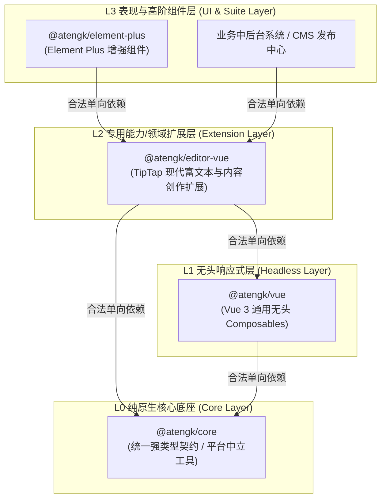
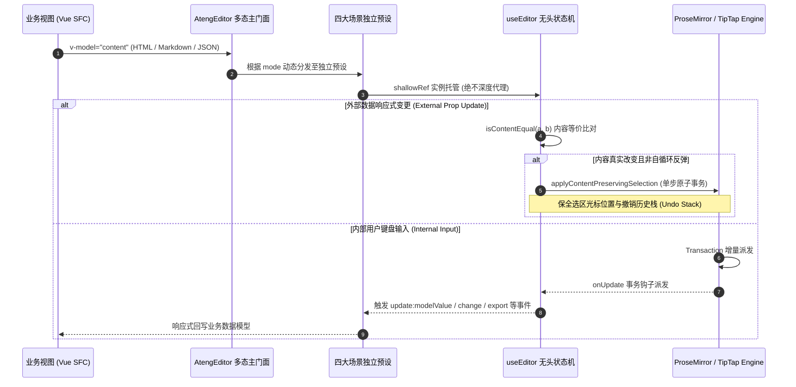
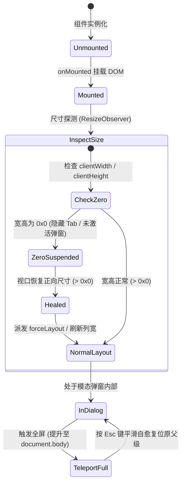

# @atengk/editor-vue 现代富文本与内容创作扩展套件

> 面向现代 Web 应用、知识库与发布系统的工业级 TipTap / ProseMirror 现代富文本与内容创作响应式扩展基础设施，归属于系统四层洋葱拓扑之 **L2 专用能力/领域扩展层**。遵循“纯 Vue 3 驱动、强类型契约、零具体 UI 依赖、确定性生命周期治理”设计，提供统一多态主门面、四大生产场景预设（Simple, Notion-like, DOCX, Agent）、全中文自适应微工具栏、表格人体工学、媒体资产直传拦截、选区气泡浮层、块级斜杠命令面板、字数硬限制、0x0 视口几何自愈、脱壳全屏穿透与纯前端 OpenXML Word 二进制安全导出。

---

## 0. 特性与公共 API 全景速查矩阵

| 特性分类       | 特性名称              | 核心门面 / 组件 / Hook                     | 关键参数 / Props / Emits                                                                  | 核心行为说明                                                                                                       | 锚定验证源头 (*Test / Sample)                                                                                                                                     |
| :------------- | :-------------------- | :----------------------------------------- | :---------------------------------------------------------------------------------------- | :----------------------------------------------------------------------------------------------------------------- | :---------------------------------------------------------------------------------------------------------------------------------------------------------------- |
| **表现容器**   | 富文本多态门面        | `AtengEditor`                              | `AtengEditorProps (mode, tools, dense) -> Expose`                                         | 统一多态主门面，通过 `mode` 动态分发 default/simple/notion/agent/docx 五大多态场景                                 | [PolymorphicEditor.test.ts](./test/PolymorphicEditor.test.ts) / [App.vue](../../apps/sample-editor-vue/src/App.vue)                                               |
| **场景预设**   | 经典轻量编辑器        | `AtengSimpleEditor`                        | `SimpleEditorProps (tools, dense) -> Expose`                                              | 经典轻量预设，标配自适应单行折叠工具栏与紧凑模式，严格隔离斜杠与浮层干扰                                           | [SimpleEditor.test.ts](./test/SimpleEditor.test.ts) / [SimpleEditorScenario.vue](../../apps/sample-editor-vue/src/scenarios/SimpleEditorScenario.vue)             |
| **场景预设**   | 知识库无界白板        | `AtengNotionEditor`                        | `NotionEditorProps (maxWidth) -> Expose`                                                  | 现代知识库预设，纯净无顶栏白板，标配六点手柄、斜杠命令、Callout 与 Toggle 物料                                     | [NotionEditor.test.ts](./test/NotionEditor.test.ts) / [NotionEditorScenario.vue](../../apps/sample-editor-vue/src/scenarios/NotionEditorScenario.vue)             |
| **场景预设**   | 智能创作协作预设      | `AtengAgentEditor`                         | `AgentEditorProps (aiStreamHandler, aiPromptBar) -> AgentEditorExpose`                    | 智能创作预设，标配双通道 AI 唤起、沉浸式 PromptBar（空行 Space / Ctrl+J 唤起）、行内原位对比审阅卡片与原子历史事务 | [AgentEditor.test.ts](./test/AgentEditor.test.ts) / [AgentEditorScenario.vue](../../apps/sample-editor-vue/src/scenarios/AgentEditorScenario.vue)                 |
| **场景预设**   | DOCX 物理排版预设     | `AtengDocxEditor`                          | `DocxEditorProps (orientation, pageMargin, headerAlign, footerAlign) -> DocxEditorExpose` | DOCX 物理排版预设，标配 A4 仿真纸张画布、动态断页槽、刻度标尺、双击交互式页眉页脚与 OpenXML 导出                   | [DocxEditor.test.ts](./test/DocxEditor.test.ts) / [DocxEditorScenario.vue](../../apps/sample-editor-vue/src/scenarios/DocxEditorScenario.vue)                     |
| **排版容器**   | A4 仿真纸张画布       | `AtengPageCanvas`                          | `AtengPageCanvasProps (orientation, pageMargin)`                                          | A4 物理仿真纸张容器，支持纵横向切换、多档页边距、高度实时测量与虚拟动态断页                                        | [DocxEditor.test.ts](./test/DocxEditor.test.ts) / [DocxEditorScenario.vue](../../apps/sample-editor-vue/src/scenarios/DocxEditorScenario.vue)                     |
| **排版工具**   | A4 物理边距与规格解析 | `resolvePageMargins / resolvePageSpecs`    | `(margin?, orientation?) -> ResolvedPageMargins`                                          | 标准化解析 mm/cm/in/px 为真实毫米与 Word Twip，统一驱动 PageCanvas 与 docx 导出                                    | [DocxEditor.test.ts](./test/DocxEditor.test.ts) / [DocxEditorScenario.vue](../../apps/sample-editor-vue/src/scenarios/DocxEditorScenario.vue)                     |
| **排版辅助**   | 毫米级刻度标尺        | `AtengPageRuler`                           | `AtengPageRulerProps (width, marginLeft, marginRight)`                                    | A4 毫米级刻度标尺，纯 SVG/CSS 绘制 cm/mm 刻度，标示可排版区域与左右页边距游标滑块                                  | [DocxEditor.test.ts](./test/DocxEditor.test.ts) / [DocxEditorScenario.vue](../../apps/sample-editor-vue/src/scenarios/DocxEditorScenario.vue)                     |
| **操作工具**   | 轻量微工具栏          | `AtengEditorToolbar`                       | `editor, disabled, isFullscreen`                                                          | 原生全中文排版操作栏，提供撤销/重做、标题、样式、列表、表格、代码、对齐、清除与全屏                                | [AtengEditor.test.ts](./test/AtengEditor.test.ts) / [BasicEditorScenario.vue](../../apps/sample-editor-vue/src/scenarios/BasicEditorScenario.vue)                 |
| **操作工具**   | 响应式折叠工具栏      | `AtengSimpleToolbar`                       | `AtengSimpleToolbarProps (tools, dense)`                                                  | 自适应单行工具栏，宽度不足时将次要按钮折叠入“更多 (•••)”菜单，支持声明式 tools 筛选                                | [SimpleEditor.test.ts](./test/SimpleEditor.test.ts) / [SimpleEditorScenario.vue](../../apps/sample-editor-vue/src/scenarios/SimpleEditorScenario.vue)             |
| **块级交互**   | 六点悬浮拖拽手柄      | `AtengDragHandle`                          | `AtengDragHandleProps -> #drag-handle, #block-menu`                                       | 原生 DOM/SVG 驱动块级手柄，贴合鼠标位置，支持拖拽重排与纯中文块级上下文菜单，100% 插槽倒置                         | [DragHandle.test.ts](./test/DragHandle.test.ts) / [NotionEditorScenario.vue](../../apps/sample-editor-vue/src/scenarios/NotionEditorScenario.vue)                 |
| **原生物料**   | 重点高亮强调卡片      | `CalloutBlock` 扩展                        | `CalloutBlockOptions (type, icon)`                                                        | 原生提示卡片物料，内置 info/warning/error/success 4 态语义高亮，支持 `>! ` 快捷输入与解包                          | [CalloutAndToggle.test.ts](./test/CalloutAndToggle.test.ts) / [NotionEditorScenario.vue](../../apps/sample-editor-vue/src/scenarios/NotionEditorScenario.vue)     |
| **原生物料**   | 交互式折叠列表        | `ToggleList` 扩展                          | `ToggleListOptions`                                                                       | 原生块级折叠列表物料，交互式展开/收起下属内容，保全撤销历史栈，支持 `>> ` 快捷输入                                 | [CalloutAndToggle.test.ts](./test/CalloutAndToggle.test.ts) / [NotionEditorScenario.vue](../../apps/sample-editor-vue/src/scenarios/NotionEditorScenario.vue)     |
| **AI 打字机**  | 打字机光标装饰扩展    | `AiStreamingExtension`                     | `AiStreamingOptions -> Commands`                                                          | 基于 ProseMirror Decoration 渲染闪烁竖线光标与呼吸高亮光晕，独立于真实文档树保全撤销历史栈                         | [AiStream.test.ts](./test/AiStream.test.ts) / [AgentEditorScenario.vue](../../apps/sample-editor-vue/src/scenarios/AgentEditorScenario.vue)                       |
| **AI 状态机**  | AI 流式无头 Hook      | `useAiStream(options)`                     | `UseAiStreamOptions -> UseAiStreamReturn`                                                 | 纯 Vue 3.5 无头响应式状态机，纳管 AbortController 中断、驱动 Decoration 光标并消费 SPI 流                          | [AiStream.test.ts](./test/AiStream.test.ts) / [AgentEditorScenario.vue](../../apps/sample-editor-vue/src/scenarios/AgentEditorScenario.vue)                       |
| **AI 唤起**    | 划选 AI 气泡菜单      | `AtengAiBubbleMenu`                        | `AtengAiBubbleMenuProps -> Emits`                                                         | 划选文本平滑跟随呼出，内置润色/扩写/精简/翻译/摘要预设与自定义提问输入                                             | [AgentEditor.test.ts](./test/AgentEditor.test.ts) / [AgentEditorScenario.vue](../../apps/sample-editor-vue/src/scenarios/AgentEditorScenario.vue)                 |
| **AI 唤起**    | 空白行沉浸提示条      | `AtengAiPromptBar`                         | `AtengAiPromptBarProps -> Emits`                                                          | 空白行聚焦沉浸呼出，支持自然语言提示词流式生成与快捷唤起                                                           | [AgentEditor.test.ts](./test/AgentEditor.test.ts) / [AgentEditorScenario.vue](../../apps/sample-editor-vue/src/scenarios/AgentEditorScenario.vue)                 |
| **AI 审阅**    | 行内原位对比卡片      | `AtengAiDiffCard`                          | `AtengAiDiffCardProps -> Emits`                                                           | 行内原位增删差异卡片，红绿高亮标示 Diff，提供【替换选区】/【插入下方】/【放弃重试】三态闭环                        | [AgentEditor.test.ts](./test/AgentEditor.test.ts) / [AgentEditorScenario.vue](../../apps/sample-editor-vue/src/scenarios/AgentEditorScenario.vue)                 |
| **AI 算法**    | 原生 LCS 文本比对     | `computeTextDiff(oldText, newText)`        | `(string, string) -> DiffChangeChunk[]`                                                   | 纯原生 LCS 动态规划算法，相邻分块合并优化，输出类型安全结构化差异切片                                              | [AgentEditor.test.ts](./test/AgentEditor.test.ts) / [AgentEditorScenario.vue](../../apps/sample-editor-vue/src/scenarios/AgentEditorScenario.vue)                 |
| **AI 协议**    | 离线打字机仿真器      | `createMockAiStreamHandler`                | `MockAiStreamHandlerOptions -> AiStreamHandler`                                           | 纯前端 100% 离线打字机 Mock 仿真器，模拟 30ms/字渐进式吐字，守护零网络泄露与离线单测                               | [AiStream.test.ts](./test/AiStream.test.ts) / [AgentEditorScenario.vue](../../apps/sample-editor-vue/src/scenarios/AgentEditorScenario.vue)                       |
| **上下文浮层** | 表格操控微菜单        | `AtengTableBubbleMenu`                     | `AtengTableBubbleMenuProps`                                                               | 光标进入表格单元格时自适应呼出，支持增删行列、单元格拆分合并与表头切换                                             | [TableErgonomics.test.ts](./test/TableErgonomics.test.ts) / [TableErgonomicsScenario.vue](../../apps/sample-editor-vue/src/scenarios/TableErgonomicsScenario.vue) |
| **上下文浮层** | 图片微浮层            | `AtengImageBubbleMenu`                     | `AtengImageBubbleMenuProps`                                                               | 光标选中图片时自适应激活，提供居左/居中/居右对齐与快速删除                                                         | [AssetUpload.test.ts](./test/AssetUpload.test.ts) / [AssetUploadScenario.vue](../../apps/sample-editor-vue/src/scenarios/AssetUploadScenario.vue)                 |
| **上下文浮层** | 超链接微浮层          | `AtengLinkBubbleMenu`                      | `AtengLinkBubbleMenuProps`                                                                | 光标位于超链接内时呼出，提供新标签页安全跳转、修改 URL 与取消链接                                                  | [AssetUpload.test.ts](./test/AssetUpload.test.ts) / [AssetUploadScenario.vue](../../apps/sample-editor-vue/src/scenarios/AssetUploadScenario.vue)                 |
| **划选浮层**   | 选区文本排版浮层      | `AtengBubbleMenu`                          | `AtengBubbleMenuProps`                                                                    | 划选任意文本时平滑跟随呼出，提供粗体、斜体、下划线、删除线、代码、高亮与超链接设置                                 | [SlashAndBubble.test.ts](./test/SlashAndBubble.test.ts) / [SlashAndBubbleScenario.vue](../../apps/sample-editor-vue/src/scenarios/SlashAndBubbleScenario.vue)     |
| **块级命令**   | 中文斜杠面板          | `AtengSlashCommand`                        | `AtengSlashCommandProps`                                                                  | 空行或输入 `/` 呼出 11 种块级物料选择器，支持键盘上下键选定、回车插入与 Esc 关闭                                   | [SlashAndBubble.test.ts](./test/SlashAndBubble.test.ts) / [SlashAndBubbleScenario.vue](../../apps/sample-editor-vue/src/scenarios/SlashAndBubbleScenario.vue)     |
| **底栏指示**   | 吸底状态栏            | `AtengStatusBar`                           | `AtengStatusBarProps`                                                                     | 实时计算纯文本字符数、词数与段落数，并在达到 maxLength 限制时触发红字告警                                          | [HardeningAndForm.test.ts](./test/HardeningAndForm.test.ts) / [FormValidationScenario.vue](../../apps/sample-editor-vue/src/scenarios/FormValidationScenario.vue) |
| **无头状态机** | 编辑器状态机 Hook     | `useEditor(options)`                       | `UseEditorOptions -> UseEditorReturn`                                                     | 纯 Vue 3.5 无头状态机，封装 TipTap 实例生命周期、多轨导出与命令调度                                                | [AtengEditor.test.ts](./test/AtengEditor.test.ts) / [BasicEditorScenario.vue](../../apps/sample-editor-vue/src/scenarios/BasicEditorScenario.vue)                 |
| **DOM 状态机** | 视口与全屏状态机      | `useEditorDom(options)`                    | `UseEditorDomOptions -> UseEditorDomReturn`                                               | 纳管脱壳全屏、ResizeObserver 0x0 视口几何自愈与 MutationObserver 暗黑热跟随                                        | [AtengEditor.test.ts](./test/AtengEditor.test.ts) / [DialogReadOnlyScenario.vue](../../apps/sample-editor-vue/src/scenarios/DialogReadOnlyScenario.vue)           |
| **扩展装配**   | 扩展预设装配器        | `createDefaultExtensions(options)`         | `CreateDefaultExtensionsOptions -> AnyExtension[]`                                        | 组装排名前 90% 的企业级扩展（StarterKit, Table, Upload, Markdown, CharacterCount 等）                              | [AtengEditor.test.ts](./test/AtengEditor.test.ts) / [BasicEditorScenario.vue](../../apps/sample-editor-vue/src/scenarios/BasicEditorScenario.vue)                 |
| **媒体直传**   | 资产上传拦截扩展      | `FileUploadExtension`                      | `FileUploadOptions -> Extension`                                                          | 拦截粘贴与拖拽文件，基于 ProseMirror 装饰器插入骨架加载占位块并原子置换图片                                        | [AssetUpload.test.ts](./test/AssetUpload.test.ts) / [AssetUploadScenario.vue](../../apps/sample-editor-vue/src/scenarios/AssetUploadScenario.vue)                 |
| **同步工具**   | 内容等价比对          | `isContentEqual(a, b)`                     | `(string, string) -> boolean`                                                             | 智能规整空段落与换行，阻断外部响应式反弹引起的自循环与光标跳动                                                     | [AtengEditor.test.ts](./test/AtengEditor.test.ts) / [BasicEditorScenario.vue](../../apps/sample-editor-vue/src/scenarios/BasicEditorScenario.vue)                 |
| **选区保护**   | 选区保全事务打补丁    | `applyContentPreservingSelection(...)`     | `(Editor, content, format, preserveSelection) -> void`                                    | 在外部数据更新时通过 ProseMirror Transaction 增量替换，保全光标与历史 Undo 栈                                      | [AtengEditor.test.ts](./test/AtengEditor.test.ts) / [BasicEditorScenario.vue](../../apps/sample-editor-vue/src/scenarios/BasicEditorScenario.vue)                 |
| **表格工具**   | 清空表格单元格内容    | `clearTableContent(editor)`                | `(CoreEditor) -> boolean`                                                                 | 确定性文档树变换，清空当前所在表格的所有单元格内容并保全行列几何排版结构                                           | [TableErgonomics.test.ts](./test/TableErgonomics.test.ts) / [TableErgonomicsScenario.vue](../../apps/sample-editor-vue/src/scenarios/TableErgonomicsScenario.vue) |
| **链接工具**   | 链接设置与安全解除    | `promptAndSetLink / unsetLinkSafe`         | `(Editor) -> void`                                                                        | 安全提示输入/移除超链接，自动前置扩选整段链接文本范围避免折叠光标残留                                              | [AssetUpload.test.ts](./test/AssetUpload.test.ts) / [AssetUploadScenario.vue](../../apps/sample-editor-vue/src/scenarios/AssetUploadScenario.vue)                 |
| **统计工具**   | 字符/词数/段落统计    | `getEditorCharacters / Words / Paragraphs` | `(Editor) -> number`                                                                      | 安全守卫 TipTap Storage 与 AST，空文档段落归零判定，统一供 Hook 与 StatusBar 复用                                  | [HardeningAndForm.test.ts](./test/HardeningAndForm.test.ts) / [FormValidationScenario.vue](../../apps/sample-editor-vue/src/scenarios/FormValidationScenario.vue) |
| **导出工具**   | 完整离线 HTML 文档    | `generateFullHtml(content, opts)`          | `(string, FullHtmlOptions) -> string`                                                     | 将 HTML 片段包装为包含完整文档头、主题与独立内联排版样式的完整网页，支持离线独立渲染                               | [AtengEditor.test.ts](./test/AtengEditor.test.ts) / [BasicEditorScenario.vue](../../apps/sample-editor-vue/src/scenarios/BasicEditorScenario.vue)                 |
| **导出工具**   | 纯前端 OpenXML 导出   | `prosemirrorJsonToDocxBlob(json, opts)`    | `(Record<string, unknown>, DocxExportOptions) -> Blob`                                    | 将 ProseMirror JSON 树直接转译为标准 Word (.docx) 二进制 Blob，支持标题、表格、边距与页眉页脚                      | [DocxExport.test.ts](./test/DocxExport.test.ts) / [DocxEditorScenario.vue](../../apps/sample-editor-vue/src/scenarios/DocxEditorScenario.vue)                     |
| **内存回收**   | 确定性文档下载        | `saveDocxFile(blob, fileName)`             | `(Blob, string) -> void`                                                                  | 触发客户端下载并通过 URL.revokeObjectURL 确定性释放内存句柄，彻底杜绝内存泄漏                                      | [DocxExport.test.ts](./test/DocxExport.test.ts) / [DocxEditorScenario.vue](../../apps/sample-editor-vue/src/scenarios/DocxEditorScenario.vue)                     |
| **门面代理**   | 统一 Expose 组装      | `createEditorExpose(target, opts)`         | `(Ref<AtengEditorExpose>, opts) -> AtengEditorExpose`                                     | 为预设包装组件提供受管透明委托代理，消除 Middle Man 样板重复并自动保全响应性                                       | [NotionEditor.test.ts](./test/NotionEditor.test.ts) / [SimpleEditorScenario.vue](../../apps/sample-editor-vue/src/scenarios/SimpleEditorScenario.vue)             |
| **标准物料**   | 默认斜杠物料清单      | `defaultSlashCommandItems`                 | `SlashCommandItem[]`                                                                      | 内置 11 种标准块级中文物料预设（标题 H1~H3、正文、列表、待办、引用、代码、表格、分割线）                           | [SlashAndBubble.test.ts](./test/SlashAndBubble.test.ts) / [SlashAndBubbleScenario.vue](../../apps/sample-editor-vue/src/scenarios/SlashAndBubbleScenario.vue)     |

---

## 1. 模块定位与 pnpm 坐标

`@atengk/editor-vue` 归属于 `ateng-ui` 基础设施套件的 **L2 专用能力/领域扩展层 (Extension Layer)**，专注于企业级现代富文本与内容创作响应式扩展。

- **npm 坐标**：`@atengk/editor-vue`
- **源码工程**：`packages/editor-vue`
- **自验展厅**：`apps/sample-editor-vue`（端口 `3009`）
- **依赖方向**：严格遵循四层洋葱拓扑单向无环依赖律，仅合法依赖 L0 (`@atengk/core`)、L1 (`@atengk/vue`) 与底层标准核心库（`@tiptap/*`、`docx`、`lowlight`），**绝对严禁逆向依赖 L3 `@atengk/element-plus`**，保持 100% UI 表现解耦；
- **微操作栏与具名插槽反转契约**：
  - 内部以 `.at-editor-*` 独立命名空间提供轻量自适应微工具栏（`AtengSimpleToolbar` / `AtengEditorToolbar`）与全套上下文气泡浮层（选区、表格、图片、超链接）；
  - 对外 100% 暴露具名插槽（`#toolbar`、`#bubble-menu`、`#table-menu`、`#drag-handle`、`#statusbar`），上层业务系统可无缝使用 Element Plus 控件或私有设计系统完全接管与反转定制；
- **镜像演进**：顶层架构规范解耦，预留未来 React 镜像包 `@atengk/editor-react`。

### 安装依赖

```bash
pnpm add @atengk/editor-vue @atengk/core @atengk/vue vue
```

### 引入基础样式

在项目入口文件（如 `main.ts`）或组件中引入样式：

```ts
import '@atengk/editor-vue/style.css';
```

### Peer Dependencies 契约基线

| 依赖包         | 兼容版本基线  | 推荐生产版本  | 作用域说明                                     |
| :------------- | :------------ | :------------ | :--------------------------------------------- |
| `vue`          | `>=3.5.0`     | `^3.5.44`     | Vue 原生响应式解构与泛型 SFC 核心驱动          |
| `@atengk/core` | `workspace:*` | `workspace:*` | 统一强类型契约、Axios 管道与平台中立底层工具库 |
| `@atengk/vue`  | `workspace:*` | `workspace:*` | 纯无头响应式状态机与通用 Composables 基础设施  |
| `Node.js`      | `>=20.18.0`   | `22.x LTS`    | 工程构建与运行环境基线                         |

---

## 2. 核心架构与设计不变量

### 2.1 四层洋葱拓扑定级图



### 2.2 TipTap 事务流转与多轨双向同步模型



### 2.3 0x0 视口几何自愈与脱壳全屏状态机



### 2.4 8 项工业级硬核设计不变量

立足于企业级富文本长期稳定性与高并发内容创作场景，`@atengk/editor-vue` 恪守以下 8 道不可逾越的工业级设计不变量：

1. **零深层代理防线 (Zero Deep-Proxy Invariant)**：
   - TipTap 与 ProseMirror 拥有极其复杂的文档树结构（`Doc/Node`）与事务调度系统。严禁将底层 Editor 实例传递给 Vue 的深度响应式 `ref()` 或 `reactive()`；
   - 内部统一采用 `shallowRef()` 与 `markRaw()` 进行实例托管，彻底阻断 Vue 递归依赖收集与 Proxy 属性劫持，杜绝大长文打字掉帧、光标卡顿与内存泄漏。
2. **多轨事务同步与光标防丢不变量 (Multi-Track Transaction Sync & Selection Preservation Invariant)**：
   - 编辑器支持 `v-model`（HTML）、`v-model:markdown` 与 `v-model:json` 多轨数据双向绑定；
   - 外部响应式数据下发时，前置执行 `isContentEqual` 智能比对（规整空段落与换行差异），若内容等价则直接阻断更新，消除“父组件回传 ➔ 编辑器重绘 ➔ 光标跳回文档首行”的死循环恶疾；
   - 真实需要更新时，统一采用 `applyContentPreservingSelection` 驱动 ProseMirror Transaction 增量替换，保全当前光标选区与完整的 Undo/Redo 历史栈。
3. **maxLength 纯文本底层事务硬拦截不变量 (Transaction Hard Limit Invariant)**：
   - 字数统计严格过滤 HTML 标签与结构节点，仅基于真实纯文本字符计算 `characters()`；
   - 达到 `maxLength` 设定阈值时，TipTap 底层事务拦截器将**在物理事件层面彻底丢弃后续物理按键输入与大段剪贴板粘贴**，从源头杜绝脏数据穿透；
   - 吸底状态栏 `<AtengStatusBar />` 实时变更为高危警告红字样式（`.is-limit-reached`）。
4. **撤销历史栈零污染不变量 (Zero Undo Stack Corruption Invariant)**：
   - AI 流式生成过程中，基于 ProseMirror 独立的 Decorations 渲染闪烁竖线光标与呼吸高亮光晕，不将每秒几十次的中间吐字过程频繁写入真实文档树，杜绝撤销历史栈被碎片字符冲垮；
   - 在 `<AiDiffCard />` 确认采纳替换、追加或外部数据同步时，统一执行单步原子事务（Transaction）写入，支持用户通过 `Ctrl + Z` 一键撤销整个生成结果。
5. **0x0 视口几何自愈不变量 (0x0 Viewport Geometric Self-Healing Invariant)**：
   - 当编辑器置于隐藏 `<el-tab-pane>`、折叠手风琴面板或初次未打开的 `<el-dialog>` 时，容器尺寸呈现 `0x0` 像素；
   - 内置 `ResizeObserver` 弹性感知尺寸从 0 到正常宽高的跃迁，毫秒级自动派发排版自愈事务，消除表格列宽坍塌与光标计算错位。
6. **脱壳全屏突破层级不变量 (Teleport Fullscreen Boundary Invariant)**：
   - 模态弹窗往往附带 CSS `transform` 或缩放动画，导致子元素的 `position: fixed` 被局部包含块劫持裁剪，无法真正铺满屏幕；
   - 本套件采用动态脱壳机制（`TeleportFullscreen`），进入全屏时将真实 DOM 提升至 `document.body` 顶层（`z-index: 3000`），退出全屏或按 `Esc` 键平滑自愈复位回原父节点。
7. **暗黑模式 0ms 热跟随不变量 (MutationObserver Hot Follow Boundary Invariant)**：
   - 内置 `MutationObserver` 监听宿主 `document.documentElement` 的 `dark` 类名变更；
   - 设计令牌完全映射 Element Plus 原生 CSS 变量（`--el-*`），主题切换时 0ms 零闪烁无损响应，零页面刷新、零编辑器重建。
8. **纯前端 OpenXML 导出与内存确定性回收不变量 (Pure Frontend OpenXML & Memory Revocation Invariant)**：
   - 纯前端解析 ProseMirror JSON 树并生成标准 Word (`.docx`) 二进制 Blob，支持段落、标题、表格、页边距与交互式页眉页脚；
   - 触发客户端下载后，通过定时器确定性调用 `URL.revokeObjectURL(url)` 回收临时内存句柄，彻底杜绝大文件重复导出造成的内存泄漏。

---

## 维度一：最小起步体验 (Happy Path)

### 3. 多态门面与高阶场景预设秒级分发

依据业务诉求，直接使用多态主门面 `<AtengEditor mode="..." />`，或引入四大开箱即用场景独立预设：

```vue
<script setup lang="ts">
import { ref } from 'vue';
import {
  AtengEditor,
  AtengSimpleEditor,
  AtengNotionEditor,
  AtengAgentEditor,
  AtengDocxEditor,
  createMockAiStreamHandler,
} from '@atengk/editor-vue';

const content = ref<string>('<p>欢迎体验现代富文本创作套件！</p>');
const currentMode = ref<'simple' | 'notion' | 'docx' | 'agent'>('simple');
const mockHandler = createMockAiStreamHandler();
</script>

<template>
  <!-- 方式一：多态主门面动态切换 -->
  <AtengEditor v-model="content" :mode="currentMode" :dense="true" />

  <!-- 方式二：经典轻量预设（单行自适应折叠工具栏、紧凑模式、隔离斜杠浮层） -->
  <AtengSimpleEditor
    v-model="content"
    :dense="true"
    :tools="['bold', 'italic', 'heading', 'bulletList', 'undo', 'redo']"
  />

  <!-- 方式三：知识库无界白板预设（纯净无顶栏、六点悬浮手柄、Callout 卡片、Toggle 列表与斜杠面板） -->
  <AtengNotionEditor v-model="content" max-width="860px" />

  <!-- 方式四：AI 智能创作预设（双通道唤起、打字机流式光标、行内 Diff 审阅卡片与原子事务保全） -->
  <AtengAgentEditor v-model="content" :ai-stream-handler="mockHandler" />

  <!-- 方式五：DOCX 物理排版预设（A4 仿真纸张、动态断页槽、刻度标尺、双击页眉页脚与 OpenXML 导出） -->
  <AtengDocxEditor
    v-model="content"
    orientation="portrait"
    page-margin="standard"
    :show-ruler="true"
    header="数字化转型指导意见"
    footer="绝密 · 内部流通"
  />
</template>
```

---

## 维度二：生产扩展接管 (Customization & Extensibility)

### 1. 自定义媒体资产直传 SPI (UploadHandler)

通过传入 `uploadHandler`，拦截剪贴板截图粘贴与外部拖拽文件，接入业务私有 OSS / MinIO 直传管道。未决期间使用 ProseMirror 装饰器插入骨架加载占位块，上传成功后平滑置换为图片：

```vue
<script setup lang="ts">
import { ref } from 'vue';
import { AtengEditor, type UploadHandler } from '@atengk/editor-vue';

const content = ref<string>('');

const customUploadHandler: UploadHandler = async (file: File) => {
  const formData = new FormData();
  formData.append('file', file);

  const res = await fetch('/api/oss/upload', {
    method: 'POST',
    body: formData,
    headers: {
      Authorization: `Bearer ${localStorage.getItem('token')}`,
    },
  });

  const data = await res.json();
  // 返回直传 URL 或对象
  return data.url;
};
</script>

<template>
  <AtengEditor v-model="content" :upload-handler="customUploadHandler" />
</template>
```

### 2. 全量表现层插槽反转定制 (#slots)

所有内置微工具栏与动态微浮层均支持具名插槽反转，业务视图可自由接入 Element Plus 控件或私有设计系统：

```vue
<template>
  <AtengEditor v-model="content">
    <!-- 自定义顶部工具栏 -->
    <template #toolbar="{ editor }">
      <div class="my-custom-toolbar">
        <el-button size="small" @click="editor?.chain().focus().toggleBold().run()">
          加粗
        </el-button>
      </div>
    </template>

    <!-- 自定义选区划词气泡 -->
    <template #bubble-menu="{ editor }">
      <div class="my-bubble-panel">
        <el-tag size="small">选区高频工具</el-tag>
      </div>
    </template>

    <!-- 自定义吸底状态栏 -->
    <template #statusbar="{ editor, characters, maxLength }">
      <div class="my-statusbar">
        <span>当前字数：{{ characters }} / {{ maxLength ?? '无限制' }}</span>
      </div>
    </template>
  </AtengEditor>
</template>
```

### 3. 纯前端 OpenXML Word (.docx) 导出接管

通过 `<AtengDocxEditor />` 暴露的 `exportDocx()` 门面或底层 `prosemirrorJsonToDocxBlob()` 转译器，零后端服务依赖在浏览器端直接生成 Word 二进制并确定性内存回收下载：

```vue
<script setup lang="ts">
import { ref } from 'vue';
import { AtengDocxEditor, type AtengDocxEditorInstance } from '@atengk/editor-vue';

const docxEditorRef = ref<AtengDocxEditorInstance | null>(null);
const content = ref<string>('<h1>企业数字化转型指导意见</h1><p>正文内容...</p>');

const handleExport = async () => {
  // 调用实例门面一键导出并下载
  await docxEditorRef.value?.exportDocx({
    fileName: '数字化转型意见.docx',
    orientation: 'portrait',
    pageMargin: 'standard',
    header: '发文字号：创发〔2026〕1024号',
    footer: '内部绝密 · 严禁翻印',
    showPageNumber: true,
  });
};
</script>

<template>
  <AtengDocxEditor ref="docxEditorRef" v-model="content" />
</template>
```

### 4. 自定义大模型通信 SPI 与 AI 流式状态机接管

通过传递自定义 `aiStreamHandler`，解耦接入业务内网大模型网关、SSE 或 WebSocket，支持流式光标渲染与行内审阅对比：

```vue
<script setup lang="ts">
import { ref } from 'vue';
import { AtengAgentEditor, type AiStreamHandler } from '@atengk/editor-vue';

const content = ref<string>('');

// 自定义大模型流式适配器
const customAiStreamHandler: AiStreamHandler = async function* ({ prompt, context, signal }) {
  const response = await fetch('/api/ai/chat-stream', {
    method: 'POST',
    headers: { 'Content-Type': 'application/json' },
    body: JSON.stringify({ prompt, context }),
    signal,
  });

  if (!response.body) return;
  const reader = response.body.getReader();
  const decoder = new TextDecoder();

  while (true) {
    const { done, value } = await reader.read();
    if (done) break;
    yield decoder.decode(value, { stream: true });
  }
};
</script>

<template>
  <AtengAgentEditor v-model="content" :ai-stream-handler="customAiStreamHandler" />
</template>
```

---

## 维度三：核心生产边界与非功能语义 (Production Boundary & Failure Modes)

1. **maxLength 事务硬拦截边界 (Transaction Hard Limit Invariant)**：
   - 过滤 HTML 标签与结构节点，严格基于纯文本字符计算 `characters()`；
   - 达到 `maxLength` 设定值时，TipTap / ProseMirror 底层事务将**彻底拦截后续物理键盘输入与外部剪贴板大段粘贴**，防范脏数据穿透；
   - 吸底状态栏 `<AtengStatusBar />` 实时变更为高危警告红字（`.is-limit-reached`）。
2. **脱壳全屏突破 Transform 裁剪 (Teleport Fullscreen Boundary)**：
   - 当编辑器被置于带有 CSS 缩放动画或 transform 的模态弹窗（如 `<el-dialog>` / `<el-drawer>`）时，常规 `position: fixed` 会被局部容器劫持裁剪；
   - 本套件的全屏切换采用动态脱壳机制，全屏时将真实 DOM 提升至 `document.body` 顶层（`z-index: 3000`），彻底摆脱弹窗边界约束，按 `Esc` 键平滑自愈复位回原父节点。
3. **0x0 隐藏几何自愈 (ResizeObserver Healing Boundary)**：
   - 处于隐藏 Tab、折叠面板或未开启弹窗中时，容器初始尺寸为 0x0；
   - 内置 `ResizeObserver` 弹性感知尺寸从 0 到可见宽高的跃迁，瞬间自动派发重绘事务，消除光标错位与表格列宽坍塌。
4. **暗黑模式 0ms 无损热跟随 (MutationObserver Hot Follow Boundary)**：
   - 内置 `MutationObserver` 监听宿主 `document.documentElement` 的 `dark` 类名变更；
   - 设计令牌完全映射 Element Plus 原生 CSS 变量（`--el-*`），主题切换时 0ms 无缝响应，零刷新零重置。
5. **双态解耦纪律 (Decoupled Disabled & ReadOnly Invariant)**：
   - `disabled`: 表单禁用态，保留输入框边框与工具栏灰色禁用态，阻止聚焦编辑；
   - `readOnly`: 纯净文章阅读态，移除边框与内外阴影，隐藏工具栏、全部上下文气泡浮层与状态栏，以优雅排版呈现阅读模式。
6. **撤销历史栈零污染与单次原子事务保全 (Zero Undo Corruption Invariant)**：
   - AI 流式打字生成过程中，基于 ProseMirror 独立 Decorations 渲染打字机光标与呼吸高亮光晕，不将中间百步吐字过程写入真实文档树，避免撤销栈（Undo Stack）被流式字符彻底冲垮；
   - 在 `<AiDiffCard />` 确认采纳替换或外部数据同步时，统一采用单次原子事务（Transaction）写入，彻底保全光标位置并支持单步一键撤销（Ctrl+Z）。
7. **100% 离线打字机仿真与零网络泄露 (Hermetic Offline AI Mock Invariant)**：
   - 内置 `createMockAiStreamHandler`，通过异步生成器模拟渐进吐字与 AbortSignal 中断，保障单元测试与自验展厅 100% 离线自洽，绝对杜绝向外部物理网络泄露敏感数据。
8. **A4 物理分页断页与确定性内存回收 (A4 Layout & ObjectURL Revocation Invariant)**：
   - 基于 `ResizeObserver` 动态计算可用排版高度，视觉上动态插入虚拟分页槽而非硬切碎 ProseMirror 节点，长表格与长段落智能跨页流畅滚动；
   - `@media print` 强制对齐真实 A4 物理纸张（`@page { size: A4; margin: 0; }`）；
   - `saveDocxFile` 触发客户端下载后，通过延迟定时器确定性调用 `URL.revokeObjectURL(url)` 回收临时句柄，彻底消除内存泄漏。

---

## 维度四：物理排版与代码全真验证 (Evergreen & Zero-Glitch)

本项目所有对外能力与用例均已在自验展厅与对抗单测中 100% 跑通闭环：

### 1. 本地单测全量回归 (15 套件 / 105 用例全绿)

```bash
pnpm --filter @atengk/editor-vue test
```

### 2. 本地静态类型与代码规范检查

```bash
pnpm --filter @atengk/editor-vue --filter sample-editor-vue typecheck && \
pnpm --filter @atengk/editor-vue --filter sample-editor-vue lint
```

### 3. 运行 1:1 真实自验展厅

```bash
pnpm --filter sample-editor-vue dev
```

展厅包含顶级四大场景模板与二级工程自验抽屉：

- **四大核心模板一级大导航**：
  - **[Simple editor] 经典轻量自适应编辑器**：单行折叠微工具栏、紧凑模式、严格隔离斜杠与浮层干扰；
  - **[Notion-like editor] 现代无界知识库白板**：原生六点悬浮手柄、Callout 4 态语义卡片、Toggle 折叠列表与斜杠面板；
  - **[DOCX editor] A4 物理分页与公文排版预设**：物理纸张阴影、纵横向切换、厘米标尺、双击页眉页脚与纯前端 OpenXML 导出；
  - **[Agent editor] AI 智能创作与行内审阅预设**：划词浮动气泡、空白行提示条、流式光标与 AiDiffCard 增删对比审阅卡片。
- **右侧工程自验抽屉（6 大极限边缘场景）**：
  - 表单联动校验与 maxLength 事务硬拦截；
  - 模态弹窗 0x0 视口几何自愈与脱壳全屏穿透；
  - 表格操控、列宽拖拽与单元格合并拆分；
  - 媒体资产上传拦截 SPI 与骨架加载占位；
  - 选区高频排版气泡与斜杠物料选择器；
  - 纯净阅读模式与暗黑主题 0ms 热跟随。
