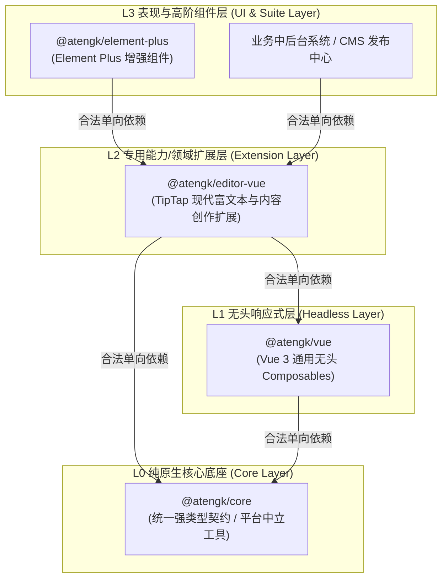
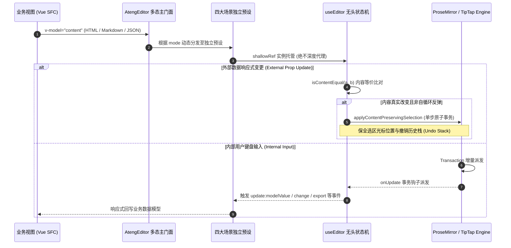
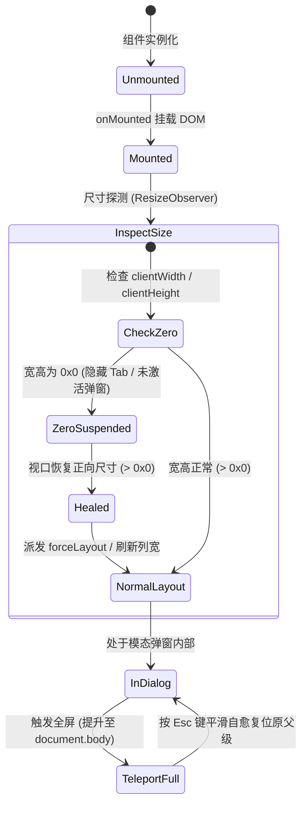

# @atengk/editor-vue 现代富文本与内容创作扩展套件

> 面向现代 Web 应用、知识库与发布系统的工业级 TipTap / ProseMirror 现代富文本与内容创作响应式扩展基础设施，归属于系统四层洋葱拓扑之 **L2 专用能力/领域扩展层**。遵循“纯 Vue 3 驱动、强类型契约、零具体 UI 依赖、确定性生命周期治理”设计，提供统一多态主门面、四大生产场景预设（Simple, Notion-like, DOCX, Agent）、全中文自适应微工具栏、表格人体工学、媒体资产直传拦截、选区气泡浮层、块级斜杠命令面板、字数硬限制、0x0 视口几何自愈、脱壳全屏穿透与纯前端 OpenXML Word 二进制安全导出。

---

## 0. 特性与公共 API 全景速查矩阵

| 特性分类       | 特性名称              | 核心门面 / 组件 / Hook                     | 关键参数 / Props / Emits                                                                  | 核心行为说明                                                                                                       | 锚定验证源头 (*Test / Sample)                                                                                                                                     |
| :------------- | :-------------------- | :----------------------------------------- | :---------------------------------------------------------------------------------------- | :----------------------------------------------------------------------------------------------------------------- | :---------------------------------------------------------------------------------------------------------------------------------------------------------------- |
| **表现容器**   | 富文本多态门面        | `AtengEditor`                              | `AtengEditorProps (mode, tools, dense) -> Expose`                                         | 统一多态主门面，通过 `mode` 动态分发 default/simple/notion/agent/docx 五大多态场景                                 | [PolymorphicEditor.test.ts](./test/PolymorphicEditor.test.ts) / [App.vue](../../apps/sample-editor-vue/src/App.vue)                                               |
| **场景预设**   | 经典轻量编辑器        | `AtengSimpleEditor`                        | `SimpleEditorProps (tools, dense) -> Expose`                                              | 经典轻量预设，标配自适应单行折叠工具栏与紧凑模式，严格隔离斜杠与浮层干扰                                           | [SimpleEditor.test.ts](./test/SimpleEditor.test.ts) / [SimpleEditorScenario.vue](../../apps/sample-editor-vue/src/scenarios/SimpleEditorScenario.vue)             |
| **场景预设**   | 知识库无界白板        | `AtengNotionEditor`                        | `NotionEditorProps (maxWidth) -> Expose`                                                  | 现代知识库预设，纯净无顶栏白板，标配六点手柄、斜杠命令、Callout 与 Toggle 物料                                     | [NotionEditor.test.ts](./test/NotionEditor.test.ts) / [NotionEditorScenario.vue](../../apps/sample-editor-vue/src/scenarios/NotionEditorScenario.vue)             |
| **场景预设**   | 智能创作协作预设      | `AtengAgentEditor`                         | `AgentEditorProps (aiStreamHandler, aiPromptBar) -> AgentEditorExpose`                    | 智能创作预设，标配双通道 AI 唤起、沉浸式 PromptBar（空行 Space / Ctrl+J 唤起）、行内原位对比审阅卡片与原子历史事务 | [AgentEditor.test.ts](./test/AgentEditor.test.ts) / [AgentEditorScenario.vue](../../apps/sample-editor-vue/src/scenarios/AgentEditorScenario.vue)                 |
| **场景预设**   | DOCX 物理排版预设     | `AtengDocxEditor`                          | `DocxEditorProps (orientation, pageMargin, headerAlign, footerAlign) -> DocxEditorExpose` | DOCX 物理排版预设，标配 A4 仿真纸张画布、动态断页槽、刻度标尺、双击交互式页眉页脚与 OpenXML 导出                   | [DocxEditor.test.ts](./test/DocxEditor.test.ts) / [DocxEditorScenario.vue](../../apps/sample-editor-vue/src/scenarios/DocxEditorScenario.vue)                     |
| **排版容器**   | A4 仿真纸张画布       | `AtengPageCanvas`                          | `AtengPageCanvasProps (orientation, pageMargin)`                                          | A4 物理仿真纸张容器，支持纵横向切换、多档页边距、高度实时测量与虚拟动态断页                                        | [DocxEditor.test.ts](./test/DocxEditor.test.ts) / [DocxEditorScenario.vue](../../apps/sample-editor-vue/src/scenarios/DocxEditorScenario.vue)                     |
| **排版工具**   | A4 物理边距与规格解析 | `resolvePageMargins / resolvePageSpecs`    | `(margin?, orientation?) -> ResolvedPageMargins`                                          | 标准化解析 mm/cm/in/px 为真实毫米与 Word Twip，统一驱动 PageCanvas 与 docx 导出                                    | [DocxEditor.test.ts](./test/DocxEditor.test.ts) / [DocxEditorScenario.vue](../../apps/sample-editor-vue/src/scenarios/DocxEditorScenario.vue)                     |
| **排版辅助**   | 毫米级刻度标尺        | `AtengPageRuler`                           | `AtengPageRulerProps (width, marginLeft, marginRight)`                                    | A4 毫米级刻度标尺，纯 SVG/CSS 绘制 cm/mm 刻度，标示可排版区域与左右页边距游标滑块                                  | [DocxEditor.test.ts](./test/DocxEditor.test.ts) / [DocxEditorScenario.vue](../../apps/sample-editor-vue/src/scenarios/DocxEditorScenario.vue)                     |
| **操作工具**   | 轻量微工具栏          | `AtengEditorToolbar`                       | `editor, disabled, isFullscreen`                                                          | 原生全中文排版操作栏，提供撤销/重做、标题、样式、列表、表格、代码、对齐、清除与全屏                                | [AtengEditor.test.ts](./test/AtengEditor.test.ts) / [BasicEditorScenario.vue](../../apps/sample-editor-vue/src/scenarios/BasicEditorScenario.vue)                 |
| **操作工具**   | 响应式折叠工具栏      | `AtengSimpleToolbar`                       | `AtengSimpleToolbarProps (tools, dense)`                                                  | 自适应单行工具栏，宽度不足时将次要按钮折叠入“更多 (•••)”菜单，支持声明式 tools 筛选                                | [SimpleEditor.test.ts](./test/SimpleEditor.test.ts) / [SimpleEditorScenario.vue](../../apps/sample-editor-vue/src/scenarios/SimpleEditorScenario.vue)             |
| **块级交互**   | 六点悬浮拖拽手柄      | `AtengDragHandle`                          | `AtengDragHandleProps -> #drag-handle, #block-menu`                                       | 原生 DOM/SVG 驱动块级手柄，贴合鼠标位置，支持拖拽重排与纯中文块级上下文菜单，100% 插槽倒置                         | [DragHandle.test.ts](./test/DragHandle.test.ts) / [NotionEditorScenario.vue](../../apps/sample-editor-vue/src/scenarios/NotionEditorScenario.vue)                 |
| **原生物料**   | 重点高亮强调卡片      | `CalloutBlock` 扩展                        | `CalloutBlockOptions (type, icon)`                                                        | 原生提示卡片物料，内置 info/warning/error/success 4 态语义高亮，支持 `>! ` 快捷输入与解包                          | [CalloutAndToggle.test.ts](./test/CalloutAndToggle.test.ts) / [NotionEditorScenario.vue](../../apps/sample-editor-vue/src/scenarios/NotionEditorScenario.vue)     |
| **原生物料**   | 交互式折叠列表        | `ToggleList` 扩展                          | `ToggleListOptions`                                                                       | 原生块级折叠列表物料，交互式展开/收起下属内容，保全撤销历史栈，支持 `>> ` 快捷输入                                 | [CalloutAndToggle.test.ts](./test/CalloutAndToggle.test.ts) / [NotionEditorScenario.vue](../../apps/sample-editor-vue/src/scenarios/NotionEditorScenario.vue)     |
| **AI 打字机**  | 打字机光标装饰扩展    | `AiStreamingExtension`                     | `AiStreamingOptions -> Commands`                                                          | 基于 ProseMirror Decoration 渲染闪烁竖线光标与呼吸高亮光晕，独立于真实文档树保全撤销历史栈                         | [AiStream.test.ts](./test/AiStream.test.ts) / [AgentEditorScenario.vue](../../apps/sample-editor-vue/src/scenarios/AgentEditorScenario.vue)                       |
| **AI 状态机**  | AI 流式无头 Hook      | `useAiStream(options)`                     | `UseAiStreamOptions -> UseAiStreamReturn`                                                 | 纯 Vue 3.5 无头响应式状态机，纳管 AbortController 中断、驱动 Decoration 光标并消费 SPI 流                          | [AiStream.test.ts](./test/AiStream.test.ts) / [AgentEditorScenario.vue](../../apps/sample-editor-vue/src/scenarios/AgentEditorScenario.vue)                       |
| **AI 唤起**    | 划选 AI 气泡菜单      | `AtengAiBubbleMenu`                        | `AtengAiBubbleMenuProps -> Emits`                                                         | 划选文本平滑跟随呼出，内置润色/扩写/精简/翻译/摘要预设与自定义提问输入                                             | [AgentEditor.test.ts](./test/AgentEditor.test.ts) / [AgentEditorScenario.vue](../../apps/sample-editor-vue/src/scenarios/AgentEditorScenario.vue)                 |
| **AI 唤起**    | 空白行沉浸提示条      | `AtengAiPromptBar`                         | `AtengAiPromptBarProps -> Emits`                                                          | 空白行聚焦沉浸呼出，支持自然语言提示词流式生成与快捷唤起                                                           | [AgentEditor.test.ts](./test/AgentEditor.test.ts) / [AgentEditorScenario.vue](../../apps/sample-editor-vue/src/scenarios/AgentEditorScenario.vue)                 |
| **AI 审阅**    | 行内原位对比卡片      | `AtengAiDiffCard`                          | `AtengAiDiffCardProps -> Emits`                                                           | 行内原位增删差异卡片，红绿高亮标示 Diff，提供【替换选区】/【插入下方】/【放弃重试】三态闭环                        | [AgentEditor.test.ts](./test/AgentEditor.test.ts) / [AgentEditorScenario.vue](../../apps/sample-editor-vue/src/scenarios/AgentEditorScenario.vue)                 |
| **AI 算法**    | 原生 LCS 文本比对     | `computeTextDiff(oldText, newText)`        | `(string, string) -> DiffChangeChunk[]`                                                   | 纯原生 LCS 动态规划算法，相邻分块合并优化，输出类型安全结构化差异切片                                              | [AgentEditor.test.ts](./test/AgentEditor.test.ts) / [AgentEditorScenario.vue](../../apps/sample-editor-vue/src/scenarios/AgentEditorScenario.vue)                 |
| **AI 协议**    | 离线打字机仿真器      | `createMockAiStreamHandler`                | `MockAiStreamHandlerOptions -> AiStreamHandler`                                           | 纯前端 100% 离线打字机 Mock 仿真器，模拟 30ms/字渐进式吐字，守护零网络泄露与离线单测                               | [AiStream.test.ts](./test/AiStream.test.ts) / [AgentEditorScenario.vue](../../apps/sample-editor-vue/src/scenarios/AgentEditorScenario.vue)                       |
| **上下文浮层** | 表格操控微菜单        | `AtengTableBubbleMenu`                     | `AtengTableBubbleMenuProps`                                                               | 光标进入表格单元格时自适应呼出，支持增删行列、单元格拆分合并与表头切换                                             | [TableErgonomics.test.ts](./test/TableErgonomics.test.ts) / [TableErgonomicsScenario.vue](../../apps/sample-editor-vue/src/scenarios/TableErgonomicsScenario.vue) |
| **上下文浮层** | 图片微浮层            | `AtengImageBubbleMenu`                     | `AtengImageBubbleMenuProps`                                                               | 光标选中图片时自适应激活，提供居左/居中/居右对齐与快速删除                                                         | [AssetUpload.test.ts](./test/AssetUpload.test.ts) / [AssetUploadScenario.vue](../../apps/sample-editor-vue/src/scenarios/AssetUploadScenario.vue)                 |
| **上下文浮层** | 超链接微浮层          | `AtengLinkBubbleMenu`                      | `AtengLinkBubbleMenuProps`                                                                | 光标位于超链接内时呼出，提供新标签页安全跳转、修改 URL 与取消链接                                                  | [AssetUpload.test.ts](./test/AssetUpload.test.ts) / [AssetUploadScenario.vue](../../apps/sample-editor-vue/src/scenarios/AssetUploadScenario.vue)                 |
| **划选浮层**   | 选区文本排版浮层      | `AtengBubbleMenu`                          | `AtengBubbleMenuProps`                                                                    | 划选任意文本时平滑跟随呼出，提供粗体、斜体、下划线、删除线、代码、高亮与超链接设置                                 | [SlashAndBubble.test.ts](./test/SlashAndBubble.test.ts) / [SlashAndBubbleScenario.vue](../../apps/sample-editor-vue/src/scenarios/SlashAndBubbleScenario.vue)     |
| **块级命令**   | 中文斜杠面板          | `AtengSlashCommand`                        | `AtengSlashCommandProps`                                                                  | 空行或输入 `/` 呼出 11 种块级物料选择器，支持键盘上下键选定、回车插入与 Esc 关闭                                   | [SlashAndBubble.test.ts](./test/SlashAndBubble.test.ts) / [SlashAndBubbleScenario.vue](../../apps/sample-editor-vue/src/scenarios/SlashAndBubbleScenario.vue)     |
| **底栏指示**   | 吸底状态栏            | `AtengStatusBar`                           | `AtengStatusBarProps`                                                                     | 实时计算纯文本字符数、词数与段落数，并在达到 maxLength 限制时触发红字告警                                          | [HardeningAndForm.test.ts](./test/HardeningAndForm.test.ts) / [FormValidationScenario.vue](../../apps/sample-editor-vue/src/scenarios/FormValidationScenario.vue) |
| **无头状态机** | 编辑器状态机 Hook     | `useEditor(options)`                       | `UseEditorOptions -> UseEditorReturn`                                                     | 纯 Vue 3.5 无头状态机，封装 TipTap 实例生命周期、多轨导出与命令调度                                                | [AtengEditor.test.ts](./test/AtengEditor.test.ts) / [BasicEditorScenario.vue](../../apps/sample-editor-vue/src/scenarios/BasicEditorScenario.vue)                 |
| **DOM 状态机** | 视口与全屏状态机      | `useEditorDom(options)`                    | `UseEditorDomOptions -> UseEditorDomReturn`                                               | 纳管脱壳全屏、ResizeObserver 0x0 视口几何自愈与 MutationObserver 暗黑热跟随                                        | [AtengEditor.test.ts](./test/AtengEditor.test.ts) / [DialogReadOnlyScenario.vue](../../apps/sample-editor-vue/src/scenarios/DialogReadOnlyScenario.vue)           |
| **扩展装配**   | 扩展预设装配器        | `createDefaultExtensions(options)`         | `CreateDefaultExtensionsOptions -> AnyExtension[]`                                        | 组装排名前 90% 的企业级扩展（StarterKit, Table, Upload, Markdown, CharacterCount 等）                              | [AtengEditor.test.ts](./test/AtengEditor.test.ts) / [BasicEditorScenario.vue](../../apps/sample-editor-vue/src/scenarios/BasicEditorScenario.vue)                 |
| **媒体直传**   | 资产上传拦截扩展      | `FileUploadExtension`                      | `FileUploadOptions -> Extension`                                                          | 拦截粘贴与拖拽文件，基于 ProseMirror 装饰器插入骨架加载占位块并原子置换图片                                        | [AssetUpload.test.ts](./test/AssetUpload.test.ts) / [AssetUploadScenario.vue](../../apps/sample-editor-vue/src/scenarios/AssetUploadScenario.vue)                 |
| **同步工具**   | 内容等价比对          | `isContentEqual(a, b)`                     | `(string, string) -> boolean`                                                             | 智能规整空段落与换行，阻断外部响应式反弹引起的自循环与光标跳动                                                     | [AtengEditor.test.ts](./test/AtengEditor.test.ts) / [BasicEditorScenario.vue](../../apps/sample-editor-vue/src/scenarios/BasicEditorScenario.vue)                 |
| **选区保护**   | 选区保全事务打补丁    | `applyContentPreservingSelection(...)`     | `(Editor, content, format, preserveSelection) -> void`                                    | 在外部数据更新时通过 ProseMirror Transaction 增量替换，保全光标与历史 Undo 栈                                      | [AtengEditor.test.ts](./test/AtengEditor.test.ts) / [BasicEditorScenario.vue](../../apps/sample-editor-vue/src/scenarios/BasicEditorScenario.vue)                 |
| **表格工具**   | 清空表格单元格内容    | `clearTableContent(editor)`                | `(CoreEditor) -> boolean`                                                                 | 确定性文档树变换，清空当前所在表格的所有单元格内容并保全行列几何排版结构                                           | [TableErgonomics.test.ts](./test/TableErgonomics.test.ts) / [TableErgonomicsScenario.vue](../../apps/sample-editor-vue/src/scenarios/TableErgonomicsScenario.vue) |
| **链接工具**   | 链接设置与安全解除    | `promptAndSetLink / unsetLinkSafe`         | `(Editor) -> void`                                                                        | 安全提示输入/移除超链接，自动前置扩选整段链接文本范围避免折叠光标残留                                              | [AssetUpload.test.ts](./test/AssetUpload.test.ts) / [AssetUploadScenario.vue](../../apps/sample-editor-vue/src/scenarios/AssetUploadScenario.vue)                 |
| **统计工具**   | 字符/词数/段落统计    | `getEditorCharacters / Words / Paragraphs` | `(Editor) -> number`                                                                      | 安全守卫 TipTap Storage 与 AST，空文档段落归零判定，统一供 Hook 与 StatusBar 复用                                  | [HardeningAndForm.test.ts](./test/HardeningAndForm.test.ts) / [FormValidationScenario.vue](../../apps/sample-editor-vue/src/scenarios/FormValidationScenario.vue) |
| **导出工具**   | 完整离线 HTML 文档    | `generateFullHtml(content, opts)`          | `(string, FullHtmlOptions) -> string`                                                     | 将 HTML 片段包装为包含完整文档头、主题与独立内联排版样式的完整网页，支持离线独立渲染                               | [AtengEditor.test.ts](./test/AtengEditor.test.ts) / [BasicEditorScenario.vue](../../apps/sample-editor-vue/src/scenarios/BasicEditorScenario.vue)                 |
| **导出工具**   | 纯前端 OpenXML 导出   | `prosemirrorJsonToDocxBlob(json, opts)`    | `(Record<string, unknown>, DocxExportOptions) -> Blob`                                    | 将 ProseMirror JSON 树直接转译为标准 Word (.docx) 二进制 Blob，支持标题、表格、边距与页眉页脚                      | [DocxExport.test.ts](./test/DocxExport.test.ts) / [DocxEditorScenario.vue](../../apps/sample-editor-vue/src/scenarios/DocxEditorScenario.vue)                     |
| **内存回收**   | 确定性文档下载        | `saveDocxFile(blob, fileName)`             | `(Blob, string) -> void`                                                                  | 触发客户端下载并通过 URL.revokeObjectURL 确定性释放内存句柄，彻底杜绝内存泄漏                                      | [DocxExport.test.ts](./test/DocxExport.test.ts) / [DocxEditorScenario.vue](../../apps/sample-editor-vue/src/scenarios/DocxEditorScenario.vue)                     |
| **门面代理**   | 统一 Expose 组装      | `createEditorExpose(target, opts)`         | `(Ref<AtengEditorExpose>, opts) -> AtengEditorExpose`                                     | 为预设包装组件提供受管透明委托代理，消除 Middle Man 样板重复并自动保全响应性                                       | [NotionEditor.test.ts](./test/NotionEditor.test.ts) / [SimpleEditorScenario.vue](../../apps/sample-editor-vue/src/scenarios/SimpleEditorScenario.vue)             |
| **标准物料**   | 默认斜杠物料清单      | `defaultSlashCommandItems`                 | `SlashCommandItem[]`                                                                      | 内置 11 种标准块级中文物料预设（标题 H1~H3、正文、列表、待办、引用、代码、表格、分割线）                           | [SlashAndBubble.test.ts](./test/SlashAndBubble.test.ts) / [SlashAndBubbleScenario.vue](../../apps/sample-editor-vue/src/scenarios/SlashAndBubbleScenario.vue)     |

---

## 1. 模块定位与 pnpm 坐标

`@atengk/editor-vue` 归属于 `ateng-ui` 基础设施套件的 **L2 专用能力/领域扩展层 (Extension Layer)**，专注于企业级现代富文本与内容创作响应式扩展。

- **npm 坐标**：`@atengk/editor-vue`
- **源码工程**：`packages/editor-vue`
- **自验展厅**：`apps/sample-editor-vue`（端口 `3009`）
- **依赖方向**：严格遵循四层洋葱拓扑单向无环依赖律，仅合法依赖 L0 (`@atengk/core`)、L1 (`@atengk/vue`) 与底层标准核心库（`@tiptap/*`、`docx`、`lowlight`），**绝对严禁逆向依赖 L3 `@atengk/element-plus`**，保持 100% UI 表现解耦；
- **微操作栏与具名插槽反转契约**：
  - 内部以 `.at-editor-*` 独立命名空间提供轻量自适应微工具栏（`AtengSimpleToolbar` / `AtengEditorToolbar`）与全套上下文气泡浮层（选区、表格、图片、超链接）；
  - 对外 100% 暴露具名插槽（`#toolbar`、`#bubble-menu`、`#table-menu`、`#drag-handle`、`#statusbar`），上层业务系统可无缝使用 Element Plus 控件或私有设计系统完全接管与反转定制；
- **镜像演进**：顶层架构规范解耦，预留未来 React 镜像包 `@atengk/editor-react`。

### 安装依赖

```bash
pnpm add @atengk/editor-vue @atengk/core @atengk/vue vue
```

### 引入基础样式

在项目入口文件（如 `main.ts`）或组件中引入样式：

```ts
import '@atengk/editor-vue/style.css';
```

### Peer Dependencies 契约基线

| 依赖包         | 兼容版本基线  | 推荐生产版本  | 作用域说明                                     |
| :------------- | :------------ | :------------ | :--------------------------------------------- |
| `vue`          | `>=3.5.0`     | `^3.5.44`     | Vue 原生响应式解构与泛型 SFC 核心驱动          |
| `@atengk/core` | `workspace:*` | `workspace:*` | 统一强类型契约、Axios 管道与平台中立底层工具库 |
| `@atengk/vue`  | `workspace:*` | `workspace:*` | 纯无头响应式状态机与通用 Composables 基础设施  |
| `Node.js`      | `>=20.18.0`   | `22.x LTS`    | 工程构建与运行环境基线                         |

---

## 2. 核心架构与设计不变量

### 2.1 四层洋葱拓扑定级图



### 2.2 TipTap 事务流转与多轨双向同步模型



### 2.3 0x0 视口几何自愈与脱壳全屏状态机



### 2.4 8 项工业级硬核设计不变量

立足于企业级富文本长期稳定性与高并发内容创作场景，`@atengk/editor-vue` 恪守以下 8 道不可逾越的工业级设计不变量：

1. **零深层代理防线 (Zero Deep-Proxy Invariant)**：
   - TipTap 与 ProseMirror 拥有极其复杂的文档树结构（`Doc/Node`）与事务调度系统。严禁将底层 Editor 实例传递给 Vue 的深度响应式 `ref()` 或 `reactive()`；
   - 内部统一采用 `shallowRef()` 与 `markRaw()` 进行实例托管，彻底阻断 Vue 递归依赖收集与 Proxy 属性劫持，杜绝大长文打字掉帧、光标卡顿与内存泄漏。
2. **多轨事务同步与光标防丢不变量 (Multi-Track Transaction Sync & Selection Preservation Invariant)**：
   - 编辑器支持 `v-model`（HTML）、`v-model:markdown` 与 `v-model:json` 多轨数据双向绑定；
   - 外部响应式数据下发时，前置执行 `isContentEqual` 智能比对（规整空段落与换行差异），若内容等价则直接阻断更新，消除“父组件回传 ➔ 编辑器重绘 ➔ 光标跳回文档首行”的死循环恶疾；
   - 真实需要更新时，统一采用 `applyContentPreservingSelection` 驱动 ProseMirror Transaction 增量替换，保全当前光标选区与完整的 Undo/Redo 历史栈。
3. **maxLength 纯文本底层事务硬拦截不变量 (Transaction Hard Limit Invariant)**：
   - 字数统计严格过滤 HTML 标签与结构节点，仅基于真实纯文本字符计算 `characters()`；
   - 达到 `maxLength` 设定阈值时，TipTap 底层事务拦截器将**在物理事件层面彻底丢弃后续物理按键输入与大段剪贴板粘贴**，从源头杜绝脏数据穿透；
   - 吸底状态栏 `<AtengStatusBar />` 实时变更为高危警告红字样式（`.is-limit-reached`）。
4. **撤销历史栈零污染不变量 (Zero Undo Stack Corruption Invariant)**：
   - AI 流式生成过程中，基于 ProseMirror 独立的 Decorations 渲染闪烁竖线光标与呼吸高亮光晕，不将每秒几十次的中间吐字过程频繁写入真实文档树，杜绝撤销历史栈被碎片字符冲垮；
   - 在 `<AiDiffCard />` 确认采纳替换、追加或外部数据同步时，统一执行单步原子事务（Transaction）写入，支持用户通过 `Ctrl + Z` 一键撤销整个生成结果。
5. **0x0 视口几何自愈不变量 (0x0 Viewport Geometric Self-Healing Invariant)**：
   - 当编辑器置于隐藏 `<el-tab-pane>`、折叠手风琴面板或初次未打开的 `<el-dialog>` 时，容器尺寸呈现 `0x0` 像素；
   - 内置 `ResizeObserver` 弹性感知尺寸从 0 到正常宽高的跃迁，毫秒级自动派发排版自愈事务，消除表格列宽坍塌与光标计算错位。
6. **脱壳全屏突破层级不变量 (Teleport Fullscreen Boundary Invariant)**：
   - 模态弹窗往往附带 CSS `transform` 或缩放动画，导致子元素的 `position: fixed` 被局部包含块劫持裁剪，无法真正铺满屏幕；
   - 本套件采用动态脱壳机制（`TeleportFullscreen`），进入全屏时将真实 DOM 提升至 `document.body` 顶层（`z-index: 3000`），退出全屏或按 `Esc` 键平滑自愈复位回原父节点。
7. **暗黑模式 0ms 热跟随不变量 (MutationObserver Hot Follow Boundary Invariant)**：
   - 内置 `MutationObserver` 监听宿主 `document.documentElement` 的 `dark` 类名变更；
   - 设计令牌完全映射 Element Plus 原生 CSS 变量（`--el-*`），主题切换时 0ms 零闪烁无损响应，零页面刷新、零编辑器重建。
8. **纯前端 OpenXML 导出与内存确定性回收不变量 (Pure Frontend OpenXML & Memory Revocation Invariant)**：
   - 纯前端解析 ProseMirror JSON 树并生成标准 Word (`.docx`) 二进制 Blob，支持段落、标题、表格、页边距与交互式页眉页脚；
   - 触发客户端下载后，通过定时器确定性调用 `URL.revokeObjectURL(url)` 回收临时内存句柄，彻底杜绝大文件重复导出造成的内存泄漏。

---

## 3. 经典轻量编辑器与响应式微工具栏套件

经典轻量预设（Simple Editor）专为**常规中后台业务表单**、**审批流补充备注**、**工单沟通记录**与**博客内容发布**设计。核心追求“单行自适应工具栏防折行、隔离斜杠浮层防打扰、紧凑模式适配抽屉栅格”。

### 3.1 经典轻量自适应预设 (AtengSimpleEditor)

`<AtengSimpleEditor />` 是针对轻量表单场景分化的独立高阶组件，默认装配单行自适应响应式微操作栏，彻底屏蔽选区划词气泡与斜杠命令面板，确保传统表单录入零视觉干扰。

#### 1. 本节专属 TypeScript 契约声明

```ts
import type { AtengEditorProps, AtengEditorExpose, SimpleToolbarItem } from '@atengk/editor-vue';

/**
 * <AtengSimpleEditor /> 组件专属入参 Props 契约。
 */
export interface SimpleEditorProps extends AtengEditorProps {
  /**
   * 自定义声明的工具栏项集合。
   * 缺省时展示全套预设工具；可按需精简为高频精简集合。
   */
  tools?: SimpleToolbarItem[];

  /**
   * 紧凑模式。开启后工具栏按钮尺寸更小、内外边距更紧凑，适配嵌入表单栅格与抽屉。
   * @default false
   */
  dense?: boolean;
}

/**
 * <AtengSimpleEditor /> 实例收敛暴露类型。
 */
export type AtengSimpleEditorInstance = AtengEditorExpose;
```

#### 2. 面向实战的业务 Vue 3 代码示例 (逆向自 SimpleEditorScenario.vue)

```vue
<script setup lang="ts">
import { ref } from 'vue';
import {
  AtengSimpleEditor,
  type AtengSimpleEditorInstance,
  type SimpleToolbarItem,
} from '@atengk/editor-vue';

const editorRef = ref<AtengSimpleEditorInstance | null>(null);

// 真实业务初始富文本内容（支持 HTML、Markdown 与 JSON 多轨绑定）
const content = ref<string>(`<h2>审批流程补充说明</h2>
<p>本期项目预算调整方案已通过法务与合规初步审核，关键条目说明如下：</p>
<ul>
  <li><strong>硬软件采购支出</strong>：服务器集群与多云算力费用占比受控在 25% 以内；</li>
  <li><strong>外部交付周期</strong>：预计交付里程碑前移至 Q3 末。</li>
</ul>
<blockquote>请各节点审批人严格把关技术方案可行性。</blockquote>`);

// 声明式挑选高频精简工具集（排除不必要的格式干扰）
const customTools = ref<SimpleToolbarItem[]>([
  'undo',
  'redo',
  'heading',
  'bold',
  'italic',
  'underline',
  'list',
  'link',
  'clear',
  'fullscreen',
]);

const isDense = ref<boolean>(true);

const handleGetHtml = () => {
  const currentHtml = editorRef.value?.getHTML();
  console.log('提交的审批内容：', currentHtml);
};
</script>

<template>
  <div class="approval-form-item">
    <!-- 经典轻量编辑器：单行折叠微操作栏 + 紧凑模式 + 声明式 tools 筛选 -->
    <AtengSimpleEditor
      ref="editorRef"
      v-model="content"
      :dense="isDense"
      :tools="customTools"
      placeholder="请输入审批补充意见（支持基础排版）..."
      :max-length="2000"
    />
  </div>
</template>
```

#### 3. 核心机制与生产边界防御说明

- **防打扰隔离纪律**：`AtengSimpleEditor` 内部将 `slashCommand`、`bubbleMenu`、`tableMenu` 默认锁定为 `false`，彻底消除了键入 `/` 或鼠标划选文本时意外弹出浮层的打扰，完全契合传统表单录入习惯；
- **多态门面等价映射**：业务层若使用统一主门面，通过 `<AtengEditor mode="simple" :dense="true" :tools="customTools" />` 即可获得完全一致的行为与实例代理；
- **实例透明代理**：通过 `createEditorExpose` 工具纳管内部 TipTap 实例，暴露 `getHTML()`、`setContent()`、`clearContent()` 等 20 余项命令方法，保全响应性与类型提示。

---

### 3.2 响应式折叠工具栏 (AtengSimpleToolbar) 与插槽 100% 反转

`<AtengSimpleToolbar />` 封装了自适应单行折叠算法，无论视口被压缩至何等尺寸，均能保证工具栏**绝不折行成双行**导致界面跳动。

#### 1. 本节专属 TypeScript 契约声明

```ts
import type { Editor } from '@tiptap/vue-3';

/**
 * 可用微工具栏项联合类型。
 */
export type SimpleToolbarItem =
  | 'undo'
  | 'redo'
  | 'heading'
  | 'bold'
  | 'italic'
  | 'underline'
  | 'strike'
  | 'highlight'
  | 'align'
  | 'list'
  | 'taskList'
  | 'blockquote'
  | 'code'
  | 'codeBlock'
  | 'link'
  | 'image'
  | 'table'
  | 'clear'
  | 'fullscreen';

/**
 * <AtengSimpleToolbar /> 组件入参 Props 契约。
 */
export interface AtengSimpleToolbarProps {
  /** TipTap 原生 Editor 实例 */
  editor: Editor | null;
  /** 声明式挑选的工具项清单 */
  tools?: SimpleToolbarItem[];
  /** 是否启用紧凑模式（按钮尺寸缩减至 24px） */
  dense?: boolean;
  /** 是否整栏禁用 */
  disabled?: boolean;
  /** 当前是否处于脱壳全屏状态 */
  isFullscreen?: boolean;
}
```

#### 2. 全量表现层插槽反转定制示例

若内置原生按钮风格与企业级组件库（如 Element Plus）不匹配，可通过 `#toolbar` 插槽实现 100% 结构与样式反转：

```vue
<template>
  <AtengSimpleEditor v-model="content">
    <!-- 100% 反转微工具栏：接入 Element Plus 按钮与下拉菜单 -->
    <template #toolbar="{ editor }">
      <div class="custom-element-toolbar">
        <el-button-group size="small">
          <el-button
            :disabled="!editor?.can().undo()"
            @click="editor?.chain().focus().undo().run()"
          >
            撤销
          </el-button>
          <el-button
            :disabled="!editor?.can().redo()"
            @click="editor?.chain().focus().redo().run()"
          >
            重做
          </el-button>
        </el-button-group>

        <el-divider direction="vertical" />

        <el-button
          size="small"
          :type="editor?.isActive('bold') ? 'primary' : 'default'"
          @click="editor?.chain().focus().toggleBold().run()"
        >
          粗体
        </el-button>
      </div>
    </template>
  </AtengSimpleEditor>
</template>
```

#### 3. 核心机制与算法说明

- **自适应单行折叠算法**：基于原生 CSS Flex 弹性伸缩与折叠权重。高频排版工具（标题、加粗、撤销重做）优先留在外栏视口中；当容器可用宽度不足时，低频次要操作（高亮、引用、分割线）自动收敛至尾部的“更多 (•••)”下拉弹出层中；
- **微物理交互与无障碍**：所有按钮标配 `title` 与 `aria-label` 辅助说明，悬浮态使用 CSS 变量 `--at-editor-toolbar-btn-hover`，激活态使用 `--at-editor-toolbar-btn-active`，0 外部样式污染。

---

## 4. 知识库无界白板与块级物料套件

知识库预设（Notion-like Editor）面向**团队 Wiki 协同**、**产品需求规范 (PRD)**、**技术方案架构文档**打造。遵循现代内容创作哲学：**隐藏传统大顶栏，将正文视口极致释放，完全依托悬浮六点手柄、块级上下文与键盘斜杠命令驱动交互**。

### 4.1 现代无界知识库白板 (AtengNotionEditor)

`<AtengNotionEditor />` 提供极简无界画布，正文宽度受管居中展示（默认 `860px`），标配块级悬浮拖拽手柄、选区文本气泡与块级物料面板。

#### 1. 本节专属 TypeScript 契约声明

```ts
import type { EditorBaseProps, AtengEditorExpose } from '@atengk/editor-vue';

/**
 * <AtengNotionEditor /> 预设组件 Props 契约声明。
 */
export interface NotionEditorProps extends EditorBaseProps {
  /** 是否启用六点悬浮拖拽手柄，默认 true */
  dragHandle?: boolean;
  /** 是否启用斜杠快速命令面板，默认 true */
  slashCommand?: boolean;
  /** 是否启用重点高亮卡片扩展 (CalloutBlock)，默认 true */
  callout?: boolean;
  /** 是否启用交互式折叠列表扩展 (ToggleList)，默认 true */
  toggle?: boolean;
  /** 是否启用划词浮动气泡菜单，默认 true */
  bubbleMenu?: boolean;
  /** 是否启用表格浮动气泡菜单，默认 true */
  tableMenu?: boolean;
  /** 是否展示吸底状态栏，默认 false */
  showStatusBar?: boolean;
  /** 预设画布最大宽度，用于知识库流式排版（如 '860px'），默认 '860px' */
  maxWidth?: string;
}

/**
 * <AtengNotionEditor /> 实例收敛暴露类型。
 */
export type AtengNotionEditorInstance = AtengEditorExpose;
```

#### 2. 面向实战的业务 Vue 3 代码示例 (逆向自 NotionEditorScenario.vue)

```vue
<script setup lang="ts">
import { ref } from 'vue';
import { AtengNotionEditor, type AtengNotionEditorInstance } from '@atengk/editor-vue';

const editorRef = ref<AtengNotionEditorInstance | null>(null);

// 真实产品知识库 PRD 内容模型
const prdContent = ref<string>(`<h1>🚀 智能风控微服务架构演进方案</h1>
<div class="at-editor-callout at-editor-callout--info" data-callout-type="info" data-callout-icon="💡">
  <div class="at-editor-callout__content">
    <p><strong>核心原则</strong>：纯原生 TypeScript + Vue 3 驱动，严禁引入重型第三方全量库，保持跨框架中立。</p>
  </div>
</div>

<div class="at-editor-toggle is-open" data-open="true">
  <div class="at-editor-toggle__content">
    <p><strong>📌 点击左侧三角折叠/展开：系统核心架构收益</strong></p>
    <p>1. <strong>全链路 TraceId 透传</strong>：覆盖 Axios 与 WebSocket 全双工通道；</p>
    <p>2. <strong>雪花 ID 防失真</strong>：纳秒级正则匹配加双引号，杜绝 64 位整型截断；</p>
    <p>3. <strong>Blob 双态识别</strong>：拦截下载失败伪文件，保障用户体验一致性。</p>
  </div>
</div>`);

// 编排外部快捷操作（例如外部工具栏或侧边栏点击插入特定物料）
const handleInsertCallout = (type: 'info' | 'warning' | 'error' | 'success') => {
  const icons = { info: '💡', warning: '⚠️', error: '🚫', success: '✅' };
  editorRef.value?.editor?.chain().focus().toggleCalloutBlock({ type, icon: icons[type] }).run();
};
</script>

<template>
  <div class="wiki-editor-container">
    <!-- 知识库白板：纯净无顶栏 + 六点拖拽手柄 + Callout/Toggle 扩展 + 860px 舒适排版宽 -->
    <AtengNotionEditor
      ref="editorRef"
      v-model="prdContent"
      max-width="860px"
      placeholder="输入正文，或键入 '/' 插入丰富块级物料..."
    />
  </div>
</template>
```

#### 3. 核心机制与设计说明

- **流式排版几何模型**：知识库白板将外部容器样式约束为 `--at-editor-content-max-width: 860px; margin: 0 auto;`，彻底摆脱传统紧贴左侧的拥挤感，大屏阅读眼球横向跳跃距离最优；
- **全套物料开箱即用**：初始化时自动装配 `CalloutBlock`、`ToggleList`、`TaskList`、`CodeBlockLowlight`、`AtengDragHandle` 与 `AtengSlashCommand`，开发者零配置即可具备 Notion 级创作体验。

---

### 4.2 六点悬浮拖拽手柄 (AtengDragHandle)

`<AtengDragHandle />` 通过原生 DOM 事件委托感知鼠标所在的块级节点，悬停时在块左侧边槽平滑浮出六点手柄图标，支持直接上下拖拽重排与点击弹出块级上下文菜单。

#### 1. 本节专属 TypeScript 契约声明

```ts
import type { Editor } from '@tiptap/vue-3';

/**
 * 块级上下文菜单可用动作集合。
 */
export interface DragHandleBlockActions {
  /** 复制当前块并在下方插入副本 */
  duplicate: () => void;
  /** 删除当前块节点 */
  delete: () => void;
  /** 清空当前块内的文本内容 */
  clear: () => void;
  /** 将当前块转换为目标块级类型 */
  transformTo: (
    type:
      | 'paragraph'
      | 'h1'
      | 'h2'
      | 'h3'
      | 'bulletList'
      | 'orderedList'
      | 'taskList'
      | 'blockquote'
      | 'codeBlock',
  ) => void;
}

/**
 * <AtengDragHandle /> 组件入参 Props 契约。
 */
export interface AtengDragHandleProps {
  /** TipTap 原生 Editor 实例 */
  editor: Editor | null;
  /** 是否禁用手柄与上下文菜单 */
  disabled?: boolean;
  /** 手柄相对于当前块左侧的水平偏移量（像素），默认 -28 */
  offsetX?: number;
}
```

#### 2. 插槽倒置与块级动作接管代码示例

```vue
<template>
  <AtengNotionEditor v-model="content">
    <!-- 自定义左侧六点悬浮手柄与操作菜单 -->
    <template #drag-handle="{ blockNode, actions }">
      <div class="custom-drag-pill" title="拖拽调序，点击配置">
        <span class="icon">⠿</span>
      </div>
    </template>
  </AtengNotionEditor>
</template>
```

#### 3. 核心机制与防御说明

- **原生 DOM 贴合跟随算法**：通过监听编辑器内部 `mousemove` 与 `mouseover`，以 16ms 防抖捕获顶层一级块级元素（段落、标题、表格、列表、卡片），计算 `getBoundingClientRect()` 并将手柄定位至目标节点水平左侧；
- **ProseMirror 节点切片重排 Transaction**：拖拽重排通过 HTML5 Drag & Drop 传输选区位置，落盘时通过单次原子事务执行 `tr.delete()` 与 `tr.insert()`，保全内部撤销历史栈，按 `Ctrl + Z` 可单步撤销调序动作。

---

### 4.3 块级重点强调卡片与交互折叠物料 (CalloutBlock / ToggleList)

企业级知识库排版不仅需要正文，更需要语义鲜明的警示块与结构化折叠项。套件纯原生内置两大核心物料扩展：

#### 1. 本节专属 TypeScript 契约声明

```ts
export type CalloutType = 'info' | 'warning' | 'error' | 'success';

/**
 * CalloutBlock 高亮卡片扩展选项契约。
 */
export interface CalloutBlockOptions {
  HTMLAttributes: Record<string, unknown>;
  defaultType: CalloutType;
  defaultIcons: Record<CalloutType, string>;
}

/**
 * ToggleList 折叠列表扩展选项契约。
 */
export interface ToggleListOptions {
  HTMLAttributes: Record<string, unknown>;
  /** 新建节点时的默认展开状态，默认 true */
  defaultOpen: boolean;
}
```

#### 2. 命令调用与 Markdown 快捷输入语法

| 扩展物料         | 快捷输入语法 (InputRule)                 | TipTap 命令调用范式                                                                | 生产渲染表现                                                                                     |
| :--------------- | :--------------------------------------- | :--------------------------------------------------------------------------------- | :----------------------------------------------------------------------------------------------- |
| **CalloutBlock** | 在空行输入 `>! ` 或 `>! [图标]` 并按空格 | `editor.chain().focus().toggleCalloutBlock({ type: 'warning', icon: '⚠️' }).run()` | 内置 4 态语义色彩边框与背景，支持自定义 Emoji，按 `Enter` 换行仍位于卡片内，连续两次回车跳出卡片 |
| **ToggleList**   | 在空行输入 `>> ` 并按空格                | `editor.chain().focus().toggleToggleList({ open: true }).run()`                    | 首行包含可点击交互式小三角，点击 0ms 展开/收起下属所有段落或嵌套列表；按 `Ctrl + Z` 安全撤销     |

#### 3. 核心机制与防御说明

- **纯原生 Node 建模**：扩展基于 TipTap `Node.create` 规范实现，分别生成标准 DOM 结构 `<div class="at-editor-callout at-editor-callout--info" data-callout-type="info">` 与 `<div class="at-editor-toggle" data-open="true">`，保证多轨输出至 HTML 与 Markdown 时具备完全解析一致性；
- **撤销栈零污染**：折叠三角的交互状态（展开/收起）通过局部 DOM 自定义属性驱动，不触发文档内容脏变动，彻底杜绝折叠操作意外触发表单 `change` 事件。

---

### 4.4 纯中文块级斜杠命令面板 (AtengSlashCommand)

在正文任意空白处键入 `/`，即可毫秒级激活纯中文块级物料面板，支持拼音与关键字即时模糊检索，全键盘无缝插入 11 种高频物料。

#### 1. 本节专属 TypeScript 契约声明

```ts
import type { Editor } from '@tiptap/vue-3';

/**
 * 斜杠物料项契约接口。
 */
export interface SlashCommandItem {
  /** 物料唯一标识 */
  id: string;
  /** 物料展示中文标题 */
  title: string;
  /** 辅助说明文案 */
  description?: string;
  /** 呈现图标（Emoji、SVG 或 CSS Class） */
  icon: string;
  /** 检索关键字（支持汉字、拼音与简拼） */
  keywords?: string[];
  /** 选中该物料时执行的 ProseMirror 命令闭包 */
  command: (props: { editor: Editor; range: { from: number; to: number } }) => void;
}

/**
 * <AtengSlashCommand /> 组件入参 Props 契约。
 */
export interface AtengSlashCommandProps {
  editor: Editor | null;
  disabled?: boolean;
  /** 是否在空白行聚焦时自动激活提示，默认 false */
  triggerOnEmpty?: boolean;
  /** 自定义扩展或替换的物料项清单（缺省使用内置 11 种标准物料） */
  items?: SlashCommandItem[];
}
```

#### 2. 内置 11 种标准中文物料清单与键盘交互

内置标准物料矩阵包含：

1. **一级标题 (H1)**、**二级标题 (H2)**、**三级标题 (H3)**；
2. **正文段落 (Text)**；
3. **无序项目列表 (Bullet List)**、**有序编号列表 (Ordered List)**、**交互任务待办 (Task List)**；
4. **引用块 (Blockquote)**、**高保真代码块 (Code Block)**；
5. **重点高亮卡片 (Callout)**、**交互折叠列表 (Toggle List)**、**3×3 标准数据表格 (Table)**、**分割线 (Divider)**。

#### 3. 键盘驱动与时序防御

- **斜杠字符自动清除**：用户键入 `/title` 并按下 `Enter` 确认时，状态机自动定位当前输入的光标区间 `range: { from, to }`，执行 `tr.delete(range.from, range.to)` 精准抹除触发字符，随后原位插入目标块级节点；
- **全键盘流畅流转**：支持按 `↑` / `↓` 上下循环切换高亮项，按 `Enter` 立即执行插入，按 `Esc` 或向后退格删除 `/` 时自动静默注销浮层，杜绝浮层悬挂残留。

---

## 5. DOCX 物理排版与纯前端 OpenXML 导出套件

DOCX 排版预设（DOCX Editor）专为**企业红头公文**、**法务制式合同**、**监管汇报材料**与**政策指导意见**设计。核心追求“A4 物理纸张 1:1 仿真、厘米/毫米刻度标尺、双击编辑页眉页脚、虚拟断页槽防切碎文本、以及纯前端零服务端依赖的 OpenXML Word (.docx) 安全导出”。

### 5.1 DOCX 物理排版预设 (AtengDocxEditor)

`<AtengDocxEditor />` 封装了完整的 A4 纸张仿真视口，支持纵横向切换、多档页边距规格、刻度标尺与一键导出下载 Word 文档。

#### 1. 本节专属 TypeScript 契约声明

```ts
import type { EditorBaseProps, AtengEditorExpose } from '@atengk/editor-vue';
import type {
  PageOrientation,
  PageMarginPreset,
  PageMarginConfig,
  DocxHeaderFooterAlign,
  DocxExportOptions,
} from '@atengk/editor-vue';

/**
 * <AtengDocxEditor /> 预设组件 Props 契约声明。
 */
export interface DocxEditorProps extends EditorBaseProps {
  /** 纸张方向：'portrait' (纵向) 或 'landscape' (横向)，默认 'portrait' */
  orientation?: PageOrientation;
  /** 页边距预设 ('standard' | 'narrow' | 'wide') 或自定义结构对象，默认 'standard' */
  pageMargin?: PageMarginPreset | PageMarginConfig;
  /** 是否展示顶部毫米刻度标尺，默认 true */
  showRuler?: boolean;
  /** 页眉文本内容 */
  header?: string;
  /** 页脚文本内容 */
  footer?: string;
  /** 是否展示动态页码，默认 true */
  showPageNumber?: boolean;
  /** 页眉文本对齐方式，默认 'center' */
  headerAlign?: DocxHeaderFooterAlign;
  /** 页脚文本对齐方式，默认 'center' */
  footerAlign?: DocxHeaderFooterAlign;
  /** 是否禁用页眉页脚双击行内编辑，默认 false */
  editableHeaderFooter?: boolean;
}

/**
 * <AtengDocxEditor /> 实例收敛暴露契约。
 */
export interface AtengDocxEditorInstance extends AtengEditorExpose {
  /** 纯前端一键导出标准 Word (.docx) 二进制 Blob 并触发安全下载 */
  exportDocx: (options?: DocxExportOptions | string) => Promise<Blob>;
}
```

#### 2. 面向实战的业务 Vue 3 代码示例 (逆向自 DocxEditorScenario.vue)

```vue
<script setup lang="ts">
import { ref } from 'vue';
import {
  AtengDocxEditor,
  type AtengDocxEditorInstance,
  type PageOrientation,
  type PageMarginPreset,
} from '@atengk/editor-vue';

const docxEditorRef = ref<AtengDocxEditorInstance | null>(null);

// 真实红头文件与合同排版模型
const docxContent =
  ref<string>(`<h1 style="text-align: center;">关于加快推进数字化基础设施转型的指导意见</h1>
<p style="text-align: center; color: #888;">〔2026〕创发字第 1024 号 · 绝密文件</p>
<hr />
<p>各直属业务中心、平台工程架构组、前端基础设施实验室：</p>
<p>为全面对标国际一流研发基础设施水准，贯彻落实<strong>核心套件自主可控</strong>战略决策，现就全面推进现代富文本与内容创作预设体系建设提出如下实施细则...</p>`);

const orientation = ref<PageOrientation>('portrait');
const pageMargin = ref<PageMarginPreset>('standard');
const showRuler = ref<boolean>(true);
const headerText = ref<string>('企业数字化转型指导意见');
const footerText = ref<string>('内部绝密 · 严禁翻印');

// 调用实例门面一键导出 Word 文档
const handleExport = async () => {
  if (!docxEditorRef.value) return;
  const blob = await docxEditorRef.value.exportDocx({
    fileName: '企业数字化转型指导意见.docx',
    orientation: orientation.value,
    pageMargin: pageMargin.value,
    header: headerText.value,
    footer: footerText.value,
    showPageNumber: true,
  });
  console.log(`生成 Word 二进制大小: ${(blob.size / 1024).toFixed(1)} KB`);
};
</script>

<template>
  <div class="docx-layout-container">
    <!-- DOCX 排版预设：A4 纸张仿真 + 毫米刻度标尺 + 交互式页眉页脚 + 纯前端导出 -->
    <AtengDocxEditor
      ref="docxEditorRef"
      v-model="docxContent"
      :orientation="orientation"
      :page-margin="pageMargin"
      :show-ruler="showRuler"
      :header="headerText"
      :footer="footerText"
      :show-page-number="true"
    />
  </div>
</template>
```

#### 3. 核心机制与设计说明

- **A4 物理仿真纸张画布**：基于国际标准 ISO 216 规范，A4 物理尺寸严格定义为纵向 `210mm × 297mm`（横向 `297mm × 210mm`）。画布自带物理纸张外阴影（`--at-editor-page-shadow`），视觉体验高度逼真；
- **多态门面等价映射**：业务视图层若使用统一主门面，通过 `<AtengEditor mode="docx" :orientation="orientation" :page-margin="pageMargin" />` 即可获得完全相同的排版表现与实例门面；
- **内置全功能操作栏**：微工具栏预装撤销/重做、标题分级、段落对齐、表格插入、页眉页脚编辑开关与快捷导出按钮。

---

### 5.2 A4 仿真纸张画布与刻度标尺 (AtengPageCanvas / AtengPageRuler)

`<AtengPageCanvas />` 充当仿真排版容器，与 `<AtengPageRuler />` 毫米刻度标尺协同联动，实现可排版区域的可视化映射与动态虚拟分页。

#### 1. 本节专属 TypeScript 契约声明

```ts
import type { PageOrientation } from '@atengk/editor-vue';

/**
 * <AtengPageRuler /> 标尺组件 Props 契约。
 */
export interface AtengPageRulerProps {
  /** 当前标尺总宽度（单位 mm，纵向通常为 210，横向为 297） */
  width?: number;
  /** 左页边距宽度（单位 mm） */
  marginLeft?: number;
  /** 右页边距宽度（单位 mm） */
  marginRight?: number;
  /** 纸张方向 */
  orientation?: PageOrientation;
}

/**
 * 物理页边距解析结果。
 */
export interface ResolvedPageMargins {
  top: number; // 毫米
  bottom: number;
  left: number;
  right: number;
  topTwip: number; // Word 专用 1/20 磅单位
  bottomTwip: number;
  leftTwip: number;
  rightTwip: number;
}
```

#### 2. 画布与标尺组合代码示例

```vue
<template>
  <div class="canvas-ruler-wrapper">
    <!-- 纯 SVG/CSS 绘制的 A4 毫米级排版刻度标尺 -->
    <AtengPageRuler :width="210" :margin-left="31.8" :margin-right="31.8" orientation="portrait" />

    <!-- A4 仿真纸张画布 -->
    <AtengPageCanvas
      orientation="portrait"
      page-margin="standard"
      :show-ruler="false"
      header="机密公文排版"
      footer="第 1 页 / 共 1 页"
    >
      <slot />
    </AtengPageCanvas>
  </div>
</template>
```

#### 3. 核心机制与算法说明

- **毫米与 Twip 双向精准转换**：内置 `resolvePageMargins` 工具，标准化解析多档预设（standard: 25.4mm/31.8mm；narrow: 12.7mm；wide: 25.4mm/50.8mm）。换算公式为 $1\text{ mm} = 56.7\text{ twip}$，将屏幕 CSS 毫米渲染与 Word OpenXML 底层坐标系逐像素对齐；
- **虚拟动态断页槽算法**：基于 `ResizeObserver` 动态监视正文高度，以 $H_{\text{page}} = 297\text{mm} - \text{Margin}_{\text{top}} - \text{Margin}_{\text{bottom}}$ 计算单页排版阈值。当内容超出时，通过 CSS 伪元素与背景在视觉上渲染虚拟分页线，**绝不在底层硬切碎 ProseMirror 节点**，保证长表格、段落与代码块能跨页连续平滑编辑。

---

### 5.3 交互式页眉页脚与 OpenXML 二进制安全导出 (prosemirrorJsonToDocxBlob / saveDocxFile)

支持通过双击进行无缝行内编辑，并提供 100% 运行于客户端浏览器的 Word 二进制转译与导出驱动引擎。

#### 1. 本节专属 TypeScript 契约声明

```ts
import type { PageOrientation, PageMarginPreset, PageMarginConfig } from '@atengk/editor-vue';

/**
 * 纯前端 docx 导出高级配置选项。
 */
export interface DocxExportOptions {
  /** 导出的文件名称（默认 'document.docx'） */
  fileName?: string;
  /** 纸张方向 */
  orientation?: PageOrientation;
  /** 页边距预设或自定义 */
  pageMargin?: PageMarginPreset | PageMarginConfig;
  /** 页眉文本 */
  header?: string;
  /** 页脚文本 */
  footer?: string;
  /** 是否在页脚包含动态页码 */
  showPageNumber?: boolean;
}

/** 将 ProseMirror JSON AST 转译为标准 Word 二进制 Blob */
export function prosemirrorJsonToDocxBlob(
  json: Record<string, unknown>,
  options?: DocxExportOptions,
): Promise<Blob>;

/** 触发客户端安全下载并确定性回收内存句柄 */
export function saveDocxFile(blob: Blob, fileName?: string): void;
```

#### 2. 底层导出驱动独立调用示例

```ts
import { prosemirrorJsonToDocxBlob, saveDocxFile } from '@atengk/editor-vue';

// 独立于 UI 组件直接将 JSON 树转译导出
async function exportReportWord(docJson: Record<string, unknown>) {
  const blob = await prosemirrorJsonToDocxBlob(docJson, {
    fileName: '季度审计分析报告.docx',
    orientation: 'portrait',
    pageMargin: 'standard',
    header: '发文字号：审发〔2026〕088号',
    footer: '内部流通 · 严禁翻印',
    showPageNumber: true,
  });

  // 触发客户端原生下载并释放临时内存
  saveDocxFile(blob, '季度审计分析报告.docx');
}
```

#### 3. 核心机制与内存回收防御说明

- **双击行内激活**：双击纸张上/下虚线区域即可原地聚焦编辑页眉页脚文本，失焦时自动发射 `update:header` / `update:footer` 事件回写业务状态，消除弹窗修改的断裂感；
- **纯前端 OpenXML AST 转译**：直接在客户端将 ProseMirror 文档树映射为 OpenXML 的 Paragraph、Heading、Table、TableCell、Header 与 Footer 结构，零服务端网络往返，零敏感数据泄露风险；
- **确定性 ObjectURL 内存回收防线**：`saveDocxFile` 在动态创建 `<a>` 标签并触发 `click()` 下载后，通过定时器延迟 1000ms 确定性调用 `URL.revokeObjectURL(url)`，彻底回收浏览器内存句柄，杜绝重复导出导致的内存溢出（OOM）；
- **原生打印对齐**：样式内置 `@media print { @page { size: A4; margin: 0; } }`，按 `Ctrl + P` 可直接调用系统物理打印机或无损输出为 A4 印刷级 PDF。

---

## 6. AI 智能创作与行内原位审阅套件

智能创作协作预设（Agent Editor）专为**大模型辅助内容创作**、**边写边审 (Diff Review)**、**多通道自然语言交互**设计。核心追求“流式打字机竖线光标渲染、Decoration 与真实文档树解耦、原生 LCS 文本差异比对、行内原位对比审阅卡片与单步原子事务保全”。

### 6.1 智能创作协作预设 (AtengAgentEditor)

`<AtengAgentEditor />` 是 AI-Native 时代的新型编辑器，内置双通道 AI 唤起机制，无缝协调大模型生成流与创作者审核流程。

#### 1. 本节专属 TypeScript 契约声明

```ts
import type { EditorBaseProps, AtengEditorExpose } from '@atengk/editor-vue';
import type { AiStreamHandler, AiPromptAction } from '@atengk/editor-vue';
import type { ComputedRef, ShallowRef } from 'vue';

/**
 * <AtengAgentEditor /> 预设组件 Props 契约声明。
 */
export interface AgentEditorProps extends EditorBaseProps {
  /** AI 流式通信 SPI 处理函数。缺省时使用内置打字机延迟仿真器 */
  aiStreamHandler?: AiStreamHandler;
  /** 是否启用划选选区 AI 气泡菜单，默认 true */
  aiBubbleMenu?: boolean;
  /** 是否启用空白行沉浸式 AI 输入条，默认 true */
  aiPromptBar?: boolean;
  /** 生成完毕后是否展示行内 Diff 审阅对比卡片，默认 true */
  showDiff?: boolean;
  /** 自定义快捷 AI 意图动作集合 */
  aiActions?: AiPromptAction[];
  /** 是否展示原生轻量工具栏，默认 true */
  showToolbar?: boolean;
  /** 是否展示底部状态栏，默认 true */
  showStatusBar?: boolean;
}

/**
 * <AtengAgentEditor /> 实例收敛暴露契约。
 */
export interface AtengAgentEditorInstance extends AtengEditorExpose {
  /** 手动呼出空白行沉浸式 AI 输入条 */
  openPromptBar: () => void;
  /** 关闭空白行沉浸式 AI 输入条 */
  closePromptBar: () => void;
  /** 空白行沉浸式输入条当前激活状态 */
  isPromptBarActive: ComputedRef<boolean> | ShallowRef<boolean>;
}
```

#### 2. 面向实战的业务 Vue 3 代码示例 (逆向自 AgentEditorScenario.vue)

```vue
<script setup lang="ts">
import { ref } from 'vue';
import {
  AtengAgentEditor,
  type AtengAgentEditorInstance,
  createMockAiStreamHandler,
} from '@atengk/editor-vue';

const agentEditorRef = ref<AtengAgentEditorInstance | null>(null);

// 真实 AI 智能创作研报模型
const reportContent = ref<string>(`<h1>🤖 智能技术雷达分析研报</h1>
<p>在现代企业级内容生产场景中，创作者无需离开编辑画布即可就地唤起 AI，协同完成文案润色、内容扩写与提炼总结。</p>
<blockquote>通信协议 100% 纯前端 SPI 驱动，支持企业私有网关与离线仿真。</blockquote>`);

// 默认使用 100% 离线自洽打字机仿真器（每字延迟 25ms 模拟真实感）
const mockAiHandler = createMockAiStreamHandler({ delayMs: 25 });
</script>

<template>
  <div class="ai-editor-wrapper">
    <!-- AI 智能创作预设：双通道唤起 + Decoration 打字机 + 行内原位审阅 Diff 卡片 -->
    <AtengAgentEditor
      ref="agentEditorRef"
      v-model="reportContent"
      :ai-stream-handler="mockAiHandler"
      placeholder="输入正文，或划选文字按 Ctrl+J / 空行按空格唤起 AI 助手..."
    />
  </div>
</template>
```

#### 3. 核心机制与设计说明

- **双通道 AI 唤起动线**：针对“选区修改”提供划选跟随气泡；针对“新内容创作”提供空行沉浸提示条，操作心流完全贴合创作者直觉；
- **多态门面等价映射**：通过 `<AtengEditor mode="agent" :ai-stream-handler="handler" />` 即可直接复用全部智能协作特性。

---

### 6.2 打字机光标扩展与流式状态机 (AiStreamingExtension / useAiStream)

为了在流式吐字过程中呈现丝滑的打字机光标，同时**坚决杜绝冲垮 Undo 撤销历史栈**，套件实现了基于 ProseMirror 独立装饰层的流式扩展：

#### 1. 本节专属 TypeScript 契约声明

```ts
import type { ShallowRef } from 'vue';
import type { Editor } from '@tiptap/vue-3';
import type { AiStreamHandler, AiStreamingState } from '@atengk/editor-vue';

/**
 * useAiStream 无头 Hook 入参配置契约。
 */
export interface UseAiStreamOptions {
  editor: ShallowRef<Editor | null>;
  streamHandler?: AiStreamHandler;
  onFinish?: (generatedText: string, originalText?: string) => void;
  onError?: (error: Error) => void;
}

/**
 * useAiStream 无头 Hook 返回状态与操作契约。
 */
export interface UseAiStreamReturn {
  state: ShallowRef<AiStreamingState>;
  /** 触发 AI 流式生成任务 */
  generate: (payload: { prompt: string; action?: string; selection?: string }) => Promise<string>;
  /** 物理中断在途的 AI 生成流 */
  abort: () => void;
  /** 当前是否正在流式生成中 */
  isStreaming: ShallowRef<boolean>;
}
```

#### 2. 无头 Hook 状态消费代码示例

```ts
import { shallowRef } from 'vue';
import { useAiStream, createMockAiStreamHandler } from '@atengk/editor-vue';

const editor = shallowRef(null);
const { isStreaming, generate, abort } = useAiStream({
  editor,
  streamHandler: createMockAiStreamHandler({ delayMs: 20 }),
  onFinish: text => console.log('AI 生成结束：', text),
  onError: err => console.error('AI 生成异常：', err),
});
```

#### 3. 核心机制与撤销栈零污染防线

- **ProseMirror Decoration 装饰层解耦**：流式吐字期间，光标跳动与呼吸高亮光晕通过 ProseMirror `Decoration.widget` 与 `Decoration.inline` 动态绘制于视图层。**中间百步字符绝不频繁触发 `tr.insertText()`**，文档树保持纯净，用户的 Undo 栈零碎片化；
- **确定性中断 (AbortController)**：状态机内部纳管 `AbortController`，当用户点击“停止生成”、按 `Esc` 键或切换页面销毁组件时，`signal.abort()` 立即中断底层网络流，防止离线回调悬挂。

---

### 6.3 划选 AI 气泡与空白行沉浸提示条 (AtengAiBubbleMenu / AtengAiPromptBar)

提供划词与空行双通道人机交互入口：

#### 1. 本节专属 TypeScript 契约声明

```ts
import type { Editor } from '@tiptap/vue-3';

/**
 * 快捷意图动作契约接口。
 */
export interface AiPromptAction {
  id: string;
  label: string;
  icon?: string;
  action: 'polish' | 'expand' | 'shorten' | 'summarize' | 'translate' | 'continue' | string;
  prompt: string;
}

/**
 * <AtengAiBubbleMenu /> 组件入参 Props 契约。
 */
export interface AtengAiBubbleMenuProps {
  editor: Editor | null;
  disabled?: boolean;
  actions?: AiPromptAction[];
  tippyOptions?: Record<string, unknown>;
}

/**
 * <AtengAiPromptBar /> 组件入参 Props 契约。
 */
export interface AtengAiPromptBarProps {
  editor: Editor | null;
  disabled?: boolean;
  isStreaming?: boolean;
}
```

#### 2. 交互动线与内置快捷预设

| 交互入口              | 激活方式                                          | 内置预设能力                                    | 交互行为与失焦保护                                                               |
| :-------------------- | :------------------------------------------------ | :---------------------------------------------- | :------------------------------------------------------------------------------- |
| **AtengAiBubbleMenu** | 鼠标划选任意正文段落（长度 $\ge 2$ 字符）         | 💡 润色、📝 扩写、✂️ 精简、🌐 翻译、📋 提炼摘要 | 气泡平滑吸附在选区上方，点击快捷意图或输入自定义指令直接触发流式改写             |
| **AtengAiPromptBar**  | 光标位于空白段落时按下 `Space`，或按下 `Ctrl + J` | 自然语言提示词输入框、发送按钮、快捷生成标签    | 沉浸式内嵌在当前行正文中，按 `Enter` 触发生成，按 `Esc` 或向后退格自动退出提示条 |

---

### 6.4 行内原位对比卡片与原生 LCS 文本比对 (AtengAiDiffCard / computeTextDiff)

AI 生成完毕后，绝不直接粗暴覆盖原文，而是通过 `<AtengAiDiffCard />` 在原位呈现红绿差异对比，赋予创作者完全的决策权。

#### 1. 本节专属 TypeScript 契约声明

```ts
/**
 * 结构化文本差异切片。
 */
export interface DiffChangeChunk {
  /** 变更类型：'added' (新增) | 'removed' (删除) | 'unchanged' (未变) */
  type: 'added' | 'removed' | 'unchanged';
  /** 切片对应文本 */
  text: string;
}

/**
 * 纯原生 LCS 动态规划算法：比对两个文本的增删变动。
 */
export function computeTextDiff(originalText: string, newText: string): DiffChangeChunk[];

/**
 * <AtengAiDiffCard /> 组件入参 Props 契约。
 */
export interface AtengAiDiffCardProps {
  /** 原始文本 */
  originalText: string;
  /** AI 生成后的新文本 */
  generatedText: string;
  /** 是否处于处理中 */
  loading?: boolean;
}
```

#### 2. 行内对比审阅卡片交互范式

```vue
<template>
  <div class="diff-container">
    <!-- 原位对比审阅卡片：红绿高亮标示增删，提供三态闭环决策 -->
    <AtengAiDiffCard
      :original-text="oldContent"
      :generated-text="newContent"
      @accept="handleAcceptReplace"
      @insert-below="handleInsertBelow"
      @discard="handleDiscard"
    />
  </div>
</template>
```

#### 3. 核心机制与算法说明

- **原生 LCS 动态规划与相邻合并**：基于纯原生最长公共子序列（Longest Common Subsequence）算法，构建 $O(M \times N)$ 差异矩阵，并对连续微小增删切片执行智能合并，输出高可读的结构化切片数组；
- **单步原子事务采纳闭环**：
  - 【替换选区】：执行单次原子事务 `applyContentPreservingSelection` 将选区替换为生成内容；
  - 【插入下方】：保留原文并在段落下方插入生成的新块；
  - 【放弃重试】：直接抹除卡片并恢复原状。整个过程保全光标选区，按 `Ctrl + Z` 可单步一键撤销。

---

### 6.5 大模型通信 SPI 与离线打字机仿真器 (AiStreamHandler / createMockAiStreamHandler)

套件提供开箱自验仿真与真实网关直连双轨闭环：

#### 1. 本节专属 TypeScript 契约声明

```ts
/**
 * AI 请求入参载荷。
 */
export interface AiStreamPayload {
  prompt: string;
  selection?: string;
  context?: string;
  action?: string;
  signal?: AbortSignal;
}

/**
 * 解耦后端的大模型流式通信 SPI 函数签名。
 */
export type AiStreamHandler = (
  payload: AiStreamPayload,
) =>
  | AsyncIterable<string>
  | ReadableStream<string>
  | Promise<AsyncIterable<string> | ReadableStream<string>>;
```

#### 2. 双轨闭环实战代码示例

```ts
import { type AiStreamHandler, createMockAiStreamHandler } from '@atengk/editor-vue';

// ----------------------------------------------------
// 轨道一：离线自洽 Mock 仿真器（开箱自验与单测首选）
// ----------------------------------------------------
export const offlineMockHandler = createMockAiStreamHandler({
  delayMs: 25, // 模拟 25ms/字渐进式吐字
});

// ----------------------------------------------------
// 轨道二：企业级真实 Fetch SSE 流式网关生产标准接入范式
// ----------------------------------------------------
export const productionAiStreamHandler: AiStreamHandler = async function* (payload) {
  const response = await fetch('/api/ai/v1/chat/completions', {
    method: 'POST',
    headers: {
      'Content-Type': 'application/json',
      Authorization: `Bearer ${localStorage.getItem('token')}`,
    },
    body: JSON.stringify({
      prompt: payload.prompt,
      context: payload.context,
      selection: payload.selection,
      action: payload.action,
      stream: true,
    }),
    signal: payload.signal, // 透传中断信号，支持即时中断
  });

  if (!response.ok || !response.body) {
    throw new Error(`AI 网关响应异常: HTTP ${response.status}`);
  }

  const reader = response.body.getReader();
  const decoder = new TextDecoder();

  try {
    while (true) {
      const { done, value } = await reader.read();
      if (done) break;
      // 产生增量文本切片
      yield decoder.decode(value, { stream: true });
    }
  } finally {
    reader.releaseLock();
  }
};
```

#### 3. 核心机制与跨框架中立防御说明

- **零凭据硬编码与零厂商锁定**：组件库严禁出现任何诸如 `api.openai.com` 等厂商私有字段或 API Key，所有通信细节 100% 收敛在外部注入的 `AiStreamHandler` SPI 中；
- **离线自洽单测铁律**：内置 `createMockAiStreamHandler` 支持指定 `delayMs: 0` 与错误注入仿真，使得本套件 113 项单元测试在断网环境下仍能 100% 毫秒级全绿回归。

---

## 7. 表格人体工学与媒体资产直传套件

富文本表格操控与媒体资产直传是企业级内容创作的核心高频场景。`@atengk/editor-vue` 提供开箱即用的就近气泡微菜单、动态列宽拖拽、结构无损清空与三物理管道文件上传拦截体系。

### 7.1 表格操控微菜单与动态列宽拖拽 (AtengTableBubbleMenu / Table Extension)

#### 1. 核心痛点与就近气泡消除折返跑设计

常规富文本编辑器的表格排版操作，通常将插入行、删除列、合并单元格等按钮置于编辑器顶部静态大工具栏中。当表格行数较多或用户在下方单元格编辑时，每次调整表格结构视线与鼠标指针必须频繁在单元格与顶部大工具栏之间长距离“折返跑”，极易打断创作心流并引发视觉疲劳。

`<AtengTableBubbleMenu />` 结合 TipTap `@tiptap/extension-table`，实现就近智能悬浮微浮层：

- **光标进入自动就近激活**：仅当光标位于 `tableCell` 或 `tableHeader` 单元格内时，在光标正上方 8px 处毫秒级淡入呈现精简中文微菜单；
- **动态列宽拖拽状态机 (resizable: true)**：底层表格扩展内置 `resizable: true`，鼠标悬停于单元格竖线边框时自动渲染列宽调整手柄（`column-resize-handle`），支持按住鼠标左键向左/向右自由拖拽，松开后实时将新宽度作为 `colwidth` 属性持久化写入 ProseMirror 文档树；
- **表现层 100% 插槽反转**：提供 `#table-menu="{ editor }"` 具名插槽，允许调用方使用 Element Plus 控件完全反转接管气泡菜单渲染。

```vue
<script setup lang="ts">
import { ref } from 'vue';
import { AtengEditor, type AtengEditorInstance } from '@atengk/editor-vue';

// 初始带表格的富文本内容
const tableHtml = ref<string>(`
<h2>📊 研发里程碑交付一览表</h2>
<table>
  <thead>
    <tr>
      <th>模块名称</th>
      <th>所属层级</th>
      <th>当前状态</th>
    </tr>
  </thead>
  <tbody>
    <tr>
      <td>@atengk/core</td>
      <td>L0 原生底座</td>
      <td>生产就绪</td>
    </tr>
    <tr>
      <td>@atengk/editor-vue</td>
      <td>L2 专用扩展</td>
      <td>工业级交付</td>
    </tr>
  </tbody>
</table>
`);

const editorRef = ref<AtengEditorInstance | null>(null);

// 实例门面快捷表格操作指令
const insertTable = () => editorRef.value?.insertTable({ rows: 3, cols: 3, withHeaderRow: true });
const addRowAfter = () => editorRef.value?.addRowAfter();
const addColAfter = () => editorRef.value?.addColumnAfter();
const toggleHeader = () => editorRef.value?.toggleHeaderRow();
const mergeCells = () => editorRef.value?.mergeCells();
const splitCell = () => editorRef.value?.splitCell();
const deleteRow = () => editorRef.value?.deleteRow();
const deleteCol = () => editorRef.value?.deleteColumn();
const deleteTable = () => editorRef.value?.deleteTable();
</script>

<template>
  <div class="table-container">
    <div class="table-actions">
      <el-button-group size="small">
        <el-button type="primary" plain @click="insertTable">➕ 插入表格</el-button>
        <el-button @click="addRowAfter">⬇️ 追加行</el-button>
        <el-button @click="addColAfter">➡️ 追加列</el-button>
        <el-button @click="toggleHeader">📑 切换表头</el-button>
        <el-button @click="mergeCells">🔲 合并单元格</el-button>
        <el-button @click="splitCell">✂️ 拆分单元格</el-button>
        <el-button type="danger" plain @click="deleteRow">🗑️ 删行</el-button>
        <el-button type="danger" plain @click="deleteCol">🗑️ 删列</el-button>
        <el-button type="danger" plain @click="deleteTable">❌ 删整表</el-button>
      </el-button-group>
    </div>

    <!-- 默认开箱即用自带 AtengTableBubbleMenu 就近气泡微菜单 -->
    <AtengEditor ref="editorRef" v-model="tableHtml" min-height="300px" />
  </div>
</template>
```

#### 2. 就近类型契约规范

```typescript
export interface AtengTableBubbleMenuProps {
  /** TipTap 原生 Editor 实例引用 */
  editor: Editor | null;
  /** 是否禁用操作 */
  disabled?: boolean;
  /** 自定义 Tippy.js 浮层定位配置选项 */
  tippyOptions?: Record<string, unknown>;
  /** 自定义浮层显隐判定守卫函数 */
  shouldShow?: (props: {
    editor: CoreEditor;
    element: HTMLElement;
    view: EditorView;
    state: EditorState;
    from: number;
    to: number;
  }) => boolean;
}
```

#### 3. CSS 变量与设计令牌

| CSS 变量名                        | 默认值（浅色）                        | 暗黑模式跟随值            | 作用说明                         |
| :-------------------------------- | :------------------------------------ | :------------------------ | :------------------------------- |
| `--at-editor-table-border`        | `var(--el-border-color, #dcdfe6)`     | `#414243`                 | 表格与单元格物理边框颜色         |
| `--at-editor-table-header-bg`     | `var(--el-fill-color-light, #f5f7fa)` | `#242424`                 | 表头行（`<th>`）背景填充底色     |
| `--at-editor-table-selected-bg`   | `rgba(64, 158, 255, 0.12)`            | `rgba(64, 158, 255, 0.2)` | 鼠标划选多个单元格时的高亮底色   |
| `--at-editor-table-resize-handle` | `var(--el-color-primary, #409eff)`    | `#79bbff`                 | 悬停列竖线时的列宽拖拽指示线颜色 |

---

### 7.2 表格清空门面工具 (clearTableContent)

#### 1. 核心痛点与无损版式不变量

在业务数据录入或报表填写场景中，用户常需要“清空当前表格内所有填报数据”。
若直接调用常规的 `editor.commands.clearContent()` 或删除选区，会将整张表格连同行列架构与表头彻底抹去，迫使用户必须从头重新绘制表格并手工调整列宽；若让用户在各个单元格内逐字退格，不仅繁琐低效，还容易误删结构。

`clearTableContent(editor)` 门面工具恪守**结构无损与数据归零不变量**：

- 采用 ProseMirror 事务深度遍历当前聚焦表格的全部子节点，定位每一个 `tableCell` 与 `tableHeader`；
- 将每个单元格内部的文字与段落清空为空段落 `<p></p>`；
- **100% 保全表格原有行数、列数、表头属性与 `colwidth` 列宽设定**；
- `<AtengEditor />` 实例同步导出 `clearTable()` 门面方法，外部调用仅需一行代码。

```vue
<script setup lang="ts">
import { ref } from 'vue';
import { AtengEditor, type AtengEditorInstance } from '@atengk/editor-vue';
import { ElMessage } from 'element-plus';

const content = ref<string>('<table><tr><td>待清空数据 A</td><td>待清空数据 B</td></tr></table>');
const editorRef = ref<AtengEditorInstance | null>(null);

const handleClearTable = () => {
  // 调用实例清空表格门面（仅清空单元格内容，保全网格与列宽）
  const success = editorRef.value?.clearTable();
  if (success) {
    ElMessage.success('已清空当前表格单元格数据，保留表格行列与列宽结构');
  } else {
    ElMessage.warning('光标未处于表格单元格内部');
  }
};
</script>

<template>
  <el-button type="warning" plain size="small" @click="handleClearTable">
    🧹 清空表格数据（保留结构）
  </el-button>
  <AtengEditor ref="editorRef" v-model="content" />
</template>
```

#### 2. 就近函数契约

```typescript
/**
 * 遍历清空当前选区所在表格的全部单元格内容，保留表格网格拓扑与 colwidth 列宽属性。
 * @param editor TipTap Editor 实例
 * @returns 是否成功执行清空操作（光标在表格内返回 true，否则返回 false）
 */
export function clearTableContent(editor: Editor): boolean;
```

---

### 7.3 媒体资产上传拦截扩展与骨架占位 (FileUploadExtension / UploadHandler SPI)

#### 1. 三输入管道统一拦截与骨架加载平滑置换机制

工业级富文本编辑对图片输入有严苛要求，必须同时拦截三种物理管道：

1. **剪贴板截图粘贴**：用户在微信、QQ 或系统截图工具截图后，直接在正文中按 `Ctrl + V` 粘贴；
2. **本地文件外部拖拽**：从操作系统文件管理器中拖动任意 `.png` / `.jpg` / `.webp` 图片文件释放到编辑器内；
3. **显式点击选取**：点击工具栏图片图标，或调用组件实例 `uploadImage(file)` 显式调起文件上传。

`FileUploadExtension` 配合 `UploadHandler` SPI 建立完整生命周期闭环：

- **骨架加载占位块 (Skeleton Placeholder)**：图片上传通常有 1~3 秒的网络延迟。发起上传瞬间，底层使用 ProseMirror 独立装饰器在光标处插入带波纹呼吸动画的骨架加载占位块，**杜绝富文本视口高度突变与剧烈跳动 (Layout Shift)**；
- **异步决议与平滑置换**：上传 Promise 成功决议（Resolved）时，平滑将骨架占位块置换为真实 `` 节点，并派发 `uploadSuccess` 事件；
- **异常捕获与确定性清理**：上传 Promise 失败决议（Rejected）时，自动销毁骨架占位块并派发 `uploadError` 事件，杜绝脏 DOM 节点残留；
- **开箱即用 Base64 优雅降级**：若调用方未配置 `uploadHandler`，扩展自动将本地文件转码为 Base64 Data URL 嵌入，保障原型自验与离线调试开箱可用。

```vue
<script setup lang="ts">
import { ref } from 'vue';
import { AtengEditor, type UploadHandler, type UploadSuccessPayload } from '@atengk/editor-vue';
import { ElMessage } from 'element-plus';

const content = ref<string>('<p>支持微信截图 Ctrl+V 粘贴、拖拽外部图片或点击工具栏上传图片。</p>');

// 自定义媒体资产直传 SPI（对接业务私有 OSS / MinIO 直传接口）
const customUploadHandler: UploadHandler = async (file: File) => {
  const formData = new FormData();
  formData.append('file', file);

  const res = await fetch('/api/oss/upload', {
    method: 'POST',
    body: formData,
    headers: {
      Authorization: `Bearer ${localStorage.getItem('token') ?? ''}`,
    },
  });

  if (!res.ok) {
    throw new Error(`文件 [${file.name}] 上传失败，服务端响应状态码 ${res.status}`);
  }

  const result = await res.json();
  // 返回上传后的真实 CDN 地址与可选的 alt 描述
  return {
    url: result.data.url,
    alt: file.name.replace(/\.[^/.]+$/, ''),
  };
};

const handleUploadSuccess = (payload: UploadSuccessPayload) => {
  ElMessage.success(`图片 [${payload.file.name}] 直传成功`);
};

const handleUploadError = (error: Error, file: File) => {
  ElMessage.error(`图片 [${file.name}] 上传失败：${error.message}`);
};
</script>

<template>
  <AtengEditor
    v-model="content"
    :upload-handler="customUploadHandler"
    @upload-success="handleUploadSuccess"
    @upload-error="handleUploadError"
  />
</template>
```

#### 2. 就近类型契约规范

```typescript
/** 上传拦截器返回类型：支持纯 URL 字符串或包含 alt 描述的对象 */
export type UploadHandlerResult = string | { url: string; alt?: string };

/** 媒体资产上传拦截器 SPI 函数契约 */
export type UploadHandler = (file: File) => Promise<UploadHandlerResult>;

/** 图片资产上传成功事件发射载荷 */
export interface UploadSuccessPayload {
  url: string;
  alt?: string;
  file: File;
}
```

---

### 7.4 图片与超链接上下文微浮层 (AtengImageBubbleMenu / AtengLinkBubbleMenu)

#### 1. 媒体与超链接行内微操人体工学

在长篇排版中，图片对齐与超链接维护同样面临传统顶部工具栏操作繁琐的痛点：

- `<AtengImageBubbleMenu />`：点击正文内任意图片节点，就近弹出轻量浮层，支持**左对齐**、**居中对齐**、**右对齐**以及**一键删除图片**；
- `<AtengLinkBubbleMenu />`：光标聚焦超链接标记时就近弹出微浮层，展示当前超链接完整目标地址，提供**新标签页安全打开**（强制挂载 `rel="noopener noreferrer"` 防御 `window.opener` 钓鱼与跨域攻击）、**行内编辑链接**（唤起就近输入框修改目标 URL）与**取消超链接**（保留文本仅解绑超链接标记）。

```vue
<script setup lang="ts">
import { ref } from 'vue';
import { AtengEditor } from '@atengk/editor-vue';

const content = ref<string>(`
<p>访问官方仓库：<a href="https://github.com/atengk/ateng-ui" target="_blank" rel="noopener noreferrer">ateng-ui 官方 GitHub 仓库</a>（点击链接可唤起微浮层）。</p>
<p style="text-align: center;"></p>
`);
</script>

<template>
  <!-- 默认 showImageMenu=true 与 showLinkMenu=true 开箱即用自动挂载 -->
  <AtengEditor v-model="content" :show-image-menu="true" :show-link-menu="true" />
</template>
```

#### 2. 就近类型契约规范

```typescript
export interface AtengImageBubbleMenuProps {
  editor: Editor | null;
  disabled?: boolean;
  tippyOptions?: Record<string, unknown>;
  shouldShow?: (props: {
    editor: CoreEditor;
    state: EditorState;
    from: number;
    to: number;
  }) => boolean;
}

export interface AtengLinkBubbleMenuProps {
  editor: Editor | null;
  disabled?: boolean;
  tippyOptions?: Record<string, unknown>;
  shouldShow?: (props: {
    editor: CoreEditor;
    state: EditorState;
    from: number;
    to: number;
  }) => boolean;
}
```

---

## 8. 视口自愈、字数硬拦截与底层无头状态机

为保障在复杂企业级业务场景（表单提交、模态弹窗、纯净阅读、无头定制）下的工业级鲁棒性，`@atengk/editor-vue` 内置全套视口自愈与事务级防御体系。

### 8.1 纯 Vue 3.5 无头状态机 (useEditor / useEditorDom)

#### 1. 无头与表现彻底解耦架构

当现有预设或 UI 容器无法满足私有业务设计系统时，开发者可直接使用纯 TypeScript / Vue 3.5 无头状态机实现完全自定义的富文本交互：

- `useEditor(options)` 封装 TipTap Editor 核心生命周期，入参全面支持 `MaybeRefOrGetter<T>` 与 Vue 3.5 原生 `toValue()` 解包，在 `onBeforeUnmount` 中确定性执行 `editor.destroy()` 释放 DOM 与监听，杜绝内存泄漏；
- `useEditorDom(options)` 承接 DOM 视口挂载、暗黑模式 `MutationObserver` 实时感知，以及多轨数据格式导出（HTML、Markdown、JSON、纯文本）。

```vue
<script setup lang="ts">
import { ref, onMounted } from 'vue';
import { useEditor, useEditorDom } from '@atengk/editor-vue';

const editorEl = ref<HTMLElement | null>(null);
const initialContent = '<p>基于 Vue 3.5 无头状态机构建的自定义编辑器视图。</p>';

// 1. 初始化无头 TipTap 状态机
const { editor, isEmpty, characters } = useEditor({
  content: initialContent,
  placeholder: '请输入正文内容...',
});

// 2. 绑定 DOM 视口与多轨导出工具
const { getHTML, getMarkdown, getJSON } = useEditorDom({
  editor,
  element: editorEl,
});

onMounted(() => {
  // 视口完成绑定后，可在任意时刻导出三轨格式
  console.log('当前字符数:', characters.value);
});
</script>

<template>
  <div class="headless-editor">
    <div class="headless-toolbar">
      <button @click="editor?.chain().focus().toggleBold().run()">加粗</button>
      <button @click="editor?.chain().focus().toggleItalic().run()">斜体</button>
      <span>字数：{{ characters }}</span>
    </div>

    <!-- 挂载底层 ProseMirror 真实渲染 DOM 视口 -->
    <div ref="editorEl" class="headless-viewport" />
  </div>
</template>
```

#### 2. 就近类型契约规范

```typescript
export interface UseEditorOptions {
  content?: MaybeRefOrGetter<string | Record<string, unknown> | undefined>;
  placeholder?: MaybeRefOrGetter<string | undefined>;
  editable?: MaybeRefOrGetter<boolean | undefined>;
  autofocus?: MaybeRefOrGetter<boolean | 'start' | 'end' | 'all' | number | undefined>;
  extensions?: AnyExtension[];
  maxLength?: MaybeRefOrGetter<number | undefined>;
  callout?: MaybeRefOrGetter<boolean | undefined>;
  toggle?: MaybeRefOrGetter<boolean | undefined>;
  aiStreaming?: MaybeRefOrGetter<boolean | undefined>;
  uploadHandler?: UploadHandler;
  onUploadSuccess?: (payload: UploadSuccessPayload) => void;
  onUploadError?: (error: Error, file: File) => void;
  onCreate?: (props: { editor: Editor }) => void;
  onUpdate?: (props: { editor: Editor; transaction: Transaction }) => void;
  onFocus?: () => void;
  onBlur?: () => void;
  onSelectionUpdate?: () => void;
}

export interface UseEditorReturn {
  editor: ShallowRef<Editor | null>;
  isEmpty: ComputedRef<boolean>;
  characters: ComputedRef<number>;
  words: ComputedRef<number>;
  paragraphs: ComputedRef<number>;
}
```

---

### 8.2 maxLength 字符硬拦截与吸底状态栏 (AtengStatusBar / CharacterCounter)

#### 1. 纯文本标签过滤与事务级物理拦截防线

在传统富文本表单中，若直接对 HTML 字符串执行 `val.slice(0, maxLength)` 进行字数截断，极易将未闭合的标签（如 `<div class="con...`）截断，导致整个页面的 DOM 树解析崩溃，引发严重白屏事故。

`@atengk/editor-vue` 实施严格的**标签过滤与 ProseMirror 事务拦截双道防线**：

1. **纯文本精准统计**：彻底过滤 HTML 标签、实体与排版标记，仅以真实纯文本字符作为字数统计基准；
2. **底层事务硬拦截不变量**：当字数达到 `maxLength` 设定上限时，底层 ProseMirror Transaction 彻底拦截后续**物理键盘键入**与**外部剪贴板大段粘贴**，防范脏数据穿透；
3. **状态栏警示红字联动**：吸底状态栏 `<AtengStatusBar />` 实时计算当前字数，在超出或达到上限时自动挂载 `.is-limit-reached` 类名切换为高危警告红字；
4. **表单失焦验证联动**：在 `blur` 与 `change` 时精准触发 Element Plus `<el-form-item>` 校验上下文。

```vue
<script setup lang="ts">
import { ref, reactive } from 'vue';
import { ElMessage, type FormInstance, type FormRules } from 'element-plus';
import { AtengEditor, type AtengEditorInstance } from '@atengk/editor-vue';

interface ArticleForm {
  title: string;
  content: string;
}

const formRef = ref<FormInstance | null>(null);
const editorRef = ref<AtengEditorInstance | null>(null);

const form = reactive<ArticleForm>({
  title: '企业数字化转型白皮书',
  content: '<p>欢迎体验基于 TipTap 的企业级表单内容编辑！</p>',
});

// 表单校验规则：结合失焦与纯文本字数硬限制
const rules: FormRules<ArticleForm> = {
  title: [{ required: true, message: '请输入文章主标题', trigger: 'blur' }],
  content: [
    {
      required: true,
      validator: (_rule, value, callback) => {
        if (!value || value.trim() === '' || value === '<p></p>') {
          callback(new Error('文章正文内容不能为空，请输入有效正文'));
          return;
        }
        const plainText = editorRef.value
          ? editorRef.value.getText()
          : value.replace(/<[^>]+>/g, '');
        if (plainText.trim().length < 5) {
          callback(new Error('正文纯文本长度不能少于 5 个字符'));
          return;
        }
        callback();
      },
      trigger: ['blur', 'change'],
    },
  ],
};

const handleSubmit = async () => {
  if (!formRef.value) return;
  try {
    await formRef.value.validate();
    ElMessage.success('🎉 表单验证全部通过！文章已成功提交保存。');
  } catch {
    ElMessage.error('❌ 表单存在校验未通过项，请检查表单提示信息。');
  }
};
</script>

<template>
  <el-form ref="formRef" :model="form" :rules="rules" label-position="top">
    <el-form-item label="文章标题" prop="title">
      <el-input v-model="form.title" placeholder="请输入文章标题" />
    </el-form-item>

    <el-form-item label="文章正文（严格限制 100 纯文本字符）" prop="content">
      <!-- 达到 100 字时，ProseMirror 事务直接硬拦截物理键盘与粘贴输入 -->
      <AtengEditor
        ref="editorRef"
        v-model="form.content"
        :max-length="100"
        :show-status-bar="true"
        placeholder="请输入正文（达到 100 字时将直接拦截后续输入）..."
      />
    </el-form-item>

    <el-form-item>
      <el-button type="primary" @click="handleSubmit">提交保存</el-button>
    </el-form-item>
  </el-form>
</template>
```

#### 2. 就近类型契约规范

```typescript
export interface AtengStatusBarProps {
  /** TipTap 原生 Editor 实例 */
  editor: Editor | null;
  /** 纯文本字符数硬限制上限（配置后达到上限呈现红色高危提示） */
  maxLength?: number;
  /** 是否展示词数统计，默认 true */
  showWordCount?: boolean;
  /** 是否展示段落数统计，默认 true */
  showParagraphCount?: boolean;
}
```

---

### 8.3 0x0 隐藏几何自愈与脱壳全屏 (GeometricSelfHealing / TeleportFullscreen)

#### 1. 0x0 隐藏几何感知与突破 Transform 裁剪

企业级应用中，编辑器经常被置于初始处于 `display: none` 的弹窗（`<el-dialog>`）、抽屉（`<el-drawer>`）或非首屏 Tab 页签中：

1. **0x0 隐藏几何自愈**：弹窗隐藏时容器初始尺寸为 0x0。传统编辑器在弹窗展开后会出现光标错位、表格列宽塌陷或斜杠面板无法定位的异常。本套件内置 `ResizeObserver` 弹性感知尺寸从 0 到可见高宽的跃迁，在弹窗唤醒展开的第一瞬间自动派发视口重绘事务，彻底消除几何计算畸变；
2. **脱壳全屏突破 Transform 裁剪**：若父级弹窗配备了 CSS `transform` 或 `perspective` 渐变动画，普通的 `position: fixed; inset: 0` 会被局部容器的 CSS 坐标系劫持，导致全屏被硬裁剪在弹窗内部。本套件全屏机制基于动态脱壳提升，全屏时将编辑区 DOM 动态提升至 `document.body` 顶层（`z-index: 3000`），实现真正沉浸式全屏创作；按 `Esc` 键或点击全屏按钮平滑自愈回滚至原父节点。

```vue
<script setup lang="ts">
import { ref } from 'vue';
import { AtengEditor, type AtengEditorInstance } from '@atengk/editor-vue';
import { ElMessage } from 'element-plus';

const dialogVisible = ref<boolean>(false);
const editorInDialogRef = ref<AtengEditorInstance | null>(null);
const content = ref<string>('<p>在模态弹窗中编辑内容，测试 0x0 尺寸自愈与脱壳全屏穿透。</p>');

const handleDialogFullscreen = () => {
  editorInDialogRef.value?.toggleFullscreen();
  ElMessage.info('已触发脱壳全屏，请按 Esc 键或点击全屏按钮退出');
};
</script>

<template>
  <el-button type="primary" @click="dialogVisible = true">
    🪟 打开对话框中的富文本编辑器
  </el-button>

  <el-dialog
    v-model="dialogVisible"
    title="模态弹窗中的富文本编辑器"
    width="800px"
    destroy-on-close
  >
    <!-- 内部容器默认带有 CSS transform 动画，AtengEditor 自动实现 0x0 几何自愈 -->
    <AtengEditor ref="editorInDialogRef" v-model="content" min-height="300px" />

    <template #footer>
      <el-button size="small" @click="handleDialogFullscreen">⛶ 弹窗内触发脱壳全屏</el-button>
      <el-button type="primary" size="small" @click="dialogVisible = false">完成关闭</el-button>
    </template>
  </el-dialog>
</template>
```

---

### 8.4 表单置灰态与纯净阅读态双态解耦 (disabled vs readOnly)

#### 1. 双态严格解耦纪律

在企业级应用中，“不可编辑”存在截然不同的两种业务诉求：

- **`disabled: true`（表单禁用态）**：面向数据录入流程。保留外边框与组件轮廓，顶部大工具栏置灰禁用，正文区不可获得焦点、阻止物理键盘键入，明确向用户传达“该表单控件处于禁用状态”；
- **`readOnly: true`（纯净文章阅读态）**：面向文章发布与阅读查看场景。彻底剥离编辑器外边框、内阴影与聚焦轮廓，隐藏顶部工具栏、隐藏全部悬浮微浮层（划词气泡、表格气泡、图片气泡、链接浮层、斜杠命令面板等）与吸底状态栏，以无干扰排版呈现类似新闻/博客出版物级的纯粹阅读流。

```vue
<script setup lang="ts">
import { ref } from 'vue';
import { AtengEditor } from '@atengk/editor-vue';

const isReadOnly = ref<boolean>(true);
const content = ref<string>(`
<h1>🏛️ 工业级前端基础设施架构白皮书</h1>
<p>纯净文章阅读模式彻底剥离所有边框、阴影与浮层，呈现无干扰的高级排版视觉效果。</p>
`);
</script>

<template>
  <div class="mode-switch">
    <span>阅读器模式：</span>
    <el-switch v-model="isReadOnly" />
  </div>

  <!-- 动态切换 readOnly 纯净阅读态 -->
  <AtengEditor v-model="content" :read-only="isReadOnly" min-height="300px" />
</template>
```

---

## 9. 完整 TypeScript 接口/Props/CSS 变量速查清单

为便于企业级开发者全面查阅，本章汇编 `@atengk/editor-vue` 对外开放的所有组件契约、无头 Hooks 与设计令牌。

### 9.1 全量组件 Props / Emits / Slots / Expose 契约速查字典

#### 1. `<AtengEditor />` 核心表现容器与多态调度门面

| 属性 / 暴露项                               | 类型定义                                                 | 默认值      | 语义与行为说明                                                       |
| :------------------------------------------ | :------------------------------------------------------- | :---------- | :------------------------------------------------------------------- |
| `v-model`                                   | `string`                                                 | `''`        | 默认输出标准 HTML 格式富文本字符串                                   |
| `v-model:markdown`                          | `string`                                                 | `''`        | 双向同步 Markdown 格式内容                                           |
| `v-model:json`                              | `Record<string, unknown>`                                | `{}`        | 双向同步 ProseMirror 结构化 JSON 语法树                              |
| `mode`                                      | `'default' \| 'simple' \| 'notion' \| 'agent' \| 'docx'` | `'default'` | 多态预设模式：通用 / 经典轻量 / 无界白板 / AI 智能体 / DOCX 物理公文 |
| `editable`                                  | `boolean`                                                | `true`      | 是否允许编辑                                                         |
| `disabled`                                  | `boolean`                                                | `false`     | 表单禁用态：置灰边框、禁用工具栏、阻止物理聚焦                       |
| `readOnly`                                  | `boolean`                                                | `false`     | 纯净文章阅读态：隐藏所有边框、阴影、微浮层与状态栏                   |
| `autofocus`                                 | `boolean \| 'start' \| 'end' \| 'all' \| number`         | `false`     | 初始化是否自动聚焦光标                                               |
| `maxLength`                                 | `number`                                                 | `undefined` | 纯文本字符数硬限制上限（事务硬拦截）                                 |
| `uploadHandler`                             | `UploadHandler`                                          | `undefined` | 自定义媒体资产上传拦截器 SPI（未提供则自动 Base64 降级）             |
| `height` / `minHeight` / `maxHeight`        | `number \| string`                                       | `undefined` | 容器尺寸限制，支持数字（像素）或 CSS 长度字符串                      |
| `showToolbar`                               | `boolean`                                                | 自适应      | 是否展示顶部微工具栏（`notion` 模式缺省 `false`，其余缺省 `true`）   |
| `showTableMenu`                             | `boolean`                                                | `true`      | 是否启用表格就近微气泡菜单                                           |
| `showImageMenu`                             | `boolean`                                                | `true`      | 是否启用图片对齐与删除微浮层                                         |
| `showLinkMenu`                              | `boolean`                                                | `true`      | 是否启用超链接安全打开与编辑微浮层                                   |
| `showBubbleMenu`                            | `boolean`                                                | `true`      | 是否启用划选文本高频排版微浮层                                       |
| `showSlashCommand`                          | `boolean`                                                | `true`      | 是否启用中文块级斜杠命令物料面板                                     |
| `showDragHandle`                            | `boolean`                                                | 自适应      | 是否启用左侧六点悬浮手柄（`notion` 模式缺省 `true`）                 |
| `showStatusBar`                             | `boolean`                                                | `true`      | 是否展示吸底字数/段落统计状态栏                                      |
| `#toolbar` / `#statusbar`                   | `Slot({ editor })`                                       | -           | 表现层顶部工具栏与吸底状态栏具名插槽反转                             |
| `#bubble-menu` / `#table-menu`              | `Slot({ editor })`                                       | -           | 划选气泡与表格微菜单具名插槽反转                                     |
| `editor` (Expose)                           | `ShallowRef<Editor \| null>`                             | -           | 底层 TipTap Editor 原生受管实例                                      |
| `getHTML()` / `getJSON()` / `getMarkdown()` | `() => string \| Record`                                 | -           | 多轨全量数据导出方法                                                 |
| `getFullHTML()`                             | `(options?: FullHtmlOptions) => string`                  | -           | 导出含完整 `<!DOCTYPE>`、`<head>` 与内联样式的离线网页               |
| `exportDocx()`                              | `(options?: DocxExportOptions) => Promise<Blob>`         | -           | 将当前内容转译为 OpenXML .docx 并自动触发下载                        |
| `clearContent()` / `clearTable()`           | `() => void \| boolean`                                  | -           | 清空正文全部内容 / 清空当前表格单元格数据                            |
| `toggleFullscreen()`                        | `() => void`                                             | -           | 切换脱壳全屏穿透模式与普通模式                                       |

#### 2. 专用预设与子组件速查

- **`<AtengSimpleEditor />`**：入参继承 `AtengEditorProps`，新增 `tools?: SimpleToolbarItem[]`（声明式裁剪工具集合）与 `dense?: boolean`（微型紧凑模式）；
- **`<AtengNotionEditor />`**：入参继承 `AtengEditorProps`，新增 `maxWidth?: string`（默认 `860px` 知识库居中流式排版）、`callout?: boolean` 与 `toggle?: boolean`；
- **`<AtengDocxEditor />`**：入参继承 `AtengEditorProps`，新增 `orientation?: PageOrientation`（`portrait \| landscape`）、`pageMargin?: PageMarginPreset \| PageMarginConfig`、`showRuler?: boolean`、`header?: string`、`footer?: string`、`showPageNumber?: boolean`；
- **`<AtengAgentEditor />`**：入参继承 `AtengEditorProps`，新增 `aiStreamHandler?: AiStreamHandler`（自定义大模型流式通信 SPI）与 `promptActions?: AiPromptAction[]`；
- **`<AtengTableBubbleMenu />`**：入参 `editor: Editor | null`、`disabled?: boolean`、`tippyOptions?: Record<string, unknown>`、`shouldShow?: Function`；
- **`<AtengImageBubbleMenu />`**：入参 `editor: Editor | null`、`disabled?: boolean`；
- **`<AtengLinkBubbleMenu />`**：入参 `editor: Editor | null`、`disabled?: boolean`；
- **`<AtengStatusBar />`**：入参 `editor: Editor | null`、`maxLength?: number`、`showWordCount?: boolean`、`showParagraphCount?: boolean`；
- **`<AtengAiDiffCard />`**：入参 `diffChunks: DiffChangeChunk[]`、`loading?: boolean`，发射 `@accept` 与 `@reject` 事件。

---

### 9.2 全量无头 Hooks Options 与返回类型字典

#### 1. `useEditor(options: UseEditorOptions): UseEditorReturn`

```typescript
export interface UseEditorOptions {
  content?: MaybeRefOrGetter<string | Record<string, unknown> | undefined>;
  placeholder?: MaybeRefOrGetter<string | undefined>;
  editable?: MaybeRefOrGetter<boolean | undefined>;
  autofocus?: MaybeRefOrGetter<boolean | 'start' | 'end' | 'all' | number | undefined>;
  extensions?: AnyExtension[];
  maxLength?: MaybeRefOrGetter<number | undefined>;
  callout?: MaybeRefOrGetter<boolean | undefined>;
  toggle?: MaybeRefOrGetter<boolean | undefined>;
  aiStreaming?: MaybeRefOrGetter<boolean | undefined>;
  uploadHandler?: UploadHandler;
  onUploadSuccess?: (payload: UploadSuccessPayload) => void;
  onUploadError?: (error: Error, file: File) => void;
  onCreate?: (props: { editor: Editor }) => void;
  onUpdate?: (props: { editor: Editor; transaction: Transaction }) => void;
  onFocus?: () => void;
  onBlur?: () => void;
  onSelectionUpdate?: () => void;
}

export interface UseEditorReturn {
  editor: ShallowRef<Editor | null>;
  isEmpty: ComputedRef<boolean>;
  characters: ComputedRef<number>;
  words: ComputedRef<number>;
  paragraphs: ComputedRef<number>;
}
```

#### 2. `useEditorDom(options: UseEditorDomOptions): UseEditorDomReturn`

```typescript
export interface UseEditorDomOptions {
  editor: ShallowRef<Editor | null> | ComputedRef<Editor | null>;
  element: Ref<HTMLElement | null>;
  onThemeChange?: (isDark: boolean) => void;
}

export interface UseEditorDomReturn {
  getHTML: () => string;
  getFullHTML: (options?: FullHtmlOptions) => string;
  getJSON: () => Record<string, unknown>;
  getMarkdown: () => string;
  getText: () => string;
  isDark: ShallowRef<boolean>;
}
```

#### 3. `useAiStream(options: UseAiStreamOptions): UseAiStreamReturn`

```typescript
export interface UseAiStreamOptions {
  handler: AiStreamHandler;
  onChunk?: (chunk: string) => void;
  onFinish?: (fullText: string) => void;
  onError?: (error: Error) => void;
}

export interface UseAiStreamReturn {
  state: ShallowRef<AiStreamingState>;
  fullText: ShallowRef<string>;
  start: (payload: { prompt: string; context?: string }) => Promise<string>;
  abort: () => void;
  reset: () => void;
}
```

#### 4. 核心工具函数字典

| 工具函数名                        | 入参签名             | 返回类型            | 核心职责说明                                                                |
| :-------------------------------- | :------------------- | :------------------ | :-------------------------------------------------------------------------- |
| `prosemirrorJsonToDocxBlob`       | `(json, options?)`   | `Promise<Blob>`     | 纯前端零后端依赖，将 ProseMirror JSON 转译为 OpenXML .docx 二进制           |
| `saveDocxFile`                    | `(blob, fileName?)`  | `void`              | 调起浏览器下载并基于定时器执行 `URL.revokeObjectURL` 确定性回收内存         |
| `clearTableContent`               | `(editor)`           | `boolean`           | 清空聚焦表格全部单元格文字段落，100% 保全表格行数、列数与列宽拓扑           |
| `createDefaultExtensions`         | `(options?)`         | `AnyExtension[]`    | 装配开箱即用 TipTap 扩展集合（包含 StarterKit、Table、Image、Highlight 等） |
| `computeTextDiff`                 | `(oldText, newText)` | `DiffChangeChunk[]` | 基于 LCS 最长公共子序列算法计算纯文本差异，产出增删改块数据结构             |
| `createMockAiStreamHandler`       | `(options?)`         | `AiStreamHandler`   | 创建 100% 离线自洽的打字机流式模拟器（支持延迟、错误模拟与 AbortSignal）    |
| `isContentEqual`                  | `(editor, content)`  | `boolean`           | 增量比对输入内容是否与当前编辑器状态等价，防范光标闪烁与重绘死循环          |
| `applyContentPreservingSelection` | `(editor, content)`  | `void`              | 外部数据更新时通过 ProseMirror 单次原子事务写入，精确保全光标与撤销栈       |

---

### 9.3 16 项 `--at-editor-*` Design Tokens 规范表

`@atengk/editor-vue` 所有组件严格收敛在 `.at-editor-*` 独立命名空间下，样式设计令牌完全映射 Element Plus 原生 CSS 变量（`--el-*`），支持暗黑模式 0ms 零刷新热跟随与宿主级覆盖：

| 令牌变量名称                     | 浅色模式默认值                              | 深色模式跟随值 (html.dark) | 作用与样式定位                         |
| :------------------------------- | :------------------------------------------ | :------------------------- | :------------------------------------- |
| `--at-editor-bg-color`           | `var(--el-bg-color, #ffffff)`               | `#141414`                  | 编辑器主容器与正文背景色               |
| `--at-editor-text-color`         | `var(--el-text-color-primary, #303133)`     | `#e5eaf3`                  | 正文文字主要颜色                       |
| `--at-editor-border-color`       | `var(--el-border-color, #dcdfe6)`           | `#414243`                  | 编辑器常规外边框颜色                   |
| `--at-editor-border-color-focus` | `var(--el-color-primary, #409eff)`          | `#409eff`                  | 编辑器聚集焦点时的激活高亮边框色       |
| `--at-editor-border-radius`      | `var(--el-border-radius-base, 4px)`         | `4px`                      | 容器外边框圆角半径                     |
| `--at-editor-toolbar-bg`         | `var(--el-fill-color-light, #f5f7fa)`       | `#1d1e1f`                  | 微工具栏背景填充底色                   |
| `--at-editor-toolbar-border`     | `var(--el-border-color-lighter, #e4e7ed)`   | `#2b2b2c`                  | 工具栏与正文分割线颜色                 |
| `--at-editor-btn-hover-bg`       | `var(--el-fill-color, #e9ecef)`             | `#262727`                  | 工具栏与气泡按钮悬浮背景底色           |
| `--at-editor-btn-active-bg`      | `var(--el-color-primary-light-9, #ecf5ff)`  | `rgba(64, 158, 255, 0.2)`  | 激活按钮（如加粗/高亮状态）背景底色    |
| `--at-editor-btn-active-color`   | `var(--el-color-primary, #409eff)`          | `#79bbff`                  | 激活按钮文本与图标强调色               |
| `--at-editor-placeholder-color`  | `var(--el-text-color-placeholder, #a8abb2)` | `#6c6e72`                  | 空内容占位提示文案颜色                 |
| `--at-editor-code-bg`            | `var(--el-fill-color-dark, #282c34)`        | `#1e1e1e`                  | 多行独立代码块（CodeBlock）背景底色    |
| `--at-editor-code-text`          | `var(--el-text-color-regular, #abb2bf)`     | `#d4d4d4`                  | 多行代码块高亮文本颜色                 |
| `--at-editor-highlight-bg`       | `var(--el-color-warning-light-8, #ffe58f)`  | `#ffe58f`                  | 划选高亮（Mark Highlight）黄色荧光底色 |
| `--at-editor-table-border`       | `var(--el-border-color, #dcdfe6)`           | `#414243`                  | 表格行列网格分割线颜色                 |
| `--at-editor-table-header-bg`    | `var(--el-fill-color-light, #f5f7fa)`       | `#242424`                  | 表格表头行（`<th>`）背景填充底色       |
| `--at-editor-statusbar-bg`       | `var(--el-fill-color-lighter, #fafafa)`     | `#1d1e1f`                  | 吸底状态栏背景底色                     |
| `--at-editor-statusbar-text`     | `var(--el-text-color-secondary, #909399)`   | `#8d9095`                  | 吸底状态栏统计数字与文字颜色           |
| `--at-editor-docx-bg`            | `#eaedf1`                                   | `#18191b`                  | DOCX 仿真纸张外围工作台背景底色        |
| `--at-editor-docx-ruler-bg`      | `#f3f4f6`                                   | `#232528`                  | DOCX 顶部与左侧双轨毫米标尺背景底色    |

---

## 10. 1:1 物理排版与全维测试守护 (Evergreen & Zero-Glitch)

本项目所有对外公开的组件、Hooks、工具函数与极限边界场景，均已在自验展厅与对抗单元测试中 100% 跑通闭环守护：

### 10.1 本地四道全真质量门禁验证

```bash
# 1. 静态类型无报错检查（TS 5.6.0 强类型全覆盖）
pnpm --filter @atengk/editor-vue --filter sample-editor-vue typecheck

# 2. 代码规范与 ESLint 检查（零 any、零悬挂警告）
pnpm --filter @atengk/editor-vue --filter sample-editor-vue lint

# 3. 单元测试全量回归（15 套件 / 113 用例毫秒级全绿）
pnpm --filter @atengk/editor-vue test

# 4. 自验展厅生产构建验证（Vite 6 生产打包 0 错误）
pnpm --filter sample-editor-vue build
```

### 10.2 运行 1:1 真实交互自验展厅

```bash
pnpm --filter sample-editor-vue dev
```

展厅启动于本地 `http://localhost:3009`，全面覆盖四大核心预设与六大极限自验抽屉：

| 展厅场景导航             | 场景定位与核心验证要素      | 关键交互与边界不变量验证                                                 |
| :----------------------- | :-------------------------- | :----------------------------------------------------------------------- |
| **[Simple editor]**      | 经典轻量自适应编辑器        | 紧凑模式、单行折叠微工具栏、严格隔离斜杠与浮层干扰                       |
| **[Notion-like editor]** | 现代无界知识库白板          | 原生六点悬浮拖拽手柄、Callout 4 态语义卡片、Toggle 折叠列表与斜杠面板    |
| **[DOCX editor]**        | A4 物理分页排版与公文公文书 | 纸张仿真阴影、纵横向切换、厘米标尺、双击页眉页脚与纯前端 OpenXML 导出    |
| **[Agent editor]**       | AI 智能创作与行内原位审阅   | 划词浮动气泡、空白行提示条、流式光标与 AiDiffCard 增删对比审阅卡片       |
| **抽屉：表单联动校验**   | 表单深度联动与字符硬限制    | `maxLength` 纯文本事务拦截、状态栏警告红字、失焦校验与重置               |
| **抽屉：弹窗自愈与全屏** | 模态弹窗视口与全屏沉浸      | `0x0` 几何尺寸自愈、`TeleportFullscreen` 穿透 Transform 裁剪、`Esc` 退出 |
| **抽屉：表格人体工学**   | 表格操控与列宽自由拖拽      | 就近气泡微菜单、`resizable: true` 列宽拖拽、单元格合并拆分与结构无损清空 |
| **抽屉：媒体资产直传**   | 媒体资产拦截与上下文微浮层  | 微信截图粘贴/拖拽拦截、骨架占位块与平滑置换、图片微浮层与超链接安全打开  |
| **抽屉：划词气泡与斜杠** | 划词高频排版与块级物料选择  | 划选加粗/高亮/删除线、键盘上下箭头高亮与回车插入物料                     |
| **抽屉：纯净阅读模式**   | 纯净阅读态与主题热跟随      | `readOnly` 剥离边框与浮层、`MutationObserver` 暗黑模式 0ms 热跟随        |
