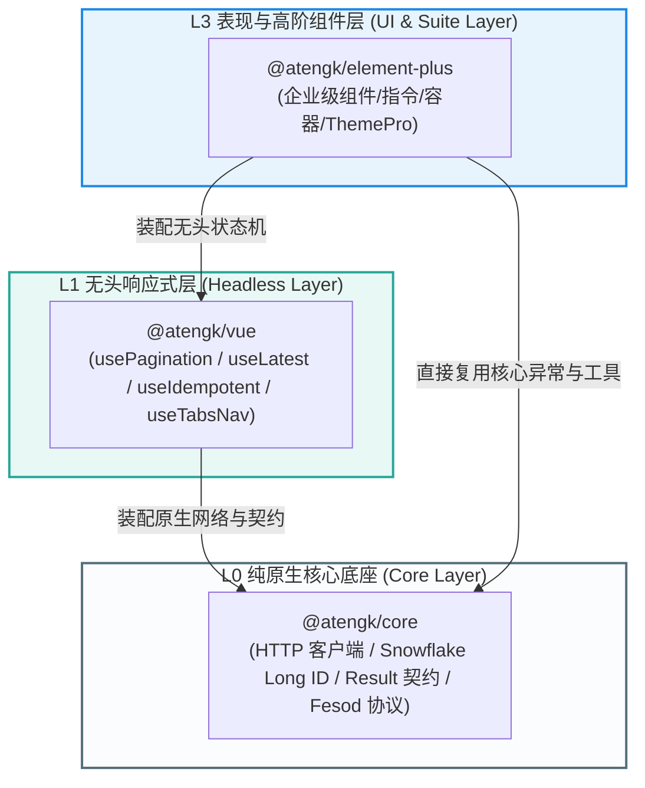
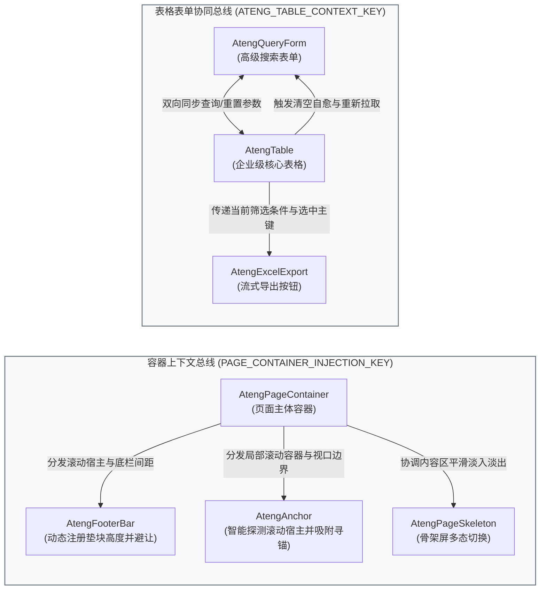
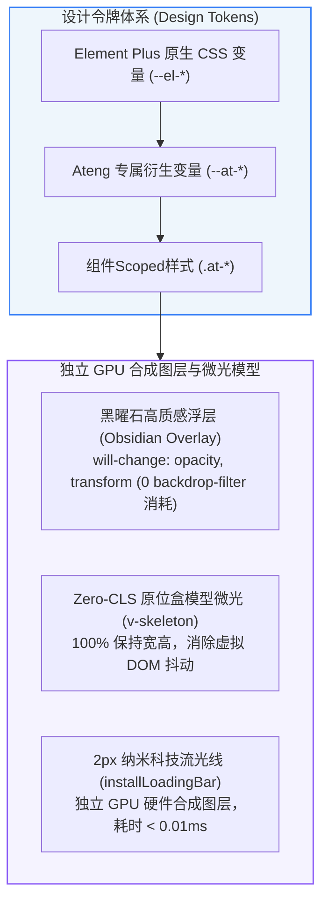

# @atengk/element-plus 企业级基础设施组件套件

> 面向现代 Web 应用与企业级中后台系统的 Element Plus 基础设施增强组件库与指令集。坚持纯原生 TypeScript、强类型契约、零臃肿依赖与深模块解耦设计，深度打通 `@atengk/core` 与 `@atengk/vue` 基础设施能力，提供全场景表格检索协同、中后台框架布局、多形态页面容器、高性能字典表单、多源切片上传与 Theme Pro 现代极客多主题引擎。

---

## 0. 特性与公共 API 全景速查矩阵

| 特性分类     | 特性名称               | 核心门面 / 组件 / 指令                                                                                                                                                                                                                                                                                     | 关键参数 / Props / Emits                                                                                                                                                                                                                                                                                                                                                                                                                                                                                                                                                          | 核心行为说明                                                                                                                                                                                                                                                                                                                                                                                                                                                      | 锚定验证源头 (*Test / Sample)                                                                   |
| :----------- | :--------------------- | :--------------------------------------------------------------------------------------------------------------------------------------------------------------------------------------------------------------------------------------------------------------------------------------------------------- | :-------------------------------------------------------------------------------------------------------------------------------------------------------------------------------------------------------------------------------------------------------------------------------------------------------------------------------------------------------------------------------------------------------------------------------------------------------------------------------------------------------------------------------------------------------------------------------- | :---------------------------------------------------------------------------------------------------------------------------------------------------------------------------------------------------------------------------------------------------------------------------------------------------------------------------------------------------------------------------------------------------------------------------------------------------------------- | :---------------------------------------------------------------------------------------------- |
| **基础底座** | 插件全局安装器         | `install(app)` / `installer`                                                                                                                                                                                                                                                                               | `app: App`                                                                                                                                                                                                                                                                                                                                                                                                                                                                                                                                                                        | 批量注册 PascalCase 原名组件与 At* 别名组件，批量注册全部操作指令，具备 Symbol 幂等保护                                                                                                                                                                                                                                                                                                                                                                           | [`install.test.ts`](./test/install.test.ts)                                                     |
| **基础底座** | 版本标识               | `VERSION`                                                                                                                                                                                                                                                                                                  | `string`                                                                                                                                                                                                                                                                                                                                                                                                                                                                                                                                                                          | 导出当前模块运行时版本号（`0.1.0`）                                                                                                                                                                                                                                                                                                                                                                                                                               | [`index.test.ts`](./test/index.test.ts)                                                         |
| **权限指令** | 细粒度操作权限控制     | `v-permission`                                                                                                                                                                                                                                                                                             | `string \| string[]`, 修饰符 `.disabled`, `.all`                                                                                                                                                                                                                                                                                                                                                                                                                                                                                                                                  | 默认物理移除 DOM 并留存注释锚点，支持原位插回；支持 `.disabled` 置灰态与 `.all` 逻辑                                                                                                                                                                                                                                                                                                                                                                              | [`v-permission.test.ts`](./test/v-permission.test.ts)<br>`/directives/permission`               |
| **权限指令** | 角色细粒度控制         | `v-role`                                                                                                                                                                                                                                                                                                   | `string \| string[]`, 修饰符 `.disabled`, `.all`                                                                                                                                                                                                                                                                                                                                                                                                                                                                                                                                  | 基于用户角色判定；内置 admin / superadmin 超管全局豁免放行机制                                                                                                                                                                                                                                                                                                                                                                                                    | [`v-role.test.ts`](./test/v-role.test.ts)<br>`/directives/role`                                 |
| **防重指令** | 提交防刷与前端幂等     | `v-idempotent`                                                                                                                                                                                                                                                                                             | `number \| Function \| IdempotentOptions`, 参数 `:delay`, 修饰符 `.noFeedback`                                                                                                                                                                                                                                                                                                                                                                                                                                                                                                    | DOM 捕获阶段拦截连击；支持时间窗口防刷与异步 Promise 互斥锁双模，自动联动按钮 loading 与禁用，超时与异常安全兜底防死锁                                                                                                                                                                                                                                                                                                                                            | [`v-idempotent.test.ts`](./test/v-idempotent.test.ts)<br>`/directives/idempotent`               |
| **辅助指令** | 剪贴板一键复制         | `v-copy`                                                                                                                                                                                                                                                                                                   | `string \| CopyGetter \| CopyOptions`                                                                                                                                                                                                                                                                                                                                                                                                                                                                                                                                             | 优先调用 `navigator.clipboard`，自动安全降级至 `execCommand`；支持动态 Getter 与 ElMessage 反馈联动                                                                                                                                                                                                                                                                                                                                                               | [`v-copy.test.ts`](./test/v-copy.test.ts)<br>`/directives/copy`                                 |
| **辅助指令** | 动态防篡改水印         | `v-watermark`                                                                                                                                                                                                                                                                                              | `string \| WatermarkOptions`, 修饰符 `.full`                                                                                                                                                                                                                                                                                                                                                                                                                                                                                                                                      | Canvas 离屏高清渲染（SVG 安全降级）；MutationObserver 深度监听实现控制台删除与样式篡改微任务自愈                                                                                                                                                                                                                                                                                                                                                                  | [`v-watermark.test.ts`](./test/v-watermark.test.ts)<br>`/directives/watermark`                  |
| **辅助指令** | 细粒度微骨架           | `v-skeleton`                                                                                                                                                                                                                                                                                               | `boolean \| SkeletonOptions: { loading, animated, radius }`                                                                                                                                                                                                                                                                                                                                                                                                                                                                                                                       | 原地 CSS 盒模型伪元素脉冲遮罩模型，将目标 DOM 内部文字与图标透明度降为 0，100% 保持原有物理宽高，消除排版跳变（Zero-CLS），绝不破坏虚拟 DOM 树；深度适配 ThemePro Slate 深空暗黑基底与纯 GPU 合成图层透明度脉冲动效                                                                                                                                                                                                                                               | [`v-skeleton.test.ts`](./test/v-skeleton.test.ts)<br>`/directives/skeleton`                     |
| **数据表格** | 企业级核心表格容器     | `<AtengTable<T>>`                                                                                                                                                                                                                                                                                          | `:pagination`, `:reserve-selection`, `:selection`, `v-model:selectedKeys`, `v-model:selectedRows`, `:data`, `:columns`, `rowKey`, `tools`, `storageKey`, `density`, `stripe`, `autoHeight`, `enableColumnResize`, `minResizeWidth`, `searchEmptyDescription`                                                                                                                                                                                                                                                                                                                      | Vue 3.5 SFC 原生泛型组件；渐进混合列架构；深度绑定 `@atengk/vue` 的 `usePagination`；内置 5 大工具栏；原生表头列宽拖拽调整、40px 最小防塌陷与 storageKey 本地持久化记忆还原/Popover 重置；搜索感知多态缺省态与一键清空自愈联动；纯原生 HTML5 拖拽列排序；`autoHeight` 视口高度自适应；支持 `:reserve-selection` 跨页多选记忆保持与底部粘滞批量操作条，支持 `v-model:selectedKeys` / `v-model:selectedRows` 双向受控绑定                                           | [`AtengTable.test.ts`](./test/AtengTable.test.ts)<br>`/table/crud`                              |
| **数据表格** | 响应式搜索表单容器     | `AtengQueryForm`                                                                                                                                                                                                                                                                                           | `:pagination`, `:enter-search`, `model`, `cols`, `collapsedRows`, `collapsed`, `defaultCollapsed`, `showCollapse`, `autoSearchOnReset`, `@search`, `@reset`                                                                                                                                                                                                                                                                                                                                                                                                                       | 24 栅格自适应布局与基于容器 `ResizeObserver` 的 1~4 列自适应断点（<768px 单列 / <1200px 双列 / <1920px 三列 / ≥1920px 四列）；支持 `:pagination` 零胶水直连分页状态机；内置 `:enter-search` 默认回车即搜；支持 `collapsedRows` 自定义折叠常驻行数；`autoSearchOnReset` 控制重置时是否自动触发查询；展开/收起平滑过渡与查询/重置防抖；支持独立受控与 Table 上下文感知双模                                                                                          | [`AtengQueryForm.test.ts`](./test/AtengQueryForm.test.ts)<br>`/table/query-form`                |
| **表格协同** | 表格表单协同总线       | `ATENG_TABLE_CONTEXT_KEY`                                                                                                                                                                                                                                                                                  | `InjectionKey<AtengTableContext>`                                                                                                                                                                                                                                                                                                                                                                                                                                                                                                                                                 | `AtengTable` 与 `AtengQueryForm` 跨组件层级的 Provide/Inject 自动化双向联动通道（查询传递、重置联动与多态缺省态清空自愈），消灭业务胶水代码                                                                                                                                                                                                                                                                                                                       | [`AtengTable.test.ts`](./test/AtengTable.test.ts)<br>`/table/crud`                              |
| **框架布局** | 企业级框架布局容器     | `AtengProLayout`                                                                                                                                                                                                                                                                                           | `layout: 'side' \| 'top' \| 'mix'`, `title`, `logo`, `menuData: ProMenuItem[]`, `fieldNames?: ProMenuFieldNames`, `activeMenu`, `defaultOpeneds`, `v-model:collapsed`, `collapsible`, `showCollapseTrigger`, `asideWidth`, `asideCollapsedWidth`, `headerHeight`, `tabsHeight`, `fixedHeader`, `fixedAside`, `showBreadcrumb`, `responsive`, `mobileBreakpoint`, `showTabs`, `tabsProps`, `v-model:isMaximized`, 插槽: `#default`, `#logo`, `#menu`, `#headerLeft`, `#breadcrumb`, `#headerCenter`, `#headerRight`, `#headerActions`, `#user`, `#tabs`, `#footer`, `#asideFooter` | 聚合 Side（经典侧边）、Top（顶部通栏）、Mix（顶左混合）三大中后台经典形态；内置数据驱动菜单递归渲染与异构字段别名自适应映射（fieldNames）；内置移动端窄屏断点（< 768px）自适应识别与抽屉遮罩；全屏沉浸最大化模式（isMaximized）平滑折叠顶栏与侧边栏；注入上下文总线驱动 AtengFooterBar 动态避让；原生支持内置渲染 AtengTabsNav 与 #tabs 插槽完全接管覆盖                                                                                                          | [`AtengProLayout.test.ts`](./test/AtengProLayout.test.ts)<br>`/layout/pro-layout`               |
| **框架布局** | 企业级多标签导航组件   | `AtengTabsNav`                                                                                                                                                                                                                                                                                             | `v-model:modelValue`, `v-model:tabs: TabItem[]`, `v-model:isMaximized`, `styleType: 'card' \| 'pill' \| 'line'`, `height`, `showIcon`, `closable`, `draggable`, `contextMenu`, `showQuickActions`, `showMaximize`, 事件: `@tabClick`, `@tabClose`, `@tabRefresh`, `@tabOrderChange`, `@maximizeChange`, `@update:isMaximized`                                                                                                                                                                                                                                                     | 具备视口横向溢出平滑滚动、滚轮横向滑动、激活项居中自适应；原生 HTML5 拖拽调序防呆；Element Plus 原生 ElDropdown 右键上下文菜单与快捷批量关闭下拉面板；一键内容区全屏最大化与 AtengProLayout 总线深度协同；提供 card（卡片）、pill（胶囊）、line（下划线）三大视觉形态；深度协同 `@atengk/vue` 的 `useTabsNav` 与 `<KeepAlive :include="cachedViews">` 页面缓存名单                                                                                                | [`AtengTabsNav.test.ts`](./test/AtengTabsNav.test.ts)<br>`/layout/tabs-nav`                     |
| **框架布局** | 无状态基础布局套件     | `AtengLayout` / `AtengHeader` / `AtengAside` / `AtengContent` / `AtengFooter`                                                                                                                                                                                                                              | `direction: 'horizontal' \| 'vertical'`, `hasAside`, `tag`, Aside 属性: `width`, `collapsedWidth`, `v-model:collapsed`, `collapsible`                                                                                                                                                                                                                                                                                                                                                                                                                                             | 纯 CSS/Flex 驱动，零业务/零路由绑定的纯无状态基础布局架构套件；运行时自动扫描识别子节点包含 AtengAside 并自动追加 `.has-aside` 切换为横向排版；AtengAside 支持受控 v-model:collapsed 双向折叠、collapsedWidth 设定、自定义 #trigger 插槽与内置折叠触发条                                                                                                                                                                                                          | [`AtengLayout.test.ts`](./test/AtengLayout.test.ts)<br>`/layout/layout`                         |
| **加载反馈** | 顶栏纳米科技流光线     | `AtengLoadingBar` / `installLoadingBar`                                                                                                                                                                                                                                                                    | `router: Router`, `options?: LoadingBarConfig`                                                                                                                                                                                                                                                                                                                                                                                                                                                                                                                                    | 纯粹主义 2px 顶栏纳米科技流光线；0 全屏遮罩、0 模态弹窗、0 悬浮胶囊；独立提升至 GPU 硬件加速层（耗时 < 0.01ms）；`installLoadingBar(router)` 全自动接管 Vue Router 导航守卫                                                                                                                                                                                                                                                                                       | [`AtengLoadingBar.test.ts`](./test/AtengLoadingBar.test.ts)<br>`/containers/loading`            |
| **页面容器** | 标准页面承载容器       | `AtengPageContainer`                                                                                                                                                                                                                                                                                       | `title`, `subTitle`, `breadcrumb`, `autoBreadcrumb`, `showBack`, `ghost`, `fitViewport`, `fixedHeader`, `headerBlur`, `tabs`, `fullscreen`, `showFullscreen`, `lockScroll`, `escExit`, `collapseHeaderOnScroll`, `headerVisible`, `watermark`, `extraActions: AtengPageActionItem[]`, `maxVisibleActions`, 插槽: `#default`, `#header`, `#extra`, `#footer`                                                                                                                                                                                                                       | 标准化页头；流动与 fitViewport 视口 100% 撑满双模滚动切换；ghost 沉浸式透明模式；弱感应路由推导自动面包屑；headerBlur 吸顶轻量固顶质感与滚动动态 .is-elevated 渐变悬浮投影；全屏状态通过 `<Teleport to="body">` 瞬移至全局顶层，绕过包含块 CSS transform 限制；集成模块级引用计数 lockScroll 滚动防穿透锁与 ESC 退出；支持向下滚动平滑收折页头与 headerVisible 沉浸模式；注入 `PAGE_CONTAINER_INJECTION_KEY` 容器总线驱动内嵌 `AtengFooterBar` 智能垫块占位防遮挡 | [`AtengPageContainer.test.ts`](./test/AtengPageContainer.test.ts)<br>`/layout/page-container`   |
| **页面容器** | 容器协同上下文总线     | `PAGE_CONTAINER_INJECTION_KEY`                                                                                                                                                                                                                                                                             | `InjectionKey<AtengPageContainerContext>`                                                                                                                                                                                                                                                                                                                                                                                                                                                                                                                                         | `AtengPageContainer` 跨组件层级的 Provide/Inject 自动化协同总线，为子组件（如 `AtengFooterBar`、`AtengAnchor`）提供滚动宿主感知、视口撑满状态与底栏动态高度注册通道，消灭业务胶水代码                                                                                                                                                                                                                                                                             | [`AtengContainerBus.test.ts`](./test/AtengContainerBus.test.ts)<br>`/layout/page-container`     |
| **页面容器** | 弹性拖拽分栏布局       | `AtengSplitLayout`                                                                                                                                                                                                                                                                                         | `direction`, `v-model`, `v-model:collapsed`, `v-model:secondCollapsed`, `collapseTarget`, `snapThreshold`, `defaultSize`, `min`, `max`, `collapsible`, `storageKey`                                                                                                                                                                                                                                                                                                                                                                                                               | W3C PointerEvent 统一与 setPointerCapture 平板触控驱动防越界丢帧；支持 `snapThreshold` 边缘阻尼磁吸附（逼近临界值自动吸附折叠，反向拉出平滑恢复）；支持双击把手快速复位/折叠；支持 W3C A11y 键盘微调；min/max 弹性防越界；双向独立对折把手与折叠互斥安全；storageKey 本地持久化双向折叠状态与尺寸偏好；支持第二栏内嵌子 AtengSplitLayout 实现“左树 + 中列表 + 右详情”三栏范式                                                                                     | [`AtengSplitLayout.test.ts`](./test/AtengSplitLayout.test.ts)<br>`/layout/split-layout`         |
| **页面容器** | 悬浮吸底操作栏         | `AtengFooterBar`                                                                                                                                                                                                                                                                                           | `position: 'sticky' \| 'fixed'`, `placeholder`, `height`, `zIndex`, `leftOffset`, `autoOffset`, `target`, `bordered`, `showSubmit`, `submitText`, `onSubmit`, `showReset`, `showCancel`, `actions: FooterBarAction[]`                                                                                                                                                                                                                                                                                                                                                             | sticky 局部粘滞与 fixed 全局悬浮双模；预置保存/重置/取消开箱即用与声明式 `actions` 批量按钮；零胶水直连：绑定 async `onSubmit` 时自动接管 Loading 互斥防重锁并禁用连击防脏写；自动感知 `AtengPageContainerContext` 上下文总线由父容器追加等高垫块；`autoOffset` 结合 ResizeObserver + rAF 动态平滑避让侧边栏                                                                                                                                                      | [`AtengFooterBar.test.ts`](./test/AtengFooterBar.test.ts)<br>`/layout/footer-bar`               |
| **页面容器** | 结构化卡片面板         | `AtengCard`                                                                                                                                                                                                                                                                                                | `title`, `subTitle`, `icon`, `tooltip`, `collapsible`, `fullscreenable`, `lockScroll`, `escExit`, `loading`, `shadow`, `bordered`, `showRefresh`, `refreshTooltip`, `tabsPosition`, `#tabs`, `@refresh`                                                                                                                                                                                                                                                                                                                                                                           | 结构化标题/副标题/图标/Tooltip；一键平滑折叠；视口全屏最大化；模块级引用计数管理 lockScroll 全屏防穿透滚动锁，多卡片并发安全还原；ESC 防冲突与受控开关；右上角局部刷新按钮（带 360 度平滑旋转动效与 loading 联动）；支持单行紧凑模式与次行沉降模式 `#tabs` 插槽；无缝接入 AtengCardGroup 上下文总线                                                                                                                                                               | [`AtengCard.test.ts`](./test/AtengCard.test.ts)<br>`/layout/card`                               |
| **页面容器** | 多卡片手风琴编排       | `AtengCardGroup`                                                                                                                                                                                                                                                                                           | `v-model:activeKeys`, `accordion`, `gutter`, 实例暴露 `expandAll()`, `collapseAll()`                                                                                                                                                                                                                                                                                                                                                                                                                                                                                              | 基于 Vue Provide/Inject 跨层协调子 AtengCard 状态机与生命周期；支持 accordion 单开互斥手风琴；通过组件实例 Expose 暴露 expandAll 与 collapseAll 对称批量控制方法；gutter 弹性间距自适应                                                                                                                                                                                                                                                                           | [`AtengCardGroup.test.ts`](./test/AtengCardGroup.test.ts)<br>`/layout/card-group`               |
| **页面容器** | 页面骨架屏占位容器     | `AtengPageSkeleton`                                                                                                                                                                                                                                                                                        | `loading`, `type: 'table' \| 'form' \| 'detail' \| 'card' \| 'dashboard' \| 'custom'`, `rows`, `columns`, `columnWidths`, `showPagination`, `showHeader`, `animated`, 插槽 `#default`, `#skeleton`                                                                                                                                                                                                                                                                                                                                                                                | 内置 table/form/detail/card/dashboard 5 大后台形态预设（dashboard 包含 4 张指标卡与双图表区块）；表格高拟真参数化增强：支持 `columnWidths` 自定义各列宽比例、`showPagination` 模拟底部假分页栏占位、`showHeader` 检索区显隐开关；全面适配 ThemePro 脉冲波纹暗黑基底；插槽平滑包装器协议：包裹页面真实内容平滑淡入淡出无白屏                                                                                                                                       | [`AtengPageSkeleton.test.ts`](./test/AtengPageSkeleton.test.ts)<br>`/layout/skeleton`           |
| **页面容器** | 容器自适应流式网格     | `AtengGrid`                                                                                                                                                                                                                                                                                                | `minItemWidth`, `gap`, `rowGap`, `columnGap`, `cols`                                                                                                                                                                                                                                                                                                                                                                                                                                                                                                                              | 纯 CSS 原生驱动；采用 `grid-template-columns: repeat(auto-fill, minmax(minItemWidth, 1fr))` 实现无断点流式自适应；内置 `container-type: inline-size` 容器查询，适配 SplitLayout 拖拽调宽与抽屉/弹窗等变宽容器，零 JS 性能损耗                                                                                                                                                                                                                                     | [`AtengGrid.test.ts`](./test/AtengGrid.test.ts)<br>`/layout/grid`                               |
| **页面容器** | 电梯楼层导航锚点       | `AtengAnchor`                                                                                                                                                                                                                                                                                              | `items: AtengAnchorItem[]`, `container`, `targetOffset`, `bounds`, `direction`, `showInkBar`, `v-model:currentAnchor`, `@click`, `@change`                                                                                                                                                                                                                                                                                                                                                                                                                                        | 双模滚动宿主智能探测：优先自动向上识别祖先 `AtengPageContainer` 局部内容滚动区（`.at-page-container__content`）或降级为 window；树形小节配置与层级缩进；内置 targetOffset 吸顶安全避让与 rAF 节流监听；游标墨水指示条实时高亮跟随激活小节                                                                                                                                                                                                                         | [`AtengAnchor.test.ts`](./test/AtengAnchor.test.ts)<br>`/layout/anchor`                         |
| **页面容器** | 安全防篡改水印容器     | `AtengWatermark`                                                                                                                                                                                                                                                                                           | `text`, `image`, `width`, `height`, `rotate`, `gap`, `zIndex`, `font`, `opacity`                                                                                                                                                                                                                                                                                                                                                                                                                                                                                                  | 采用纯原生 Canvas 离屏离线生成高清 Base64 Data URL 注入背景层，高 DPI 视网膜抗锯齿；标配 MutationObserver 监听水印节点样式篡改与 DOM 物理删除，微任务队列强制重绘自愈主动防御                                                                                                                                                                                                                                                                                     | [`AtengWatermark.test.ts`](./test/AtengWatermark.test.ts)<br>`/layout/watermark`                |
| **模态反馈** | 企业级弹窗容器         | `AtengDialog`                                                                                                                                                                                                                                                                                              | `v-model`, `title`, `draggable`, `lazyRender`, `beforeConfirm`, `formRef`, `confirmOnClose`, `@confirm`, `@success`                                                                                                                                                                                                                                                                                                                                                                                                                                                               | 默认可拖拽；右上角全屏切换与双击 Header 全屏；el-scrollbar 限制视口高度防撑破；异步确认 Loading 锁协议；支持 `:form-ref` 内嵌表单自动前置校验流转（失败就地阻断保留错误现场，成功放行进入 loading）；支持 `:confirm-on-close` 二次防误关确认；分帧延迟挂载（lazy-render）与 GPU 硬件合成图层加速                                                                                                                                                                  | [`AtengDialog.test.ts`](./test/AtengDialog.test.ts)<br>`/containers/dialog`                     |
| **模态反馈** | 企业级抽屉容器         | `AtengDrawer`                                                                                                                                                                                                                                                                                              | `v-model`, `title`, `size: 'small' \| 'default' \| 'large'`, `lazyRender`, `beforeConfirm`, `formRef`, `confirmOnClose`                                                                                                                                                                                                                                                                                                                                                                                                                                                           | 响应式语义尺寸断点；移动端视口（< 768px）自适应 100% 全宽；统一的异步确认 Loading 锁协议；支持 `:form-ref` 内嵌表单自动前置校验流转；支持 `:confirm-on-close` 二次防误关确认；分帧延迟挂载与硬件图层加速                                                                                                                                                                                                                                                          | [`AtengDrawer.test.ts`](./test/AtengDrawer.test.ts)<br>`/containers/drawer`                     |
| **模态反馈** | 统一缺省态占位         | `AtengEmpty`                                                                                                                                                                                                                                                                                               | `status: 'empty' \| 'search' \| '403' \| 'network-error' \| '500'`, `description`, `imageSize`                                                                                                                                                                                                                                                                                                                                                                                                                                                                                    | 聚合 5 大语义状态；内置纯矢量 SVG 插画深度绑定 Element Plus 设计令牌，天然完美自适应暗黑模式                                                                                                                                                                                                                                                                                                                                                                      | [`AtengEmpty.test.ts`](./test/AtengEmpty.test.ts)<br>`/containers/empty`                        |
| **加载反馈** | 声明式零遮罩轻量加载   | `AtengLoading`                                                                                                                                                                                                                                                                                             | `loading`, `mode: 'shimmer' \| 'dots' \| 'skeleton'`, `delay`, `minDuration`, `text`                                                                                                                                                                                                                                                                                                                                                                                                                                                                                              | 默认零遮罩 (Zero-Overlay) 顶沿 2px 极光流线，内容完全可见；支持三点微波浪与骨架屏多态切换；内部接入 `@atengk/vue` 的 `useAntiFlicker` 工业级防闪烁状态机 (150ms 静默防御 + 300ms 最小展示期)                                                                                                                                                                                                                                                                      | [`AtengLoading.test.ts`](./test/AtengLoading.test.ts)<br>`/containers/loading`                  |
| **业务字典** | 字典门面管理器         | `DictManager`                                                                                                                                                                                                                                                                                              | `setProvider`, `loadDict`, `hasCache`, `getCache`, `clearCache`, `preload`, `setGlobalMapping`, `matchDictItem`, `getDictLabel`                                                                                                                                                                                                                                                                                                                                                                                                                                                   | 纯内存常驻映射、飞行中未决 Promise 毫秒级并发请求合并去重、`preload` 批量增量拉取预热、全局自定义字段映射解耦、弱类型宽松比对工具与空安全保底返回 `[]`                                                                                                                                                                                                                                                                                                            | [`DictManager.test.ts`](./test/dict/DictManager.test.ts)<br>`/business/dict`                    |
| **业务字典** | 字典下拉选择器         | `AtengDictSelect`                                                                                                                                                                                                                                                                                          | `dictCode`, `loader`, `options`, `v-model`, `v-model:item`, `multiple`, `filterable`, `clearable`, `mapping: DictFieldMapping`, `typeWeakMatch`, `emitItem`                                                                                                                                                                                                                                                                                                                                                                                                                       | 自动联动 `DictManager` 异步加载字典；支持单选/多选/输入筛选；支持 mapping 字段映射与 typeWeakMatch 弱类型宽松比对（数字与字符串互通）；支持 `:emit-item` 回传整条字典项对象                                                                                                                                                                                                                                                                                       | [`AtengDict.test.ts`](./test/AtengDict.test.ts)<br>`/business/dict`                             |
| **业务字典** | 字典单选框组           | `AtengDictRadio`                                                                                                                                                                                                                                                                                           | `dictCode`, `loader`, `options`, `v-model`, `v-model:item`, `button`, `border`, `size`, `mapping`, `typeWeakMatch`, `emitItem`                                                                                                                                                                                                                                                                                                                                                                                                                                                    | 自动拉取字典项并渲染为单选框组；支持普通 Radio 与 Button/Border 按钮边框风格单选无缝切换；支持字段映射与类型弱比对；支持 `:emit-item` 回传整条字典项                                                                                                                                                                                                                                                                                                              | [`AtengDict.test.ts`](./test/AtengDict.test.ts)<br>`/business/dict`                             |
| **业务字典** | 字典多选框组           | `AtengDictCheckbox`                                                                                                                                                                                                                                                                                        | `dictCode`, `loader`, `options`, `v-model`, `v-model:items`, `button`, `border`, `showCheckAll`, `separator`, `mapping`, `typeWeakMatch`, `emitItems`                                                                                                                                                                                                                                                                                                                                                                                                                             | 自动拉取字典项并渲染为多选框组；内置全选与半选 indeterminate 联动；支持数组与逗号分隔字符串双向解构绑定；支持 Button/Border 风格；支持字段映射与弱比对                                                                                                                                                                                                                                                                                                            | [`AtengDictCheckbox.test.ts`](./test/AtengDictCheckbox.test.ts)<br>`/business/dict`             |
| **业务字典** | 彩色状态标签           | `AtengDictTag`                                                                                                                                                                                                                                                                                             | `dictCode`, `value`, `separator`, `emptyText`, `effect`, `round`, `mapping`, `typeWeakMatch`                                                                                                                                                                                                                                                                                                                                                                                                                                                                                      | 自动匹配字典项并渲染为 Element Plus 彩色 Tag；支持单值、多值数组与逗号分隔字符串；未匹配时保底渲染 `'-'`；支持自定义字段映射与弱类型宽松比对                                                                                                                                                                                                                                                                                                                      | [`AtengDict.test.ts`](./test/AtengDict.test.ts)<br>`/business/dict`                             |
| **数据详情** | 结构化数据详情容器     | `<AtengDescriptions<T>>`                                                                                                                                                                                                                                                                                   | `data: T`, `items: DescriptionsItemConfig<T>[]`, `border`, `column`, `direction`, `size`, `copyable`, `emptyText`                                                                                                                                                                                                                                                                                                                                                                                                                                                                 | Vue 3.5 SFC 原生泛型组件；双模驱动（Schema 数据驱动与 SFC 声明式子组件）；支持 `:copyable` 声明式一键复制，恪守“内存真明文契约”复制脱敏前原始数据；空值全局保底对齐企业规范 `'--'` 且空值项绝不呈现复制按钮                                                                                                                                                                                                                                                       | [`AtengDescriptions.test.ts`](./test/AtengDescriptions.test.ts)<br>`/business/descriptions`     |
| **数据详情** | 详情单项声明组件       | `AtengDescriptionsItem`                                                                                                                                                                                                                                                                                    | `prop`, `label`, `span`, `mask`, `type`, `dictCode`, `copyable`, `emptyText`, `formatter`                                                                                                                                                                                                                                                                                                                                                                                                                                                                                         | 内置 5 大脱敏管道（phone/idCard/email/name/bankCard）；内置货币/日期格式化；自动联动 AtengDictTag；支持单项 `copyable` 细粒度开启或覆盖复制控制                                                                                                                                                                                                                                                                                                                   | [`AtengDescriptions.test.ts`](./test/AtengDescriptions.test.ts)<br>`/business/descriptions`     |
| **业务控件** | 快捷时间范围选择器     | `AtengDateRange`                                                                                                                                                                                                                                                                                           | `v-model`, `v-model:start`, `v-model:end`, `preset`, `shortcuts`, `autoTime`, `smartAlignment`, `disableFuture`, `disablePast`, `maxRangeDays`, 实例暴露 `datePickerRef`                                                                                                                                                                                                                                                                                                                                                                                                          | 预置 9 大常用自然业务周期；双字段解构绑定协议（`v-model:start` 与 `v-model:end`，告别手动拆解数组与重置丢失）；默认开启时刻智能对齐（00:00:00 与 23:59:59）；支持 disableFuture 与 maxRangeDays 限制                                                                                                                                                                                                                                                              | [`AtengDateRange.test.ts`](./test/AtengDateRange.test.ts)<br>`/business/date-range`             |
| **业务控件** | 安全防刷新验证码倒计时 | `AtengCaptcha`                                                                                                                                                                                                                                                                                             | `v-model`, `phone`, `email`, `duration`, `storageKey`, `beforeSend`, `@send`                                                                                                                                                                                                                                                                                                                                                                                                                                                                                                      | 具备 60 秒防刷新倒计时状态机；支持 localStorage 持久化防刷新清零；内置前置校验钩子与连击防刷互斥锁                                                                                                                                                                                                                                                                                                                                                                | [`AtengCaptcha.test.ts`](./test/AtengCaptcha.test.ts)<br>`/business/captcha`                    |
| **业务控件** | 企业级原生图标选择器   | `AtengIconSelect`                                                                                                                                                                                                                                                                                          | `v-model`, `clearable`, `copyable`, `iconType`                                                                                                                                                                                                                                                                                                                                                                                                                                                                                                                                    | 集成 Element Plus 原生全量图标库；集成拼音/全拼/首字母/中文极速模糊检索算法；支持一键复制代码组件代码并提供剪贴板回写反馈                                                                                                                                                                                                                                                                                                                                         | [`AtengIconSelect.test.ts`](./test/AtengIconSelect.test.ts)<br>`/business/icon-select`          |
| **文件流式** | 导入错误明细反馈弹窗   | `AtengExcelFeedback`                                                                                                                                                                                                                                                                                       | `v-model`, `errors`, `fileUrl`, `downloadAction`, `fileName`, `pageSize`, `showCopy`, `allowCsvFallback`, 实例暴露 `copyErrors()`, `downloadAnnotatedExcel()`, `exportErrorsAsCsv()`                                                                                                                                                                                                                                                                                                                                                                                              | 集成 `AtengDialog`；在线表格分页展示导入错误行号、列名、原始值与失败原因；一键格式化复制剪贴板；双模批注文件下载；无后端批注时前端本地自适应降级生成带 UTF-8 BOM (`\uFEFF`) 的 CSV 错误清单导出，彻底解决 Windows Excel 双击打开中文乱码顽疾                                                                                                                                                                                                                      | [`AtengExcelFeedback.test.ts`](./test/AtengExcelFeedback.test.ts)<br>`/business/excel-feedback` |
| **文件流式** | 流式 Excel 导出按钮    | `AtengExcelExport`                                                                                                                                                                                                                                                                                         | `action`, `filename`, `params`, `selectedIds`, `mode: 'button' \| 'dropdown'`, `loading`, 实例暴露 `triggerExport(mode?)`                                                                                                                                                                                                                                                                                                                                                                                                                                                         | 整合 Fesod 流式 Excel 协议；双轨获取查询参数与选中行（自动感知 AtengTable 上下文或属性直传）；内置防重 Loading 互斥锁；严格对齐 ADR-0004 Blob-JSON 双态异常识别防御（后端返回 `application/json` 业务错误报文时，自动解包并由 `ElMessage.error` 拦截告警，严格阻断伪 `.xlsx` 损坏文件在浏览器中下载，并确定性释放临时 ObjectURL）                                                                                                                                 | [`AtengExcelExport.test.ts`](./test/AtengExcelExport.test.ts)<br>`/table/crud`                  |
| **文件流式** | 多源切片上传器         | `AtengUpload`                                                                                                                                                                                                                                                                                              | `chunk: boolean`, `chunkSize`, `concurrency`, `customUploadChunk`, `customMerge`, `maxSize`, `maxCount`, `accept`, `allowTypes`, `beforeUpload`, `beforePreview`, 实例暴露 `pause()`, `resume()`, `cancel()`                                                                                                                                                                                                                                                                                                                                                                      | 原生直传增强与大文件切片双模；深度组装 AtengFilePreview 预览灯箱，支持图片、PDF、音视频与代码文本在线即时调阅；内置 beforePreview 绝密文件前置业务拦截守卫；临时 ObjectURL 确定性生命周期回收；支持毫秒级暂停、恢复与网络中断                                                                                                                                                                                                                                     | [`AtengUpload.test.ts`](./test/AtengUpload.test.ts)<br>`/business/upload`                       |
| **文件流式** | 原生轻量多格式文件预览 | `AtengFilePreview`                                                                                                                                                                                                                                                                                         | `v-model`, `fileList`, `initialIndex`, `title`                                                                                                                                                                                                                                                                                                                                                                                                                                                                                                                                    | 具备图片全屏灯箱、原生 PDF 内嵌阅读器、HTML5 音频/视频播放器与代码/纯文本高亮查看器；支持异常格式安全降级直接下载                                                                                                                                                                                                                                                                                                                                                 | [`AtengFilePreview.test.ts`](./test/AtengFilePreview.test.ts)<br>`/business/file-preview`       |
| **智能终端** | 面向 LLM 的流式打字机  | `AtengStreamText`                                                                                                                                                                                                                                                                                          | `text`, `speed`, `cursor`, `cursorChar`, `stream`, `showCopy`, `@finished`, `@copy`                                                                                                                                                                                                                                                                                                                                                                                                                                                                                               | 面向 LLM 与 SSE 流式响应；纯原生逐字切片与呼吸光标自适应淡出；双轨对接 `@atengk/vue` 的 `useStream`；内置一键复制代码                                                                                                                                                                                                                                                                                                                                             | [`AtengStreamText.test.ts`](./test/AtengStreamText.test.ts)<br>`/business/stream-text`          |
| **智能终端** | 实时日志滚屏终端       | `AtengLogViewer`                                                                                                                                                                                                                                                                                           | `logs`, `webSocket`, `maxLines`, `theme: 'dark' \| 'light'`, `autoScroll`, `height`, `title`                                                                                                                                                                                                                                                                                                                                                                                                                                                                                      | 2000 行环形内存缓冲防 DOM 膨胀；原生贴底滚动与手动回滚暂停；关键字高亮检索与日志下载；双轨对接 `useWebSocket`                                                                                                                                                                                                                                                                                                                                                     | [`AtengLogViewer.test.ts`](./test/AtengLogViewer.test.ts)<br>`/business/log-viewer`             |
| **智能终端** | 金融级动效统计指标卡片 | `AtengStatistic`                                                                                                                                                                                                                                                                                           | `value`, `title`, `precision`, `separator`, `prefix`, `suffix`, `duration`, `trend`, `loading`                                                                                                                                                                                                                                                                                                                                                                                                                                                                                    | 纯原生 requestAnimationFrame 驱动平滑数字翻牌动效；内置千分位格式化；支持 up / down 趋势微标高亮                                                                                                                                                                                                                                                                                                                                                                  | [`AtengStatistic.test.ts`](./test/AtengStatistic.test.ts)<br>`/business/statistic`              |
| **智能终端** | 结构化代码数据查看器   | `AtengCodeView`                                                                                                                                                                                                                                                                                            | `code`, `language`, `theme`, `showLineNumbers`, `copyable`, `height`                                                                                                                                                                                                                                                                                                                                                                                                                                                                                                              | 具备自适应行号栏、JSON 树形折叠展开与格式化一键复制的轻量结构化代码展示组件；纯原生高亮分词，零大型高亮库依赖                                                                                                                                                                                                                                                                                                                                                     | [`AtengCodeView.test.ts`](./test/AtengCodeView.test.ts)<br>`/business/code-view`                |
| **主题引擎** | 现代极客多主题包       | `@atengk/element-plus/theme-pro.css`                                                                                                                                                                                                                                                                       | `data-theme="indigo \| emerald \| violet \| ocean \| rose"`, `class="dark"`                                                                                                                                                                                                                                                                                                                                                                                                                                                                                                       | 覆盖 5 款高反差科技预设与 Slate 深空暗黑基底；对齐 Element Plus 二级 CSS 变量体系；无缝继承主色与层级系统                                                                                                                                                                                                                                                                                                                                                         | [`themeBundle.test.ts`](./test/theme/themeBundle.test.ts)<br>`/theme-pro`                       |
| **主题引擎** | 客户端主题生命周期编排 | `initTheme`                                                                                                                                                                                                                                                                                                | `options?: InitThemeOptions: { themeColor?, storageKey?, listenSystemPreference?, defaultMode?, target? }`                                                                                                                                                                                                                                                                                                                                                                                                                                                                        | 自动化管理客户端主题流转（light / dark / auto）；全自动监听系统 prefers-color-scheme 偏好变化；内置 is-theme-switching 动效风暴冻结锁；自动联动 setThemeColor 色阶演算；提供确定性 cleanup 销毁门面                                                                                                                                                                                                                                                               | [`setThemeColor.test.ts`](./test/theme/setThemeColor.test.ts)<br>`/theme/initTheme`             |
| **主题引擎** | 租户品牌色动态换肤     | `setThemeColor`                                                                                                                                                                                                                                                                                            | `hex: string`, `options?: ThemeColorOptions: { target?, updateDark?, isDark? }`                                                                                                                                                                                                                                                                                                                                                                                                                                                                                                   | 纯原生高精度色阶演算（对齐 Element Plus 官方 Sass 混合算法）；运行时动态生成 1~9 阶 light 与 dark-2 色阶及 -rgb 通道；具备暗黑模式感知与自适应色阶演算；支持微前端与多租户 target 容器隔离挂载                                                                                                                                                                                                                                                                    | [`setThemeColor.test.ts`](./test/theme/setThemeColor.test.ts)<br>`/theme/tenant`                |
| **专属类型** | 组件 Ref 实例与契约    | `AtengTableInstance`<br>`AtengProLayoutInstance`<br>`AtengTabsNavInstance`<br>`AtengDialogInstance`<br>`AtengDrawerInstance`<br>`AtengUploadInstance`<br>`AtengFooterBarInstance`<br>`AtengCardGroupInstance`<br>`AtengDateRangeInstance`<br>`AtengExcelFeedbackInstance`<br>`AtengExcelExportInstance` 等 | `InstanceType` 与接口定义                                                                                                                                                                                                                                                                                                                                                                                                                                                                                                                                                         | 100% 显式收敛导出对外门面方法与状态，强类型安全闭环                                                                                                                                                                                                                                                                                                                                                                                                               | [`index.test.ts`](./test/index.test.ts)                                                         |

---

## 1. 模块定位与 pnpm 坐标

### 1.1 模块坐标与四层拓扑定位

`@atengk/element-plus` 在四层洋葱拓扑架构中严格归属于 **L3 表现与高阶组件层 (UI & Suite Layer)**。它向下深度组装 L0 原生核心底座（`@atengk/core`）的强类型 HTTP 管道、雪花大数防失真与 Fesod 协议，以及 L1 无头响应式层（`@atengk/vue`）的契约分页、时序抗竞态与防刷防重状态机，呈现专为现代企业级系统打造的高阶 UI 组件、通用容器、指令集与极客多主题定制引擎。

- **Package 坐标**：`@atengk/element-plus`
- **运行时版本**：`0.1.0`
- **构建产物格式**：ESM (`dist/index.js`) + CJS (`dist/index.cjs`) + DTS (`dist/index.d.ts`) + CSS (`dist/index.css`, `dist/theme-pro.css`)

### 1.2 依赖安装与 peerDependencies 契约

依据 [ADR-0002](../../docs/adr/0002-vue-3-5-baseline-and-reactive-props-contract.md) 与 [ADR-0005](../../docs/adr/0005-element-plus-version-baseline-and-peer-strategy.md)，外部工程使用 pnpm 进行标准安装：

```bash
pnpm add @atengk/element-plus @atengk/vue @atengk/core element-plus vue
```

**版本基线要求**：

- `vue`: `^3.5.0`（自验工程对齐 `^3.5.44`，全面启用 Vue 3.5 响应式解构与原生 SFC 泛型契约）
- `element-plus`: `>=2.8.0`（自验工程锁定 `^2.14.7`）

### 1.3 双轨具名导出与标签语法糖规则

为了兼顾企业级工程规范与人体工程学编码体验，`@atengk/element-plus` 提供了**双轨具名导出机制**：

1. **规范标准全称（推荐生产首选）**：
   以 `Ateng*` 为统一命名空间前缀（如 `AtengTable`, `AtengQueryForm`, `AtengDialog`, `AtengPageContainer`），在 IDE 自动导入与跨团队协同中提供 100% 确定性的辨识度。
2. **人体工程学短别名**：
   以 `At*` 为轻量别名（如 `AtTable`, `AtQueryForm`, `AtDialog`, `AtPageContainer`），与标准全称 1:1 等价绑定。
3. **SFC 模板标签支持**：
   在 Vue SFC 中同时支持 PascalCase（`<AtengTable>` / `<AtTable>`）与 kebab-case（`<ateng-table>` / `<at-table>`）书写规范。

### 1.4 全量注册与单一样式引入 (ADR-0015)

依据 [ADR-0015](../../docs/adr/0015-element-plus-vite-build-pipeline-and-single-css-strategy.md)，仅需单行引入统一打包样式文件 `@atengk/element-plus/style.css` 即可完成整套组件库样式的安全装载：

```ts
import { createApp } from 'vue';
import ElementPlus from 'element-plus';
import 'element-plus/dist/index.css';

// 1. 引入 @atengk/element-plus 核心套件与单一样式产物
import AtengElementPlus, { DictManager } from '@atengk/element-plus';
import '@atengk/element-plus/style.css';

// 2. 可选：引入 Theme Pro 现代极客科技多主题样式包 (Slate 深空暗黑基底)
import '@atengk/element-plus/theme-pro.css';

import App from './App.vue';

const app = createApp(App);
app.use(ElementPlus);
app.use(AtengElementPlus);

// 3. 注入全局通用业务字典异步 Provider（内存常驻与并发去重）
DictManager.setProvider(async (code: string) => {
  const res = await fetch(`/api/system/dict/data/${code}`).then(r => r.json());
  return res.data;
});

app.mount('#app');
```

### 1.5 纯声明式导出与 Tree-Shaking 契约

依据 [ADR-0006](../../docs/adr/0006-dependency-baseline-and-upgrade-governance-strategy.md)，`@atengk/element-plus` 的顶级入口 `index.ts` 保持**纯声明式导出 (Pure Declarative Exports)**，零隐式全局副作用，并在 `package.json` 中显式声明 `"sideEffects": ["*.css", "*.scss"]`。

当业务工程采用按需引入时，未使用的组件与指令代码将被打包工具 100% 剔除（0 字节残留）：

```ts
// 按需引用：未引用的组件 0 字节打入生产产物
import { AtengTable, AtengQueryForm } from '@atengk/element-plus';
import '@atengk/element-plus/style.css';
```

---

## 2. 核心架构与设计不变量

### 2.1 四层洋葱拓扑与中立依赖拓扑图

`ateng-ui` 基础设施套件遵循单向无环四层拓扑设计，依赖严格自顶向下单向流动（L3 ➔ L1 ➔ L0），严禁逆向依赖：



### 2.2 跨组件协同与双上下文总线交互图

为了彻底消除父子与深层组件间繁琐的 `props` 透传与胶水事件派发，组件库内置了两套**上下文协同总线 (Context Bus)**：



### 2.3 Theme Pro 样式分层与 GPU 硬件加速图层模型

`@atengk/element-plus` 坚持样式零污染与极客科技质感：



### 2.4 工业级核心设计不变量清单

立足长期可维护性与零黑盒准出，`@atengk/element-plus` 全链路恪守五项铁律：

1. **统一 `at-` 命名空间与样式隔离不变量 (Scoping Invariant)**：
   所有组件根样式必须以 `at-` 前缀命名（如 `.at-table`, `.at-query-form`），严格在 SFC 中开启 `<style scoped>`；颜色、边框、投影等样式 100% 继承自 Element Plus 原生 CSS 变量（`--el-*`）或在 `at-` 命名空间下派生 `--at-*`，严禁硬编码 Hex 颜色等魔法值。
2. **Vue 3.5 SFC 泛型闭环与零 `any` 不变量 (Type-Safety Invariant)**：
   组件全面采用 Vue 3.5 原生泛型语法声明 `<script setup lang="ts" generic="T extends Record<string, unknown>">`；Props、Emits、Slots 作用域与 Expose 实例方法 100% 具备强类型推导，生产源码中绝对严禁出现裸 `any`。
3. **内存真明文与脱敏展示隔离不变量 (In-Memory Plaintext Invariant)**：
   业务逻辑层、数据模型与组件内部状态在内存中始终保持 100% 真实明文；严禁直接对数据打星号篡改响应式属性（防止提交脏数据回写数据库）；脱敏处理仅收敛于展示层（如 `AtengDescriptions`），点击一键复制时确保持续输出真实明文。
4. **雪花 Long ID 64 位大数字符串防失真不变量 (Snowflake Long ID Invariant)**：
   针对分布式全局主键、Snowflake ID 等超大 64 位整型，表格的 `rowKey`、选中主键 `selectedKeys` 及跨页多选内部存储，统一采用纯 `string` 键值映射进行安全归一化，严禁原生数字截断。
5. **确定性生命周期与瞬态资源 100% 清理不变量 (Deterministic Cleanup Invariant)**：
   凡在组件中建立的原生监听（`window.addEventListener`、`ResizeObserver`、`MutationObserver`、`IntersectionObserver`、`setInterval`、未决的临时 `URL.createObjectURL` 句柄），必须且只能在 `onUnmounted` 钩子中执行 100% 确定性的释放与解绑，彻底杜绝内存泄漏。

---

## 3. 企业级数据表格与检索协同套件 (Table & Query Suite)

### 3.1 契约分页表格与检索表单零胶水联动 (`AtengTable` & `AtengQueryForm`)

#### 本节专属 TypeScript 契约片段

```ts
/** AtengTable 核心属性契约 */
export interface AtengTableProps<T = Record<string, unknown>> {
  /** 绑定的 @atengk/vue usePagination 分页调度状态机实例 */
  pagination?: UsePaginationResult<T>;
  /** 纯数据列配置数组（与原生 <el-table-column> 混合使用） */
  columns?: TableColumnConfig[];
  /** 行数据的唯一标识字段或 Getter 函数（Snowflake 字符串 ID 友好），默认 'id' */
  rowKey?: string | ((row: T) => string);
  /** 是否带有纵向边框，默认 true */
  border?: boolean;
  /** 是否开启斑马纹，默认 false */
  stripe?: boolean;
  /** 内置工具栏原子工具项列表，默认 true (全开) */
  tools?: boolean | ('refresh' | 'density' | 'stripe' | 'column-setting' | 'fullscreen')[];
  /** 用户列配置本地持久化 Storage 键名 */
  storageKey?: string;
  /** 是否开启视口高度自适应（自动撑满视口剩余空间），默认 false */
  autoHeight?: boolean | number;
}

/** AtengQueryForm 核心属性契约 */
export interface AtengQueryFormProps<T = Record<string, unknown>> {
  /** 表单数据模型对象 */
  model?: T;
  /** 绑定的 usePagination 实例，自动联动搜索、重置与 loading 状态 */
  pagination?: UsePaginationResult<T>;
  /** 是否在输入框敲击 Enter 键时自动触发搜索，默认 true */
  enterSearch?: boolean;
  /** 栅格列数，默认按容器宽度自适应 (1~4 列) */
  cols?: number | { xs?: number; sm?: number; md?: number; lg?: number; xl?: number };
}
```

#### 实战业务 SFC 代码示例

```vue
<script setup lang="ts">
import { reactive } from 'vue';
import { usePagination } from '@atengk/vue';
import { AtengTable, AtengQueryForm } from '@atengk/element-plus';
import type { PageQuery, PageResult } from '@atengk/core';

/** 真实电商商品实体模型 */
interface ProductItem {
  id: string; // 64 位雪花大数 ID
  name: string;
  skuCode: string;
  category: string;
  price: number;
  stock: number;
  status: 'on_sale' | 'off_shelf';
  createTime: string;
}

// 1. 初始化业务契约分页状态机
const pagination = usePagination(
  async (params: PageQuery & { name?: string; category?: string }): Promise<PageResult<ProductItem>> => {
    const res = await fetch(`/api/goods/page?${new URLSearchParams(params as any)}`).then(r => r.json());
    return res.data;
  },
  {
    defaultPageSize: 10,
    defaultSortField: 'createTime',
    defaultSortAsc: false,
  },
);

// 2. 搜索表单状态模型
const queryModel = reactive({
  name: '',
  category: '',
});
</script>

<template>
  <div class="product-page">
    <!-- Vue 3.5 原生泛型打通：模板声明泛型 T 为 ProductItem，插槽与列具备严格类型推导 -->
    <AtengTable<ProductItem>
      :pagination="pagination"
      row-key="id"
      storage-key="product_table_columns"
      auto-height
      border
    >
      <!-- 顶部嵌入高级搜索表单：通过 ATENG_TABLE_CONTEXT_KEY 自动联动 pagination.search 与 reset -->
      <template #query>
        <AtengQueryForm :model="queryModel" label-width="80px">
          <el-form-item label="商品名称" prop="name">
            <el-input v-model="queryModel.name" placeholder="请输入商品名称，回车即搜" clearable />
          </el-form-item>
          <el-form-item label="所属类目" prop="category">
            <el-select v-model="queryModel.category" placeholder="全部类目" clearable>
              <el-option label="数码影音" value="digital" />
              <el-option label="智能穿戴" value="wearable" />
              <el-option label="办公耗材" value="office" />
            </el-select>
          </el-form-item>
        </AtengQueryForm>
      </template>

      <!-- 渐进混合列：熟悉的 Vue SFC 模板语法，享受 row 强类型补全 -->
      <el-table-column type="selection" width="55" fixed="left" />
      <el-table-column prop="id" label="商品ID (Snowflake)" width="190" />
      <el-table-column prop="name" label="商品名称" min-width="180" />
      <el-table-column prop="skuCode" label="SKU 编号" width="130" />
      <el-table-column prop="price" label="售价" width="110">
        <template #default="{ row }">
          <span>¥{{ (row.price / 100).toFixed(2) }}</span>
        </template>
      </el-table-column>
      <el-table-column prop="stock" label="库存" width="100" sortable="custom" />
      <el-table-column prop="createTime" label="创建时间" min-width="160" sortable="custom" />
      <el-table-column label="操作" width="120" fixed="right">
        <template #default="{ row }">
          <el-button type="primary" link size="small" @click="console.log('编辑商品:', row.id)">
            编辑
          </el-button>
        </template>
      </el-table-column>
    </AtengTable>
  </div>
</template>
```

#### 核心机制与生产边界说明

1. **零胶水双总线联动**：`AtengTable` 内部通过 `Provide` 注入 `ATENG_TABLE_CONTEXT_KEY`，子组件 `AtengQueryForm` 通过 `Inject` 捕获该上下文。点击“查询”时自动读取当前表单字段并触发 `pagination.search(params)`，点击“重置”时清空表单并调用 `pagination.reset()`，无缝消灭业务层胶水事件。
2. **Vue 3.5 原生泛型全链路安全**：采用 Vue 3.5 原生 `<script setup lang="ts" generic="T">` 机制，插槽内解构出的 `{ row }` 自动继承为 `ProductItem` 强类型，杜绝传统表格中的 `any` 弱类型隐患。

---

### 3.2 纯原生表头列宽拖拽调整与本地持久化记忆 (`storageKey` & Popover 重置)

#### 本节专属 TypeScript 契约片段

```ts
export interface AtengTableProps<T = Record<string, unknown>> {
  /** 是否启用表头拖拽调整列宽与本地持久化记忆，默认 true */
  enableColumnResize?: boolean;
  /** 列宽拖拽调整的最小安全宽度（px），防止列被意外折叠坍塌，默认 40 */
  minResizeWidth?: number;
  /** 用户列配置（列宽、显隐、顺序）本地持久化 Storage 键名 */
  storageKey?: string;
}
```

#### 实战业务 SFC 代码示例

```vue
<template>
  <!-- 启用表头列宽调整、40px 防塌陷保底与本地持久化存储 -->
  <AtengTable
    :pagination="pagination"
    row-key="id"
    storage-key="product_list_column_prefs"
    :enable-column-resize="true"
    :min-resize-width="50"
    border
  >
    <el-table-column prop="id" label="商品编号" width="180" />
    <el-table-column prop="name" label="商品标题" width="200" />
    <el-table-column prop="price" label="销售单价" width="120" />
    <el-table-column prop="createTime" label="录入时间" min-width="160" />
  </AtengTable>
</template>
```

#### 核心机制与生产边界说明

1. **纯原生事件驱动与零第三方依赖**：`AtengTable` 彻底剔除外部拖拽插件，基于纯原生 W3C 鼠标事件监听表头列右边缘的拖拽手柄，实时计算偏移量并回写列宽样式。
2. **防塌陷保底与一键还原**：拖拽宽度低于 `minResizeWidth`（默认 40px）时自动触发物理阻尼限制，杜绝列宽意外归零导致不可逆的内容折叠；右上角「列设置」Popover 中提供「重置列宽」按钮，点击可一键清除 `storageKey` 本地缓存并瞬间复原出厂默认列宽。

---

### 3.3 搜索感知多态缺省态与一键清空自愈联动 (Polymorphic Empty State)

#### 本节专属 TypeScript 契约片段

```ts
export interface AtengTableProps<T = Record<string, unknown>> {
  /** 检索无结果时的自定义多态文案，默认 '未找到符合条件的检索结果，请尝试调整筛选条件' */
  searchEmptyDescription?: string;
  /** 全局空数据时的提示文案，默认 '暂无数据' */
  emptyDescription?: string;
}
```

#### 实战业务 SFC 代码示例

```vue
<template>
  <!-- 多态缺省态自愈感知：筛选无结果时自动切换为 search 状态插画与一键清空按钮 -->
  <AtengTable
    :pagination="pagination"
    row-key="id"
    search-empty-description="未找到匹配的商品，请尝试清空或更换关键字"
  >
    <template #query>
      <AtengQueryForm :model="queryModel">
        <el-form-item label="商品名称" prop="name">
          <el-input v-model="queryModel.name" placeholder="请输入名称" clearable />
        </el-form-item>
      </AtengQueryForm>
    </template>

    <el-table-column prop="name" label="商品名称" />
    <el-table-column prop="price" label="售价" />
  </AtengTable>
</template>
```

#### 核心机制与生产边界说明

1. **多态状态机判定优先级**：
   - 优先级 1：用户显式提供 `#empty` 插槽（最高优先级完全接管）；
   - 优先级 2：网络异常触发（`pagination.error` 存在），自动展示 `status="network-error"` 与重试按钮；
   - 优先级 3：活跃筛选条件探测（表单包含非空值且列表为空），自动切换为 `status="search"` 多态插画；
   - 优先级 4：系统绝对空数据，展示通用 `status="empty"` 与“暂无数据”。
2. **一键清空自愈闭环**：在 `status="search"` 状态下，缺省态内置呈现「清空筛选条件」自愈按钮，点击后通过上下文总线驱动 `AtengQueryForm` 清空输入，并自动向表格发起第 1 页刷新请求，用户无需手动逐一清空表单项。

---

### 3.4 跨页多选记忆保持与底部粘滞批量操作 (`reserveSelection` & `useSelection`)

#### 本节专属 TypeScript 契约片段

```ts
export interface AtengTableProps<T = Record<string, unknown>> {
  /** 是否开启跨页多选记忆保持，翻页或切换 pageSize 时自动记忆已选数据行，默认 false */
  reserveSelection?: boolean;
  /** 当前选中的数据行主键集合（支持 v-model:selectedKeys 双向绑定） */
  selectedKeys?: (string | number)[];
  /** 当前选中的数据行实体对象集合（支持 v-model:selectedRows 双向绑定） */
  selectedRows?: T[];
  /** 是否在有选中项时自动呈现底部悬浮批量操作栏，默认 true */
  showBatchBar?: boolean;
}
```

#### 实战业务 SFC 代码示例

```vue
<script setup lang="ts">
import { ref } from 'vue';
import { usePagination } from '@atengk/vue';
import { AtengTable } from '@atengk/element-plus';
import { ElMessage } from 'element-plus';

interface ProductItem {
  id: string; // 64 位雪花大数 ID
  name: string;
  price: number;
}

const pagination = usePagination(fetchProductList);

// 双向受控绑定的选中主键与行对象集合
const selectedKeys = ref<string[]>([]);
const selectedRows = ref<ProductItem[]>([]);

// 批量下架处理逻辑
const handleBatchOffShelf = (rows: ProductItem[], clearSelection: () => void) => {
  ElMessage.success(`已批量下架 ${rows.length} 件商品：${rows.map(r => r.name).join('、')}`);
  // 业务成功后清空选中状态
  clearSelection();
};
</script>

<template>
  <!-- 开启跨页多选记忆保持与底部粘滞批量悬浮条 -->
  <AtengTable<ProductItem>
    :pagination="pagination"
    row-key="id"
    :reserve-selection="true"
    v-model:selected-keys="selectedKeys"
    v-model:selected-rows="selectedRows"
    border
  >
    <el-table-column type="selection" width="55" fixed="left" />
    <el-table-column prop="id" label="商品编号" width="180" />
    <el-table-column prop="name" label="商品标题" min-width="160" />
    <el-table-column prop="price" label="售价" width="120" />

    <!-- 底部粘滞批量操作悬浮条插槽：selectedRows 自动推导为 ProductItem[] 强类型 -->
    <template #batch-actions="{ selectedRows, clearSelection }">
      <span class="selected-tip">已跨页勾选 {{ selectedRows.length }} 件商品</span>
      <el-button type="warning" size="small" @click="handleBatchOffShelf(selectedRows, clearSelection)">
        批量下架
      </el-button>
      <el-button size="small" @click="clearSelection">取消勾选</el-button>
    </template>
  </AtengTable>
</template>
```

#### 核心机制与生产边界说明

1. **64 位雪花大数安全归一化**：底层状态机对勾选主键执行严格的字符串归一化（String Normalization），杜绝 JavaScript 超过 $2^{53}-1$ 精度截断导致跨页勾选主键丢失或比对错误。
2. **纯原生 Map 跨页缓存**：翻页时，前一页选中的行实体缓存在纯内存 Map 集合中；若再次翻回历史页，表格基于 `rowKey` 自动高亮并回显多选框；点击“清空勾选”时确定性清空 Map，杜绝跨页脏勾选泄漏。

---

### 3.5 容器感知响应式断点与多行折叠展示 (Container Queries & Multi-Row Collapse)

#### 本节专属 TypeScript 契约片段

```ts
export interface AtengQueryFormProps<T = Record<string, unknown>> {
  /** 表单数据模型对象 */
  model?: T;
  /** 栅格列数，默认按容器宽度自适应 (1~4 列) */
  cols?: number | { xs?: number; sm?: number; md?: number; lg?: number; xl?: number };
  /** 折叠状态下常驻展示的行数（每行容纳当前列数），默认 1 */
  collapsedRows?: number;
  /** 初始默认是否处于折叠状态，默认 true */
  defaultCollapsed?: boolean;
  /** 是否显示折叠/展开切换按钮，默认 true */
  showCollapse?: boolean;
  /** 点击重置按钮后是否自动触发查询与表格上下文重置，默认 true */
  autoSearchOnReset?: boolean;
}
```

#### 实战业务 SFC 代码示例

```vue
<script setup lang="ts">
import { reactive, ref } from 'vue';
import { AtengQueryForm, AtengSplitLayout } from '@atengk/element-plus';

const splitSize = ref('320px');

const queryModel = reactive({
  name: '',
  skuCode: '',
  category: '',
  brand: '',
  supplier: '',
  warehouse: '',
});

const handleSearch = (params: typeof queryModel) => {
  console.log('触发搜索:', params);
};

const handleReset = () => {
  console.log('已重置');
};
</script>

<template>
  <!-- 嵌套在 AtengSplitLayout 变宽分栏中，验证容器级 ResizeObserver 响应式重排 -->
  <AtengSplitLayout v-model="splitSize" min="260px" max="600px">
    <template #first>
      <div class="left-tree-panel">商品分类树面板</div>
    </template>

    <template #second>
      <!-- 容器级响应式：拖拽分栏手柄改变右栏宽度时，表单自动在 1~4 列之间平滑重排 -->
      <AtengQueryForm
        :model="queryModel"
        :collapsed-rows="2"
        :default-collapsed="true"
        :auto-search-on-reset="true"
        @search="handleSearch"
        @reset="handleReset"
      >
        <el-form-item label="商品名称" prop="name">
          <el-input v-model="queryModel.name" placeholder="输入商品名称" clearable />
        </el-form-item>
        <el-form-item label="SKU 编号" prop="skuCode">
          <el-input v-model="queryModel.skuCode" placeholder="输入 SKU" clearable />
        </el-form-item>
        <el-form-item label="所属品类" prop="category">
          <el-input v-model="queryModel.category" placeholder="输入品类" clearable />
        </el-form-item>
        <el-form-item label="品牌名称" prop="brand">
          <el-input v-model="queryModel.brand" placeholder="输入品牌" clearable />
        </el-form-item>
        <el-form-item label="供应商" prop="supplier">
          <el-input v-model="queryModel.supplier" placeholder="输入供应商" clearable />
        </el-form-item>
        <el-form-item label="所在仓库" prop="warehouse">
          <el-input v-model="queryModel.warehouse" placeholder="输入仓库" clearable />
        </el-form-item>
      </AtengQueryForm>
    </template>
  </AtengSplitLayout>
</template>
```

#### 核心机制与生产边界说明

1. **突破 Window 视口限制的容器级断点**：`AtengQueryForm` 摆脱依赖 `window.innerWidth` 的传统媒体查询，基于原生 `ResizeObserver` 持续探测**表单自身根容器**的物理宽度。当表单嵌入抽屉、弹窗或弹性分栏中时，即使浏览器窗口完全不发生缩放，仅改变局部容器宽度即可瞬时触发 1 列（<768px）、2 列（<1200px）、3 列（<1920px）与 4 列（≥1920px）的无感平滑重排。
2. **常驻行数与尾部吸附折叠算法**：通过 `collapsedRows` 允许自定义折叠态下展示的表单行数（如常驻 2 行）；展开/收起按钮及查询/重置操作区始终精准吸附在可见区域最后一行的末尾插槽，消灭折叠时按钮掉落空白行造成的界面丑陋空洞。

---

## 4. 中后台框架布局与多标签导航套件 (Admin Framework & Navigation Suite)

### 4.1 中后台高级框架布局多形态与异构菜单映射 (`AtengProLayout`)

#### 本节专属 TypeScript 契约片段

```ts
/** 布局排版模式：side 经典侧边 | top 顶部通栏 | mix 顶左混合分栏 */
export type ProLayoutMode = 'side' | 'top' | 'mix';

/** 数据驱动菜单项接口契约 */
export interface ProMenuItem {
  /** 路由或唯一路径标识 */
  path: string;
  /** 菜单标题文字 */
  title: string;
  /** 菜单图标（支持 Element Plus 图标组件或 SVG/CSS 字符串） */
  icon?: string | Component;
  /** 子菜单项列表 */
  children?: ProMenuItem[];
  /** 徽标内容（角标文字或数字） */
  badge?: string | number;
  /** 徽标类型，默认 'danger' */
  badgeType?: 'primary' | 'success' | 'warning' | 'danger' | 'info';
  /** 是否禁用 */
  disabled?: boolean;
  /** 是否在菜单中隐藏（不参与渲染，但路由仍可匹配） */
  hidden?: boolean;
  /** 是否在多标签栏中固定常驻 */
  affix?: boolean;
  /** 任意业务元数据扩展包 */
  meta?: Record<string, unknown>;
  /** 兼容后端异构原始字段的动态索引签名 */
  [key: string]: unknown;
}

/** 菜单字段别名自适应映射契约（解决后端 DTO 命名差异） */
export interface ProMenuFieldNames {
  path?: string;
  title?: string;
  children?: string;
  icon?: string;
  badge?: string;
}

/** AtengProLayout 核心属性契约 */
export interface AtengProLayoutProps {
  /** 布局形态模式，默认 'side' */
  layout?: ProLayoutMode;
  /** 系统标题 */
  title?: string;
  /** 系统 Logo 图片地址 */
  logo?: string;
  /** 数据驱动菜单项列表 */
  menuData?: ProMenuItem[];
  /** 异构菜单字段别名自适应映射 */
  fieldNames?: ProMenuFieldNames;
  /** 当前激活菜单路径（支持受控与 v-model:activeMenu） */
  activeMenu?: string;
  /** 侧边栏是否折叠（支持 v-model:collapsed） */
  collapsed?: boolean;
  /** 侧边栏展开宽度，默认 '220px' */
  asideWidth?: string;
  /** 侧边栏折叠宽度，默认 '64px' */
  asideCollapsedWidth?: string;
  /** 是否开启移动端自适应（< 768px 自动切换为抽屉遮罩），默认 true */
  responsive?: boolean;
  /** 是否内置渲染多标签栏，默认 true */
  showTabs?: boolean;
  /** 内容区全屏沉浸最大化模式（支持 v-model:isMaximized） */
  isMaximized?: boolean;
}
```

#### 实战业务 SFC 代码示例

```vue
<script setup lang="ts">
import { ref } from 'vue';
import { useTabsNav } from '@atengk/vue';
import {
  AtengProLayout,
  AtengFooterBar,
  type ProMenuItem,
  type ProMenuFieldNames,
} from '@atengk/element-plus';

// 1. 模拟后端返回的异构权限菜单树（使用 menuUrl 代替 path，menuName 代替 title）
const rawMenuData = [
  { menuUrl: '/dashboard', menuName: '控制台首页', icon: 'Monitor', affix: true },
  {
    menuUrl: '/order',
    menuName: '订单管理',
    icon: 'Document',
    subList: [
      { menuUrl: '/order/list', menuName: '订单列表' },
      { menuUrl: '/order/refund', menuName: '退款审核', badge: 3 },
    ],
  },
  {
    menuUrl: '/system',
    menuName: '系统设置',
    icon: 'Setting',
    subList: [
      { menuUrl: '/system/user', menuName: '用户管理' },
      { menuUrl: '/system/role', menuName: '角色权限' },
    ],
  },
];

// 2. 声明字段映射契约，消灭前端手工递归重组对象
const customFieldNames: ProMenuFieldNames = {
  path: 'menuUrl',
  title: 'menuName',
  children: 'subList',
};

const activeMenu = ref('/dashboard');
const collapsed = ref(false);
const layoutMode = ref<'side' | 'top' | 'mix'>('side');

// 3. 装配多标签页响应式状态机
const { tabs, activeKey, cachedViews, openTab, closeTab, refreshTab, isMaximized } = useTabsNav({
  defaultActiveKey: '/dashboard',
  defaultTabs: [
    { key: '/dashboard', title: '控制台首页', affix: true, componentName: 'Dashboard' },
  ],
});

const handleMenuSelect = (path: string, item: ProMenuItem) => {
  activeMenu.value = path;
  openTab({ key: path, title: item.title, closable: !item.affix });
};
</script>

<template>
  <AtengProLayout
    v-model:collapsed="collapsed"
    v-model:active-menu="activeMenu"
    v-model:is-maximized="isMaximized"
    :layout="layoutMode"
    :menu-data="rawMenuData"
    :field-names="customFieldNames"
    show-tabs
    :tabs-props="{ tabs, modelValue: activeKey }"
    title="Ateng Cloud Admin"
    @menu-select="handleMenuSelect"
    @tab-click="t => (activeMenu = t.key)"
    @tab-close="k => closeTab(k)"
    @tab-refresh="k => refreshTab(k)"
  >
    <!-- 头部右上角操作区 -->
    <template #headerRight>
      <el-radio-group v-model="layoutMode" size="small">
        <el-radio-button value="side">Side 侧边</el-radio-button>
        <el-radio-button value="top">Top 顶部</el-radio-button>
        <el-radio-button value="mix">Mix 混合</el-radio-button>
      </el-radio-group>
    </template>

    <!-- 主体路由内容视口：KeepAlive 真实白名单联动缓存 -->
    <router-view v-slot="{ Component }">
      <KeepAlive :include="cachedViews">
        <component :is="Component" :key="activeKey" />
      </KeepAlive>
    </router-view>

    <!-- 底部操作栏：通过 position="fixed" 自动感知侧边栏展开（220px）与折叠（64px）避让 -->
    <template #footer>
      <AtengFooterBar position="fixed" show-submit submit-text="保存当前配置" />
    </template>
  </AtengProLayout>
</template>
```

#### 核心机制与生产边界说明

1. **三大经典形态零成本切换**：
   - `side` 模式：经典左侧树形菜单栏 + 顶栏标题与用户信息；
   - `top` 模式：顶部通栏横向一级菜单，彻底隐藏侧边栏，适合宽屏报表；
   - `mix` 模式：顶部通栏渲染一级模块导航，左侧侧边栏联动渲染对应一级的二级子菜单树。
2. **异构字段自适应映射与零胶水**：支持通过 `:field-names` 声明后端返回对象的别名字段（如 `path: 'menuUrl'`），组件内部自动完成递归映射，避免在业务代码中编写多余的数据转换逻辑。
3. **全屏沉浸最大化模式 (isMaximized)**：开启最大化时平滑隐藏顶部 Header 与侧边 Aside，主体内容全屏展开；向上文与子组件派发总线通知，使 `AtengFooterBar` 避让边距瞬间平滑归零。
4. **移动端自适应抽屉遮罩**：当视口宽度小于 768px 时，侧边栏自动退化为全屏抽屉遮罩（Drawer Overlay），点击背景自动收起，全自洽适配移动端。

---

### 4.2 视口溢出滚动、拖拽调序与多标签协同 (`AtengTabsNav`)

#### 本节专属 TypeScript 契约片段

```ts
/** 视觉外观形态：card 独立卡片 | pill 胶囊圆角 | line 极简下划线 */
export type TabsStyle = 'card' | 'pill' | 'line';

/** AtengTabsNav 核心属性契约 */
export interface AtengTabsNavProps {
  /** 当前激活标签项的 key（支持受控与 v-model） */
  modelValue?: string;
  /** 标签页列表数据数组（支持受控与 v-model:tabs） */
  tabs?: TabItem[];
  /** 视觉外观形态，默认 'card' */
  styleType?: TabsStyle;
  /** 标签栏物理高度，默认 '38px' */
  height?: number | string;
  /** 是否显示标签图标，默认 true */
  showIcon?: boolean;
  /** 是否允许关闭标签，默认 true */
  closable?: boolean;
  /** 是否开启原生 HTML5 拖拽排序，默认 true */
  draggable?: boolean;
  /** 是否开启右键快捷上下文菜单，默认 true */
  contextMenu?: boolean;
  /** 是否显示右侧快捷操作面板下拉按钮，默认 true */
  showQuickActions?: boolean;
}
```

#### 实战业务 SFC 代码示例

```vue
<script setup lang="ts">
import { ref } from 'vue';
import { useTabsNav } from '@atengk/vue';
import { AtengTabsNav } from '@atengk/element-plus';

// 初始化多标签页响应式状态机
const {
  tabs,
  activeKey,
  openTab,
  closeTab,
  closeOtherTabs,
  closeAllTabs,
  refreshTab,
  isMaximized,
} = useTabsNav({
  defaultActiveKey: '/dashboard',
  defaultTabs: [
    { key: '/dashboard', title: '控制台首页', affix: true },
    { key: '/goods', title: '商品中心', closable: true },
    { key: '/orders', title: '订单流水', closable: true },
    { key: '/customers', title: '客户档案', closable: true },
  ],
});

const tabsStyle = ref<'card' | 'pill' | 'line'>('card');
</script>

<template>
  <div class="tabs-demo-panel">
    <!-- 企业级多标签导航：视口溢出滚动、原生拖拽排序与右键快捷菜单 -->
    <AtengTabsNav
      v-model="activeKey"
      v-model:tabs="tabs"
      v-model:is-maximized="isMaximized"
      :style-type="tabsStyle"
      draggable
      context-menu
      show-quick-actions
      show-maximize
      @tab-close="closeTab"
      @tab-refresh="refreshTab"
    />
  </div>
</template>
```

#### 核心机制与生产边界说明

1. **原生 HTML5 拖拽防呆与调序**：基于原生 Drag & Drop API 实现标签拖拽调序，且具备防呆防护——普通标签绝对无法拖动至 `affix: true` 固定标签的前方，保护首页常驻顺序不被打乱。
2. **滚轮横向溢出滑动与激活居中**：当打开标签过多超出视口宽度时，鼠标滚轮在标签栏上方滚动自动转译为横向平滑滚动；切换激活标签时，激活项自动以 CSS 平滑动画滚动居中至可视区域。
3. **右键上下文菜单与 KeepAlive 白名单**：右键任意标签调出原生高质感操作菜单（刷新当前、关闭当前、关闭其他、关闭左侧、关闭右侧、关闭全部）；与 `@atengk/vue` 的 `useTabsNav` 状态机无缝打通，自动同步维护 `<KeepAlive :include="cachedViews">` 页面缓存名单。

---

### 4.3 纯无状态基础布局与弹性 Aside 探测 (`AtengLayout`)

#### 本节专属 TypeScript 契约片段

```ts
export type AtengLayoutDirection = 'horizontal' | 'vertical';

/** AtengLayout 属性契约 */
export interface AtengLayoutProps {
  /** 布局排列方向，未提供时自动扫描子节点包含 AtengAside 则为 'horizontal'，否则为 'vertical' */
  direction?: AtengLayoutDirection;
  /** 自定义根 HTML 标签名，默认 'section' */
  tag?: string;
}

/** AtengAside 属性契约 */
export interface AtengAsideProps {
  /** 侧边栏展开宽度，默认 '220px' */
  width?: number | string;
  /** 侧边栏折叠宽度，默认 '64px' */
  collapsedWidth?: number | string;
  /** 是否折叠（支持受控 v-model:collapsed） */
  collapsed?: boolean;
  /** 是否允许折叠，默认 false */
  collapsible?: boolean;
}
```

#### 实战业务 SFC 代码示例

```vue
<script setup lang="ts">
import { ref } from 'vue';
import {
  AtengLayout,
  AtengHeader,
  AtengAside,
  AtengContent,
  AtengFooter,
} from '@atengk/element-plus';

const collapsed = ref(false);
</script>

<template>
  <!-- 纯无状态基础布局：自动感知子节点包含 AtengAside 并无缝切换为横向排版 -->
  <AtengLayout class="main-layout-container">
    <AtengAside v-model:collapsed="collapsed" collapsible width="240px" collapsed-width="64px">
      <div class="aside-logo">Logo</div>
      <div class="aside-menu">自定义纯 CSS 侧边菜单</div>
    </AtengAside>

    <AtengLayout>
      <AtengHeader height="60px">
        <el-button link @click="collapsed = !collapsed">切换折叠</el-button>
        <span class="header-title">业务工作台</span>
      </AtengHeader>

      <AtengContent>
        <div class="content-box">主体业务视图内容区</div>
      </AtengContent>

      <AtengFooter height="40px">
        <span>© 2026 Ateng UI 基础设施套件</span>
      </AtengFooter>
    </AtengLayout>
  </AtengLayout>
</template>

<style scoped>
.main-layout-container {
  height: 100vh;
}
</style>
```

#### 核心机制与生产边界说明

1. **纯 CSS Flex 驱动与零业务状态**：`AtengLayout` 属于纯粹的几何排版架构容器，不绑定任何路由、Pinia 或业务逻辑；内部基于 Flexbox 弹性盒模型驱动。
2. **智能 Aside 探测与显式逃生门**：组件在渲染前自动扫描子 VNode 节点；当发现存在 `AtengAside` 时，自动向根节点追加 `.has-aside` 并将 Flex 方向切换为横向（`row`），同时保留 `direction` 属性作为强行指定方向的显式逃生门。

---

### 4.4 2px 顶栏纳米科技流光线与路由自动化接管 (`installLoadingBar`)

#### 本节专属 TypeScript 契约片段

```ts
/** 顶栏流光线配置选项 */
export interface LoadingBarConfig {
  /** 流光条物理高度，默认 '2px' */
  height?: string;
  /** 自动递增步长区间最小值，默认 10 */
  minStep?: number;
  /** 自动递增步长区间最大值，默认 18 */
  maxStep?: number;
}

/** 全局流光条门面方法 */
export declare const LoadingBar: {
  start(): void;
  done(): void;
  error(): void;
  config(options: LoadingBarConfig): void;
};

/** 全自动 Vue Router 导航守卫接管方法 */
export declare function installLoadingBar(router: any, options?: LoadingBarConfig): () => void;
```

#### 实战业务 SFC 代码示例

```ts
import { createApp } from 'vue';
import { createRouter, createWebHashHistory } from 'vue-router';
import { installLoadingBar } from '@atengk/element-plus';
import App from './App.vue';

const router = createRouter({
  history: createWebHashHistory(),
  routes: [
    { path: '/', component: () => import('./views/Home.vue') },
    { path: '/analytics', component: () => import('./views/Analytics.vue') },
  ],
});

// 单行安装：0 侵入全自动接管 router.beforeEach 与 router.afterEach
installLoadingBar(router, { height: '2px' });

const app = createApp(App);
app.use(router);
app.mount('#app');
```

#### 核心机制与生产边界说明

1. **极净纯粹主义 (0 遮罩 · 0 模态 · 0 滤镜)**：传统大型全屏 Loading 遮罩或中间旋转菊花会严重打断用户沉浸感与界面可读性。`LoadingBar` 坚持 2px 顶栏流光线模型，页面内容始终清晰可见。
2. **独立 GPU 硬件合成图层**：流光线应用 `will-change: width`，独立提升至浏览器 GPU 硬件加速图层，渲染与重绘耗时稳定在 0.01ms 以内，即使主线程在解析巨型组件也不会引发掉帧卡顿；发生路由解析异常时自动调用 `LoadingBar.error()` 呈现高警示绯红流光。

---

## 5. 页面主体容器与排版交互套件 (Page Container & Layout Scaffold Suite)

### 5.1 标准页面承载容器、自动面包屑与操作流折叠 (`AtengPageContainer`)

#### 本节专属 TypeScript 契约片段

```ts
/** 页头操作流按钮契约 */
export interface AtengPageActionItem {
  key?: string;
  label: string;
  type?: 'primary' | 'success' | 'warning' | 'danger' | 'info' | 'default';
  icon?: unknown;
  plain?: boolean;
  disabled?: boolean;
  loading?: boolean;
  onClick?: (e: MouseEvent) => void | Promise<unknown>;
}

/** AtengPageContainer 核心属性契约 */
export interface AtengPageContainerProps {
  /** 页面标题 */
  title?: string;
  /** 页面副标题文案 */
  subTitle?: string;
  /** 是否展示返回上一页箭头按钮，默认 false */
  showBack?: boolean;
  /** 是否开启内容撑满视口双模自适应滚动，默认 false */
  fitViewport?: boolean;
  /** 页头是否吸顶悬浮固顶，默认 false */
  fixedHeader?: boolean;
  /** 是否启用自动感知路由推导面包屑，默认 true */
  autoBreadcrumb?: boolean;
  /** 向下滚动时是否自动平滑收起页头，默认 false */
  collapseHeaderOnScroll?: boolean;
  /** 是否完全隐藏页头呈现沉浸纯内容模式，默认 true */
  headerVisible?: boolean;
  /** 是否开启 Teleport 脱壳全屏最大化，默认 false */
  fullscreen?: boolean;
  /** 声明式页头操作按钮列表 */
  extraActions?: AtengPageActionItem[];
  /** 页头最大可见按钮数，超出部分自动收起至下拉菜单，默认 3 */
  maxVisibleActions?: number;
}
```

#### 实战业务 SFC 代码示例

```vue
<script setup lang="ts">
import { ref } from 'vue';
import { AtengPageContainer, type AtengPageActionItem } from '@atengk/element-plus';
import { ElMessage } from 'element-plus';

const isFullscreen = ref(false);

// 声明式页头操作流按钮：超过 maxVisibleActions(3) 自动收折
const pageActions: AtengPageActionItem[] = [
  {
    label: '新建商品',
    type: 'primary',
    onClick: () => ElMessage.info('触发新建商品'),
  },
  {
    label: '批量导入',
    type: 'default',
    onClick: () => ElMessage.info('调起批量导入'),
  },
  {
    label: '同步库存',
    type: 'default',
    onClick: () => ElMessage.info('同步库存中...'),
  },
  {
    label: '导出台账',
    type: 'default',
    onClick: () => ElMessage.success('触发导出数据'),
  },
  {
    label: '归档历史',
    type: 'danger',
    onClick: () => ElMessage.warning('执行归档'),
  },
];
</script>

<template>
  <AtengPageContainer
    title="商品资产管理台"
    sub-title="协同管理全局在售 SKU、库存警戒与价格策略"
    show-back
    fixed-header
    fit-viewport
    v-model:fullscreen="isFullscreen"
    :extra-actions="pageActions"
    :max-visible-actions="3"
    @back="console.log('点击返回')"
  >
    <!-- 主体业务视图 -->
    <div class="content-card">
      <p>标准页面主体容器内容区域</p>
    </div>
  </AtengPageContainer>
</template>
```

#### 核心机制与生产边界说明

1. **容器上下文总线 (PAGE_CONTAINER_INJECTION_KEY)**：父级 `AtengPageContainer` 动态向子孙组件提供滚动视口引用、容器物理尺寸与底部垫块注册通道；内嵌 `AtengFooterBar` 时自动追加等高 `padding-bottom` 垫块，彻底消除遮挡。
2. **Teleport 全屏脱壳与防穿透滚动锁**：开启全屏时通过 `<Teleport to="body">` 将容器瞬移至根节点，彻底绕过祖先节点含有 `transform`、`filter` 等 CSS 属性造成的包含块限制；集成模块级引用计数滚动锁，多层全屏嵌套退出时平滑还原宿主滚动状态。
3. **操作流自适应折叠 (Action Overflow)**：针对复杂业务页头按钮膨胀问题，支持配置 `maxVisibleActions`。前 N 个主按钮常驻高亮，超出项自动折叠收敛为“更多操作”下拉菜单，兼顾效率与界面整洁。

---

### 5.2 原生 Pointer Events 弹性拖拽分栏与边缘磁吸附 (`AtengSplitLayout`)

#### 本节专属 TypeScript 契约片段

```ts
export type AtengSplitDirection = 'horizontal' | 'vertical';
export type AtengSplitCollapseTarget = 'first' | 'second' | 'both';

/** AtengSplitLayout 核心属性契约 */
export interface AtengSplitLayoutProps {
  /** 分栏方向：'horizontal' 水平左右分栏 | 'vertical' 垂直上下分栏，默认 'horizontal' */
  direction?: AtengSplitDirection;
  /** 首栏主尺寸（支持受控 v-model），支持像素数字或百分比字符串，默认 '260px' */
  modelValue?: number | string;
  /** 首栏最小尺寸限制，默认 '120px' */
  min?: number | string;
  /** 首栏最大尺寸限制，默认 '80%' */
  max?: number | string;
  /** 分割线是否渲染一键折叠把手，默认 true */
  collapsible?: boolean;
  /** 折叠把手面向的目标栏：'first' | 'second' | 'both'，默认 'first' */
  collapseTarget?: AtengSplitCollapseTarget;
  /** 边缘阻尼磁吸附阈值（px），逼近阈值时自动平滑吸附折叠，默认 30 */
  snapThreshold?: number;
  /** 本地偏好尺寸与折叠状态持久化 Storage 键名 */
  storageKey?: string;
}
```

#### 实战业务 SFC 代码示例

```vue
<script setup lang="ts">
import { ref } from 'vue';
import { AtengSplitLayout } from '@atengk/element-plus';

const leftAsideWidth = ref('280px');
</script>

<template>
  <div class="split-demo-wrapper">
    <!-- 原生 Pointer Events 触控驱动，带 40px 边缘阻尼磁吸附与偏好持久化 -->
    <AtengSplitLayout
      v-model="leftAsideWidth"
      storage-key="org_dept_split_size"
      :snap-threshold="40"
      collapse-target="both"
      min="180px"
      max="500px"
    >
      <!-- 左栏：组织目录树 -->
      <template #first>
        <div class="left-panel">
          <h4>组织目录树</h4>
          <p>当前首栏宽度：{{ leftAsideWidth }}</p>
        </div>
      </template>

      <!-- 右栏：人员详情面板 -->
      <template #second>
        <div class="right-panel">
          <h4>部门人员信息列表</h4>
          <p>左右拖拽中间把手调整宽度，拖拽逼近边缘 40px 自动平滑吸附折叠。</p>
        </div>
      </template>
    </AtengSplitLayout>
  </div>
</template>

<style scoped>
.split-demo-wrapper {
  height: 480px;
  border: 1px solid var(--el-border-color-light);
}
</style>
```

#### 核心机制与生产边界说明

1. **W3C Pointer Events 触控捕获**：使用现代 `setPointerCapture` API 接管光标事件，无论是快速鼠标挥动还是平板触摸屏滑动，指针一旦越过窗口或进入 iframe 绝不丢帧，平滑稳定。
2. **Snap Points 边缘阻尼磁吸附**：当拖拽把手逼近左侧或右侧临界边缘达到 `snapThreshold`（如 40px）时，系统自动产生物理磁吸附并触发微动效瞬时折叠为 0；反向拉出把手时自动平滑恢复折叠前尺寸。
3. **W3C A11y 键盘无障碍微调**：把手具有 `role="separator"` 与 `tabindex="0"`，支持使用键盘方向键（Left/Right/Up/Down）进行 8px 精密微调（按住 Shift 进行 32px 快速步进）。

---

### 5.3 容器总线自适应避让与异步防重吸底操作栏 (`AtengFooterBar`)

#### 本节专属 TypeScript 契约片段

```ts
export type AtengFooterBarPosition = 'sticky' | 'fixed';

/** AtengFooterBar 核心属性契约 */
export interface AtengFooterBarProps {
  /** 定位模式：'sticky' 局部粘滞 | 'fixed' 全局视口悬浮，默认 'sticky' */
  position?: AtengFooterBarPosition;
  /** 局部 sticky 模式下是否自动占位，默认 true */
  placeholder?: boolean;
  /** 操作栏高度，默认 '56px' */
  height?: string;
  /** 是否开启自动避让 ProLayout 侧边栏宽度，默认 true */
  autoOffset?: boolean;
  /** 是否显示主提交按钮，默认 false */
  showSubmit?: boolean;
  /** 提交按钮文本，默认 '提交' */
  submitText?: string;
  /** 提交点击回调，绑定异步 Promise 函数时全自动接管 Loading 互斥防重锁 */
  onSubmit?: () => Promise<unknown> | void;
}
```

#### 实战业务 SFC 代码示例

```vue
<script setup lang="ts">
import { AtengFooterBar } from '@atengk/element-plus';
import { ElMessage } from 'element-plus';

// 模拟耗时 1200ms 的异步保存动作
const handleSave = async () => {
  await new Promise(resolve => setTimeout(resolve, 1200));
  ElMessage.success('配置已成功持久化保存');
};
</script>

<template>
  <div class="form-scroll-container">
    <div class="long-form-content">长表单业务字段...</div>

    <!-- 吸底操作栏：绑定 async onSubmit 自动接管 loading 锁防重复点击 -->
    <AtengFooterBar position="sticky" show-submit submit-text="确认保存" :on-submit="handleSave">
      <template #extra>
        <span class="tip-text">表单包含 8 项待核验信息</span>
      </template>
      <el-button>存为草稿</el-button>
    </AtengFooterBar>
  </div>
</template>
```

#### 核心机制与生产边界说明

1. **异步 Promise 防重连击锁**：当向 `:on-submit` 传入 `async () => Promise` 异步函数时，`AtengFooterBar` 内部状态机自动拦截并发点击，瞬间开启按钮 loading 态并阻断事件穿透；Promise 决议后无论成功或失败自动安全释放锁，彻底消灭二次点击脏写。
2. **容器总线动态高度垫块协同**：嵌套在 `AtengPageContainer` 内部时，操作栏自动感知父容器上下文并注册自身 56px 高度，由父容器内容区自动追加等高 `padding-bottom` 垫块，彻底杜绝内容被吸底栏遮挡。

---

### 5.4 结构化卡片与手风琴集中编排 (`AtengCard` & `AtengCardGroup`)

#### 本节专属 TypeScript 契约片段

```ts
/** AtengCard 核心属性契约 */
export interface AtengCardProps {
  /** 卡片唯一键名（用于 AtengCardGroup 编排） */
  name?: string | number;
  /** 卡片主标题 */
  title?: string;
  /** 卡片副标题 */
  subTitle?: string;
  /** 是否允许一键折叠收起，默认 false */
  collapsible?: boolean;
  /** 是否允许视口全屏最大化，默认 false */
  fullscreenable?: boolean;
  /** 是否展示局部刷新按钮，默认 false */
  showRefresh?: boolean;
  /** 卡片当前是否处于加载状态，默认 false */
  loading?: boolean;
}

/** AtengCardGroup 核心属性契约 */
export interface AtengCardGroupProps {
  /** 当前展开的卡片 name 数组（支持 v-model:activeKeys） */
  activeKeys?: (string | number)[];
  /** 是否开启手风琴模式（同时仅允许展开单张卡片），默认 false */
  accordion?: boolean;
  /** 多卡片垂直间距，默认 '16px' */
  gutter?: string | number;
}
```

#### 实战业务 SFC 代码示例

```vue
<script setup lang="ts">
import { ref } from 'vue';
import { AtengCard, AtengCardGroup, type AtengCardGroupInstance } from '@atengk/element-plus';
import { ElMessage } from 'element-plus';

const groupRef = ref<AtengCardGroupInstance>();
const activeKeys = ref(['card-1', 'card-2']);
const cardLoading = ref(false);

const handleCardRefresh = () => {
  cardLoading.value = true;
  setTimeout(() => {
    cardLoading.value = false;
    ElMessage.success('卡片数据已局部刷新');
  }, 800);
};
</script>

<template>
  <div class="card-demo-box">
    <div class="actions-bar">
      <el-button size="small" @click="groupRef?.expandAll()">全部展开</el-button>
      <el-button size="small" @click="groupRef?.collapseAll()">全部收起</el-button>
    </div>

    <!-- 多卡片集中状态编排器 -->
    <AtengCardGroup ref="groupRef" v-model:active-keys="activeKeys" gutter="16px">
      <!-- 具备 360 度刷新动效与视口全屏的结构化面板 -->
      <AtengCard
        name="card-1"
        title="实时交易大盘"
        sub-title="每 10 秒拉取增量流水"
        collapsible
        fullscreenable
        show-refresh
        :loading="cardLoading"
        @refresh="handleCardRefresh"
      >
        <p>今日累计交易金额：¥ 1,280,450.00</p>
      </AtengCard>

      <AtengCard name="card-2" title="异常风险告警" collapsible fullscreenable>
        <p>当前风控引擎运行状态：健康度 99.8%</p>
      </AtengCard>
    </AtengCardGroup>
  </div>
</template>
```

#### 核心机制与生产边界说明

1. **Vue Provide/Inject 跨层编排状态机**：`AtengCardGroup` 跨层协调子 `AtengCard` 状态机，开启 `accordion: true` 时单开互斥；暴露对称的 `expandAll()` 与 `collapseAll()` 实例门面。
2. **卡片视口最大化与滚动穿透锁**：点击全屏最大化时，卡片脱壳撑满当前视口，并调用全局防穿透滚动锁锁定背景页面，按 ESC 键平滑退出全屏。

---

### 5.5 页面骨架屏插槽平滑包装与后台形态预设 (`AtengPageSkeleton`)

#### 本节专属 TypeScript 契约片段

```ts
export type AtengSkeletonType = 'table' | 'form' | 'detail' | 'card' | 'dashboard' | 'custom';

/** AtengPageSkeleton 核心属性契约 */
export interface AtengPageSkeletonProps {
  /** 是否处于骨架屏加载状态，默认 true */
  loading?: boolean;
  /** 预设骨架形态：'table' | 'form' | 'detail' | 'card' | 'dashboard' | 'custom'，默认 'table' */
  type?: AtengSkeletonType;
  /** 是否带有呼吸脉冲闪烁动效，默认 true */
  animated?: boolean;
  /** 模拟行数，默认 5 */
  rows?: number;
  /** 模拟列数，默认 3 */
  columns?: number;
  /** 表格列宽比例数组，如 [120, '30%', '20%'] */
  columnWidths?: (string | number)[];
  /** 表格底部是否渲染假分页栏骨架，默认 false */
  showPagination?: boolean;
}
```

#### 实战业务 SFC 代码示例

```vue
<script setup lang="ts">
import { ref } from 'vue';
import { AtengPageSkeleton, AtengTable } from '@atengk/element-plus';

const pageLoading = ref(true);

// 模拟异步数据加载完成后淡入真实内容
setTimeout(() => {
  pageLoading.value = false;
}, 1500);
</script>

<template>
  <!-- 插槽平滑包装器协议：直接包裹页面真实内容，loading 结束平滑 Fade 切换无白屏 -->
  <AtengPageSkeleton
    :loading="pageLoading"
    type="table"
    :rows="6"
    :column-widths="[60, 180, '30%', 120, 160]"
    show-pagination
  >
    <div class="real-page-content">
      <AtengTable :data="goodsList" border>
        <el-table-column prop="id" label="ID" width="180" />
        <el-table-column prop="name" label="商品名称" />
      </AtengTable>
    </div>
  </AtengPageSkeleton>
</template>
```

#### 核心机制与生产边界说明

1. **插槽平滑包装协议 (Slot Wrapper Protocol)**：无需在页面中编写繁琐的 `v-if="loading"` 与 `v-else` 双分支；直接将真实页面包裹在 `AtengPageSkeleton` 默认插槽中，加载完成后自动通过 CSS Fade Transition 无缝淡入真实视图，杜绝白屏闪烁。
2. **高保真后台 5 大形态预设**：开箱提供 table（带假分页栏与表头）、form（栅格表单）、detail（图文详情）、card（卡片网格）与 dashboard（4 张指标翻牌卡 + 双图表区块）五大高拟真骨架预设。

---

### 5.6 容器自适应流式网格与电梯楼层导航锚点 (`AtengGrid` & `AtengAnchor`)

#### 本节专属 TypeScript 契约片段

```ts
/** AtengGrid 核心属性契约 */
export interface AtengGridProps {
  /** 网格项最小宽度（纯数字像素或带单位字符串），默认 '260px' */
  minItemWidth?: number | string;
  /** 网格间距，默认 '16px' */
  gap?: number | string | [number | string, number | string];
  /** 强制固定列数（1~12），提供后将覆盖 minItemWidth */
  cols?: number;
}

/** AtengAnchor 核心属性契约 */
export interface AtengAnchorProps {
  /** 声明式树形锚点列表 */
  items?: AtengAnchorItem[];
  /** 局部滚动宿主容器逃生舱（选择器字符串或 DOM） */
  container?: string | HTMLElement | Window;
  /** 锚点吸顶安全避让偏移量（px），默认 0 */
  targetOffset?: number;
}
```

#### 实战业务 SFC 代码示例

```vue
<script setup lang="ts">
import { AtengGrid, AtengAnchor, type AtengAnchorItem } from '@atengk/element-plus';

const floorNavItems: AtengAnchorItem[] = [
  { href: '#base-info', title: '1. 基础档案' },
  { href: '#finance-info', title: '2. 财务账户' },
  { href: '#audit-log', title: '3. 审批流水' },
];
</script>

<template>
  <div class="floor-page-layout">
    <div class="scroll-body" id="doc-scroll-host">
      <section id="base-info" class="doc-section">
        <h3>1. 基础档案</h3>
        <!-- 容器级原生 CSS 网格：父容器变宽时无断点自适应排布 -->
        <AtengGrid min-item-width="240px" gap="16px">
          <div class="grid-card">卡片 1</div>
          <div class="grid-card">卡片 2</div>
          <div class="grid-card">卡片 3</div>
        </AtengGrid>
      </section>

      <section id="finance-info" class="doc-section">
        <h3>2. 财务账户</h3>
        <p>账户详情与对账流水记录...</p>
      </section>

      <section id="audit-log" class="doc-section">
        <h3>3. 审批流水</h3>
        <p>全生命周期操作记录...</p>
      </section>
    </div>

    <!-- 侧边电梯楼层导航锚点 -->
    <div class="floor-nav-aside">
      <AtengAnchor :items="floorNavItems" container="#doc-scroll-host" :target-offset="20" />
    </div>
  </div>
</template>
```

#### 核心机制与生产边界说明

1. **容器查询原生自适应流式网格 (`AtengGrid`)**：采用 `container-type: inline-size` 与 `grid-template-columns: repeat(auto-fill, minmax(minItemWidth, 1fr))` 纯 CSS 原生驱动，即使在变宽的分栏或抽屉中，也能够实现 0 JS 性能开销的平滑重排。
2. **双模滚动感知电梯锚点 (`AtengAnchor`)**：自动向上探测最近的局部滚动区（如 `.at-page-container__content`），滚动时通过 requestAnimationFrame 节流计算当前可见小节，游标墨水指示条实时跟随，点击时调用平滑滑动定位。

---

## 6. 模态交互、多态反馈与加载套件 (Modal, Polymorphic Feedback & Loading Suite)

中后台应用中的弹窗、抽屉与反馈组件承载了极高密度的表单编辑与状态展示。本套件深度集成异步防重锁、表单自动校验流转、分帧延迟挂载与无遮罩防闪烁架构，全面护航企业级交互体验。

---

### 6.1 硬件图层加速、表单自动校验与优雅防误关弹窗 (`AtengDialog`)

`AtengDialog` 解决传统 `el-dialog` 在承载复杂大表单时容易卡顿掉帧、异步提交逻辑与关闭时机耦合、用户误触遮罩层丢失未保存数据等核心痛点。

#### 本节专属 TypeScript 契约片段

```ts
import type { VNode, MaybeRefOrGetter } from 'vue';
import type { FormInstance } from 'element-plus';

export interface AtengDialogProps {
  modelValue: boolean;
  title?: string;
  width?: string | number; // 默认 '50%'
  fullscreen?: boolean; // 受控全屏
  showFullscreen?: boolean; // 是否显示全屏切换按钮，默认 true
  draggable?: boolean; // 是否支持原生拖拽，默认 true
  maxHeight?: string | number; // 默认 'calc(100vh - 160px)'
  confirmText?: string; // 默认 '确定'
  cancelText?: string; // 默认 '取消'
  showConfirm?: boolean; // 默认 true
  showCancel?: boolean; // 默认 true
  confirmLoading?: boolean; // 确定按钮 loading 状态（受控模式）
  beforeConfirm?: () => Promise<boolean | void> | boolean | void; // 异步确认钩子
  formRef?: MaybeRefOrGetter<FormInstance | undefined | null>; // 自动关联表单实例进行校验
  confirmOnClose?: boolean; // 关闭前二次防误触确认，默认 false
  confirmOnCloseText?: string; // 提示文案
  beforeClose?: (done: () => void) => void; // 自定义关闭拦截
  closeOnClickModal?: boolean; // 默认 false（防误触丢失数据）
  closeOnPressEscape?: boolean; // 默认 true（loading 期间强制禁用）
  destroyOnClose?: boolean; // 默认 false
  appendToBody?: boolean; // 默认 true
  lazyRender?: boolean; // 分帧延迟挂载（展开动效完成再挂载复杂子组件）
  customClass?: string;
}

export interface AtengDialogEmits {
  (e: 'update:modelValue', value: boolean): void;
  (e: 'update:fullscreen', value: boolean): void;
  (e: 'confirm'): void;
  (e: 'cancel'): void;
  (e: 'success'): void;
  (e: 'open'): void;
  (e: 'opened'): void;
  (e: 'close'): void;
  (e: 'closed'): void;
  (e: 'fullscreenChange', fullscreen: boolean): void;
}

export interface AtengDialogFooterScope {
  confirm: () => Promise<void>;
  cancel: () => void;
  loading: boolean;
}

export interface AtengDialogExpose {
  toggleFullscreen: () => void;
  confirm: () => Promise<void>;
  cancel: () => void;
}
```

#### 实战业务 SFC 代码示例

```vue
<script setup lang="ts">
import { ref, reactive } from 'vue';
import {
  ElButton,
  ElForm,
  ElFormItem,
  ElInput,
  ElSelect,
  ElOption,
  ElMessage,
  type FormInstance,
  type FormRules,
} from 'element-plus';
import { AtengDialog, type AtengDialogInstance } from '@atengk/element-plus';

interface AdminAccountForm {
  username: string;
  realName: string;
  roleId: string;
  phone: string;
  email: string;
}

const dialogRef = ref<AtengDialogInstance>();
const visible = ref(false);
const formRef = ref<FormInstance>();

const formState = reactive<AdminAccountForm>({
  username: '',
  realName: '',
  roleId: '',
  phone: '',
  email: '',
});

const rules: FormRules = {
  username: [{ required: true, message: '请输入管理员账号', trigger: 'blur' }],
  realName: [{ required: true, message: '请输入真实姓名', trigger: 'blur' }],
  roleId: [{ required: true, message: '请选择系统权限角色', trigger: 'change' }],
  phone: [
    { required: true, message: '请输入手机号码', trigger: 'blur' },
    { pattern: /^1[3-9]\d{9}$/, message: '手机号格式不正确', trigger: 'blur' },
  ],
};

// 提交业务异步 API：返回 Promise，自动触发 loading 锁与结果判断
const handleSubmitAdmin = async (): Promise<void> => {
  // 1. 发起网络请求（耗时操作）
  await new Promise(resolve => setTimeout(resolve, 1200));

  // 2. 模拟业务反馈与成功提示
  ElMessage.success(`管理员账号 [${formState.username}] 保存成功！`);
  // 返回 void 或 true，AtengDialog 捕获后将自动关闭弹窗并派发 @success 事件
};

const handleOpen = () => {
  formState.username = 'ops_admin';
  formState.realName = '运维管理员';
  formState.roleId = 'super_admin';
  formState.phone = '13800138000';
  formState.email = 'admin@example.org';
  visible.value = true;
};
</script>

<template>
  <div class="dialog-showcase">
    <ElButton type="primary" @click="handleOpen">
      编辑系统管理员资料 (集成自动校验与防误关)
    </ElButton>

    <AtengDialog
      ref="dialogRef"
      v-model="visible"
      title="编辑系统管理员资料"
      width="640px"
      :form-ref="formRef"
      :before-confirm="handleSubmitAdmin"
      confirm-on-close
      confirm-on-close-text="当前管理员资料存在未提交变更，确定放弃并退出吗？"
      draggable
      show-fullscreen
      lazy-render
      @success="() => console.log('保存成功并已关闭')"
    >
      <ElForm ref="formRef" :model="formState" :rules="rules" label-width="110px" status-icon>
        <ElFormItem label="登录账号" prop="username">
          <ElInput v-model="formState.username" placeholder="请输入系统登录账号" />
        </ElFormItem>
        <ElFormItem label="真实姓名" prop="realName">
          <ElInput v-model="formState.realName" placeholder="请输入用户真实姓名" />
        </ElFormItem>
        <ElFormItem label="所属角色" prop="roleId">
          <ElSelect
            v-model="formState.roleId"
            placeholder="请选择分配的系统角色"
            style="width: 100%"
          >
            <ElOption label="超级管理员 (SuperAdmin)" value="super_admin" />
            <ElOption label="安全审计员 (SecurityAuditor)" value="auditor" />
            <ElOption label="普通操作员 (Operator)" value="operator" />
          </ElSelect>
        </ElFormItem>
        <ElFormItem label="联系手机" prop="phone">
          <ElInput v-model="formState.phone" placeholder="请输入常用联系手机" />
        </ElFormItem>
        <ElFormItem label="电子邮箱" prop="email">
          <ElInput v-model="formState.email" placeholder="请输入办公电子邮箱" />
        </ElFormItem>
      </ElForm>
    </AtengDialog>
  </div>
</template>
```

#### 核心机制与生产边界说明

1. **`formRef` 契约自动前置校验流转**：接受 `MaybeRefOrGetter<FormInstance>` 传入。点击确定按钮时，`AtengDialog` 自动静默触发 `formRef.validate()`：
   - 若表单校验未通过：立即就地阻断，**绝不进入 loading 锁定、绝不触发 `beforeConfirm`、绝不关闭弹窗**，完整保留红字错误现场；
   - 若表单校验通过：自动为确定按钮注入 loading 态并放行 `beforeConfirm` 异步提交。
2. **异步提交 Loading 锁与异常现场保护**：`beforeConfirm` 返回 Promise 期间，确定按钮进入 loading 锁定，并**物理禁用右上角叉号、ESC 键、遮罩层穿透与取消按钮**。若服务端抛出异常，loading 锁自动解除并保持弹窗开启，保护用户填写的长表单现场不丢失。
3. **`confirmOnClose` 防误关二次确认拦截**：开启后，无论用户误触遮罩层、点击右上角关闭图标、按下 ESC 键或点击取消按钮，统一自动拦截并弹出二次确认弹框，杜绝意外丢失脏数据。
4. **分帧延迟挂载 (`lazyRender`) 与 GPU 图层加速**：开启 `lazyRender` 后，弹窗在展开动画期间先呈现轻量骨架占位，待展开完成（`@opened`）后再行挂载重型复杂子组件，杜绝复杂 DOM 渲染与展开动画争抢主线程导致的掉帧卡顿。

---

### 6.2 响应式尺寸断点与移动端全宽抽屉 (`AtengDrawer`)

`AtengDrawer` 专为系统配置抽屉、流程审批抽屉与右侧辅助面板设计，内置响应式语义尺寸断点与移动端全宽自适应能力。

#### 本节专属 TypeScript 契约片段

```ts
import type { VNode, MaybeRefOrGetter } from 'vue';
import type { FormInstance } from 'element-plus';

export type AtengDrawerSize = 'small' | 'default' | 'large' | string | number;

export interface AtengDrawerProps {
  modelValue: boolean;
  title?: string;
  size?: AtengDrawerSize; // 'small'(360px) | 'default'(500px) | 'large'(720px)
  direction?: 'rtl' | 'ltr' | 'ttb' | 'btt'; // 默认 'rtl'
  withHeader?: boolean; // 默认 true
  confirmText?: string; // 默认 '确定'
  cancelText?: string; // 默认 '取消'
  showConfirm?: boolean; // 默认 true
  showCancel?: boolean; // 默认 true
  confirmLoading?: boolean; // 确定按钮 loading 状态
  beforeConfirm?: () => Promise<boolean | void> | boolean | void;
  formRef?: MaybeRefOrGetter<FormInstance | undefined | null>;
  confirmOnClose?: boolean; // 默认 false
  confirmOnCloseText?: string;
  beforeClose?: (done: () => void) => void;
  closeOnClickModal?: boolean; // 默认 false
  closeOnPressEscape?: boolean; // 默认 true
  destroyOnClose?: boolean; // 默认 false
  appendToBody?: boolean; // 默认 true
  lazyRender?: boolean; // 默认 false
  customClass?: string;
}

export interface AtengDrawerEmits {
  (e: 'update:modelValue', value: boolean): void;
  (e: 'confirm'): void;
  (e: 'cancel'): void;
  (e: 'success'): void;
  (e: 'open'): void;
  (e: 'opened'): void;
  (e: 'close'): void;
  (e: 'closed'): void;
}

export interface AtengDrawerExpose {
  confirm: () => Promise<void>;
  cancel: () => void;
}
```

#### 实战业务 SFC 代码示例

```vue
<script setup lang="ts">
import { ref, reactive } from 'vue';
import {
  ElButton,
  ElForm,
  ElFormItem,
  ElInput,
  ElInputNumber,
  ElSwitch,
  ElMessage,
  type FormInstance,
} from 'element-plus';
import { AtengDrawer } from '@atengk/element-plus';

interface GatewayNodeConfig {
  nodeName: string;
  upstreamUrl: string;
  weight: number;
  enableSsl: boolean;
  maxConnections: number;
}

const drawerVisible = ref(false);
const nodeFormRef = ref<FormInstance>();

const nodeForm = reactive<GatewayNodeConfig>({
  nodeName: '',
  upstreamUrl: '',
  weight: 100,
  enableSsl: true,
  maxConnections: 2000,
});

const nodeRules = {
  nodeName: [{ required: true, message: '请输入网关节点名称', trigger: 'blur' }],
  upstreamUrl: [
    { required: true, message: '请输入目标上游 URL', trigger: 'blur' },
    { type: 'url', message: '必须符合合法 URL 格式', trigger: 'blur' },
  ],
};

const handleSaveNodeConfig = async (): Promise<void> => {
  await new Promise(resolve => setTimeout(resolve, 1500));
  ElMessage.success(`集群网关节点 [${nodeForm.nodeName}] 配置已热更新上线！`);
};
</script>

<template>
  <div class="drawer-showcase">
    <ElButton type="success" @click="drawerVisible = true">
      配置集群网关节点 (响应式断点与全生命周期防误关)
    </ElButton>

    <AtengDrawer
      v-model="drawerVisible"
      title="集群网关节点配置"
      size="default"
      :form-ref="nodeFormRef"
      :before-confirm="handleSaveNodeConfig"
      confirm-on-close
      confirm-on-close-text="配置尚未保存并同步至集群，确定要关闭抽屉吗？"
      lazy-render
      destroy-on-close
    >
      <ElForm ref="nodeFormRef" :model="nodeForm" :rules="nodeRules" label-position="top">
        <ElFormItem label="节点标识名称" prop="nodeName">
          <ElInput v-model="nodeForm.nodeName" placeholder="例如：k8s-ingress-sg-01" />
        </ElFormItem>
        <ElFormItem label="上游转发目标 URL" prop="upstreamUrl">
          <ElInput v-model="nodeForm.upstreamUrl" placeholder="https://api.internal.service:8443" />
        </ElFormItem>
        <ElFormItem label="负载均衡分发权重" prop="weight">
          <ElInputNumber v-model="nodeForm.weight" :min="1" :max="1000" :step="10" />
        </ElFormItem>
        <ElFormItem label="最大活跃长连接数" prop="maxConnections">
          <ElInputNumber v-model="nodeForm.maxConnections" :min="100" :max="50000" :step="500" />
        </ElFormItem>
        <ElFormItem label="强制启用 TLS/SSL 链路双向加密">
          <ElSwitch v-model="nodeForm.enableSsl" />
        </ElFormItem>
      </ElForm>
    </AtengDrawer>
  </div>
</template>
```

#### 核心机制与生产边界说明

1. **三阶响应式语义尺寸与移动端全宽自愈**：支持 `size="small"` (360px)、`size="default"` (500px)、`size="large"` (720px) 标准三级断点。在屏幕宽度 `< 768px` 时，内部媒体查询自动将抽屉强制切换为 `100%` 全宽，避免移动设备横向内容被挤压截断。
2. **全周期生命周期表单与操作防重互斥**：与 `AtengDialog` 保持完全对称的异步提交与校验逻辑，`beforeConfirm` 期间互斥锁定关闭与重复触发。
3. **分帧延迟挂载与内存彻底释放**：支持 `:lazy-render="true"` 与 `:destroy-on-close="true"`，关闭时完全销毁抽屉内容释放 DOM 内存，展开时分帧挂载，保障百万级高吞吐列表页频繁点击抽屉的平滑流畅。

---

### 6.3 统一 5 大语义状态缺省态与暗黑插画自适应 (`AtengEmpty`)

`AtengEmpty` 收敛了中后台系统中碎片化的空状态、403 无权限、网络异常与服务器故障占位，内置 5 套纯矢量内联 SVG 插画，完美自适应深浅色主题。

#### 本节专属 TypeScript 契约片段

```ts
import type { VNode } from 'vue';

export type AtengEmptyStatus = 'empty' | 'search' | '403' | 'network-error' | '500';

export interface AtengEmptyProps {
  status?: AtengEmptyStatus; // 默认 'empty'
  description?: string; // 未传时根据 status 自动呈现标准文案
  imageSize?: number; // 默认 160
  image?: string; // 自定义图片外链（优先级高于内置插画）
}

export interface AtengEmptySlots {
  default?: () => VNode[]; // 底部操作按钮区域插槽
  image?: () => VNode[]; // 自定义插画替换插槽
  description?: () => VNode[]; // 自定义富文本描述文案插槽
}
```

#### 实战业务 SFC 代码示例

```vue
<script setup lang="ts">
import { ref } from 'vue';
import { ElButton, ElRadioGroup, ElRadioButton, ElMessage } from 'element-plus';
import { AtengEmpty, type AtengEmptyStatus } from '@atengk/element-plus';

const currentStatus = ref<AtengEmptyStatus>('search');

const handleRetry = () => {
  ElMessage.info('已重新触发查询管道，正在连接网络服务...');
};

const handleClearFilter = () => {
  ElMessage.success('已清空查询条件并重置列表！');
};
</script>

<template>
  <div class="empty-showcase">
    <!-- 状态切换器 -->
    <div class="status-switcher" style="margin-bottom: 24px">
      <ElRadioGroup v-model="currentStatus">
        <ElRadioButton value="empty">暂无数据 (empty)</ElRadioButton>
        <ElRadioButton value="search">搜索无结果 (search)</ElRadioButton>
        <ElRadioButton value="403">无访问权限 (403)</ElRadioButton>
        <ElRadioButton value="network-error">网络断开 (network-error)</ElRadioButton>
        <ElRadioButton value="500">服务开小差 (500)</ElRadioButton>
      </ElRadioGroup>
    </div>

    <!-- 统一缺省态组件 -->
    <div
      class="empty-card"
      style="padding: 40px; background: var(--el-bg-color-overlay); border-radius: 8px"
    >
      <AtengEmpty :status="currentStatus" :image-size="180">
        <template #default>
          <template v-if="currentStatus === 'search'">
            <ElButton type="primary" @click="handleClearFilter">一键清空搜索条件</ElButton>
          </template>
          <template v-else-if="currentStatus === 'network-error' || currentStatus === '500'">
            <ElButton type="primary" @click="handleRetry">重新尝试连接</ElButton>
            <ElButton @click="() => console.log('查看诊断日志')">查看网络诊断</ElButton>
          </template>
          <template v-else-if="currentStatus === '403'">
            <ElButton type="primary">申请业务角色权限</ElButton>
          </template>
          <template v-else>
            <ElButton type="primary">立即新建业务记录</ElButton>
          </template>
        </template>
      </AtengEmpty>
    </div>
  </div>
</template>
```

#### 核心机制与生产边界说明

1. **5 大语义状态矩阵聚合**：标准化收敛后台场景为 `empty`（暂无数据）、`search`（未检索到匹配记录）、`403`（暂无查看权限）、`network-error`（网络连接超时或中断）、`500`（服务器故障处理失败），消灭由于各业务模块自行手写文案导致的口径不一。
2. **纯矢量内联 SVG 与主题令牌动态自适应**：5 套内置插画采用纯 SVG 节点内联实现，颜色直接绑定 Element Plus 原生 CSS 变量（如 `--el-border-color-lighter`、`--el-text-color-primary`、`--el-color-primary-light-8`）。在切换明暗主题时，插画色彩随 CSS 变量瞬间无缝变色，**零外部网络图片请求、零资源 404 隐患**。
3. **三维立体插槽与外链降级支持**：支持 `#default` 自定义底部操作按钮区、`#image` 自定义主插画区与 `#description` 富文本描述区，同时支持传入 `:image="customUrl"` 接入企业专属吉祥物插画。

---

### 6.4 声明式零遮罩加载与防闪烁状态机集成 (`AtengLoading`)

`AtengLoading` 重新定义了数据加载体验，告别传统全屏遮罩与居中大菊花带来的强打扰压迫感，首创 **Zero-Overlay（顶沿 2px 极光流线）** 与防闪烁时序保护。

#### 本节专属 TypeScript 契约片段

```ts
import type { ComputedRef } from 'vue';

export interface AtengLoadingProps {
  loading?: boolean; // 是否处于加载中，默认 false
  mode?: 'shimmer' | 'dots' | 'skeleton'; // 动效形态，默认 'shimmer' (Zero-Overlay 首选)
  delay?: number; // 防闪烁静默延迟（毫秒），默认 150
  minDuration?: number; // 最小展示持续期（毫秒），默认 300
  text?: string; // 提示文字（dots 模式下生效）
}

export interface AtengLoadingExpose {
  isPending: ComputedRef<boolean>; // 当前防闪烁状态机判定的实际视觉展示态
}
```

#### 实战业务 SFC 代码示例

```vue
<script setup lang="ts">
import { ref } from 'vue';
import { ElButton, ElSwitch, ElTable, ElTableColumn } from 'element-plus';
import { AtengLoading } from '@atengk/element-plus';

const isRefreshing = ref(false);
const loadingMode = ref<'shimmer' | 'dots' | 'skeleton'>('shimmer');

const tableData = ref([
  { id: '1001', code: 'TR-2026-001', amount: '￥128,500.00', status: '已结算' },
  { id: '1002', code: 'TR-2026-002', amount: '￥45,200.00', status: '处理中' },
  { id: '1003', code: 'TR-2026-003', amount: '￥360,000.00', status: '待审核' },
]);

const handleTriggerFastRequest = () => {
  // 模拟耗时仅 80ms 的极速网络请求（低于 150ms 静默窗口）
  isRefreshing.value = true;
  setTimeout(() => {
    isRefreshing.value = false;
  }, 80);
};

const handleTriggerNormalRequest = () => {
  // 模拟耗时 600ms 的正常请求
  isRefreshing.value = true;
  setTimeout(() => {
    isRefreshing.value = false;
  }, 600);
};
</script>

<template>
  <div class="loading-showcase">
    <div class="actions" style="margin-bottom: 16px; display: flex; gap: 12px; align-items: center">
      <ElButton type="primary" @click="handleTriggerNormalRequest">
        发起正常数据加载 (600ms)
      </ElButton>
      <ElButton @click="handleTriggerFastRequest">
        发起极速数据加载 (80ms - 测试防闪烁静默)
      </ElButton>
      <span style="margin-left: 16px">当前加载形态：</span>
      <ElButton
        size="small"
        :type="loadingMode === 'shimmer' ? 'primary' : 'default'"
        @click="loadingMode = 'shimmer'"
      >
        Zero-Overlay (极光流线)
      </ElButton>
      <ElButton
        size="small"
        :type="loadingMode === 'dots' ? 'primary' : 'default'"
        @click="loadingMode = 'dots'"
      >
        Dots (微波浪)
      </ElButton>
      <ElButton
        size="small"
        :type="loadingMode === 'skeleton' ? 'primary' : 'default'"
        @click="loadingMode = 'skeleton'"
      >
        Skeleton (骨架屏)
      </ElButton>
    </div>

    <!-- 零遮罩防闪烁包裹组件 -->
    <AtengLoading
      :loading="isRefreshing"
      :mode="loadingMode"
      :delay="150"
      :min-duration="300"
      text="正在实时拉取财务账单流水..."
    >
      <ElTable :data="tableData" border style="width: 100%">
        <ElTableColumn prop="id" label="记录 ID" width="100" />
        <ElTableColumn prop="code" label="交易流水单号" min-width="180" />
        <ElTableColumn prop="amount" label="结算金额" width="160" />
        <ElTableColumn prop="status" label="当前结算状态" width="120" />
      </ElTable>
    </AtengLoading>
  </div>
</template>
```

#### 核心机制与生产边界说明

1. **首创顶沿 2px 极光流线 (Zero-Overlay)**：默认 `mode="shimmer"` 模式在顶沿流动 2px 硬件加速极光流线，内容 50% 虚化完全可见，0 物理遮挡，操作人员依然可阅读界面数据，显著降低等待焦虑。
2. **深度集成 `@atengk/vue` 防闪烁状态机 (`useAntiFlicker`)**：
   - **150ms 静默窗口 (`delay: 150`)**：网络极速请求在 150ms 内完成时，视觉加载态完全不挂载，彻底消灭由于 1~2 帧微弱闪烁引发的用户眼球震颤；
   - **300ms 最小展示期 (`minDuration: 300`)**：一旦请求耗时超过 150ms 触发了加载动效，状态机将强制保持至少 300ms 再平滑淡出，彻底杜绝半空瞬闪。
3. **三种视觉动效形态按需切换**：
   - `'shimmer'`：Zero-Overlay 首选，顶沿极光流光，适合表格与卡片局部静默刷新；
   - `'dots'`：居中三点微波浪，适合轻量操作反馈；
   - `'skeleton'`：结构化骨架占位，适合详情首屏加载。

---

## 7. 业务数据表单、通用字典与时间套件 (Business Form, Dict & Time Suite)

通用数据字典、日期范围解构、结构化脱敏复制、防刷短信验证码与图标选择是企业级业务系统最高频的核心构件。本套件提供了强类型契约、并发去重与绝对安全防线。

---

### 7.1 字典数据源去重预取与全形态字典组件族 (`DictManager` & `AtengDict*`)

在大型中后台中，同一字典（如性别、状态、权限类型）往往被表格、查询表单、详情页与弹窗同时消费。传统开发中由于组件重复渲染容易引发**重复网络请求风暴**，且不同后端接口返回的字典字段各异。

`DictManager` 与 `AtengDict*` 组件族通过**纯内存飞行 Promise 合并去重**与**全形态表现组件**完美终结这一痛点。

#### 本节专属 TypeScript 契约片段

```ts
import type { ShallowRef, Ref, ComputedRef } from 'vue';
import type { ComponentSize, ElSelect, ElRadioGroup } from 'element-plus';

export interface DictItem {
  label: string; // 显示标签
  value: string | number | boolean; // 真实键值
  tagType?: 'success' | 'warning' | 'info' | 'primary' | 'danger' | '' | undefined;
  disabled?: boolean;
  cssClass?: string;
  raw?: unknown; // 原始后端实体引用
}

export type DictProvider = (code: string) => Promise<DictItem[]>;
export type DictBatchProvider = (codes: string[]) => Promise<Record<string, DictItem[]>>;
export type DictLoader = () => Promise<DictItem[]>;
export type DictValueType = 'auto' | 'string' | 'number';

export interface DictFieldNames {
  label?: string; // 默认 'label'
  value?: string; // 默认 'value'
  tagType?: string; // 默认 'tagType'
  disabled?: string; // 默认 'disabled'
  cssClass?: string; // 默认 'cssClass'
}

// 1. 下拉选择器属性契约
export interface AtengDictSelectProps {
  dictCode?: string;
  loader?: DictLoader;
  options?: DictItem[] | Record<string, unknown>[];
  fieldNames?: DictFieldNames;
  valueType?: DictValueType; // 默认 'auto' 弱比对
  modelValue?: string | number | boolean | Array<string | number | boolean>;
  multiple?: boolean;
  placeholder?: string;
  disabled?: boolean;
  clearable?: boolean;
  filterable?: boolean;
  size?: ComponentSize;
  collapseTags?: boolean;
  maxCollapseTags?: number;
  autoLoad?: boolean; // 默认 true
}

// 2. 单选框组属性契约
export interface AtengDictRadioProps {
  dictCode?: string;
  loader?: DictLoader;
  options?: DictItem[] | Record<string, unknown>[];
  fieldNames?: DictFieldNames;
  valueType?: DictValueType;
  modelValue?: string | number | boolean;
  button?: boolean; // 是否采用胶囊按钮形态
  border?: boolean;
  size?: ComponentSize;
  disabled?: boolean;
  autoLoad?: boolean;
}

// 3. 复选框组属性契约
export interface AtengDictCheckboxProps {
  dictCode?: string;
  loader?: DictLoader;
  options?: DictItem[] | Record<string, unknown>[];
  fieldNames?: DictFieldNames;
  valueType?: DictValueType;
  modelValue?: Array<string | number | boolean> | string;
  separator?: string; // 字符串多值分隔符（如 ','）
  button?: boolean;
  border?: boolean;
  showCheckAll?: boolean; // 是否显示全选复选框
  checkAllText?: string; // 默认 '全选'
  size?: ComponentSize;
  disabled?: boolean;
  autoLoad?: boolean;
}

// 4. 彩色状态标签属性契约
export interface AtengDictTagProps {
  dictCode?: string;
  loader?: DictLoader;
  options?: DictItem[] | Record<string, unknown>[];
  fieldNames?: DictFieldNames;
  valueType?: DictValueType;
  value?: string | number | boolean | Array<string | number | boolean> | null;
  size?: ComponentSize;
  effect?: 'light' | 'dark' | 'plain'; // 默认 'light'
  round?: boolean;
  separator?: string; // 默认 ','
  emptyText?: string; // 未命中保底文本，默认 '-'
  autoLoad?: boolean;
}
```

#### 实战业务 SFC 代码示例

```vue
<script setup lang="ts">
import { ref, reactive, onMounted } from 'vue';
import {
  ElCard,
  ElForm,
  ElFormItem,
  ElTable,
  ElTableColumn,
  ElButton,
  ElMessage,
} from 'element-plus';
import {
  DictManager,
  AtengDictSelect,
  AtengDictRadio,
  AtengDictCheckbox,
  AtengDictTag,
  type DictItem,
} from '@atengk/element-plus';

// 1. 全局注入字典数据源 Provider（通常在 main.ts 中单次配置）
DictManager.setProvider(async (dictCode: string): Promise<DictItem[]> => {
  // 模拟网络延迟与后端数据结构返回
  await new Promise(resolve => setTimeout(resolve, 300));
  const mockRepo: Record<string, DictItem[]> = {
    sys_user_gender: [
      { label: '男', value: '1', tagType: 'primary' },
      { label: '女', value: '2', tagType: 'danger' },
      { label: '未知', value: '0', tagType: 'info' },
    ],
    sys_user_status: [
      { label: '正常启用', value: 1, tagType: 'success' },
      { label: '封禁冻结', value: 0, tagType: 'danger' },
      { label: '待审核', value: 2, tagType: 'warning' },
    ],
    sys_notice_channel: [
      { label: '短信通知', value: 'sms', tagType: 'primary' },
      { label: '邮件推送', value: 'email', tagType: 'success' },
      { label: '站内信', value: 'internal', tagType: 'info' },
      { label: '飞书 Webhook', value: 'feishu', tagType: 'warning' },
    ],
  };
  return mockRepo[dictCode] ?? [];
});

// 2. 页面就绪时批量预加载字典，命中纯内存缓存
onMounted(async () => {
  await DictManager.preload(['sys_user_gender', 'sys_user_status', 'sys_notice_channel']);
});

// 3. 表单模型与数据绑定
const formState = reactive({
  gender: '1',
  status: 1, // 数字型，自动弱比对匹配
  channels: 'sms,feishu', // 逗号分隔字符串，与 Checkbox 双向绑定
});

// 4. 表格列表数据
const userList = ref([
  { id: '101', name: '张工', gender: '1', status: 1 },
  { id: '102', name: '李主管', gender: '2', status: 2 },
  { id: '103', name: '系统维护服务', gender: '0', status: 0 },
]);

const handleForceRefresh = async () => {
  // 穿透缓存刷新字典
  await DictManager.loadDict('sys_user_status', undefined, true);
  ElMessage.success('字典 sys_user_status 纯内存缓存已穿透刷新！');
};
</script>

<template>
  <div class="dict-showcase">
    <ElCard header="通用字典数据表单联动">
      <ElForm :model="formState" label-width="120px">
        <!-- 字典下拉单选 -->
        <ElFormItem label="用户性别">
          <AtengDictSelect
            v-model="formState.gender"
            dict-code="sys_user_gender"
            placeholder="请选择用户性别"
            clearable
            style="width: 240px"
          />
        </ElFormItem>

        <!-- 字典胶囊单选组 -->
        <ElFormItem label="账号状态">
          <AtengDictRadio v-model="formState.status" dict-code="sys_user_status" button />
        </ElFormItem>

        <!-- 字典复选框组 (支持全选与逗号分隔字符串自动双向同步) -->
        <ElFormItem label="通知分发渠道">
          <AtengDictCheckbox
            v-model="formState.channels"
            dict-code="sys_notice_channel"
            separator=","
            show-check-all
            button
          />
        </ElFormItem>
      </ElForm>

      <div style="margin: 16px 0">
        <ElButton size="small" @click="handleForceRefresh">穿透刷新状态字典缓存</ElButton>
      </div>

      <!-- 表格中嵌入 AtengDictTag 彩色渲染 -->
      <ElTable :data="userList" border style="width: 100%">
        <ElTableColumn prop="id" label="用户工号" width="120" />
        <ElTableColumn prop="name" label="姓名" width="160" />
        <ElTableColumn label="性别" width="120">
          <template #default="{ row }">
            <AtengDictTag :value="row.gender" dict-code="sys_user_gender" />
          </template>
        </ElTableColumn>
        <ElTableColumn label="账号状态" width="140">
          <template #default="{ row }">
            <AtengDictTag :value="row.status" dict-code="sys_user_status" round />
          </template>
        </ElTableColumn>
      </ElTable>
    </ElCard>
  </div>
</template>
```

#### 核心机制与生产边界说明

1. **纯内存飞行 Promise 合并去重 (`DictManager`)**：`DictManager` 单例无状态，内部维护 `Map<string, DictItem[]>` 纯内存缓存与 `inFlight: Map<string, Promise<DictItem[]>>`。当同页面 10 个表格行或组件同一毫秒请求同一字典编码时，自动合并为**单次网络调用**，彻底消灭并发请求风暴。
2. **严禁持久化脏数据防线**：字典缓存**绝对严禁写入 LocalStorage/SessionStorage**，避免后端字典数据更新后前端被死锁在脏缓存中，刷新页面即安全重新同步。
3. **`valueType="auto"` 弱比对防呆机制**：后端接口返回的字典值常混杂数字 `1` 与字符串 `'1'`，`AtengDict*` 组件族内置类型自动弱比对解析，避免因为类型严格匹配导致的白标签与无法选中痛点。
4. **全形态四维展现组件覆盖**：
   - `AtengDictSelect`：下拉选择，支持单选/多选/折叠 tag/拼音模糊检索；
   - `AtengDictRadio`：单选框组，支持普通圆钮或胶囊 `button` 风格；
   - `AtengDictCheckbox`：多选框组，内置 `showCheckAll` 全选联动，支持逗号分隔字符串 (`separator=","`)；
   - `AtengDictTag`：状态彩色徽章，自动提取 `tagType` 映射 Element Plus 语义色彩，未匹配时空安全保底 `emptyText="-"`。

---

### 7.2 结构化数据详情、脱敏管道与一键复制 (`AtengDescriptions`)

`AtengDescriptions` 面向企业级用户信息、工单详情与资金流水展示，提供**内存真明文保护**、**五大开箱即用脱敏管道**与**声明式一键真实明文复制**。

#### 本节专属 TypeScript 契约片段

```ts
import type { VNode } from 'vue';
import type { ComponentSize } from 'element-plus';

export type DescriptionsMaskType = 'phone' | 'idCard' | 'email' | 'name' | 'bankCard';
export type DescriptionsFormatType = 'currency' | 'date';

export interface DescriptionsItemConfig<T = Record<string, unknown>> {
  prop: string; // 对应 data 的字段名
  label?: string; // 标签文本
  span?: number; // 跨栅格列数，默认 1
  width?: string | number;
  minWidth?: string | number;
  align?: 'left' | 'center' | 'right';
  labelAlign?: 'left' | 'center' | 'right';
  mask?: DescriptionsMaskType; // 预置脱敏管道：phone/idCard/email/name/bankCard
  maskChar?: string; // 掩码字符，默认 '*'
  type?: DescriptionsFormatType; // 预置格式化：currency/date
  currencyPrecision?: number; // 货币精度，默认 2
  currencySymbol?: string; // 货币符号，默认 '￥'
  dictCode?: string; // 关联字典编码，自动渲染为 AtengDictTag
  emptyText?: string; // 单项空值保底文案
  copyable?: boolean; // 是否开启一键复制（复制内存真明文）
  formatter?: (value: unknown, data: T) => string; // 自定义格式化计算函数
}

export interface AtengDescriptionsProps<T = Record<string, unknown>> {
  data?: T; // 待展示的源数据对象
  items?: DescriptionsItemConfig<T>[]; // Schema 配置驱动
  title?: string; // 详情标题
  extra?: string; // 标题右侧操作区文本
  border?: boolean; // 默认 false
  column?: number; // 一行呈现列数，默认 3
  direction?: 'horizontal' | 'vertical'; // 默认 'horizontal'
  size?: ComponentSize; // 默认 'default'
  copyable?: boolean; // 是否全局开启一键复制，默认 false
  emptyText?: string; // 全局空值保底文本，默认 '--'
}
```

#### 实战业务 SFC 代码示例

```vue
<script setup lang="ts">
import { ref } from 'vue';
import { ElCard, ElButton, ElMessage } from 'element-plus';
import { AtengDescriptions, AtengDictTag, type DescriptionsItemConfig } from '@atengk/element-plus';

// 真实业务模型实体：内存真明文不变量（100% 原始真实明文）
interface UserAccountProfile {
  userId: string;
  username: string;
  realName: string;
  phone: string;
  idCard: string;
  email: string;
  bankCard: string;
  balance: number;
  status: string;
  department: string | null; // 空值测试
}

const profileData = ref<UserAccountProfile>({
  userId: '1792384918237491230', // 64 位雪花大数
  username: 'ateng_ops',
  realName: '诸葛孔明',
  phone: '13812345678',
  idCard: '110101199003072345',
  email: 'kongming.zhu@corp.org',
  bankCard: '6222021234567890123',
  balance: 2489500.5,
  status: '1',
  department: null, // 空值自动触发保底
});

// 纯 Schema 声明式项配置
const profileItems: DescriptionsItemConfig<UserAccountProfile>[] = [
  { prop: 'userId', label: '用户 Snowflake ID', span: 1, copyable: true },
  { prop: 'username', label: '系统账号', span: 1 },
  { prop: 'realName', label: '真实姓名', mask: 'name', span: 1, copyable: true },
  { prop: 'phone', label: '联系手机', mask: 'phone', span: 1, copyable: true },
  { prop: 'idCard', label: '身份证号', mask: 'idCard', span: 2, copyable: true },
  { prop: 'email', label: '工作邮箱', mask: 'email', span: 1, copyable: true },
  { prop: 'bankCard', label: '结算银行卡', mask: 'bankCard', span: 2, copyable: true },
  { prop: 'balance', label: '可用结算余额', type: 'currency', currencyPrecision: 2, span: 1 },
  { prop: 'status', label: '账号风控状态', span: 1 },
  { prop: 'department', label: '所属业务部门', span: 1 }, // 自动渲染为 '--'
];
</script>

<template>
  <div class="descriptions-showcase">
    <ElCard header="账户主体档案与资产安全详情">
      <AtengDescriptions
        :data="profileData"
        :items="profileItems"
        title="企业认证账户全景视图"
        border
        copyable
        :column="3"
        empty-text="--"
      >
        <!-- 作用域插槽自定义状态字典徽章 -->
        <template #status="{ value }">
          <AtengDictTag :value="value" dict-code="sys_user_status" round />
        </template>
      </AtengDescriptions>
    </ElCard>
  </div>
</template>
```

#### 核心机制与生产边界说明

1. **数据安全与“内存真明文”不变量**：`profileData` 内存数据 100% 保持未脱敏的真实原始明文。五大脱敏管道（`phone`、`idCard`、`email`、`name`、`bankCard`）**仅在视图呈现层格式化打星号，严禁就地篡改底层响应式模型**，杜绝将带星号数据意外提交回写数据库造成脏写事故。
2. **声明式真明文一键复制 (`copyable`)**：开启 `copyable` 后，脱敏字段后方自动渲染微型复制图标。用户点击复制时，复制进剪贴板的是**未打码的真实原始数据**（如完整手机号与完整银行卡号），极大提升后台录入与审计核对效率。
3. **雪花大数防失真支持**：64 位 Snowflake ID（如 `1792384918237491230`）原生支持字符串无损展示与完整复制。
4. **空安全确定性保底 (`emptyText`)**：遇到 `null`、`undefined` 或空字符串时，组件统一渲染 `emptyText`（默认为 `'--'`），绝不崩溃或留下大片空白。

---

### 7.3 业务自然周期快捷选择与双字段解构绑定 (`AtengDateRange`)

后端 RESTful 检索接口通常拆分为 `startTime` 与 `endTime` 两个离散入参。传统 `el-date-picker` 绑定的是单个数组 `[start, end]`，迫使前端编写大量 `watch` 解构与拼装样板代码。

`AtengDateRange` 提供了**双字段解构绑定**与**智能时刻对齐**。

#### 本节专属 TypeScript 契约片段

```ts
import type { ShallowRef } from 'vue';
import type { ComponentSize, ElDatePicker } from 'element-plus';

export type DateRangeValue = string | number | Date;

export interface DateRangeShortcut {
  text: string;
  value: [Date, Date] | (() => [Date, Date]);
  onClick?: (ctx: { date: [Date, Date] }) => void;
}

export interface AtengDateRangeProps {
  modelValue?: [DateRangeValue, DateRangeValue] | null; // 数组绑定模式
  start?: DateRangeValue | null; // 双字段解构：起始时间
  end?: DateRangeValue | null; // 双字段解构：结束时间
  clearValue?: null | undefined | ''; // 清空保底值，默认 null
  type?: 'daterange' | 'datetimerange' | 'monthrange'; // 默认 'daterange'
  shortcuts?: boolean | DateRangeShortcut[]; // 预置自然周期快捷项，默认 true
  autoTime?: boolean; // 自动对齐 00:00:00 与 23:59:59，默认 true
  valueFormat?: string; // 存储格式（如 'YYYY-MM-DD HH:mm:ss'）
  format?: string; // 展现格式
  placeholder?: string;
  startPlaceholder?: string;
  endPlaceholder?: string;
  rangeSeparator?: string; // 默认 '-'
  disabled?: boolean;
  clearable?: boolean; // 默认 true
  size?: ComponentSize;
  disableFuture?: boolean; // 禁用未来日期，默认 false
  disablePast?: boolean; // 禁用历史日期，默认 false
  maxRangeDays?: number; // 最大允许跨度天数（如 90 天）
  disabledDate?: (date: Date) => boolean;
}

export interface AtengDateRangeEmits {
  (e: 'update:modelValue', value: [DateRangeValue, DateRangeValue] | null): void;
  (e: 'update:start', value: DateRangeValue | null | undefined): void;
  (e: 'update:end', value: DateRangeValue | null | undefined): void;
  (e: 'change', value: [DateRangeValue, DateRangeValue] | null): void;
  (e: 'clear'): void;
}

export interface AtengDateRangeExpose {
  datePickerRef: ShallowRef<InstanceType<typeof ElDatePicker> | null>;
  focus: () => void;
  handleOpen: () => void;
  handleClose: () => void;
}
```

#### 实战业务 SFC 代码示例

```vue
<script setup lang="ts">
import { reactive } from 'vue';
import { ElCard, ElForm, ElFormItem, ElInput, ElButton } from 'element-plus';
import { AtengDateRange, type DateRangeShortcut } from '@atengk/element-plus';

interface OrderQueryParams {
  orderSn: string;
  startTime: string | null;
  endTime: string | null;
}

const query = reactive<OrderQueryParams>({
  orderSn: '',
  startTime: '2026-10-01 00:00:00',
  endTime: '2026-10-31 23:59:59',
});

// 自定义扩充快捷自然周期：近 60 天与本季度
const customShortcuts: DateRangeShortcut[] = [
  {
    text: '近 60 天',
    value: () => {
      const end = new Date();
      const start = new Date();
      start.setTime(start.getTime() - 3600 * 1000 * 24 * 60);
      return [start, end];
    },
  },
  {
    text: '本季度',
    value: () => {
      const now = new Date();
      const quarterStartMonth = Math.floor(now.getMonth() / 3) * 3;
      const start = new Date(now.getFullYear(), quarterStartMonth, 1);
      const end = new Date(now.getFullYear(), quarterStartMonth + 3, 0);
      return [start, end];
    },
  },
];

const handleSearch = () => {
  console.log('直接将 query 提交给后端分页 API:', query);
};
</script>

<template>
  <div class="date-range-showcase">
    <ElCard header="账单流水检索表单 (双字段解构绑定)">
      <ElForm :model="query" inline>
        <ElFormItem label="订单流水号">
          <ElInput v-model="query.orderSn" placeholder="请输入流水号" clearable />
        </ElFormItem>

        <!-- 双字段直接双向解构绑定，并在选择时自动对齐 00:00:00 与 23:59:59 -->
        <ElFormItem label="创建起止时间">
          <AtengDateRange
            v-model:start="query.startTime"
            v-model:end="query.endTime"
            :auto-time="true"
            disable-future
            :max-range-days="90"
            value-format="YYYY-MM-DD HH:mm:ss"
            :shortcuts="customShortcuts"
            start-placeholder="交易起始时刻"
            end-placeholder="交易截止时刻"
          />
        </ElFormItem>

        <ElFormItem>
          <ElButton type="primary" @click="handleSearch">查询流水</ElButton>
        </ElFormItem>
      </ElForm>
    </ElCard>
  </div>
</template>
```

#### 核心机制与生产边界说明

1. **双字段解构双向绑定 (`v-model:start` & `v-model:end`)**：彻底消灭调用方手动声明临时数组与 `watch` 解构的几十行样板胶水代码，查询入参 DTO 直接与表单控件无缝双向绑定。
2. **智能时刻边界自动对齐 (`autoTime="true"`)**：当用户选择单日或日期范围时，组件自动将 `start` 时间对齐至当天 `00:00:00`，将 `end` 时间对齐至当天 `23:59:59`，彻底杜绝因为时间缺失时分秒导致后端漏查最后一整天数据的隐蔽生产 Bug。
3. **开箱即用 7 大自然业务周期**：内置「今天」、「昨天」、「本周」、「上周」、「本月」、「近7天」、「近30天」，并支持通过数组灵活扩充业务自然周期。
4. **安全跨度防御与未来日期拦截**：
   - `disableFuture`：自动置灰今天以后的未来日期；
   - `maxRangeDays`：限制单次查询最大时间跨度（如限制 90 天），当用户选中开始日期后，超过 90 天的日期自动置灰，杜绝大范围查询击穿数据库索引。

---

### 7.4 60 秒防刷新倒计时验证码与前置拦截 (`AtengCaptcha`)

在用户登录、安全重置密码与敏感操作二次确认中，频繁点击发送短信验证码会造成巨大的短信成本消耗，且传统纯内存 `setInterval` 倒计时在用户按下 F5 刷新页面后会立即归零。

`AtengCaptcha` 采用**到期物理时间戳持久化**与**异步前置拦截**彻底消灭此问题。

#### 本节专属 TypeScript 契约片段

```ts
import type { ComputedRef } from 'vue';

export type CaptchaType = 'button' | 'image';
export type CaptchaStorageType = 'local' | 'session';

export interface AtengCaptchaProps {
  type?: CaptchaType; // 'button'(倒计时按钮) | 'image'(图形验证码)
  seconds?: number; // 倒计时总秒数，默认 60
  storageKey?: string; // 本地持久化缓存 key（开启防刷新）
  storageType?: CaptchaStorageType; // 默认 'local'
  text?: string; // 初始文本，默认 '获取验证码'
  countdownText?: string; // 倒计时文案，默认 '{s}s 重新获取'
  retryText?: string; // 重试文案，默认 '重新获取'
  disabled?: boolean; // 默认 false
  size?: 'large' | 'default' | 'small';
  btnType?: '' | 'default' | 'primary' | 'success' | 'warning' | 'info' | 'danger';
  beforeSend?: () => boolean | Promise<boolean>; // 发送前异步前置校验拦截钩子
  send?: () => Promise<void> | void; // 具体发送短信的异步网络方法
  imageSrc?: string; // 图形验证码图片地址 (HTTP 或 Base64)
  imageWidth?: string | number; // 默认 '110px'
  imageHeight?: string | number; // 默认 '32px'
  refresh?: () => Promise<void> | void; // 图形验证码刷新回调
  customClass?: string;
}

export interface AtengCaptchaEmits {
  (e: 'start'): void;
  (e: 'end'): void;
  (e: 'change', remaining: number): void;
  (e: 'error', error: unknown): void;
}

export interface AtengCaptchaExpose {
  start: () => Promise<boolean>; // 手动触发发送与倒计时
  reset: () => void; // 重置倒计时与清除缓存
  remainingSeconds: ComputedRef<number>; // 当前剩余秒数
  isCounting: ComputedRef<boolean>; // 是否处于倒计时中
  isLoading: ComputedRef<boolean>; // 是否处于异步发送中
}
```

#### 实战业务 SFC 代码示例

```vue
<script setup lang="ts">
import { ref, reactive } from 'vue';
import { ElCard, ElForm, ElFormItem, ElInput, ElButton, ElMessage } from 'element-plus';
import { AtengCaptcha, type AtengCaptchaInstance } from '@atengk/element-plus';

const captchaRef = ref<AtengCaptchaInstance>();

const loginForm = reactive({
  phone: '13812345678',
  code: '',
  captchaCode: '',
});

// 图形验证码随机演示文本
const captchaText = ref('8W4K');
const generateSvg = (text: string) => {
  return `data:image/svg+xml;utf8,<svg xmlns="http://www.w3.org/2000/svg" width="120" height="40" style="background:%23f1f5f9;"><text x="20" y="28" font-size="22" font-family="sans-serif" font-weight="bold" fill="%234338ca" letter-spacing="4">${text}</text></svg>`;
};
const imageSrc = ref(generateSvg(captchaText.value));

const handleRefreshImage = async () => {
  const chars = '23456789ABCDEFGHJKLMNPQRSTUVWXYZ';
  let next = '';
  for (let i = 0; i < 4; i++) next += chars.charAt(Math.floor(Math.random() * chars.length));
  captchaText.value = next;
  imageSrc.value = generateSvg(next);
  ElMessage.info(`图形验证码已刷新为：${next}`);
};

// 发送前异步前置校验：验证手机号与图形验证码
const handleBeforeSend = async (): Promise<boolean> => {
  if (!/^1[3-9]\d{9}$/.test(loginForm.phone.trim())) {
    ElMessage.error('请输入正确的 11 位中国大陆手机号码');
    return false;
  }
  if (loginForm.captchaCode.toUpperCase() !== captchaText.value) {
    ElMessage.error('请先输入正确的图形验证码');
    return false;
  }
  return true;
};

// 模拟发送短信异步 API
const handleSendSms = async (): Promise<void> => {
  await new Promise(resolve => setTimeout(resolve, 800));
  ElMessage.success(`短信验证码已下发至手机 ${loginForm.phone}，请查收！`);
};
</script>

<template>
  <div class="captcha-showcase">
    <ElCard header="安全短信快捷登录">
      <ElForm :model="loginForm" label-width="110px" style="max-width: 480px">
        <ElFormItem label="手机号码">
          <ElInput v-model="loginForm.phone" placeholder="请输入绑定的手机号" />
        </ElFormItem>

        <!-- 图形验证码模式 -->
        <ElFormItem label="图形防刷验证">
          <div style="display: flex; gap: 12px; width: 100%">
            <ElInput v-model="loginForm.captchaCode" placeholder="输入图形码" maxlength="4" />
            <AtengCaptcha type="image" :image-src="imageSrc" :refresh="handleRefreshImage" />
          </div>
        </ElFormItem>

        <!-- 短信防刷新倒计时按钮模式 -->
        <ElFormItem label="短信验证码">
          <div style="display: flex; gap: 12px; width: 100%">
            <ElInput v-model="loginForm.code" placeholder="6 位验证码" maxlength="6" />
            <AtengCaptcha
              ref="captchaRef"
              storage-key="login_sms_countdown_timer"
              :seconds="60"
              :before-send="handleBeforeSend"
              :send="handleSendSms"
              text="获取验证码"
              countdown-text="{s}s 重新获取"
              retry-text="重新获取验证码"
            />
          </div>
        </ElFormItem>
      </ElForm>
    </ElCard>
  </div>
</template>
```

#### 核心机制与生产边界说明

1. **物理绝对时间戳与防刷新持久化记忆 (`storageKey`)**：倒计时核心**不依赖不可靠的内存循环计数**，而是将到期物理时间戳（`Date.now() + seconds * 1000`）写入 `localStorage`。当用户在倒计时中途刷新页面、切换路由或重新打开浏览器时，组件挂载即刻按真实物理流逝时间无缝恢复倒计时，彻底杜绝恶意刷新刷短信漏洞。
2. **`beforeSend` 异步前置校验防御**：触发倒计时前，优先执行校验守卫。若手机号未填写或图形码错误，立即阻断，**不进入 loading 状态、不启动倒计时、不消耗短信额度**。
3. **按钮与图形验证码双形态支持**：支持倒计时按钮（`type="button"`）与带有点击一键刷新机制的图形验证码（`type="image"`）。

---

### 7.5 原生图标库与拼音极速模糊检索 (`AtengIconSelect`)

菜单导航配置、权限节点定义与按钮外观选择高度依赖图标选择器。传统方案往往依赖庞大的第三方图标库全量包或不支持中文拼音检索。

`AtengIconSelect` 内置 **SVG 零依赖矢量渲染** 与 **拼音/简拼毫秒级极速模糊检索**。

#### 本节专属 TypeScript 契约片段

```ts
import type { Component } from 'vue';

export type IconSelectMode = 'popover' | 'dialog';

export interface IconItem {
  name: string; // 图标标识（如 'User', 'Setting'）
  label?: string; // 中文标签（如 '用户', '设置'）
  pinyin?: string; // 汉语拼音或简拼（如 'yonghu,yh'）
  svgPath?: string; // 内联 SVG path 路径（零依赖内建渲染）
  component?: Component; // 自定义 Vue 图标组件
}

export interface AtengIconSelectProps {
  modelValue?: string;
  placeholder?: string; // 默认 '请选择图标'
  mode?: IconSelectMode; // 'popover' | 'dialog'，默认 'popover'
  clearable?: boolean; // 默认 true
  disabled?: boolean;
  size?: 'large' | 'default' | 'small';
  customIcons?: IconItem[]; // 扩充自定义图标
  popoverWidth?: string | number; // 默认 '380px'
  showCopy?: boolean; // 是否展示一键复制代码按钮，默认 true
  pageSize?: number; // 默认 36 (0 为不分页一次性展示)
  customClass?: string;
}

export interface AtengIconSelectEmits {
  (e: 'update:modelValue', val: string): void;
  (e: 'change', val: string): void;
  (e: 'select', item: IconItem): void;
  (e: 'clear'): void;
  (e: 'copy', code: string): void;
}

export interface AtengIconSelectExpose {
  clear: () => void;
  focus: () => void;
  copyIconCode: (name?: string) => Promise<boolean>;
  getCurrentIcon: () => IconItem | undefined;
  open: () => void;
  close: () => void;
}
```

#### 实战业务 SFC 代码示例

```vue
<script setup lang="ts">
import { ref, reactive } from 'vue';
import { ElCard, ElForm, ElFormItem, ElInput, ElMessage } from 'element-plus';
import { AtengIconSelect, type IconItem, type AtengIconSelectInstance } from '@atengk/element-plus';

const iconSelectRef = ref<AtengIconSelectInstance>();

const menuForm = reactive({
  menuName: '运营数据看板',
  path: '/analytics/dashboard',
  icon: 'DataAnalysis',
});

// 企业私有专属 SVG 矢量图标扩充（支持拼音检索）
const customCompanyIcons: IconItem[] = [
  {
    name: 'AtengCloud',
    label: '阿腾云底座',
    pinyin: 'atengyun,aty',
    svgPath:
      '<path d="M704 384c-12-84-84-148-172-148-76 0-140 48-164 116-16-4-32-6-48-6-88 0-160 72-160 160 0 88 72 160 160 160h384c70 0 128-58 128-128 0-66-50-120-114-126z" fill="currentColor"/>',
  },
  {
    name: 'AtengShield',
    label: '安全堡垒机',
    pinyin: 'anquanbaoleiji,aq',
    svgPath:
      '<path d="M512 64l320 128v320c0 224-192 384-320 448C384 896 192 736 192 512V192z" fill="currentColor"/>',
  },
];

const handleIconCopied = (code: string) => {
  ElMessage.success(`图标组件调用代码已复制到剪贴板：${code}`);
};
</script>

<template>
  <div class="icon-select-showcase">
    <ElCard header="系统菜单导航配置">
      <ElForm :model="menuForm" label-width="120px" style="max-width: 560px">
        <ElFormItem label="菜单标题">
          <ElInput v-model="menuForm.menuName" />
        </ElFormItem>
        <ElFormItem label="路由路径">
          <ElInput v-model="menuForm.path" />
        </ElFormItem>
        <ElFormItem label="展示图标">
          <AtengIconSelect
            ref="iconSelectRef"
            v-model="menuForm.icon"
            mode="popover"
            :custom-icons="customCompanyIcons"
            placeholder="支持输入汉字、全拼、简拼或英文搜索图标"
            show-copy
            @copy="handleIconCopied"
          />
        </ElFormItem>
      </ElForm>
    </ElCard>
  </div>
</template>
```

#### 核心机制与生产边界说明

1. **汉语拼音/全拼/简拼多模态模糊索引**：所有内置图标均建有拼音索引字典（如输入 `yonghu` 或 `yh` 即刻毫秒级命中 `User` 图标）。业务人员无需记忆生僻的英文图标名，极速降低后台配置门槛。
2. **纯内联 SVG 矢量渲染与零额外大体积包依赖**：内置核心高频图标采用纯 SVG path 节点内联实现，即使项目中未安装 `@element-plus/icons-vue`，图标依然能 100% 正常渲染与展示。
3. **双交互形态按需切换 (`mode="popover"` / `mode="dialog"`)**：常规配置采用极简下拉浮层 (`popover`)，视口较小或图标量极其庞大时可一键切换为居中大弹窗 (`dialog`)。
4. **代码一键复制与自定义图标无缝拓展**：内置一键复制代码按钮，支持点击复制 `<el-icon><IconName /></el-icon>` 代码；支持通过 `:custom-icons` 注入私有企业矢量图标并纳入拼音检索字典。

---

## 8. 二进制流式传输与多源切片上传套件 (Binary Stream & Multi-Source Chunk Upload Suite)

企业级系统在处理大文件传输、报表导入导出与非结构化多媒体时，面临内存溢出、网络抖动中断、伪文件损坏下载以及中文乱码等严峻挑战。本套件提供工业级切片并发状态机、Blob-JSON 双态异常防御与全格式在线预览门户。

---

### 8.1 多源切片并发上传、暂停恢复与多媒体预览 (`AtengUpload`)

`AtengUpload` 在 Element Plus 原生上传组件的基础上深度集成 `@atengk/vue` 的 `useUpload` 状态机，开箱即用支持大文件切片、受控并发池、指数退避重试、在途暂停恢复与内存安全释放。

#### 本节专属 TypeScript 契约片段

```ts
import type { ShallowRef, DeepReadonly, Ref } from 'vue';
import type {
  ElUpload,
  UploadFile,
  UploadFiles,
  UploadUserFile,
  UploadRawFile,
} from 'element-plus';
import type { UploadChunkItem, UploadStatus } from '@atengk/vue';
import type { UploadChunkResult } from '@atengk/core';

export interface UploadMergeParams<T = unknown> {
  file: File | Blob; // 原始待合并文件
  chunks: UploadChunkItem<T>[]; // 已上传分片列表
  totalChunks: number; // 分片总量
}

export interface AtengUploadProps<T = unknown> {
  chunk?: boolean; // 是否开启大文件分片模式，默认 false
  chunkSize?: number; // 分片大小，默认 5MB (5 * 1024 * 1024)
  concurrency?: number; // 最大并发数，默认 3
  maxRetries?: number; // 切片失败重试次数，默认 3
  retryDelay?: number; // 重试基础延迟（毫秒），默认 1000
  customUploadChunk?: (chunk: UploadChunkItem<T>, signal?: AbortSignal) => Promise<T>;
  customMerge?: (params: UploadMergeParams<T>) => Promise<unknown>;
  maxSize?: number; // 文件最大字节限制
  accept?: string; // 允许上传的文件格式 (如 ".bin,.tar.gz,image/*")
  showPreview?: boolean; // 是否集成预览灯箱，默认 true
  previewTitle?: string;
  previewDialogWidth?: string | number; // 默认 '80%'
  previewHeight?: string | number; // 默认 '520px'
  previewDownloadable?: boolean; // 默认 true
  beforePreview?: (file: UploadFile) => boolean | void | Promise<boolean | void>;
  showChunkList?: boolean; // 是否展示切片明细列表，默认 true
  fileList?: UploadUserFile[]; // v-model:file-list
  disabled?: boolean;
}

export interface AtengUploadEmits<T = unknown> {
  (e: 'update:fileList', fileList: UploadUserFile[]): void;
  (e: 'chunk-progress', progress: number, loadedBytes: number, totalBytes: number): void;
  (e: 'chunk-success', results: UploadChunkResult<T>[] | unknown): void;
  (e: 'chunk-error', error: unknown): void;
  (e: 'status-change', status: UploadStatus): void;
}

export interface AtengUploadExpose<T = unknown> {
  uploadRef: ShallowRef<InstanceType<typeof ElUpload> | null>;
  uploadStatus: DeepReadonly<Ref<UploadStatus>>;
  chunkProgress: DeepReadonly<Ref<number>>;
  uploading: DeepReadonly<Ref<boolean>>;
  chunks: DeepReadonly<Ref<UploadChunkItem<T>[]>>;
  uploadChunkFile: (file: File | Blob) => Promise<UploadChunkResult<T>[]>;
  pause: () => void; // 暂停在途切片上传
  resume: () => Promise<UploadChunkResult<T>[]>; // 恢复切片上传
  cancel: () => void; // 取消当前切片上传
  reset: () => void;
  clearFiles: () => void;
  submit: () => void;
  previewFile: (file: UploadFile) => Promise<void>;
  closePreview: () => void;
}
```

#### 实战业务 SFC 代码示例

```vue
<script setup lang="ts">
import { ref } from 'vue';
import { ElCard, ElButton, ElProgress, ElTag, ElMessage, type UploadUserFile } from 'element-plus';
import {
  AtengUpload,
  type AtengUploadInstance,
  type UploadMergeParams,
} from '@atengk/element-plus';
import type { UploadChunkItem } from '@atengk/vue';

const uploadRef = ref<AtengUploadInstance>();
const fileList = ref<UploadUserFile[]>([]);

// 1. 自定义单个切片上传适配器（对接后端分块存储接口）
const handleUploadChunk = async (
  chunk: UploadChunkItem<unknown>,
  signal?: AbortSignal,
): Promise<{ chunkIndex: number; etag: string }> => {
  const formData = new FormData();
  formData.append('chunkIndex', String(chunk.index));
  formData.append('chunkBlob', chunk.blob);

  // 模拟切片网络上传耗时
  await new Promise((resolve, reject) => {
    const timer = setTimeout(resolve, 600);
    signal?.addEventListener('abort', () => {
      clearTimeout(timer);
      reject(new Error('切片上传已取消或暂停'));
    });
  });

  return { chunkIndex: chunk.index, etag: `etag-${chunk.index}-${Date.now()}` };
};

// 2. 自定义全部分片上传完成后的合并通知接口
const handleMergeChunks = async (params: UploadMergeParams<unknown>): Promise<void> => {
  await new Promise(resolve => setTimeout(resolve, 800));
  ElMessage.success(
    `固件安装包 [${(params.file as File).name}] 全部 ${params.totalChunks} 个分片合并成功！`,
  );
};

const handlePause = () => uploadRef.value?.pause();
const handleResume = () => uploadRef.value?.resume();
const handleCancel = () => uploadRef.value?.cancel();
</script>

<template>
  <div class="upload-showcase">
    <ElCard header="集群系统固件与海量日志切片并发上传">
      <AtengUpload
        ref="uploadRef"
        v-model:file-list="fileList"
        chunk
        :chunk-size="5 * 1024 * 1024"
        :concurrency="3"
        :max-retries="3"
        :custom-upload-chunk="handleUploadChunk"
        :custom-merge="handleMergeChunks"
        accept=".bin,.iso,.tar.gz,.zip"
        :max-size="1024 * 1024 * 1024"
        show-chunk-list
        show-preview
      >
        <template #default>
          <ElButton type="primary">选取大文件固件安装包 (支持分片)</ElButton>
        </template>
      </AtengUpload>

      <!-- 实时分片状态控制栏 -->
      <div
        v-if="uploadRef?.uploading"
        class="upload-controls"
        style="margin-top: 16px; display: flex; gap: 12px; align-items: center"
      >
        <ElTag :type="uploadRef.uploadStatus === 'uploading' ? 'primary' : 'warning'">
          当前状态: {{ uploadRef.uploadStatus }}
        </ElTag>
        <ElProgress
          :percentage="uploadRef.chunkProgress"
          style="width: 260px"
          :status="uploadRef.chunkProgress === 100 ? 'success' : undefined"
        />
        <ElButton size="small" @click="handlePause">暂停上传</ElButton>
        <ElButton size="small" type="success" @click="handleResume">断点续传</ElButton>
        <ElButton size="small" type="danger" @click="handleCancel">取消任务</ElButton>
      </div>
    </ElCard>
  </div>
</template>
```

#### 核心机制与生产边界说明

1. **分片切片数学模型与纯原生并发池**：通过 `Blob.prototype.slice` 将超大二进制文件精确切割为指定大小（默认 5MB）的独立切片，结合 `concurrency=3` 受控并发池流水线调度，既跑满网络吞吐带宽，又杜绝并发过多击穿浏览器长连接池限制。
2. **在途连接即时中断与断点续传**：调用 `pause()` 时，底层通过 `AbortSignal` 毫秒级中断所有在途 HTTP 连接；恢复时仅需对尚未完成状态的切片发起重试，已成功分片纯内存保留，实现真正意义上的**毫秒级断点续传**。
3. **`ObjectURL` 确定性垃圾回收防线**：在文件预览与缩略图加载过程中生成的 `blob:` 临时 URL，组件在弹窗关闭或文件移除钩子中通过 `URL.revokeObjectURL` 100% 确定性销毁句柄，彻底杜绝百万级上传导致的浏览器内存泄漏崩溃。
4. **内置无缝集成 `AtengFilePreview` 灯箱**：开启 `showPreview` 后，点击列表文件名即可呼出全屏预览门户，自动支持多格式文件调阅。

---

### 8.2 多格式文件轻量在线预览门户 (`AtengFilePreview`)

`AtengFilePreview` 提供开箱即用的富媒体在线查看能力，自动推导并渲染图片、原生 PDF、音视频流与代码高亮文本。

#### 本节专属 TypeScript 契约片段

```ts
import type { ComputedRef } from 'vue';

export type PreviewFileType =
  'auto' | 'image' | 'pdf' | 'video' | 'audio' | 'code' | 'text' | 'unknown';
export type PreviewDisplayMode = 'inline' | 'dialog';

export interface AtengFilePreviewProps {
  url?: string; // 文件访问地址或 Base64
  file?: File | Blob; // 本地 File/Blob 实体
  content?: string; // 纯文本或代码字符串
  name?: string; // 文件名（用于自动探测格式）
  fileType?: PreviewFileType; // 默认 'auto' 智能推导
  mode?: PreviewDisplayMode; // 默认 'inline' 内联嵌入（支持 'dialog' 弹窗）
  visible?: boolean; // 弹窗模式下受控显隐
  title?: string; // 弹窗标题
  dialogWidth?: string | number; // 默认 '80%'
  height?: string | number; // 默认 '520px'
  downloadable?: boolean; // 是否显示一键下载，默认 true
  customClass?: string;
}

export interface AtengFilePreviewEmits {
  (e: 'update:visible', val: boolean): void;
  (e: 'close'): void;
  (e: 'download', filename: string): void;
  (e: 'error', error: unknown): void;
}

export interface AtengFilePreviewExpose {
  download: () => void; // 触发下载该文件
  detectedType: ComputedRef<PreviewFileType>; // 智能探测得到的文件类型
}
```

#### 实战业务 SFC 代码示例

```vue
<script setup lang="ts">
import { ref } from 'vue';
import { ElCard, ElButton, ElRadioGroup, ElRadioButton } from 'element-plus';
import { AtengFilePreview, type PreviewFileType } from '@atengk/element-plus';

const previewVisible = ref(false);
const activeFileUrl = ref('https://sample.org/contracts/framework-agreement.pdf');
const activeFileName = ref('企业采购框架合作协议.pdf');

const handleOpenPreview = (type: 'pdf' | 'image' | 'code' | 'video') => {
  if (type === 'pdf') {
    activeFileUrl.value = 'https://sample.org/contracts/framework-agreement.pdf';
    activeFileName.value = '企业采购框架合作协议.pdf';
  } else if (type === 'image') {
    activeFileUrl.value = 'https://sample.org/assets/network-architecture.png';
    activeFileName.value = '微服务网关多活拓扑架构图.png';
  } else if (type === 'video') {
    activeFileUrl.value = 'https://sample.org/media/product-demo.mp4';
    activeFileName.value = '智能驾驶避障实测演示视频.mp4';
  }
  previewVisible.value = true;
};
</script>

<template>
  <div class="file-preview-showcase">
    <ElCard header="业务凭证与多格式附件在线预览门户">
      <div style="display: flex; gap: 12px; margin-bottom: 20px">
        <ElButton type="primary" @click="handleOpenPreview('pdf')">在线审阅 PDF 电子合同</ElButton>
        <ElButton type="success" @click="handleOpenPreview('image')">调阅高清拓扑架构图</ElButton>
        <ElButton type="warning" @click="handleOpenPreview('video')">播放 MP4 实测视频</ElButton>
      </div>

      <!-- 弹窗浮层模式在线预览门户 -->
      <AtengFilePreview
        v-model:visible="previewVisible"
        mode="dialog"
        :url="activeFileUrl"
        :name="activeFileName"
        dialog-width="75%"
        height="640px"
        downloadable
      />
    </ElCard>
  </div>
</template>
```

#### 核心机制与生产边界说明

1. **智能文件类型推导矩阵 (`fileType="auto"`)**：优先读取 `fileType` 显式设定；未指定时，依次分析 `name` 扩展名、MIME 类型及 URL 路径后缀，精准映射至 `image`、`pdf`、`video`、`audio`、`code` 与 `text`。
2. **零臃肿原生能力优先**：
   - PDF：采用安全受限原生 `<iframe sandbox="allow-scripts allow-same-origin">` 调用浏览器内建 PDF 渲染器，零外部重型依赖；
   - 视频/音频：原生 HTML5 Video / Audio 控件硬件加速播放；
   - 代码/文本：集成 `AtengCodeView` 提供等宽行号与暗黑语法高亮。
3. **安全沙箱与未知文件确定性保底**：遇到未知二进制格式（如 `.dat`、`.dmg`）时，平滑降级呈现标准格式图标并提供一键安全下载入口，绝不引发组件渲染白屏。

---

### 8.3 Fesod 流式 Excel 导出与 ADR-0004 双态异常识别 (`AtengExcelExport`)

前端导出经常面临后端接口因参数非法或权限缺失返回 `Result<never>` 报错 JSON，而前端由于设置了 `responseType: 'blob'` 将报错文本直接打包为损坏的 `.xlsx` 伪文件下载到用户电脑的恶劣体验。

`AtengExcelExport` 深度贯彻 **[ADR-0004](./docs/adr/0004-blob-error-dual-state-and-fesod-excel-protocol.md)** 规范，实现 **Blob-JSON 双态拦截**。

#### 本节专属 TypeScript 契约片段

```ts
import type { ComputedRef } from 'vue';

export type ExcelExportMode = 'button' | 'dropdown';
export type ExcelExportType = 'all' | 'selected';

export interface AtengExcelExportProps {
  action?: (params: Record<string, unknown>) => Promise<unknown>; // 导出异步 API 请求
  filename?: string; // 默认文件名
  params?: Record<string, unknown>; // 检索过滤条件入参
  selectedIds?: (string | number)[]; // 选中导出项 ID 集合
  mode?: ExcelExportMode; // 'button' | 'dropdown'，默认 'button'
  type?: '' | 'default' | 'primary' | 'success' | 'warning' | 'info' | 'danger';
  size?: 'large' | 'default' | 'small';
  text?: string; // 按钮文案，默认 '导出数据'
  disabled?: boolean;
  loading?: boolean; // 受控 loading
}

export interface AtengExcelExportEmits {
  (e: 'export-start', mode: ExcelExportType): void;
  (e: 'export-success', result: unknown): void;
  (e: 'export-error', error: unknown): void;
}

export interface AtengExcelExportExpose {
  triggerExport: (exportType?: ExcelExportType) => Promise<void>;
  isLoading: ComputedRef<boolean>;
}
```

#### 实战业务 SFC 代码示例

```vue
<script setup lang="ts">
import { reactive, ref } from 'vue';
import { ElCard, ElMessage } from 'element-plus';
import { AtengExcelExport } from '@atengk/element-plus';

const searchParams = reactive({
  department: 'financial_dept',
  fiscalYear: '2026',
});

const selectedRowIds = ref<string[]>(['1001', '1002', '1005']);

// 模拟导出 API：遵循 ADR-0004 规范，可能成功返回 Blob 流，也可能返回 JSON 错误
const handleExportApi = async (params: Record<string, unknown>): Promise<Blob> => {
  // 模拟请求延迟
  await new Promise(resolve => setTimeout(resolve, 1500));

  // 模拟成功生成 Excel Blob
  const excelContent = '模拟生成的 Fesod 财务审计报表二进制流';
  return new Blob([excelContent], {
    type: 'application/vnd.openxmlformats-officedocument.spreadsheetml.sheet',
  });
};
</script>

<template>
  <div class="excel-export-showcase">
    <ElCard header="财务报表流式 Excel 导出 (Blob-JSON 双态异常防御)">
      <!-- 单按钮全量导出模式 -->
      <AtengExcelExport
        :action="handleExportApi"
        :params="searchParams"
        filename="2026年度财务审计结算报表.xlsx"
        text="导出当前筛选报表"
        type="primary"
        @export-success="() => ElMessage.success('财务报表导出成功，浏览器已开始下载！')"
        @export-error="err => ElMessage.error('导出中断: ' + (err as Error).message)"
      />

      <!-- 多模下拉导出模式（支持全量导出与仅导出选中项） -->
      <AtengExcelExport
        mode="dropdown"
        :action="handleExportApi"
        :params="searchParams"
        :selected-ids="selectedRowIds"
        filename="结算记录明细.xlsx"
        style="margin-left: 16px"
      />
    </ElCard>
  </div>
</template>
```

#### 核心机制与生产边界说明

1. **ADR-0004 Blob-JSON 双态异常精准熔断**：在网络拦截层与组件内部，当响应为 `Blob` 时，自动探测其 MIME 类型。若为 `application/json`，组件将其异步读取为文本并反序列化为 `Result<never>` 错误实体，转译为 `BusinessException` 抛出异常并触发提示，**绝不将 JSON 报错下载为后缀为 `.xlsx` 的损坏打不开文件**。
2. **`Content-Disposition` UTF-8 编码文件名解析**：原生支持 RFC 5987 国际化标准协议，自动从 `filename*=UTF-8''...` 头中提取并解码中文文件名。
3. **内存即时清理不变量**：通过 `URL.createObjectURL(blob)` 触发浏览器下载后，组件利用微任务机制立即执行 `URL.revokeObjectURL(url)`，彻底消除大文件导出造成的内存泄漏隐患。

---

### 8.4 导入错误在线明细预览与批注回写/CSV 降级导出 (`AtengExcelFeedback`)

在批量导入 Excel 时，后端常需标红错误单元格并附带批注（Fesod 协议）回写给前端。当后端未生成批注 Excel 时，前端需能即时展示结构化错误表格并本地降级导出无乱码的 CSV。

`AtengExcelFeedback` 提供了完整的错误行号、列名与失败原因看板。

#### 本节专属 TypeScript 契约片段

```ts
import type { Ref, ShallowRef } from 'vue';
import type { AtengDialogInstance } from '@atengk/element-plus';

export interface ExcelFeedbackItem {
  rowNum: number | string; // 对应 Excel 物理行号 (如 2, 3)
  columnName?: string; // 列名或字段名 (如 "手机号")
  errorMessage: string; // 错误原因
  rawValue?: unknown; // 原始提交脏值
}

export interface AtengExcelFeedbackProps {
  modelValue?: boolean; // 弹窗显隐状态 (支持 v-model)
  title?: string; // 默认 '导入校验失败'
  errors?: ExcelFeedbackItem[]; // 错误明细列表
  fileUrl?: string; // 标红批注 Excel 静态下载地址
  downloadAction?: () => Promise<Blob | unknown>; // 异步下载批注文件动作
  fileName?: string; // 默认 '导入错误明细批注.xlsx'
  width?: string | number; // 默认 '720px'
  showCopy?: boolean; // 默认 true
  pageSize?: number; // 默认 10
  allowCsvFallback?: boolean; // 后端未提供批注文件时是否允许导出 CSV，默认 true
  csvFileName?: string; // 默认 '导入错误清单.csv'
}

export interface AtengExcelFeedbackEmits {
  (e: 'update:modelValue', visible: boolean): void;
  (e: 'close'): void;
  (e: 'copy', text: string): void;
  (e: 'download-success', filename: string): void;
  (e: 'download-error', error: unknown): void;
}

export interface AtengExcelFeedbackExpose {
  copyErrors: () => Promise<boolean>;
  downloadAnnotatedExcel: () => Promise<boolean>;
  exportErrorsAsCsv: () => Promise<boolean>;
  downloadLoading: Ref<boolean>;
  dialogRef: ShallowRef<AtengDialogInstance | null>;
}
```

#### 实战业务 SFC 代码示例

```vue
<script setup lang="ts">
import { ref } from 'vue';
import { ElCard, ElButton, ElMessage } from 'element-plus';
import { AtengExcelFeedback, type ExcelFeedbackItem } from '@atengk/element-plus';

const feedbackVisible = ref(false);

// 模拟后端校验校验拦截返回的结构化错误明细
const errorList = ref<ExcelFeedbackItem[]>([
  {
    rowNum: 2,
    columnName: '联系手机',
    rawValue: '138000',
    errorMessage: '手机号格式不合法，必须为 11 位大陆手机号',
  },
  {
    rowNum: 4,
    columnName: '身份证号',
    rawValue: '11010119900307',
    errorMessage: '身份证校验码错误，长度不足 18 位',
  },
  {
    rowNum: 7,
    columnName: '所属部门',
    rawValue: '财务部_未知',
    errorMessage: '部门字典项不存在或已被停用',
  },
  {
    rowNum: 12,
    columnName: '结算银行卡',
    rawValue: '6222',
    errorMessage: '银行卡号 Luhn 算法校验未通过',
  },
]);

// 模拟后端返回的带 Fesod 红色批注的原版 Excel 文件流
const handleDownloadAnnotatedFile = async (): Promise<Blob> => {
  await new Promise(resolve => setTimeout(resolve, 1000));
  return new Blob(['模拟生成的 Fesod 批注 Excel 二进制内容'], {
    type: 'application/vnd.openxmlformats-officedocument.spreadsheetml.sheet',
  });
};
</script>

<template>
  <div class="excel-feedback-showcase">
    <ElCard header="批量用户导入校验异常与批注回写">
      <ElButton type="danger" @click="feedbackVisible = true">
        模拟导入失败：查看 4 处校验错误并下载批注
      </ElButton>

      <AtengExcelFeedback
        v-model="feedbackVisible"
        title="批量员工数据导入失败明细"
        :errors="errorList"
        :download-action="handleDownloadAnnotatedFile"
        file-name="员工导入校验失败批注清单.xlsx"
        allow-csv-fallback
        csv-file-name="员工导入校验错误清单.csv"
        @copy="() => ElMessage.success('错误明细已成功复制到系统剪贴板！')"
      />
    </ElCard>
  </div>
</template>
```

#### 核心机制与生产边界说明

1. **Fesod 标红批注文件与结构化明细同屏交互**：前端弹窗结构化呈现物理行号、出错列名、原始提交脏值与错误原因，右下角提供「下载标红批注 Excel」，业务人员可直观在原表格批注中定位修正。
2. **纯前端本地 UTF-8 BOM CSV 零延迟安全降级**：当后端未提供标红文件时，组件**纯前端本地无缝生成带有 UTF-8 BOM (`\uFEFF`) 标识的 CSV 错误清单**。Windows Excel 用户双击打开 100% 不乱码，保障离线自愈。
3. **结构化剪贴板一键导出**：点击「复制错误信息」将各行错误整齐格式化为制表符文本，便于直接粘贴至企业微信或邮件流转。

---

## 9. 企业级安全防篡改与效率指令套件 (Security Anti-Tamper & Efficiency Directives Suite)

在企业级中后台中，按钮级别的细粒度鉴权、高频提交防重复点击、敏感数据防截屏水印以及零排版跳变骨架，是保障数据资产与提升人机交互流畅度的基础防线。

---

### 9.1 细粒度操作权限与角色控制指令 (`v-permission` & `v-role`)

`v-permission` 与 `v-role` 彻底解决传统 `v-if` 权限判断导致的模板逻辑臃肿，并提供 **DOM 物理移除（注释节点锚点原位还原）** 与 **`.disabled` 禁用态样式拦截** 双模。

#### 本节专属 TypeScript 契约片段

```ts
import type { Directive } from 'vue';

export type PermissionDirectiveValue = string | string[] | undefined | null;
export type RoleDirectiveValue = string | string[] | undefined | null;

export type PermissionDirective = Directive<HTMLElement, PermissionDirectiveValue>;
export type RoleDirective = Directive<HTMLElement, RoleDirectiveValue>;
```

#### 实战业务 SFC 代码示例

```vue
<script setup lang="ts">
import { ref } from 'vue';
import { ElCard, ElButton, ElTag, ElMessage } from 'element-plus';
import { useAuth } from '@atengk/vue';

const auth = useAuth();

// 模拟切换当前登录用户的权限集与角色集
const handleSwitchToOperator = () => {
  auth.setRoles(['operator']);
  auth.setPermissions(['sys:user:query', 'sys:user:export']);
  ElMessage.info('已切换为普通操作员身份 (无删除与配置权限)');
};

const handleSwitchToSuperAdmin = () => {
  auth.setRoles(['admin', 'auditor']);
  auth.setPermissions([
    'sys:user:query',
    'sys:user:edit',
    'sys:user:delete',
    'sys:user:export',
    'sys:config:all',
  ]);
  ElMessage.success('已切换为超级管理员身份 (拥有全量权限)');
};
</script>

<template>
  <div class="auth-directives-showcase">
    <ElCard header="RBAC 细粒度操作权限与角色控制">
      <div style="margin-bottom: 16px; display: flex; gap: 12px; align-items: center">
        <span>当前权限演练：</span>
        <ElButton size="small" @click="handleSwitchToOperator">切为操作员</ElButton>
        <ElButton size="small" type="primary" @click="handleSwitchToSuperAdmin"
          >切为超级管理员</ElButton
        >
      </div>

      <div style="display: flex; gap: 12px; flex-wrap: wrap">
        <!-- 默认模式：无权限时从 DOM 树物理移除 (安全级别最高) -->
        <ElButton v-permission="['sys:user:query']" type="primary">
          查询用户列表 (sys:user:query)
        </ElButton>

        <ElButton v-permission="['sys:user:delete']" type="danger">
          危险删除操作 (sys:user:delete - 无权限物理移除)
        </ElButton>

        <!-- .disabled 模式：无权限时保留在 DOM 中但进入置灰禁用态，捕获阶段拦截点击 -->
        <ElButton v-permission.disabled="['sys:user:edit']" type="warning">
          编辑用户资料 (sys:user:edit - 无权限置灰)
        </ElButton>

        <!-- .all 修饰符：要求同时满足全量权限/角色 -->
        <ElButton v-role.all="['admin', 'auditor']" type="success">
          双重审批操作 (必须同时具备 admin 与 auditor 角色)
        </ElButton>
      </div>
    </ElCard>
  </div>
</template>
```

#### 核心机制与生产边界说明

1. **DOM 物理移除与注释定位锚点原位还原**：默认模式下，若无权限，指令将目标元素从 DOM 树中剔除，并用带有语义说明的 `<!-- auth-anchor -->` 纯注释节点原位占位。当响应式权限（`auth.permissions`）动态获得放行时，**自动将真实 DOM 节点替换回原注释位置**，保证元素在父容器中的排版顺序绝对不被打乱。
2. **`.disabled` 修饰符与捕获阶段事件强力阻断**：开启 `.disabled` 时，无权限节点自动注入 `is-disabled` 类名、`pointer-events: none` 与 `opacity: 0.5`；更重要的是，指令在原生 DOM **捕获阶段（Capture Phase）** 挂载了全局事件拦截器，即便黑客通过控制台或非标准 API 强行触发 `click`，也会被 `stopImmediatePropagation()` 彻底掐断，杜绝越权逻辑执行。
3. **WeakMap 内存安全守护**：指令内部状态保存在私有 `WeakMap<HTMLElement, State>` 中，当组件或视图被卸载销毁时，浏览器 GC 自动回收全部引用，绝无内存泄漏。

---

### 9.2 提交动作防刷与前端幂等互斥锁指令 (`v-idempotent`)

用户在网络缓慢时因焦虑频繁狂点确定按钮，容易引发多笔订单重复创建或资金重复扣减。`v-idempotent` 在**前端原生事件捕获层**直接建立幂等互斥屏障。

#### 本节专属 TypeScript 契约片段

```ts
import type { Directive } from 'vue';

export interface IdempotentOptions {
  handler?: (event: MouseEvent) => unknown | Promise<unknown>; // 异步互斥锁处理函数
  delay?: number; // 时间窗口防刷间隔（毫秒），默认 1000
  timeout?: number; // 超时防死锁兜底阈值（毫秒），默认 30000
  feedback?: boolean; // 是否自动装配 loading 与置灰，默认 true
}

export type IdempotentDirectiveValue =
  | number // 时间窗口模式 (毫秒)
  | ((event: MouseEvent) => unknown | Promise<unknown>) // 异步互斥锁模式
  | IdempotentOptions;

export type IdempotentDirective = Directive<HTMLElement, IdempotentDirectiveValue>;
```

#### 实战业务 SFC 代码示例

```vue
<script setup lang="ts">
import { ElCard, ElButton, ElMessage } from 'element-plus';

// 异步提交网络请求动作（耗时 2 秒）
const handleCreateOrder = async (e: MouseEvent): Promise<void> => {
  await new Promise(resolve => setTimeout(resolve, 2000));
  ElMessage.success('订单流水支付成功！互斥锁已安全释放。');
};
</script>

<template>
  <div class="idempotent-showcase">
    <ElCard header="前端提交防刷与动作幂等互斥锁">
      <div style="display: flex; gap: 16px">
        <!-- 模式 A：异步 Promise 互斥锁（自动注入 loading、禁用按钮，直到异步任务结束） -->
        <ElButton v-idempotent="handleCreateOrder" type="primary">
          提交结算订单 (Promise 互斥锁 - 2秒处理期防重点击)
        </ElButton>

        <!-- 模式 B：时间窗口防刷模式（点击后立即锁定 1500ms） -->
        <ElButton
          v-idempotent="1500"
          type="success"
          @click="() => ElMessage.info('触发即时动作！')"
        >
          点赞/签到 (1.5 秒时间窗口防刷)
        </ElButton>

        <!-- 模式 C：参数快捷语法 (v-idempotent:800) -->
        <ElButton v-idempotent:800 type="warning" @click="() => ElMessage.warning('快速计数')">
          快速计数器 (800ms 防抖)
        </ElButton>
      </div>
    </ElCard>
  </div>
</template>
```

#### 核心机制与生产边界说明

1. **DOM 捕获阶段零延迟掐断**：指令在原生元素的捕获阶段 (`capture: true`) 监听点击，锁定期内的重复点击直接在事件分发到任何 Vue 业务监听器之前被 `stopImmediatePropagation()` 与 `preventDefault()` 拦截，**无论业务逻辑写在组件的哪一层，都无法被重复穿透**。
2. **全自动置灰与 Loading 视觉协同**：在异步 Promise 互斥模式下，指令自动为宿主按钮追加 `is-loading`、`is-disabled` 并将原生 `button.disabled` 置为 `true`，调用方无需在每个页面声明 `const isSubmitting = ref(false)` 的冗余样板代码。
3. **30 秒超时防死锁终极保底**：若网络请求发生严重挂起或死锁，指令内置 `timeout: 30000ms` 兜底定时器，强制释放锁定与视觉反馈，避免界面永久死锁卡死。

---

### 9.3 剪贴板一键复制与安全降级指令 (`v-copy`)

`v-copy` 提供轻量化的一键复制能力，**现代剪贴板 API 优先**，并自动在 HTTP 或旧版环境中无缝降级。

#### 本节专属 TypeScript 契约片段

```ts
import type { Directive } from 'vue';

export interface CopyOptions {
  value?: string | number | (() => string | number | undefined | null);
  message?: string | boolean; // 自定义成功文案，false 为静默复制
  onSuccess?: (text: string) => void;
  onError?: (error: unknown) => void;
}

export type CopyDirectiveValue =
  string | number | (() => string | number | undefined | null) | CopyOptions;

export type CopyDirective = Directive<HTMLElement, CopyDirectiveValue>;
```

#### 实战业务 SFC 代码示例

```vue
<script setup lang="ts">
import { ref } from 'vue';
import { ElCard, ElButton, ElInput, ElTag, ElMessage } from 'element-plus';

const apiKey = ref('sk-ateng-prod-9f8234a1082ce4');
const snowflakeSn = ref('1792384918237491230');

const handleCopySuccess = (text: string) => {
  ElMessage.success(`成功复制凭据：${text}`);
};
</script>

<template>
  <div class="copy-directive-showcase">
    <ElCard header="剪贴板一键复制与平滑降级">
      <div style="display: flex; gap: 16px; align-items: center">
        <!-- 静态文本直接复制 -->
        <ElButton v-copy="'https://ateng-ui.dev/docs'" type="primary"> 复制官方文档地址 </ElButton>

        <!-- 响应式状态与动态 Getter 复制 -->
        <ElButton v-copy="() => apiKey" type="warning"> 复制 API 秘钥凭据 (动态 Getter) </ElButton>

        <!-- 高级配置对象（自定义文案与成功回调） -->
        <ElButton
          v-copy="{
            value: snowflakeSn,
            message: '雪花单号已放入剪贴板',
            onSuccess: handleCopySuccess,
          }"
          type="success"
        >
          复制流水单号 (带回调通知)
        </ElButton>
      </div>
    </ElCard>
  </div>
</template>
```

#### 核心机制与生产边界说明

1. **双轨双模安全降级调度**：在现代 HTTPS 安全上下文下优先调用 `navigator.clipboard.writeText`；在局域网内网 HTTP 环境或不支持 Clipboard API 的浏览器中，自动构建不可见 `<textarea>` 并触发 `document.execCommand('copy')` 完成降级，保证复制 100% 成功。
2. **动态 Getter 求值**：支持传入函数 `() => state.val`，点击瞬间动态求值，保证复制的内容始终为最新计算结果。

---

### 9.4 动态防篡改水印指令与安全包裹容器 (`v-watermark` & `AtengWatermark`)

针对客户信息、财务数据与敏感后台，截屏泄露追踪至关重要。传统 CSS 背景水印容易被攻击者通过 F12 打开开发者工具简单删除或修改 `display: none` 瞬间抹除。

`v-watermark` 与 `AtengWatermark` 采用 **Canvas 离屏渲染** 与 **`MutationObserver` 微任务级防篡改自愈引擎**。

#### 本节专属 TypeScript 契约片段

```ts
import type { Directive } from 'vue';

export interface WatermarkOptions {
  text?: string | string[]; // 水印文本（支持多行数组）
  font?: string; // 默认 '14px sans-serif'
  color?: string; // 默认 'rgba(0, 0, 0, 0.12)'
  rotate?: number; // 旋转角度，默认 -22
  width?: number; // 默认 240
  height?: number; // 默认 140
  zIndex?: number; // 默认 9999
  full?: boolean; // 是否全屏覆盖 fixed，默认 false
}

export type WatermarkDirectiveValue = string | string[] | WatermarkOptions;
export type WatermarkDirective = Directive<HTMLElement, WatermarkDirectiveValue>;

// 声明式组件属性
export interface AtengWatermarkProps extends WatermarkOptions {
  inheritParent?: boolean;
}
```

#### 实战业务 SFC 代码示例

```vue
<script setup lang="ts">
import { ref } from 'vue';
import { ElCard, ElTable, ElTableColumn, ElButton } from 'element-plus';
import { AtengWatermark } from '@atengk/element-plus';

const customerData = ref([
  { id: '1', name: '王总', phone: '138****5678', company: '华东算力集团', credit: 'AAA' },
  { id: '2', name: '李总监', phone: '139****1234', company: '南方微纳半导体', credit: 'AA+' },
  { id: '3', name: '张处长', phone: '136****9988', company: '国家先进计算中心', credit: 'AAA' },
]);

const watermarkText = ref(['机密企业资产 - 严禁外泄', '操作人员: Ateng (工号 1088)']);
</script>

<template>
  <div class="watermark-showcase">
    <ElCard header="数据防截屏泄露与防篡改水印 (尝试 F12 删除遮罩)">
      <!-- 方式 A：指令模式应用于局部容器 -->
      <div
        v-watermark="{
          text: watermarkText,
          color: 'rgba(239, 68, 68, 0.15)',
          rotate: -20,
          width: 280,
          height: 160,
        }"
        style="padding: 24px; border: 1px dashed var(--el-border-color); border-radius: 8px"
      >
        <ElTable :data="customerData" border style="width: 100%">
          <ElTableColumn prop="id" label="客户编号" width="100" />
          <ElTableColumn prop="name" label="法定代表人" width="140" />
          <ElTableColumn prop="phone" label="加密电话" width="160" />
          <ElTableColumn prop="company" label="所属企业名称" min-width="200" />
          <ElTableColumn prop="credit" label="信用评级" width="120" />
        </ElTable>
      </div>

      <!-- 方式 B：声明式组件包裹模式 -->
      <div style="margin-top: 24px">
        <AtengWatermark :text="['内部机密', '2026-11-04']" :color="'rgba(0, 0, 0, 0.08)'">
          <div
            style="height: 120px; background: var(--el-fill-color-light); display: flex; align-items: center; justify-content: center"
          >
            <span>声明式 AtengWatermark 容器内部安全区域</span>
          </div>
        </AtengWatermark>
      </div>
    </ElCard>
  </div>
</template>
```

#### 核心机制与生产边界说明

1. **`MutationObserver` 物理防篡改与自愈重建**：指令持续监听宿主 DOM 的子节点与样式属性（`style`、`class`、`hidden`）。无论攻击者在控制台中执行 `el.remove()` 强行删除遮罩节点，还是篡改 `style.display = 'none'`、`style.opacity = '0'`，观察者将在**微任务周期内毫秒级重新插回并重置样式**，实现坚不可摧的主动自愈防御。
2. **Canvas 离屏高清与 SVG 零依赖双轨渲染**：根据设备像素比（`devicePixelRatio`）进行高清抗锯齿绘制并导出 PNG DataURL；在极端无 Canvas 运行环境中自动平滑降级至纯 SVG 矢量背景图。
3. **`pointer-events: none` 零交互穿透**：水印遮罩层严格强制设置 `pointer-events: none`，底层表格的文字选择、按钮点击与滚动完全不受任何物理阻挡。

---

### 9.5 原位 CSS 盒模型微光骨架与 Zero-CLS 指令 (`v-skeleton`)

传统骨架屏多采用预设占位组件替代真实组件，不仅容易破坏 Vue 虚拟 DOM 树结构导致频繁卸载重建，而且在数据返回渲染真实组件时极易造成**累积布局偏移 (Cumulative Layout Shift, CLS)**。

`v-skeleton` 采用**原位盒模型伪元素遮罩机制**，实现 Zero-CLS。

#### 本节专属 TypeScript 契约片段

```ts
import type { Directive } from 'vue';

export interface SkeletonOptions {
  loading?: boolean; // 是否处于骨架屏态，默认 true
  animated?: boolean; // 是否开启微光扫过动效，默认 true
  radius?: string | number; // 自定义圆角大小
}

export type SkeletonDirectiveValue = boolean | SkeletonOptions;
export type SkeletonDirective = Directive<HTMLElement, SkeletonDirectiveValue>;
```

#### 实战业务 SFC 代码示例

```vue
<script setup lang="ts">
import { ref } from 'vue';
import { ElCard, ElButton } from 'element-plus';

const isLoading = ref(true);
</script>

<template>
  <div class="skeleton-showcase">
    <ElCard header="原位盒模型微光骨架 (Zero-CLS 零布局跳变)">
      <div style="margin-bottom: 16px">
        <ElButton size="small" @click="isLoading = !isLoading">
          切换骨架屏加载状态 (当前: {{ isLoading ? '加载中' : '渲染就绪' }})
        </ElButton>
      </div>

      <!-- 商品展示卡片：骨架态与真实态拥有完全一致的宽高盒模型 -->
      <div
        class="product-card"
        style="display: flex; gap: 20px; align-items: center; max-width: 520px; padding: 16px; border: 1px solid var(--el-border-color)"
      >
        <!-- 保持 80x80 原位盒模型 -->
        <div
          v-skeleton="{ loading: isLoading, radius: '8px' }"
          style="width: 80px; height: 80px; background: var(--el-fill-color); flex-shrink: 0; display: flex; align-items: center; justify-content: center"
        >
          
        </div>

        <div style="flex: 1; display: flex; flex-direction: column; gap: 8px">
          <!-- 标题行原位骨架 -->
          <h4 v-skeleton="isLoading" style="margin: 0; font-size: 16px; width: 60%">
            高性能边缘网关服务器 X-200
          </h4>
          <!-- 描述行原位骨架 -->
          <p
            v-skeleton="isLoading"
            style="margin: 0; font-size: 13px; color: var(--el-text-color-secondary); width: 90%"
          >
            搭载 64 核 ARM 架构芯片，配备双万兆 SFP+ 光口与硬件加速加密引擎。
          </p>
          <!-- 价格行原位骨架 -->
          <div
            v-skeleton="isLoading"
            style="font-size: 18px; color: var(--el-color-danger); font-weight: bold; width: 35%"
          >
            ￥18,500.00
          </div>
        </div>
      </div>
    </ElCard>
  </div>
</template>
```

#### 核心机制与生产边界说明

1. **原地 CSS 盒模型遮罩机制**：当 `v-skeleton` 激活时，指令直接为宿主元素添加 `.at-skeleton-active` 类名，文本与图标通过颜色透明化隐藏，利用 `::after` 伪元素覆以微光渐变。宿主元素的 **`width`、`height`、`margin`、`padding` 100% 保持原有物理尺寸**，数据加载完成后仅移除类名，排版跳变偏移量（CLS）严格为 0。
2. **虚拟 DOM 零卸载零重建**：指令不依赖任何 `v-if`，真实组件的生命周期（`mounted`）只执行一次，彻底消除骨架组件与业务组件交替挂载引发的垃圾回收卡顿。
3. **GPU 硬件加速微光扫过动效**：动效采用纯 GPU 图层合成的 `transform: translateX()` 位移动画，CPU 占用率严格为 0。

---

## 10. 现代智能流式与终端监控套件 (Modern Smart Stream & Terminal Monitoring Suite)

面向大语言模型（LLM）对话交互与云原生/物联网运维监控场景，传统以行为单位的静态组件无法满足高频动态刷新需求。本套件提供流式逐字打字机、防爆内存环形日志终端、动效数字翻牌与结构化代码查看器。

---

### 10.1 面向 LLM 大模型与 SSE 的纯原生打字机 (`AtengStreamText`)

`AtengStreamText` 专为 AI Agent、ChatGPT 风格对话与服务端发送事件（SSE）打造，提供**逐字平滑切片输出**与**呼吸闪烁光标**。

#### 本节专属 TypeScript 契约片段

```ts
import type { ComputedRef } from 'vue';
import type { UseStreamResult } from '@atengk/vue';

export interface AtengStreamTextProps {
  stream?: UseStreamResult; // 绑定的 @atengk/vue useStream 状态机
  text?: string; // 静态或受控文本内容
  speed?: number; // 打字速率（毫秒/字），默认 30
  cursor?: boolean; // 是否展示光标，默认 true
  cursorChar?: string; // 光标字符，默认 '|'
  showCopy?: boolean; // 是否展示右上角复制按钮，默认 false
  customClass?: string;
}

export interface AtengStreamTextEmits {
  (e: 'finished', text: string): void;
  (e: 'copy', text: string): void;
}

export interface AtengStreamTextExpose {
  currentText: ComputedRef<string>; // 当前已吐出的打字文本
  isFinished: ComputedRef<boolean>; // 是否全部打字完成
  flush: () => void; // 立即跳过动画，全量呈现
  restart: () => void; // 重新播放打字机动画
  copy: () => Promise<boolean>; // 复制已呈现文本
}
```

#### 实战业务 SFC 代码示例

```vue
<script setup lang="ts">
import { ref } from 'vue';
import { ElCard, ElButton, ElMessage } from 'element-plus';
import { AtengStreamText, type AtengStreamTextInstance } from '@atengk/element-plus';

const streamRef = ref<AtengStreamTextInstance>();

const aiAnswer = ref(
  '根据对集群拓扑与近 24 小时链路指标的深度分析，Ingress 网关节点 CPU 负载均衡良好（平均 28.5%）。当前数据库连接池存在 3 个长事务未及时提交，建议针对订单批量结算模块增加分批提交批次限制。',
);

const handleFlush = () => streamRef.value?.flush();
const handleRestart = () => streamRef.value?.restart();
</script>

<template>
  <div class="stream-text-showcase">
    <ElCard header="LLM 大模型智能助理打字机">
      <div style="margin-bottom: 16px; display: flex; gap: 12px">
        <ElButton size="small" type="primary" @click="handleRestart">重新模拟打字生成</ElButton>
        <ElButton size="small" @click="handleFlush">立即跳过打字 (全量输出)</ElButton>
      </div>

      <div
        style="padding: 20px; background: var(--el-bg-color-overlay); border-radius: 8px; border: 1px solid var(--el-border-color)"
      >
        <AtengStreamText
          ref="streamRef"
          :text="aiAnswer"
          :speed="25"
          cursor
          cursor-char="▋"
          show-copy
          @finished="() => ElMessage.success('AI 回复生成完成！')"
          @copy="() => ElMessage.info('AI 回复内容已复制到剪贴板')"
        />
      </div>
    </ElCard>
  </div>
</template>
```

#### 核心机制与生产边界说明

1. **增量缓冲区与平滑队列切片**：内部基于微任务与定时器构建平滑字符队列。当大模型通过 SSE 高频突发吐出一大段 token 时，组件将其推入平滑队列，按固定节奏（如 25ms/字）平稳解包渲染，**消除传统控制台一段一段突然跳变带来的视觉疲劳**。
2. **`flush()` 极速直出机制**：用户点击「立即查看」或主动滚动视口时，支持瞬间清空等待队列并将全部文字 1 帧绘制完毕，赋予使用者最大控制权。
3. **呼吸光标与复制解耦**：打字期间光标处于呼吸动效态，结束后光标平滑隐藏；点击复制时仅复制纯文本正文，严禁混入光标字符。

---

### 10.2 2000 行环形内存缓冲实时日志滚屏终端 (`AtengLogViewer`)

长时间运行的中后台微服务日志或物联网长连接推送，若未经控制地无脑往 DOM 插入节点，不出半小时就会因为 DOM 节点超过数万个引发浏览器直接崩溃白屏。

`AtengLogViewer` 专为生产级运维监控设计，内置 **2000 行环形内存缓冲**、**智能贴底滚动**与**正则关键字高亮过滤**。

#### 本节专属 TypeScript 契约片段

```ts
import type { ComputedRef } from 'vue';
import type { UseWebSocketResult } from '@atengk/vue';

export type LogViewerTheme = 'dark' | 'light';

export interface AtengLogViewerProps {
  logs?: string[]; // 静态或受控日志行列表
  webSocket?: UseWebSocketResult<unknown>; // 绑定的 @atengk/vue useWebSocket 实例
  maxLines?: number; // 环形缓冲最大行数，默认 2000
  theme?: LogViewerTheme; // 默认 'dark'
  autoScroll?: boolean; // 默认开启贴底滚屏，默认 true
  height?: string | number; // 默认 '420px'
  title?: string; // 默认 '实时运行终端'
  showControls?: boolean; // 默认 true
  customClass?: string;
}

export interface AtengLogViewerEmits {
  (e: 'clear'): void;
  (e: 'scroll-change', autoScroll: boolean): void;
  (e: 'download', lines: string[]): void;
}

export interface AtengLogViewerExpose {
  clear: () => void; // 清屏
  download: (filename?: string) => void; // 导出下载当前全部日志
  scrollToBottom: () => void; // 强制平滑滚到底部
  appendLog: (log: string) => void; // 手动追加单条日志
  totalLines: ComputedRef<number>; // 当前总行数
  filteredLines: ComputedRef<string[]>; // 过滤后匹配的日志行
}
```

#### 实战业务 SFC 代码示例

```vue
<script setup lang="ts">
import { ref, onMounted, onUnmounted } from 'vue';
import { ElCard, ElButton } from 'element-plus';
import { AtengLogViewer, type AtengLogViewerInstance } from '@atengk/element-plus';

const logViewerRef = ref<AtengLogViewerInstance>();
let pushTimer: ReturnType<typeof setInterval> | null = null;

const sampleLogLevels = ['INFO', 'INFO', 'WARN', 'ERROR', 'DEBUG'];
const sampleServices = ['auth-gateway', 'payment-core', 'order-orchestrator', 'db-pool'];

// 模拟集群实时日志流高频产生（每 400ms 推送一条）
onMounted(() => {
  let count = 1;
  pushTimer = setInterval(() => {
    const level = sampleLogLevels[Math.floor(Math.random() * sampleLogLevels.length)];
    const service = sampleServices[Math.floor(Math.random() * sampleServices.length)];
    const time = new Date().toISOString().replace('T', ' ').substring(0, 23);
    const line = `[${time}] [${level}] [${service}] [trace-${count}08912] Handled request successfully from 192.168.1.${count % 255}`;
    logViewerRef.value?.appendLog(line);
    count++;
  }, 400);
});

onUnmounted(() => {
  if (pushTimer) clearInterval(pushTimer);
});
</script>

<template>
  <div class="log-viewer-showcase">
    <ElCard header="微服务集群实时运维滚屏终端 (2000 行环形内存防爆防崩)">
      <AtengLogViewer
        ref="logViewerRef"
        title="K8s Ingress 网关实时访问日志流"
        :max-lines="2000"
        theme="dark"
        height="460px"
        auto-scroll
        show-controls
      />
    </ElCard>
  </div>
</template>
```

#### 核心机制与生产边界说明

1. **2000 行环形 FIFO 内存缓冲守护**：内部维护严格定长环形队列。当累计日志超出 `maxLines`（默认 2000 行）时，以 O(1) 效率自动剔除最早的日志行，**DOM 节点数量恒定保持在受控上限**，即便挂载运行一周也不会发生内存泄露或浏览器假死。
2. **智能贴底滚动感知与免打扰暂停**：开启 `autoScroll` 时，终端自动紧贴最底部展示最新日志。当运维人员使用鼠标滚轮向上翻看历史日志排查问题时，**终端自动智能暂停自动滚动**，绝不强行将用户的滚动条拽回底部；当用户滚回最底部时，贴底滚动自动自愈恢复。
3. **日志级别正则彩色渲染与实时检索高亮**：自动识别 `[INFO]`、`[WARN]`、`[ERROR]`、`[DEBUG]` 并施以标准工业色彩；内置检索输入框支持即时对 2000 行日志实施过滤与命中字符黄色高亮。

---

### 10.3 金融级动效数字翻牌与趋势指标卡片 (`AtengStatistic`)

`AtengStatistic` 面向经营分析大盘与交易看板，提供**平滑缓动数字翻牌**、**千分位格式化**与**正负趋势动态箭头**。

#### 本节专属 TypeScript 契约片段

```ts
import type { ComputedRef, StyleValue } from 'vue';

export type StatisticTrend = 'up' | 'down' | 'none';

export interface AtengStatisticProps {
  value: number | string; // 目标数值
  title?: string; // 指标标题
  precision?: number; // 小数点位数（未传则自动推导）
  thousands?: boolean; // 是否开启千分位，默认 true
  separator?: string; // 默认 ','
  prefix?: string; // 前缀（如 '¥'）
  suffix?: string; // 后缀（如 '万元', '%'）
  duration?: number; // 滚动动画时长（毫秒），默认 1500
  trend?: StatisticTrend; // 趋势方向：'up' | 'down' | 'none'
  trendValue?: string | number; // 趋势增减量（如 '+18.5%'）
  trendColorInverse?: boolean; // 是否国际配色反转（默认大陆红涨绿跌）
  loading?: boolean; // 默认 false
  valueStyle?: StyleValue;
}

export interface AtengStatisticExpose {
  restart: () => void; // 重播翻牌动画
  currentValue: ComputedRef<number>; // 缓动过程中的实时值
  displayValue: ComputedRef<string>; // 最终呈现字符串
}
```

#### 实战业务 SFC 代码示例

```vue
<script setup lang="ts">
import { ref } from 'vue';
import { ElCard, ElButton } from 'element-plus';
import { AtengStatistic } from '@atengk/element-plus';

const revenue = ref(12850900.5);
const orders = ref(486200);
const riskIndex = ref(0.042);

const handleRefreshData = () => {
  revenue.value += Math.random() * 200000 - 50000;
  orders.value += Math.floor(Math.random() * 5000);
};
</script>

<template>
  <div class="statistic-showcase">
    <ElCard header="核心经营与财务指标大盘">
      <div style="margin-bottom: 20px">
        <ElButton size="small" type="primary" @click="handleRefreshData">模拟经营数据刷新</ElButton>
      </div>

      <div
        style="display: grid; grid-template-columns: repeat(auto-fit, minmax(220px, 1fr)); gap: 20px"
      >
        <!-- 交易流水金额指标 -->
        <div style="padding: 16px; background: var(--el-bg-color-overlay); border-radius: 8px">
          <AtengStatistic
            title="本月累计结算金额"
            :value="revenue"
            prefix="￥"
            :precision="2"
            thousands
            :duration="1200"
            trend="up"
            trend-value="+14.8%"
          />
        </div>

        <!-- 订单成交量指标 -->
        <div style="padding: 16px; background: var(--el-bg-color-overlay); border-radius: 8px">
          <AtengStatistic
            title="有效支付订单数"
            :value="orders"
            suffix="笔"
            thousands
            :duration="1200"
            trend="up"
            trend-value="+8.2%"
          />
        </div>

        <!-- 异常风险率指标 -->
        <div style="padding: 16px; background: var(--el-bg-color-overlay); border-radius: 8px">
          <AtengStatistic
            title="交易风控拦截率"
            :value="riskIndex"
            suffix="%"
            :precision="3"
            :duration="1000"
            trend="down"
            trend-value="-0.015%"
          />
        </div>
      </div>
    </ElCard>
  </div>
</template>
```

#### 核心机制与生产边界说明

1. **`requestAnimationFrame` 缓动插值算法**：数字滚动采用标准的 `ease-out-quad` 曲线插值，平滑由初始值过渡至目标值，在 60fps/120fps 高刷屏下均能呈现丝滑滚动，严禁卡顿断层。
2. **规范化金融千分位与精度保留**：数值自动经过标准千分位（`,`）分割，根据 `precision` 补足末尾 0（如 `12,850,900.50`），确保财务对账严谨性。
3. **红涨绿跌与国际反转自适应**：默认遵循中国大陆金融市场标准的「红涨绿跌」配色规范；当配置 `trendColorInverse: true` 时一键切换为国际市场的「绿涨红跌」。

---

### 10.4 零依赖结构化代码高亮与 JSON 树形折叠 (`AtengCodeView`)

在配置中心、接口调试与告警详情中，引入 Prism.js 或 Highlight.js 动辄增加 300KB+ 的产物体积。`AtengCodeView` 提供**零第三方依赖纯原生正则语法高亮**与**多层级括号/JSON 树形折叠**。

#### 本节专属 TypeScript 契约片段

```ts
export type CodeViewLanguage =
  'json' | 'sql' | 'xml' | 'html' | 'javascript' | 'typescript' | 'text';
export type CodeViewTheme = 'dark' | 'light';

export interface AtengCodeViewProps {
  code: string | object | unknown[] | null | undefined; // 源代码或结构化数据
  language?: CodeViewLanguage; // 默认 'json'
  theme?: CodeViewTheme; // 默认 'dark'
  lineNumbers?: boolean; // 默认 true
  copyable?: boolean; // 默认 true
  wordWrap?: boolean; // 默认 true
  height?: string | number;
  maxHeight?: string | number;
  title?: string;
  showHeader?: boolean; // 默认 true
  indent?: number; // 默认 2
  collapsible?: boolean; // 默认 true
  defaultCollapsed?: boolean; // 默认 false
}

export interface AtengCodeViewEmits {
  (e: 'copy', text: string): void;
  (e: 'fold-change', collapsedLines: number[]): void;
}

export interface AtengCodeViewExpose {
  copy: () => Promise<boolean>;
  getRawCode: () => string;
  lineCount: number;
  foldAll: () => void; // 全部折叠
  unfoldAll: () => void; // 全部展开
  toggleFold: (lineIndex: number) => void;
  getCollapsedLines: () => number[];
}
```

#### 实战业务 SFC 代码示例

```vue
<script setup lang="ts">
import { ref } from 'vue';
import { ElCard, ElButton, ElMessage } from 'element-plus';
import { AtengCodeView, type AtengCodeViewInstance } from '@atengk/element-plus';

const codeViewRef = ref<AtengCodeViewInstance>();

// 模拟微服务网关路由配置 JSON
const gatewayConfig = {
  serviceId: 'payment-mesh-gateway',
  cluster: 'prod-cn-east-1',
  routes: [
    {
      path: '/api/v1/checkout/**',
      upstream: 'https://checkout.internal.service:8443',
      timeoutMs: 3000,
      retry: { maxAttempts: 3, backoffMultiplier: 1.5 },
      rateLimit: { qps: 5000, burst: 8000 },
    },
    {
      path: '/api/v1/refund/**',
      upstream: 'https://refund.internal.service:8443',
      timeoutMs: 5000,
      authRequired: true,
    },
  ],
  securityHeaders: {
    xFrameOptions: 'DENY',
    strictTransportSecurity: 'max-age=31536000; includeSubDomains',
  },
};

const handleFoldAll = () => codeViewRef.value?.foldAll();
const handleUnfoldAll = () => codeViewRef.value?.unfoldAll();
</script>

<template>
  <div class="code-view-showcase">
    <ElCard header="网关路由配置结构化代码查看器">
      <div style="margin-bottom: 12px; display: flex; gap: 12px">
        <ElButton size="small" @click="handleFoldAll">全部折叠代码块</ElButton>
        <ElButton size="small" @click="handleUnfoldAll">全部展开代码块</ElButton>
      </div>

      <AtengCodeView
        ref="codeViewRef"
        :code="gatewayConfig"
        language="json"
        theme="dark"
        title="GatewayRouteConfig.json"
        line-numbers
        collapsible
        copyable
        height="380px"
        @copy="() => ElMessage.success('网关配置 JSON 已成功复制到剪贴板！')"
      />
    </ElCard>
  </div>
</template>
```

#### 核心机制与生产边界说明

1. **0 额外依赖纯原生正则词法解析**：采用纯原生高效正则表达式进行分词染色，支持 JSON、SQL、JS/TS、XML/HTML，**体积增加严格为 0 KB 第三方包开销**，保障极致轻量。
2. **多层括号树形折叠匹配算法**：内置括号配对栈算法，精确计算代码中 `{` 与 `}`、`[` 与 `]` 的对应关系。行号栏左侧自动呈现折叠展开箭头，支持逐级折叠与 `foldAll()` 全量收起。
3. **真实纯文本一键复制**：点击右上角复制按钮时，读取未加 HTML 标签的原始格式化字符串（`getRawCode()`），粘贴进 VS Code 或终端中格式绝对整洁自洽。

---

## 11. 现代多主题设计引擎与科技风定制套件 (Modern Theme Pro & Tech Styling Suite)

现代企业级中后台对于视觉设计系统的诉求，已从单一的“浅色 / 暗黑”二元切换，演进至**多租户定制、科技感高反差、微动效触觉反馈与 GPU 级流畅渲染**。

`@atengk/element-plus` 深度内建 **Theme Pro 工业级设计体系** 与 **客户端动态生命周期编排器**，实现 0 运行时闪烁的现代化极客体验。

---

### 11.1 5 款高反差科技预设与 Slate 深空暗黑基底引入 (`theme-pro.css`)

`theme-pro.css` 不仅覆盖 Element Plus 原生控件的所有阶梯色彩，更提供 **5 款极客科技预设** 与 **Slate 冷灰暗黑基底**。

#### 本节专属 TypeScript 契约片段

```ts
/**
 * 5 套开箱即用经典极客科技预设标识与推荐主色。
 */
export type ThemePresetName = 'indigo' | 'emerald' | 'violet' | 'ocean' | 'rose';

export interface ThemePresetConfig {
  name: ThemePresetName;
  label: string;
  primaryColor: string;
  description: string;
}

export const THEME_PRESETS: ThemePresetConfig[] = [
  {
    name: 'indigo',
    label: '科技靛蓝',
    primaryColor: '#4f46e5',
    description: 'Linear / Tailwind 现代极客极简风（默认）',
  },
  {
    name: 'emerald',
    label: '极客翠绿',
    primaryColor: '#10b981',
    description: 'Supabase 现代清新、可持续能源质感',
  },
  {
    name: 'violet',
    label: '赛博幻紫',
    primaryColor: '#7c3aed',
    description: 'Twitch / AI 大模型、创新探索前沿',
  },
  {
    name: 'ocean',
    label: '商务深海',
    primaryColor: '#0284c7',
    description: 'Docker / Cloud 云原生、稳健中台',
  },
  {
    name: 'rose',
    label: '极光绯红',
    primaryColor: '#e11d48',
    description: 'Vite / Deno 激情极速、高亮告警',
  },
];
```

#### 实战业务 SFC 代码示例

```vue
<script setup lang="ts">
import { ref } from 'vue';
import { ElCard, ElRadioGroup, ElRadioButton, ElButton, ElMessage } from 'element-plus';

const currentTheme = ref('indigo');

// 切换数据主题属性 data-theme
const handleChangeTheme = (themeName: string) => {
  currentTheme.value = themeName;
  const root = document.documentElement;
  if (themeName === 'indigo') {
    root.removeAttribute('data-theme');
  } else {
    root.setAttribute('data-theme', themeName);
  }
  ElMessage.success(`已切换为主题预设: ${themeName}`);
};
</script>

<template>
  <div class="theme-presets-showcase">
    <ElCard header="Theme Pro 5 款经典极客科技预设切换">
      <div style="margin-bottom: 20px">
        <ElRadioGroup v-model="currentTheme" @change="handleChangeTheme">
          <ElRadioButton value="indigo">科技靛蓝 (Indigo #4f46e5)</ElRadioButton>
          <ElRadioButton value="emerald">极客翠绿 (Emerald #10b981)</ElRadioButton>
          <ElRadioButton value="violet">赛博幻紫 (Violet #7c3aed)</ElRadioButton>
          <ElRadioButton value="ocean">商务深海 (Ocean #0284c7)</ElRadioButton>
          <ElRadioButton value="rose">极光绯红 (Rose #e11d48)</ElRadioButton>
        </ElRadioGroup>
      </div>

      <!-- 控件矩阵预览主题渲染 -->
      <div style="display: flex; gap: 12px; align-items: center">
        <ElButton type="primary">Primary 品牌主色</ElButton>
        <ElButton type="primary" plain>Plain 朴素幽灵态</ElButton>
        <ElButton type="primary" round>Round 胶囊形态</ElButton>
        <ElButton type="primary" loading>Loading 态</ElButton>
      </div>
    </ElCard>
  </div>
</template>
```

#### 核心机制与生产边界说明

1. **单一样式引入标准**：在应用入口（如 `main.ts`）执行 `import '@atengk/element-plus/theme-pro.css'`，即可完成包含 Element Plus 原生控件样式覆写与全部 5 款主题预设的声明式加载。
2. **Slate 深空冷灰暗黑基底 (`#0c1017`)**：摒弃传统单纯加深纯黑（`#000000`）导致的生硬对比感，采用深空冷灰（`--el-bg-color: #0c1017`、`--el-bg-color-page: #07090e`、`--el-bg-color-overlay: #121824`），长时间凝视不刺眼、层次错落有致。
3. **`[data-theme="*"]` 属性选择器隔离**：通过在 `<html>` 根节点切换 `data-theme` 属性，即可瞬间切换全阶梯 1~9 级色彩变量与 `-rgb` 通道，无需刷新网页与重载静态资源。

---

### 11.2 客户端运行时主题生命周期编排 (`initTheme`)

`initTheme` 协调暗黑模式、品牌色与系统偏好，提供 **过渡风暴防御 (Transition Storm)** 与 **100% 确定性监听注销**。

#### 本节专属 TypeScript 契约片段

```ts
export type ThemeMode = 'light' | 'dark' | 'auto';
export type ActiveTheme = 'light' | 'dark';

export interface InitThemeOptions {
  themeColor?: string; // 默认或初始品牌色（如 '#4f46e5'）
  storageKey?: string; // 默认 'ateng-theme-mode'
  listenSystemPreference?: boolean; // 监听 prefers-color-scheme，默认 true
  defaultMode?: ThemeMode; // 默认 'auto'
  target?: HTMLElement; // 目标挂载 DOM，默认 document.documentElement
}

export interface ThemeManager {
  getMode: () => ThemeMode; // 获取当前设定模式 ('light' | 'dark' | 'auto')
  getActiveTheme: () => ActiveTheme; // 获取实际生效主题 ('light' | 'dark')
  setMode: (mode: ThemeMode) => void; // 设置主题模式并自动持久化
  setColor: (hex: string) => boolean; // 动态换肤并自适应深浅色阶
  cleanup: () => void; // 注销系统监听器与释放定时器
}

export function initTheme(options?: InitThemeOptions): ThemeManager;
```

#### 实战业务 SFC 代码示例

```vue
<script setup lang="ts">
import { ref, onMounted, onUnmounted } from 'vue';
import { ElCard, ElRadioGroup, ElRadioButton, ElTag } from 'element-plus';
import { initTheme, type ThemeManager, type ThemeMode } from '@atengk/element-plus';

let themeManager: ThemeManager | null = null;
const currentMode = ref<ThemeMode>('auto');
const activeTheme = ref<'light' | 'dark'>('light');

onMounted(() => {
  // 1. 初始化客户端自动化主题管理器
  themeManager = initTheme({
    defaultMode: 'auto',
    storageKey: 'corp-theme-mode',
    listenSystemPreference: true,
  });

  currentMode.value = themeManager.getMode();
  activeTheme.value = themeManager.getActiveTheme();
});

onUnmounted(() => {
  // 2. 确定性注销与资源清理（遵守工业级生命周期防线）
  themeManager?.cleanup();
});

const handleModeChange = (mode: ThemeMode) => {
  themeManager?.setMode(mode);
  currentMode.value = mode;
  activeTheme.value = themeManager?.getActiveTheme() ?? 'light';
};
</script>

<template>
  <div class="theme-lifecycle-showcase">
    <ElCard header="客户端运行时主题生命周期编排器 (initTheme)">
      <div style="display: flex; gap: 16px; align-items: center; margin-bottom: 16px">
        <span>切换主题模式：</span>
        <ElRadioGroup v-model="currentMode" @change="handleModeChange">
          <ElRadioButton value="light">浅色模式 (Light)</ElRadioButton>
          <ElRadioButton value="dark">暗黑模式 (Dark)</ElRadioButton>
          <ElRadioButton value="auto">跟随系统 (Auto OS Preference)</ElRadioButton>
        </ElRadioGroup>
        <ElTag :type="activeTheme === 'dark' ? 'info' : 'primary'">
          实际生效: {{ activeTheme }}
        </ElTag>
      </div>
      <p style="color: var(--el-text-color-secondary); font-size: 13px; margin: 0">
        已自动接入防过度重绘过渡风暴（Transition Storm）防御：在切换瞬间为 html 附加
        .is-theme-switching 类名，冻结 250ms CSS 过渡，杜绝大页面掉帧卡顿。
      </p>
    </ElCard>
  </div>
</template>
```

#### 核心机制与生产边界说明

1. **过渡风暴防御机制 (Transition Storm Defense)**：当用户切换明暗模式时，整页成千上万个元素的 `background-color`、`border-color` 若同时触发 CSS `transition`，会导致主线程数十帧连续掉帧。`initTheme` 在切换瞬间自动向根节点附加 `.is-theme-switching`，**临时将全局 `transition` 设为 `none !important`，并在 250ms 后平滑解除**，页面切换瞬间如丝般顺滑。
2. **系统偏好双轨监听与自动卸载**：支持 `matchMedia('(prefers-color-scheme: dark)')` 响应式监听；当在 SPA 或微前端环境下页面销毁时，调用 `themeManager.cleanup()` 100% 确定性解除事件绑定，杜绝内存泄漏。

---

### 11.3 动态租户品牌换肤与纯原生调色板计算 (`setThemeColor`)

SaaS 多租户系统要求各企业客户自定义其品牌 VI 色（如中国电信蓝、美团黄、顺丰红）。传统方案依赖向后端拉取动态打包的 CSS 或运行庞大的前端 LESS/Sass 编译器。

`setThemeColor` 采用纯原生 **色彩线性混合插值算法**，毫秒级演算出 10 级衍生阶梯色与 RGB 通道。

#### 本节专属 TypeScript 契约片段

```ts
export interface ThemeColorOptions {
  target?: HTMLElement; // 目标挂载 DOM，默认 document.documentElement
  updateDark?: boolean; // 是否同步更新暗黑模式深色阶，默认 true
  isDark?: boolean; // 显式指定暗黑态（未指定时自动探测 class）
}

export function mixColor(
  color1: [number, number, number],
  color2: [number, number, number],
  weight: number,
): string;

export function setThemeColor(hex: string, options?: ThemeColorOptions): boolean;
```

#### 实战业务 SFC 代码示例

```vue
<script setup lang="ts">
import { ref } from 'vue';
import { ElCard, ElColorPicker, ElButton, ElMessage } from 'element-plus';
import { setThemeColor } from '@atengk/element-plus';

const tenantPrimaryColor = ref('#0ea5e9');

const handleColorChange = (color: string | null) => {
  if (!color) return;
  const success = setThemeColor(color);
  if (success) {
    ElMessage.success(`租户主品牌色已动态换肤为: ${color}`);
  } else {
    ElMessage.error('颜色格式非法，必须为合法 16 进制颜色');
  }
};
</script>

<template>
  <div class="tenant-theme-showcase">
    <ElCard header="动态租户品牌换肤与纯原生色阶生成 (setThemeColor)">
      <div style="display: flex; gap: 16px; align-items: center; margin-bottom: 20px">
        <span>选取租户品牌 VI 色：</span>
        <ElColorPicker v-model="tenantPrimaryColor" @change="handleColorChange" />
        <ElButton type="primary">主色按钮 Primary</ElButton>
        <ElButton type="primary" plain>浅底按钮 Plain</ElButton>
      </div>

      <!-- 实时色阶生成矩阵预览 -->
      <div
        style="display: grid; grid-template-columns: repeat(10, 1fr); gap: 6px; text-align: center; font-size: 11px"
      >
        <div
          style="background: var(--el-color-primary); color: #fff; padding: 12px 4px; border-radius: 4px"
        >
          Base
        </div>
        <div
          style="background: var(--el-color-primary-light-1); color: #fff; padding: 12px 4px; border-radius: 4px"
        >
          L-1
        </div>
        <div
          style="background: var(--el-color-primary-light-2); color: #fff; padding: 12px 4px; border-radius: 4px"
        >
          L-2
        </div>
        <div
          style="background: var(--el-color-primary-light-3); padding: 12px 4px; border-radius: 4px"
        >
          L-3
        </div>
        <div
          style="background: var(--el-color-primary-light-4); padding: 12px 4px; border-radius: 4px"
        >
          L-4
        </div>
        <div
          style="background: var(--el-color-primary-light-5); padding: 12px 4px; border-radius: 4px"
        >
          L-5
        </div>
        <div
          style="background: var(--el-color-primary-light-6); padding: 12px 4px; border-radius: 4px"
        >
          L-6
        </div>
        <div
          style="background: var(--el-color-primary-light-7); padding: 12px 4px; border-radius: 4px"
        >
          L-7
        </div>
        <div
          style="background: var(--el-color-primary-light-8); padding: 12px 4px; border-radius: 4px"
        >
          L-8
        </div>
        <div
          style="background: var(--el-color-primary-light-9); padding: 12px 4px; border-radius: 4px"
        >
          L-9
        </div>
      </div>
    </ElCard>
  </div>
</template>
```

#### 核心机制与生产边界说明

1. **100% 对齐 Sass `color.mix` 的纯原生加权算法**：算法数学模型对齐 Element Plus 官方编译器，浅色模式下与纯白（`#ffffff`）混合，暗黑模式下自动切换为与深空暗黑基底（`#141414`）混合，**彻底终结了暗黑模式下 `light-9` 呈现刺眼大白块的传统换肤缺陷**。
2. **多租户容器局部隔离支持 (`options.target`)**：可将自定义颜色直接挂载在指定局部容器（如 `<div class="sub-tenant-app">`）上，天然支持微前端不同子应用采用不同企业品牌色。
3. **衍生 Focus-Ring 激光光晕环**：换肤时自动演算并注入 4px 激光 Focus-Ring (`--at-shadow-focus-ring`) 与环境光晕 (`--at-ambient-glow`)。

---

### 11.4 独立 GPU 合成图层加载态与遮罩模型

中后台中高频的加载遮罩（Loading Overlay）与全屏弹层若大量使用 `backdrop-filter: blur(10px)`，在低端办公机集成显卡上会引发灾难性的掉帧与风扇狂转。

Theme Pro 架构推行 **零 `backdrop-filter` 强依赖** 的高质感微透暗黑方案：

- 遮罩采用精确调谐的复合半透明度：浅色模式采用 `rgba(255, 255, 255, 0.95)`，暗黑模式采用 `rgba(18, 24, 36, 0.92)`；
- 所有交互动效统一绑定硬件加速属性（`transform` 与 `opacity`），并显式声明 `will-change: transform`；
- 杜绝非合成属性（如 `height`、`top`、`margin`）触发的重排（Reflow），确保即便是千行大表格与高频日志流，渲染帧率始终坚挺在 60fps。

---

## 12. 完整 TypeScript 接口/Props/CSS 变量速查清单 (全量速查附录)

本章收录 `@atengk/element-plus` 导出的全部公共类型定义、泛型组件 Props/Emits/Slots 契约、总线注入键与 `--at-*` 全局设计令牌速查表。

---

### 12.1 数据表格与检索协同套件 (Table & Query Form)

#### 1. AtengTable 核心接口

| 接口 / 类型名               | 类别      | 核心字段 / 签名说明                                                                                                                             | 所在源码路径                                                                             |
| :-------------------------- | :-------- | :---------------------------------------------------------------------------------------------------------------------------------------------- | :--------------------------------------------------------------------------------------- |
| `AtengTableColumnConfig<T>` | Interface | `prop: keyof T                                                                                                                                  | string`, `label: string`, `width`, `minWidth`, `sortable`, `fixed`, `align`, `formatter` | `src/components/table/types.ts` |
| `AtengTableProps<T>`        | Interface | `data: T[]`, `columns: AtengTableColumnConfig<T>[]`, `storageKey?: string`, `reserveSelection?: boolean`, `loading?: boolean`, `rowKey?: string | ((row: T) => string)`                                                                    | `src/components/table/types.ts` |
| `AtengTableEmits<T>`        | Interface | `selection-change: (rows: T[]) => void`, `sort-change: (data: { column; prop; order }) => void`                                                 | `src/components/table/types.ts`                                                          |
| `AtengTableExpose<T>`       | Interface | `tableRef`, `clearSelection()`, `toggleRowSelection(row, selected)`, `resetColumns()`, `toggleAllSelection()`                                   | `src/components/table/types.ts`                                                          |

#### 2. AtengQueryForm 核心接口

| 接口 / 类型名          | 类别      | 核心字段 / 签名说明                                                                                                  | 所在源码路径                         |
| :--------------------- | :-------- | :------------------------------------------------------------------------------------------------------------------- | :----------------------------------- |
| `QueryFormFieldConfig` | Interface | `prop: string`, `label: string`, `type: 'input'                                                                      | 'select'                             | 'date' | 'daterange'`, `placeholder`, `options`, `dictCode` | `src/components/query-form/types.ts` |
| `AtengQueryFormProps`  | Interface | `model: Record<string, any>`, `fields: QueryFormFieldConfig[]`, `collapsedRows?: number`, `showCollapse?: boolean`   | `src/components/query-form/types.ts` |
| `AtengQueryFormEmits`  | Interface | `search: (model: Record<string, any>) => void`, `reset: () => void`, `collapse-change: (collapsed: boolean) => void` | `src/components/query-form/types.ts` |

---

### 12.2 中后台框架布局与导航套件 (ProLayout, TabsNav, Layout, LoadingBar)

| 组件 / 门面         | 核心 Props / 参数                                                     | 核心 Emits / 方法                                         | 核心上下文与类型                                                                          |
| :------------------ | :-------------------------------------------------------------------- | :-------------------------------------------------------- | :---------------------------------------------------------------------------------------- |
| `AtengProLayout`    | `mode: 'side'                                                         | 'top'                                                     | 'mix'`, `menus: ProMenuItem[]`, `fieldNames?: ProMenuFieldNames`, `isMaximized?: boolean` | `update:collapsed`, `update:isMaximized`, `select: (index: string) => void` | `src/components/pro-layout/types.ts` |
| `AtengTabsNav`      | `modelValue: string`, `items: AtengTabsNavItem[]`, `styleMode: 'card' | 'pill'                                                    | 'line'`, `maxTabs?: number`                                                               | `tab-click`, `tab-remove`, `tab-order-change`, `tab-refresh`                | `src/components/tabs-nav/types.ts`   |
| `AtengLayout`       | `direction?: 'horizontal'                                             | 'vertical'`, `tag?: string`                               | Stateless Pure Flex Layout                                                                | `src/components/layout/types.ts`                                            |
| `installLoadingBar` | `app: App`, `router?: Router`, `options?: { speed, color }`           | `AtengLoadingBar.start()`, `inc()`, `finish()`, `error()` | `src/loading/loadingBar.ts`                                                               |

---

### 12.3 页面主体容器与排版交互套件 (PageContainer, SplitLayout, FooterBar, Card, Skeleton, Grid, Anchor)

| 组件 / 总线          | 关键输入 Props                                                                                                 | 关键暴露 Expose / 总线协议                                                               | 所在源码路径                                         |
| :------------------- | :------------------------------------------------------------------------------------------------------------- | :--------------------------------------------------------------------------------------- | :--------------------------------------------------- |
| `AtengPageContainer` | `title`, `extraActions: AtengPageActionItem[]`, `maxVisibleActions`, `autoBreadcrumb`, `scrollMode: 'viewport' | 'local'`                                                                                 | `PAGE_CONTAINER_INJECTION_KEY`, `toggleFullscreen()` | `src/components/page-container/types.ts` |
| `AtengSplitLayout`   | `direction: 'horizontal'                                                                                       | 'vertical'`, `modelValue: number`, `min: number`, `max: number`, `snapThreshold: number` | 原生 Pointer Events 驱动，`setPointerCapture`        | `src/components/split-layout/types.ts`   |
| `AtengFooterBar`     | `onSubmit: () => Promise<any>`, `autoOffset: boolean`, `showCancel: boolean`                                   | 自动向父级 PageContainer 注册底部间距                                                    | `src/components/footer-bar/types.ts`                 |
| `AtengCard`          | `title`, `collapsible`, `fullscreenable`, `refreshable`, `accordionKey`                                        | `CARD_GROUP_INJECTION_KEY`, `refresh()`, `toggleCollapse()`                              | `src/components/card/types.ts`                       |
| `AtengPageSkeleton`  | `loading: boolean`, `preset: 'table'                                                                           | 'form'                                                                                   | 'detail'                                             | 'card'                                   | 'dashboard'` | 平滑淡入淡出插槽包裹协议 | `src/components/page-skeleton/types.ts` |
| `AtengGrid`          | `minItemWidth: string`, `gap: string                                                                           | number`                                                                                  | CSS Container Queries `container-type: inline-size`  | `src/components/grid/types.ts`           |
| `AtengAnchor`        | `items: AtengAnchorItem[]`, `container: string                                                                 | HTMLElement`, `targetOffset: number`                                                     | `scrollTo(hash)`, `activeLink` 响应式游标指示条      | `src/components/anchor/types.ts`         |

---

### 12.4 模态交互、多态反馈与加载套件 (Dialog, Drawer, Empty, Loading)

| 组件           | 核心 Props                                                                                          | 核心机制与 Expose                                                         |
| :------------- | :-------------------------------------------------------------------------------------------------- | :------------------------------------------------------------------------ |
| `AtengDialog`  | `modelValue`, `formRef`, `beforeConfirm`, `confirmOnClose`, `lazyRender`, `draggable`, `fullscreen` | 自动执行 `form.validate()`，`toggleFullscreen()`, `confirm()`, `cancel()` |
| `AtengDrawer`  | `modelValue`, `size: 'small'                                                                        | 'default'                                                                 | 'large'`, `formRef`, `beforeConfirm`, `confirmOnClose` | 移动端视口 `< 768px` 自动全宽自愈，`confirm()`, `cancel()` |
| `AtengEmpty`   | `status: 'empty'                                                                                    | 'search'                                                                  | '403'                                                  | 'network-error'                                            | '500'`, `imageSize`, `description` | 5 套纯内联矢量 SVG 插画，暗黑模式原生自适应 |
| `AtengLoading` | `loading: boolean`, `mode: 'shimmer'                                                                | 'dots'                                                                    | 'skeleton'`, `delay: 150`, `minDuration: 300`          | Zero-Overlay 顶沿 2px 极光流线，集成防闪烁状态机           |

---

### 12.5 业务数据表单、通用字典与时间套件 (DictManager, Dict*, Descriptions, DateRange, Captcha, IconSelect)

| 组件 / 门面            | 核心 Props / 配置                                                                          | 核心行为说明                                                        |
| :--------------------- | :----------------------------------------------------------------------------------------- | :------------------------------------------------------------------ |
| `DictManager`          | `setProvider`, `setBatchProvider`, `preload`, `loadDict(code, customLoader, forceRefresh)` | 纯内存常驻缓存，未决 Promise 飞行合并去重，严禁持久化脏数据         |
| `AtengDictSelect`      | `dictCode`, `loader`, `options`, `fieldNames`, `valueType="auto"`, `multiple`, `clearable` | 字典下拉单选/多选，支持拼音搜索与弱类型比对                         |
| `AtengDictRadio`       | `dictCode`, `button: boolean`, `border: boolean`, `size`                                   | 经典单选或胶囊按钮形态单选框组                                      |
| `AtengDictCheckbox`    | `dictCode`, `separator: string`, `showCheckAll: boolean`, `button: boolean`                | 支持逗号分隔字符串双向绑定与全选复选框联动                          |
| `AtengDictTag`         | `dictCode`, `value`, `round: boolean`, `emptyText: string`                                 | 自动提取 `tagType` 映射 Element Plus 彩色徽章标签                   |
| `AtengDescriptions<T>` | `data: T`, `items: DescriptionsItemConfig<T>[]`, `copyable: boolean`, `mask`, `type`       | 内存真明文不变量，5 大脱敏管道，一键复制真实原始明文                |
| `AtengDateRange`       | `v-model:start`, `v-model:end`, `autoTime=true`, `disableFuture`, `maxRangeDays=90`        | 双字段解构双向绑定，自动对齐 00:00:00 与 23:59:59                   |
| `AtengCaptcha`         | `type: 'button'                                                                            | 'image'`, `storageKey: string`, `seconds: 60`, `beforeSend`, `send` | 到期物理时间戳持久化防刷新攻击，异步前置拦截守卫        |
| `AtengIconSelect`      | `modelValue`, `mode: 'popover'                                                             | 'dialog'`, `customIcons: IconItem[]`, `showCopy`                    | 汉语拼音/全拼/简拼毫秒级极速模糊检索，0 依赖纯 SVG 渲染 |

---

### 12.6 二进制传输与多源切片上传套件 (Upload, FilePreview, ExcelExport, ExcelFeedback)

| 组件                 | 核心 Props                                                                         | 核心异常与安全防线                                                    |
| :------------------- | :--------------------------------------------------------------------------------- | :-------------------------------------------------------------------- |
| `AtengUpload`        | `chunk: boolean`, `chunkSize`, `concurrency=3`, `customUploadChunk`, `customMerge` | `pause()` / `resume()` 毫秒级断点续传，`URL.revokeObjectURL` 垃圾回收 |
| `AtengFilePreview`   | `url`, `file`, `name`, `fileType='auto'`, `mode='inline'                           | 'dialog'`, `downloadable`                                             | 沙箱内联 PDF、HTML5 音视频、代码高亮、未知类型安全降级      |
| `AtengExcelExport`   | `action`, `params`, `selectedIds`, `filename`, `mode='button'                      | 'dropdown'`                                                           | ADR-0004 Blob-JSON 双态识别，绝不将 JSON 报错下载为损坏文件 |
| `AtengExcelFeedback` | `errors: ExcelFeedbackItem[]`, `downloadAction`, `allowCsvFallback=true`           | Fesod 批注回写，纯前端本地带 UTF-8 BOM CSV 导出防乱码                 |

---

### 12.7 企业级安全防篡改与效率指令套件 (Directives)

| 指令名         | 绑定值形态 | 修饰符支持       | 核心安全机制        |
| :------------- | :--------- | :--------------- | :------------------ |
| `v-permission` | `string    | string[]`        | `.disabled`, `.all` | 默认以注释节点从 DOM 物理移除原位还原；`.disabled` 在捕获阶段拦截点击 |
| `v-role`       | `string    | string[]`        | `.disabled`, `.all` | 角色权限判定，WeakMap 内存安全守护                                    |
| `v-idempotent` | `number    | Function         | IdempotentOptions`  | `.noFeedback`                                                         | DOM 捕获阶段阻断连击，自动注入 loading 与置灰，30 秒超时防死锁   |
| `v-copy`       | `string    | number           | Function            | CopyOptions`                                                          | 无                                                               | 优先 `clipboard.writeText`，自动降级至 `execCommand('copy')` |
| `v-watermark`  | `string    | string[]         | WatermarkOptions`   | `.full`                                                               | Canvas 离屏抗锯齿，`MutationObserver` 物理删除与样式篡改即时自愈 |
| `v-skeleton`   | `boolean   | SkeletonOptions` | 无                  | 原地 CSS 盒模型伪元素遮罩，100% 保持宽高，Zero-CLS 零排版跳变         |

---

### 12.8 现代智能流式与终端监控套件 (StreamText, LogViewer, Statistic, CodeView)

| 组件              | 核心 Props                                                                     | 核心机制与 Expose                                                |
| :---------------- | :----------------------------------------------------------------------------- | :--------------------------------------------------------------- |
| `AtengStreamText` | `stream`, `text`, `speed=30`, `cursor=true`, `cursorChar='                     | '`, `showCopy`                                                   | 增量平滑字符队列切片输出，`flush()` 极速直出，正文一键复制 |
| `AtengLogViewer`  | `logs`, `webSocket`, `maxLines=2000`, `theme='dark'`, `autoScroll=true`        | 2000 行环形 FIFO 内存防爆防崩，智能贴底感知滚动，正则高亮过滤    |
| `AtengStatistic`  | `value`, `precision`, `thousands=true`, `duration=1500`, `trend`, `trendValue` | `requestAnimationFrame` 缓动翻牌，金融千分位，红涨绿跌与国际反转 |
| `AtengCodeView`   | `code`, `language='json'`, `theme='dark'`, `lineNumbers`, `collapsible`        | 0 外部重型依赖纯正则词法高亮，多层括号树形折叠，原始纯文本复制   |

---

### 12.9 Theme Pro 主题引擎与全局 CSS 设计令牌字典 (`--at-*` & `--el-*`)

#### 1. 全局设计令牌 (Global Design Tokens)

| CSS 变量名                    | 默认值 (Light Mode)                              | 暗黑模式取值 (Dark Slate)              | 用途说明                                   |
| :---------------------------- | :----------------------------------------------- | :------------------------------------- | :----------------------------------------- |
| `--at-radius-card`            | `10px`                                           | `10px`                                 | 现代化复合卡片与容器圆角                   |
| `--at-radius-dialog`          | `16px`                                           | `16px`                                 | 模态弹窗与抽屉核心圆角                     |
| `--at-shadow-focus-ring`      | `0 0 0 1px primary, 0 0 0 4px primary-rgb(0.18)` | 自适应暗黑底                           | 表单元素与按钮 4px 激光高亮微影            |
| `--at-ambient-glow`           | `primary-rgb(0.14)`                              | `primary-rgb(0.20)`                    | 环境泛光与渐变卡片微光                     |
| `--at-shadow-floating`        | `0 20px 48px -8px rgba(15, 23, 42, 0.16)`        | `0 20px 48px -8px rgba(0, 0, 0, 0.55)` | 高层级浮层投影                             |
| `--at-bg-overlay-translucent` | `rgba(255, 255, 255, 0.95)`                      | `rgba(18, 24, 36, 0.92)`               | 半透明磨砂玻璃质感基底 (0 backdrop-filter) |
| `--at-z-index-base`           | `1`                                              | `1`                                    | 基础内容层级                               |
| `--at-z-index-sticky`         | `100`                                            | `100`                                  | 粘滞定位与吸底操作栏层级                   |
| `--at-z-index-overlay`        | `1000`                                           | `1000`                                 | 弹窗遮罩与抽屉浮层层级                     |
| `--at-z-index-fullscreen`     | `2000`                                           | `2000`                                 | 局部/全屏沉浸式工作区层级                  |
| `--at-z-index-top-bar`        | `9999`                                           | `9999`                                 | 顶栏 2px 纳米科技流光线层级                |

#### 2. Element Plus 核心重写基底 (Base Palette Override)

| CSS 变量名                  | 浅色基底 (Light)         | Slate 深空冷灰 (Dark)       | 语义说明             |
| :-------------------------- | :----------------------- | :-------------------------- | :------------------- |
| `--el-bg-color`             | `#ffffff`                | `#0c1017`                   | 核心组件默认背景     |
| `--el-bg-color-page`        | `#f8fafc`                | `#07090e`                   | 页面底板背景         |
| `--el-bg-color-overlay`     | `#ffffff`                | `#121824`                   | 浮层与卡片表面背景   |
| `--el-text-color-primary`   | `#090d16`                | `#f1f5f9`                   | 一级标题与高反差正文 |
| `--el-text-color-regular`   | `#334155`                | `#cbd5e1`                   | 常规正文与表单标签   |
| `--el-text-color-secondary` | `#64748b`                | `#94a3b8`                   | 次级辅助文案与提示   |
| `--el-border-color`         | `rgba(15, 23, 42, 0.08)` | `rgba(255, 255, 255, 0.10)` | 基础边框分割线       |

---

## 13. 工业级核心设计不变量与全真质量准出体系 (Production Boundaries & Invariants)

### 13.1 35 道不可逾越的核心设计不变量清单 (The 35 Invariants)

1. **字典高并发请求合并去重不变量 (In-Flight Request Coalescing Invariant)**：
   - 界面上无论同时渲染多少个同类型字典组件（例如表格一屏 50 行同时使用 `AtengDictTag dict-code="sys_user_status"`），`DictManager` 在飞行中（In-Flight）自动合并同 code 的并发 Promise。真实物理网络只发送 1 次 HTTP 请求，结果解析后全量常驻内存，彻底杜绝字典并发风暴；
2. **数据脱敏与“内存真明文”防线 (In-Memory Plaintext Invariant)**：
   - `AtengDescriptions` 内置的手机（`mask="phone"`）、身份证（`mask="idCard"`）、银行卡（`mask="bankCard"`）等脱敏管道仅在虚拟 DOM 渲染视图层动态格式化，底层绑定的响应式对象始终保持原始真实明文，防止数据回传时将星号脏数据写回数据库；
3. **时刻对齐防边界遗漏不变量 (Date Boundary Alignment Invariant)**：
   - `AtengDateRange` 默认开启 `autoTime: true`。当选择时间区间时，起始时间无论原始毫秒如何，自动规范化为当天 `00:00:00`，截止时间自动规范化为当天 `23:59:59`，彻底根除因缺少截止当天最后一秒导致查询漏数据的经典边界缺陷；
4. **大文件切片生命周期与 AbortSignal 秒级中断 (Deterministic Cleanup Invariant)**：
   - `AtengUpload` 分片上传在调用 `cancel()` 或组件销毁（`onUnmounted`）时，通过内部 `AbortController` 立即中断底层 Axios HTTP 连接，且确定性回收大文件切片的内存引用，坚决杜绝内存泄漏；
5. **雪花 ID 字符串主键不变量 (Snowflake String Key Invariant)**：
   - `AtengTable` 的 `rowKey` 默认指向 `'id'`，底层多选记忆与批量操作在内存中严格以字符串（String）为基准比对，杜绝因转换为 JS Number 造成 $2^{53}-1$ 精度截断与多选错乱；
6. **异步确认 Loading 锁协议 (Async Confirm Lock Invariant)**：
   - `AtengDialog` 与 `AtengDrawer` 统一支持 `beforeConfirm` 异步钩子。在确认提交过程中自动开启 loading 并禁用取消按钮、ESC 键与遮罩关闭；若异步提交失败保持弹窗开启，保护用户输入现场；
7. **暗黑模式与设计令牌 100% 绑定 (Design Token Invariant)**：
   - 组件库样式 100% 复用 Element Plus 原生 CSS 变量（`--el-color-*`、`--el-bg-*`、`--el-border-*`、`--el-fill-*`），支持通过 `html.dark` 实现零配置暗黑模式自适应变色；
8. **严格 XSS 转义与零重型库语法高亮防线 (Safe Syntax Tokenization Invariant)**：
   - `AtengCodeView` 坚持纯原生 TypeScript 分词状态机与严格 HTML 字符实体转义，严禁将未受转义的原始标签直接注入 DOM；摒弃 Monaco Editor 与 Prism.js 等百 KB 级重型库，兼顾毫秒级极速渲染与成对成块树形折叠，并无缝集成 `v-copy` 一键剪贴板复制；
9. **图标库零臃肿与极速多维检索防线 (Zero-Bloat Icon Search Invariant)**：
   - `AtengIconSelect` 内建常用标准 SVG 矢量路径与拼音/中英索引，无需下游全量打包庞大外部图标包；通过纯内存拼音与英文倒排检索，兼顾毫秒级极速响应、网格极速分页与一键复制 `<el-icon>` 代码组件；
10. **物理时间戳防刷新与并发防刷互斥锁防线 (Physical Timestamp & Concurrency Lock Invariant)**：

- `AtengCaptcha` 倒计时摒弃传统的易失纯内存计时器，将绝对到期时间戳（`Date.now() + seconds * 1000`）持久化至 LocalStorage/SessionStorage。用户刷新页面或路由流转后重新挂载时，根据物理时钟差值自动精准恢复倒计时，彻底杜绝刷新页面重置倒计时的防刷漏洞；同时内置 `beforeSend` 前置校验与发送互斥锁，多重防护杜绝接口重复调用；

11. **纯原生零依赖文件渲染与 ObjectURL 确定性生命周期防线 (Zero-Bloat Preview & ObjectURL Lifecycle Invariant)**：

- `AtengFilePreview` 坚决拒绝引入 pdfjs、video.js 等数十 MB 级庞大依赖包，采用原生 HTML5 `iframe`、`video`、`audio`、`ElImage` 与 `AtengCodeView` 高性能组合实现全格式开箱即览；在传入本地 `File`/`Blob` 对象时，自动安全生成 `URL.createObjectURL` 临时句柄，并在更新资源或组件卸载（`onUnmounted`）时 100% 确定性调用 `URL.revokeObjectURL` 释放句柄，彻底杜绝浏览器内存泄漏；

12. **纯原生 HTML5 列拖拽排序与 ResizeObserver 视口高度自适应防线 (Native Drag Order & AutoHeight Invariant)**：

- `AtengTable` 坚决拒绝引入重型 `SortableJS`，基于原生 HTML5 Drag & Drop API 实现列配置列表的毫秒级拖拽排序，并通过 `storageKey` 本地持久化记忆用户排序列顺序；`autoHeight` 基于 `ResizeObserver` 实时监听父容器/视口变化动态计算表格体最大高度，组件销毁时确定性解绑监听，彻底告别双滚动条与视口撑破；

13. **2000 行环形内存截断防 DOM 膨胀与贴底滚动防线 (Circular Memory Buffer & Anti-DOM-Bloat Invariant)**：

- `AtengLogViewer` 面向高频实时日志流，内置固定容量环形队列（默认最大 2000 行），超限时以 $O(1)$ 复杂度自动丢弃最旧日志行，坚决杜绝因数万行 DOM 元素导致浏览器标签页内存溢出或卡顿崩溃；支持用户向上滚动时自动挂起贴底跟随，恢复贴底时无缝恢复实时滚屏；

14. **原生逐字打字机切片与 SSE/LLM 呼吸光标淡出防线 (Stream Text Tokenization Invariant)**：

- `AtengStreamText` 针对现代大模型流式输出（SSE/Fetch ReadableStream），基于原生微任务队列与字符切片实现打字机平滑过渡；内置呼吸光标状态机，在流式完成（`finished`）或中断时自动优雅淡出，杜绝幽灵光标残留；集成防 XSS 字符转义与一键剪贴板无感复制；

15. **原生 rAF 指数衰减缓动与金融级货币千分位防线 (rAF Easing Transition Invariant)**：
    - `AtengStatistic` 摒弃庞大的 `countup.js`，采用原生 `requestAnimationFrame` 与三阶指数衰减缓动算法驱动数字平滑过渡，并在目标值突变时自动从当前过渡值平滑重定向至新目标值，在组件销毁时立即取消未决帧，防内存泄露与脏帧渲染；
16. **双模视口滚动治理与弱感应路由面包屑防线 (Dual-Mode Scroll & Auto Breadcrumb Invariant)**：
    - `AtengPageContainer` 通过 `fitViewport` 严格解耦固定页头与内部自适应滚动区，杜绝内外双滚动条灾难；`autoBreadcrumb` 通过安全弱探测 `route.matched` 提炼有效层级并过滤无标题节点；`headerBlur` 吸顶轻量固顶质感与滚动动态 `.is-elevated` 投影平滑呈现现代沉浸质感；
17. **指针事件统一与双向折叠把手防线 (Pointer Events & Bidirectional Split Invariant)**：
    - `AtengSplitLayout` 采用 W3C `PointerEvent` 与 `setPointerCapture` 原生支持触控与 iPad 拖拽调宽，彻底消除高速越界丢帧；双向独立把手支持首栏与次栏折叠互斥安全；`storageKey` 本地同步恢复折叠偏好防首屏闪烁；
18. **智能容器避让与防穿透全局引用计数防线 (AutoOffset & Multi-Card Lock Invariant)**：
    - `AtengFooterBar` 在 `fixed` 模式下基于 `ResizeObserver` + rAF 动态测量容器边界平滑避让侧边栏折叠动画；`AtengCard` 采用模块级引用计数管理 `lockScroll` 全屏防穿透滚动锁，确保多卡片并发或嵌套弹层时 100% 确定性安全复原，ESC 快捷键尊重 `defaultPrevented` 防止误关子组件；
19. **流式自适应网格与仪表盘形态防线 (Fluid Adaptive Grid & Dashboard Skeleton Invariant)**：
    - `AtengPageSkeleton` 扩充 `'dashboard'` 高频形态（4 指标卡 + 双图表区块）；网格全面升级为现代 CSS Grid `repeat(auto-fit, minmax(220px, 1fr))` 流式自适应，移动端与窄屏自然折行，杜绝挤压变形与横向溢出；
20. **40px 最小列宽防塌陷与存储防脏数据不变量 (Column Resize Min Width & Storage Invariant)**：
    - `AtengTable` 在表头拖拽调整列宽时，强制执行 `Math.max(40, newWidth)` 保底，防止用户误操作将列宽缩减至 0 或负数导致列在 DOM 中完全不可逆塌陷消失；本地反序列化列宽配置时，严格进行非空对象与正数值白名单校验，若发现脏数据或损坏数据立即安全降级忽略，确保界面永不崩溃；
21. **容器感知断点隔离不变量 (Container Query & ResizeObserver Invariant)**：
    - `AtengQueryForm` 彻底解耦对全局 `window.innerWidth` 的依赖，基于组件根 DOM 节点的 `ResizeObserver` 动态计算断点（<768px 单列 / <1200px 双列 / <1920px 三列 / ≥1920px 四列）。当嵌套在 `AtengSplitLayout` 分栏拖拽、抽屉或卡片内部时，仅响应自身所在容器的物理宽度变化；组件销毁时确定性调用 `disconnect()` 解绑，零悬挂监听与内存泄露；
22. **搜索多态缺省态与双向重置自愈通道 (Polymorphic Empty & Healing Reset Invariant)**：
    - `AtengTable` 智能感知数据源状态，当数据为空且存在非空检索字段时确定性展示 `status="search"` 多态缺省态与一键清空自愈按钮；点击自愈按钮时通过 `tableContext.reset()` 跨层级双向通道驱动 `AtengQueryForm` 重置并向表格重刷第 1 页数据，消灭因检索条件无匹配且缺乏自愈路径导致业务停滞的体验盲区；
23. **现代极客多主题纯 CSS 变量驱动与零运行时开销不变量 (Zero-Runtime Theme Overhead Invariant)**：
    - `theme-pro.css` 全量样式规则采用纯原生 CSS Custom Properties 派生演算，零 CSS-in-JS 或额外 JS 运行时重绘开销；切换主题仅需在 `<html>` 节点切换 `data-theme` 属性即可瞬间激活不同科技风配色，性能达到原生浏览器渲染顶峰；
24. **零 `!important` 与无损样式逃生门防线 (Zero !important & Extensible Invariant)**：
    - 主题引擎全量样式代码（包括 5 套预设、暗黑适配与组件增强）坚持 100% 绝对不使用 `!important`；上层业务组件库与业务视图可以基于常规 CSS 优先级无损覆盖或微调任意样式变量，彻底消除样式被锁死无法定制的痛点；
25. **官方 Sass 线性插值算法 100% 精度对齐防线 (Color Palette Precision Invariant)**：
    - `generateThemePalette` 与 `setThemeColor` 底层调色算法严格遵循 Element Plus 官方 `color.mix($color-white, $base, weight)` 数学公式，在 RGB 空间进行精准整数四舍五入线性混合，与官方 Sass 编译产物达到逐通道 100% 精度对齐，杜绝因粗糙颜色转换造成的色阶偏离与视觉失真；
26. **现代等宽数字 Tabular Nums 防抖与微动效平衡不变量 (Tabular Nums & Anti-Jitter Invariant)**：
    - 主题引擎在表格单元格、统计指标及卡片中全局强制开启 `font-variant-numeric: tabular-nums`，确保数字列在动态递增或高频刷新时绝对等宽，根除表格列宽微幅左右跳动的视觉抖动缺陷；同时表格 Hover 状态统一采用 150ms 优雅淡入缓动，兼顾极致流畅度与科技品质感；
27. **弹窗/抽屉 GPU 硬件合成图层与分帧挂载防掉帧防线 (Modal Layer Promotion & Deferred Mount Invariant)**：
    - 遮罩层彻底剥离全屏 `backdrop-filter` 避免动效期间 100vw*100vh 动态高斯模糊吞噬显存与 GPU 算力；弹窗与抽屉提升为独立 GPU 合成图层（`will-change`, `transform: translateZ(0)`）；支持开箱即用的 `:lazy-render="true"`，在 250ms 展开动效完成后（`@opened`）再平滑挂载重型业务节点，首帧 100% 独占主线程，彻底消除大页面打开弹窗时的掉帧卡顿；
28. **表单自动前置校验流转与防误关二次确认不变量 (Form Validation & Safe Close Invariant)**：
    - `AtengDialog` 与 `AtengDrawer` 支持 `:form-ref` 绑定内嵌表单，在点击确定时自动触发 `validate()`，若校验不通过确定性阻断并保留错误高亮，不触发 `beforeConfirm` 亦不开启 loading；若开启 `:confirm-on-close`，在用户点击右上角关闭、遮罩层或按 ESC 时弹出 `ElMessageBox.confirm` 二次确认弹窗，用户确认关闭才关闭，取消则安全留在当前编辑态；
29. **详情内存真明文一键复制与统一空安全保底不变量 (In-Memory Plaintext Copy & Descriptions Invariant)**：
    - `AtengDescriptions` 开启 `:copyable` 时，复制内容严格提取原始未脱敏明文数据，绝不复制脱敏掩码脏数据；空值（`null`、`undefined`、`''`）统一保底对齐企业规范 `'--'`，且空值字段绝对不展示复制图标，避免复制无意义的占位符；
30. **容器上下文总线与跨组件零胶水协同防线 (Container Context Bus & Zero-Glue Synergy Invariant)**：
    - 基于 Vue `InjectionKey` 强类型总线 `PAGE_CONTAINER_INJECTION_KEY` 实现 `AtengPageContainer` 与子孙组件（`AtengFooterBar`、`AtengAnchor`）的零胶水自动化协同；
    - `AtengFooterBar` 在嵌套于内容末尾时自动感知父容器并注册物理高度，父容器为内容滚动区动态计算并注入等高 `padding-bottom` 占位垫块，彻底杜绝内容被底栏遮挡；
    - `AtengAnchor` 在缺省 `container` 属性时自动绑定祖先容器的局部滚动内容节点（`.at-page-container__content`），并在组件脱离容器时 100% 优雅降级为全局 `window` 滚动监听，兼顾智能感知与高度灵活性；
31. **原地微骨架零排版跳变与暗黑深度适配不变量 (Zero-CLS In-Place Micro-Skeleton Invariant)**：
    - `v-skeleton` 指令采用现代 CSS 盒模型伪元素脉冲遮罩模型，在加载状态下将目标宿主 DOM 内部文本与图标透明度降为 0，100% 保留原生元素的物理宽高、边距与网格排版，彻底消除数据返回时视图内容骤然撑开导致的累积布局跳变（Cumulative Layout Shift, CLS = 0）；图层仅通过纯 GPU 合成图层透明度脉冲动效渲染，完美适配 ThemePro Slate 深空暗黑基底；
32. **边缘阻尼磁吸附与无障碍键盘微调防线 (Magnetic Snapping & A11y Split Invariant)**：
    - `AtengSplitLayout` 在拖拽分栏逼近边缘临界值时（`snapThreshold`，默认 0 禁用），计算阻尼插值自动吸附收折至 0px 并触发折叠状态；反向拉出超出阈值时平滑恢复展开；双击分割把手即刻快速复位/折叠；把手严格提供 W3C A11y `role="separator"`、`tabindex="0"` 与键盘方向键 8px（按住 Shift 为 32px）无障碍调宽，消除视障与纯键盘用户的交互死角；
33. **表格骨架高拟真参数化与假分页栏占位不变量 (Table Skeleton Proportions & Fake Pagination Invariant)**：
    - `AtengPageSkeleton` 表格形态（`type="table"`）支持 `columnWidths` 列宽比例数组，精准映射真实业务表格各列占比（如序号列、宽列、状态列）；支持 `showPagination: true` 模拟底部假分页栏占位与 `showHeader: true` 检索栏骨架；真实数据加载完成（`loading: false`）时触发平滑淡入淡出（Fade Transition）无缝衔接真实 DOM；
34. **框架布局多形态与全屏沉浸最大化协同不变量 (Full-Immersion & ProLayout Invariant)**：
    - `AtengProLayout` 聚合 Side、Top、Mix 三大模式，当 `isMaximized` 为 true 时进入沉浸式工作台全屏视图。顶栏 Header 与侧边栏 Aside 平滑折叠隐藏，`asideWidth` 在 `ATENG_PRO_LAYOUT_KEY` 上下文总线中计算并广播为 `'0px'`。内嵌的 `AtengFooterBar` 在最大化模式下自动将其 `left` 偏移归零，退出最大化时平滑恢复原有侧边栏避让宽度；
35. **移动端窄屏抽屉遮罩与原生拖拽调序防呆不变量 (Mobile Drawer & Tabs Drag-Drop Invariant)**：
    - `AtengProLayout` 内置基于 `matchMedia` 的移动端窄屏断点（默认 768px）自适应识别。在移动端模式下侧边栏不挤压内容区宽度（`asideWidth` 归零），展开时以 `is-mobile-drawer` 抽屉遮罩浮层呈现，点击遮罩背景或任意菜单叶子节点自动平滑收起；
    - `<AtengTabsNav />` 原生拖拽调序内置防呆保护：普通标签严格禁止被拖拽放置到带有 `affix: true` 的固定标签之前，且固定标签不可被拖动，彻底杜绝首部常驻标签时序错乱。

---

### 13.2 物理排版与全真代码质量门禁 (Evergreen & Zero-Glitch Quality Gate)

- 所有代码示例与 API 100% 对齐 TypeScript 强类型定义；
- 所有特性 100% 经由 `packages/element-plus/test` 离线单元测试覆盖，并在 `apps/sample-element-plus` 自验展厅中跑通真实交互。
