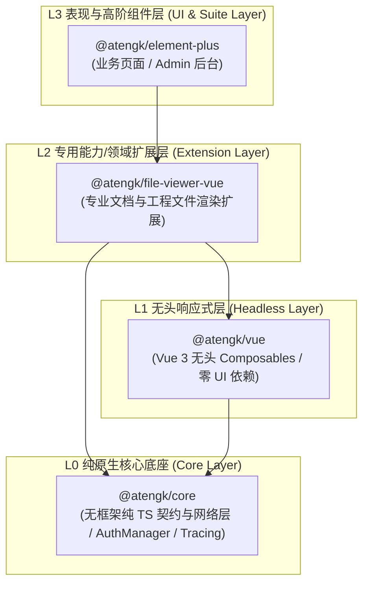
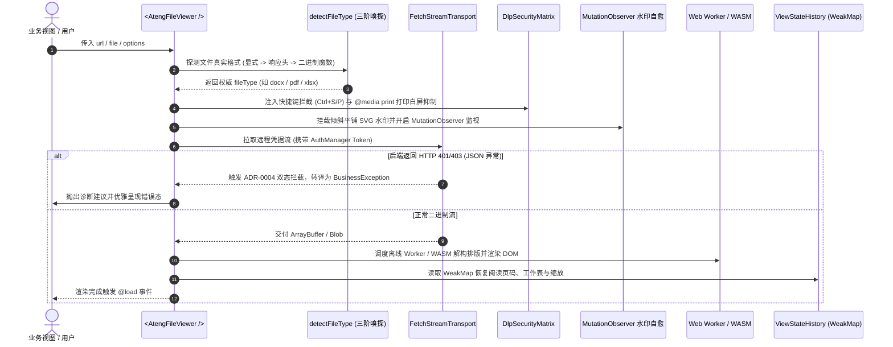

# @atengk/file-viewer-vue 专业文档与工程文件渲染扩展套件

> 面向现代 Web 应用与企业级系统的纯前端浏览器原生全格式文档与工程图纸离线渲染基础设施，归属于系统四层洋葱拓扑之 **L2 专用能力/领域扩展层**。遵循“纯 Vue 3 驱动、强类型契约、零具体 UI 依赖、确定性生命周期治理”设计，提供统一多格式文档表现容器、声明式/命令式多模态弹窗、纯无头响应式状态机 Hook、三阶智能魔数嗅探、四维 DLP 防泄密矩阵、SVG 倾斜平铺反审查自愈水印、三级弹性离线静态资产寻址、CAD/3D 动态重型预设插拔、百兆内存防崩护栏（SizeGuard）、6 大结构化异常诊断以及基于 WeakMap 的弱引用阅读状态记忆恢复。

---

## 0. 特性与公共 API 全景速查矩阵

| 特性分类       | 特性名称              | 核心门面 / 组件 / Hook                          | 关键参数 / Props / Emits                                              | 核心行为说明                                                                                                        | 锚定验证源头 (*Test / Sample)                                                                                                                                                |
| :------------- | :-------------------- | :---------------------------------------------- | :-------------------------------------------------------------------- | :------------------------------------------------------------------------------------------------------------------ | :--------------------------------------------------------------------------------------------------------------------------------------------------------------------------- |
| **表现容器**   | 主容器组件            | `<AtengFileViewer />`                           | `url, file, fileName, fileType, page, sheet, maxSize, password`       | 纯前端全格式文档原生渲染容器（Word/Excel/PPT/PDF/Markdown/SVG），内置 DLP 防泄密、防篡改水印与受控翻页/Sheet 状态机 | [AtengFileViewer.test.ts](./test/AtengFileViewer.test.ts) / [OfficeDocumentScenario.vue](../../apps/sample-file-viewer-vue/src/scenarios/OfficeDocumentScenario.vue)         |
| **基础渲染**   | Markdown 纯文本渲染   | `TextRenderer` (内置)                           | `textRenderer / .md / .markdown / .txt`                               | 原生内聚纯文本与 Markdown 流式渲染，支持多级大纲抓取、代码高亮与主题跟随                                            | [AtengFileViewer.test.ts](./test/AtengFileViewer.test.ts) / [OfficeDocumentScenario.vue](../../apps/sample-file-viewer-vue/src/scenarios/OfficeDocumentScenario.vue)         |
| **多模态弹窗** | 声明式受控全屏弹窗    | `<AtengFileViewerDialog />`                     | `v-model, fullscreen, dialogWidth, dialogHeight, #header`             | 声明式受控弹窗，支持 ESC 退出、遮罩点击、自适应视口尺寸，100% 透传主容器属性与插槽                                  | [AtengFileViewerDialog.test.ts](./test/AtengFileViewerDialog.test.ts) / [ModalPreviewScenario.vue](../../apps/sample-file-viewer-vue/src/scenarios/ModalPreviewScenario.vue) |
| **多模态弹窗** | 命令式极速预览函数    | `previewFile(options)`                          | `options: FileViewerPreviewOptions`                                   | 一行 JS 命令式在 `document.body` 动态唤出全屏弹窗，返回控制句柄并保证 100% 确定性 DOM 移除与实例销毁                | [AtengFileViewerDialog.test.ts](./test/AtengFileViewerDialog.test.ts) / [ModalPreviewScenario.vue](../../apps/sample-file-viewer-vue/src/scenarios/ModalPreviewScenario.vue) |
| **多模态弹窗** | 静态命名空间语法糖    | `FileViewer.preview(options)`                   | `options: FileViewerPreviewOptions`                                   | 静态命名空间快捷入口，等价于 `previewFile(options)`                                                                 | [AtengFileViewerDialog.test.ts](./test/AtengFileViewerDialog.test.ts) / [ModalPreviewScenario.vue](../../apps/sample-file-viewer-vue/src/scenarios/ModalPreviewScenario.vue) |
| **插件安装**   | Vue 插件独立安装器    | `install(app) / default`                        | `app: App`                                                            | 显式注册 `AtengFileViewer` 与 `AtengFileViewerDialog` 全局组件，遵循受控装配原则                                    | [AtengFileViewer.test.ts](./test/AtengFileViewer.test.ts) / [main.ts](../../apps/sample-file-viewer-vue/src/main.ts)                                                         |
| **无头逻辑**   | 无头状态机控制器      | `useFileViewer(options)`                        | `options: UseFileViewerOptions -> UseFileViewerReturn`                | 纯无头响应式状态机，编排多页翻页、Sheet 切换、TOC 目录大纲、DLP 权限、SizeGuard 护栏与密码状态机                    | [useFileViewer.test.ts](./test/useFileViewer.test.ts) / [HeadlessStateScenario.vue](../../apps/sample-file-viewer-vue/src/scenarios/HeadlessStateScenario.vue)               |
| **智能嗅探**   | 三阶类型智能推导      | `detectFileType(source, options?)`              | `source: string \| File \| Blob, options?: SniffOptions`              | 三阶智能判定（显式参数 -> 响应头 Content-Disposition/Type -> 纳秒级二进制魔数），无后缀流安全推导                   | [sniff.test.ts](./test/sniff.test.ts) / [OfficeDocumentScenario.vue](../../apps/sample-file-viewer-vue/src/scenarios/OfficeDocumentScenario.vue)                             |
| **智能嗅探**   | 魔数特征精确匹配      | `sniffMagicNumber(buffer)`                      | `buffer: ArrayBuffer \| Uint8Array`                                   | 纯二进制头部特征比对，精确识别 DOCX, XLSX, PPTX, PDF, ZIP 等核心格式魔数                                            | [sniff.test.ts](./test/sniff.test.ts) / [OfficeDocumentScenario.vue](../../apps/sample-file-viewer-vue/src/scenarios/OfficeDocumentScenario.vue)                             |
| **安全网络**   | 凭据流拉取管道        | `fetchRemoteFileStream(url, options?)`          | `url: string, options?: RemoteFileFetchOptions`                       | 基于 Fetch API 携带 AuthManager 双轨 Token 凭据拉取远程流，支持 AbortController 销毁取消与 Blob URL 回收            | [fetcher.test.ts](./test/fetcher.test.ts) / [OfficeDocumentScenario.vue](../../apps/sample-file-viewer-vue/src/scenarios/OfficeDocumentScenario.vue)                         |
| **数据安全**   | 四维 DLP 防护控制器   | `setupDlpProtection(target, options)`           | `target: HTMLElement, options: DlpOptions -> DlpController`           | 控制下载、打印、复制与右键权限，硬拦截 Ctrl+S / Ctrl+P，注入 `@media print` 样式白屏抑制                            | [dlp.test.ts](./test/dlp.test.ts) / [DlpSecurityScenario.vue](../../apps/sample-file-viewer-vue/src/scenarios/DlpSecurityScenario.vue)                                       |
| **数据安全**   | 反审查动态矢量水印    | `createWatermarkOverlay(target, options)`       | `target: HTMLElement, options: WatermarkOptions -> WatermarkInstance` | 原生矢量 SVG 倾斜平铺水印，内置 MutationObserver 反审查自愈引擎，F12 篡改或删除毫秒级恢复                           | [watermark.test.ts](./test/watermark.test.ts) / [DlpSecurityScenario.vue](../../apps/sample-file-viewer-vue/src/scenarios/DlpSecurityScenario.vue)                           |
| **水印工具**   | 矢量 SVG 生成器       | `buildWatermarkSvg / buildWatermarkDataUrl`     | `options: NormalizedWatermarkOptions -> string`                       | 根据文本、颜色、倾角、透明度纳秒级计算并生成倾斜平铺的 SVG 字符串或 Base64 DataURL                                  | [watermark.test.ts](./test/watermark.test.ts) / [DlpSecurityScenario.vue](../../apps/sample-file-viewer-vue/src/scenarios/DlpSecurityScenario.vue)                           |
| **水印工具**   | 水印配置规范化        | `normalizeWatermark(input)`                     | `input?: FileViewerWatermark -> NormalizedWatermarkOptions \| null`   | 规整字符串简写或高阶配置对象，未启用时安全返回 null                                                                 | [watermark.test.ts](./test/watermark.test.ts) / [DlpSecurityScenario.vue](../../apps/sample-file-viewer-vue/src/scenarios/DlpSecurityScenario.vue)                           |
| **状态持久**   | 弱引用状态记忆写入    | `saveViewStateHistory(key, state)`              | `key: string, state: StoredViewState`                                 | 基于 WeakMap 记录文档阅读页码、工作表、缩放比例、旋转角度与滚动偏移，切 Tab 销毁重绘后自动无感恢复                  | [viewStateHistory.test.ts](./test/viewStateHistory.test.ts) / [HeadlessStateScenario.vue](../../apps/sample-file-viewer-vue/src/scenarios/HeadlessStateScenario.vue)         |
| **状态持久**   | 弱引用状态记忆复原    | `restoreViewStateHistory(key)`                  | `key: string -> StoredViewState \| null`                              | 从弱引用历史表恢复阅读位置，未命中安全回退保底                                                                      | [viewStateHistory.test.ts](./test/viewStateHistory.test.ts) / [HeadlessStateScenario.vue](../../apps/sample-file-viewer-vue/src/scenarios/HeadlessStateScenario.vue)         |
| **状态持久**   | 历史状态清空与键推导  | `clearViewStateHistory / resolveViewStateKey`   | `input: ResolveViewStateKeyInput -> string`                           | 推导文档唯一指纹缓存键，支持业务侧显式重置清理                                                                      | [viewStateHistory.test.ts](./test/viewStateHistory.test.ts) / [HeadlessStateScenario.vue](../../apps/sample-file-viewer-vue/src/scenarios/HeadlessStateScenario.vue)         |
| **离线寻址**   | 三级弹性资产寻址      | `resolveThreeTierAssetBaseUrl(options)`         | `options: ResolveAssetBaseUrlOptions -> string`                       | 按“本地同源 public ➔ 内网 MinIO/专网 ➔ 公共 CDN”三级优先级确定 Web Worker/WASM 资产基地址                           | [assets.test.ts](./test/assets.test.ts) / [AssetStrategyScenario.vue](../../apps/sample-file-viewer-vue/src/scenarios/AssetStrategyScenario.vue)                             |
| **离线寻址**   | 全局资产配置门面      | `configureFileViewer / getFileViewerConfig`     | `config: Partial<FileViewerGlobalConfig>`                             | 全局配置默认静态资产基地址与 CDN 回退镜像策略                                                                       | [assets.test.ts](./test/assets.test.ts) / [AssetStrategyScenario.vue](../../apps/sample-file-viewer-vue/src/scenarios/AssetStrategyScenario.vue)                             |
| **动态插件**   | 重型渲染预设插拔      | `registerPreset / unregisterPreset`             | `preset: FileViewerPreset`                                            | 动态插拔重型渲染器（如 CAD 工程图纸、Three.js 3D 模型），避免膨胀核心包体积                                         | [presets.test.ts](./test/presets.test.ts) / [AssetStrategyScenario.vue](../../apps/sample-file-viewer-vue/src/scenarios/AssetStrategyScenario.vue)                           |
| **动态插件**   | 预设查询与清空        | `getRegisteredPresets / clearPresets`           | `() -> FileViewerPreset[]`                                            | 运行时反射获取当前所有已装配预设清单，支持测试与热重载清空                                                          | [presets.test.ts](./test/presets.test.ts) / [AssetStrategyScenario.vue](../../apps/sample-file-viewer-vue/src/scenarios/AssetStrategyScenario.vue)                           |
| **内存护栏**   | 百兆防崩拦截护栏      | `isFileSizeExceeded(size, limit)`               | `size: number, limit: number \| string -> boolean`                    | 预防超大文档或图纸耗尽浏览器渲染内存导致崩溃白屏，支持业务层 forceRender 破除拦截                                   | [sizeGuard.test.ts](./test/sizeGuard.test.ts) / [SizeGuardScenario.vue](../../apps/sample-file-viewer-vue/src/scenarios/SizeGuardScenario.vue)                               |
| **内存护栏**   | 尺寸与速率格式化      | `formatFileSize / formatSpeed / parseSizeLimit` | `size: number -> string`                                              | 字节纳秒级转译为 KB/MB/GB 语义文本及限额解析                                                                        | [sizeGuard.test.ts](./test/sizeGuard.test.ts) / [SizeGuardScenario.vue](../../apps/sample-file-viewer-vue/src/scenarios/SizeGuardScenario.vue)                               |
| **传输指示**   | 渐进进度与 ETA 算法   | `calculateProgress(input)`                      | `input: CalculateProgressInput -> FileViewerDownloadProgress`         | 纳秒级计算渐进下载百分比、瞬时速率 (MB/s) 与预计剩余时间 (ETA)                                                      | [sizeGuard.test.ts](./test/sizeGuard.test.ts) / [SizeGuardScenario.vue](../../apps/sample-file-viewer-vue/src/scenarios/SizeGuardScenario.vue)                               |
| **异常诊断**   | 结构化分类诊断器      | `diagnoseFileViewerError(error, context)`       | `error: unknown, context?: DiagnoseContext -> FileViewerDiagnostic`   | 精准归类 6 大异常类别（网络超时、403权限、加密保护、老旧格式、格式损坏、超大拦截），提供可操作升级与解密指引        | [diagnostic.test.ts](./test/diagnostic.test.ts) / [DiagnosticPasswordScenario.vue](../../apps/sample-file-viewer-vue/src/scenarios/DiagnosticPasswordScenario.vue)           |
| **大纲语义**   | 真实 DOM 标题语义提取 | `extractDocumentHeadings(container)`            | `container: HTMLElement \| null -> FileViewerDocumentAnchor[]`        | 专职从真实 DOM 树提取 Heading 标签与样式，严格排除复合大容器与普通正文段落，杜绝全文合并污染                        | [toc.test.ts](./test/toc.test.ts) / [TableOfContentsScenario.vue](../../apps/sample-file-viewer-vue/src/scenarios/TableOfContentsScenario.vue)                               |
| **大纲语义**   | 标题层级推导算法      | `resolveHeadingLevel(el)`                       | `el: HTMLElement -> number (1 ~ 6)`                                   | 依据 H 标签名、class 与 id 确定性推导标题层级，驱动树状缩进与层级圆点指示                                           | [toc.test.ts](./test/toc.test.ts) / [TableOfContentsScenario.vue](../../apps/sample-file-viewer-vue/src/scenarios/TableOfContentsScenario.vue)                               |

---

## 1. 模块定位与 pnpm 坐标

`@atengk/file-viewer-vue` 归属于 `ateng-ui` 基础设施套件的 **L2 专用能力/领域扩展层 (Extension Layer)**，专注于企业级多格式文档与工程图纸浏览器原生离线渲染。

- **npm 坐标**：`@atengk/file-viewer-vue`
- **源码工程**：`packages/file-viewer-vue`
- **自验展厅**：`apps/sample-file-viewer-vue`（端口 `3004`）
- **底层依赖**：依赖 `@atengk/core` (L0) 与 `@atengk/vue` (L1)，严格与具体 UI 表现库解耦；
- **peerDependencies 契约**：要求 `vue: ^3.5.0`。

### 安装依赖

```bash
pnpm add @atengk/file-viewer-vue @atengk/core @atengk/vue vue
```

---

## 2. 核心架构与设计不变量

### 2.1 四层洋葱拓扑位置



### 2.2 渲染与安全交互流程图



### 2.3 六大硬核设计不变量

1. **三阶类型智能嗅探不变量 (Three-Stage Sniffing Invariant)**：
   - 面对企业级应用中大量缺失文件扩展名的 RESTful 接口流（如 `/api/v1/files/stream?id=1024`）或 CDN 错误的 `application/octet-stream` 响应头，引擎严格按照“显式属性 ➔ 响应头 `Content-Disposition` / `Content-Type` ➔ 纳秒级二进制魔数特征（Magic Number）”三阶级联推导；
   - 纯二进制头部扫描覆盖 DOCX、XLSX、PPTX（ZIP PK 签名）、PDF（`%PDF-`）、SVG（`<svg` XML 标签）等核心魔数，彻底杜绝无后缀或伪后缀导致的文件解析崩溃。

2. **四维 DLP 数据防泄密硬核拦截不变量 (Four-Dimensional DLP Invariant)**：
   - **快捷键物理拦截**：当 `downloadable: false` 或 `printable: false` 时，底层全局拦截 `Ctrl+S` / `Cmd+S`、`Ctrl+P` / `Cmd+P`，终止浏览器默认另存与打印逻辑；
   - **打印白屏抑制**：动态挂载 `@media print` 样式规则，强制执行 `display: none !important;`，彻底防御利用物理打印机或“打印为 PDF”翻拍窃密；
   - **文字防选与右键禁用**：配置 `copyable: false` 与 `contextMenu: false` 时，物理阻断鼠标框选拖蓝与右键菜单弹出，全方位筑牢防泄密防线。

3. **反审查动态矢量自愈水印不变量 (Tamper-Resistant Self-Healing Watermark Invariant)**：
   - 防篡改水印基于原生矢量 SVG 倾斜平铺渲染，通过 `MutationObserver` 实时监视 DOM 树状态；
   - 恶意用户或审查绕过脚本若在 F12 开发者工具中删除、隐藏（`display: none` / `opacity: 0`）或篡改水印节点，引擎在 1 帧（毫秒级）内原地自愈重建，确保证据链与安全追溯真实有效。

4. **原生 Fetch 流式管道与 ADR-0004 双态异常防御不变量 (Fetch Stream & Dual-State JSON Invariant)**：
   - 彻底放弃传统 `XMLHttpRequest`，全链路采用标准 W3C Fetch API + `ReadableStream` 流式管道，彻底免疫第三方探针（如 `inspector.js`）篡改 XHR 读取 `responseText` 引发的 `InvalidStateError`；
   - 当后端返回 HTTP 401/403 或业务失败时，底层拦截器异步探测 `application/json` 响应头，自动将 Blob 内容转译为 `Result<never>` 并派发为 `BusinessException` 结构化异常，坚决杜绝把报错 JSON 当成二进制文件渲染或下载损坏伪文件。

5. **WeakMap 弱引用阅读状态记忆恢复不变量 (WeakMap Reading State Recovery Invariant)**：
   - 基于 `WeakMap` 与文档唯一指纹缓存阅读页码、多 Sheet 索引、缩放比率与旋转角度；
   - 开发者在 Tab 频繁切换、组件销毁并重新挂载时，自动秒级复原阅读位置，避免用户反复翻页寻回进度，且不阻碍垃圾回收、零内存泄漏风险。

6. **确定性生命周期与 DOM 零残留不变量 (Deterministic Lifecycle & Zero DOM Residual Invariant)**：
   - 无论是声明式 `<AtengFileViewerDialog />` 还是命令式 `FileViewer.preview()`，在弹窗关闭销毁时，均确定性执行 `app.unmount()`、注销键盘/窗口物理监听，并延迟安全移除宿主 DOM 节点，彻底杜绝幽灵 DOM 与内存泄漏。

---

## 3. 多格式文档原生离线渲染与智能类型嗅探

> 待后续工单 #257 交付：包含主容器、Markdown 渲染、三阶智能魔数嗅探等子小节的“三要素就近闭环”。

---

## 4. 真实 DOM 章节大纲提取与目录联动 (TOC)

> 待后续工单 #257 交付：包含标题语义提取器、层级推导与平滑锚点跳转等子小节的“三要素就近闭环”。

---

## 5. 四维 DLP 数据防泄密与反审查自愈水印

> 待后续工单 #258 交付：包含四维 DLP 权限矩阵、反审查动态自愈水印等子小节的“三要素就近闭环”。

---

## 6. 三级弹性离线资产寻址与动态重型预设插拔

> 待后续工单 #258 交付：包含 Local/Intranet/CDN 三级寻址、CAD/3D 动态重型预设等子小节的“三要素就近闭环”。

---

## 7. 百兆内存防崩护栏 (SizeGuard) 与渐进传输指示

> 待后续工单 #259 交付：包含 SizeGuard 堆内存护栏、下载进度/速率/ETA 算法等子小节的“三要素就近闭环”。

---

## 8. 结构化异常分类诊断与加密文档原地密码解密

> 待后续工单 #259 交付：包含 6 大错误分类指引、受保护 PDF 原地解密等子小节的“三要素就近闭环”。

---

## 9. 多模态表现容器与无头状态机编排

> 待后续工单 #259 交付：包含全屏弹窗、命令式 preview、useFileViewer、WeakMap 状态记忆等子小节的“三要素就近闭环”。

---

## 10. 完整 TypeScript 接口/Props/CSS 变量速查清单

> 待后续工单 #259 交付：包含全量 Props、Emits、Slots、Ref 实例与 CSS 变量 Design Tokens 速查附录字典。
