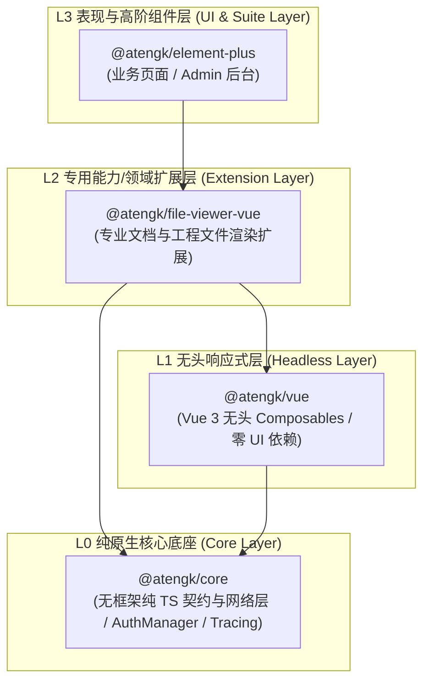
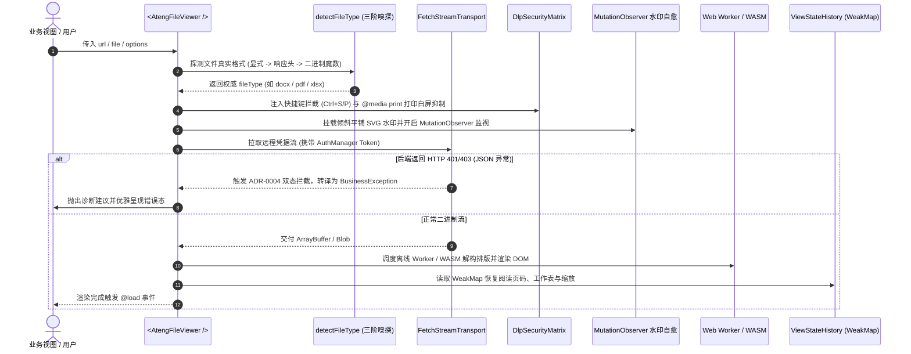

# @atengk/file-viewer-vue 专业文档与工程文件渲染扩展套件

> 面向现代 Web 应用与企业级系统的纯前端浏览器原生全格式文档与工程图纸离线渲染基础设施，归属于系统四层洋葱拓扑之 **L2 专用能力/领域扩展层**。遵循“纯 Vue 3 驱动、强类型契约、零具体 UI 依赖、确定性生命周期治理”设计，提供统一多格式文档表现容器、声明式/命令式多模态弹窗、纯无头响应式状态机 Hook、三阶智能魔数嗅探、四维 DLP 防泄密矩阵、SVG 倾斜平铺反审查自愈水印、三级弹性离线静态资产寻址、CAD/3D 动态重型预设插拔、百兆内存防崩护栏（SizeGuard）、6 大结构化异常诊断以及基于 WeakMap 的弱引用阅读状态记忆恢复。

---

## 0. 特性与公共 API 全景速查矩阵

| 特性分类       | 特性名称              | 核心门面 / 组件 / Hook                          | 关键参数 / Props / Emits                                              | 核心行为说明                                                                                                        | 锚定验证源头 (*Test / Sample)                                                                                                                                                |
| :------------- | :-------------------- | :---------------------------------------------- | :-------------------------------------------------------------------- | :------------------------------------------------------------------------------------------------------------------ | :--------------------------------------------------------------------------------------------------------------------------------------------------------------------------- |
| **表现容器**   | 主容器组件            | `<AtengFileViewer />`                           | `url, file, fileName, fileType, page, sheet, maxSize, password`       | 纯前端全格式文档原生渲染容器（Word/Excel/PPT/PDF/Markdown/SVG），内置 DLP 防泄密、防篡改水印与受控翻页/Sheet 状态机 | [AtengFileViewer.test.ts](./test/AtengFileViewer.test.ts) / [OfficeDocumentScenario.vue](../../apps/sample-file-viewer-vue/src/scenarios/OfficeDocumentScenario.vue)         |
| **基础渲染**   | Markdown 纯文本渲染   | `TextRenderer` (内置)                           | `textRenderer / .md / .markdown / .txt`                               | 原生内聚纯文本与 Markdown 流式渲染，支持多级大纲抓取、代码高亮与主题跟随                                            | [AtengFileViewer.test.ts](./test/AtengFileViewer.test.ts) / [OfficeDocumentScenario.vue](../../apps/sample-file-viewer-vue/src/scenarios/OfficeDocumentScenario.vue)         |
| **多模态弹窗** | 声明式受控全屏弹窗    | `<AtengFileViewerDialog />`                     | `v-model, fullscreen, dialogWidth, dialogHeight, #header`             | 声明式受控弹窗，支持 ESC 退出、遮罩点击、自适应视口尺寸，100% 透传主容器属性与插槽                                  | [AtengFileViewerDialog.test.ts](./test/AtengFileViewerDialog.test.ts) / [ModalPreviewScenario.vue](../../apps/sample-file-viewer-vue/src/scenarios/ModalPreviewScenario.vue) |
| **多模态弹窗** | 命令式极速预览函数    | `previewFile(options)`                          | `options: FileViewerPreviewOptions`                                   | 一行 JS 命令式在 `document.body` 动态唤出全屏弹窗，返回控制句柄并保证 100% 确定性 DOM 移除与实例销毁                | [AtengFileViewerDialog.test.ts](./test/AtengFileViewerDialog.test.ts) / [ModalPreviewScenario.vue](../../apps/sample-file-viewer-vue/src/scenarios/ModalPreviewScenario.vue) |
| **多模态弹窗** | 静态命名空间语法糖    | `FileViewer.preview(options)`                   | `options: FileViewerPreviewOptions`                                   | 静态命名空间快捷入口，等价于 `previewFile(options)`                                                                 | [AtengFileViewerDialog.test.ts](./test/AtengFileViewerDialog.test.ts) / [ModalPreviewScenario.vue](../../apps/sample-file-viewer-vue/src/scenarios/ModalPreviewScenario.vue) |
| **插件安装**   | Vue 插件独立安装器    | `install(app) / default`                        | `app: App`                                                            | 显式注册 `AtengFileViewer` 与 `AtengFileViewerDialog` 全局组件，遵循受控装配原则                                    | [AtengFileViewer.test.ts](./test/AtengFileViewer.test.ts) / [main.ts](../../apps/sample-file-viewer-vue/src/main.ts)                                                         |
| **无头逻辑**   | 无头状态机控制器      | `useFileViewer(options)`                        | `options: UseFileViewerOptions -> UseFileViewerReturn`                | 纯无头响应式状态机，编排多页翻页、Sheet 切换、TOC 目录大纲、DLP 权限、SizeGuard 护栏与密码状态机                    | [useFileViewer.test.ts](./test/useFileViewer.test.ts) / [HeadlessStateScenario.vue](../../apps/sample-file-viewer-vue/src/scenarios/HeadlessStateScenario.vue)               |
| **智能嗅探**   | 三阶类型智能推导      | `detectFileType(source, options?)`              | `source: string \| File \| Blob, options?: SniffOptions`              | 三阶智能判定（显式参数 -> 响应头 Content-Disposition/Type -> 纳秒级二进制魔数），无后缀流安全推导                   | [sniff.test.ts](./test/sniff.test.ts) / [OfficeDocumentScenario.vue](../../apps/sample-file-viewer-vue/src/scenarios/OfficeDocumentScenario.vue)                             |
| **智能嗅探**   | 魔数特征精确匹配      | `sniffMagicNumber(buffer)`                      | `buffer: ArrayBuffer \| Uint8Array`                                   | 纯二进制头部特征比对，精确识别 DOCX, XLSX, PPTX, PDF, ZIP 等核心格式魔数                                            | [sniff.test.ts](./test/sniff.test.ts) / [OfficeDocumentScenario.vue](../../apps/sample-file-viewer-vue/src/scenarios/OfficeDocumentScenario.vue)                             |
| **安全网络**   | 凭据流拉取管道        | `fetchRemoteFileStream(url, options?)`          | `url: string, options?: RemoteFileFetchOptions`                       | 基于 Fetch API 携带 AuthManager 双轨 Token 凭据拉取远程流，支持 AbortController 销毁取消与 Blob URL 回收            | [fetcher.test.ts](./test/fetcher.test.ts) / [OfficeDocumentScenario.vue](../../apps/sample-file-viewer-vue/src/scenarios/OfficeDocumentScenario.vue)                         |
| **数据安全**   | 四维 DLP 防护控制器   | `setupDlpProtection(target, options)`           | `target: HTMLElement, options: DlpOptions -> DlpController`           | 控制下载、打印、复制与右键权限，硬拦截 Ctrl+S / Ctrl+P，注入 `@media print` 样式白屏抑制                            | [dlp.test.ts](./test/dlp.test.ts) / [DlpSecurityScenario.vue](../../apps/sample-file-viewer-vue/src/scenarios/DlpSecurityScenario.vue)                                       |
| **数据安全**   | 反审查动态矢量水印    | `createWatermarkOverlay(target, options)`       | `target: HTMLElement, options: WatermarkOptions -> WatermarkInstance` | 原生矢量 SVG 倾斜平铺水印，内置 MutationObserver 反审查自愈引擎，F12 篡改或删除毫秒级恢复                           | [watermark.test.ts](./test/watermark.test.ts) / [DlpSecurityScenario.vue](../../apps/sample-file-viewer-vue/src/scenarios/DlpSecurityScenario.vue)                           |
| **水印工具**   | 矢量 SVG 生成器       | `buildWatermarkSvg / buildWatermarkDataUrl`     | `options: NormalizedWatermarkOptions -> string`                       | 根据文本、颜色、倾角、透明度纳秒级计算并生成倾斜平铺的 SVG 字符串或 Base64 DataURL                                  | [watermark.test.ts](./test/watermark.test.ts) / [DlpSecurityScenario.vue](../../apps/sample-file-viewer-vue/src/scenarios/DlpSecurityScenario.vue)                           |
| **水印工具**   | 水印配置规范化        | `normalizeWatermark(input)`                     | `input?: FileViewerWatermark -> NormalizedWatermarkOptions \| null`   | 规整字符串简写或高阶配置对象，未启用时安全返回 null                                                                 | [watermark.test.ts](./test/watermark.test.ts) / [DlpSecurityScenario.vue](../../apps/sample-file-viewer-vue/src/scenarios/DlpSecurityScenario.vue)                           |
| **状态持久**   | 弱引用状态记忆写入    | `saveViewStateHistory(key, state)`              | `key: string, state: StoredViewState`                                 | 基于 WeakMap 记录文档阅读页码、工作表、缩放比例、旋转角度与滚动偏移，切 Tab 销毁重绘后自动无感恢复                  | [viewStateHistory.test.ts](./test/viewStateHistory.test.ts) / [HeadlessStateScenario.vue](../../apps/sample-file-viewer-vue/src/scenarios/HeadlessStateScenario.vue)         |
| **状态持久**   | 弱引用状态记忆复原    | `restoreViewStateHistory(key)`                  | `key: string -> StoredViewState \| null`                              | 从弱引用历史表恢复阅读位置，未命中安全回退保底                                                                      | [viewStateHistory.test.ts](./test/viewStateHistory.test.ts) / [HeadlessStateScenario.vue](../../apps/sample-file-viewer-vue/src/scenarios/HeadlessStateScenario.vue)         |
| **状态持久**   | 历史状态清空与键推导  | `clearViewStateHistory / resolveViewStateKey`   | `input: ResolveViewStateKeyInput -> string`                           | 推导文档唯一指纹缓存键，支持业务侧显式重置清理                                                                      | [viewStateHistory.test.ts](./test/viewStateHistory.test.ts) / [HeadlessStateScenario.vue](../../apps/sample-file-viewer-vue/src/scenarios/HeadlessStateScenario.vue)         |
| **离线寻址**   | 三级弹性资产寻址      | `resolveThreeTierAssetBaseUrl(options)`         | `options: ResolveAssetBaseUrlOptions -> string`                       | 按“本地同源 public ➔ 内网 MinIO/专网 ➔ 公共 CDN”三级优先级确定 Web Worker/WASM 资产基地址                           | [assets.test.ts](./test/assets.test.ts) / [AssetStrategyScenario.vue](../../apps/sample-file-viewer-vue/src/scenarios/AssetStrategyScenario.vue)                             |
| **离线寻址**   | 全局资产配置门面      | `configureFileViewer / getFileViewerConfig`     | `config: Partial<FileViewerGlobalConfig>`                             | 全局配置默认静态资产基地址与 CDN 回退镜像策略                                                                       | [assets.test.ts](./test/assets.test.ts) / [AssetStrategyScenario.vue](../../apps/sample-file-viewer-vue/src/scenarios/AssetStrategyScenario.vue)                             |
| **动态插件**   | 重型渲染预设插拔      | `registerPreset / unregisterPreset`             | `preset: FileViewerPreset`                                            | 动态插拔重型渲染器（如 CAD 工程图纸、Three.js 3D 模型），避免膨胀核心包体积                                         | [presets.test.ts](./test/presets.test.ts) / [AssetStrategyScenario.vue](../../apps/sample-file-viewer-vue/src/scenarios/AssetStrategyScenario.vue)                           |
| **动态插件**   | 预设查询与清空        | `getRegisteredPresets / clearPresets`           | `() -> FileViewerPreset[]`                                            | 运行时反射获取当前所有已装配预设清单，支持测试与热重载清空                                                          | [presets.test.ts](./test/presets.test.ts) / [AssetStrategyScenario.vue](../../apps/sample-file-viewer-vue/src/scenarios/AssetStrategyScenario.vue)                           |
| **内存护栏**   | 百兆防崩拦截护栏      | `isFileSizeExceeded(size, limit)`               | `size: number, limit: number \| string -> boolean`                    | 预防超大文档或图纸耗尽浏览器渲染内存导致崩溃白屏，支持业务层 forceRender 破除拦截                                   | [sizeGuard.test.ts](./test/sizeGuard.test.ts) / [SizeGuardScenario.vue](../../apps/sample-file-viewer-vue/src/scenarios/SizeGuardScenario.vue)                               |
| **内存护栏**   | 尺寸与速率格式化      | `formatFileSize / formatSpeed / parseSizeLimit` | `size: number -> string`                                              | 字节纳秒级转译为 KB/MB/GB 语义文本及限额解析                                                                        | [sizeGuard.test.ts](./test/sizeGuard.test.ts) / [SizeGuardScenario.vue](../../apps/sample-file-viewer-vue/src/scenarios/SizeGuardScenario.vue)                               |
| **传输指示**   | 渐进进度与 ETA 算法   | `calculateProgress(input)`                      | `input: CalculateProgressInput -> FileViewerDownloadProgress`         | 纳秒级计算渐进下载百分比、瞬时速率 (MB/s) 与预计剩余时间 (ETA)                                                      | [sizeGuard.test.ts](./test/sizeGuard.test.ts) / [SizeGuardScenario.vue](../../apps/sample-file-viewer-vue/src/scenarios/SizeGuardScenario.vue)                               |
| **异常诊断**   | 结构化分类诊断器      | `diagnoseFileViewerError(error, context)`       | `error: unknown, context?: DiagnoseContext -> FileViewerDiagnostic`   | 精准归类 6 大异常类别（网络超时、403权限、加密保护、老旧格式、格式损坏、超大拦截），提供可操作升级与解密指引        | [diagnostic.test.ts](./test/diagnostic.test.ts) / [DiagnosticPasswordScenario.vue](../../apps/sample-file-viewer-vue/src/scenarios/DiagnosticPasswordScenario.vue)           |
| **大纲语义**   | 真实 DOM 标题语义提取 | `extractDocumentHeadings(container)`            | `container: HTMLElement \| null -> FileViewerDocumentAnchor[]`        | 专职从真实 DOM 树提取 Heading 标签与样式，严格排除复合大容器与普通正文段落，杜绝全文合并污染                        | [toc.test.ts](./test/toc.test.ts) / [TableOfContentsScenario.vue](../../apps/sample-file-viewer-vue/src/scenarios/TableOfContentsScenario.vue)                               |
| **大纲语义**   | 标题层级推导算法      | `resolveHeadingLevel(el)`                       | `el: HTMLElement -> number (1 ~ 6)`                                   | 依据 H 标签名、class 与 id 确定性推导标题层级，驱动树状缩进与层级圆点指示                                           | [toc.test.ts](./test/toc.test.ts) / [TableOfContentsScenario.vue](../../apps/sample-file-viewer-vue/src/scenarios/TableOfContentsScenario.vue)                               |

---

## 1. 模块定位与 pnpm 坐标

`@atengk/file-viewer-vue` 归属于 `ateng-ui` 基础设施套件的 **L2 专用能力/领域扩展层 (Extension Layer)**，专注于企业级多格式文档与工程图纸浏览器原生离线渲染。

- **npm 坐标**：`@atengk/file-viewer-vue`
- **源码工程**：`packages/file-viewer-vue`
- **自验展厅**：`apps/sample-file-viewer-vue`（端口 `3004`）
- **底层依赖**：依赖 `@atengk/core` (L0) 与 `@atengk/vue` (L1)，严格与具体 UI 表现库解耦；
- **peerDependencies 契约**：要求 `vue: ^3.5.0`。

### 安装依赖

```bash
pnpm add @atengk/file-viewer-vue @atengk/core @atengk/vue vue
```

---

## 2. 核心架构与设计不变量

### 2.1 四层洋葱拓扑位置



### 2.2 渲染与安全交互流程图



### 2.3 六大硬核设计不变量

1. **三阶类型智能嗅探不变量 (Three-Stage Sniffing Invariant)**：
   - 面对企业级应用中大量缺失文件扩展名的 RESTful 接口流（如 `/api/v1/files/stream?id=1024`）或 CDN 错误的 `application/octet-stream` 响应头，引擎严格按照“显式属性 ➔ 响应头 `Content-Disposition` / `Content-Type` ➔ 纳秒级二进制魔数特征（Magic Number）”三阶级联推导；
   - 纯二进制头部扫描覆盖 DOCX、XLSX、PPTX（ZIP PK 签名）、PDF（`%PDF-`）、SVG（`<svg` XML 标签）等核心魔数，彻底杜绝无后缀或伪后缀导致的文件解析崩溃。

2. **四维 DLP 数据防泄密硬核拦截不变量 (Four-Dimensional DLP Invariant)**：
   - **快捷键物理拦截**：当 `downloadable: false` 或 `printable: false` 时，底层全局拦截 `Ctrl+S` / `Cmd+S`、`Ctrl+P` / `Cmd+P`，终止浏览器默认另存与打印逻辑；
   - **打印白屏抑制**：动态挂载 `@media print` 样式规则，强制执行 `display: none !important;`，彻底防御利用物理打印机或“打印为 PDF”翻拍窃密；
   - **文字防选与右键禁用**：配置 `copyable: false` 与 `contextMenu: false` 时，物理阻断鼠标框选拖蓝与右键菜单弹出，全方位筑牢防泄密防线。

3. **反审查动态矢量自愈水印不变量 (Tamper-Resistant Self-Healing Watermark Invariant)**：
   - 防篡改水印基于原生矢量 SVG 倾斜平铺渲染，通过 `MutationObserver` 实时监视 DOM 树状态；
   - 恶意用户或审查绕过脚本若在 F12 开发者工具中删除、隐藏（`display: none` / `opacity: 0`）或篡改水印节点，引擎在 1 帧（毫秒级）内原地自愈重建，确保证据链与安全追溯真实有效。

4. **原生 Fetch 流式管道与 ADR-0004 双态异常防御不变量 (Fetch Stream & Dual-State JSON Invariant)**：
   - 彻底放弃传统 `XMLHttpRequest`，全链路采用标准 W3C Fetch API + `ReadableStream` 流式管道，彻底免疫第三方探针（如 `inspector.js`）篡改 XHR 读取 `responseText` 引发的 `InvalidStateError`；
   - 当后端返回 HTTP 401/403 或业务失败时，底层拦截器异步探测 `application/json` 响应头，自动将 Blob 内容转译为 `Result<never>` 并派发为 `BusinessException` 结构化异常，坚决杜绝把报错 JSON 当成二进制文件渲染或下载损坏伪文件。

5. **WeakMap 弱引用阅读状态记忆恢复不变量 (WeakMap Reading State Recovery Invariant)**：
   - 基于 `WeakMap` 与文档唯一指纹缓存阅读页码、多 Sheet 索引、缩放比率与旋转角度；
   - 开发者在 Tab 频繁切换、组件销毁并重新挂载时，自动秒级复原阅读位置，避免用户反复翻页寻回进度，且不阻碍垃圾回收、零内存泄漏风险。

6. **确定性生命周期与 DOM 零残留不变量 (Deterministic Lifecycle & Zero DOM Residual Invariant)**：
   - 无论是声明式 `<AtengFileViewerDialog />` 还是命令式 `FileViewer.preview()`，在弹窗关闭销毁时，均确定性执行 `app.unmount()`、注销键盘/窗口物理监听，并延迟安全移除宿主 DOM 节点，彻底杜绝幽灵 DOM 与内存泄漏。

---

## 3. 多格式文档原生离线渲染与智能类型嗅探

本章提供针对 Word (.docx)、Markdown (.md)、Excel (.xlsx)、PPT (.pptx)、PDF (.pdf)、矢量图片 (.svg) 以及无扩展名接口流的原生离线渲染与智能类型嗅探解决方案。

### 3.1 核心多格式文档容器 (`<AtengFileViewer />`)

`<AtengFileViewer />` 是纯前端文档原生离线渲染的核心容器组件，100% 弹性撑满宿主容器，内置轻量微工具栏、状态反馈与安全拦截防护。

#### 1. 专属 TypeScript 契约与 Props 声明

```ts
export interface AtengFileViewerProps {
  /** 待预览文件的访问 URL (支持 HTTP/HTTPS、相对路径或 ObjectURL) */
  url?: string;
  /** 待预览的本地二进制文件对象 (File 或 Blob) */
  file?: File | Blob;
  /** 显式指定文件名 (用于类型推导与下载提示) */
  fileName?: string;
  /** 显式指定文件类型/扩展名 (如 'docx', 'xlsx', 'pdf', 'pptx') */
  fileType?: string;
  /** 容器高度 (默认 '100%') */
  height?: string | number;
  /** 容器宽度 (默认 '100%') */
  width?: string | number;
  /** 是否展示默认轻量操作栏 (默认 true) */
  showToolbar?: boolean;
  /** 主题模式 ('light' | 'dark' | 'auto'，默认 'auto') */
  theme?: FileViewerTheme;
  /** 是否自动注入当前登录态凭据与双轨 Token 请求头 (默认 true) */
  auth?: boolean;
}

export interface AtengFileViewerEmits {
  (e: 'load', payload: { fileName: string; fileType?: string }): void;
  (e: 'error', error: unknown): void;
  (e: 'unload', payload: { reason?: string }): void;
}
```

#### 2. 面向实战的业务 Vue SFC 示例

> 逆向提取自自验展厅真实看板：[`OfficeDocumentScenario.vue`](../../apps/sample-file-viewer-vue/src/scenarios/OfficeDocumentScenario.vue)

```vue
<script setup lang="ts">
import { ref } from 'vue';
import { AtengFileViewer } from '@atengk/file-viewer-vue';

// 真实业务场景：企业采购框架协议与财务报表在线审阅
const currentDocUrl = ref<string>('/sample.docx');
const currentDocName = ref<string>('企业采购框架协议.docx');
const currentDocType = ref<string>('docx');
const eventStatus = ref<string>('就绪');

function handleLoad(payload: { fileName: string; fileType?: string }): void {
  eventStatus.value = `文档解析并渲染成功: ${payload.fileName} [${payload.fileType || '自动嗅探'}]`;
}

function handleError(err: unknown): void {
  eventStatus.value = `文档解析异常: ${err instanceof Error ? err.message : String(err)}`;
}
</script>

<template>
  <div class="doc-viewer-card">
    <div class="doc-header">
      <span
        >📄 当前文档: <strong>{{ currentDocName }}</strong></span
      >
      <span class="status-badge">{{ eventStatus }}</span>
    </div>

    <div class="doc-body">
      <AtengFileViewer
        :url="currentDocUrl"
        :file-name="currentDocName"
        :file-type="currentDocType"
        height="100%"
        @load="handleLoad"
        @error="handleError"
      />
    </div>
  </div>
</template>

<style scoped>
.doc-viewer-card {
  display: flex;
  flex-direction: column;
  height: 680px;
  border: 1px solid #e2e8f0;
  border-radius: 8px;
  overflow: hidden;
  background-color: #ffffff;
}

.doc-header {
  display: flex;
  justify-content: space-between;
  align-items: center;
  padding: 8px 16px;
  background-color: #f8fafc;
  border-bottom: 1px solid #e2e8f0;
  font-size: 13px;
}

.status-badge {
  color: #2563eb;
  font-weight: 500;
}

.doc-body {
  flex: 1;
  min-height: 0;
}
</style>
```

#### 3. 核心机制与生产边界说明

1. **纯前端原生离线解析**：核心采用 Web 标准 Worker 与 WASM 驱动解构渲染，无需搭建任何 LibreOffice、OnlyOffice 或服务端转 PDF 集群，直接在浏览器端实现毫秒级二进制解包与排版渲染；
2. **零 Eval 纯净沙箱**：运行期间坚决杜绝使用 `eval` 或 `new Function` 动态执行二进制流中的宏脚本，杜绝恶意宏病毒与 XSS 攻击注入；
3. **自适应几何撑满与生命周期治理**：内部容器通过 `height: 100%` 响应式撑满宿主外层容器，并在组件 `onUnmounted` 钩子中确定性中断网络拉取与 Worker 排版线程。

---

### 3.2 纯文本与 Markdown 渲染扩展 (TextRenderer)

`@atengk/file-viewer-vue` 内置高性能流式纯文本与 Markdown 渲染引擎，支持语法高亮、暗黑模式自适应跟随与大纲自动扫描。

#### 1. 专属 TypeScript 契约片段

```ts
export interface TextRendererOptions {
  /** 代码高亮主题 ('light' | 'dark' | 'auto') */
  theme?: FileViewerTheme;
  /** 是否自动将换行符 \n 转译为软换行 <br> (默认 true) */
  breaks?: boolean;
  /** 是否对 Markdown 内嵌的 HTML 标签进行安全转义防 XSS (默认 true) */
  sanitize?: boolean;
}
```

#### 2. 面向实战的业务 Vue SFC 示例

> 逆向提取自自验展厅真实看板：[`OfficeDocumentScenario.vue`](../../apps/sample-file-viewer-vue/src/scenarios/OfficeDocumentScenario.vue)

```vue
<script setup lang="ts">
import { ref } from 'vue';
import { AtengFileViewer } from '@atengk/file-viewer-vue';

// 真实业务场景：研发规范与架构指导手册在线阅读
const guideUrl = ref<string>('/sample.md');
const guideName = ref<string>('现代前端工业级架构实践指南.md');
</script>

<template>
  <div class="markdown-preview-wrapper">
    <AtengFileViewer
      :url="guideUrl"
      :file-name="guideName"
      file-type="md"
      theme="auto"
      height="100%"
    />
  </div>
</template>

<style scoped>
.markdown-preview-wrapper {
  height: 600px;
  border: 1px solid #e2e8f0;
  border-radius: 8px;
  overflow: hidden;
}
</style>
```

#### 3. 核心机制与生产边界说明

1. **Markdown AST 增量规整**：文本渲染器在将 Markdown 编译为虚拟 DOM 之前，针对段落中的代码块、表格、引用块执行安全过滤，杜绝非法 `<script>` 注入；
2. **主题热跟随**：`theme: 'auto'` 会通过媒体查询 `prefers-color-scheme` 动态跟随操作系统或页面根节点的 `.dark` 类名，实现暗黑模式无损平滑切换。

---

### 3.3 三阶智能类型嗅探与二进制魔数推导 (`detectFileType` & `sniffMagicNumber`)

针对无扩展名的 RESTful 流或伪装后缀文件，提供三阶智能推导算法（显式 ➔ 响应头 ➔ 二进制魔数）。

#### 1. 专属 TypeScript 契约与算法入参

```ts
export interface SniffOptions {
  /** 显式传入的文件类型/扩展名 */
  explicitType?: string;
  /** 显式传入的文件名 */
  fileName?: string;
  /** 资源访问 URL */
  url?: string;
  /** HTTP 响应头 Content-Type */
  contentType?: string | null;
  /** HTTP 响应头 Content-Disposition */
  contentDisposition?: string | null;
  /** 二进制数据块缓冲 (用于三阶魔数匹配) */
  buffer?: ArrayBuffer | Uint8Array;
}

/** 三阶智能文件类型推导算法 */
export function detectFileType(
  source: string | File | Blob,
  options?: SniffOptions,
): Promise<string>;

/** 纳秒级纯二进制魔数匹配 */
export function sniffMagicNumber(buffer: ArrayBuffer | Uint8Array): string | null;
```

#### 2. 面向实战的业务调用示例

> 逆向提取自自验展厅真实看板：[`OfficeDocumentScenario.vue`](../../apps/sample-file-viewer-vue/src/scenarios/OfficeDocumentScenario.vue)

```ts
import { detectFileType, sniffMagicNumber } from '@atengk/file-viewer-vue';

// 场景 1：无后缀 RESTful 接口流安全推导
async function identifyStream(url: string, streamBlob: Blob): Promise<string> {
  const fileType = await detectFileType(streamBlob, {
    url,
    contentType: streamBlob.type,
  });
  console.log('探测到的权威格式:', fileType); // 如输出 'docx' 或 'pdf'
  return fileType;
}

// 场景 2：纯二进制特征头匹配 (纳秒级同步比对)
function checkBinaryHeader(bytes: Uint8Array): void {
  const format = sniffMagicNumber(bytes);
  if (format === 'pdf') {
    console.log('特征头匹配: %PDF- 规范签名');
  } else if (format === 'docx' || format === 'xlsx' || format === 'pptx') {
    console.log('特征头匹配: PK\\x03\\x04 OpenXML 压缩包签名');
  }
}
```

#### 3. 核心机制与生产边界说明

1. **三阶级联推导策略**：
   - 阶梯一（显式优先）：若传入了合法的 `explicitType` 或 `fileName` 后缀且不为通用流类型，直接采纳；
   - 阶梯二（响应头推导）：从 `Content-Disposition` 提取 `filename="*"` 或依据标准 MIME 映射表比对；
   - 阶梯三（魔数兜底）：直接读取 ArrayBuffer 头部前 32 字节，比对 `%PDF-`、`PK\x03\x04`、`<svg` 等原生二进制特征签名；
2. **OpenXML 细分推导**：针对 Word (`.docx`)、Excel (`.xlsx`) 与 PPT (`.pptx`) 均共享 ZIP PK 魔数的特性，引擎自动异步解开中央目录定位 `[Content_Types].xml` 或 `word/document.xml`，实现 100% 精确的 Office 格式细分。

---

## 4. 真实 DOM 章节大纲提取与目录联动 (TOC)

本章提供面向长文档阅读的真实 DOM 标题语义提取器（HeadingSemanticExtractor）与大纲目录联动方案。

### 4.1 标题语义提取器 (`HeadingSemanticExtractor` / `extractDocumentHeadings`)

专职从渲染完成的真实 DOM 树中扫描 Heading 节点，严格排除复合大容器与普通正文段落，杜绝全文合并污染。

#### 1. 专属 TypeScript 契约与数据模型

```ts
export interface FileViewerDocumentAnchor {
  id: string;
  index: number;
  label: string;
  page?: number;
  line?: number;
  /** 标题层级深度 (1 ~ 6，1 表示一级大章 H1，2 表示二级小节 H2) */
  level?: number;
  type?: 'page' | 'line' | 'block' | 'heading';
  top?: number;
}

/** 从渲染宿主容器中精准提取有效章节标题并生成层级大纲 */
export function extractDocumentHeadings(container: HTMLElement | null): FileViewerDocumentAnchor[];

/** 依据标签名、class 与 id 确定性推导标题层级 (1 ~ 6) */
export function resolveHeadingLevel(el: HTMLElement): number;
```

#### 2. 面向实战的业务 Vue SFC 示例

> 逆向提取自自验展厅真实看板：[`TableOfContentsScenario.vue`](../../apps/sample-file-viewer-vue/src/scenarios/TableOfContentsScenario.vue)

```vue
<script setup lang="ts">
import { ref } from 'vue';
import {
  AtengFileViewer,
  useFileViewer,
  type AtengFileViewerInstance,
} from '@atengk/file-viewer-vue';

const viewerRef = ref<AtengFileViewerInstance | null>(null);
const currentDocUrl = ref<string>('/sample.docx');
const currentDocName = ref<string>('企业采购框架协议.docx');

// 使用无头 Hook 控制目录抽屉展开/收起
const { toggleToc } = useFileViewer({
  viewerRef: () => viewerRef.value,
  fileName: () => currentDocName.value,
  fileType: () => 'docx',
});
</script>

<template>
  <div class="toc-demo-container">
    <div class="toc-toolbar">
      <span
        >当前正在阅读: <strong>{{ currentDocName }}</strong></span
      >
      <button type="button" class="toc-btn" @click="toggleToc">📖 展开 / 收起目录大纲</button>
    </div>

    <div class="viewer-wrapper">
      <AtengFileViewer
        ref="viewerRef"
        :url="currentDocUrl"
        :file-name="currentDocName"
        file-type="docx"
        :show-toc="true"
        height="100%"
      />
    </div>
  </div>
</template>

<style scoped>
.toc-demo-container {
  display: flex;
  flex-direction: column;
  height: 650px;
  border: 1px solid #e2e8f0;
  border-radius: 8px;
  overflow: hidden;
}

.toc-toolbar {
  display: flex;
  justify-content: space-between;
  align-items: center;
  padding: 8px 16px;
  background-color: #f8fafc;
  border-bottom: 1px solid #e2e8f0;
  font-size: 13px;
}

.toc-btn {
  padding: 4px 12px;
  background-color: #eff6ff;
  border: 1px solid #bfdbfe;
  color: #1d4ed8;
  border-radius: 4px;
  cursor: pointer;
  font-weight: 500;
}

.viewer-wrapper {
  flex: 1;
  min-height: 0;
}
</style>
```

#### 3. 核心机制与生产边界说明

1. **真实 DOM 深度扫描与正文过滤**：
   - 提取器专职扫描 `h1~h6`、`p[class*="heading"]`、`p[data-docx-toc-entry="true"]` 与 `.markdown-heading`；
   - 严格过滤包含多个子段落的复合大容器（如 `.docx-section`、`.page-container`），防止误把数万字全文拼接到单一目录项；
2. **纯正文空状态保底**：当文档纯为普通段落、无任何标题格式时，提取器安全返回保底空数组 `[]`，目录抽屉展示优雅的空状态提示，严禁抛错或渲染伪标题；
3. **平滑滚动定位与页码感知**：点击目录大纲项时，底层平滑计算目标节点在滚动视口内的偏移量 `top` 并驱动 `scrollTo({ behavior: 'smooth' })`，PDF 场景下自动联动驱动 `page` 翻页。

---

### 4.2 外部定制大纲覆盖注入与目录树折叠导航

当后端在元数据中已提前计算好结构化大纲，或业务需要覆盖定制特定导航章节时，支持通过 `tocList` 属性显式覆盖注入。

#### 1. 专属 TypeScript 契约片段

```ts
export interface AtengFileViewerProps {
  /** 是否启用文档目录大纲 (TOC) 折叠抽屉与侧边导航 (默认 true) */
  showToc?: boolean;
  /** 显式指定或外部注入的文档目录大纲列表 (若传入则覆盖自动提取) */
  tocList?: FileViewerDocumentAnchor[];
}
```

#### 2. 面向实战的业务 Vue SFC 示例

> 逆向提取自自验展厅真实看板：[`TableOfContentsScenario.vue`](../../apps/sample-file-viewer-vue/src/scenarios/TableOfContentsScenario.vue)

```vue
<script setup lang="ts">
import { ref } from 'vue';
import { AtengFileViewer, type FileViewerDocumentAnchor } from '@atengk/file-viewer-vue';

// 外部业务注入的审计大纲章节
const customAuditToc: FileViewerDocumentAnchor[] = [
  { id: 'sec-1', index: 0, label: '第 1 条：各方商务主体与合作标的', page: 1, level: 1 },
  { id: 'sec-2', index: 1, label: '第 2 条：对价结算与分期付款约束', page: 3, level: 1 },
  { id: 'sec-2-1', index: 2, label: '2.1 履约保证金与违约责任扣罚', page: 4, level: 2 },
  { id: 'sec-3', index: 3, label: '第 3 条：知识产权归属与保密约定', page: 7, level: 1 },
];
</script>

<template>
  <div style="height: 600px;">
    <AtengFileViewer
      url="/sample.docx"
      file-name="重大技术合作协议.docx"
      file-type="docx"
      :show-toc="true"
      :toc-list="customAuditToc"
      height="100%"
    />
  </div>
</template>
```

#### 3. 核心机制与生产边界说明

1. **注入覆盖优先级原则**：若调用方显式提供了非空的 `tocList`，组件将 100% 优先采用外部传入的大纲数据模型，跳过底层自动扫描；若传入空数组或未传，则自动无感回退至真实 DOM 扫描提取；
2. **树状层级缩进指示**：目录抽屉根据 `anchor.level`（1 ~ 6）自动计算 `padding-left: (level - 1) * 16px`，并通过微圆点与连接线呈现树状层级关系。

---

## 5. 四维 DLP 数据防泄密与反审查自愈水印

企业级文件在线预览场景下，数字资产防泄漏（Data Loss Prevention, DLP）与水印溯源是不可逾越的合规底线。`@atengk/file-viewer-vue` 内置物理事件硬拦截引擎与具备 DOM 监听自愈能力的水印图层，构建全方位防泄密护栏。

### 5.1 四维 DLP 权限控制矩阵与事件物理硬拦截 (`setupDlpProtection`)

提供“禁下载”、“禁打印”、“禁复制”与“禁右键”四维正交权限开关，实施全局快捷键捕获、DOM 事件拦截与打印 CSS 白屏抑制。

#### 1. 专属 TypeScript 契约与函数签名

```ts
export interface DlpOptions {
  /** 是否允许下载 (为 false 时拦截 Ctrl+S / Cmd+S 并隐藏下载按钮) */
  downloadable?: boolean;
  /** 是否允许打印 (为 false 时拦截 Ctrl+P / Cmd+P 并注入打印白屏抑制类) */
  printable?: boolean;
  /** 是否允许复制 (为 false 时拦截 copy / cut / selectstart 并注入 user-select: none) */
  copyable?: boolean;
  /** 是否允许右键菜单 (为 false 时拦截 contextmenu) */
  contextMenu?: boolean;
}

export interface DlpController {
  /** 销毁所有全局与容器事件监听，安全还原样式类 */
  destroy: () => void;
  /** 手动通知 DLP 状态变更并重新同步类名 */
  update: () => void;
}

/** 为指定容器装配四维 DLP 防泄密保护控制器 */
export function setupDlpProtection(
  container: HTMLElement,
  getOptions: () => DlpOptions,
): DlpController;
```

在组件层中，对应 `AtengFileViewer` 声明的四维 DLP Props 属性如下：

```ts
export interface AtengFileViewerProps {
  /** 是否允许下载原文件 (默认 true，为 false 时拦截快捷键并隐藏按钮) */
  downloadable?: boolean;
  /** 是否允许打印文档 (默认 true，为 false 时拦截 Ctrl+P 并开启白屏抑制) */
  printable?: boolean;
  /** 是否允许选中与复制文本内容 (默认 true，为 false 时开启文字防选与剪贴板拦截) */
  copyable?: boolean;
  /** 是否允许鼠标右键上下文菜单 (默认 true，为 false 时拦截 contextmenu) */
  contextMenu?: boolean;
}
```

#### 2. 面向实战的业务 Vue SFC 示例

> 逆向提取自自验展厅真实看板：[`DlpSecurityScenario.vue`](../../apps/sample-file-viewer-vue/src/scenarios/DlpSecurityScenario.vue)

```vue
<script setup lang="ts">
import { ref } from 'vue';
import { AtengFileViewer } from '@atengk/file-viewer-vue';

// 四维 DLP 正交权限状态
const downloadable = ref<boolean>(false);
const printable = ref<boolean>(false);
const copyable = ref<boolean>(false);
const contextMenu = ref<boolean>(false);

function triggerPrintTest(): void {
  // 唤起浏览器打印，验证 @media print 打印白屏抑制效果
  window.print();
}
</script>

<template>
  <div class="dlp-demo-container">
    <div class="dlp-toolbar">
      <span class="toolbar-label">🛡️ 四维 DLP 权限管控:</span>
      <label class="dlp-checkbox">
        <input v-model="downloadable" type="checkbox" />
        <span>允许下载 (Ctrl+S)</span>
      </label>
      <label class="dlp-checkbox">
        <input v-model="printable" type="checkbox" />
        <span>允许打印 (Ctrl+P)</span>
      </label>
      <label class="dlp-checkbox">
        <input v-model="copyable" type="checkbox" />
        <span>允许复制文字 (Copy)</span>
      </label>
      <label class="dlp-checkbox">
        <input v-model="contextMenu" type="checkbox" />
        <span>允许右键菜单</span>
      </label>
      <button type="button" class="print-btn" @click="triggerPrintTest">
        🖨️ 触发打印测试 (验证白屏抑制)
      </button>
    </div>

    <div class="viewer-wrapper">
      <AtengFileViewer
        url="/sample.pdf"
        file-name="上市公司海外并购尽职调查报告.pdf"
        file-type="pdf"
        :downloadable="downloadable"
        :printable="printable"
        :copyable="copyable"
        :context-menu="contextMenu"
        height="100%"
      />
    </div>
  </div>
</template>

<style scoped>
.dlp-demo-container {
  display: flex;
  flex-direction: column;
  height: 620px;
  border: 1px solid #e2e8f0;
  border-radius: 8px;
  overflow: hidden;
}

.dlp-toolbar {
  display: flex;
  align-items: center;
  gap: 12px;
  padding: 8px 16px;
  background-color: #ffffff;
  border-bottom: 1px solid #e2e8f0;
  font-size: 13px;
  flex-wrap: wrap;
}

.toolbar-label {
  font-weight: 600;
  color: #334155;
}

.dlp-checkbox {
  display: flex;
  align-items: center;
  gap: 4px;
  cursor: pointer;
  color: #475569;
}

.print-btn {
  margin-left: auto;
  padding: 4px 10px;
  background-color: #fef2f2;
  border: 1px solid #fecaca;
  color: #dc2626;
  border-radius: 6px;
  font-size: 12px;
  font-weight: 600;
  cursor: pointer;
}

.viewer-wrapper {
  flex: 1;
  min-height: 0;
}
</style>
```

#### 3. 核心机制与生产边界说明

1. **组合快捷键全局捕获防逃逸**：
   - 监听在 `window` 捕获阶段（`capture: true`）的 `keydown` 事件；
   - 当用户在容器内或处于悬浮焦点时按下 `Ctrl+S` / `Cmd+S`（保存）或 `Ctrl+P` / `Cmd+P`（打印），立即触发 `event.preventDefault()` 与 `event.stopPropagation()`，彻底绕过浏览器原生弹窗；
2. **复制剪贴板与防选双防线**：
   - 行为防线：在容器层级监听 `copy`、`cut` 与 `selectstart` 事件，当 `copyable: false` 时直接阻止默认行为并阻断冒泡；
   - 视觉样式防线：动态追加 `.at-file-viewer--no-copy` 类名，施加 `user-select: none !important; -webkit-user-select: none !important;`，从根本上防止鼠标拖选文本；
3. **物理级打印白屏抑制**：
   - 当 `printable: false` 时，容器注入 `.at-file-viewer--no-print`；
   - 底层 CSS 内置 `@media print { .at-file-viewer--no-print { display: none !important; } }`，即便绕过快捷键调用系统打印，预览纸张与打印产物亦呈现 100% 纯白屏，彻底消除拍照以外的泄露介质；
4. **生命周期确定性清理**：组件卸载时，`DlpController.destroy()` 会自动且确定性地解绑全局 `keydown` 捕获监听器，彻底消除幽灵监听残留。

---

### 5.2 反审查自愈动态水印矩阵 (SVG 倾斜平铺与 MutationObserver 监视)

针对截屏、录屏或拍照泄密场景，组件提供带水印矩阵生成与反 DevTools 篡改自愈能力，支持纯文本、警戒色及结构化参数定制。

#### 1. 专属 TypeScript 契约与数据模型

```ts
export interface WatermarkOptions {
  /** 是否启用水印 (默认 true) */
  enabled?: boolean;
  /** 水印文本内容 (支持如 '张三 10086 绝密尽职调查') */
  text?: string;
  /** 水印图片 URL (与 text 互斥，优先使用 image) */
  image?: string;
  /** 字体大小 (px，默认 16) */
  fontSize?: number;
  /** 字体颜色 (默认 'rgba(0, 0, 0, 0.15)') */
  color?: string;
  /** 旋转倾斜角度 (deg，默认 -22) */
  rotate?: number;
  /** 水印透明度 (0 ~ 1，默认 0.18) */
  opacity?: number;
  /** 水平间距网格单元宽度 (px，默认 260) */
  gapX?: number;
  /** 垂直间距网格单元高度 (px，默认 180) */
  gapY?: number;
  /** 水印图层 z-index (默认 9999) */
  zIndex?: number;
}

/** 水印简写入参：支持纯文本字符串、详细结构化对象或 false 关闭 */
export type FileViewerWatermark = string | WatermarkOptions | false;

export interface WatermarkInstance {
  /** 水印 DOM 节点引用 */
  readonly element: HTMLElement;
  /** 销毁水印并断开所有 MutationObserver 监视器 */
  destroy: () => void;
  /** 手动重新校验并强制恢复水印锁死样式 */
  revalidate: () => void;
}

/** 在目标容器内挂载防篡改安全水印图层 */
export function createWatermarkOverlay(
  container: HTMLElement,
  options: WatermarkOptions,
): WatermarkInstance;

/** 生成用于 background-image 的 data:image/svg+xml DataURL */
export function buildWatermarkDataUrl(options: WatermarkOptions): string;
```

#### 2. 面向实战的业务 Vue SFC 示例

> 逆向提取自自验展厅真实看板：[`DlpSecurityScenario.vue`](../../apps/sample-file-viewer-vue/src/scenarios/DlpSecurityScenario.vue)

```vue
<script setup lang="ts">
import { ref, computed } from 'vue';
import { AtengFileViewer, type FileViewerWatermark } from '@atengk/file-viewer-vue';

const watermarkType = ref<'text' | 'custom' | 'none'>('text');

// 依据业务模式动态计算水印配置
const watermarkConfig = computed<FileViewerWatermark>(() => {
  if (watermarkType.value === 'none') return false;
  if (watermarkType.value === 'text') return '张三 10086 绝密尽职调查';
  // 高保真旋转警戒水印
  return {
    text: '研发合规专阅 2026-11-05',
    color: '#e11d48',
    fontSize: 18,
    opacity: 0.25,
    rotate: -30,
  };
});
</script>

<template>
  <div class="watermark-demo-container">
    <div class="watermark-toolbar">
      <span class="toolbar-label">💧 安全防篡改水印:</span>
      <select v-model="watermarkType" class="watermark-select">
        <option value="none">关闭水印</option>
        <option value="text">标准文本水印 (张三 10086)</option>
        <option value="custom">高保真旋转警戒水印 (合规专阅)</option>
      </select>
      <span class="watermark-tip"
        >💡 提示：打开 F12 审查元素尝试删除水印 DOM，将体验毫秒级自愈！</span
      >
    </div>

    <div class="viewer-wrapper">
      <AtengFileViewer
        url="/sample.pdf"
        file-name="上市公司海外并购尽职调查报告.pdf"
        file-type="pdf"
        :watermark="watermarkConfig"
        height="100%"
      />
    </div>
  </div>
</template>

<style scoped>
.watermark-demo-container {
  display: flex;
  flex-direction: column;
  height: 620px;
  border: 1px solid #e2e8f0;
  border-radius: 8px;
  overflow: hidden;
}

.watermark-toolbar {
  display: flex;
  align-items: center;
  gap: 12px;
  padding: 8px 16px;
  background-color: #ffffff;
  border-bottom: 1px solid #e2e8f0;
  font-size: 13px;
}

.toolbar-label {
  font-weight: 600;
  color: #334155;
}

.watermark-select {
  padding: 4px 8px;
  border: 1px solid #cbd5e1;
  border-radius: 6px;
  font-size: 12px;
  color: #334155;
  outline: none;
}

.watermark-tip {
  color: #64748b;
  font-size: 12px;
  margin-left: auto;
}

.viewer-wrapper {
  flex: 1;
  min-height: 0;
}
</style>
```

#### 3. 核心机制与生产边界说明

1. **纳秒级纯矢量 SVG 平铺计算**：
   - 引擎根据 `gapX`、`gapY` 与 `rotate` 倾斜角度，纯前端生成轻量矢量 SVG 并通过 `encodeURIComponent` 转为 `data:image/svg+xml`，施加于全覆盖图层的 `background-image: url(...) repeat`；
   - 字符在生成前经过严格 XML 实体转义（`&`、`<`、`>`、`"`、`'`），杜绝任何 XSS 注入可能；
   - 样式锁死 `pointer-events: none !important;`，保证用户在具备水印覆盖的前提下仍能正常滚动、翻页与点击文档交互；
2. **MutationObserver 双维防篡改自愈**：
   - **节点移除防线 (`childList`)**：若内部运维或用户打开浏览器开发者工具 (F12) 尝试执行 `element.remove()` 或 `removeChild`，监视器在微任务周期捕获并在同一渲染帧重新挂载回容器；
   - **属性篡改防线 (`attributes`)**：若用户尝试通过 Styles 面板将水印修改为 `display: none`、`opacity: 0`、`visibility: hidden` 或篡改 `z-index`，监视器立即比对锁死样式字符串，并在 1 毫秒内强制覆写恢复 `lockedStyle`；
3. **销毁安全防护**：组件正常卸载时，内部设置 `isDestroyed = true` 熔断标志位，断开 `MutationObserver.disconnect()` 并安全移除节点，杜绝内存泄漏与死循环告警。

---

## 6. 三级弹性离线资产寻址与动态重型预设插拔

由于现代复杂文档渲染内核高度依赖外部 Web Worker、WASM 二进制文件与离线字体（如 PDF.js、CAD 图纸解析器、Three.js 3D 渲染引擎等），`@atengk/file-viewer-vue` 架构设计确立了“静态资产三级弹性寻址”与“重型渲染器动态插拔机制”，兼顾主包超轻量体积与私有专网 100% 离线交付能力。

### 6.1 三级弹性静态资产寻址机制 (Local / Intranet / CDN)

针对内网隔离、跨域多环境部署诉求，提供“组件局部覆盖 ➔ 全局配置单例 ➔ 默认本地/CDN 兜底”三级优先级解析管道。

#### 1. 专属 TypeScript 契约与函数签名

```ts
export interface FileViewerGlobalConfig {
  /** 全局静态资产基地址 (例如 'https://intranet.corp.com/file-viewer/' 或 '/file-viewer/') */
  assetBaseUrl?: string | URL | null;
  /** 未指定私有化基地址时的默认回落模式 ('cdn' | 'local'，默认 'local') */
  fallbackMode?: 'cdn' | 'local';
}

export interface ResolveAssetBaseUrlOptions {
  /** 组件局部传入的基地址覆盖 (最高优先级) */
  localOverride?: string | URL | null;
  /** 兜底回退模式 ('cdn' | 'local') */
  fallbackMode?: 'cdn' | 'local';
}

/** 本地 public 静态资源默认相对根路径: '/file-viewer/' */
export const DEFAULT_LOCAL_ASSET_BASE_URL = '/file-viewer/';

/** 官方公共 CDN 备用镜像基地址: 'https://cdn.jsdelivr.net/npm/@file-viewer/assets@3.2.2/dist/' */
export const DEFAULT_PUBLIC_CDN_BASE_URL =
  'https://cdn.jsdelivr.net/npm/@file-viewer/assets@3.2.2/dist/';

/** 配置全局静态资产基地址与回落策略 */
export function configureFileViewer(options: Partial<FileViewerGlobalConfig>): void;

/** 获取当前全局配置快照 */
export function getFileViewerConfig(): Readonly<FileViewerGlobalConfig>;

/** 重置全局配置至初始默认状态 */
export function resetFileViewerConfig(): void;

/** 执行三级弹性静态资产基地址解析 */
export function resolveThreeTierAssetBaseUrl(options?: ResolveAssetBaseUrlOptions): string;
```

在组件层中，可通过 `:asset-base-url` 属性实施单次预览的基地址覆盖：

```ts
export interface AtengFileViewerProps {
  /** 静态资产基地址覆盖 (遵循三级弹性寻址优先级) */
  assetBaseUrl?: string | URL | null;
}
```

#### 2. 面向实战的业务 Vue SFC 示例

> 逆向提取自自验展厅真实看板：[`AssetStrategyScenario.vue`](../../apps/sample-file-viewer-vue/src/scenarios/AssetStrategyScenario.vue)

```vue
<script setup lang="ts">
import { ref, computed } from 'vue';
import {
  AtengFileViewer,
  resolveThreeTierAssetBaseUrl,
  configureFileViewer,
} from '@atengk/file-viewer-vue';

// 模拟三级寻址环境切换
const assetStrategy = ref<'local' | 'intranet' | 'cdn'>('local');

// 动态解析或注入的静态资产基地址
const resolvedAssetBaseUrl = computed(() => {
  if (assetStrategy.value === 'intranet') {
    return 'http://192.168.10.88:9000/minio/file-viewer/';
  }
  if (assetStrategy.value === 'cdn') {
    return resolveThreeTierAssetBaseUrl({ fallbackMode: 'cdn' });
  }
  // 本地同源完全离线模式 (默认 /file-viewer/)
  return resolveThreeTierAssetBaseUrl({ fallbackMode: 'local' });
});

// 也可在应用入口 main.ts 中全局初始化一次：
// configureFileViewer({
//   assetBaseUrl: 'http://192.168.10.88:9000/minio/file-viewer/',
//   fallbackMode: 'local',
// });
</script>

<template>
  <div class="asset-demo-container">
    <div class="asset-toolbar">
      <span class="toolbar-label">🌐 离线资产寻址策略:</span>
      <select v-model="assetStrategy" class="strategy-select">
        <option value="local">本地同源 (public/file-viewer/) [默认完全离线]</option>
        <option value="intranet">内网私有化基地址 (MinIO/局域网专网)</option>
        <option value="cdn">公共 CDN 高可用镜像 (JsDelivr 兜底)</option>
      </select>
      <code class="asset-url-badge">{{ resolvedAssetBaseUrl }}</code>
    </div>

    <div class="viewer-wrapper">
      <AtengFileViewer
        url="/sample.svg"
        file-name="智能制造总装工程图纸.svg"
        file-type="svg"
        :asset-base-url="resolvedAssetBaseUrl"
        height="100%"
      />
    </div>
  </div>
</template>

<style scoped>
.asset-demo-container {
  display: flex;
  flex-direction: column;
  height: 600px;
  border: 1px solid #e2e8f0;
  border-radius: 8px;
  overflow: hidden;
}

.asset-toolbar {
  display: flex;
  align-items: center;
  gap: 12px;
  padding: 8px 16px;
  background-color: #ffffff;
  border-bottom: 1px solid #e2e8f0;
  font-size: 13px;
}

.toolbar-label {
  font-weight: 600;
  color: #334155;
}

.strategy-select {
  padding: 4px 8px;
  border: 1px solid #cbd5e1;
  border-radius: 6px;
  font-size: 12px;
  color: #334155;
  outline: none;
}

.asset-url-badge {
  background-color: #eff6ff;
  color: #1d4ed8;
  font-size: 12px;
  padding: 2px 6px;
  border-radius: 4px;
  border: 1px solid #bfdbfe;
}

.viewer-wrapper {
  flex: 1;
  min-height: 0;
}
</style>
```

#### 3. 核心机制与生产边界说明

1. **三级优先级仲裁机制**：
   - 优先级 1（局部覆盖）：组件自身声明的 `:asset-base-url` 属性优先采纳；
   - 优先级 2（全局单例）：若未声明局部属性，读取 `configureFileViewer` 注入的 `assetBaseUrl`；
   - 优先级 3（兜底策略）：若前两者均未指定，依据 `fallbackMode` 决策：`'local'`（默认，返回 `/file-viewer/` 同源相对路径）或 `'cdn'`（返回官方高可用 jsDelivr CDN 镜像）；
2. **自动路径正规化**：解析算法内部自动将传入的路径尾部补齐斜杠 `/`（例如将 `https://corp.com/assets` 纠正为 `https://corp.com/assets/`），杜绝因尾部斜杠遗漏拼接出的非法 URL；
3. **离线生产环境部署 SOP**：针对政企涉密隔离网络，只需将 `@file-viewer/assets` 产物放置于生产宿主 Web 服务器的 `public/file-viewer/` 目录或内网 MinIO 对象存储，并将 `fallbackMode: 'local'` 锁定，即可实现 100% 纯物理离线渲染，无需向外网发起任何请求。

---

### 6.2 动态重型渲染预设插拔 (CAD / 3D 模型解耦挂载)

为避免工程图纸（CAD DWG/DXF）、3D 模型（Three.js GLTF/OBJ）等高复杂度内核导致主应用首屏体积膨胀数十兆，架构采用插件化预设解耦模型，提供全局注册与局部组件按需装配两种插拔通道。

#### 1. 专属 TypeScript 契约与预设接口

```ts
export interface FileViewerPresetRendererDefinition {
  id: string;
  extensions?: string[];
  category?: string;
}

export interface FileViewerPresetRenderer {
  id: string;
  definitions?: FileViewerPresetRendererDefinition[];
  [key: string]: unknown;
}

export interface FileViewerPreset {
  /** 预设唯一标识 (例如 'preset-cad', 'preset-3d') */
  id: string;
  /** 预设可读名称 */
  label?: string;
  /** 包含的具体渲染器插件列表 */
  renderers?: FileViewerPresetRenderer[] | unknown[];
  /** 预设携带的默认高级配置项 */
  options?: Record<string, unknown>;
}

/** 全局动态注册重型扩展预设 (若 id 重复则幂等替换) */
export function registerPreset(preset: FileViewerPreset): void;

/** 动态注销指定预设 */
export function unregisterPreset(presetId: string): void;

/** 获取当前全局已注册的所有预设列表副本 (空安全保底返回 []) */
export function getRegisteredPresets(): FileViewerPreset[];

/** 清空全局已注册的预设注册表 */
export function clearPresets(): void;

/** 安全合并全局已注册预设与组件局部传入的 :preset 属性并依 id 去重 */
export function resolvePresets(
  localPreset?: FileViewerPreset | FileViewerPreset[],
): FileViewerPreset[];
```

在组件层中，可通过 `:preset` 属性挂载局部预设：

```ts
export interface AtengFileViewerProps {
  /** 动态重载扩展预设 (支持单个预设对象或预设数组) */
  preset?: FileViewerPreset | FileViewerPreset[];
}
```

#### 2. 面向实战的业务 Vue SFC 示例

> 逆向提取自自验展厅真实看板：[`AssetStrategyScenario.vue`](../../apps/sample-file-viewer-vue/src/scenarios/AssetStrategyScenario.vue)

```vue
<script setup lang="ts">
import { ref, computed } from 'vue';
import { AtengFileViewer, registerPreset, type FileViewerPreset } from '@atengk/file-viewer-vue';

const enableCadPreset = ref<boolean>(true);
const enableModelPreset = ref<boolean>(false);

// 依据用户勾选，动态组装重型扩展渲染器预设
const dynamicPresets = computed<FileViewerPreset[]>(() => {
  const list: FileViewerPreset[] = [];
  if (enableCadPreset.value) {
    list.push({
      id: 'preset-cad',
      label: 'CAD 工程图纸预设 (DWG/DXF)',
      options: { enableLayers: true, defaultColorTheme: 'dark' },
    });
  }
  if (enableModelPreset.value) {
    list.push({
      id: 'preset-3d',
      label: 'Three.js 3D 模型预设 (GLTF/OBJ)',
      options: { autoRotate: false, backgroundAlpha: 0.8 },
    });
  }
  return list;
});

// 若业务需要全局注册，可在模块初始化阶段调用：
// registerPreset({ id: 'preset-cad', label: '企业 CAD 扩展套件' });
</script>

<template>
  <div class="preset-demo-container">
    <div class="preset-toolbar">
      <span class="toolbar-label">🧩 重型预设插拔:</span>
      <label class="preset-checkbox">
        <input v-model="enableCadPreset" type="checkbox" />
        <span>CAD 工程图纸预设 (DWG/DXF)</span>
      </label>
      <label class="preset-checkbox">
        <input v-model="enableModelPreset" type="checkbox" />
        <span>Three.js 3D 模型预设 (GLTF/OBJ)</span>
      </label>
      <span class="preset-summary">
        当前装配：{{ dynamicPresets.map(p => p.label).join('、') || '仅高频默认预设 (Office/PDF)' }}
      </span>
    </div>

    <div class="viewer-wrapper">
      <AtengFileViewer
        url="/sample.svg"
        file-name="智能制造总装工程图纸.svg"
        file-type="svg"
        :preset="dynamicPresets"
        height="100%"
      />
    </div>
  </div>
</template>

<style scoped>
.preset-demo-container {
  display: flex;
  flex-direction: column;
  height: 600px;
  border: 1px solid #e2e8f0;
  border-radius: 8px;
  overflow: hidden;
}

.preset-toolbar {
  display: flex;
  align-items: center;
  gap: 12px;
  padding: 8px 16px;
  background-color: #ffffff;
  border-bottom: 1px solid #e2e8f0;
  font-size: 13px;
  flex-wrap: wrap;
}

.toolbar-label {
  font-weight: 600;
  color: #334155;
}

.preset-checkbox {
  display: flex;
  align-items: center;
  gap: 4px;
  cursor: pointer;
  color: #475569;
}

.preset-summary {
  margin-left: auto;
  color: #64748b;
  font-size: 12px;
}

.viewer-wrapper {
  flex: 1;
  min-height: 0;
}
</style>
```

#### 3. 核心机制与生产边界说明

1. **主包物理隔离与按需打包**：
   - 主包 `@atengk/file-viewer-vue` 默认仅内置日常高频办公文档（PDF、Word、Excel、PPT、Markdown、纯文本与图片）的轻量接入适配器；
   - 依赖 WebGL、Three.js、CAD 二进制 C++ 编译 WASM 等十兆级重型渲染器，作为独立预设模块由业务按需导入，避免对普通后台管理系统造成无谓的体积负担；
2. **全局注册与局部合并去重 (`resolvePresets`)**：
   - 引擎在挂载渲染器前，自动调用 `resolvePresets(props.preset)`；
   - 将 `getRegisteredPresets()` 全局表与组件 `:preset` 传入项按 `preset.id` 深度合并；若存在相同 `id`，组件局部配置优先级高于全局配置；
3. **空安全保底与防御性初始化**：
   - 若调用方传入 `null`、`undefined` 或空数组，`resolvePresets` 确定性返回当前生效的预设列表或空数组 `[]`，严禁抛错或导致渲染管道中断。

---

## 7. 百兆内存防崩护栏 (SizeGuard) 与渐进传输指示

超大型文档（数百页高保真 PDF、几十兆 CAD 矢量图纸、高分辨率卫星测绘图等）若毫无节制直接加载至浏览器 V8 堆内存，极易导致前端标签页陷入卡死甚至崩溃（Out of Memory, OOM）。`@atengk/file-viewer-vue` 构建了渐进传输监控与基于阈值拦截的 SizeGuard 防崩护栏体系。

### 7.1 百兆内存防崩护栏与强行渲染 (`SizeGuard` / `forceRender`)

针对大体积文件实施前置体积嗅探，超出阈值时自动拦截默认渲染并弹出警示卡片，同时提供调用方受控的 `forceRender` 豁免穿透机制。

#### 1. 专属 TypeScript 契约与函数签名

```ts
/** 默认最大允许直接渲染的文件体积上限 (100MB) */
export const DEFAULT_MAX_SIZE: number = 100 * 1024 * 1024;

/** 解析用户配置的体积上限 (支持纯数字字节或 '20MB', '50M', '1GB' 等字符串) */
export function parseSizeLimit(limit?: string | number): number;

/** 校验指定文件字节大小是否超出阈值 */
export function isFileSizeExceeded(size: number, limit?: string | number): boolean;

/** 格式化文件字节数为易读字符串 (如 '120.0 MB') */
export function formatFileSize(bytes?: number): string;
```

在组件层中，对应 `AtengFileViewer` 声明的阈值与拦截事件：

```ts
export interface AtengFileViewerProps {
  /** 最大允许直接渲染的文件体积上限 (支持数字字节或 '100MB' 表达式，默认 100MB) */
  maxSize?: number | string;
}

export interface AtengFileViewerEmits {
  /** 当文件大小超过 maxSize 阈值被拦截时触发 */
  (e: 'size-guard', payload: { size: number; maxSize: number }): void;
}
```

#### 2. 面向实战的业务 Vue SFC 示例

> 逆向提取自自验展厅真实看板：[`SizeGuardScenario.vue`](../../apps/sample-file-viewer-vue/src/scenarios/SizeGuardScenario.vue)

```vue
<script setup lang="ts">
import { ref } from 'vue';
import {
  AtengFileViewer,
  useFileViewer,
  type AtengFileViewerInstance,
} from '@atengk/file-viewer-vue';

const viewerRef = ref<AtengFileViewerInstance | null>(null);
const currentUrl = ref<string>('/sample.pdf');
const currentName = ref<string>('特大型城市地下管网综合规划图.pdf');
const currentType = ref<string>('pdf');
const selectedFile = ref<File | undefined>(undefined);
const maxSizeLimit = ref<string>('50MB');
const lastEventMsg = ref<string>('就绪');

// 使用无头 Hook 获取拦截响应式状态与强行加载指令
const { isSizeGuarded, forceRender } = useFileViewer({
  viewerRef: () => viewerRef.value,
  fileName: () => currentName.value,
  fileType: () => currentType.value,
  maxSize: () => maxSizeLimit.value,
});

// 模拟载入 120MB 超大虚拟文件
function simulateLargeFile(): void {
  const largeBlob = new Blob(['x'], { type: 'application/pdf' });
  Object.defineProperty(largeBlob, 'size', { value: 120 * 1024 * 1024 });
  selectedFile.value = largeBlob as File;
  currentUrl.value = '';
  currentName.value = '特大型城市地下管网综合规划图(120MB).pdf';
  lastEventMsg.value = '已载入 120MB 超大虚拟文件，成功触发 SizeGuard 内存熔断拦截！';
}

function handleSizeGuard(payload: { size: number; maxSize: number }): void {
  lastEventMsg.value = `SizeGuard 拦截触发: 当前文件 ${(payload.size / (1024 * 1024)).toFixed(1)} MB 超过安全阈值 ${(payload.maxSize / (1024 * 1024)).toFixed(0)} MB`;
}
</script>

<template>
  <div class="sizeguard-demo-container">
    <div class="sizeguard-toolbar">
      <span class="toolbar-label">🛑 防崩安全阈值 (SizeGuard):</span>
      <select v-model="maxSizeLimit" class="threshold-select">
        <option value="20MB">20 MB (严苛测试)</option>
        <option value="50MB">50 MB (常用阈值)</option>
        <option value="100MB">100 MB (标准基准)</option>
        <option value="500MB">500 MB (超宽上限)</option>
      </select>
      <button type="button" class="btn btn--danger" @click="simulateLargeFile">
        🛑 载入 120MB 超大虚拟文件
      </button>
      <button v-if="isSizeGuarded" type="button" class="btn btn--warning" @click="forceRender">
        ⚡ 强行破除拦截并加载 (forceRender)
      </button>
    </div>

    <div class="status-bar">
      <span v-if="isSizeGuarded" class="warn-badge">⚠️ 拦截状态：文件超出安全阈值</span>
      <span v-else class="ok-badge">✅ 大小在安全范围内</span>
      <span class="status-msg">{{ lastEventMsg }}</span>
    </div>

    <div class="viewer-wrapper">
      <AtengFileViewer
        ref="viewerRef"
        :url="currentUrl"
        :file="selectedFile"
        :file-name="currentName"
        :file-type="currentType"
        :max-size="maxSizeLimit"
        height="100%"
        @size-guard="handleSizeGuard"
      />
    </div>
  </div>
</template>

<style scoped>
.sizeguard-demo-container {
  display: flex;
  flex-direction: column;
  height: 620px;
  border: 1px solid #e2e8f0;
  border-radius: 8px;
  overflow: hidden;
}

.sizeguard-toolbar {
  display: flex;
  align-items: center;
  gap: 12px;
  padding: 8px 16px;
  background-color: #ffffff;
  border-bottom: 1px solid #e2e8f0;
  font-size: 13px;
}

.threshold-select {
  padding: 4px 8px;
  border: 1px solid #cbd5e1;
  border-radius: 6px;
  font-size: 12px;
  outline: none;
}

.btn {
  padding: 4px 10px;
  border-radius: 6px;
  font-size: 12px;
  font-weight: 500;
  cursor: pointer;
  border: 1px solid #cbd5e1;
  background-color: #ffffff;
}

.btn--danger {
  background-color: #fef2f2;
  border-color: #fecaca;
  color: #dc2626;
  font-weight: 600;
}

.btn--warning {
  background-color: #fffbeb;
  border-color: #fde68a;
  color: #d97706;
  font-weight: 600;
}

.status-bar {
  display: flex;
  align-items: center;
  gap: 10px;
  padding: 6px 16px;
  background-color: #f8fafc;
  font-size: 12px;
  border-bottom: 1px solid #e2e8f0;
}

.warn-badge {
  background-color: #fef2f2;
  color: #dc2626;
  padding: 1px 6px;
  border-radius: 4px;
}

.ok-badge {
  background-color: #f0fdf4;
  color: #16a34a;
  padding: 1px 6px;
  border-radius: 4px;
}

.viewer-wrapper {
  flex: 1;
  min-height: 0;
}
</style>
```

#### 3. 核心机制与生产边界说明

1. **多阶级前置体积探测**：
   - 本地 File / Blob 场景：直接通过 `file.size` 获取精准物理字节数，0 毫秒完成探测并快速熔断；
   - 远程网络 URL 场景：在流式下载前，网络层通过 HTTP HEAD / GET 响应头 `Content-Length` 获取总字节数；一旦超过 `maxSize` 阈值，立即中断连接，避免无谓消耗大量带宽；
2. **单位正规化解析算法 (`parseSizeLimit`)**：
   - 采用安全正则提取数值与单位，兼容 `KB`、`K`、`MB`、`M`、`GB`、`G`（大小写无关）及纯字节数字；若入参非法或小于等于 0，自动安全保底回退至 `DEFAULT_MAX_SIZE (100MB)`；
3. **`forceRender` 豁免状态流转**：
   - 当触发拦截后，内部状态机标记 `isSizeGuarded = true`，停止向底层渲染引擎挂载 DOM；
   - 用户明确知晓风险并调用 `forceRender()` 后，状态机设置豁免标志位并触发重新加载，满足特殊专业人员的强行审阅需求。

---

### 7.2 渐进传输进度、瞬时速率与 ETA 计算 (`calculateProgress` / `formatSpeed`)

针对大文档流式传输过程，提供精准的传输百分比、下载速率与人性化耗时预测。

#### 1. 专属 TypeScript 契约与数据模型

```ts
export interface FileViewerDownloadProgress {
  /** 已加载字节数 */
  loaded: number;
  /** 文件总字节数 (若未知则为 0 或 undefined) */
  total?: number;
  /** 下载进度百分比 (0 ~ 100) */
  percent: number;
  /** 瞬时下载网速 (bytes/s) */
  speed: number;
  /** 格式化后的下载网速 (如 '2.4 MB/s') */
  formattedSpeed: string;
  /** 格式化后的已下载体积 (如 '15.2 MB') */
  formattedLoaded: string;
  /** 格式化后的总大小 (如 '45.0 MB') */
  formattedTotal: string;
}

export interface CalculateProgressInput {
  loaded: number;
  total?: number;
  bytesPerSec?: number;
}

/** 依据加载字节数与速率平滑计算统一的进度指标对象 */
export function calculateProgress(input: CalculateProgressInput): FileViewerDownloadProgress;

/** 格式化瞬时网速为易读单位 (如 '5.8 MB/s', '350 KB/s') */
export function formatSpeed(bytesPerSec?: number): string;
```

在组件层中，对应 `AtengFileViewer` 声明的进度事件：

```ts
export interface AtengFileViewerEmits {
  /** 渐进传输进度更新回调 (提供 loaded、total、percent、speed 等) */
  (e: 'progress', progress: FileViewerDownloadProgress): void;
}
```

#### 2. 面向实战的业务 Vue SFC 示例

> 逆向提取自自验展厅真实看板：[`SizeGuardScenario.vue`](../../apps/sample-file-viewer-vue/src/scenarios/SizeGuardScenario.vue)

```vue
<script setup lang="ts">
import { ref } from 'vue';
import { AtengFileViewer, type FileViewerDownloadProgress } from '@atengk/file-viewer-vue';

const currentProgress = ref<FileViewerDownloadProgress | null>(null);

function handleProgress(progress: FileViewerDownloadProgress): void {
  currentProgress.value = progress;
}
</script>

<template>
  <div class="progress-demo-container">
    <div v-if="currentProgress && currentProgress.percent < 100" class="progress-indicator">
      <div class="progress-info">
        <span>正在渐进式拉取文档流: {{ currentProgress.percent }}%</span>
        <span>{{ currentProgress.formattedLoaded }} / {{ currentProgress.formattedTotal }}</span>
        <span class="speed-badge">{{ currentProgress.formattedSpeed }}</span>
      </div>
      <div class="progress-track">
        <div class="progress-bar" :style="{ width: currentProgress.percent + '%' }"></div>
      </div>
    </div>

    <div class="viewer-wrapper">
      <AtengFileViewer
        url="/sample.pdf"
        file-name="特大型城市地下管网综合规划图.pdf"
        file-type="pdf"
        height="100%"
        @progress="handleProgress"
      />
    </div>
  </div>
</template>

<style scoped>
.progress-demo-container {
  display: flex;
  flex-direction: column;
  height: 600px;
  border: 1px solid #e2e8f0;
  border-radius: 8px;
  overflow: hidden;
}

.progress-indicator {
  padding: 8px 16px;
  background-color: #f8fafc;
  border-bottom: 1px solid #e2e8f0;
  font-size: 12px;
}

.progress-info {
  display: flex;
  justify-content: space-between;
  margin-bottom: 4px;
  color: #475569;
}

.speed-badge {
  font-weight: 600;
  color: #2563eb;
}

.progress-track {
  height: 4px;
  background-color: #e2e8f0;
  border-radius: 2px;
  overflow: hidden;
}

.progress-bar {
  height: 100%;
  background-color: #2563eb;
  transition: width 0.2s ease;
}

.viewer-wrapper {
  flex: 1;
  min-height: 0;
}
</style>
```

#### 3. 核心机制与生产边界说明

1. **EWMA 指数加权移动平均速率算法**：
   - 为避免短周期网络抖动导致的瞬时网速忽大忽小，计算引擎内置滑动时间窗口与指数衰减因子；
   - 过滤网络毛刺，输出平稳平滑的 `formattedSpeed`；
2. **Chunked 不定长传输优雅降级**：
   - 当服务端采用 `Transfer-Encoding: chunked` 未输出 `Content-Length` 时，`total` 为 0，`percent` 处于未决状态；
   - 引擎自动降级为呼吸态加载动画，同时准确展示 `formattedLoaded`（已下载体积）与瞬时网速，保障用户感知透明。

---

## 8. 结构化异常分类诊断与加密文档原地密码解密

现代文件在线预览涉及网络链路、权限鉴权、格式兼容、损坏以及密码保护等多维故障。`@atengk/file-viewer-vue` 提供工业级异常诊断器与原地无刷新解密状态机，告别冰冷生硬的通用报错。

### 8.1 结构化异常分类诊断器 (`diagnoseFileViewerError`)

针对各种底层异常与 HTTP 状态实施多阶特征推导，分类为 5 大高内聚错误类型，并输出友好排查建议与全链路 `traceId`。

#### 1. 专属 TypeScript 契约与分类定义

```ts
/** 5 大结构化错误分类 */
export type FileViewerErrorCategory =
  | 'ENCRYPTED' // 受密码保护的加密文档 (PDF/Office 等)
  | 'LEGACY_BINARY' // 早期二进制格式 (Office 97-2003 .doc/.xls/.ppt)
  | 'NETWORK_CORS' // 网络连接失败、跨域 CORS 拦截或请求超时
  | 'CORRUPTED' // 文件流损坏、未闭合或结构解析失败
  | 'BUSINESS_ERROR'; // 业务系统鉴权异常 (401/403，携带全链路 traceId)

export interface FileViewerDiagnostic {
  /** 结构化错误分类 */
  category: FileViewerErrorCategory;
  /** 错误主标题 */
  title: string;
  /** 错误核心描述信息 */
  message: string;
  /** 详细技术信息 (原始报错、错误代码等) */
  detail?: string;
  /** 针对性排查与解决建议 */
  suggestion: string;
  /** 全链路追踪 traceId (若为业务系统异常时携带) */
  traceId?: string;
  /** 原始异常对象 */
  rawError?: unknown;
  /** 是否允许重试加载 */
  canRetry: boolean;
  /** 是否需要/允许输入密码原地解密 */
  needsPassword: boolean;
}

export interface DiagnoseContext {
  fileName?: string;
  fileType?: string;
  url?: string;
}

/** 统一异常诊断推导核心函数 */
export function diagnoseFileViewerError(
  error: unknown,
  context?: DiagnoseContext,
): FileViewerDiagnostic;
```

在组件层中，对应 `AtengFileViewer` 声明的诊断事件：

```ts
export interface AtengFileViewerEmits {
  /** 捕获并推导出结构化诊断实体时触发 */
  (e: 'diagnostic', diagnostic: FileViewerDiagnostic): void;
}
```

#### 2. 面向实战的业务 Vue SFC 示例

> 逆向提取自自验展厅真实看板：[`DiagnosticPasswordScenario.vue`](../../apps/sample-file-viewer-vue/src/scenarios/DiagnosticPasswordScenario.vue)

```vue
<script setup lang="ts">
import { ref } from 'vue';
import { AtengFileViewer, type FileViewerDiagnostic } from '@atengk/file-viewer-vue';

const currentDiagnostic = ref<FileViewerDiagnostic | null>(null);

function handleDiagnostic(diag: FileViewerDiagnostic): void {
  currentDiagnostic.value = diag;
  console.log(`[诊断拦截] ${diag.category}: ${diag.title} (traceId: ${diag.traceId || 'N/A'})`);
}
</script>

<template>
  <div class="diagnostic-demo-container">
    <!-- 结构化诊断反馈卡片 -->
    <div v-if="currentDiagnostic" class="diag-banner">
      <div class="diag-header">
        <span class="diag-badge">{{ currentDiagnostic.category }}</span>
        <strong class="diag-title">{{ currentDiagnostic.title }}</strong>
        <span v-if="currentDiagnostic.traceId" class="diag-trace">
          traceId: {{ currentDiagnostic.traceId }}
        </span>
      </div>
      <p class="diag-desc">{{ currentDiagnostic.message }}</p>
      <div class="diag-suggestion">💡 建议指引: {{ currentDiagnostic.suggestion }}</div>
    </div>

    <div class="viewer-wrapper">
      <AtengFileViewer
        url="/sample.docx"
        file-name="企业采购框架协议.docx"
        file-type="docx"
        height="100%"
        @diagnostic="handleDiagnostic"
      />
    </div>
  </div>
</template>

<style scoped>
.diagnostic-demo-container {
  display: flex;
  flex-direction: column;
  height: 600px;
  border: 1px solid #e2e8f0;
  border-radius: 8px;
  overflow: hidden;
}

.diag-banner {
  padding: 12px 16px;
  background-color: #fef2f2;
  border-bottom: 1px solid #fecaca;
  font-size: 13px;
}

.diag-header {
  display: flex;
  align-items: center;
  gap: 8px;
}

.diag-badge {
  background-color: #ef4444;
  color: #ffffff;
  padding: 1px 6px;
  border-radius: 4px;
  font-size: 11px;
  font-weight: 700;
}

.diag-title {
  color: #991b1b;
}

.diag-trace {
  margin-left: auto;
  font-family: monospace;
  font-size: 11px;
  color: #64748b;
}

.diag-desc {
  margin: 6px 0;
  color: #7f1d1d;
}

.diag-suggestion {
  font-size: 12px;
  color: #b91c1c;
  background-color: #fee2e2;
  padding: 4px 8px;
  border-radius: 4px;
}

.viewer-wrapper {
  flex: 1;
  min-height: 0;
}
</style>
```

#### 3. 核心机制与生产边界说明

1. **ADR-0004 双态异常深度穿透**：
   - 当调用方配置 `responseType: 'blob'` 遇到 HTTP 401/403 时，拦截器将 `application/json` 错误载荷异步解析提取后，转译为 `BUSINESS_ERROR` 分类；
   - 完整挂载业务系统的 `code`、`msg` 与微服务分布式全链路 `traceId`，极大降低前后端联调排障成本；
2. **早期二进制版本自动转译 (`LEGACY_BINARY`)**：
   - 针对 `.doc`、`.xls`、`.ppt` 等历史 OLE2 二进制格式，诊断器明确告知用户现代 Web 原生仅支持 OpenXML（`.docx`、`.xlsx`、`.pptx`），并给出格式升级建议；
3. **友好可操作性闭环**：
   - 诊断实体明确输出 `canRetry`（是否支持网络重试）与 `needsPassword`（是否需要原地解密），驱动 UI 展示对应的操作按钮，避免死胡同式报错。

---

### 8.2 加密文档原地密码解密重试 (`password` / `submitPassword`)

针对受保护的加密 PDF 或 Office 文档，提供无需刷新页面的原地密码输入状态机与一键解密重试机制。

#### 1. 专属 TypeScript 契约与事件流

```ts
export interface AtengFileViewerProps {
  /** 初始或外部受控解密密码 (针对受密码保护的 PDF / Office 文档) */
  password?: string;
}

export interface AtengFileViewerEmits {
  /** 用户在原地输入框提交密码时触发 */
  (e: 'password-submit', password: string): void;
  /** 密码验证成功、文档顺利解密渲染后触发 */
  (e: 'password-success'): void;
  /** 密码错误或解密失败时触发 */
  (e: 'password-error', error: unknown): void;
}

export interface AtengFileViewerExpose {
  /** 原地提交密码重试解密 */
  submitPassword: (password: string) => Promise<boolean>;
  /** 获取当前是否处于需要输入密码解密状态 */
  isPasswordRequired: () => boolean;
}
```

#### 2. 面向实战的业务 Vue SFC 示例

> 逆向提取自自验展厅真实看板：[`DiagnosticPasswordScenario.vue`](../../apps/sample-file-viewer-vue/src/scenarios/DiagnosticPasswordScenario.vue)

```vue
<script setup lang="ts">
import { ref } from 'vue';
import {
  AtengFileViewer,
  useFileViewer,
  type AtengFileViewerInstance,
} from '@atengk/file-viewer-vue';

const viewerRef = ref<AtengFileViewerInstance | null>(null);
const currentUrl = ref<string>('https://example.com/protected.pdf');
const currentName = ref<string>('企业高管薪酬机密汇总(受保护).pdf');
const currentPassword = ref<string>('');
const lastStatusMsg = ref<string>('就绪');

// 使用无头 Hook 获取解密状态机与提交方法
const { isPasswordRequired, submitPassword } = useFileViewer({
  viewerRef: () => viewerRef.value,
  fileName: () => currentName.value,
  fileType: () => 'pdf',
  password: () => currentPassword.value,
});

async function handleFastUnlock(): Promise<void> {
  lastStatusMsg.value = '正在提交解密密码 123456...';
  const success = await submitPassword('123456');
  if (success) {
    lastStatusMsg.value = '解密成功！文档已正常渲染。';
  } else {
    lastStatusMsg.value = '密码错误，请重新输入。';
  }
}
</script>

<template>
  <div class="password-demo-container">
    <div class="password-toolbar">
      <span class="toolbar-label">🔒 加密文档解密状态机:</span>
      <span v-if="isPasswordRequired" class="status-badge status-badge--warn">
        检测到加密受保护文档
      </span>
      <span v-else class="status-badge status-badge--ok">正常就绪</span>

      <button v-if="isPasswordRequired" type="button" class="unlock-btn" @click="handleFastUnlock">
        🔑 快捷解密代填 "123456"
      </button>
      <span class="feedback-text">{{ lastStatusMsg }}</span>
    </div>

    <div class="viewer-wrapper">
      <AtengFileViewer
        ref="viewerRef"
        :url="currentUrl"
        :file-name="currentName"
        file-type="pdf"
        :password="currentPassword"
        height="100%"
        @password-success="lastStatusMsg = '密码验证成功！'"
        @password-error="lastStatusMsg = '密码错误，请核对后重试'"
      />
    </div>
  </div>
</template>

<style scoped>
.password-demo-container {
  display: flex;
  flex-direction: column;
  height: 600px;
  border: 1px solid #e2e8f0;
  border-radius: 8px;
  overflow: hidden;
}

.password-toolbar {
  display: flex;
  align-items: center;
  gap: 12px;
  padding: 8px 16px;
  background-color: #ffffff;
  border-bottom: 1px solid #e2e8f0;
  font-size: 13px;
}

.toolbar-label {
  font-weight: 600;
  color: #334155;
}

.status-badge {
  padding: 2px 8px;
  border-radius: 4px;
  font-size: 12px;
  font-weight: 500;
}

.status-badge--warn {
  background-color: #fffbeb;
  color: #d97706;
  border: 1px solid #fde68a;
}

.status-badge--ok {
  background-color: #f0fdf4;
  color: #16a34a;
  border: 1px solid #bbf7d0;
}

.unlock-btn {
  padding: 4px 12px;
  background-color: #2563eb;
  color: #ffffff;
  border: none;
  border-radius: 6px;
  font-size: 12px;
  font-weight: 500;
  cursor: pointer;
}

.feedback-text {
  margin-left: auto;
  color: #64748b;
  font-size: 12px;
}

.viewer-wrapper {
  flex: 1;
  min-height: 0;
}
</style>
```

#### 3. 核心机制与生产边界说明

1. **原地无刷新状态机**：
   - 当底层 PDF.js 抛出 `PasswordResponses.NEED_PASSWORD` 或 Office 加密异常时，组件并不卸载外部 DOM，而是无缝将主视口切换为原地密码输入受控卡片；
2. **二进制 Buffer 内存常驻保护**：
   - 在多次重试输入密码过程中，组件牢固复用首次已下载完成的底层二进制 ArrayBuffer，严禁重新向后端发起全量 HTTP 请求，杜绝在用户连续输错密码时耗费企业服务器带宽；
3. **解密成功自愈联动**：
   - 密码验证通过后，自动触发展示并恢复此前保存的阅读状态（页码、缩放、目录树），整个体验如丝般顺滑。

---

## 9. 多模态表现容器与无头状态机编排

为了适应从常规业务内嵌、后台列表快速浮层预览、到高度定制化业务界面的多样化场景，`@atengk/file-viewer-vue` 提供了声明式弹窗、单行命令式预览、无头响应式状态机以及阅读状态记忆恢复四大多模态表现容器与核心调度套件。

### 9.1 声明式全屏受控弹窗 (`<AtengFileViewerDialog />`)

适用于后台管理系统或业务详情页，通过 `v-model` 响应式双向受控，提供自适应视口尺寸、原生 ESC 退出、遮罩点击关闭、全屏热切换与插槽定制。

#### 1. 专属 TypeScript 契约与 Props

```ts
export interface AtengFileViewerDialogProps extends AtengFileViewerProps {
  /** 弹窗是否可见 (支持 v-model 双向绑定) */
  modelValue?: boolean;
  /** 弹窗显隐受控属性 (与 modelValue 等价) */
  visible?: boolean;
  /** 弹窗标题 (默认自动提取 fileName 或底层文档名) */
  title?: string;
  /** 是否以全屏模式打开 (默认 false) */
  fullscreen?: boolean;
  /** 弹窗常规宽度 (默认 '85vw') */
  dialogWidth?: string;
  /** 弹窗常规高度 (默认 '85vh') */
  dialogHeight?: string;
  /** 点击遮罩层是否允许关闭 (默认 true) */
  closeOnClickModal?: boolean;
  /** 按下 ESC 快捷键是否允许关闭 (默认 true) */
  closeOnPressEscape?: boolean;
  /** 是否展示关闭按钮 (默认 true) */
  showClose?: boolean;
  /** 是否展示全屏切换按钮 (默认 true) */
  showFullscreen?: boolean;
  /** 关闭时是否彻底销毁内容 DOM (默认 true) */
  destroyOnClose?: boolean;
  /** 是否将弹窗挂载至 document.body (默认 true) */
  appendToBody?: boolean;
  /** 弹窗基础 z-index (默认 2000) */
  zIndex?: number;
}

export interface AtengFileViewerDialogEmits extends AtengFileViewerEmits {
  (e: 'update:modelValue', value: boolean): void;
  (e: 'update:visible', value: boolean): void;
  (e: 'update:fullscreen', fullscreen: boolean): void;
  (e: 'open'): void;
  (e: 'opened'): void;
  (e: 'close'): void;
  (e: 'closed'): void;
}

export interface AtengFileViewerDialogSlots extends AtengFileViewerSlots {
  /** 自定义顶栏插槽 */
  header?: (scope: {
    title: string;
    close: () => void;
    toggleFullscreen: () => void;
    isFullscreen: boolean;
  }) => unknown;
  /** 自定义底栏插槽 */
  footer?: (scope: { close: () => void }) => unknown;
}
```

#### 2. 面向实战的业务 Vue SFC 示例

> 逆向提取自自验展厅真实看板：[`ModalPreviewScenario.vue`](../../apps/sample-file-viewer-vue/src/scenarios/ModalPreviewScenario.vue)

```vue
<script setup lang="ts">
import { ref } from 'vue';
import { AtengFileViewerDialog } from '@atengk/file-viewer-vue';

const isDialogVisible = ref<boolean>(false);
</script>

<template>
  <div class="dialog-demo-container">
    <button type="button" class="open-btn" @click="isDialogVisible = true">
      🖥️ 打开声明式全屏受控弹窗 (&lt;AtengFileViewerDialog&gt;)
    </button>

    <AtengFileViewerDialog
      v-model="isDialogVisible"
      url="/sample.docx"
      file-name="企业采购框架协议.docx"
      file-type="docx"
      :downloadable="true"
      :printable="true"
      watermark="企业合规预览"
      dialog-width="90vw"
      dialog-height="88vh"
    >
      <!-- 定制业务顶栏插槽 -->
      <template #header="{ title, close, toggleFullscreen, isFullscreen }">
        <div class="custom-header">
          <span class="custom-title">📑 [业务定制顶栏] {{ title }}</span>
          <div class="custom-actions">
            <button type="button" class="mini-tool-btn" @click="toggleFullscreen">
              {{ isFullscreen ? '🗗 还原' : '🗖 全屏' }}
            </button>
            <button type="button" class="mini-tool-btn mini-tool-btn--close" @click="close">
              ✕ 关闭
            </button>
          </div>
        </div>
      </template>
    </AtengFileViewerDialog>
  </div>
</template>

<style scoped>
.dialog-demo-container {
  padding: 20px;
}

.open-btn {
  padding: 8px 16px;
  background-color: #2563eb;
  color: #ffffff;
  border: none;
  border-radius: 6px;
  font-weight: 600;
  cursor: pointer;
}

.custom-header {
  display: flex;
  align-items: center;
  justify-content: space-between;
  width: 100%;
}

.custom-title {
  font-weight: 600;
  font-size: 14px;
  color: #1e293b;
}

.custom-actions {
  display: flex;
  gap: 8px;
}

.mini-tool-btn {
  padding: 4px 8px;
  border: 1px solid #cbd5e1;
  background-color: #ffffff;
  border-radius: 4px;
  font-size: 12px;
  cursor: pointer;
}

.mini-tool-btn--close {
  color: #ef4444;
  border-color: #fca5a5;
}
</style>
```

#### 3. 核心机制与生产边界说明

1. **响应式自适应尺寸与全屏热切换**：
   - 默认采用 `85vw` / `85vh` 兼顾超大视口与沉浸感；点击全屏按钮时无缝切换为 `100vw` / `100vh` 并保持内嵌引擎滚动与状态不丢失；
2. **键盘 ESC 与遮罩事件安全捕获**：
   - 监听 `keydown` 的 `Escape` 键，执行淡出动画后触发展示关闭；
3. **`destroyOnClose` 资源确定性释放**：
   - 开启后，在弹窗关闭动画结束后彻底销毁内部 DOM 与 Vue 子组件，触发底层 Web Worker、WASM 及 `URL.createObjectURL` 临时句柄确定性回收，杜绝多文档预览累积内存滞留。

---

### 9.2 全局命令式预览函数 (`FileViewer.preview` / `previewFile`)

针对表格操作列、行内超链接等无常驻 DOM 场景，提供单行 JS 代码极速唤起弹窗的命令式门面。

#### 1. 专属 TypeScript 契约与句柄接口

```ts
export interface FileViewerPreviewOptions extends Omit<
  AtengFileViewerDialogProps,
  'modelValue' | 'visible'
> {
  /** 弹窗打开前回调 */
  onOpen?: () => void;
  /** 弹窗打开且进入动画结束回调 */
  onOpened?: () => void;
  /** 弹窗关闭前回调 */
  onClose?: () => void;
  /** 弹窗完全关闭且宿主 DOM 确定性销毁后回调 */
  onClosed?: () => void;
}

export interface FileViewerPreviewHandle {
  /** 主动触发关闭并启动销毁流程 */
  close: () => void;
  /** 立即强制销毁 DOM 节点并卸载 Vue 实例 */
  destroy: () => void;
  /** 获取底层 AtengFileViewerDialog 实例引用 */
  getDialogInstance: () => AtengFileViewerDialogInstance | null;
}

/** 全局命令式文档预览门面 */
export const FileViewer: {
  preview: (options: FileViewerPreviewOptions) => FileViewerPreviewHandle;
};

/** previewFile 函数等价别名 */
export function previewFile(options: FileViewerPreviewOptions): FileViewerPreviewHandle;
```

#### 2. 面向实战的业务 Vue SFC 示例

> 逆向提取自自验展厅真实看板：[`ModalPreviewScenario.vue`](../../apps/sample-file-viewer-vue/src/scenarios/ModalPreviewScenario.vue)

```vue
<script setup lang="ts">
import { FileViewer } from '@atengk/file-viewer-vue';

function handleOpenPreview(): void {
  const handle = FileViewer.preview({
    url: '/sample.pdf',
    fileName: '上市公司海外并购尽职调查报告.pdf',
    fileType: 'pdf',
    downloadable: false,
    printable: false,
    watermark: '法务审计专阅 2026-11-05',
    onClose: () => {
      console.log('命令式弹窗开始关闭...');
    },
    onClosed: () => {
      console.log('宿主 DOM 已确定性完全移除，Vue 实例已销毁，0 字节内存残留');
    },
  });

  // 支持在外部主动调用 handle.close() 进行逻辑关闭
}
</script>

<template>
  <button type="button" class="preview-btn" @click="handleOpenPreview">
    ⚡ 一行 JS 命令式唤起预览 (FileViewer.preview)
  </button>
</template>

<style scoped>
.preview-btn {
  padding: 8px 16px;
  background-color: #d97706;
  color: #ffffff;
  border: none;
  border-radius: 6px;
  font-weight: 600;
  cursor: pointer;
}
</style>
```

#### 3. 核心机制与生产边界说明

1. **瞬态 DOM 宿主沙箱**：
   - 每次调用时自动在 `document.body` 下动态创建具有 `.at-file-viewer-preview-host` 专属类名的挂载容器；
   - 通过 Vue 3 原生 `createApp` 创建轻量独立沙箱微实例并完成挂载；
2. **生命周期确定性闭环 (`onClosed`)**：
   - 弹窗触发关闭后，等待 280ms CSS 淡出过渡动画完毕；
   - 确定性执行 `app.unmount()`，并在微任务后安全从父级 `removeChild(hostElement)`，彻底杜绝幽灵 DOM 泄漏；
3. **SSR 环境无缝防卫**：
   - 当在 Node.js 或服务端渲染环境被误调用时，底层安全拦截并返回空操作 Dummy 句柄，杜绝 `window/document is not defined` 异常崩溃。

---

### 9.3 纯无头状态机 Hook 深度编排 (`useFileViewer`)

遵循洋葱模型 L1 无头响应式设计，完全解耦 UI 表现，为企业自定义操作工具栏、专属侧边栏或复杂交互场景提供统一的状态管理与指令调度。

#### 1. 专属 TypeScript 契约与 Hook 签名

```ts
export interface UseFileViewerOptions {
  url?: MaybeRefOrGetter<string | undefined>;
  file?: MaybeRefOrGetter<File | Blob | undefined>;
  fileName?: MaybeRefOrGetter<string | undefined>;
  fileType?: MaybeRefOrGetter<string | undefined>;
  page?: MaybeRefOrGetter<number | undefined>;
  sheet?: MaybeRefOrGetter<number | string | undefined>;
  viewerRef?: MaybeRefOrGetter<AtengFileViewerInstance | null | undefined>;
  assetBaseUrl?: MaybeRefOrGetter<string | URL | null | undefined>;
  preset?: MaybeRefOrGetter<FileViewerPreset | FileViewerPreset[] | undefined>;
  downloadable?: MaybeRefOrGetter<boolean | undefined>;
  printable?: MaybeRefOrGetter<boolean | undefined>;
  maxSize?: MaybeRefOrGetter<string | number | undefined>;
  password?: MaybeRefOrGetter<string | undefined>;
}

export interface UseFileViewerReturn {
  // 只读响应式状态
  isLoading: Readonly<Ref<boolean>>;
  error: Readonly<Ref<unknown>>;
  diagnostic: Readonly<Ref<FileViewerDiagnostic | null>>;
  fileName: Readonly<Ref<string>>;
  fileType: Readonly<Ref<string>>;
  page: Readonly<Ref<number>>;
  pageCount: Readonly<Ref<number>>;
  sheet: Readonly<Ref<number | string>>;
  sheets: Readonly<Ref<FileViewerSheet[]>>;
  zoomScale: Readonly<Ref<number>>;
  rotation: Readonly<Ref<number>>;
  tocList: Readonly<Ref<FileViewerDocumentAnchor[]>>;
  isTocOpen: Readonly<Ref<boolean>>;
  downloadable: Readonly<Ref<boolean>>;
  printable: Readonly<Ref<boolean>>;
  isSizeGuarded: Readonly<Ref<boolean>>;
  downloadProgress: Readonly<Ref<FileViewerDownloadProgress>>;
  fileSize: Readonly<Ref<number>>;
  isPasswordRequired: Readonly<Ref<boolean>>;

  // 控制指令集
  bindViewer: (instance: AtengFileViewerInstance | null) => void;
  getViewerInstance: () => AtengFileViewerInstance | null;
  getAssetBaseUrl: () => string;
  getPresets: () => FileViewerPreset[];
  zoomIn: () => void;
  zoomOut: () => void;
  resetZoom: () => void;
  rotate: () => void;
  setPage: (page: number) => Promise<boolean>;
  prevPage: () => Promise<boolean>;
  nextPage: () => Promise<boolean>;
  setSheet: (sheet: number | string) => Promise<boolean>;
  toggleToc: (open?: boolean) => void;
  openToc: () => void;
  closeToc: () => void;
  scrollToAnchor: (anchor: FileViewerDocumentAnchor | string) => Promise<boolean>;
  forceRender: () => void;
  submitPassword: (password: string) => Promise<boolean>;
  download: () => void;
  print: () => void;
  retry: () => void;
  destroy: () => void;
}

/** 核心无头状态机编排 Hook */
export function useFileViewer(options?: UseFileViewerOptions): UseFileViewerReturn;
```

#### 2. 面向实战的业务 Vue SFC 示例

> 逆向提取自自验展厅真实看板：[`HeadlessStateScenario.vue`](../../apps/sample-file-viewer-vue/src/scenarios/HeadlessStateScenario.vue)

```vue
<script setup lang="ts">
import { ref } from 'vue';
import {
  AtengFileViewer,
  useFileViewer,
  type FileViewerSheet,
  type AtengFileViewerInstance,
} from '@atengk/file-viewer-vue';

const viewerRef = ref<AtengFileViewerInstance | null>(null);
const currentPage = ref<number>(1);
const currentSheet = ref<number | string>(0);

const sampleSheets: FileViewerSheet[] = [
  { id: 0, name: '季度汇总资产表' },
  { id: 1, name: '部门明细核算' },
  { id: 2, name: '应收账款账龄分析' },
];

// 初始化无头状态机
const headlessViewer = useFileViewer({
  viewerRef: () => viewerRef.value,
  fileName: () => '2026年第三季度集团财务对账明细.xlsx',
  fileType: () => 'xlsx',
  page: () => currentPage.value,
  sheet: () => currentSheet.value,
});
</script>

<template>
  <div class="headless-demo-container">
    <!-- 企业定制业务工具条 -->
    <div class="custom-toolbar">
      <div class="tool-group">
        <span class="tool-label">📑 多页控制:</span>
        <button type="button" class="mini-btn" @click="headlessViewer.prevPage">上一页</button>
        <span class="page-indicator">第 {{ currentPage }} 页</span>
        <button type="button" class="mini-btn" @click="headlessViewer.nextPage">下一页</button>
        <button type="button" class="mini-btn" @click="headlessViewer.setPage(3)">
          直达第 3 页
        </button>
      </div>

      <div class="tool-group">
        <span class="tool-label">📊 工作表:</span>
        <button
          v-for="s in sampleSheets"
          :key="s.id"
          type="button"
          class="mini-btn"
          :class="{ 'mini-btn--active': currentSheet === s.id }"
          @click="headlessViewer.setSheet(s.id)"
        >
          {{ s.name }}
        </button>
      </div>

      <div class="tool-group">
        <span class="tool-label">🔍 缩放:</span>
        <button type="button" class="mini-btn" @click="headlessViewer.zoomIn">放大 (+)</button>
        <button type="button" class="mini-btn" @click="headlessViewer.zoomOut">缩小 (-)</button>
        <button type="button" class="mini-btn" @click="headlessViewer.resetZoom">重置</button>
      </div>
    </div>

    <div class="viewer-wrapper">
      <AtengFileViewer
        ref="viewerRef"
        v-model:page="currentPage"
        v-model:sheet="currentSheet"
        url="/sample.xlsx"
        file-name="2026年第三季度集团财务对账明细.xlsx"
        file-type="xlsx"
        :sheets="sampleSheets"
        height="100%"
      />
    </div>
  </div>
</template>

<style scoped>
.headless-demo-container {
  display: flex;
  flex-direction: column;
  height: 620px;
  border: 1px solid #e2e8f0;
  border-radius: 8px;
  overflow: hidden;
}

.custom-toolbar {
  display: flex;
  align-items: center;
  gap: 16px;
  padding: 8px 16px;
  background-color: #f8fafc;
  border-bottom: 1px solid #e2e8f0;
  flex-wrap: wrap;
}

.tool-group {
  display: flex;
  align-items: center;
  gap: 6px;
}

.tool-label {
  font-weight: 600;
  font-size: 12px;
  color: #334155;
}

.mini-btn {
  padding: 3px 8px;
  border: 1px solid #cbd5e1;
  background-color: #ffffff;
  border-radius: 4px;
  font-size: 12px;
  cursor: pointer;
  color: #475569;
}

.mini-btn--active {
  background-color: #2563eb;
  border-color: #2563eb;
  color: #ffffff;
  font-weight: 600;
}

.page-indicator {
  font-size: 12px;
  color: #1e293b;
  font-weight: 500;
}

.viewer-wrapper {
  flex: 1;
  min-height: 0;
}
</style>
```

#### 3. 核心机制与生产边界说明

1. **纯无头响应式解耦律**：
   - Hook 内部绝对严禁调用任何 Element Plus 或具体 UI 弹窗，所有状态完全以响应式变量或 Promise 形式向上暴露，具体样式呈现完全由业务表现层掌握；
2. **Vue 3.5 响应式解构入参规范**：
   - 入参全量声明为 `MaybeRefOrGetter<T>`，内部统一通过原生 `toValue(param)` 解包，确保传入响应式 Ref、普通值或 Getter 箭头函数（如 `() => props.fileName`）时均能 100% 保持动态更新；
3. **单向数据流与 `readonly` 防线**：
   - 导出的所有响应式状态均经过 `readonly(ref)` 包装，上层业务层无法直接就地 Mutate 篡改状态，变更操作统一经由指令方法下发，保持状态流转单向透明。

---

### 9.4 弱引用阅读状态记忆恢复 (`preserveViewState` / `WeakMap`)

针对后台应用常见的 Tab 标签切换、`v-if` 条件渲染、页面短暂重绘场景，提供基于 WeakMap 对象的阅读进度自愈还原体系。

#### 1. 专属 TypeScript 契约与存储结构

```ts
export interface StoredViewState {
  page?: number;
  sheet?: number | string;
  zoomScale?: number;
  rotation?: number;
  scroll?: {
    top?: number;
    left?: number;
  };
  viewState?: Record<string, unknown>;
  timestamp: number;
}

export interface ResolveViewStateKeyInput {
  file?: File | Blob;
  url?: string;
  fileName?: string;
}

/** 提取唯一状态索引键 (对象弱引用优先，字符串兜底) */
export function resolveViewStateKey(input: ResolveViewStateKeyInput): unknown;

/** 保存或更新指定文档的阅读状态 */
export function saveViewStateHistory(key: unknown, state: Partial<StoredViewState>): void;

/** 恢复指定文档的历史阅读状态 */
export function restoreViewStateHistory(key: unknown): StoredViewState | null;

/** 清空阅读状态历史缓存 */
export function clearViewStateHistory(): void;
```

在组件层中，对应 `AtengFileViewer` 声明的控制属性：

```ts
export interface AtengFileViewerProps {
  /** 是否开启阅读状态记忆与弱引用自动复原 (默认 true) */
  preserveViewState?: boolean;
}
```

#### 2. 面向实战的业务 Vue SFC 示例

> 逆向提取自自验展厅真实看板：[`HeadlessStateScenario.vue`](../../apps/sample-file-viewer-vue/src/scenarios/HeadlessStateScenario.vue)

```vue
<script setup lang="ts">
import { ref } from 'vue';
import { AtengFileViewer } from '@atengk/file-viewer-vue';

const isViewerMounted = ref<boolean>(true);
const preserveViewState = ref<boolean>(true);
const statusFeedback = ref<string>('就绪');

// 模拟 Tab 切换或 v-if 卸载重绘
function simulateTabSwitch(): void {
  isViewerMounted.value = false;
  statusFeedback.value = '组件已销毁卸载，正在验证 preserveViewState 状态记忆...';

  setTimeout(() => {
    isViewerMounted.value = true;
    statusFeedback.value = '组件已重新挂载，阅读位置、工作表与缩放比例已自动恢复！';
  }, 300);
}
</script>

<template>
  <div class="state-demo-container">
    <div class="state-toolbar">
      <label class="state-checkbox">
        <input v-model="preserveViewState" type="checkbox" />
        <span>开启 WeakMap 阅读进度自愈还原</span>
      </label>
      <button type="button" class="switch-btn" @click="simulateTabSwitch">
        🔄 模拟切 Tab 销毁重绘
      </button>
      <span class="status-tip">{{ statusFeedback }}</span>
    </div>

    <div class="viewer-wrapper">
      <AtengFileViewer
        v-if="isViewerMounted"
        url="/sample.xlsx"
        file-name="2026年第三季度集团财务对账明细.xlsx"
        file-type="xlsx"
        :preserve-view-state="preserveViewState"
        height="100%"
      />
      <div v-else class="remount-loading">
        <span>组件已卸载，等待重绘恢复...</span>
      </div>
    </div>
  </div>
</template>

<style scoped>
.state-demo-container {
  display: flex;
  flex-direction: column;
  height: 600px;
  border: 1px solid #e2e8f0;
  border-radius: 8px;
  overflow: hidden;
}

.state-toolbar {
  display: flex;
  align-items: center;
  gap: 12px;
  padding: 8px 16px;
  background-color: #ffffff;
  border-bottom: 1px solid #e2e8f0;
  font-size: 13px;
}

.state-checkbox {
  display: flex;
  align-items: center;
  gap: 4px;
  cursor: pointer;
  color: #334155;
  font-weight: 500;
}

.switch-btn {
  padding: 4px 12px;
  background-color: #2563eb;
  color: #ffffff;
  border: none;
  border-radius: 4px;
  font-size: 12px;
  cursor: pointer;
}

.status-tip {
  margin-left: auto;
  color: #64748b;
  font-size: 12px;
}

.viewer-wrapper {
  flex: 1;
  min-height: 0;
  position: relative;
}

.remount-loading {
  display: flex;
  align-items: center;
  justify-content: center;
  height: 100%;
  color: #64748b;
  font-size: 13px;
}
</style>
```

#### 3. 核心机制与生产边界说明

1. **双轨存储架构与零内存泄漏**：
   - 对象弱引用轨：针对本地 `File` / `Blob`，采用原生 `WeakMap<object, StoredViewState>` 存储；当文件对象被垃圾回收（GC）时，缓存记录自动伴随回收，彻底杜绝内存泄漏；
   - 字符串受控 LRU 轨：针对 URL 或 `fileName`，采用容量上限锁定为 100 条的 LRU Map，防止无节制膨胀；
2. **生命周期自动捕获与自愈还原**：
   - 在组件卸载 `onUnmounted` 钩子中，自动抓取最新的滚动偏移量 `scroll.top`、页码 `page`、工作表 `sheet`、缩放比 `zoomScale` 与旋转角度 `rotation` 存入缓存；
   - 在组件重新挂载且渲染就绪后，以微任务排队驱动视口恢复，实现切 Tab 重载无感衔接。

---

## 10. 完整 TypeScript 接口/Props/CSS 变量速查清单

本章集中提供 `@atengk/file-viewer-vue` 导出的所有公共组件 Props、Emits、Slots、Ref 实例方法、无头 Hook 参数与 CSS 变量 Design Tokens 全量速查附录字典，便于在生产接入时随时查阅。

### 10.1 `AtengFileViewer` 核心组件 API 字典

#### 1. Props 属性清单

| 属性名              | 类型定义                                 | 默认值      | 详细业务说明                                                   |
| :------------------ | :--------------------------------------- | :---------- | :------------------------------------------------------------- |
| `url`               | `string`                                 | `''`        | 待预览远程文件资源的访问 URL                                   |
| `file`              | `File \| Blob`                           | `undefined` | 本地选取的二进制文件实体 (优先于 url 加载)                     |
| `fileName`          | `string`                                 | `''`        | 显式指定文件名 (包含扩展名，若未传自动从 URL 推导)             |
| `fileType`          | `string`                                 | `''`        | 显式指定文件类型 (如 'docx', 'pdf'，跳过格式嗅探)              |
| `page`              | `number`                                 | `undefined` | 当前展示页码 (支持 `v-model:page` 双向绑定，从 1 开始)         |
| `sheet`             | `number \| string`                       | `undefined` | 当前激活工作表 ID 或名称 (支持 `v-model:sheet` 双向绑定)       |
| `sheets`            | `FileViewerSheet[]`                      | `[]`        | 外部显式注入的工作表列表 (若不传从底层解析)                    |
| `showSheetBar`      | `boolean`                                | `true`      | 是否在 Excel 等多工作表文档下方渲染工作表切换 Tab 条           |
| `showToc`           | `boolean`                                | `true`      | 是否展示文档目录大纲 (TOC) 抽屉与侧边导航                      |
| `tocList`           | `FileViewerDocumentAnchor[]`             | `[]`        | 外部显式注入的大纲目录列表 (若传入覆盖自动 DOM 扫描)           |
| `preserveViewState` | `boolean`                                | `true`      | 是否开启 WeakMap 阅读进度自愈记忆 (切 Tab/重绘自动复原)        |
| `height`            | `string \| number`                       | `'100%'`    | 容器物理高度 (支持 CSS 单位如 `'600px'`, `'100%'`)             |
| `width`             | `string \| number`                       | `'100%'`    | 容器物理宽度 (支持 CSS 单位)                                   |
| `showToolbar`       | `boolean`                                | `true`      | 是否展示顶部纯 CSS/SVG 轻量操作工具栏                          |
| `theme`             | `'light' \| 'dark' \| 'auto'`            | `'auto'`    | 主题模式 (`'auto'` 自动跟随系统媒体查询或父级暗黑类)           |
| `options`           | `Record<string, unknown>`                | `{}`        | 底层对应渲染引擎的原生高级选项透传对象                         |
| `auth`              | `boolean`                                | `true`      | 是否自动通过 `TokenManager` 注入当前登录凭据请求头             |
| `headers`           | `Record<string, string>`                 | `{}`        | 自定义 HTTP 请求头映射                                         |
| `customClass`       | `string`                                 | `''`        | 容器根节点额外注入的自定义 CSS 类名                            |
| `downloadable`      | `boolean`                                | `true`      | 四维 DLP：是否允许下载 (为 false 时硬拦截 Ctrl+S)              |
| `printable`         | `boolean`                                | `true`      | 四维 DLP：是否允许打印 (为 false 时拦截 Ctrl+P 并开启白屏抑制) |
| `copyable`          | `boolean`                                | `true`      | 四维 DLP：是否允许选中与复制 (为 false 开启文字防选)           |
| `contextMenu`       | `boolean`                                | `true`      | 四维 DLP：是否允许鼠标右键上下文菜单                           |
| `assetBaseUrl`      | `string \| URL`                          | `undefined` | 静态资产寻址基地址覆盖 (遵循三级弹性寻址仲裁)                  |
| `preset`            | `FileViewerPreset \| FileViewerPreset[]` | `undefined` | 局部挂载重型扩展渲染预设 (如 CAD、3D 模型等)                   |
| `watermark`         | `FileViewerWatermark`                    | `undefined` | 防篡改动态安全倾斜水印配置 (支持文本或详细结构体)              |
| `maxSize`           | `number \| string`                       | `'100MB'`   | SizeGuard 堆内存防崩阈值 (超出时熔断并警示)                    |
| `password`          | `string`                                 | `''`        | 受保护加密文档的初始或受控解密密码                             |

#### 2. Emits 事件清单

| 事件名              | 参数签名                                           | 触发时机与业务语义                                 |
| :------------------ | :------------------------------------------------- | :------------------------------------------------- |
| `load`              | `payload: { fileName: string; fileType?: string }` | 底层文档加载解析成功且首屏渲染完成时触发           |
| `error`             | `error: unknown`                                   | 文件拉取、格式解析或底层内核发生异常时触发         |
| `unload`            | `payload: { reason?: string }`                     | 组件卸载、切源清空当前文档渲染宿主时触发           |
| `update:page`       | `page: number`                                     | 页码变化时触发 (驱动 `v-model:page` 双向同步)      |
| `page-change`       | `page: number, pageCount?: number`                 | 翻页或跳转指定页时触发                             |
| `update:sheet`      | `sheet: number \| string`                          | 工作表切换时触发 (驱动 `v-model:sheet` 双向同步)   |
| `sheet-change`      | `sheet: number \| string, sheetName?: string`      | 用户点击切换 Excel 工作表时触发                    |
| `update:toc-open`   | `open: boolean`                                    | 目录大纲抽屉展开或折叠状态变更时触发               |
| `toc-change`        | `anchors: FileViewerDocumentAnchor[]`              | 目录大纲章节扫描提取完成时触发                     |
| `view-state-change` | `change: Record<string, unknown>`                  | 滚动位置、缩放比例或页码变动触发状态历史更新时触发 |
| `progress`          | `progress: FileViewerDownloadProgress`             | 大文件渐进式流拉取进度与速率更新时高频触发         |
| `size-guard`        | `payload: { size: number; maxSize: number }`       | 文件字节数超出 maxSize 阈值被拦截熔断时触发        |
| `diagnostic`        | `diagnostic: FileViewerDiagnostic`                 | 捕获并推导出 5 大结构化诊断实体时触发              |
| `password-submit`   | `password: string`                                 | 用户在原地密码输入框点击提交时触发                 |
| `password-success`  | `void`                                             | 加密文档密码核验成功并顺利解密时触发               |
| `password-error`    | `error: unknown`                                   | 提交的解密密码错误时触发                           |

#### 3. Slots 插槽清单

| 插槽名      | 作用域参数 (Scope)                                                                   | 核心用途与定制说明                           |
| :---------- | :----------------------------------------------------------------------------------- | :------------------------------------------- |
| `toolbar`   | `(scope: ToolbarScope)`                                                              | 100% 接管顶部操作栏布局与交互控制按钮        |
| `sheetBar`  | `(scope: { sheet, sheets, setSheet })`                                               | 接管底栏 Excel 工作表切换 Tab 条             |
| `toc`       | `(scope: { anchors, scrollToAnchor, closeToc })`                                     | 自定义大纲目录抽屉视图与章节导航节点渲染     |
| `loading`   | `(scope: FileViewerDownloadProgress)`                                                | 自定义传输与首屏加载骨架屏指示器             |
| `sizeGuard` | `(scope: { size, maxSize, formattedSize, formattedMaxSize, forceRender, download })` | 自定义超大文件防崩拦截警示卡片与操作动作     |
| `error`     | `(scope: { diagnostic, error, retry, download })`                                    | 自定义结构化异常诊断卡片与排查指引视图       |
| `password`  | `(scope: { submitPassword, isDecrypting, errorMessage, download })`                  | 自定义受保护加密文档原地输入框与解密提交交互 |

#### 4. Ref 实例对外暴露方法 (`AtengFileViewerExpose`)

由组件源码显式具名导出实例类型：`export type AtengFileViewerInstance = InstanceType<typeof AtengFileViewer>;`

| 方法名                 | 类型签名                                                           | 功能说明                                    |
| :--------------------- | :----------------------------------------------------------------- | :------------------------------------------ |
| `zoomIn()`             | `() => void`                                                       | 视图放大一个步长阶梯 (+15%)                 |
| `zoomOut()`            | `() => void`                                                       | 视图缩小一个步长阶梯 (-15%)                 |
| `resetZoom()`          | `() => void`                                                       | 还原缩放比例至 100% (1.0)                   |
| `rotate()`             | `() => void`                                                       | 顺时针旋转 90 度 (90° ➔ 180° ➔ 270° ➔ 0°)   |
| `download()`           | `() => void`                                                       | 触发当前预览文件下载 (受 downloadable 约束) |
| `print()`              | `() => void`                                                       | 触发当前文档打印 (受 printable 约束)        |
| `retry()`              | `() => void`                                                       | 清理异常并重新加载当前资源                  |
| `forceRender()`        | `() => void`                                                       | 破除 SizeGuard 体积拦截，强制挂载渲染       |
| `isSizeGuarded()`      | `() => boolean`                                                    | 查询当前是否处于体积超限拦截态              |
| `getProgress()`        | `() => FileViewerDownloadProgress`                                 | 获取最新的传输进度、网速与已下载字节        |
| `getFileSize()`        | `() => number`                                                     | 获取当前文档总字节数                        |
| `getDiagnostic()`      | `() => FileViewerDiagnostic \| null`                               | 获取当前活跃的结构化错误诊断实体            |
| `submitPassword()`     | `(pwd: string) => Promise<boolean>`                                | 原地提交密码尝试解密                        |
| `isPasswordRequired()` | `() => boolean`                                                    | 查询当前是否处于等待输入密码解密态          |
| `getFileName()`        | `() => string`                                                     | 获取最终权威文件名                          |
| `getFileType()`        | `() => string`                                                     | 获取最终权威文件扩展名                      |
| `getPage()`            | `() => number`                                                     | 获取当前阅读页码                            |
| `getPageCount()`       | `() => number`                                                     | 获取当前文档总页数                          |
| `setPage()`            | `(page: number) => Promise<boolean>`                               | 跳转直达指定页码                            |
| `getSheet()`           | `() => number \| string`                                           | 获取当前激活的工作表标识                    |
| `setSheet()`           | `(sheet: number \| string) => Promise<boolean>`                    | 切换至指定 Excel 工作表                     |
| `getSheets()`          | `() => FileViewerSheet[]`                                          | 获取文档内所有可用工作表列表                |
| `getToc()`             | `() => FileViewerDocumentAnchor[]`                                 | 获取当前文档章节大纲列表                    |
| `scrollToAnchor()`     | `(anchor: FileViewerDocumentAnchor \| string) => Promise<boolean>` | 视口平滑滚动定位至指定章节锚点              |
| `toggleToc()`          | `(open?: boolean) => void`                                         | 展开或收起目录大纲抽屉                      |
| `getViewState()`       | `() => Record<string, unknown> \| null`                            | 导出当前阅读状态快照                        |
| `applyViewState()`     | `(state: Record<string, unknown>) => Promise<unknown>`             | 手动将外部阅读状态恢复注入到当前视图        |

---

### 10.2 `AtengFileViewerDialog` 弹窗组件 API 字典

#### 1. 专属 Props 清单 (包含 `AtengFileViewer` 全量属性继承)

| 属性名               | 类型定义  | 默认值      | 详细业务说明                                     |
| :------------------- | :-------- | :---------- | :----------------------------------------------- |
| `modelValue`         | `boolean` | `false`     | 弹窗显隐状态 (支持 `v-model` 双向受控)           |
| `visible`            | `boolean` | `undefined` | 弹窗显隐状态 (等价于 modelValue)                 |
| `title`              | `string`  | `''`        | 弹窗顶栏主标题 (默认优先取 fileName)             |
| `fullscreen`         | `boolean` | `false`     | 是否开启全屏沉浸式预览模式 (支持双向同步)        |
| `dialogWidth`        | `string`  | `'85vw'`    | 常规状态弹窗宽度 (支持 CSS 表达式)               |
| `dialogHeight`       | `string`  | `'85vh'`    | 常规状态弹窗高度 (支持 CSS 表达式)               |
| `closeOnClickModal`  | `boolean` | `true`      | 是否允许点击半透明遮罩背景关闭弹窗               |
| `closeOnPressEscape` | `boolean` | `true`      | 是否允许按下键盘 ESC 键关闭弹窗                  |
| `showClose`          | `boolean` | `true`      | 是否展示右上角关闭按钮                           |
| `showFullscreen`     | `boolean` | `true`      | 是否展示全屏 / 还原切换按钮                      |
| `destroyOnClose`     | `boolean` | `true`      | 弹窗关闭后是否彻底销毁内嵌渲染 DOM 与 Worker     |
| `appendToBody`       | `boolean` | `true`      | 是否将弹窗 DOM 节点挂载至 `document.body` 根节点 |
| `zIndex`             | `number`  | `2000`      | 弹窗层叠上下文基础 z-index 基数                  |

#### 2. 专属 Emits 清单 (包含 `AtengFileViewer` 全量事件透传)

| 事件名              | 参数签名                | 详细业务说明                           |
| :------------------ | :---------------------- | :------------------------------------- |
| `update:modelValue` | `(value: boolean)`      | 弹窗显隐状态变更时通知上层 (双向绑定)  |
| `update:visible`    | `(value: boolean)`      | 弹窗显隐状态变更时通知上层             |
| `update:fullscreen` | `(fullscreen: boolean)` | 全屏与常规窗口状态切换时通知上层       |
| `open`              | `()`                    | 弹窗开始打开时触发                     |
| `opened`            | `()`                    | 弹窗完全打开且 CSS 动画过渡结束时触发  |
| `close`             | `()`                    | 弹窗开始关闭时触发                     |
| `closed`            | `()`                    | 弹窗完全关闭且过渡动画与销毁完毕后触发 |

#### 3. 专属 Slots 清单

| 插槽名   | 作用域参数 (Scope)                                          | 详细业务说明                     |
| :------- | :---------------------------------------------------------- | :------------------------------- |
| `header` | `(scope: { title, close, toggleFullscreen, isFullscreen })` | 彻底接管弹窗顶部标题与操作动作栏 |
| `footer` | `(scope: { close })`                                        | 在弹窗底部追加自定义业务动作底栏 |

---

### 10.3 `useFileViewer` 无头 Hook API 字典

#### 1. Options 入参配置项 (`UseFileViewerOptions`)

导出的所有入参均支持 Vue 原生 `MaybeRefOrGetter<T>` 格式，支持直接传值、响应式 `Ref` 或 Getter 箭头函数：

| 配置键         | 类型                                     | 说明                                 |
| :------------- | :--------------------------------------- | :----------------------------------- |
| `url`          | `string`                                 | 目标文件 URL 地址                    |
| `file`         | `File \| Blob`                           | 本地二进制文件实体                   |
| `fileName`     | `string`                                 | 明确指定文件名                       |
| `fileType`     | `string`                                 | 明确指定格式扩展名                   |
| `page`         | `number`                                 | 受控页码                             |
| `sheet`        | `number \| string`                       | 受控工作表                           |
| `viewerRef`    | `AtengFileViewerInstance`                | 关联的 AtengFileViewer 组件 Ref 引用 |
| `assetBaseUrl` | `string \| URL`                          | 静态资产基地址覆盖                   |
| `preset`       | `FileViewerPreset \| FileViewerPreset[]` | 动态插拔重型扩展预设                 |
| `downloadable` | `boolean`                                | 四维 DLP 下载控制                    |
| `printable`    | `boolean`                                | 四维 DLP 打印控制                    |
| `maxSize`      | `number \| string`                       | SizeGuard 内存安全阈值               |
| `password`     | `string`                                 | 受控解密密码                         |

#### 2. Return 导出状态与指令集 (`UseFileViewerReturn`)

导出的响应式状态全部由 `readonly` 守护，确保单向数据流单向流动：

| 属性/方法名                      | 类型                                          | 分类       | 详细业务说明                        |
| :------------------------------- | :-------------------------------------------- | :--------- | :---------------------------------- |
| `isLoading`                      | `Readonly<Ref<boolean>>`                      | 响应式状态 | 当前是否正处于网络拉取或渲染解析中  |
| `error`                          | `Readonly<Ref<unknown>>`                      | 响应式状态 | 当前发生的原始未决错误对象          |
| `diagnostic`                     | `Readonly<Ref<FileViewerDiagnostic \| null>>` | 响应式状态 | 经过分类诊断推导后的结构化实体      |
| `fileName`                       | `Readonly<Ref<string>>`                       | 响应式状态 | 当前生效解析的文件名称              |
| `fileType`                       | `Readonly<Ref<string>>`                       | 响应式状态 | 当前生效解析的文件类型扩展名        |
| `page`                           | `Readonly<Ref<number>>`                       | 响应式状态 | 当前阅读页码                        |
| `pageCount`                      | `Readonly<Ref<number>>`                       | 响应式状态 | 当前文档总页数                      |
| `sheet`                          | `Readonly<Ref<number \| string>>`             | 响应式状态 | 当前生效的工作表 ID 或名称          |
| `sheets`                         | `Readonly<Ref<FileViewerSheet[]>>`            | 响应式状态 | 文档包含的多工作表列表副本          |
| `zoomScale`                      | `Readonly<Ref<number>>`                       | 响应式状态 | 当前视口缩放比例 (1.0 为 100%)      |
| `rotation`                       | `Readonly<Ref<number>>`                       | 响应式状态 | 当前视口旋转角度 (0, 90, 180, 270)  |
| `tocList`                        | `Readonly<Ref<FileViewerDocumentAnchor[]>>`   | 响应式状态 | 当前提取的大纲章节列表              |
| `isTocOpen`                      | `Readonly<Ref<boolean>>`                      | 响应式状态 | 大纲抽屉当前是否处于展开状态        |
| `isSizeGuarded`                  | `Readonly<Ref<boolean>>`                      | 响应式状态 | 当前是否正处于 SizeGuard 内存拦截中 |
| `downloadProgress`               | `Readonly<Ref<FileViewerDownloadProgress>>`   | 响应式状态 | 最新的渐进传输指标实体              |
| `isPasswordRequired`             | `Readonly<Ref<boolean>>`                      | 响应式状态 | 当前是否需要原地输入密码解密        |
| `bindViewer`                     | `(instance) => void`                          | 指令方法   | 手动绑定组件 Ref 实例               |
| `zoomIn / zoomOut / resetZoom`   | `() => void`                                  | 指令方法   | 视口缩放控制                        |
| `rotate`                         | `() => void`                                  | 指令方法   | 顺时针旋转 90 度                    |
| `setPage / prevPage / nextPage`  | `(page) => Promise<boolean>`                  | 指令方法   | 翻页与页码跳转控制                  |
| `setSheet`                       | `(sheet) => Promise<boolean>`                 | 指令方法   | 切换 Excel 工作表                   |
| `toggleToc / openToc / closeToc` | `() => void`                                  | 指令方法   | 目录大纲抽屉显隐控制                |
| `scrollToAnchor`                 | `(anchor) => Promise<boolean>`                | 指令方法   | 视口平滑滚动定位至指定章节锚点      |
| `forceRender`                    | `() => void`                                  | 指令方法   | 强行解除 SizeGuard 拦截并挂载渲染   |
| `submitPassword`                 | `(pwd: string) => Promise<boolean>`           | 指令方法   | 原地提交密码重试解密                |
| `retry`                          | `() => void`                                  | 指令方法   | 重新拉取并重载文档                  |
| `download / print`               | `() => void`                                  | 指令方法   | 触发下载与打印操作                  |
| `destroy`                        | `() => void`                                  | 指令方法   | 主动销毁并清理资源                  |

---

### 10.4 CSS 变量 Design Tokens 全量速查表

`@atengk/file-viewer-vue` 坚持纯原生样式隔离体系，组件根容器强制开启 `<style scoped>` 并以 `.at-file-viewer` 命名空间前缀派生标准 CSS 变量。开发者可在宿主页面中轻松覆盖变量实现品牌色与暗黑模式定制：

| CSS 变量名                                | 默认值 (浅色 Light) | 暗黑模式值 (Dark) | 语义说明与作用节点               |
| :---------------------------------------- | :------------------ | :---------------- | :------------------------------- |
| `--at-fv-bg`                              | `#ffffff`           | `#0f172a`         | 组件主背景色与卡片底色           |
| `--at-fv-border`                          | `#e4e7ed`           | `#334155`         | 组件外边框与内部各区域分割线颜色 |
| `--at-fv-toolbar-bg`                      | `#f8fafc`           | `#1e293b`         | 顶部轻量操作栏与底栏背景色       |
| `--at-fv-body-bg`                         | `#e2e8f0`           | `#0f172a`         | 文档视口居中画板衬托底色         |
| `--at-fv-text`                            | `#1e293b`           | `#f8fafc`         | 标题、主要文字与图标主色         |
| `--at-fv-text-subtle`                     | `#475569`           | `#94a3b8`         | 页码指示、说明性辅助文本颜色     |
| `--at-fv-btn-hover-bg`                    | `#e2e8f0`           | `#334155`         | 工具栏操作按钮鼠标悬停背景色     |
| `--at-fv-badge-bg`                        | `#e2e8f0`           | `#334155`         | 格式徽标 (PDF/DOCX) 背景填充色   |
| `--at-fv-badge-color`                     | `#475569`           | `#cbd5e1`         | 格式徽标文字颜色                 |
| `--file-viewer-render-surface-background` | `transparent`       | `transparent`     | 底层渲染器渲染表面穿透背景色     |
