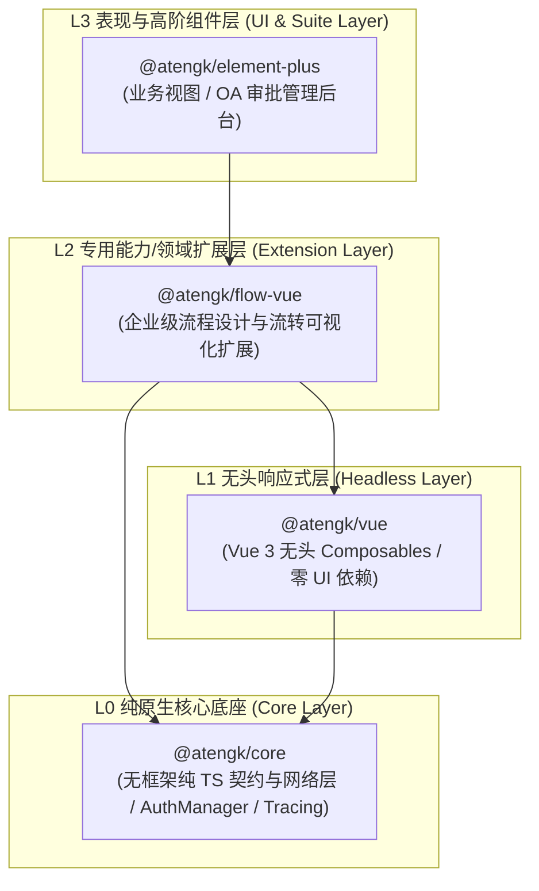
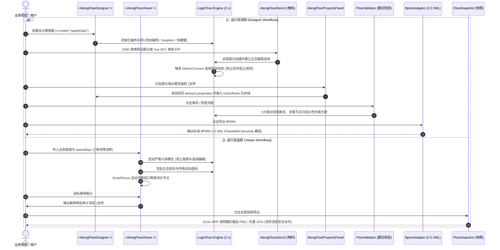

# @atengk/flow-vue 企业级流程设计与流转可视化扩展套件

> 面向现代 Web 应用与企业级审批流、状态机的工业级流程设计与流转可视化扩展套件，归属于系统四层洋葱拓扑之 **L2 专用能力/领域扩展层**。遵循“纯 Vue 3 驱动、强类型契约、零具体 UI 依赖、深模块解耦、确定性生命周期治理”设计，深度集成 LogicFlow 2.x 核心引擎，支持正交折线四向磁吸路由、开箱即用拓扑防呆守卫、三段式物料面板、属性配置抽屉、全量插槽控制反转、五态运行轨迹动效与悬停审计浮层、静态拓扑图论校验引擎、BPMN 2.0 工业协议双向转译、2x/3x DPR 全景防虚快照与安全文本矩阵水印、Vue 3 SFC 卡片节点注册以及低代码规则引擎 DAG 拓扑编排。

---

## 0. 特性与公共 API 全景速查矩阵

| 特性分类             | 特性名称               | 核心门面 / 组件 / Hook                                                       | 关键参数 / Props / Emits                                                                                                       | 核心行为说明                                                                                                                                            | 锚定验证源头 (*Test / Sample)                                                                                                                                                     |
| :------------------- | :--------------------- | :--------------------------------------------------------------------------- | :----------------------------------------------------------------------------------------------------------------------------- | :------------------------------------------------------------------------------------------------------------------------------------------------------ | :-------------------------------------------------------------------------------------------------------------------------------------------------------------------------------- |
| **画布核心**         | 流程画布组件           | `<AtengFlowCanvas />`                                                        | `modelValue, options, disabled, @node:click, @edge:click, @blank:click, @change, @ready`                                       | 基础流程拓扑画布容器，集成 ResizeObserver 几何自愈、图元双向数据流、历史栈与事件桥接                                                                    | [AtengFlowCanvas.test.ts](./test/AtengFlowCanvas.test.ts) / [DesignerBasicScenario.vue](../../apps/sample-flow-vue/src/scenarios/DesignerBasicScenario.vue)                       |
| **无头逻辑**         | 流程无头状态机 Hook    | `useFlow(options?)`                                                          | `(options?: UseFlowOptions) -> UseFlowReturn`                                                                                  | 纯响应式状态机，暴露 `init, render, getGraphData, zoomIn, zoomOut, fitView, undo, redo, destroy` 等原子操作门面                                         | [useFlow.test.ts](./test/useFlow.test.ts)                                                                                                                                         |
| **设计器主容器**     | 工业级流程编排设计器   | `<AtengFlowDesigner />`                                                      | `v-model, stencilGroups, customVueNodes, beforeConnect, panelWidth, showPanel, #stencil, #panel, #toolbar, @validate`          | 工业级流程编排设计器，组装三段式物料面板、画布、智能对齐线（Snapline）、四向吸附正交连线、属性抽屉与图论校验                                            | [AtengFlowDesigner.test.ts](./test/AtengFlowDesigner.test.ts) / [DesignerBasicScenario.vue](../../apps/sample-flow-vue/src/scenarios/DesignerBasicScenario.vue)                   |
| **流转追踪器**       | 运行态只读流转追踪器   | `<AtengFlowViewer />`                                                        | `v-model, statusMap, focusActiveNode, wheelZoomGuard, showMiniToolbar, #audit-popover, #mini-toolbar`                          | 专用于工单详情与审批流转的只读追踪容器，内置五态高亮流动虚线、悬停审批审计浮层、SmartFocus 智能待办定位与 WheelZoomGuard 滚轮防冲突                     | [AtengFlowViewer.test.ts](./test/AtengFlowViewer.test.ts) / [ViewerAuditScenario.vue](../../apps/sample-flow-vue/src/scenarios/ViewerAuditScenario.vue)                           |
| **物料面板**         | 三段式图元物料库       | `<AtengFlowStencil />`                                                       | `groups, lf, title, @dragstart, @item:click`                                                                                   | 遵循事件/任务/网关三段式规范分类展示预设图元，支持关键词过滤与 LogicFlow DND 拖拽投递                                                                   | [presets.test.ts](./test/presets.test.ts) / [DesignerBasicScenario.vue](../../apps/sample-flow-vue/src/scenarios/DesignerBasicScenario.vue)                                       |
| **属性抽屉**         | 元素属性配置抽屉       | `<AtengFlowPropertyPanel />`                                                 | `element, disabled, title, @update:property, @update:properties, @close, #header, #footer, #extra`                             | 针对选中节点与连线提供纯原生无依赖表单（只读 ID、名称、条件表达式、审批人与会签模式），支持 100% 插槽反转                                               | [AtengFlowPropertyPanel.test.ts](./test/AtengFlowPropertyPanel.test.ts) / [PropertyPanelSlotScenario.vue](../../apps/sample-flow-vue/src/scenarios/PropertyPanelSlotScenario.vue) |
| **顶部工具栏**       | 控制栏动作矩阵         | `<AtengFlowToolbar />`                                                       | `lf, canUndo, canRedo, disabled, @zoom-in, @fit-view, @undo, @redo, @clear, @layout, @toggle-grid, @toggle-minimap, @validate` | 集成缩放控制、Undo/Redo、网格切换、小地图开关、防误触清空弹层、自动排版与静态拓扑校验触发                                                               | [AtengFlowToolbar.test.ts](./test/AtengFlowToolbar.test.ts) / [DesignerBasicScenario.vue](../../apps/sample-flow-vue/src/scenarios/DesignerBasicScenario.vue)                     |
| **业务卡片**         | 预设审批卡片节点       | `<ApprovalCardNode />`                                                       | `node: FlowNode, graph: FlowGraph, updateProperties, @click:approve, @click:reject`                                            | 预设高颜值审批卡片，带头像、类型胶囊、状态指示徽标、办理进度条与快捷审批动作，支持双向属性原地 Diff 回写                                                | [VueNodeRegistry.test.ts](./test/VueNodeRegistry.test.ts) / [VueNodeCustomScenario.vue](../../apps/sample-flow-vue/src/scenarios/VueNodeCustomScenario.vue)                       |
| **Vue 节点注册**     | SFC 自定义卡片适配机制 | `VueNodeRegistry`                                                            | `register(target, type, component, options?)`                                                                                  | 将普通 Vue 3 SFC 单文件组件桥接注册为 LogicFlow 自定义卡片节点，响应式 Props 注入、原地 Diff 更新与销毁确定性清理                                       | [VueNodeRegistry.test.ts](./test/VueNodeRegistry.test.ts) / [VueNodeCustomScenario.vue](../../apps/sample-flow-vue/src/scenarios/VueNodeCustomScenario.vue)                       |
| **Vue 节点注册**     | 声明式组件快捷注册函数 | `registerVueNode(lf, type, component, options?)`                             | `(lf: LogicFlow, type: string, component: Component, options?: VueNodeOptions) => void`                                        | 便捷函数将单文件组件直接注册到 LogicFlow 实例，指定宽高等几何参数                                                                                       | [VueNodeRegistry.test.ts](./test/VueNodeRegistry.test.ts) / [VueNodeCustomScenario.vue](../../apps/sample-flow-vue/src/scenarios/VueNodeCustomScenario.vue)                       |
| **静态拓扑校验**     | 流程静态校验引擎       | `FlowValidator`                                                              | `validate(graph) -> FlowValidationResult, hasErrors(result) -> boolean`                                                        | 纯原生 TypeScript 校验 5 大图论刚性规则（起止唯一性、连通孤岛、排他网关分支与条件、无出口死循环检测）并输出结构化诊断实体集合                           | [FlowValidator.test.ts](./test/FlowValidator.test.ts) / [ValidatorLayoutScenario.vue](../../apps/sample-flow-vue/src/scenarios/ValidatorLayoutScenario.vue)                       |
| **规则代号枚举**     | 拓扑校验规则常量字典   | `FlowValidationRuleCode`                                                     | `START_NODE_MISSING, DEADLOCK_CYCLE, GATEWAY_BRANCH_INSUFFICIENT 等`                                                           | 结构化图论校验错误分类代号枚举字典                                                                                                                      | [FlowValidator.test.ts](./test/FlowValidator.test.ts) / [ValidatorLayoutScenario.vue](../../apps/sample-flow-vue/src/scenarios/ValidatorLayoutScenario.vue)                       |
| **自动排版**         | DAG 分层排版引擎       | `AutoLayoutEngine`                                                           | `layout(graph, options?) -> FlowGraph, animateLayout(lf, graph, options?)`                                                     | 基于有向无环图分层拓扑算法，计算 Rank 与节点间距，支持水平 (LR) 与垂直 (TB) 规整重排、平滑缓动动画与折点自适应更新                                      | [AutoLayoutEngine.test.ts](./test/AutoLayoutEngine.test.ts) / [ValidatorLayoutScenario.vue](../../apps/sample-flow-vue/src/scenarios/ValidatorLayoutScenario.vue)                 |
| **BPMN 转译器**      | BPMN 2.0 工业协议互转  | `BpmnAdapter`                                                                | `toBpmnXml(graph, options?) -> string, fromBpmnXml(xml) -> FlowGraph`                                                          | 纯原生双向协议转译，兼容 Flowable/Camunda 标准规范，精确还原 Bounds 中心坐标、折点 Waypoint 与办理人/条件扩展属性                                       | [BpmnAdapter.test.ts](./test/BpmnAdapter.test.ts) / [BpmnAdapterScenario.vue](../../apps/sample-flow-vue/src/scenarios/BpmnAdapterScenario.vue)                                   |
| **全景高清快照**     | 高清防虚快照导出工具   | `FlowSnapshot`                                                               | `computeBoundingBox, getSvgString, getSnapshot, download`                                                                      | 最小外接边界自适应计算，2x/3x DPR 视网膜高清防虚栅格化，矢量 SVG 导出与自定义防泄密矩阵文本水印                                                         | [FlowSnapshot.test.ts](./test/FlowSnapshot.test.ts) / [SnapshotWatermarkScenario.vue](../../apps/sample-flow-vue/src/scenarios/SnapshotWatermarkScenario.vue)                     |
| **五态枚举与字典**   | 执行状态枚举与样式映射 | `FlowExecutionStatus / STATUS_TEXT_MAP / STATUS_BADGE_CLASS_MAP`             | `FlowExecutionStatus.*, Record<ExecutionStatus, string>`                                                                       | 统一提供五态运行时枚举（COMPLETED/PROCESSING/REJECTED/PENDING/TERMINATED）与中文文案、专属 CSS 徽标映射字典                                             | [types.ts](./src/types.ts) / [ViewerAuditScenario.vue](../../apps/sample-flow-vue/src/scenarios/ViewerAuditScenario.vue)                                                          |
| **预设图元注册**     | 核心预设图元与拓扑防呆 | `registerPresetNodes`                                                        | `(lf: LogicFlow, beforeConnect?: BeforeConnectHook) => void`                                                                   | 注册开始、结束、审批任务、服务任务、排他网关、并行网关与折线/贝塞尔连线，内置自环/起止点/重复连线防呆守卫                                               | [presets.test.ts](./test/presets.test.ts) / [DesignerBasicScenario.vue](../../apps/sample-flow-vue/src/scenarios/DesignerBasicScenario.vue)                                       |
| **图元枚举与元数据** | 预设图元类型与徽标字典 | `FlowNodeType / NODE_TYPE_LABEL_MAP / NODE_TYPE_ICON_MAP / getNodeBadgeIcon` | `FlowNodeType.*, NODE_TYPE_LABEL_MAP, getNodeBadgeIcon(type) -> string`                                                        | 标准化图元类型标识字典（如 `flow:start`）、显示名称映射与小徽标图标解析函数                                                                             | [presets.test.ts](./test/presets.test.ts) / [DesignerBasicScenario.vue](../../apps/sample-flow-vue/src/scenarios/DesignerBasicScenario.vue)                                       |
| **物料常量**         | 默认三段式物料分组     | `DEFAULT_STENCIL_GROUPS`                                                     | `StencilGroup[]`                                                                                                               | 默认物料预设分组配置（事件类、任务类、网关控制类）                                                                                                      | [presets.test.ts](./test/presets.test.ts) / [DesignerBasicScenario.vue](../../apps/sample-flow-vue/src/scenarios/DesignerBasicScenario.vue)                                       |
| **插件安装**         | 全局组件独立注册器     | `install(app) / default`                                                     | `(app: App) => void`                                                                                                           | 批量向 Vue 应用注册 `AtengFlowCanvas, AtengFlowDesigner, AtengFlowViewer, AtengFlowStencil, AtengFlowPropertyPanel, AtengFlowToolbar, ApprovalCardNode` | [index.ts](./src/index.ts) / [main.ts](../../apps/sample-flow-vue/src/main.ts)                                                                                                    |

---

## 1. 模块定位与 pnpm 坐标

`@atengk/flow-vue` 归属于 `ateng-ui` 基础设施套件的 **L2 专用能力/领域扩展层 (Extension Layer)**，专注于企业级现代审批流、状态机可视化与低代码规则拓扑编排。

- **npm 坐标**：`@atengk/flow-vue`
- **源码工程**：`packages/flow-vue`
- **自验展厅**：`apps/sample-flow-vue`（固定端口 `3007`）
- **底层依赖**：依赖 `@atengk/core` (L0) 与 `@atengk/vue` (L1)，严格与具体 UI 表现库（如 Element Plus）解耦；
- **peerDependencies 契约**：要求 `vue: ^3.5.0`，`@logicflow/core: ^2.0.0`。

### 安装依赖

```bash
pnpm add @atengk/flow-vue @logicflow/core @atengk/core @atengk/vue vue
```

---

## 2. 核心架构与设计不变量

### 2.1 四层洋葱拓扑位置



### 2.2 双轨设计态与流转追踪态交互时序图



### 2.3 四大核心设计不变量

1. **L2 专用扩展层解耦与框架中立不变量 (L2 Decoupling & Framework Neutrality Invariant)**：
   - `@atengk/flow-vue` 作为专业工作流扩展套件，坚守 L2 纯原生中立定位，**绝对严禁直接硬编码依赖任何具体 UI 库（如 Element Plus）**；
   - 内部面板样式一律以 `.at-flow-*` 命名空间隔离并使用 `--at-flow-*` CSS 变量；
   - 采用 100% 插槽控制反转（Slot Inversion）架构，对外暴露 `#stencil`、`#panel`、`#toolbar` 与 `#audit-popover` 具名插槽，上层业务使用 Element Plus 时可通过 `<el-form>`、`<el-timeline>` 零胶水无缝替换接管。

2. **设计态与只读流转追踪态双轨分离不变量 (Dual-Track Design/Viewer Invariant)**：
   - **设计态 (`<AtengFlowDesigner />`)**：面向流程编排与管理后台，组装物料面板、Snapline 磁吸对齐线、快捷键体系（Delete/Ctrl+Z/Y/C/V）、属性抽屉与静态校验；
   - **流转追踪态 (`<AtengFlowViewer />`)**：面向工单详情与审批履历页，严格开启 `isSilentMode: true` 物理只读锁定，隐藏所有连线锚点，彻底杜绝误触或非授权篡改；标配五态运行动效、审批审计浮层、`SmartFocus` 智能待办定位与 `WheelZoomGuard` 页面滚轮防冲突守卫。

3. **确定性四步生命周期销毁与内存零泄漏不变量 (Deterministic Four-Step Lifecycle Cleanup Invariant)**：
   - 针对 LogicFlow 图形引擎、SVG 画布与 Vue 3 SFC 自定义节点实例池，在组件销毁钩子（`onUnmounted`）中严格执行“四步清理”：
     1. **尺寸解绑**：解绑 `ResizeObserver` 视口监听句柄，清除重试定时器；
     2. **实例池回收**：遍历销毁所有通过 `VueNodeRegistry` 挂载的 Vue 3 SFC 虚拟节点并清理 DOM 挂载点；
     3. **事件卸载**：注销画布全局键盘快捷键、右键菜单与 MiniMap 缩略图物理事件监听；
     4. **引擎销毁**：显式调用 `lf.destroy()` 释放底座资源并置空引用，彻底消除离线回调悬挂与内存泄漏。

4. **图论连线防呆与拓扑静态校验不变量 (Topology Guard & Static Validation Invariant)**：
   - **前置连线守卫 (`beforeConnect`)**：在拖拽连线握手阶段实施毫秒级图论拦截（禁止自环连线、开始节点不可连入、结束节点不可连出、相同节点禁止重复连线），非法连线即时弹回；
   - **静态校验引擎 (`FlowValidator`)**：纯原生 TypeScript 实现 5 大刚性图论规则校验（起止节点唯一性、连通孤岛、排他网关分支数与流转条件缺失、无出口死循环检测）；
   - **视觉自愈与精准定位**：校验发现异常时，涉事节点自动挂载 `.at-flow-node--error` 呈现红色脉冲发光呼吸动画（`@keyframes at-flow-pulse-error`），支持视口平滑居中聚焦。

---

## 3. 工业级可视化流程编排设计器套件 (AtengFlowDesigner)

`AtengFlowDesigner` 是面向现代企业级 BPMN 流程编排、费用报销审批流与规则引擎 DAG 设计打造的一站式可视化编排设计器。它在底层深度封装了 LogicFlow 核心底座，内置了三段式物料面板 (`AtengFlowStencil`)、四向磁吸正交平滑折线、操作控制栏 (`AtengFlowToolbar`)、右侧可配置属性抽屉 (`AtengFlowPropertyPanel`)、键盘快捷键体系以及图论拓扑防呆连线守卫。

---

### 3.1 开箱即用设计器与三段式物料面板 (AtengFlowStencil)

#### 1. 契约与配置片段 (TypeScript Contracts)

```typescript
import type {
  FlowGraph,
  FlowOptions,
  FlowNode,
  FlowEdge,
  FlowElementData,
  LayoutDirection,
} from '@atengk/flow-vue';

/**
 * 物料面板分组契约。
 */
export interface StencilGroup {
  /** 分组唯一标识（如 'events' | 'tasks' | 'gateways'） */
  id: string;
  /** 分组标题 */
  title: string;
  /** 组内物料图元清单 */
  items: StencilItem[];
}

/**
 * 物料图元条目契约。
 */
export interface StencilItem {
  /** 图元类型标识（如 'flow:start', 'flow:user-task'） */
  type: string;
  /** 显示标题 */
  label: string;
  /** 图元说明描述 */
  description?: string;
  /** 图标字符或 SVG */
  icon?: string;
  /** 拖拽至画布时初始化的节点配置 */
  nodeConfig?: Partial<FlowNode>;
}

/**
 * AtengFlowDesigner 核心 Props 契约。
 */
export interface AtengFlowDesignerProps {
  /** 流程图双向绑定数据（包含 nodes 与 edges） */
  modelValue?: FlowGraph;
  /** LogicFlow 底层原始配置项 */
  options?: FlowOptions;
  /** 物料分组配置列表（默认提供事件/任务/网关三段式分组） */
  stencilGroups?: StencilGroup[];
  /** 自定义连线前置守卫钩子（返回 false 阻断连线） */
  beforeConnect?: (sourceNode: FlowNode, targetNode: FlowNode) => boolean | string;
  /** 容器宽度（默认 '100%'） */
  width?: string | number;
  /** 容器高度（默认 '100%'） */
  height?: string | number;
  /** 是否禁用设计编辑（只读） */
  disabled?: boolean;
  /** 是否启用顶部操作工具栏（默认 true） */
  showToolbar?: boolean;
  /** 是否启用键盘快捷键（默认 true） */
  enableKeyboard?: boolean;
  /** 是否启用右侧属性配置抽屉（默认 true） */
  showPanel?: boolean;
  /** 右侧属性配置抽屉宽度（默认 '320px'） */
  panelWidth?: string | number;
}
```

#### 2. 面向实战的业务 Vue 代码示例 (Business Practice)

以下代码逆向提取自场景看板 [`DesignerBasicScenario.vue`](file:///d:/My/dev/ateng-ui/apps/sample-flow-vue/src/scenarios/DesignerBasicScenario.vue)，演示**企业费用报销审批流程**的基础编排：

```vue
<script setup lang="ts">
import { ref } from 'vue';
import {
  AtengFlowDesigner,
  FlowNodeType,
  DEFAULT_STENCIL_GROUPS,
  type FlowGraph,
  type FlowNode,
  type FlowEdge,
  type FlowElementData,
  type AtengFlowDesignerInstance,
} from '@atengk/flow-vue';

const designerRef = ref<AtengFlowDesignerInstance | null>(null);

// 真实业务图谱：企业费用报销审批流程
const graphData = ref<FlowGraph>({
  nodes: [
    {
      id: 'start-1',
      type: FlowNodeType.START,
      x: 100,
      y: 180,
      text: '发起报销',
      properties: { description: '员工提交费用报销申请', initiator: 'zhangsan' },
    },
    {
      id: 'task-1',
      type: FlowNodeType.USER_TASK,
      x: 300,
      y: 180,
      text: '财务初审',
      properties: { assignee: 'caiwu_01', dueHours: 24, description: '核验纸质发票真伪' },
    },
    {
      id: 'gateway-1',
      type: FlowNodeType.EXCLUSIVE_GATEWAY,
      x: 500,
      y: 180,
      text: '金额判断',
      properties: { description: '根据金额决定是否总监审批' },
    },
    {
      id: 'task-2',
      type: FlowNodeType.USER_TASK,
      x: 700,
      y: 90,
      text: '总监终审',
      properties: { assignee: 'role:finance_director', dueHours: 48, description: '大额支出终审' },
    },
    {
      id: 'end-1',
      type: FlowNodeType.END,
      x: 900,
      y: 180,
      text: '办结归档',
      properties: { description: '出纳打款并归档凭证' },
    },
  ],
  edges: [
    {
      id: 'edge-1',
      type: 'polyline',
      sourceNodeId: 'start-1',
      targetNodeId: 'task-1',
      text: '提交',
    },
    {
      id: 'edge-2',
      type: 'polyline',
      sourceNodeId: 'task-1',
      targetNodeId: 'gateway-1',
      text: '初审通过',
    },
    {
      id: 'edge-3',
      type: 'polyline',
      sourceNodeId: 'gateway-1',
      targetNodeId: 'task-2',
      text: '金额 ≥ 1万元',
      properties: { condition: '${amount >= 10000}', priority: 1 },
    },
    {
      id: 'edge-4',
      type: 'polyline',
      sourceNodeId: 'gateway-1',
      targetNodeId: 'end-1',
      text: '金额 < 1万元',
      properties: { condition: '${amount < 10000}', priority: 2 },
    },
    {
      id: 'edge-5',
      type: 'polyline',
      sourceNodeId: 'task-2',
      targetNodeId: 'end-1',
      text: '同意打款',
    },
  ],
});

const handleReady = () => {
  console.log('流程设计器就绪：LogicFlow 引擎加载完成');
};

const handleSelectionChange = (element: FlowElementData | null) => {
  if (element) {
    console.log(`当前选中图元 [${element.id}] (${element.type})`);
  }
};
</script>

<template>
  <div class="designer-container" style="height: 600px; border: 1px solid #e2e8f0;">
    <AtengFlowDesigner
      ref="designerRef"
      v-model="graphData"
      :stencil-groups="DEFAULT_STENCIL_GROUPS"
      @ready="handleReady"
      @selection:change="handleSelectionChange"
    />
  </div>
</template>
```

#### 3. 核心机制与生产边界防御说明 (Mechanism & Production Guard)

- **三段式物料分类规范**：
  - 默认物料面板由 `DEFAULT_STENCIL_GROUPS` 驱动，分为“事件图元 (Events)”、“任务图元 (Tasks)”与“网关控制 (Gateways)”三层企业标准分类；
  - 面板内置分类折叠与实时图元搜索过滤能力，图元超长时自动显示 Tooltip 描述，避免庞大企业物料库造成视口遮挡。
- **HTML5 Drag & Drop (DND) 原生拖拽集成**：
  - 用户按下物料时调用 `lf.dnd.startDrag(item.type, item.nodeConfig)`，释放时 LogicFlow 底层自动将屏幕绝对坐标转译为视口画布坐标，即时实例化图元；
  - 彻底规避了基于纯 DOM 模拟拖拽导致的坐标偏移与高 DPI 屏幕缩放失真问题。
- **受管单向数据流与响应式闭环**：
  - 内部变更（移动图元、添加连线、删除元素）通过 `update:modelValue` 与 `change` 双向同步至业务响应式状态；
  - 外部状态变更若非本实例引发，将通过增量比较静默更新画布，防止死循环刷新。

---

### 3.2 四向磁吸正交平滑折线与拓扑防呆连线 (BeforeConnectHook)

#### 1. 契约与配置片段 (TypeScript Contracts)

```typescript
import type { FlowNode, FlowEdge } from '@atengk/flow-vue';

/**
 * 自定义连线前置守卫钩子类型。
 * 若返回 false 或返回字符串（错误原因），将即时阻断连线并派发 connection:not-allowed 事件。
 */
export type BeforeConnectHook = (sourceNode: FlowNode, targetNode: FlowNode) => boolean | string;

/**
 * 连线图元定义契约。
 */
export interface FlowEdge {
  /** 连线唯一 ID */
  id: string;
  /** 连线类型：'polyline'（正交折线） | 'bezier'（贝塞尔曲线） */
  type: string;
  /** 起始源节点 ID */
  sourceNodeId: string;
  /** 起始源节点吸附锚点 ID（如 'task-1_1'） */
  sourceAnchorId?: string;
  /** 目标节点 ID */
  targetNodeId: string;
  /** 目标节点吸附锚点 ID（如 'gateway-1_3'） */
  targetAnchorId?: string;
  /** 连线上展示的文案 */
  text?: string;
  /** 连线绑定的业务属性（如条件表达式、流转优先级） */
  properties?: {
    condition?: string;
    priority?: number;
    [key: string]: unknown;
  };
}
```

#### 2. 面向实战的业务 Vue 代码示例 (Business Practice)

```vue
<script setup lang="ts">
import { ref } from 'vue';
import {
  AtengFlowDesigner,
  DEFAULT_STENCIL_GROUPS,
  type FlowGraph,
  type BeforeConnectHook,
} from '@atengk/flow-vue';

const graphData = ref<FlowGraph>({ nodes: [], edges: [] });
const warningMsg = ref<string>('');

// 前置拓扑防呆守卫：连线握手阶段实施毫秒级图论校验
const beforeConnect: BeforeConnectHook = (source, target) => {
  // 1. 禁止图元自环连线
  if (source.id === target.id) {
    warningMsg.value = `⚠️ 拓扑防呆拦截：图元 [${source.text || source.id}] 禁止自环连线！`;
    return false;
  }
  // 2. 开始节点不可作为终点
  if (target.type === 'flow:start') {
    warningMsg.value = `⚠️ 拓扑防呆拦截：开始节点不可作为目标连入！`;
    return false;
  }
  // 3. 结束节点不可作为起点
  if (source.type === 'flow:end') {
    warningMsg.value = `⚠️ 拓扑防呆拦截：结束节点不可作为源起连出！`;
    return false;
  }
  return true;
};

const handleConnectionNotAllowed = (data: unknown) => {
  console.warn('连线被底层守卫拦截:', data);
};
</script>

<template>
  <div class="designer-box">
    <div v-if="warningMsg" class="warning-banner">{{ warningMsg }}</div>
    <AtengFlowDesigner
      v-model="graphData"
      :stencil-groups="DEFAULT_STENCIL_GROUPS"
      :before-connect="beforeConnect"
      @connection:not-allowed="handleConnectionNotAllowed"
    />
  </div>
</template>
```

#### 3. 核心机制与生产边界防御说明 (Mechanism & Production Guard)

- **四向正交磁吸锚点算法**：
  - 所有预设图元内置上下右左（索引 `0, 1, 2, 3`）四向正交物理吸附锚点；
  - 拖拽连线时，鼠标靠近目标图元指定方向锚点（阈值 15px 内）自动产生磁吸吸附效果；
  - 连线采用 A* 正交避障与曼哈顿距离最小化路径算法，折线自动围绕节点边缘正交绕行，杜绝斜穿图元的不良穿模。
- **连线前置守卫拦截与防呆机制**：
  - 传统连线操作多在后端保存时才报错，导致用户连线心智负担大；
  - `beforeConnect` 钩子在用户松手触发连接的瞬间执行校验，一旦返回 `false` 或字符串，底层立即中断连线，动画弹回起点，并向外派发 `@connection:not-allowed` 事件；
  - 有效阻断自环连线、起止反接与相同方向重复连线等拓扑脏数据产生。

---

### 3.3 顶部操作控制栏矩阵与键盘快捷键体系 (AtengFlowToolbar)

#### 1. 契约与配置片段 (TypeScript Contracts)

```typescript
import type { LogicFlow, LayoutDirection, FlowGraph } from '@atengk/flow-vue';

/**
 * AtengFlowToolbar 顶部控制栏 Props 契约。
 */
export interface AtengFlowToolbarProps {
  /** LogicFlow 画布实例 */
  lf?: LogicFlow | null;
  /** 是否可撤销 */
  canUndo?: boolean;
  /** 是否可重做 */
  canRedo?: boolean;
  /** 是否展示视口缩放控制区（放大、缩小、还原、居中，默认 true） */
  showZoom?: boolean;
  /** 是否展示历史撤销重做控制区（默认 true） */
  showHistory?: boolean;
  /** 是否展示 DAG 自动分层排版控制区（默认 true） */
  showLayout?: boolean;
  /** 是否展示网格切换按钮（默认 true） */
  showGridToggle?: boolean;
  /** 是否展示鹰眼小地图开关（默认 true） */
  showMiniMap?: boolean;
  /** 是否展示清空画布按钮（默认 true） */
  showClear?: boolean;
  /** 是否展示拓扑静态校验按钮（默认 true） */
  showValidate?: boolean;
}

/**
 * AtengFlowDesigner 对外暴露的控制门面方法。
 */
export interface AtengFlowDesignerExpose {
  getLf: () => LogicFlow | null;
  getGraphData: () => FlowGraph;
  render: (graph?: FlowGraph) => void;
  clear: () => void;
  zoomIn: () => void;
  zoomOut: () => void;
  resetZoom: () => void;
  fitView: () => void;
  undo: () => void;
  redo: () => void;
  autoLayout: (direction?: LayoutDirection) => void;
  toggleGrid: (visible?: boolean) => void;
  toggleMiniMap: (visible?: boolean) => void;
  focusElement: (id: string) => void;
}
```

#### 2. 面向实战的业务 Vue 代码示例 (Business Practice)

```vue
<script setup lang="ts">
import { ref } from 'vue';
import {
  AtengFlowDesigner,
  type AtengFlowDesignerInstance,
  type FlowGraph,
} from '@atengk/flow-vue';

const designerRef = ref<AtengFlowDesignerInstance | null>(null);
const graphData = ref<FlowGraph>({ nodes: [], edges: [] });

// 编程式调度设计器门面能力
const handleFitCenter = () => {
  designerRef.value?.fitView();
};

const handleHorizontalLayout = () => {
  designerRef.value?.autoLayout('LR');
};

const handleResetDefault = () => {
  designerRef.value?.clear();
  // 重新加载初始图谱
};
</script>

<template>
  <div class="workspace">
    <!-- 顶部业务定制按钮组 -->
    <div class="action-bar">
      <button @click="handleFitCenter">居中对齐</button>
      <button @click="handleHorizontalLayout">水平 DAG 排版</button>
      <button @click="handleResetDefault">重置默认</button>
    </div>

    <!-- 内置 AtengFlowToolbar 的完整设计器 -->
    <AtengFlowDesigner
      ref="designerRef"
      v-model="graphData"
      :show-toolbar="true"
      :enable-keyboard="true"
    />
  </div>
</template>
```

#### 3. 核心机制与生产边界防御说明 (Mechanism & Production Guard)

- **控制栏与命令栈联动机制**：
  - 工具栏通过订阅 LogicFlow 内部的 `history:change` 事件与 MobX 观察者，精确计算当前命令历史栈的深度，实时驱动“撤销”与“重做”按钮的禁用态；
  - 自适应居中算法在缩放图谱的同时计算物理内边距（Padding 40px），确保无论多大尺寸的流程图均能一览无余地投影在画布正中。
- **键盘快捷键体系与表单上下文隔离**：
  - 启用 `:enable-keyboard="true"` 后，支持标准的操作系统级设计快捷键：
    - `Delete` / `Backspace`：删除当前选中的节点或连线；
    - `Ctrl + Z` / `Cmd + Z`：撤销上一步操作；
    - `Ctrl + Y` / `Cmd + Y`：重做已撤销的操作；
    - `Ctrl + C` / `Ctrl + V`：图元复制与粘贴。
  - **生产防御（输入冲突守卫）**：在右侧属性抽屉、输入框 (`<input>`, `<textarea>`) 获得焦点时，内部快捷键守卫自动挂起画板按键监听，防止业务人员在填写审批意见或节点名称时误触发图元删除。
- **清空防误触二次确认**：
  - 点击工具栏清空按钮时，通过气泡确认框拦截危险动作，防止业务人员误触丢失大篇幅已编排的业务流程。

---

## 4. 运行态只读流转追踪套件 (AtengFlowViewer)

`AtengFlowViewer` 是专为企业级 OA 审批流转、ERP 订单履历跟踪、工单执行进度查看与规则引擎 DAG 调试等场景量身定制的**轻量化只读流转追踪器**。它是设计器在运行态的镜像组件，标配物理防篡改只读、五态高亮与流动虚线动效、悬停审批审计履历卡片插槽反转、智能待办聚焦 (SmartFocus) 与页面滚轮防冲突守卫 (WheelZoomGuard) 等工业级能力。

---

### 4.1 五态审批流转高亮与流动虚线动效 (ExecutionStatus)

#### 1. 契约与配置片段 (TypeScript Contracts)

```typescript
import type { FlowGraph, FlowOptions, FlowNode, FlowEdge } from '@atengk/flow-vue';

/**
 * 运行态五态执行状态枚举。
 */
export const FlowExecutionStatus = {
  /** 已完成 / 审核通过 */
  COMPLETED: 'completed',
  /** 流转中 / 审批中（触发动态流动虚线） */
  PROCESSING: 'processing',
  /** 已驳回 / 审核不通过 */
  REJECTED: 'rejected',
  /** 待处理 / 尚未流转到 */
  PENDING: 'pending',
  /** 已终止 / 异常中断 */
  TERMINATED: 'terminated',
} as const;

export type ExecutionStatus = (typeof FlowExecutionStatus)[keyof typeof FlowExecutionStatus];

/**
 * 关联的历史审批或操作审计记录实体。
 */
export interface AuditRecord {
  /** 记录唯一标识 */
  id?: string;
  /** 审批人或操作人姓名 */
  operator: string;
  /** 执行审批状态 */
  status: ExecutionStatus;
  /** 操作发生时间（如 '2026-11-05 10:15:20'） */
  time?: string;
  /** 处理耗时（如 '15分钟'） */
  duration?: string;
  /** 审批处理意见或附言 */
  comment?: string;
  /** 扩展业务元数据 */
  extra?: Record<string, unknown>;
}

/**
 * 单个节点或连线的流转状态实体。
 */
export interface FlowExecutionItem {
  status: ExecutionStatus;
  audit?: AuditRecord[];
  extra?: Record<string, unknown>;
}

/**
 * 全图元素（节点/连线）的五态流转映射表。
 * 支持直接传入状态字符串，或传入包含审计履历列表的完整实体。
 */
export type FlowStatusMap = Record<string, ExecutionStatus | FlowExecutionItem>;

/**
 * AtengFlowViewer 核心 Props 契约。
 */
export interface AtengFlowViewerProps {
  /** 流程图数据模型 */
  modelValue?: FlowGraph;
  /** 全图五态流转映射表 */
  statusMap?: FlowStatusMap;
  /** 是否在加载完成后自动将首个流转中节点平滑居中聚焦 (SmartFocus，默认 false) */
  focusActiveNode?: boolean;
  /** 显式指定的聚焦节点 ID（优先级高于 focusActiveNode） */
  focusNodeId?: string;
  /** 是否启用滚轮防冲突守卫 (WheelZoomGuard，默认 false) */
  wheelZoomGuard?: boolean;
  /** 是否显示微型视口控制浮动工具条（默认 false） */
  showMiniToolbar?: boolean;
  /** 容器宽度（默认 '100%'） */
  width?: string | number;
  /** 容器高度（默认 '100%'） */
  height?: string | number;
  /** 底层 LogicFlow 原始配置项 */
  options?: FlowOptions;
}
```

#### 2. 面向实战的业务 Vue 代码示例 (Business Practice)

以下代码逆向提取自场景看板 [`ViewerAuditScenario.vue`](file:///d:/My/dev/ateng-ui/apps/sample-flow-vue/src/scenarios/ViewerAuditScenario.vue)，演示**企业工单审批流转状态与流动动效呈现**：

```vue
<script setup lang="ts">
import { ref, computed } from 'vue';
import {
  AtengFlowViewer,
  FlowNodeType,
  FlowExecutionStatus,
  type FlowGraph,
  type FlowStatusMap,
} from '@atengk/flow-vue';

// 基础工单流程图谱
const viewerGraph = ref<FlowGraph>({
  nodes: [
    { id: 'start-1', type: FlowNodeType.START, x: 100, y: 200, text: '发起申请' },
    { id: 'task-leader', type: FlowNodeType.USER_TASK, x: 280, y: 200, text: '部门主管审批' },
    { id: 'task-finance', type: FlowNodeType.USER_TASK, x: 480, y: 200, text: '财务初审' },
    { id: 'task-cfo', type: FlowNodeType.USER_TASK, x: 680, y: 200, text: '财务总监终审' },
    { id: 'end-1', type: FlowNodeType.END, x: 880, y: 200, text: '办结打款' },
  ],
  edges: [
    {
      id: 'edge-1',
      type: 'polyline',
      sourceNodeId: 'start-1',
      targetNodeId: 'task-leader',
      text: '已提交',
    },
    {
      id: 'edge-2',
      type: 'polyline',
      sourceNodeId: 'task-leader',
      targetNodeId: 'task-finance',
      text: '主管同意',
    },
    {
      id: 'edge-3',
      type: 'polyline',
      sourceNodeId: 'task-finance',
      targetNodeId: 'task-cfo',
      text: '初审通过',
    },
    {
      id: 'edge-4',
      type: 'polyline',
      sourceNodeId: 'task-cfo',
      targetNodeId: 'end-1',
      text: '同意打款',
    },
  ],
});

// 动态响应式五态映射（模拟阶段 2：部门与初审已通过，总监审批中触发蓝色流动虚线动效）
const statusMap = computed<FlowStatusMap>(() => ({
  'start-1': {
    status: FlowExecutionStatus.COMPLETED,
    audit: [
      {
        operator: '张三',
        status: FlowExecutionStatus.COMPLETED,
        time: '2026-11-05 09:30',
        comment: '提交申请',
      },
    ],
  },
  'edge-1': FlowExecutionStatus.COMPLETED,
  'task-leader': {
    status: FlowExecutionStatus.COMPLETED,
    audit: [
      {
        operator: '李主管',
        status: FlowExecutionStatus.COMPLETED,
        time: '2026-11-05 10:15',
        comment: '行程真实有效，准予报销',
      },
    ],
  },
  'edge-2': FlowExecutionStatus.COMPLETED,
  'task-finance': {
    status: FlowExecutionStatus.COMPLETED,
    audit: [
      {
        operator: '王财务',
        status: FlowExecutionStatus.COMPLETED,
        time: '2026-11-05 11:20',
        comment: '发票验真合规，准予上报',
      },
    ],
  },
  'edge-3': FlowExecutionStatus.PROCESSING, // 连线激活科技蓝流动虚线
  'task-cfo': {
    status: FlowExecutionStatus.PROCESSING, // 节点激活流转中高亮
    audit: [
      {
        operator: '赵总监',
        status: FlowExecutionStatus.PROCESSING,
        time: '2026-11-05 11:30',
        comment: '待总监终审签字',
      },
    ],
  },
  'edge-4': FlowExecutionStatus.PENDING,
  'end-1': FlowExecutionStatus.PENDING,
}));
</script>

<template>
  <div class="viewer-container" style="height: 480px; border: 1px solid #e2e8f0;">
    <AtengFlowViewer
      v-model="viewerGraph"
      :status-map="statusMap"
      :focus-active-node="true"
      :show-mini-toolbar="true"
    />
  </div>
</template>
```

#### 3. 核心机制与生产边界防御说明 (Mechanism & Production Guard)

- **严格物理只读与防篡改不变量**：
  - `AtengFlowViewer` 在初始化时底层强制配置 `isSilentMode: true`、`stopScrollGraph: true`、`stopMoveGraph: false`；
  - 彻底关闭节点拖拽位移、连线创建/删除、文字双击编辑与右键上下文菜单，隐藏全部连线吸附锚点；
  - 确保工单审计追溯场景下，图谱拓扑结构的 100% 绝对权威性与防篡改安全。
- **五态色彩语义体系与 SVG 呼吸流动动效**：
  - 组件严格遵循企业级色彩规范，通过 `.at-flow-status--*` CSS 命名空间进行状态上色：
    - `COMPLETED`（翡翠绿 `#10b981` / 浅绿背景 `#ecfdf5`）：表示该环节已审核通过或正常归档；
    - `PROCESSING`（科技蓝 `#3b82f6` / 浅蓝背景 `#eff6ff`）：表示当前审批人正在办理中，涉事连线自动启动 SVG `stroke-dasharray` 动态虚线位移流动动画（`model.isAnimation = true`），打造极强视觉焦点；
    - `REJECTED`（警戒红 `#ef4444` / 浅红背景 `#fef2f2`）：表示审批被驳回或要求退回重提；
    - `PENDING`（低饱和灰 `#94a3b8` / 虚线边框）：表示后续尚未流转到的待办环节；
    - `TERMINATED`（深暗灰 `#64748b`）：表示流程被主动作废、撤回或系统异常终止。
- **动态状态热更新防御**：
  - `statusMap` 的更新通过增量样式重绘管道实现，无需对底层 DOM 节点或图论模型进行全量销毁与重建，避免了数据轮询或 WebSocket 实时推送时的画面闪烁。

---

### 4.2 悬停审批审计浮层与 #audit-popover 具名插槽反转

#### 1. 契约与配置片段 (TypeScript Contracts)

```typescript
import type { FlowNode, ExecutionStatus, AuditRecord } from '@atengk/flow-vue';

/**
 * AtengFlowViewer Slots 插槽定义契约。
 */
export interface AtengFlowViewerSlots {
  /**
   * 自定义悬停审批审计卡片浮层插槽。
   * 当鼠标悬停在附带有 audit 记录的节点上时触发。
   */
  'audit-popover'?: (props: {
    /** 当前悬停的目标节点元数据 */
    node: FlowNode;
    /** 当前节点的执行状态 */
    status?: ExecutionStatus;
    /** 该节点关联的全部审批履历列表 */
    auditList: AuditRecord[];
    /** 关闭浮层函数 */
    close: () => void;
  }) => unknown;
}
```

#### 2. 面向实战的业务 Vue 代码示例 (Business Practice)

```vue
<script setup lang="ts">
import { ref } from 'vue';
import { AtengFlowViewer, type FlowGraph, type FlowStatusMap } from '@atengk/flow-vue';

const graph = ref<FlowGraph>({ nodes: [], edges: [] });
const statusMap = ref<FlowStatusMap>({
  'task-leader': {
    status: 'completed',
    audit: [
      {
        operator: '李主管',
        status: 'completed',
        time: '2026-11-05 10:15:20',
        duration: '12分钟',
        comment: '核实出差真实有效，同意报销。',
      },
    ],
  },
});
</script>

<template>
  <div class="viewer-wrapper">
    <AtengFlowViewer v-model="graph" :status-map="statusMap">
      <!-- 具名插槽反转：使用 Element Plus 时间轴或高级卡片完全接管浮层展示 -->
      <template #audit-popover="{ node, auditList, close }">
        <div class="custom-audit-card">
          <div class="card-header">
            <h4>{{ node.text || node.id }} - 审批履历</h4>
            <button class="close-btn" @click="close">×</button>
          </div>
          <div class="card-timeline">
            <div v-for="(record, index) in auditList" :key="index" class="timeline-item">
              <div class="item-meta">
                <span class="operator">{{ record.operator }}</span>
                <span class="time">{{ record.time }}</span>
                <span v-if="record.duration" class="badge">耗时: {{ record.duration }}</span>
              </div>
              <div class="comment">意见: {{ record.comment || '无附言' }}</div>
            </div>
          </div>
        </div>
      </template>
    </AtengFlowViewer>
  </div>
</template>

<style scoped>
.custom-audit-card {
  padding: 12px;
  background: #ffffff;
  border-radius: 8px;
  box-shadow: 0 4px 16px rgba(0, 0, 0, 0.12);
  min-width: 280px;
}
.card-header {
  display: flex;
  justify-content: space-between;
  border-bottom: 1px solid #f1f5f9;
  padding-bottom: 8px;
}
.timeline-item {
  margin-top: 8px;
  font-size: 13px;
}
.badge {
  margin-left: 8px;
  padding: 2px 6px;
  background: #f1f5f9;
  border-radius: 4px;
  font-size: 12px;
}
.comment {
  color: #475569;
  margin-top: 4px;
}
</style>
```

#### 3. 核心机制与生产边界防御说明 (Mechanism & Production Guard)

- **控制反转 (Inversion of Control) 架构**：
  - `@atengk/flow-vue` 作为 L2 级中立扩展套件，默认提供轻量原生 SVG 悬停浮层；
  - 通过 `#audit-popover` 具名插槽反转，将渲染的主动权 100% 移交给终端业务系统，无论上层选用 Element Plus `<el-timeline>`、Ant Design 还是纯原生 Tailwind 卡片，均能无缝装配，绝不强制绑定特定 UI 依赖。
- **悬停监听防抖与平滑交互通道**：
  - 内部在节点 `node:mouseenter` 与 `node:mouseleave` 上配置 200ms 防抖与 150ms 移出缓冲延迟；
  - 当鼠标在不同图元间快速扫过时，不会频繁触发浮层创建与销毁；当鼠标平移进弹出的浮层时，浮层保持常驻，方便用户复制审批单号或阅读长段审批意见。
- **视口边缘碰撞检测与自适应翻转**：
  - 浮层定位自动计算当前节点相对于画布外层容器的物理坐标与边界尺寸；
  - 若节点处于视口极右侧或底部，浮层自动由默认的“右下展开”翻转为“左上对齐”或“居中向上”，避免被画布边界截断或触发非预期的滚动条抖动。

---

### 4.3 智能待办聚焦 (SmartFocus) 与页面滚轮防冲突守卫 (WheelZoomGuard)

#### 1. 契约与配置片段 (TypeScript Contracts)

```typescript
/**
 * AtengFlowViewer 对外暴露的实例门面。
 */
export interface AtengFlowViewerExpose {
  /** 视口自适应居中全图 */
  fitView: (verticalPadding?: number, horizontalPadding?: number) => void;
  /** 平滑平移视口并聚焦指定节点 */
  focusNode: (nodeId: string) => void;
  /** 智能聚焦首个流转中 (processing) 或待办节点 */
  focusActiveNode: () => void;
  /** 放大画布 */
  zoomIn: () => void;
  /** 缩小画布 */
  zoomOut: () => void;
  /** 还原 1:1 缩放 */
  resetZoom: () => void;
  /** 动态更新五态执行状态映射 */
  setStatusMap: (statusMap: FlowStatusMap) => void;
}
```

#### 2. 面向实战的业务 Vue 代码示例 (Business Practice)

```vue
<script setup lang="ts">
import { ref } from 'vue';
import {
  AtengFlowViewer,
  type AtengFlowViewerInstance,
  type FlowGraph,
  type FlowStatusMap,
} from '@atengk/flow-vue';

const viewerRef = ref<AtengFlowViewerInstance | null>(null);
const graph = ref<FlowGraph>({ nodes: [], edges: [] });
const statusMap = ref<FlowStatusMap>({
  'task-cfo': { status: 'processing', audit: [{ operator: '赵总监', status: 'processing' }] },
});

// 手动触发智能居中聚焦
const handleLocateActive = () => {
  viewerRef.value?.focusActiveNode();
};

// 视口自适应还原
const handleFitAll = () => {
  viewerRef.value?.fitView(20, 20);
};
</script>

<template>
  <div class="viewer-box">
    <div class="control-bar">
      <button @click="handleLocateActive">🎯 定位当前审批节点</button>
      <button @click="handleFitAll">🔍 全图自适应</button>
    </div>

    <!-- 
      :focus-active-node="true" 开启加载完成后自动平移聚焦流转中节点
      :wheel-zoom-guard="true"  开启滚轮防冲突守卫（普通滚动穿透页面，按住 Ctrl 缩放画布）
    -->
    <AtengFlowViewer
      ref="viewerRef"
      v-model="graph"
      :status-map="statusMap"
      :focus-active-node="true"
      :wheel-zoom-guard="true"
      :show-mini-toolbar="true"
    />
  </div>
</template>
```

#### 3. 核心机制与生产边界防御说明 (Mechanism & Production Guard)

- **SmartFocus 智能视口对待办节点平滑定位算法**：
  - 在包含数十个甚至数百个审批节点的超大型企业复杂流程中，用户进入工单最迫切的需求是“一眼看清当前卡在哪个部门”；
  - 开启 `:focus-active-node="true"` 后，组件在画布初始化渲染完成后自动执行扫描算法：
    1. 优先检索 `status === 'processing'` 的首个流转中节点；
    2. 若当前全流程已办结，则回退检索最后一个 `COMPLETED` 节点；
    3. 获取该节点物理坐标 $(x, y)$ 并结合视口容器尺寸计算居中平移向量，通过 requestAnimationFrame 执行平滑缓动平移过渡，极大减轻用户的肉眼寻觅成本。
- **WheelZoomGuard 页面滚轮防冲突守卫**：
  - **业务痛点**：传统 Web 流程图嵌入在长工单表单中时，用户快速滚动鼠标滚轮向下浏览表单正文，一旦鼠标掠过流程图区域，滚轮事件被画布强行捕获，导致页面滚动瞬时卡死，画布被误触发过度放大/缩小，产生极其恶劣的交互体验；
  - **守卫机制**：开启 `:wheel-zoom-guard="true"` 后，组件拦截画布的 `wheel` 事件，仅当检测到键盘修饰键 `e.ctrlKey || e.metaKey` 时才允许触发画布缩放；未按修饰键时自动让渡滚轮事件，让主页面维持流畅的原生垂直滚动，彻底化解了内嵌画布与主页面的滚动冲突。

---

## 5. 元素属性配置抽屉与业务表单插槽接管 (AtengFlowPropertyPanel)

_(待工单 #265 系统交付：通用元数据原生表单、#panel 具名插槽反转与 Element Plus 深度接管)_

---

## 6. 静态拓扑图论校验与 DAG 自动分层排版套件

_(待工单 #265 系统交付：FlowValidator 5大图论规则、结构化诊断错误实体、AutoLayoutEngine 分层排版动画)_

---

## 7. BPMN 2.0 工业标准协议双向转译套件 (BpmnAdapter)

_(待工单 #266 系统交付：FlowGraph 导出标准 BPMN 2.0 XML、Flowable/Camunda 兼容、几何坐标保真还原)_

---

## 8. 全景高清防虚快照与安全水印导出套件 (FlowSnapshot)

_(待工单 #266 系统交付：最小外接边界自适应、2x/3x DPR 视网膜抗锯齿、矢量 SVG 与文本矩阵安全水印)_

---

## 9. Vue 3 SFC 自定义卡片节点与业务扩展套件 (VueNodeRegistry)

_(待工单 #266 系统交付：声明式注册 Vue SFC 节点、ApprovalCardNode 预设卡片、双向属性回写与动作回传)_

---

## 10. 完整 TypeScript 接口/Props/CSS 变量速查清单 (全量速查附录字典)

_(待工单 #266 系统交付：全量集中速查字典与 --at-flow-_ Design Tokens 规范)*

---

## 11. 1:1 物理排版与全维测试守护 (Evergreen & Zero-Glitch)

- 本包所有公开组件与方法均具备 100% 离线自洽的单元测试覆盖；
- 真实端到端场景在自验展厅 [`apps/sample-flow-vue`](../../apps/sample-flow-vue/README.md)（固定端口 `3007`）8 大解耦看板中完整呈现；
- 运行测试与自验工程全真构建：
  ```bash
  pnpm --filter @atengk/flow-vue test && \
  pnpm --filter sample-flow-vue build
  ```
