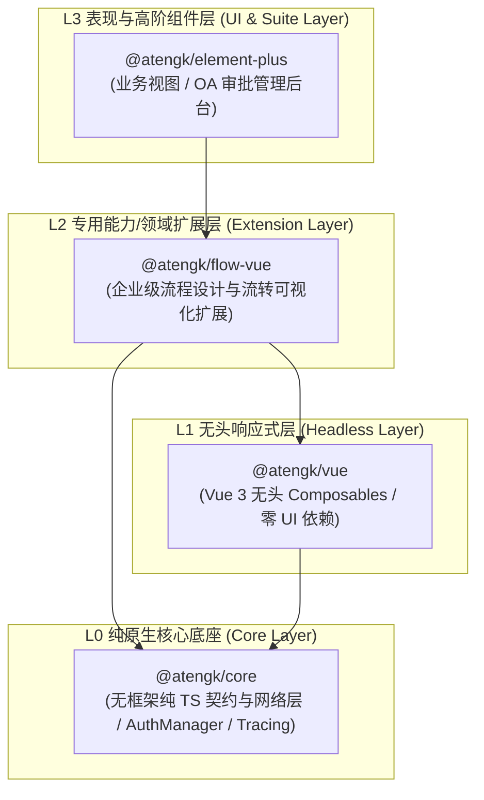
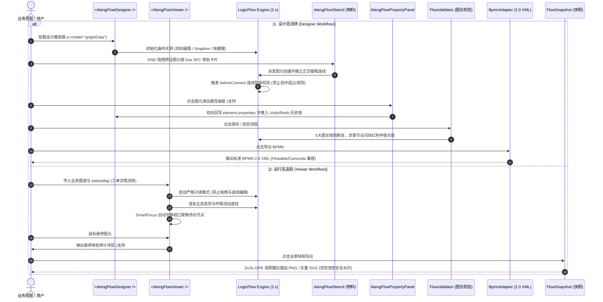

# @atengk/flow-vue 企业级流程设计与流转可视化扩展套件

> 面向现代 Web 应用与企业级审批流、状态机的工业级流程设计与流转可视化扩展套件，归属于系统四层洋葱拓扑之 **L2 专用能力/领域扩展层**。遵循“纯 Vue 3 驱动、强类型契约、零具体 UI 依赖、深模块解耦、确定性生命周期治理”设计，深度集成 LogicFlow 2.x 核心引擎，支持正交折线四向磁吸路由、开箱即用拓扑防呆守卫、三段式物料面板、属性配置抽屉、全量插槽控制反转、五态运行轨迹动效与悬停审计浮层、静态拓扑图论校验引擎、BPMN 2.0 工业协议双向转译、2x/3x DPR 全景防虚快照与安全文本矩阵水印、Vue 3 SFC 卡片节点注册以及低代码规则引擎 DAG 拓扑编排。

---

## 0. 特性与公共 API 全景速查矩阵

| 特性分类             | 特性名称               | 核心门面 / 组件 / Hook                                                       | 关键参数 / Props / Emits                                                                                                       | 核心行为说明                                                                                                                                            | 锚定验证源头 (*Test / Sample)                                                                                                                                                     |
| :------------------- | :--------------------- | :--------------------------------------------------------------------------- | :----------------------------------------------------------------------------------------------------------------------------- | :------------------------------------------------------------------------------------------------------------------------------------------------------ | :-------------------------------------------------------------------------------------------------------------------------------------------------------------------------------- |
| **画布核心**         | 流程画布组件           | `<AtengFlowCanvas />`                                                        | `modelValue, options, disabled, @node:click, @edge:click, @blank:click, @change, @ready`                                       | 基础流程拓扑画布容器，集成 ResizeObserver 几何自愈、图元双向数据流、历史栈与事件桥接                                                                    | [AtengFlowCanvas.test.ts](./test/AtengFlowCanvas.test.ts) / [DesignerBasicScenario.vue](../../apps/sample-flow-vue/src/scenarios/DesignerBasicScenario.vue)                       |
| **无头逻辑**         | 流程无头状态机 Hook    | `useFlow(options?)`                                                          | `(options?: UseFlowOptions) -> UseFlowReturn`                                                                                  | 纯响应式状态机，暴露 `init, render, getGraphData, zoomIn, zoomOut, fitView, undo, redo, destroy` 等原子操作门面                                         | [useFlow.test.ts](./test/useFlow.test.ts)                                                                                                                                         |
| **设计器主容器**     | 工业级流程编排设计器   | `<AtengFlowDesigner />`                                                      | `v-model, stencilGroups, customVueNodes, beforeConnect, panelWidth, showPanel, #stencil, #panel, #toolbar, @validate`          | 工业级流程编排设计器，组装三段式物料面板、画布、智能对齐线（Snapline）、四向吸附正交连线、属性抽屉与图论校验                                            | [AtengFlowDesigner.test.ts](./test/AtengFlowDesigner.test.ts) / [DesignerBasicScenario.vue](../../apps/sample-flow-vue/src/scenarios/DesignerBasicScenario.vue)                   |
| **流转追踪器**       | 运行态只读流转追踪器   | `<AtengFlowViewer />`                                                        | `v-model, statusMap, focusActiveNode, wheelZoomGuard, showMiniToolbar, #audit-popover, #mini-toolbar`                          | 专用于工单详情与审批流转的只读追踪容器，内置五态高亮流动虚线、悬停审批审计浮层、SmartFocus 智能待办定位与 WheelZoomGuard 滚轮防冲突                     | [AtengFlowViewer.test.ts](./test/AtengFlowViewer.test.ts) / [ViewerAuditScenario.vue](../../apps/sample-flow-vue/src/scenarios/ViewerAuditScenario.vue)                           |
| **物料面板**         | 三段式图元物料库       | `<AtengFlowStencil />`                                                       | `groups, lf, title, @dragstart, @item:click`                                                                                   | 遵循事件/任务/网关三段式规范分类展示预设图元，支持关键词过滤与 LogicFlow DND 拖拽投递                                                                   | [presets.test.ts](./test/presets.test.ts) / [DesignerBasicScenario.vue](../../apps/sample-flow-vue/src/scenarios/DesignerBasicScenario.vue)                                       |
| **属性抽屉**         | 元素属性配置抽屉       | `<AtengFlowPropertyPanel />`                                                 | `element, disabled, title, @update:property, @update:properties, @close, #header, #footer, #extra`                             | 针对选中节点与连线提供纯原生无依赖表单（只读 ID、名称、条件表达式、审批人与会签模式），支持 100% 插槽反转                                               | [AtengFlowPropertyPanel.test.ts](./test/AtengFlowPropertyPanel.test.ts) / [PropertyPanelSlotScenario.vue](../../apps/sample-flow-vue/src/scenarios/PropertyPanelSlotScenario.vue) |
| **顶部工具栏**       | 控制栏动作矩阵         | `<AtengFlowToolbar />`                                                       | `lf, canUndo, canRedo, disabled, @zoom-in, @fit-view, @undo, @redo, @clear, @layout, @toggle-grid, @toggle-minimap, @validate` | 集成缩放控制、Undo/Redo、网格切换、小地图开关、防误触清空弹层、自动排版与静态拓扑校验触发                                                               | [AtengFlowToolbar.test.ts](./test/AtengFlowToolbar.test.ts) / [DesignerBasicScenario.vue](../../apps/sample-flow-vue/src/scenarios/DesignerBasicScenario.vue)                     |
| **业务卡片**         | 预设审批卡片节点       | `<ApprovalCardNode />`                                                       | `node: FlowNode, graph: FlowGraph, updateProperties, @click:approve, @click:reject`                                            | 预设高颜值审批卡片，带头像、类型胶囊、状态指示徽标、办理进度条与快捷审批动作，支持双向属性原地 Diff 回写                                                | [VueNodeRegistry.test.ts](./test/VueNodeRegistry.test.ts) / [VueNodeCustomScenario.vue](../../apps/sample-flow-vue/src/scenarios/VueNodeCustomScenario.vue)                       |
| **Vue 节点注册**     | SFC 自定义卡片适配机制 | `VueNodeRegistry`                                                            | `register(target, type, component, options?)`                                                                                  | 将普通 Vue 3 SFC 单文件组件桥接注册为 LogicFlow 自定义卡片节点，响应式 Props 注入、原地 Diff 更新与销毁确定性清理                                       | [VueNodeRegistry.test.ts](./test/VueNodeRegistry.test.ts) / [VueNodeCustomScenario.vue](../../apps/sample-flow-vue/src/scenarios/VueNodeCustomScenario.vue)                       |
| **Vue 节点注册**     | 声明式组件快捷注册函数 | `registerVueNode(lf, type, component, options?)`                             | `(lf: LogicFlow, type: string, component: Component, options?: VueNodeOptions) => void`                                        | 便捷函数将单文件组件直接注册到 LogicFlow 实例，指定宽高等几何参数                                                                                       | [VueNodeRegistry.test.ts](./test/VueNodeRegistry.test.ts) / [VueNodeCustomScenario.vue](../../apps/sample-flow-vue/src/scenarios/VueNodeCustomScenario.vue)                       |
| **静态拓扑校验**     | 流程静态校验引擎       | `FlowValidator`                                                              | `validate(graph) -> FlowValidationResult, hasErrors(result) -> boolean`                                                        | 纯原生 TypeScript 校验 5 大图论刚性规则（起止唯一性、连通孤岛、排他网关分支与条件、无出口死循环检测）并输出结构化诊断实体集合                           | [FlowValidator.test.ts](./test/FlowValidator.test.ts) / [ValidatorLayoutScenario.vue](../../apps/sample-flow-vue/src/scenarios/ValidatorLayoutScenario.vue)                       |
| **规则代号枚举**     | 拓扑校验规则常量字典   | `FlowValidationRuleCode`                                                     | `START_NODE_MISSING, DEADLOCK_CYCLE, GATEWAY_BRANCH_INSUFFICIENT 等`                                                           | 结构化图论校验错误分类代号枚举字典                                                                                                                      | [FlowValidator.test.ts](./test/FlowValidator.test.ts) / [ValidatorLayoutScenario.vue](../../apps/sample-flow-vue/src/scenarios/ValidatorLayoutScenario.vue)                       |
| **自动排版**         | DAG 分层排版引擎       | `AutoLayoutEngine`                                                           | `layout(graph, options?) -> FlowGraph, animateLayout(lf, graph, options?)`                                                     | 基于有向无环图分层拓扑算法，计算 Rank 与节点间距，支持水平 (LR) 与垂直 (TB) 规整重排、平滑缓动动画与折点自适应更新                                      | [AutoLayoutEngine.test.ts](./test/AutoLayoutEngine.test.ts) / [ValidatorLayoutScenario.vue](../../apps/sample-flow-vue/src/scenarios/ValidatorLayoutScenario.vue)                 |
| **BPMN 转译器**      | BPMN 2.0 工业协议互转  | `BpmnAdapter`                                                                | `toBpmnXml(graph, options?) -> string, fromBpmnXml(xml) -> FlowGraph`                                                          | 纯原生双向协议转译，兼容 Flowable/Camunda 标准规范，精确还原 Bounds 中心坐标、折点 Waypoint 与办理人/条件扩展属性                                       | [BpmnAdapter.test.ts](./test/BpmnAdapter.test.ts) / [BpmnAdapterScenario.vue](../../apps/sample-flow-vue/src/scenarios/BpmnAdapterScenario.vue)                                   |
| **全景高清快照**     | 高清防虚快照导出工具   | `FlowSnapshot`                                                               | `computeBoundingBox, getSvgString, getSnapshot, download`                                                                      | 最小外接边界自适应计算，2x/3x DPR 视网膜高清防虚栅格化，矢量 SVG 导出与自定义防泄密矩阵文本水印                                                         | [FlowSnapshot.test.ts](./test/FlowSnapshot.test.ts) / [SnapshotWatermarkScenario.vue](../../apps/sample-flow-vue/src/scenarios/SnapshotWatermarkScenario.vue)                     |
| **五态枚举与字典**   | 执行状态枚举与样式映射 | `FlowExecutionStatus / STATUS_TEXT_MAP / STATUS_BADGE_CLASS_MAP`             | `FlowExecutionStatus.*, Record<ExecutionStatus, string>`                                                                       | 统一提供五态运行时枚举（COMPLETED/PROCESSING/REJECTED/PENDING/TERMINATED）与中文文案、专属 CSS 徽标映射字典                                             | [types.ts](./src/types.ts) / [ViewerAuditScenario.vue](../../apps/sample-flow-vue/src/scenarios/ViewerAuditScenario.vue)                                                          |
| **预设图元注册**     | 核心预设图元与拓扑防呆 | `registerPresetNodes`                                                        | `(lf: LogicFlow, beforeConnect?: BeforeConnectHook) => void`                                                                   | 注册开始、结束、审批任务、服务任务、排他网关、并行网关与折线/贝塞尔连线，内置自环/起止点/重复连线防呆守卫                                               | [presets.test.ts](./test/presets.test.ts) / [DesignerBasicScenario.vue](../../apps/sample-flow-vue/src/scenarios/DesignerBasicScenario.vue)                                       |
| **图元枚举与元数据** | 预设图元类型与徽标字典 | `FlowNodeType / NODE_TYPE_LABEL_MAP / NODE_TYPE_ICON_MAP / getNodeBadgeIcon` | `FlowNodeType.*, NODE_TYPE_LABEL_MAP, getNodeBadgeIcon(type) -> string`                                                        | 标准化图元类型标识字典（如 `flow:start`）、显示名称映射与小徽标图标解析函数                                                                             | [presets.test.ts](./test/presets.test.ts) / [DesignerBasicScenario.vue](../../apps/sample-flow-vue/src/scenarios/DesignerBasicScenario.vue)                                       |
| **物料常量**         | 默认三段式物料分组     | `DEFAULT_STENCIL_GROUPS`                                                     | `StencilGroup[]`                                                                                                               | 默认物料预设分组配置（事件类、任务类、网关控制类）                                                                                                      | [presets.test.ts](./test/presets.test.ts) / [DesignerBasicScenario.vue](../../apps/sample-flow-vue/src/scenarios/DesignerBasicScenario.vue)                                       |
| **插件安装**         | 全局组件独立注册器     | `install(app) / default`                                                     | `(app: App) => void`                                                                                                           | 批量向 Vue 应用注册 `AtengFlowCanvas, AtengFlowDesigner, AtengFlowViewer, AtengFlowStencil, AtengFlowPropertyPanel, AtengFlowToolbar, ApprovalCardNode` | [index.ts](./src/index.ts) / [main.ts](../../apps/sample-flow-vue/src/main.ts)                                                                                                    |

---

## 1. 模块定位与 pnpm 坐标

`@atengk/flow-vue` 归属于 `ateng-ui` 基础设施套件的 **L2 专用能力/领域扩展层 (Extension Layer)**，专注于企业级现代审批流、状态机可视化与低代码规则拓扑编排。

- **npm 坐标**：`@atengk/flow-vue`
- **源码工程**：`packages/flow-vue`
- **自验展厅**：`apps/sample-flow-vue`（固定端口 `3007`）
- **底层依赖**：依赖 `@atengk/core` (L0) 与 `@atengk/vue` (L1)，严格与具体 UI 表现库（如 Element Plus）解耦；
- **peerDependencies 契约**：要求 `vue: ^3.5.0`，`@logicflow/core: ^2.0.0`。

### 安装依赖

```bash
pnpm add @atengk/flow-vue @logicflow/core @atengk/core @atengk/vue vue
```

---

## 2. 核心架构与设计不变量

### 2.1 四层洋葱拓扑位置



### 2.2 双轨设计态与流转追踪态交互时序图



### 2.3 四大核心设计不变量

1. **L2 专用扩展层解耦与框架中立不变量 (L2 Decoupling & Framework Neutrality Invariant)**：
   - `@atengk/flow-vue` 作为专业工作流扩展套件，坚守 L2 纯原生中立定位，**绝对严禁直接硬编码依赖任何具体 UI 库（如 Element Plus）**；
   - 内部面板样式一律以 `.at-flow-*` 命名空间隔离并使用 `--at-flow-*` CSS 变量；
   - 采用 100% 插槽控制反转（Slot Inversion）架构，对外暴露 `#stencil`、`#panel`、`#toolbar` 与 `#audit-popover` 具名插槽，上层业务使用 Element Plus 时可通过 `<el-form>`、`<el-timeline>` 零胶水无缝替换接管。

2. **设计态与只读流转追踪态双轨分离不变量 (Dual-Track Design/Viewer Invariant)**：
   - **设计态 (`<AtengFlowDesigner />`)**：面向流程编排与管理后台，组装物料面板、Snapline 磁吸对齐线、快捷键体系（Delete/Ctrl+Z/Y/C/V）、属性抽屉与静态校验；
   - **流转追踪态 (`<AtengFlowViewer />`)**：面向工单详情与审批履历页，严格开启 `isSilentMode: true` 物理只读锁定，隐藏所有连线锚点，彻底杜绝误触或非授权篡改；标配五态运行动效、审批审计浮层、`SmartFocus` 智能待办定位与 `WheelZoomGuard` 页面滚轮防冲突守卫。

3. **确定性四步生命周期销毁与内存零泄漏不变量 (Deterministic Four-Step Lifecycle Cleanup Invariant)**：
   - 针对 LogicFlow 图形引擎、SVG 画布与 Vue 3 SFC 自定义节点实例池，在组件销毁钩子（`onUnmounted`）中严格执行“四步清理”：
     1. **尺寸解绑**：解绑 `ResizeObserver` 视口监听句柄，清除重试定时器；
     2. **实例池回收**：遍历销毁所有通过 `VueNodeRegistry` 挂载的 Vue 3 SFC 虚拟节点并清理 DOM 挂载点；
     3. **事件卸载**：注销画布全局键盘快捷键、右键菜单与 MiniMap 缩略图物理事件监听；
     4. **引擎销毁**：显式调用 `lf.destroy()` 释放底座资源并置空引用，彻底消除离线回调悬挂与内存泄漏。

4. **图论连线防呆与拓扑静态校验不变量 (Topology Guard & Static Validation Invariant)**：
   - **前置连线守卫 (`beforeConnect`)**：在拖拽连线握手阶段实施毫秒级图论拦截（禁止自环连线、开始节点不可连入、结束节点不可连出、相同节点禁止重复连线），非法连线即时弹回；
   - **静态校验引擎 (`FlowValidator`)**：纯原生 TypeScript 实现 5 大刚性图论规则校验（起止节点唯一性、连通孤岛、排他网关分支数与流转条件缺失、无出口死循环检测）；
   - **视觉自愈与精准定位**：校验发现异常时，涉事节点自动挂载 `.at-flow-node--error` 呈现红色脉冲发光呼吸动画（`@keyframes at-flow-pulse-error`），支持视口平滑居中聚焦。

---

## 3. 工业级可视化流程编排设计器套件 (AtengFlowDesigner)

_(待工单 #264 系统交付：极简开箱、物料面板 DND、四向吸附正交平滑折线、快捷键体系与三要素就近闭环)_

---

## 4. 运行态只读流转追踪套件 (AtengFlowViewer)

_(待工单 #264 系统交付：五态审批流转高亮、流动虚线动效、悬停审批审计浮层、SmartFocus 与 WheelZoomGuard)_

---

## 5. 元素属性配置抽屉与业务表单插槽接管 (AtengFlowPropertyPanel)

_(待工单 #265 系统交付：通用元数据原生表单、#panel 具名插槽反转与 Element Plus 深度接管)_

---

## 6. 静态拓扑图论校验与 DAG 自动分层排版套件

_(待工单 #265 系统交付：FlowValidator 5大图论规则、结构化诊断错误实体、AutoLayoutEngine 分层排版动画)_

---

## 7. BPMN 2.0 工业标准协议双向转译套件 (BpmnAdapter)

_(待工单 #266 系统交付：FlowGraph 导出标准 BPMN 2.0 XML、Flowable/Camunda 兼容、几何坐标保真还原)_

---

## 8. 全景高清防虚快照与安全水印导出套件 (FlowSnapshot)

_(待工单 #266 系统交付：最小外接边界自适应、2x/3x DPR 视网膜抗锯齿、矢量 SVG 与文本矩阵安全水印)_

---

## 9. Vue 3 SFC 自定义卡片节点与业务扩展套件 (VueNodeRegistry)

_(待工单 #266 系统交付：声明式注册 Vue SFC 节点、ApprovalCardNode 预设卡片、双向属性回写与动作回传)_

---

## 10. 完整 TypeScript 接口/Props/CSS 变量速查清单 (全量速查附录字典)

_(待工单 #266 系统交付：全量集中速查字典与 --at-flow-_ Design Tokens 规范)*

---

## 11. 1:1 物理排版与全维测试守护 (Evergreen & Zero-Glitch)

- 本包所有公开组件与方法均具备 100% 离线自洽的单元测试覆盖；
- 真实端到端场景在自验展厅 [`apps/sample-flow-vue`](../../apps/sample-flow-vue/README.md)（固定端口 `3007`）8 大解耦看板中完整呈现；
- 运行测试与自验工程全真构建：
  ```bash
  pnpm --filter @atengk/flow-vue test && \
  pnpm --filter sample-flow-vue build
  ```
