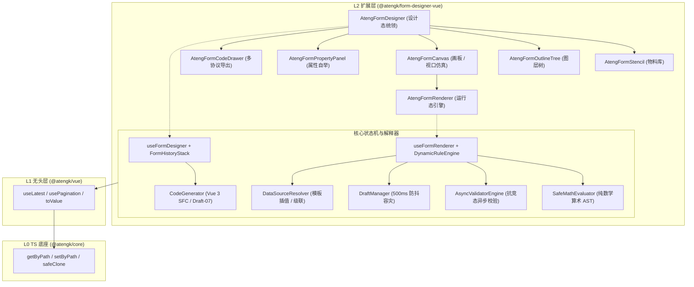

# @atengk/form-designer-vue 工业级动态表单设计器与运行态渲染引擎

> 面向现代 Web 应用与企业级审批流的高性能三段式 AST Schema 渲染引擎、无头拖拽设计态状态机与流程权限协同基础设施。

---

## 0. 特性与公共 API 全景速查矩阵

| 模块分类         | 导出符号 / 组件名称          | 核心职责与能力声明                                                          | 源码直达                                                                         |
| :--------------- | :--------------------------- | :-------------------------------------------------------------------------- | :------------------------------------------------------------------------------- |
| **运行态组件**   | `<AtengFormRenderer />`      | 解析三段式 AST，提供双向数据绑定、动态规则计算与流程权限覆盖                | [`AtengFormRenderer.vue`](./src/components/AtengFormRenderer.vue)                |
| **设计态组件**   | `<AtengFormDesigner />`      | 顶层设计器容器，统领物料库、画板、大纲树、属性自举面板与导出抽屉            | [`AtengFormDesigner.vue`](./src/components/AtengFormDesigner.vue)                |
| **画板组件**     | `<AtengFormCanvas />`        | 中央拖拽放置画板，支持 PC / Pad / Mobile 手机壳仿真与单列自适应流动         | [`AtengFormCanvas.vue`](./src/components/AtengFormCanvas.vue)                    |
| **物料库组件**   | `<AtengFormStencil />`       | 按基础、高级、布局、集合四大类呈现物料，支持 SortableJS 拖拽源              | [`AtengFormStencil.vue`](./src/components/AtengFormStencil.vue)                  |
| **大纲树组件**   | `<AtengFormOutlineTree />`   | 树形呈现整棵表单 AST 图层，支持快速寻址、重命名、复制与删除                 | [`AtengFormOutlineTree.vue`](./src/components/AtengFormOutlineTree.vue)          |
| **属性面板**     | `<AtengFormPropertyPanel />` | 属性自举配置面板，通过自身渲染器动态生成选中控件的属性配置表单              | [`AtengFormPropertyPanel.vue`](./src/components/AtengFormPropertyPanel.vue)      |
| **导出抽屉**     | `<AtengFormCodeDrawer />`    | 四目标 Tab 预览（SFC / AST / JSON Schema / Mock）、一键复制代码与 Blob 导出 | [`AtengFormCodeDrawer.vue`](./src/components/AtengFormCodeDrawer.vue)            |
| **排版容器**     | `<AtengFormGrid />`          | 栅格排版容器（LayoutContainer），内部子字段平铺绑定至根表单数据             | [`AtengFormGrid.vue`](./src/containers/AtengFormGrid.vue)                        |
| **卡片容器**     | `<AtengFormCard />`          | 卡片分组容器（LayoutContainer），提供边框卡片折叠视觉包裹                   | [`AtengFormCard.vue`](./src/containers/AtengFormCard.vue)                        |
| **明细容器**     | `<AtengSubForm />`           | 动态明细子表单容器（DataContainer），产生独立数组分支与行作用域数据         | [`AtengSubForm.vue`](./src/containers/AtengSubForm.vue)                          |
| **电子签名**     | `<AtengSignature />`         | 原生 Canvas 手写电子签名板，支持画笔线宽颜色、撤销笔迹与清除                | [`AtengSignature.vue`](./src/presets/element-plus/components/AtengSignature.vue) |
| **无头 Hooks**   | `useFormRenderer`            | 运行态响应式状态机，编排校验、可见性计算与数据存取                          | [`useFormRenderer.ts`](./src/composables/useFormRenderer.ts)                     |
| **无头 Hooks**   | `useFormDesigner`            | 设计态响应式状态机，管理选区、画布节点增删移改与视口切换                    | [`useFormDesigner.ts`](./src/composables/useFormDesigner.ts)                     |
| **校验引擎**     | `AsyncValidatorEngine`       | 基于 async-validator 扩展，注入 `AbortSignal` 根除异步网络校验竞态          | [`AsyncValidatorEngine.ts`](./src/validator/AsyncValidatorEngine.ts)             |
| **动态规则**     | `DynamicRuleEngine`          | 零 `eval` 安全沙箱，驱动字段间显隐、禁用、必填与取值联动                    | [`DynamicRuleEngine.ts`](./src/rules/DynamicRuleEngine.ts)                       |
| **算术引擎**     | `SafeMathEvaluator`          | 纯数学 AST 表达式解释器，支持加减乘除括号取模等四则公式安全计算             | [`SafeMathEvaluator.ts`](./src/rules/SafeMathEvaluator.ts)                       |
| **历史栈**       | `FormHistoryStack`           | 不可变快照历史栈，支持 300ms 连续输入防抖合并与最大 30 步撤销重做           | [`FormHistoryStack.ts`](./src/history/FormHistoryStack.ts)                       |
| **容灾存储**     | `DraftManager`               | 本地草稿箱管理器，500ms 静默防抖落盘，LocalStorage 异常自动降级内存         | [`DraftManager.ts`](./src/storage/DraftManager.ts)                               |
| **代码编译器**   | `CodeGenerator`              | 表单多协议编译器，提供 Vue 3 SFC、JSON Schema Draft-07 与 Mock 合成         | [`CodeGenerator.ts`](./src/generator/CodeGenerator.ts)                           |
| **数据源协调**   | `DataSourceResolver`         | 远程动态字典解析器，支持 `{{ variable }}` 模板变量插值与级联重拉            | [`DataSourceResolver.ts`](./src/datasource/DataSourceResolver.ts)                |
| **官方适配套件** | `registerElementPlusWidgets` | 注册 15 种 Element Plus 官方高频表单控件适配器（次级导出）                  | [`presets/element-plus`](./src/presets/element-plus/index.ts)                    |
| **生态物料装配** | `registerEcosystemWidgets`   | 注册富文本、代码编辑器、手写签名、切片上传四大兄弟生态扩展                  | [`ecosystem.ts`](./src/presets/element-plus/ecosystem.ts)                        |

---

## 1. 模块定位与 pnpm 坐标

`@atengk/form-designer-vue` 位于全仓架构的 **L2 专业能力扩展层**，向下依托 L0（`@atengk/core`）的工具基准与 L1（`@atengk/vue`）的无头响应式状态编排能力，向上可被企业级应用或 L3 套件（`@atengk/element-plus`）无缝消费，实现零逆向依赖与极致的 Tree-Shaking。

```bash
pnpm add @atengk/form-designer-vue
```

### Peer Dependencies 依赖矩阵

| 依赖包名       | 兼容版本范围 | 推荐生产版本 | 选填说明                                     |
| :------------- | :----------- | :----------- | :------------------------------------------- |
| `vue`          | `>=3.5.0`    | `^3.5.13`    | 必填核心运行时                               |
| `element-plus` | `>=2.8.0`    | `^2.14.7`    | 可选（使用官方 Element Plus 适配预设时需要） |

---

## 2. 核心架构与设计不变量



### 核心架构不变量

1. **三段式 AST 协议不变量**：所有表单元数据统一序列化为标准 `FormSchema`：`version` 锁定协议版本、`formConfig` 约束全局布局规格、`widgetList` 维护具有严格拓扑顺序的控件树。
2. **容器二分模型不变量**：
   - **排版容器 (LayoutContainer)**：`grid`、`card`、`tabs` 等，仅影响视觉排版几何，内部叶子控件的数据绑定键平铺在根 `formData` 作用域；
   - **数据容器 (DataContainer)**：`subform`、`detail-table` 等，在数据模型中严格产生独立数组分支（`formData.items = [...]`），具备独立的明细行作用域。
3. **零 eval 与沙箱防篡改安全线**：所有动态公式计算与规则联动严禁使用危险的 `eval()` 或 `new Function()`，全部收敛于纯 AST 词法分析与有限状态机求值，100% 根除动态表单 XSS 逃逸注入。
4. **确定性生命周期治理**：Sortable 拖拽实例、LocalStorage 防抖定时器、Canvas 画布上下文与临时 Blob 下载 URL，在组件卸载（`onUnmounted`）时 100% 显式销毁释放。

---

## 3. 运行态三段式 AST Schema 与渲染器

### 3.1 专属 TypeScript 契约

```ts
/**
 * 三段式表单专用 AST Schema 实体。
 */
export interface FormSchema {
  /** 协议版本号，当前锁定 '1.0' */
  version: '1.0';
  /** 全局表单配置 */
  formConfig: {
    layout?: 'horizontal' | 'vertical' | 'inline';
    labelWidth?: number | string;
    labelPosition?: 'left' | 'right' | 'top';
    size?: 'large' | 'default' | 'small';
    colon?: boolean;
    readonly?: boolean;
    disabled?: boolean;
  };
  /** 根控件节点列表 */
  widgetList: FormWidget[];
}

/**
 * AtengFormRenderer 组件 Props 契约。
 */
export interface AtengFormRendererProps {
  /** 表单三段式 AST Schema 结构 */
  schema: FormSchema;
  /** 双向绑定的表单填报数据模型 */
  formData?: Record<string, unknown>;
  /** BPMN 流程协同节点字段权限矩阵 */
  permissions?: FieldPermissionMatrix;
  /** 是否开启本地草稿箱容灾静默落盘 */
  enableDraft?: boolean;
  /** 本地草稿存储键 */
  draftKey?: string;
}
```

### 3.2 实战业务代码

```vue
<script setup lang="ts">
import { reactive, ref } from 'vue';
import { AtengFormRenderer } from '@atengk/form-designer-vue';
import type { FormSchema, FormRendererInstance } from '@atengk/form-designer-vue';

const formRendererRef = ref<FormRendererInstance | null>(null);

// 企业采购审批单据 AST
const purchaseSchema: FormSchema = {
  version: '1.0',
  formConfig: { layout: 'vertical', labelPosition: 'top', colon: true },
  widgetList: [
    {
      id: 'w_order_title',
      type: 'input',
      modelKey: 'orderTitle',
      label: '采购立项标题',
      rules: [{ required: true, message: '请录入采购项目标题' }],
    },
    {
      id: 'w_budget',
      type: 'input-number',
      modelKey: 'budgetAmount',
      label: '申请预算金额 (元)',
      defaultValue: 10000,
      rules: [{ min: 100, message: '采购起批预算不低于 100 元' }],
    },
  ],
};

const formData = reactive<Record<string, unknown>>({
  orderTitle: '2026 年度研发终端设备换新采购',
  budgetAmount: 85000,
});

const handleSubmit = async () => {
  if (!formRendererRef.value) return;
  const result = await formRendererRef.value.validate();
  if (result.valid) {
    console.log('表单校验通过，提交数据:', formRendererRef.value.getFormData());
  }
};
</script>

<template>
  <div class="purchase-form-card">
    <AtengFormRenderer
      ref="formRendererRef"
      :schema="purchaseSchema"
      :form-data="formData"
      enable-draft
      draft-key="purchase_draft_01"
    />
    <button type="button" @click="handleSubmit">提交审批</button>
  </div>
</template>
```

### 3.3 架构机制与生产边界

- **双向数据解包与深层寻址**：通过 `@atengk/core` 的 `getByPath` 与 `setByPath` 实现对 `user.profile.title` 点路径的直接绑定，无损保持响应性；
- **防校验穿透**：当字段处于隐藏态（`isFieldVisible === false`）或禁用态（`disabled`）时，校验引擎在前置阶段自动短路跳过，避免无效拦截。

---

## 4. BPMN 审批流节点权限协同矩阵

### 4.1 专属 TypeScript 契约

```ts
/**
 * 字段流程权限枚举。
 * - editable: 可编辑（正常交互）
 * - readonly: 只读（脱壳纯文本或禁用态）
 * - hidden: 隐藏（不参与渲染且跳过校验）
 * - required: 强制必填（覆盖 Schema 默认规则）
 */
export type FieldPermission = 'editable' | 'readonly' | 'hidden' | 'required';

/**
 * 流程协同字段权限矩阵。键为字段的 modelKey。
 */
export type FieldPermissionMatrix = Record<string, FieldPermission>;
```

### 4.2 实战业务代码

```vue
<script setup lang="ts">
import { ref } from 'vue';
import { AtengFormRenderer } from '@atengk/form-designer-vue';
import type { FormSchema, FieldPermissionMatrix } from '@atengk/form-designer-vue';

const schema: FormSchema = {
  version: '1.0',
  formConfig: { layout: 'vertical' },
  widgetList: [
    { id: 'w1', type: 'input', modelKey: 'applicant', label: '申请人' },
    { id: 'w2', type: 'input', modelKey: 'deptAudit', label: '部门审核意见' },
    { id: 'w3', type: 'input', modelKey: 'financeAudit', label: '财务审批意见' },
  ],
};

// 模拟“部门主管审核”节点：申请人只读，财务意见隐藏，本节点意见必填
const currentRolePermissions = ref<FieldPermissionMatrix>({
  applicant: 'readonly',
  deptAudit: 'required',
  financeAudit: 'hidden',
});
</script>

<template>
  <AtengFormRenderer :schema="schema" :permissions="currentRolePermissions" />
</template>
```

### 4.3 架构机制与生产边界

- **非破坏性权限叠加**：流程节点权限仅作用于视图渲染流水线，完全不污染底层的 `FormSchema` AST 定义；
- **前端状态真明文与脱敏**：严禁在权限控制中将受保护属性篡改为 `***` 字符串污染数据模型，所有掩码逻辑收敛于只读格式化管道。

---

## 5. 零 eval 动态规则与纯数学算术 AST 解释器

### 5.1 专属 TypeScript 契约

```ts
/**
 * 动态规则定义。
 */
export interface DynamicRule {
  conditions: Array<{
    sourceKey: string;
    operator: 'eq' | 'ne' | 'gt' | 'gte' | 'lt' | 'lte' | 'in' | 'empty' | 'notEmpty';
    value?: unknown;
  }>;
  logic?: 'and' | 'or';
  actions: Array<{
    target: 'visible' | 'disabled' | 'required' | 'value';
    value: unknown;
  }>;
  otherwise?: Array<{
    target: 'visible' | 'disabled' | 'required' | 'value';
    value: unknown;
  }>;
}
```

### 5.2 实战业务代码

```ts
import { SafeMathEvaluator, DynamicRuleEngine } from '@atengk/form-designer-vue';

// 1. 安全算术公式求值（纯数学 AST，零 eval）
const formData = { unitPrice: 299.5, quantity: 3, discount: 50 };
const totalAmount = SafeMathEvaluator.evaluate('(unitPrice * quantity) - discount', formData);
console.log('计算结果:', totalAmount); // 848.5

// 2. 动态规则条件判定
const rule = {
  conditions: [{ sourceKey: 'totalAmount', operator: 'gt', value: 500 }],
  actions: [{ target: 'required', value: true }],
};
const shouldRequireVipCode = DynamicRuleEngine.evaluateRule(rule, { totalAmount: 848.5 });
console.log('是否满足要求:', shouldRequireVipCode); // true
```

### 5.3 架构机制与生产边界

- **数学语法安全限制**：`SafeMathEvaluator` 基于递归下降解析器，仅允许数字、变量标识符与算术运算符（`+`, `-`, `*`, `/`, `%`, `()`），遇到非法字符与原型链属性（如 `__proto__`, `constructor`）立即抛出异常阻断。

---

## 6. 容器二分法与动态明细子表单 SubForm

### 6.1 专属 TypeScript 契约

```ts
/**
 * 子表单明细数据容器专用 Props。
 */
export interface SubFormProps {
  /** 交互模式：table 紧凑行内编辑表格，dialog-list 卡片弹窗填报 */
  displayMode?: 'table' | 'dialog-list';
  /** 是否允许新增明细行 */
  allowAdd?: boolean;
  /** 是否允许删除明细行 */
  allowDelete?: boolean;
  /** 允许的最大记录行数 */
  maxRows?: number;
  /** 允许的最小记录行数 */
  minRows?: number;
}
```

### 6.2 实战业务代码

```vue
<script setup lang="ts">
import { reactive } from 'vue';
import { AtengFormRenderer } from '@atengk/form-designer-vue';
import type { FormSchema } from '@atengk/form-designer-vue';

const subFormSchema: FormSchema = {
  version: '1.0',
  formConfig: { layout: 'vertical' },
  widgetList: [
    {
      id: 'w_subform',
      type: 'subform',
      modelKey: 'orderItems',
      label: '采购商品明细清单',
      isCollection: true,
      containerType: 'data',
      props: { displayMode: 'table', allowAdd: true, allowDelete: true },
      children: [
        { id: 'c1', type: 'input', modelKey: 'productName', label: '商品品名' },
        { id: 'c2', type: 'input-number', modelKey: 'price', label: '采购单价' },
        { id: 'c3', type: 'input-number', modelKey: 'count', label: '数量' },
      ],
    },
  ],
};

const formData = reactive({
  orderItems: [
    { productName: '无线降噪耳机', price: 1299, count: 2 },
    { productName: '机械键盘', price: 599, count: 5 },
  ],
});
</script>

<template>
  <AtengFormRenderer :schema="subFormSchema" :form-data="formData" />
</template>
```

### 6.3 架构机制与生产边界

- **行作用域隔离**：子表单每一行生成独立行索引上下文，行内字段路径自动编码为 `orderItems[0].price`，在更新与校验时实现精准行列寻址。

---

## 7. 设计态画板、物料库、属性自举与历史栈

### 7.1 专属 TypeScript 契约

```ts
/**
 * AtengFormDesigner 顶层设计器组件暴露的实例接口。
 */
export interface FormDesignerInstance {
  getSchema: () => FormSchema;
  setSchema: (schema: FormSchema) => void;
  getActiveWidget: () => FormWidget | null;
  selectWidget: (id: string | null) => void;
  clearWidgets: () => void;
  undo: () => void;
  redo: () => void;
  exportSchema: () => FormSchema;
  setViewport: (viewport: 'pc' | 'pad' | 'mobile') => void;
}
```

### 7.2 实战业务代码

```vue
<script setup lang="ts">
import { ref } from 'vue';
import { AtengFormDesigner } from '@atengk/form-designer-vue';
import type { FormDesignerInstance } from '@atengk/form-designer-vue';

const designerRef = ref<FormDesignerInstance | null>(null);

const handleExport = () => {
  if (!designerRef.value) return;
  const currentSchema = designerRef.value.getSchema();
  console.log('导出最新表单 AST:', currentSchema);
};
</script>

<template>
  <div style="height: 800px;">
    <AtengFormDesigner ref="designerRef" />
  </div>
</template>
```

### 7.3 架构机制与生产边界

- **属性自举机制**：属性面板内部通过 `AtengFormRenderer` 自身来渲染被选中控件的配置 Schema，实现了“用表单渲染器配置表单渲染器”的高阶自举模式；
- **拖拽类型守卫**：内置 `validateDropTarget` 强校验，严禁子表单内嵌套子表单、容器拖入自身或非法递归。

---

## 8. 多端视口仿真、草稿箱容灾与多目标代码生成

### 8.1 专属 TypeScript 契约

```ts
/**
 * 本地草稿箱容灾管理器配置选项。
 */
export interface DraftManagerOptions {
  prefix?: string;
  debounceMs?: number;
  maxAgeMs?: number;
  onSave?: (record: DraftRecord) => void;
  onError?: (error: Error) => void;
}
```

### 8.2 实战业务代码

```ts
import { CodeGenerator, createDraftManager } from '@atengk/form-designer-vue';

// 1. 本地草稿箱 500ms 静默防抖落盘
const draftManager = createDraftManager('user_reimburse_form', { debounceMs: 500 });
draftManager.save({ amount: 980, reason: '差旅交通费' });

// 2. 编译生成独立可运行的 Vue 3 SFC 单文件组件
const sfcCode = CodeGenerator.toVueSfc(schema, { componentName: 'ReimburseForm' });
console.log('生成单文件代码:\n', sfcCode);

// 3. 编译生成符合 JSON Schema Draft-07 协议对象
const jsonSchema = CodeGenerator.toStandardJsonSchema(schema);
```

### 8.3 架构机制与生产边界

- **存储沙箱优雅降级**：当无 window 环境、LocalStorage 抛出 `QuotaExceededError` 或无痕模式禁止存储时，自动平滑回退至内存 `Map` 存储，绝不导致页面抛错白屏。

---

## 9. 官方 Element Plus 适配预设、远程数据源与兄弟生态物料

### 9.1 专属 TypeScript 契约

```ts
import type { FormWidgetRegistry } from '@atengk/form-designer-vue';

/**
 * 次级导出路径：@atengk/form-designer-vue/presets/element-plus
 */
export declare function registerElementPlusWidgets(
  registry?: FormWidgetRegistry,
): FormWidgetRegistry;
export declare function registerEcosystemWidgets(
  registry?: FormWidgetRegistry,
  options?: EcosystemWidgetsOptions,
): FormWidgetRegistry;
export declare function installElementPlusPreset(
  registry?: FormWidgetRegistry,
  options?: EcosystemWidgetsOptions,
): FormWidgetRegistry;
```

### 9.2 实战业务代码

```vue
<script setup lang="ts">
import { reactive } from 'vue';
import { AtengFormRenderer, FormWidgetRegistry } from '@atengk/form-designer-vue';
import { installElementPlusPreset } from '@atengk/form-designer-vue/presets/element-plus';

// 初始化并一键注册 Element Plus 15 种官方控件与生态物料
const registry = installElementPlusPreset(new FormWidgetRegistry());

const schema = {
  version: '1.0' as const,
  formConfig: { layout: 'vertical' as const },
  widgetList: [
    { id: 'w1', type: 'el-input', modelKey: 'title', label: '申请标题' },
    { id: 'w2', type: 'el-switch', modelKey: 'urgent', label: '加急状态' },
    { id: 'w3', type: 'signature', modelKey: 'signImg', label: '手写签名' },
  ],
};

const formData = reactive({ title: '', urgent: false, signImg: '' });
</script>

<template>
  <AtengFormRenderer :schema="schema" :form-data="formData" :registry="registry" />
</template>
```

### 9.3 架构机制与生产边界

- **动态变量插值与级联重拉**：`DataSourceConfig` 支持 `url: '/api/cities?provinceId={{ provinceId }}'`，当下游检测到上游 `provinceId` 变更时，自动取消未决请求（`AbortController`）并重新发起拉取，同时自动清空下级脏数据。

---

## 10. 生产环境避坑与性能/生命周期治理指南

1. **避免循环嵌套拖拽污染**：严禁通过手动修改 Schema 将 `subform` 嵌套在另一个 `subform` 内部，若需要多层明细，请设计为平铺关联的父子单据。
2. **防抖落盘与卸载时序**：在组件销毁或页面跳出时，若有未完成的防抖保存，请调用 `draftManager.flush()` 立即刷盘，并在 `onUnmounted` 中调用 `draftManager.dispose()` 释放定时器句柄。
3. **大数据量下拉列表性能**：在配置 `el-select` 选项时，如果选项规模超过 1000 项，请务必启用虚拟滚动或服务端检索模式，避免在 DOM 树中渲染数千个 `ElOption` 节点导致帧率骤降。
4. **公式变量拼写对齐**：使用 `SafeMathEvaluator` 公式时，表达式内的变量名必须与相应控件的 `modelKey` 严格保持一致，大小写敏感。
5. **暗黑模式样式隔离**：自定义物料或拓展样式严禁硬编码物理 Hex 色值（如 `#ffffff` 或 `#333333`），必须统一绑定 `--el-bg-color`、`--el-text-color-primary` 等 Design Tokens。
6. **流程权限前置校验防穿透**：当业务需要在只读态下提交数据时，注意只读字段不会触发原生必填校验，后端需配合执行二道校验防线。

---

## 11. 完整 TypeScript 接口/Props/CSS 变量速查清单

### 11.1 AtengFormRenderer Props 规格参数表

| 属性名            | 说明                          | 类型                      | 默认值      |
| :---------------- | :---------------------------- | :------------------------ | :---------- |
| `schema`          | 表单三段式 AST Schema 结构    | `FormSchema`              | **必填**    |
| `formData`        | 双向绑定的表单填报数据模型    | `Record<string, unknown>` | `{}`        |
| `permissions`     | BPMN 流程协同节点字段权限矩阵 | `FieldPermissionMatrix`   | `{}`        |
| `disabled`        | 全局表单禁用开关              | `boolean`                 | `false`     |
| `readonly`        | 全局表单只读开关              | `boolean`                 | `false`     |
| `enableDraft`     | 是否开启本地草稿箱容灾落盘    | `boolean`                 | `false`     |
| `draftKey`        | 本地草稿存储 Key              | `string`                  | `schema.id` |
| `draftDebounceMs` | 草稿箱落盘防抖延迟（毫秒）    | `number`                  | `500`       |

### 11.2 AtengFormDesigner Props 规格参数表

| 属性名            | 说明                     | 类型                        | 默认值      |
| :---------------- | :----------------------- | :-------------------------- | :---------- |
| `schema`          | 初始表单 Schema 结构     | `FormSchema`                | `undefined` |
| `maxHistoryLimit` | 快照历史栈最大步数       | `number`                    | `30`        |
| `debounceMs`      | 属性变更快照防抖合并延迟 | `number`                    | `300`       |
| `defaultViewport` | 画板初始视口模式         | `'pc' \| 'pad' \| 'mobile'` | `'pc'`      |

### 11.3 CSS 变量 Design Tokens

```css
:root {
  --at-form-text-color: var(--el-text-color-primary, #1e293b);
  --at-form-label-color: var(--el-text-color-regular, #334155);
  --at-form-danger-color: var(--el-color-danger, #ef4444);
  --at-form-info-color: var(--el-color-primary, #3b82f6);
}
```
