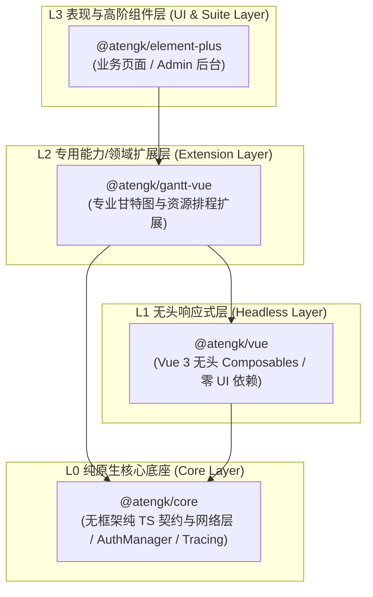
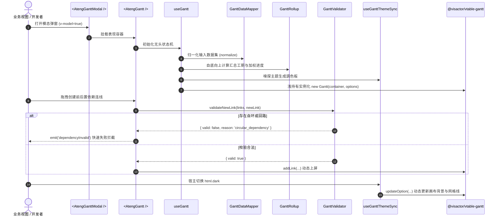

# @atengk/gantt-vue 专业甘特图与资源排程扩展套件

> 面向现代 Web 应用与企业级系统的前端高性能甘特图与资源排程基础设施，归属于系统四层洋葱拓扑之 **L2 专用能力/领域扩展层**。遵循“纯 Vue 3 驱动、强类型契约、零具体 UI 依赖、确定性生命周期治理”设计，基于 VisActor 现代 Canvas 渲染管线，提供统一甘特图表现容器、原生脱壳模态弹窗、纯无头响应式状态机 Hook、多级 WBS 树形折叠、双模数据自适应、自底向上工期/进度 Rollup 汇总推算、前后置依赖 FS/SS/FF/SF 拓扑判环防呆、计划基准线对比与延误智能预警、5 大时间刻度平滑无缝缩放、Design Tokens 驱动与暗黑模式无损热跟随，以及 Retina 高清防虚全景图片导出。

---

## 0. 特性与公共 API 全景速查矩阵

| 特性分类     | 特性名称                | 核心门面 / 组件 / Hook       | 关键参数 / Props / Emits                                            | 核心行为说明                                                                                             | 锚定验证源头 (*Test / Sample)                                                                                                                                  |
| :----------- | :---------------------- | :--------------------------- | :------------------------------------------------------------------ | :------------------------------------------------------------------------------------------------------- | :------------------------------------------------------------------------------------------------------------------------------------------------------------- |
| **表现容器** | 核心甘特图表现容器      | `<AtengGantt />`             | `tasks, columns, scale, mode, splitWidth, rollup, theme, markLines` | VisActor Canvas 驱动的专业甘特图容器，支持双栏像素级同步滚动、内置微工具栏与全套插槽反转                 | [ateng-gantt.test.ts](./test/ateng-gantt.test.ts) / [AgileWbsScenario.vue](../../apps/sample-gantt-vue/src/scenarios/AgileWbsScenario.vue)                     |
| **模态弹窗** | 原生脱壳模态排程弹窗    | `<AtengGanttModal />`        | `v-model, fullscreen, title, width, height, @save, @cancel`         | 基于 `<Teleport to="body">` 脱壳渲染，支持真全屏切换、0x0 视口自愈与操作按钮栏，透传全部甘特图门面       | [ateng-gantt-modal.test.ts](./test/ateng-gantt-modal.test.ts) / [ModalExportScenario.vue](../../apps/sample-gantt-vue/src/scenarios/ModalExportScenario.vue)   |
| **无头逻辑** | 纯无头甘特图状态机      | `useGantt(options)`          | `options: UseGanttOptions -> UseGanttReturn`                        | 浅引用闭包持有底盘实例，暴露对称挂载/销毁、刻度缩放、节点折叠展开、数据增删改查与图片导出高阶门面        | [use-gantt.test.ts](./test/use-gantt.test.ts) / [ScaleControlScenario.vue](../../apps/sample-gantt-vue/src/scenarios/ScaleControlScenario.vue)                 |
| **暗黑跟随** | 主题热同步状态机        | `useGanttThemeSync(options)` | `options: UseGanttThemeSyncOptions -> UseGanttThemeSyncReturn`      | 响应式监听 `html.dark` 类名与媒体查询，动态调用 `updateOption()` 切换背景与网格线色板，0 刷新平滑换肤    | [use-gantt-theme-sync.test.ts](./test/use-gantt-theme-sync.test.ts) / [App.vue](../../apps/sample-gantt-vue/src/App.vue)                                       |
| **视口守卫** | 视口几何自愈守卫        | `GanttResizeGuard`           | `container, onResize -> GanttResizeGuard`                           | 监控 DOM 从 `0x0`（隐藏/切 Tab/弹窗未展开）到实际尺寸恢复，毫秒级触发 Canvas 自愈重绘，根除白屏          | [gantt-resize-guard.test.ts](./test/gantt-resize-guard.test.ts) / [ModalExportScenario.vue](../../apps/sample-gantt-vue/src/scenarios/ModalExportScenario.vue) |
| **数据映射** | 双模数据自适应引擎      | `GanttDataMapper`            | `isFlatStructure, toTree, toFlat, updateTaskInList`                 | 纳秒级识别扁平数组与嵌套树结构并双向转换，回写时 100% 保全未在列中展示的业务私有扩展属性                 | [gantt-data-mapper.test.ts](./test/gantt-data-mapper.test.ts) / [AgileWbsScenario.vue](../../apps/sample-gantt-vue/src/scenarios/AgileWbsScenario.vue)         |
| **汇总计算** | 自底向上工期/进度汇总   | `GanttRollup`                | `rollupTree, rollupNode`                                            | 自叶向根动态推导父级任务最早开始、最晚结束工期，并按子任务工期加权推算综合完成进度百分比                 | [gantt-rollup.test.ts](./test/gantt-rollup.test.ts) / [AgileWbsScenario.vue](../../apps/sample-gantt-vue/src/scenarios/AgileWbsScenario.vue)                   |
| **依赖防呆** | DAG 依赖拓扑校验引擎    | `GanttValidator`             | `validateNewLink, isTaskDelayed`                                    | 基于有向无环图深度优先搜索拦截自环与回路，遇到死循环拓扑快速失败；精准推算工期相对计划基准的滞后延误天数 | [gantt-validator.test.ts](./test/gantt-validator.test.ts) / [AgileWbsScenario.vue](../../apps/sample-gantt-vue/src/scenarios/AgileWbsScenario.vue)             |
| **高清导出** | Retina 防虚图片导出引擎 | `GanttExporter`              | `exportAsDataUrl, triggerDownload`                                  | 将排程画布栅格化为 Base64 PNG/JPEG 图片，支持 2x Retina 像素比、全景排程与左表合并，支持直接文件下载     | [gantt-exporter.test.ts](./test/gantt-exporter.test.ts) / [ModalExportScenario.vue](../../apps/sample-gantt-vue/src/scenarios/ModalExportScenario.vue)         |

---

## 1. 模块定位与 pnpm 坐标

`@atengk/gantt-vue` 归属于 `ateng-ui` 基础设施套件的 **L2 专用能力/领域扩展层 (Extension Layer)**，专注于企业级高性能甘特图与资源排程。

- **npm 坐标**：`@atengk/gantt-vue`
- **源码工程**：`packages/gantt-vue`
- **自验展厅**：`apps/sample-gantt-vue`（端口 `3018`）
- **底层依赖**：依赖 `@atengk/core` (L0) 与 `@atengk/vue` (L1)，严格与具体 UI 库解耦；
- **peerDependencies 契约**：要求 `vue: ^3.5.0`。

### 安装依赖

```bash
pnpm add @atengk/gantt-vue @atengk/core @atengk/vue vue
```

---

## 2. 核心架构与设计不变量

### 2.1 四层洋葱拓扑位置



### 2.2 核心渲染与状态机协同流程



### 2.3 关键技术防线与设计不变量

1. **严格浅响应与浅持有（ADR-0050 §7）**：VTable-Gantt 底层实例极其复杂，**严禁使用 Vue `ref` 或 `reactive` 进行深层 Proxy 代理**，统一使用闭包或 `shallowRef` 持有，杜绝性能雪崩。
2. **纯 TS 纯净中立与 L2 定位**：作为 L2 扩展层组件，严禁在核心库中逆向依赖 Element Plus；模态弹窗采用纯原生 `<Teleport to="body">` 脱壳渲染。
3. **数据双模自适应与 100% 属性保全**：自动嗅探外部输入为扁平数组还是多级嵌套树，并在增量更新与变更回写时 100% 保全未在列中展示的任意业务扩展字段。
4. **DAG 有向无环图判环防呆**：依赖连线接入深度优先判环引擎，在用户拖拽连线时前置拦截自环与回路，杜绝无限循环死锁。

---

## 3. 核心表现容器与 WBS 排程套件

### 3.1 树形折叠、双栏同步滚动与自底向上 Rollup 汇总

`<AtengGantt />` 表现容器内置左侧树表（TreeGrid）与右侧排程时间轴双栏渲染，支持像素级同步垂直滚动与父任务自动工期/进度推算。

#### TypeScript 专属契约片段

```ts
export interface AtengGanttProps {
  /** 任务记录数据集 */
  tasks?: GanttTaskRecord[];
  /** 左侧任务树表列定义 */
  columns?: GanttColumn[];
  /** 时间轴刻度，默认 'day' */
  scale?: GanttScale;
  /** 交互模式，默认 'interactive' */
  mode?: GanttMode;
  /** 左侧表格宽度（像素），默认 360 */
  splitWidth?: number;
  /** 是否开启父任务自底向上工期/进度汇总，默认 true */
  rollup?: boolean;
}
```

#### 实战业务代码示例

```vue
<script setup lang="ts">
import { ref } from 'vue';
import { AtengGantt, type GanttTaskRecord, type GanttColumn } from '@atengk/gantt-vue';

const tasks = ref<GanttTaskRecord[]>([
  {
    id: 1,
    name: 'Ateng-UI v2.0 架构升级',
    startDate: '2026-11-01',
    endDate: '2026-11-30',
    type: 'summary',
    children: [
      {
        id: 101,
        name: '需求澄清与领域建模',
        startDate: '2026-11-01',
        endDate: '2026-11-05',
        progress: 1,
      },
      {
        id: 102,
        name: '无头状态机与契约设计',
        startDate: '2026-11-06',
        endDate: '2026-11-14',
        progress: 0.9,
      },
    ],
  },
]);

const columns: GanttColumn[] = [
  { field: 'id', title: '序号', width: 60, align: 'center' },
  { field: 'name', title: '任务名称', width: 240, sortable: true },
  { field: 'progress', title: '进度', width: 80, align: 'center' },
  { field: 'startDate', title: '开始时间', width: 110, align: 'center' },
  { field: 'endDate', title: '结束时间', width: 110, align: 'center' },
];
</script>

<template>
  <div style="height: 500px">
    <AtengGantt v-model:tasks="tasks" :columns="columns" :rollup="true" />
  </div>
</template>
```

#### 核心机制与生产边界

- **自底向上加权汇总**：当 `rollup: true` 时，汇总节点工期自动由子任务最小 `startDate` 与最大 `endDate` 决定，进度按子任务持续时间天数加权折算；
- **响应式双向绑定**：通过 `v-model:tasks` 实现任务拖拽拉伸后双向自动回传，父组件感知数据变更并保全扩展属性。

---

### 3.2 任务条微交互、里程碑菱形与 Tooltip 插槽反转

支持将工期起止相同的任务识别为黄色菱形里程碑（`milestone`），并提供 `#tooltip` 悬浮插槽供业务定制人员卡片与延误指标。

#### TypeScript 专属契约片段

```ts
export interface GanttTooltipSlotProps {
  /** 当前悬停的任务实体 */
  task: GanttTaskRecord;
  /** 是否发生工期延误 */
  delayed: boolean;
  /** 延误滞后天数 */
  delayDays: number;
}
```

#### 实战业务代码示例

```vue
<template>
  <AtengGantt :tasks="tasks" :columns="columns">
    <template #tooltip="{ task, delayed, delayDays }">
      <div class="custom-card">
        <div class="title">{{ task.name }}</div>
        <div>工期: {{ task.startDate }} 至 {{ task.endDate }}</div>
        <div>当前进度: {{ Math.round((task.progress ?? 0) * 100) }}%</div>
        <div v-if="delayed" class="warn">⚠️ 较基准滞后 {{ delayDays }} 天</div>
      </div>
    </template>
  </AtengGantt>
</template>
```

#### 核心机制与生产边界

- **里程碑自适应**：若任务 `startDate === endDate` 且 `type !== 'summary'`，引擎自动将其渲染为经典菱形里程碑；
- **插槽反转防遮挡**：Tooltip 容器自动计算视口边界偏移坐标，防止被 Canvas 画布边界截断。

---

## 4. 前后置依赖拓扑与 DAG 防呆判环

### 4.1 FS / SS / FF / SF 依赖连线转换与声明

系统支持四类国际标准工程依赖关系，抹平底层引擎字符串差异：

| 依赖代码 | 国际标准全称     | 语义说明                                 | 典型生产场景                    |
| :------- | :--------------- | :--------------------------------------- | :------------------------------ |
| `FS`     | Finish-to-Start  | 前置任务完成后，后置任务方可开始（默认） | 代码编写完成 ➔ 集成测试启动     |
| `SS`     | Start-to-Start   | 前置任务启动后，后置任务即可同步启动     | 土建主体浇筑 ➔ 预埋管线同步施工 |
| `FF`     | Finish-to-Finish | 前置任务完成后，后置任务才允许结束       | 需求变更澄清 ➔ 最终验收关闭     |
| `SF`     | Start-to-Finish  | 前置任务启动后，后置任务才允许结束       | 新系统割接上线 ➔ 老旧系统下线   |

#### 实战业务代码示例

```ts
import type { GanttDependencyLink } from '@atengk/gantt-vue';

const dependencies: GanttDependencyLink[] = [
  { sourceId: 101, targetId: 102, type: 'FS' },
  { sourceId: 102, targetId: 201, type: 'SS' },
];
```

---

### 4.2 拓扑判环、自环拦截与回路快速失败

内置 `GanttValidator` 拓扑校验算法，在新增连线时深度优先遍历有向图并检测自环与回路。

#### TypeScript 专属契约片段

```ts
export interface GanttValidationResult {
  /** 是否合法通过 */
  valid: boolean;
  /** 失败原因：'self_dependency' | 'circular_dependency' | 'invalid_id' */
  reason?: 'self_dependency' | 'circular_dependency' | 'invalid_id';
  /** 循环回路路径节点 ID 列表 */
  cyclePath?: (string | number)[];
}
```

#### 实战业务代码示例

```ts
import { GanttValidator, type GanttDependencyLink } from '@atengk/gantt-vue';

const existingLinks: GanttDependencyLink[] = [
  { sourceId: 'A', targetId: 'B', type: 'FS' },
  { sourceId: 'B', targetId: 'C', type: 'FS' },
];

// 校验尝试将 C 连回 A (回路)
const result = GanttValidator.validateNewLink(existingLinks, {
  sourceId: 'C',
  targetId: 'A',
  type: 'FS',
});
if (!result.valid) {
  console.warn(`非法依赖回路: ${result.cyclePath?.join(' -> ')}`);
}
```

#### 核心机制与生产边界

- **拓扑判环复杂度**：时间复杂度 $O(V + E)$，在微秒级完成全网深度优先判环；
- **防呆事件派发**：`<AtengGantt />` 遇非法回路时拦截物理连线并派发 `@dependency-invalid`，杜绝脏数据进入持久层。

---

## 5. 项目计划基线对比与工期延误预警

### 5.1 计划基准双层条绘制与偏差识别

支持在实际排期任务条下方对比渲染半透明灰色的计划基准条（Baseline），直观展示实际施工与计划安排的时序偏差。

#### TypeScript 专属契约片段

```ts
export interface GanttBaseline {
  /** 基准开始日期，格式 'YYYY-MM-DD' 或 Date */
  startDate: string | Date;
  /** 基准结束日期，格式 'YYYY-MM-DD' 或 Date */
  endDate: string | Date;
}

export interface GanttDelayStatus {
  /** 是否发生滞后延误 */
  delayed: boolean;
  /** 延误滞后天数 */
  delayDays: number;
}
```

#### 实战业务代码示例

```vue
<script setup lang="ts">
import { ref } from 'vue';
import { AtengGantt, type GanttTaskRecord } from '@atengk/gantt-vue';

const tasks = ref<GanttTaskRecord[]>([
  {
    id: 'E101',
    name: '主体钢结构吊装 (降雨延误)',
    startDate: '2026-11-05',
    endDate: '2026-11-20',
    progress: 0.6,
    baseline: {
      startDate: '2026-11-01',
      endDate: '2026-11-14',
    },
  },
]);
</script>

<template>
  <AtengGantt :tasks="tasks" :show-weekend="true" :show-today-line="true" />
</template>
```

#### 核心机制与生产边界

- **延误智能变色**：当 `actualEndDate > baselineEndDate` 且进度未完成时，任务条自动从主题主色变更为警示红色（`--at-gantt-delay-color`）；
- **非工作日高亮**：`showWeekend: true` 自动渲染周末非工作日斑马纹遮罩，直观对照有效工期。

---

## 6. 多粒度时间刻度缩放与视口控制

### 6.1 5 大时间刻度自由切换与步进缩放

支持按 `day`（日）、`week`（周）、`month`（月）、`quarter`（季）、`year`（年）五级时间粒度动态自由切换：

```vue
<script setup lang="ts">
import { ref } from 'vue';
import { AtengGantt, type GanttScale } from '@atengk/gantt-vue';

const scale = ref<GanttScale>('month');
const ganttRef = ref<InstanceType<typeof AtengGantt> | null>(null);

const zoomIn = () => ganttRef.value?.zoomIn();
const zoomOut = () => ganttRef.value?.zoomOut();
const scrollToMidYear = () => ganttRef.value?.scrollToDate('2026-07-01');
</script>

<template>
  <div>
    <button @click="scale = 'day'">日视图</button>
    <button @click="scale = 'week'">周视图</button>
    <button @click="scale = 'month'">月视图</button>
    <button @click="zoomIn">放大</button>
    <button @click="zoomOut">缩小</button>
    <button @click="scrollToMidYear">定位到7月</button>

    <AtengGantt ref="ganttRef" v-model:scale="scale" :tasks="tasks" />
  </div>
</template>
```

#### 核心机制与生产边界

- **智能标尺自适应**：切换至宏观年/季视图时表头自动汇总至季度与年份标签；微观日视图显示 ISO 自然周序号与具体天数；
- **定位居中平滑算法**：`scrollToDate` 将指定日期毫秒数转译为 Canvas 绝对 X 轴偏移，驱动水平滚动条平滑居中。

---

## 7. 脱壳模态弹窗与暗黑模式热跟随

### 7.1 原生 `<Teleport to="body">` 模态弹窗与真全屏切换

`<AtengGanttModal />` 100% 物理脱耦具体 UI 库，直接向 `document.body` 脱壳渲染，支持 ESC 键关闭、全屏切换手柄与操作栏持久化回写。

#### TypeScript 专属契约片段

```ts
export interface AtengGanttModalProps extends AtengGanttProps {
  /** 模态弹窗显隐状态 (v-model) */
  modelValue?: boolean;
  /** 弹窗标题 */
  title?: string;
  /** 是否处于全屏模式 (v-model:fullscreen) */
  fullscreen?: boolean;
  /** 点击遮罩层是否自动关闭，默认 true */
  closeOnClickModal?: boolean;
  /** 按下 ESC 键是否自动关闭，默认 true */
  closeOnPressEscape?: boolean;
}
```

#### 实战业务代码示例

```vue
<script setup lang="ts">
import { ref } from 'vue';
import { AtengGanttModal, type GanttTaskRecord } from '@atengk/gantt-vue';

const visible = ref(false);
const isFullscreen = ref(false);
const tasks = ref<GanttTaskRecord[]>([]);

const onSave = (latestTasks: GanttTaskRecord[]) => {
  console.log('用户确认保存甘特图数据:', latestTasks);
};
</script>

<template>
  <div>
    <button @click="visible = true">打开排程决策工作台</button>

    <AtengGanttModal
      v-model="visible"
      v-model:fullscreen="isFullscreen"
      v-model:tasks="tasks"
      title="敏捷研发排程工作台"
      @save="onSave"
    />
  </div>
</template>
```

---

### 7.2 Design Tokens 体系与暗黑模式 0 刷新热跟随

组件内置 `useGanttThemeSync`，基于 `MutationObserver` 响应式监听宿主 `document.documentElement`（`html.dark`）类名变化与系统偏好，动态调用引擎 `updateOption()` 切换调色板，杜绝页面刷新或重新构建实例导致的白屏闪烁。

#### CSS 变量 Design Tokens 字典

```css
:root {
  --at-gantt-font-family: -apple-system, BlinkMacSystemFont, 'Segoe UI', Roboto, sans-serif;
  --at-gantt-bg: #ffffff;
  --at-gantt-border-color: #e5e7eb;
  --at-gantt-header-bg: #f9fafb;
  --at-gantt-text-color: #1f2937;
  --at-gantt-bar-color: #3b82f6;
  --at-gantt-bar-progress-color: #1d4ed8;
  --at-gantt-delay-color: #ef4444;
  --at-gantt-milestone-color: #f59e0b;
  --at-gantt-grid-line-color: #f3f4f6;
  --at-gantt-weekend-bg: rgba(243, 244, 246, 0.6);
  --at-gantt-modal-mask-bg: rgba(0, 0, 0, 0.45);
  --at-gantt-modal-bg: #ffffff;
}

html.dark {
  --at-gantt-bg: #111827;
  --at-gantt-border-color: #374151;
  --at-gantt-header-bg: #1f2937;
  --at-gantt-text-color: #f3f4f6;
  --at-gantt-bar-color: #2563eb;
  --at-gantt-grid-line-color: #374151;
  --at-gantt-weekend-bg: rgba(31, 41, 55, 0.5);
  --at-gantt-modal-mask-bg: rgba(0, 0, 0, 0.7);
  --at-gantt-modal-bg: #1f2937;
}
```

---

## 8. 高清全景排程图导出与下载引擎

### 8.1 2x Retina 高清防虚栅格化与全景导出

内置 `GanttExporter` 引擎，可直接将 Canvas 画布、左侧树表及超屏全量时间轴栅格化为 Base64 图片，并支持直接下载。

#### TypeScript 专属契约片段

```ts
export interface GanttExportOptions {
  /** 导出图片格式，默认 'png' */
  format?: 'png' | 'jpeg';
  /** 导出文件名，默认 'gantt-schedule' */
  fileName?: string;
  /** 导出分辨率缩放比，默认 window.devicePixelRatio */
  pixelRatio?: number;
  /** 导出范围：全量排程图或仅可视区域，默认 'all' */
  viewRange?: 'all' | 'visible';
  /** 是否包含左侧任务树表，默认 true */
  includeTable?: boolean;
}
```

#### 实战业务代码示例

```vue
<script setup lang="ts">
import { ref } from 'vue';
import { AtengGantt } from '@atengk/gantt-vue';

const ganttRef = ref<InstanceType<typeof AtengGantt> | null>(null);

// 1. 获取图片 Base64 DataURL (可供上传或预览)
const handleExportPreview = async () => {
  const dataUrl = await ganttRef.value?.exportImage({
    format: 'png',
    pixelRatio: 2,
    includeTable: true,
  });
  console.log('导出 Base64 数据:', dataUrl?.slice(0, 50));
};

// 2. 直接触发浏览器下载
const handleDownload = async () => {
  await ganttRef.value?.downloadImage({
    fileName: '2026-项目全景排程',
    pixelRatio: 2,
  });
};
</script>
```

---

## 9. 生产环境避坑与生命周期/性能治理指南

### 9.1 严格浅响应防线（严禁 ref / reactive 深代理）

- **风险根因**：VTable-Gantt 实例包含复杂的场景树、渲染上下文及海量事件派发对象；若使用 Vue `ref()` 或 `reactive()` 包装，Vue 会尝试递归深度建立 Proxy 拦截，引发内存暴涨、帧率暴跌与死循环；
- **防御原则**：在 `useGantt` 状态机内部一律以普通闭包变量持有底盘实例，对外仅暴露受控命令式方法与只读状态（`readonly()`）。

### 9.2 0x0 视口折叠展开自愈（`GanttResizeGuard` 机制）

- **风险根因**：在 `<el-tabs>` 切换、折叠面板隐藏或弹窗从隐藏状态展开时，挂载容器的物理尺寸为 `0x0`；Canvas 若在该时刻完成初始化，后续容器恢复尺寸时将呈现白屏；
- **防御原则**：内置 `GanttResizeGuard` 守卫监听父级容器，一旦检测到视口尺寸从 `0` 恢复至有效宽度高度，自动在微任务帧触发内部 `_resize()` 重绘，实现 100% 毫秒级自愈。

### 9.3 确定性生命周期清理与句柄销毁

- 组件内部所有原生事件监听器（ESC 键盘监听、`MutationObserver` 宿主类名监听、`ResizeObserver` 视口监听）均在 `onBeforeUnmount` 或 `onScopeDispose` 中安全解绑；
- 组件卸载时自动调用底盘实例 `release()`，确保 Canvas 内存完全回收，杜绝 SPA 页面长期停留引发内存泄漏。

---

## 10. 完整 TypeScript 接口/Props/CSS 变量速查清单

### 10.1 `<AtengGantt />` 全量 Props 清单

| 参数名          | 类型                                                | 默认值          | 说明                                                |
| :-------------- | :-------------------------------------------------- | :-------------- | :-------------------------------------------------- |
| `tasks`         | `GanttTaskRecord[]`                                 | `[]`            | 标准化任务数据集（支持嵌套树与扁平数组）            |
| `columns`       | `GanttColumn[]`                                     | 默认 5 列       | 左侧任务树表列定义                                  |
| `scale`         | `'day' \| 'week' \| 'month' \| 'quarter' \| 'year'` | `'day'`         | 时间轴刻度（支持 `v-model:scale`）                  |
| `mode`          | `'interactive' \| 'readonly'`                       | `'interactive'` | 交互模式（支持 `v-model:mode`）                     |
| `splitWidth`    | `number`                                            | `360`           | 左侧任务树表默认宽度（像素）                        |
| `minSplitWidth` | `number`                                            | `200`           | 左侧表格最小分栏拖拽宽度                            |
| `maxSplitWidth` | `number`                                            | `600`           | 左侧表格最大分栏拖拽宽度                            |
| `rollup`        | `boolean`                                           | `true`          | 是否开启父级任务自底向上工期/进度加权汇总           |
| `theme`         | `'auto' \| 'light' \| 'dark'`                       | `'auto'`        | 主题模式（默认根据宿主 `html.dark` 类名动态自适应） |
| `showToolbar`   | `boolean`                                           | `true`          | 是否展示内置微工具栏                                |
| `showTodayLine` | `boolean`                                           | `true`          | 是否展示今日指示垂线                                |
| `showWeekend`   | `boolean`                                           | `true`          | 是否高亮周末非工作日遮罩                            |
| `markLines`     | `GanttMarkLine[]`                                   | `[]`            | 自定义垂直时间标记线列表                            |
| `dependencies`  | `GanttDependencyLink[]`                             | `[]`            | 前后置依赖连线列表                                  |
| `vtableOptions` | `Record<string, unknown>`                           | `undefined`     | 底盘 VTable-Gantt 原始逃生配置项                    |

### 10.2 `<AtengGantt />` Emits 事件清单

| 事件名              | 参数                                                               | 说明                                     |
| :------------------ | :----------------------------------------------------------------- | :--------------------------------------- |
| `update:tasks`      | `(tasks: GanttTaskRecord[]) => void`                               | 任务拖拽拉伸、进度调整后的双向更新事件   |
| `update:scale`      | `(scale: GanttScale) => void`                                      | 时间轴刻度切换后的双向更新事件           |
| `update:mode`       | `(mode: GanttMode) => void`                                        | 交互/只读模式切换后的双向更新事件        |
| `taskChange`        | `(payload: { task: GanttTaskRecord; changeType: string }) => void` | 任务变动回调（move / resize / progress） |
| `taskClick`         | `(task: GanttTaskRecord, event: MouseEvent) => void`               | 点击任务条事件                           |
| `dependencyCreate`  | `(payload: { sourceId, targetId, type }) => void`                  | 成功创建依赖连线事件                     |
| `dependencyDelete`  | `(payload: { sourceId, targetId }) => void`                        | 删除依赖连线事件                         |
| `dependencyInvalid` | `(payload: { sourceId, targetId, reason }) => void`                | 创建非法依赖回路被前置拦截事件           |

### 10.3 `<AtengGanttModal />` 独有 Props 清单

| 参数名               | 类型                    | 默认值         | 说明                                            |
| :------------------- | :---------------------- | :------------- | :---------------------------------------------- |
| `modelValue`         | `boolean`               | `false`        | 控制模态弹窗显隐（支持 `v-model`）              |
| `fullscreen`         | `boolean`               | `false`        | 是否处于真全屏模式（支持 `v-model:fullscreen`） |
| `title`              | `string`                | `'排程甘特图'` | 弹窗标题文本                                    |
| `width`              | `string \| number`      | `'90%'`        | 弹窗常规宽度                                    |
| `height`             | `string \| number`      | `'80vh'`       | 弹窗常规高度                                    |
| `teleportTo`         | `string \| HTMLElement` | `'body'`       | 脱壳挂载目标节点                                |
| `closeOnClickModal`  | `boolean`               | `true`         | 点击背景遮罩层是否关闭弹窗                      |
| `closeOnPressEscape` | `boolean`               | `true`         | 按下键盘 ESC 键是否关闭弹窗                     |
| `showFullscreenBtn`  | `boolean`               | `true`         | 标题栏是否展示全屏切换按钮                      |
| `showFooter`         | `boolean`               | `true`         | 是否展示底部操作栏                              |
| `cancelText`         | `string`                | `'取消'`       | 取消按钮文案                                    |
| `confirmText`        | `string`                | `'保存'`       | 确认/保存按钮文案                               |
| `destroyOnClose`     | `boolean`               | `false`        | 关闭后是否物理销毁内部 DOM                      |

---

> 详细场景自验与跑通样例，请参阅自验展厅：[sample-gantt-vue](../../apps/sample-gantt-vue/README.md)。
