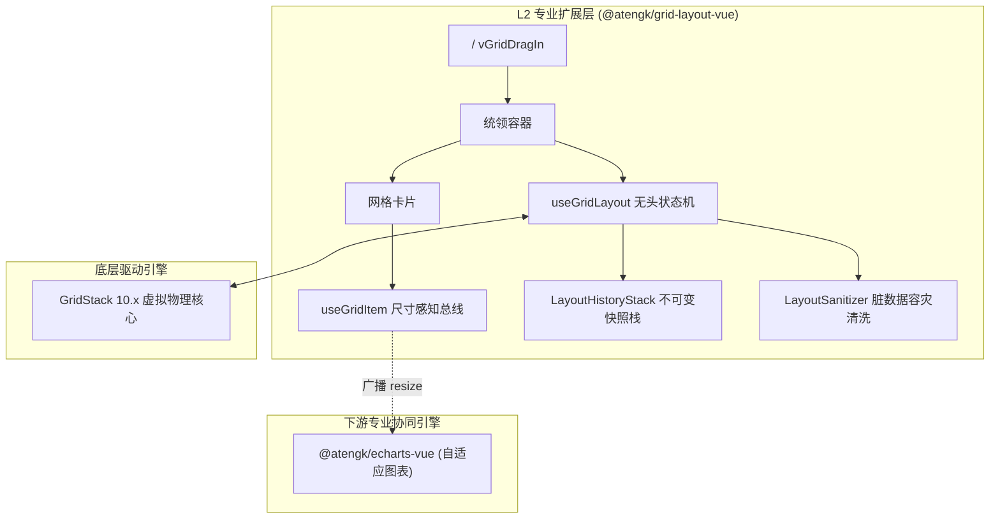

# @atengk/grid-layout-vue 可拖拽响应式网格布局引擎

> 面向现代企业级千人千面工作台、BI 决策看板与大屏编排场景的前端工业级网格布局套件（L2 专业扩展层）。基于 Vue 3.5 响应式系统与 GridStack 10.x 高性能碰撞物理引擎双轨构建，提供双向 JSON 响应式同步、尺寸感知总线、不可变历史快照栈、容器查询自适应、外部物料拖拽接入与极端脏数据自愈容灾能力。

---

## 0. 特性与公共 API 全景速查矩阵 (100% 覆盖)

| 特性分类         | 特性名称           | 核心门面 / 组件 / Hook                     | 关键参数 / Props / Emits / Slots / Expose                                                                                                                                                                                                                                                                                                                                                                                                                                                                                  | 核心行为说明                                                                                 | 锚定验证源头 (*Test / Sample)                                                                                                            |
| :--------------- | :----------------- | :----------------------------------------- | :------------------------------------------------------------------------------------------------------------------------------------------------------------------------------------------------------------------------------------------------------------------------------------------------------------------------------------------------------------------------------------------------------------------------------------------------------------------------------------------------------------------------- | :------------------------------------------------------------------------------------------- | :--------------------------------------------------------------------------------------------------------------------------------------- |
| **容器组件**     | 网格统领容器       | `<AtengGridLayout>`                        | `Props: layout, column, cellHeight, margin, float, editable, showGridLines, handle, responsive, breakpoints, dragIn, dragInOptions...`<br>`Emits: update:layout, change, dragstart, dragstop, resizestart, resizestop, breakpointChange, dropItem, maximize, restore, collapse, expand...`<br>`Slots: #default`<br>`Expose: grid, controller, container, currentColumn, cellHeight, maximize, restore, collapse, expand, undo, redo, canUndo, canRedo, saveToStorage, loadFromStorage, resetLayout, wakeUp, tidyLayout...` | 核心布局容器，挂载 GridStack 引擎，维护原子更新互斥锁、容器查询断点与键盘快捷键监听          | [grid-layout.test.ts](./test/grid-layout.test.ts) / [BasicDashboard.vue](../../apps/sample-grid-layout-vue/src/views/BasicDashboard.vue) |
| **布局项组件**   | 单个网格卡片       | `<AtengGridItem>`                          | `Props: item`<br>`Emits: resize`<br>`Slots: #default="{ item, isDragging, isResizing, isLocked, isMaximized, isCollapsed, toggleMaximize, toggleCollapse, maximize, restore, collapse, expand }"`<br>`Expose: el, item, isDragging, isResizing, isLocked, isMaximized, isCollapsed, pixelWidth, pixelHeight, onResize...`                                                                                                                                                                                                  | 栅格卡片单元，承载几何尺寸注入、ResizeObserver 实时感知、全视口最大化与手风琴折叠状态机      | [context.test.ts](./test/context.test.ts) / [CockpitDashboard.vue](../../apps/sample-grid-layout-vue/src/views/CockpitDashboard.vue)     |
| **外部物料组件** | 抽屉拖拽物料       | `<AtengGridPaletteItem>`                   | `Props: item, payload, disabled`<br>`Slots: #default`                                                                                                                                                                                                                                                                                                                                                                                                                                                                      | 供外部物料抽屉使用的可拖入网格组件，支持自定义 JSON 业务载荷注入                             | [palette.test.ts](./test/palette.test.ts) / [PaletteDashboard.vue](../../apps/sample-grid-layout-vue/src/views/PaletteDashboard.vue)     |
| **交互指令**     | 拖拽接入指令       | `vGridDragIn`                              | `v-grid-drag-in="options"`                                                                                                                                                                                                                                                                                                                                                                                                                                                                                                 | 赋予任意外部 DOM 元素拖入网格变为新卡片的能力，支持数据载荷注入                              | [palette.test.ts](./test/palette.test.ts) / [vGridDragIn.ts](./src/directives/vGridDragIn.ts)                                            |
| **无头状态机**   | 网格布局状态机     | `useGridLayout(options)`                   | `options: UseGridLayoutOptions`<br>`return: UseGridLayoutReturn`                                                                                                                                                                                                                                                                                                                                                                                                                                                           | 纯无头网格编排状态机，管理布局数据流、撤销重做快照栈、持久化、最大化与折叠                   | [grid-layout.test.ts](./test/grid-layout.test.ts) / [useGridLayout.ts](./src/composables/useGridLayout.ts)                               |
| **消费端 Hook**  | 尺寸感知总线       | `useGridItem()`                            | `return: GridItemContext \| null`                                                                                                                                                                                                                                                                                                                                                                                                                                                                                          | 子树消费当前网格项尺寸流、防抖广播与聚焦折叠状态，用于驱动下游 ECharts 重绘                  | [context.test.ts](./test/context.test.ts) / [useGridItem.ts](./src/composables/useGridItem.ts)                                           |
| **容灾算法**     | 脏数据清洗器       | `sanitizeLayout(raw, col?)`                | `raw: unknown, column?: number`                                                                                                                                                                                                                                                                                                                                                                                                                                                                                            | 纯函数清洗外部脏 JSON：自动修正负数坐标、裁剪超限尺寸、平移越界卡片、自动寻空安置冲突项      | [governance.test.ts](./test/governance.test.ts) / [sanitizer.ts](./src/utils/sanitizer.ts)                                               |
| **空间算法**     | 首个可用空位计算   | `findFirstAvailableSlot(list, w, h, col)`  | `items: GridLayoutItem[], w: number, h: number, column?: number`                                                                                                                                                                                                                                                                                                                                                                                                                                                           | 基于二维栅格占用表，为新卡片自动寻找首个无冲突空闲槽位坐标                                   | [palette.test.ts](./test/palette.test.ts) / [autoPosition.ts](./src/utils/autoPosition.ts)                                               |
| **断点算法**     | 容器响应式断点解析 | `resolveResponsiveColumns(width, bp, def)` | `width: number, breakpoints?: GridResponsiveBreakpoints, defaultColumn?: number`                                                                                                                                                                                                                                                                                                                                                                                                                                           | 根据容器实时像素宽度，自动解析当前断点对应的最优栅格列数 (12/6/2/1)                          | [responsive.test.ts](./test/responsive.test.ts) / [constants/index.ts](./src/constants/index.ts)                                         |
| **插件安装**     | Vue 插件安装器     | `install(app)`                             | `app: App`                                                                                                                                                                                                                                                                                                                                                                                                                                                                                                                 | 批量注册全局组件 `<AtengGridLayout>`、`<AtengGridItem>` 与指令 `v-grid-drag-in`              | [index.ts](./src/index.ts)                                                                                                               |
| **强类型契约**   | 核心数据项接口     | `GridLayoutItem<T>`                        | 泛型结构体                                                                                                                                                                                                                                                                                                                                                                                                                                                                                                                 | 定义包含 `id, x, y, w, h, locked, static, noResize, noMove, autoPosition, data` 的强类型契约 | [types/index.ts](./src/types/index.ts)                                                                                                   |
| **强类型契约**   | 尺寸上下文契约     | `GridItemContext<T>`                       | 结构化接口                                                                                                                                                                                                                                                                                                                                                                                                                                                                                                                 | 定义包含 `pixelWidth, pixelHeight, onResize, isMaximized, isCollapsed...` 的注入契约         | [types/index.ts](./src/types/index.ts)                                                                                                   |

---

## 1. 模块定位与 pnpm 坐标

`@atengk/grid-layout-vue` 归属于 `ateng-ui` 基础设施套件的 **L2 专业扩展层 (Extension Layer)**，专注于企业级动态工作台、低代码仪表盘与数据大屏编排。

- **npm 坐标**：`@atengk/grid-layout-vue`
- **源码工程**：`packages/grid-layout-vue`
- **自验展厅**：`apps/sample-grid-layout-vue`（固定端口 `3013`）
- **拓扑方向**：遵循洋葱架构单向流动律，仅合法依赖 Vue 3.5 与 GridStack 10.x，**零 hard UI 组件库依赖**，下游与 `@atengk/echarts-vue` 协同在展厅中 1:1 验证。

### 安装依赖

```bash
pnpm add @atengk/grid-layout-vue gridstack vue
```

### 引入基础样式

在应用入口文件（如 `main.ts`）中引入样式：

```ts
import '@atengk/grid-layout-vue/style.css';
```

### Peer Dependencies 契约基线

| 依赖包      | 兼容版本基线 | 推荐生产版本 | 作用域说明                       |
| :---------- | :----------- | :----------- | :------------------------------- |
| `vue`       | `>=3.5.0`    | `^3.5.44`    | Vue 响应式核心驱动引擎           |
| `gridstack` | `>=10.0.0`   | `^10.3.1`    | 高性能网格碰撞与拖拽排版物理引擎 |

---

## 2. 核心架构与设计不变量



### 核心架构不变量 (Invariants)

1. **单向洋葱依赖律 (ADR-0009)**：本包位于 L2，仅依赖 Vue 3.5 与 GridStack 核心算法，严禁反向引入上层 L3 (`@atengk/element-plus`) 或同层包，保持 100% 宿主与样式中立。
2. **确定性生命周期与 DOM 保留铁律 (ADR-0045 & ADR-0008)**：卸载组件时严格调用 `grid.destroy(false)`，严禁由底层驱动移除 DOM 节点，完全交由 Vue 运行时安全卸载，根除 `removeChild` 崩溃；所有 `ResizeObserver`、全局快捷键与定时器在 `onUnmounted` 中 100% 注销。
3. **双轨架构设计 (ADR-0045)**：既提供即开即用的 SFC 组件，也对外暴露纯无头状态机 `useGridLayout()`，支持通过 `controller` 外部注入深度自定义。

---

## 3. 基础栅格与双向 JSON 数据流

### 3.1 TypeScript 专属契约

```ts
export interface GridLayoutItem<T = Record<string, unknown>> {
  id: string | number; // 唯一标识
  x?: number; // 列索引 (从 0 开始)
  y?: number; // 行索引 (从 0 开始)
  w?: number; // 占据列宽 (默认 1)
  h?: number; // 占据行高 (默认 1)
  locked?: boolean; // 是否锁定位置与尺寸
  static?: boolean; // 是否静态项 (脱离拖拽但参与碰撞阻挡)
  data?: T; // 业务自定义强类型载荷数据
}
```

### 3.2 生产业务代码示例

```vue
<script setup lang="ts">
import { ref } from 'vue';
import { AtengGridLayout, AtengGridItem, type GridLayoutItem } from '@atengk/grid-layout-vue';

interface MetricPayload {
  title: string;
  value: string;
}

const layout = ref<GridLayoutItem<MetricPayload>[]>([
  { id: 'kpi-1', x: 0, y: 0, w: 6, h: 2, data: { title: '今日销售总额', value: '¥1,280,000' } },
  { id: 'kpi-2', x: 6, y: 0, w: 6, h: 2, data: { title: '实时在线终端', value: '42,109 台' } },
]);
</script>

<template>
  <AtengGridLayout v-model:layout="layout" :column="12" cell-height="90px">
    <AtengGridItem v-for="item in layout" :key="item.id" :item="item">
      <template #default="{ isDragging }">
        <div class="metric-card" :class="{ 'metric-card--dragging': isDragging }">
          <div class="at-grid-drag-handle card-header">{{ item.data?.title }}</div>
          <div class="card-body">{{ item.data?.value }}</div>
        </div>
      </template>
    </AtengGridItem>
  </AtengGridLayout>
</template>
```

### 3.3 核心机制与生产边界

- **双向响应式与原子互斥锁**：底层事件与 Vue 响应式回流通过内部 `isInternalUpdating` 互斥锁解耦，彻底避免“修改驱动变更 $\rightarrow$ 触发组件重渲染 $\rightarrow$ 再次触发驱动事件”的死循环抖动。

---

## 4. 物理排版、重力紧凑与自由浮动双模

### 4.1 TypeScript 专属契约

```ts
export interface UseGridLayoutOptions<T = Record<string, unknown>> {
  float?: boolean; // 是否开启自由浮动 (默认 false，即开启垂直紧凑吸附)
  editable?: boolean; // 是否处于编辑态 (默认 false)
}

export interface UseGridLayoutReturn<T = Record<string, unknown>> {
  float: Ref<boolean>;
  setFloat: (val: boolean) => void;
  tidyLayout: () => void; // 一键垂直向上紧凑规整，消除空洞
}
```

### 4.2 生产业务代码示例

```vue
<script setup lang="ts">
import { ref } from 'vue';
import { AtengGridLayout, AtengGridItem } from '@atengk/grid-layout-vue';

const isFloat = ref(false);
const gridRef = ref<InstanceType<typeof AtengGridLayout> | null>(null);

const toggleFloat = () => {
  isFloat.value = !isFloat.value;
};

const handleTidy = () => {
  gridRef.value?.tidyLayout(); // 一键重力压实
};
</script>

<template>
  <div class="toolbar">
    <button @click="toggleFloat">{{ isFloat ? '开启紧凑吸附' : '开启自由浮动' }}</button>
    <button @click="handleTidy">一键压实规整</button>
  </div>
  <AtengGridLayout ref="gridRef" :float="isFloat">
    <!-- 卡片插槽 -->
  </AtengGridLayout>
</template>
```

### 4.3 核心机制与生产边界

- **重力吸附与空洞消除**：`float: false` 时，卡片下方悬空会被垂直重力自动吸附；调用 `tidyLayout()` 立即重新计算并更新所有卡片的 `y` 坐标。

---

## 5. 容器查询断点与辅助网格

### 5.1 TypeScript 专属契约

```ts
export interface GridResponsiveBreakpoints {
  xs?: number; // < 576px，默认 1 列
  sm?: number; // < 768px，默认 2 列
  md?: number; // < 992px，默认 6 列
  lg?: number; // >= 1200px，默认 12 列
}
```

### 5.2 生产业务代码示例

```vue
<template>
  <AtengGridLayout
    :responsive="true"
    :show-grid-lines="true"
    :breakpoints="{ xs: 1, sm: 2, md: 6, lg: 12 }"
    @breakpoint-change="onBreakpointChange"
  >
    <!-- 卡片插槽 -->
  </AtengGridLayout>
</template>
```

### 5.3 核心机制与生产边界

- **容器查询而非窗口查询**：基于容器内部 `ResizeObserver` 动态计算像素宽度，不论外层处于全屏、弹窗还是侧边栏，卡片列数均可精确自适应。
- **纯 CSS 背景辅助参考线**：开启 `show-grid-lines` 时依托 CSS 变量 `--at-grid-columns` 绘制背景虚线网格，零多余 DOM 节点开销。

---

## 6. 外部物料抽屉拖拽与自动寻空

### 6.1 TypeScript 专属契约

```ts
export interface PaletteItemPayload {
  name: string;
  type: string;
}
```

### 6.2 生产业务代码示例

```vue
<template>
  <div class="editor-view">
    <!-- 右侧物料抽屉 -->
    <div class="palette-drawer">
      <AtengGridPaletteItem
        :item="{ w: 4, h: 2 }"
        :payload="{ name: '新增图表组件', type: 'chart' }"
      >
        <span>📊 柱状图组件 (拖我入画布)</span>
      </AtengGridPaletteItem>
    </div>

    <!-- 左侧主网格画布 -->
    <AtengGridLayout v-model:layout="canvasLayout" @drop-item="onItemDropped">
      <AtengGridItem v-for="item in canvasLayout" :key="item.id" :item="item" />
    </AtengGridLayout>
  </div>
</template>
```

### 6.3 核心机制与生产边界

- **自动寻空算法 (`findFirstAvailableSlot`)**：当卡片未指定坐标或标记 `autoPosition: true` 时，空间算法在内存栅格占用表中自上而下自左向右寻空安置，杜绝重叠。

---

## 7. 尺寸感知总线与下游专业引擎联动

### 7.1 TypeScript 专属契约

```ts
export interface GridItemContext<T = Record<string, unknown>> {
  pixelWidth: Ref<number>;
  pixelHeight: Ref<number>;
  onResize: (cb: (size: { width: number; height: number }) => void) => () => void;
}
```

### 7.2 生产业务代码示例

```vue
<!-- 自定义业务图表组件内部 -->
<script setup lang="ts">
import { useGridItem } from '@atengk/grid-layout-vue';
import { AtengTrendChart } from '@atengk/echarts-vue';

const gridItem = useGridItem();

gridItem?.onResize(({ width, height }) => {
  // 卡片调整尺寸防抖广播触发图表自适应重绘
});
</script>

<template>
  <AtengTrendChart :data="trendData" height="100%" />
</template>
```

### 7.3 核心机制与生产边界

- **防抖广播总线**：在卡片缩放或拖拽过程中，100ms 防抖广播最新宽高，确保内部图表高保真过渡重绘，彻底避免高频调用导致的卡顿。

---

## 8. 单卡片全视口聚焦与手风琴高度折叠

### 8.1 TypeScript 专属契约

```ts
export interface UseGridLayoutReturn<T = Record<string, unknown>> {
  maximizedId: Ref<string | number | null>;
  collapsedIds: Ref<Set<string | number>>;
  maximize: (id: string | number) => void;
  restore: (id?: string | number) => void;
  toggleMaximize: (id: string | number) => void;
  collapse: (id: string | number) => void;
  expand: (id: string | number) => void;
  toggleCollapse: (id: string | number) => void;
}
```

### 8.2 生产业务代码示例

```vue
<template>
  <AtengGridItem v-for="item in layout" :key="item.id" :item="item">
    <template #default="{ isMaximized, isCollapsed, toggleMaximize, toggleCollapse }">
      <div class="card-header">
        <span>{{ item.data?.title }}</span>
        <button @click="toggleCollapse">{{ isCollapsed ? '展开' : '折叠' }}</button>
        <button @click="toggleMaximize">{{ isMaximized ? '还原' : '全屏聚焦' }}</button>
      </div>
      <div v-show="!isCollapsed" class="card-body">
        <!-- 业务内容 -->
      </div>
    </template>
  </AtengGridItem>
</template>
```

### 8.3 核心机制与生产边界

- **无损几何快照**：最大化与折叠时自动缓存原始尺寸快照 `originalRect: { x, y, w, h }`，还原时 100% 精确还原原有位置。

---

## 9. 企业级双模治理、触控防冲突与脏数据自愈

### 9.1 TypeScript 专属契约

```ts
export function sanitizeLayout<T = Record<string, unknown>>(
  raw: unknown,
  column?: number,
): GridLayoutItem<T>[];
```

### 9.2 生产业务代码示例

```vue
<script setup lang="ts">
import { ref } from 'vue';
import { AtengGridLayout, sanitizeLayout } from '@atengk/grid-layout-vue';

const editable = ref(false); // 默认运行只读态

const loadExternalJson = (dirtyJson: unknown) => {
  // 纯函数清洗越界 (w > 12)、负数与重合坐标
  layout.value = sanitizeLayout(dirtyJson, 12);
};
</script>

<template>
  <!-- 只读模式下一键隐藏手柄，光标复位，杜绝误触 -->
  <AtengGridLayout :layout="layout" :editable="editable" />
</template>
```

### 9.3 核心机制与生产边界

- **移动端轻扫滚动保护**：样式层配置 `touch-action: pan-y`，触控屏轻扫卡片主体优先响应页面自然滚动。
- **隐藏 Tab 唤醒自愈**：当容器尺寸从 `0x0`（隐藏态）变为正尺寸时，防卫式调用 `onParentResize()`，消除白屏。

---

## 10. 不可变快照历史栈与本地持久化草稿

### 10.1 TypeScript 专属契约

```ts
export interface UseGridLayoutReturn<T = Record<string, unknown>> {
  canUndo: ComputedRef<boolean>;
  canRedo: ComputedRef<boolean>;
  undo: () => void;
  redo: () => void;
  recordSnapshot: () => void;
  saveToStorage: (key?: string) => void;
  loadFromStorage: (key?: string) => boolean;
  resetLayout: () => void;
}
```

### 10.2 生产业务代码示例

```vue
<script setup lang="ts">
import { ref } from 'vue';
import { AtengGridLayout } from '@atengk/grid-layout-vue';

const gridRef = ref<InstanceType<typeof AtengGridLayout> | null>(null);

const handleUndo = () => gridRef.value?.undo();
const handleRedo = () => gridRef.value?.redo();
const handleSave = () => gridRef.value?.saveToStorage('my-dashboard-draft');
const handleLoad = () => gridRef.value?.loadFromStorage('my-dashboard-draft');
</script>

<template>
  <div class="action-bar">
    <button :disabled="!gridRef?.canUndo" @click="handleUndo">撤销 (Ctrl+Z)</button>
    <button :disabled="!gridRef?.canRedo" @click="handleRedo">重做 (Ctrl+Y)</button>
    <button @click="handleSave">保存草稿</button>
    <button @click="handleLoad">恢复草稿</button>
  </div>
  <AtengGridLayout ref="gridRef" :layout="layout" :editable="true" />
</template>
```

### 10.3 核心机制与生产边界

- **纯内存深拷贝不可变性**：基于原生 `toRaw` + `structuredClone` 实现纯内存快照栈，最大 20 步，支持 `Ctrl+Z` / `Ctrl+Y` 快捷键。

---

## 11. 生产环境避坑与生命周期/性能治理指南

1. **避免双重卸载 (Double Unmount) 崩溃**：
   在组件卸载时，严禁使用原生 `grid.destroy(true)`（会强制移除 DOM 节点并与 Vue 的虚拟 DOM 卸载发生冲突产生 `removeChild` 报错）；本套件内部严格执行 `grid.destroy(false)` 保留 DOM 节点，让 Vue SFC 自行安全卸载。
2. **移动端触控与原生滚动冲突防御**：
   在移动设备或 iPad 上，严禁在卡片主体监听 `touchstart` 强行启动拖拽；应配置拖拽手柄（`handle`），卡片主体保持 `touch-action: pan-y` 确保页面正常平滑滚动。
3. **外部未知 JSON 导入防崩溃**：
   从接口或文件导入外部 JSON 布局时，强制先经过 `sanitizeLayout()` 纯函数清洗，彻底消除负数坐标、超大宽度与重叠项隐患。
4. **隐藏 Tab 切换白屏自愈**：
   若将网格置于 `<el-tab-pane>`、抽屉或折叠面板中，从隐藏态唤醒时若尺寸未同步，可调用组件暴露的 `wakeUp()` 或 `refresh()` 实例方法。

---

## 12. 完整 TypeScript 接口/Props/CSS 变量速查字典

### 12.1 `<AtengGridLayout>` 组件 Props 清单

| 属性名          | 类型                        | 默认值                                          | 说明                                              |
| :-------------- | :-------------------------- | :---------------------------------------------- | :------------------------------------------------ |
| `layout`        | `GridLayoutItem<T>[]`       | `[]`                                            | 响应式双向绑定的布局数据数组                      |
| `column`        | `number`                    | `12`                                            | 栅格总列数                                        |
| `cellHeight`    | `number \| string`          | `'80px'`                                        | 网格行高                                          |
| `margin`        | `number \| string`          | `10`                                            | 网格卡片间距 (像素)                               |
| `float`         | `boolean`                   | `false`                                         | 是否开启自由浮动 (默认 false，即垂直紧凑吸附)     |
| `editable`      | `boolean`                   | `false`                                         | 是否处于编辑态 (运行态禁用拖拽缩放并隐藏调节手柄) |
| `showGridLines` | `boolean`                   | `false`                                         | 是否展示背景辅助参考虚线网格                      |
| `handle`        | `string`                    | `'.at-grid-drag-handle, .at-grid-item__header'` | 允许拖拽的手柄 CSS 选择器                         |
| `responsive`    | `boolean`                   | `false`                                         | 是否开启容器查询响应式断点                        |
| `breakpoints`   | `GridResponsiveBreakpoints` | `undefined`                                     | 响应式断点映射配置                                |
| `dragIn`        | `string`                    | `'.at-grid-palette-item, [data-drag-in]'`       | 外部可拖入网格的元素选择器                        |
| `controller`    | `UseGridLayoutReturn<T>`    | `undefined`                                     | 外部传入的自定义状态机控制器                      |

### 12.2 `<AtengGridItem>` 组件 Props 清单

| 属性名 | 类型                | 默认值   | 说明               |
| :----- | :------------------ | :------- | :----------------- |
| `item` | `GridLayoutItem<T>` | **必传** | 当前网格项数据对象 |

### 12.3 CSS Tokens 变量字典

| CSS 变量名                     | 默认值 (Light)            | 暗黑模式 (Dark)             | 说明                          |
| :----------------------------- | :------------------------ | :-------------------------- | :---------------------------- |
| `--at-grid-columns`            | `12`                      | `12`                        | 栅格列数 (由组件内部动态注入) |
| `--at-grid-cell-height`        | `80px`                    | `80px`                      | 网格行高 (由组件内部动态注入) |
| `--at-grid-line-color`         | `rgba(0, 0, 0, 0.06)`     | `rgba(255, 255, 255, 0.08)` | 背景辅助参考虚线颜色          |
| `--at-grid-border-radius`      | `8px`                     | `8px`                       | 网格卡片与占位框圆角          |
| `--at-grid-placeholder-bg`     | `rgba(64, 158, 255, 0.1)` | `rgba(64, 158, 255, 0.15)`  | 拖拽占位影子背景色            |
| `--at-grid-placeholder-border` | `2px dashed #409eff`      | `2px dashed #409eff`        | 拖拽占位影子虚线边框          |
