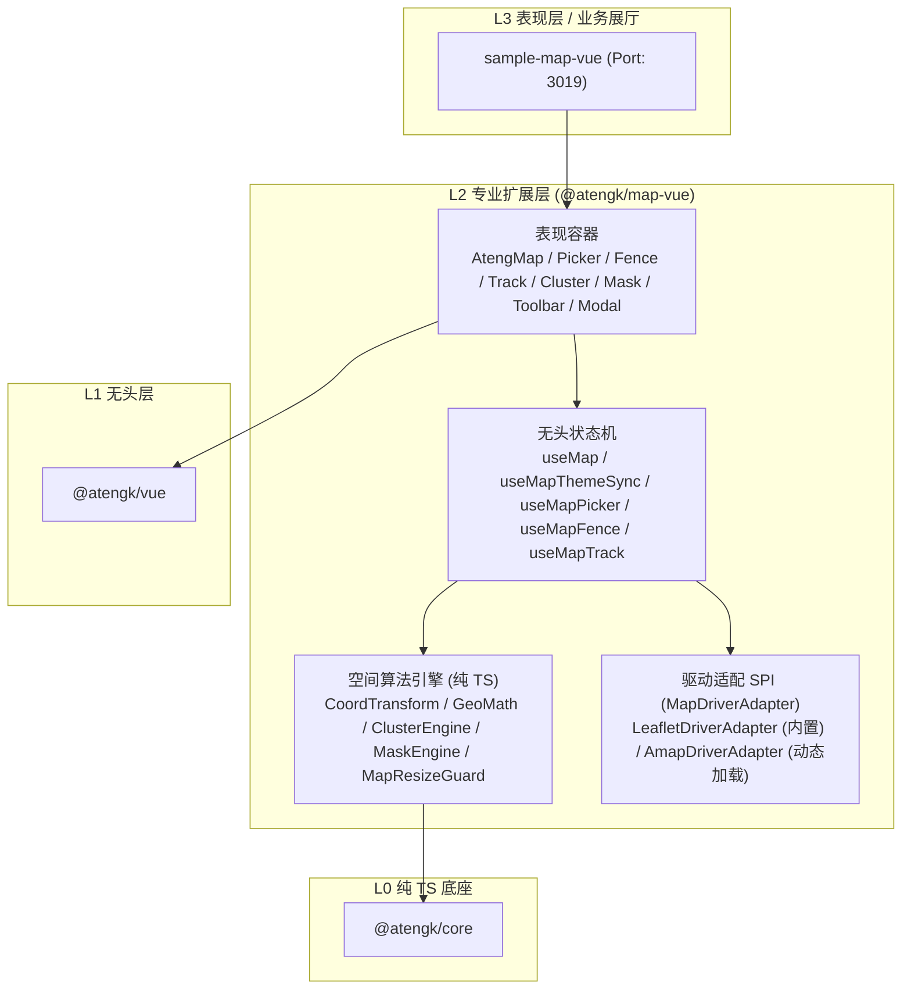

# @atengk/map-vue 多源地图引擎与空间计算套件

> 面向现代 Web 应用与企业级系统的前端多源地图引擎、高精度坐标纠偏、空间几何算法、电子围栏告警、轨迹平滑回放、海量点聚合、行政区划反向遮罩与脱壳模态交互基础设施（L2 专业扩展层）。

---

## 0. 特性与公共 API 全景速查矩阵

| 导出符号               | 分类 | 核心职责                              | 关键 Props / 参数                                                                        | 关键 Emits / 暴露方法                                                                        |
| :--------------------- | :--- | :------------------------------------ | :--------------------------------------------------------------------------------------- | :------------------------------------------------------------------------------------------- |
| `AtengMap`             | 组件 | 多源底图渲染表现核心容器              | `center`, `zoom`, `tilePreset`, `tileUrl`, `dark`, `engine`, `driver`, `interactive`     | `ready`, `mapClick`, `update:center`, `update:zoom` / `panTo`, `invalidateSize`, `addMarker` |
| `AtengMapPicker`       | 组件 | 坐标与结构化地址交互拾取器            | `modelValue`, `mode`, `coordType`, `geocodeProvider`, `searchDebounceMs`, `dark`         | `update:modelValue`, `change`, `confirm`, `reset` / `pickCoord`, `search`, `getPickerResult` |
| `AtengMapFence`        | 组件 | 空间电子围栏标绘与碰撞感知容器        | `fences`, `activeId`, `drawMode`, `editable`, `showRuler`, `checkPoints`                 | `fenceCreate`, `fenceUpdate`, `pointEnter`, `pointLeave` / `addFence`, `checkPoint`          |
| `AtengMapTrack`        | 组件 | 历史轨迹平滑回放与车头转向容器        | `trackPoints`, `progress`, `speedRate`, `loop`, `autoPlay`, `passedPathColor`, `carIcon` | `update:progress`, `pointChange`, `finish` / `play`, `pause`, `stop`, `seek`, `setSpeedRate` |
| `AtengMapCluster`      | 组件 | 海量点网格聚合与 Spiderfy 容器        | `markers`, `gridSize`, `maxClusterZoom`, `spiderfyOnMaxZoom`, `renderMode`               | `clusterClick`, `markerClick` / `clusters`, `refresh`                                        |
| `AtengMapMask`         | 组件 | 行政区划反向镂空压暗遮罩容器          | `geoData`, `maskColor`, `boundaryColor`, `boundaryWidth`, `dashArray`                    | `ready`, `maskClick` / `fitMaskBounds`, `refresh`                                            |
| `AtengMapToolbar`      | 组件 | 悬浮微工具栏 (测距/测面/全屏/复位)    | `driver`, `actions`, `position`, `defaultCenter`, `defaultZoom`                          | `measureChange`, `measureFinish`, `action` / `setMeasureMode`, `clearMeasurement`            |
| `AtengMapModal`        | 组件 | 原生 Teleport 轻量脱壳模态弹窗        | `modelValue`, `title`, `width`, `height`, `fullscreen`, `teleportTo`, `dark`             | `update:modelValue`, `confirm`, `cancel` / `open`, `close`, `toggleFullscreen`               |
| `useMap`               | Hook | 地图底层生命周期与驱动编排状态机      | `center`, `zoom`, `tilePreset`, `engine`, `driver`, `interactive`, `autoResize`          | `ready`, `currentCenter`, `currentZoom`, `isDark`, `mount`, `dispose`, `invalidateSize`      |
| `useMapThemeSync`      | Hook | 暗黑主题自适应瓦片无损反色滤镜        | `dark` (`boolean \| 'auto'`), `targetElement`                                            | `isDark`, `computedFilterStyle`                                                              |
| `useMapPicker`         | Hook | 坐标与地址拾取无头状态机              | `initialCoord`, `mode`, `coordType`, `geocodeProvider`                                   | `selectedCoord`, `selectedAddress`, `pickCoord`, `search`, `getPickerResult`                 |
| `useMapFence`          | Hook | 电子围栏标绘与点位越界感知状态机      | `initialFences`, `drawMode`, `activeId`, `checkPoints`                                   | `fences`, `activeId`, `drawMode`, `addFence`, `checkPoint`, `finishDrawing`                  |
| `useMapTrack`          | Hook | 轨迹 requestAnimationFrame 插帧状态机 | `trackPoints`, `speedRate`, `initialProgress`, `durationMs`, `loop`                      | `status`, `progress`, `currentCoordinate`, `currentHeading`, `play`, `pause`, `seek`         |
| `CoordTransform`       | 引擎 | WGS84 ⇄ GCJ02 ⇄ BD09 高精度转换       | 经纬度纯数学运算                                                                         | `wgs84ToGcj02`, `gcj02ToWgs84`, `gcj02ToBd09`, `bd09ToGcj02`, `transformAll`                 |
| `GeoMath`              | 引擎 | 球面空间几何算法 (Haversine/Shoelace) | 经纬度点序列                                                                             | `distance`, `polylineDistance`, `area`, `bearing`, `interpolate`, `isPointInPolygon`         |
| `ClusterEngine`        | 引擎 | 墨卡托网格分桶聚合与 Spiderfy 算法    | 50,000+ 点位、缩放层级                                                                   | `cluster`, `generateSpiderfyOffsets`, `latLngToPixel`, `pixelToLatLng`                       |
| `MaskEngine`           | 引擎 | GeoJSON 反向多环掩膜构建算法          | GeoJSON Polygon / MultiPolygon                                                           | `buildInvertedMask`, `extractBoundaries`                                                     |
| `MapResizeGuard`       | 守卫 | 0x0 隐藏容器尺寸几何自愈守卫          | `container`, `invalidateSizeFn`                                                          | `observe`, `destroy`                                                                         |
| `LeafletDriverAdapter` | SPI  | 内置免费免密 Leaflet 渲染驱动适配器   | `container`, `MapInitOptions`                                                            | `init`, `destroy`, `setCenter`, `setZoom`, `fitBounds`, `addMarker`, `invalidateSize`        |
| `AmapDriverAdapter`    | SPI  | 高德地图 2.0 动态 Loader 驱动适配器   | `amapKey`, `securityJsCode`                                                              | `init`, `destroy`, `setCenter`, `setZoom`, `addMarker`, `invalidateSize`                     |

---

## 1. 模块定位与 pnpm 坐标

`@atengk/map-vue` 隶属于 `ateng-ui` 四层洋葱拓扑的 **L2 专业扩展层**，向下依赖 L0 纯 TS 底座（`@atengk/core`）与 L1 无头状态机（`@atengk/vue`），**绝对零物理依赖 L3 UI 套件层（`@atengk/element-plus`）**。

- **包名**：`@atengk/map-vue`
- **安装命令**：
  ```bash
  pnpm add @atengk/map-vue
  ```
- **Peer Dependencies 契约**：`vue: ">=3.5.0"`（锁定 ESM + CJS + DTS 双模分发）。
- **样式引入**：
  ```ts
  import '@atengk/map-vue/style.css';
  ```

---

## 2. 核心架构与设计不变量



### 核心设计不变量

1. **单向无环洋葱依赖律（ADR-0009）**：`L3 ➔ L2 ➔ L1 ➔ L0`，严禁在 `map-vue` 中导入 `element-plus` 或其组件。模态弹窗与工具条 100% 依托原生 Vue 3 `<Teleport>` 与语义化 HTML 实现。
2. **零商业 Key 硬编码（ADR-0051）**：内置默认开箱即用的 Leaflet 驱动与 OpenStreetMap 瓦片服务；商业高德驱动基于 `@amap/amap-jsapi-loader` 动态按需加载，凭据由宿主环境通过入参注入。
3. **确定性生命周期闭环**：所有定时器、`requestAnimationFrame`、ResizeObserver 视口监听与 Leaflet 原生图层对象，必须在 `onScopeDispose` 或 `onBeforeUnmount` 中 100% 销毁清理。
4. **异步挂载防卫**：所有涉及 `await driver.init(...)` 等异步渲染管线后，必须前置增加实例存活卫语句（`if (!driverInstance) return;`），严防组件卸载竞态与空指针异常。

---

## 3. 能力领域一：多源底图驱动、瓦片与视口几何自愈

### 3.1 核心表现容器 AtengMap

#### TypeScript 契约片段

```ts
export interface AtengMapProps {
  /** 中心点坐标 (支持 v-model:center 双向绑定) */
  center?: MapCoordinate;
  /** 缩放等级 (支持 v-model:zoom 双向绑定，默认 12) */
  zoom?: number;
  /** 标准瓦片预设枚举，默认 TilePreset.OSM */
  tilePreset?: TilePreset | string;
  /** 自定义内网瓦片服务模板 URL */
  tileUrl?: string;
  /** 暗黑模式开关或跟随宿主，默认 'auto' */
  dark?: boolean | 'auto';
  /** 是否开启 ResizeObserver 自动尺寸几何自愈，默认 true */
  autoResize?: boolean;
}

export interface AtengMapEmits {
  (e: 'ready', driver: MapDriverAdapter): void;
  (e: 'mapClick', payload: { coordinate: MapCoordinate; originalEvent: MouseEvent }): void;
}
```

#### 实战业务代码示例

```vue
<script setup lang="ts">
import { ref } from 'vue';
import { AtengMap, TilePreset, type MapCoordinate, type MapDriverAdapter } from '@atengk/map-vue';

const center = ref<MapCoordinate>({ lng: 116.4074, lat: 39.9042 });
const zoom = ref(13);
const dark = ref(false);

function onReady(driver: MapDriverAdapter) {
  console.log(`地图引擎已就绪: ${driver.engineName}`);
}
</script>

<template>
  <div style="height: 500px; width: 100%;">
    <AtengMap
      v-model:center="center"
      v-model:zoom="zoom"
      :tile-preset="TilePreset.OSM"
      :dark="dark"
      @ready="onReady"
    />
  </div>
</template>
```

#### 核心机制与生产边界

- **暗黑瓦片无损反色（`useMapThemeSync`）**：针对无原生夜间切片的免费公开瓦片（如 OSM），通过 CSS 滤镜 `filter: invert(100%) hue-rotate(180deg) brightness(95%) contrast(90%)` 实现色彩反转，使道路与绿地保持视觉真实协调，避免高亮白底刺眼。
- **0x0 视口几何自愈（`MapResizeGuard`）**：针对 `v-show`、Element Plus `el-tab-pane` 或 `el-dialog` 在初始隐藏挂载时容器尺寸为 `0x0` 导致的瓦片缺失、灰屏或中心偏移，内置 ResizeObserver 并在视口宽度/高度首次大于 0 时自动调用 `invalidateSize()` 触发几何修复。

---

## 4. 能力领域二：坐标防漂移与交互式地址选点

### 4.1 坐标与地址拾取器 AtengMapPicker

#### TypeScript 契约片段

```ts
export type PickerMode = 'marker' | 'crosshair';

export interface PickerResult {
  coordinate: MapCoordinate;
  address?: GeocodeResult;
  coords: {
    wgs84: MapCoordinate;
    gcj02: MapCoordinate;
    bd09: MapCoordinate;
  };
}

export interface AtengMapPickerProps {
  modelValue?: MapCoordinate;
  mode?: PickerMode;
  coordType?: CoordType;
  searchDebounceMs?: number;
}
```

#### 实战业务代码示例

```vue
<script setup lang="ts">
import { ref } from 'vue';
import { AtengMapPicker, type MapCoordinate, type PickerResult } from '@atengk/map-vue';

const selectedPoint = ref<MapCoordinate>({ lng: 116.4074, lat: 39.9042, coordType: 'GCJ02' });

function onConfirm(result: PickerResult) {
  console.log('详细地址:', result.address?.formattedAddress);
  console.log('GCJ02 坐标:', result.coords.gcj02);
  console.log('WGS84 坐标:', result.coords.wgs84);
}
</script>

<template>
  <AtengMapPicker
    v-model="selectedPoint"
    mode="marker"
    coord-type="GCJ02"
    height="540px"
    @confirm="onConfirm"
  />
</template>
```

#### 核心机制与生产边界

- **纯数学高精度三维坐标转换（`CoordTransform`）**：内置克拉索夫斯基椭球体参数，毫秒级完成 `WGS84 ⇄ GCJ02 ⇄ BD09` 双向精确互换，根除中国地图偏移漂移问题。
- **中心十字准星与自由 Pin 双模选点**：`crosshair` 模式锁定视口中心，移动地图实时重算中心点；`marker` 模式支持拖拽图钉自由微调，并附带 POI 关键词防抖联想搜索。

---

## 5. 能力领域三：空间几何计算与电子围栏告警感知

### 5.1 空间电子围栏容器 AtengMapFence

#### TypeScript 契约片段

```ts
export type FenceShape = 'circle' | 'polygon' | 'rectangle';

export interface FenceRecord {
  id: string | number;
  name?: string;
  shape: FenceShape;
  center?: MapCoordinate;
  radius?: number;
  points?: MapCoordinate[];
  area?: number;
}

export interface FenceAlarmPayload {
  point: MapCoordinate;
  fence: FenceRecord;
  action: 'enter' | 'leave' | 'inside';
  timestamp: number;
}
```

#### 实战业务代码示例

```vue
<script setup lang="ts">
import { ref } from 'vue';
import {
  AtengMapFence,
  type FenceRecord,
  type FenceAlarmPayload,
  type MapCoordinate,
} from '@atengk/map-vue';

const fences = ref<FenceRecord[]>([
  {
    id: 'fence-01',
    name: '重点防护区',
    shape: 'circle',
    center: { lng: 116.4074, lat: 39.9042 },
    radius: 500,
    strokeColor: '#ef4444',
  },
]);

const patrolPoint = ref<MapCoordinate>({ lng: 116.401, lat: 39.9042 });

function onPointEnter(payload: FenceAlarmPayload) {
  alert(`目标入侵进入电子围栏: ${payload.fence.name}`);
}
</script>

<template>
  <AtengMapFence
    v-model:fences="fences"
    :check-points="patrolPoint"
    height="520px"
    @point-enter="onPointEnter"
  />
</template>
```

#### 核心机制与生产边界

- **光线投射法（Ray-Casting Algorithm）与 Haversine 测距**：`GeoMath.isPointInPolygon` 通过从检测点向右做射线计算交点奇偶性，支持任意凹凸多边形；圆形围栏基于球面 Haversine 物理大圆测距；鞋带公式（Shoelace）投影计算真实地表物理面积（㎡/km²）。
- **实时边界越界状态机（`useMapFence`）**：内部维护目标点位历史位置状态哈希表，精准识别瞬时 `enter`（穿透进入）、`inside`（内部滞留）与 `leave`（移出告警）。

---

## 6. 能力领域四：轨迹回放、海量点聚合与行政区划遮罩

### 6.1 历史轨迹回放 AtengMapTrack

```vue
<template>
  <AtengMapTrack
    v-model:progress="progress"
    v-model:speed-rate="speedRate"
    :track-points="trackPoints"
    :auto-play="true"
    height="520px"
  />
</template>
```

- **平滑插帧与车头转向**：`useMapTrack` 基于浏览器 `requestAnimationFrame` 动态按时间戳推进，利用 `GeoMath.bearing` 实时计算当前移动朝向的大圆切线方位角（0°~360°），使载具/小车图标平滑无抖动转向；支持 0.5x~8x 倍速播放与进度拖拽。

### 6.2 海量点标记网格聚合 AtengMapCluster

```vue
<template>
  <AtengMapCluster
    :markers="sensorMarkers"
    render-mode="canvas"
    :max-cluster-zoom="17"
    height="520px"
  />
</template>
```

- **50,000+ 点位 60fps 墨卡托网格聚合**：`ClusterEngine` 将经纬度转化为墨卡托世界像素分桶计算质心，支持 DOM 阶梯徽标与纯 Canvas 2D 双模渲染；放大至最大层级支持 Spiderfy 蜘蛛网环状发散展开。

### 6.3 行政区划反向遮罩 AtengMapMask

```vue
<template>
  <AtengMapMask
    :geo-data="districtGeoJSON"
    mask-color="rgba(15, 23, 42, 0.72)"
    boundary-color="#38bdf8"
    height="520px"
  />
</template>
```

- **Inverted Polygon Mask 几何反向掩膜**：`MaskEngine` 自动构建覆盖全球的超大多边形作为外环，将目标行政区划作为内孔洞（Holes），结合 `fillRule: 'evenodd'` 实现全球区域压暗遮罩、目标行政区域完全透明凸显，并配合高亮描边。

---

## 7. 能力领域五：悬浮微工具栏与轻量脱壳模态弹窗

### 7.1 悬浮微工具栏 AtengMapToolbar

```vue
<template>
  <AtengMap ref="mapRef">
    <template #toolbar="{ driver }">
      <AtengMapToolbar
        :driver="driver"
        :actions="['zoomIn', 'zoomOut', 'reset', 'measureDistance', 'measureArea', 'fullscreen']"
      />
    </template>
  </AtengMap>
</template>
```

- **连续测距与多边形测面小工具**：点击地图打点，实时沿线标注分段距离、累计里程，封闭多边形后中央浮动展示总面积；支持一键真全屏切换。

### 7.2 轻量脱壳模态弹窗 AtengMapModal

```vue
<template>
  <AtengMapModal
    v-model="modalVisible"
    title="空间选点弹窗"
    width="920px"
    height="600px"
    @confirm="handleSave"
  >
    <AtengMapPicker v-model="pickedCoord" height="100%" />
  </AtengMapModal>
</template>
```

- **零 Element Plus 依赖原生 Teleport**：采用纯原生 Vue 3 `<Teleport>` 渲染至 `body`，物理脱耦具体 UI 库，内置真全屏放大切换按键、滚动条锁定守护与确认/取消操作条。

---

## 8. 生产环境避坑与生命周期/性能治理指南

1. **防范卸载后异步回调空指针（Fail-Safe）**：
   在任何包含 `await driver.init(...)` 或异步加载瓦片的业务组件中，必须在 `await` 之后立即检查实例有效性：
   ```ts
   const driver = new LeafletDriverAdapter();
   await driver.init(containerRef.value, options);
   if (isDisposed) {
     driver.destroy();
     return;
   }
   ```
2. **海量点渲染性能选型**：
   点位数据量在 $1,000$ 以内时推荐使用默认 `renderMode: 'dom'` 享受完整的 HTML/CSS 样式灵活性；数据量达到 $10,000 \sim 50,000+$ 时，**强烈推荐开启 `renderMode: 'canvas'`**，降低 DOM 节点数，杜绝浏览器内存暴涨与掉帧。
3. **样式隔离与 Design Tokens 继承**：
   所有容器组件根类名均以 `at-map-` 为前缀，组件色彩与阴影全面绑定 CSS 变量（如 `--at-map-panel-bg`、`--at-map-border-color`）。严禁在外部业务组件中使用全局 `!important` 覆盖底层瓦片样式。

---

## 9. 完整 TypeScript 接口/Props/CSS 变量速查清单

### 9.1 CSS 变量 Design Tokens

| CSS 变量名              | 默认值 (浅色)               | 暗黑模式取值             | 说明                 |
| :---------------------- | :-------------------------- | :----------------------- | :------------------- |
| `--at-map-panel-bg`     | `rgba(255, 255, 255, 0.94)` | `rgba(30, 41, 59, 0.94)` | 控制底栏/面板背景色  |
| `--at-map-toolbar-bg`   | `rgba(255, 255, 255, 0.92)` | `rgba(30, 41, 59, 0.92)` | 微工具栏悬浮背景色   |
| `--at-map-border-color` | `#e2e8f0`                   | `#334155`                | 边框与分割线颜色     |
| `--at-map-modal-bg`     | `#ffffff`                   | `#0f172a`                | 模态弹窗对话框背景色 |

### 9.2 顶级导出 TypeScript 接口清单

- `CoordType`: `'WGS84' | 'GCJ02' | 'BD09'`
- `MapCoordinate`: `{ lng: number; lat: number; alt?: number; coordType?: CoordType }`
- `MapMarker`: 标记点契约
- `FenceRecord`: 电子围栏契约
- `TrackPoint`: 轨迹时序节点契约
- `ClusterMarker` / `ClusterGroup`: 点聚合与簇契约
- `GeoJSONGeometryData`: GeoJSON 多边形联合类型
- `MeasureResult`: 空间测量结果契约
- `AtengMapProps` / `AtengMapEmits` / `AtengMapInstance`
- `AtengMapPickerProps` / `AtengMapPickerEmits` / `AtengMapPickerInstance`
- `AtengMapFenceProps` / `AtengMapFenceEmits` / `AtengMapFenceInstance`
- `AtengMapTrackProps` / `AtengMapTrackEmits` / `AtengMapTrackInstance`
- `AtengMapClusterProps` / `AtengMapClusterEmits` / `AtengMapClusterInstance`
- `AtengMapMaskProps` / `AtengMapMaskEmits` / `AtengMapMaskInstance`
- `AtengMapToolbarProps` / `AtengMapToolbarEmits` / `AtengMapToolbarInstance`
- `AtengMapModalProps` / `AtengMapModalEmits` / `AtengMapModalInstance`
- `MapDriverAdapter`: 多源底图底层驱动 SPI 抽象契约
