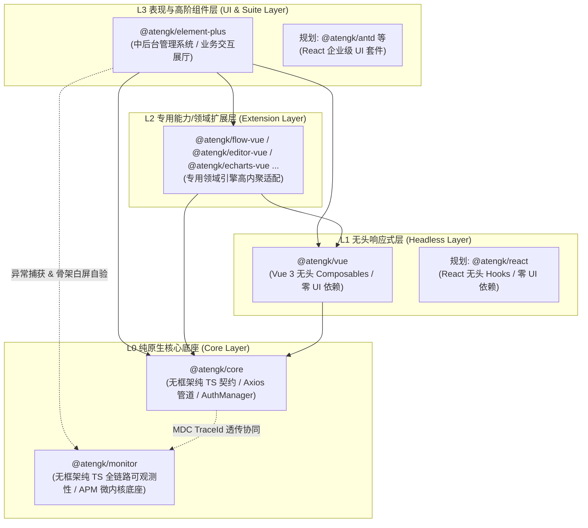
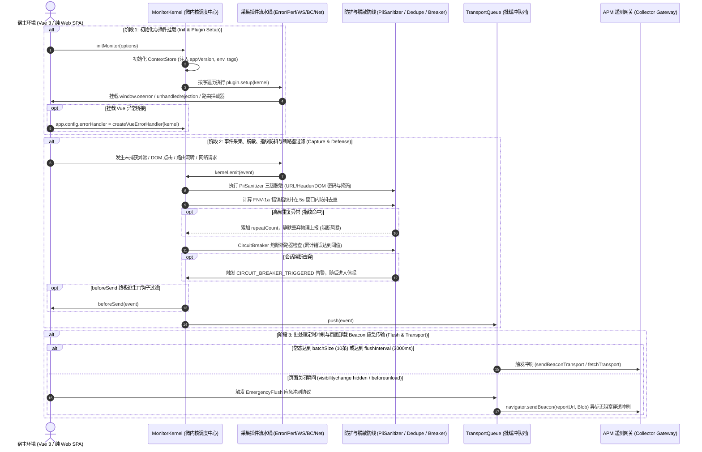

# @atengk/monitor 前端全链路可观测性与异常监控基础设施

> 面向现代 Web 应用与企业级系统的高可用纯 TypeScript 全链路前端可观测性与异常监控微内核基础设施，归属于系统四层洋葱拓扑之 **L0 纯原生核心底座 (Core Layer)**。遵循“纯 TS 驱动、强类型契约、零外部框架运行时依赖、微内核插件可插拔、极高可用性与零二次伤害”设计，深度集成运行时异常收集（同步 JS / Promise 拒付 / 静态资源 404 / console.error 代理）、Vue 3 无损组件级错误适配器、3×3 视口点阵采样白屏感知与骨架屏/Loading 白名单自愈双阶段复验、Google Core Web Vitals 官方三态体验评级、主线程长任务 (>50ms Long Task) 与 Jank 掉帧告警、定长环形用户行为轨迹时间轴 (FIFO)、原生 Fetch/XHR 网络嗅探与 `@atengk/core` Axios 拦截器分布式 MDC TraceId 协同串联；内置 URL/Header/DOM 密码与掩码容器三级数据脱敏防线、基于 FNV-1a 纳秒级特征指纹的 5 秒窗口防抖去重聚合、单会话熔断断路器、防套娃死循环调用协议，以及基于 `sendBeacon` / `fetch keepalive` / `XHR` 的三阶高可用防丢传输管道与页面卸载零丢包紧急冲刷。

---

## 0. 特性与公共 API 全景速查矩阵

依据《五维生产就绪交付模型》，下表 100% 收录本子模块对外暴露的所有微内核方法、采集器插件、高可用防线、传输管道与核心类型契约：

| 特性分类         | 特性名称               | 核心门面 / 函数 / 类型                                  | 关键参数 / Props / 返回类型                                                | 核心行为说明                                                                    | 锚定验证源头 (*Test / Sample)                                                                                                             |
| :--------------- | :--------------------- | :------------------------------------------------------ | :------------------------------------------------------------------------- | :------------------------------------------------------------------------------ | :---------------------------------------------------------------------------------------------------------------------------------------- |
| **内核调度**     | 全局监控初始化         | `initMonitor`                                           | `(options?: MonitorOptions) => MonitorKernelInstance`                      | 创建并初始化监控微内核单例，按拓扑序装载采集插件流水线                          | [kernel.test.ts](./test/kernel.test.ts) / [monitor.ts](../../apps/sample-monitor/src/monitor.ts)                                          |
| **内核调度**     | 活跃内核实例获取       | `getActiveMonitor`                                      | `() => MonitorKernelInstance \| undefined`                                 | 获取当前全局唯一活跃的微内核单例句柄                                            | [kernel.test.ts](./test/kernel.test.ts) / [ApmTerminal.vue](../../apps/sample-monitor/src/components/ApmTerminal.vue)                     |
| **内核调度**     | 全局活跃内核销毁       | `destroyActiveMonitor`                                  | `() => Promise<void>`                                                      | 逆序注销全部插件，清空上下文与队列，重置全局单例句柄                            | [kernel.test.ts](./test/kernel.test.ts)                                                                                                   |
| **内核调度**     | 监控内核类实现         | `MonitorKernel`                                         | `new MonitorKernel(options?: MonitorOptions)`                              | 微内核调度中心，管理插件拓扑、上下文、熔断器与传输队列                          | [kernel.test.ts](./test/kernel.test.ts) / [monitor.ts](../../apps/sample-monitor/src/monitor.ts)                                          |
| **上下文管理**   | 独立上下文状态存储     | `createContextStore`                                    | `(options?: MonitorOptions) => ContextStoreInstance`                       | 维护用户、租户、Tags 与系统环境快照，提供防御性克隆与快照提取                   | [context.test.ts](./test/context.test.ts) / [monitor.ts](../../apps/sample-monitor/src/monitor.ts)                                        |
| **异常捕获插件** | 运行时异常收集插件     | `createErrorPlugin`, `ErrorPluginOptions`               | `(options?: ErrorPluginOptions) => MonitorPlugin`                          | 捕获全局 JS 运行时异常、Promise 拒付、静态资源 404 与 console.error 代理        | [error.test.ts](./test/error.test.ts) / [FaultPanel.vue](../../apps/sample-monitor/src/components/FaultPanel.vue)                         |
| **异常捕获插件** | Vue 错误捕获辅助       | `captureVueError`                                       | `(kernel, err, instance?, info?) => void`                                  | 纯 TS 无损提取 Vue 组件名与生命周期阶段信息，零 Vue 物理运行时依赖              | [error.test.ts](./test/error.test.ts) / [FaultPanel.vue](../../apps/sample-monitor/src/components/FaultPanel.vue)                         |
| **异常捕获插件** | Vue 错误处理器工厂     | `createVueErrorHandler`                                 | `(kernel) => (err, instance, info) => void`                                | 便捷导出符合 Vue `app.config.errorHandler` 签名的错误处理适配器                 | [error.test.ts](./test/error.test.ts) / [main.ts](../../apps/sample-monitor/src/main.ts)                                                  |
| **DOM 与组件**   | 选择器与组件名解析     | `getElementSelector`, `getVueComponentName`             | `(el: Element) => string`, `(inst?: unknown) => string`                    | 提取格式化选择器路径与防御性提取 Vue 内部组件名称                               | [error.test.ts](./test/error.test.ts) / [BreadcrumbPanel.vue](../../apps/sample-monitor/src/components/BreadcrumbPanel.vue)               |
| **白屏感知插件** | 视口点阵白屏检测插件   | `createWhiteScreenPlugin`, `WhiteScreenPluginOptions`   | `(options?: WhiteScreenPluginOptions) => WhiteScreenPluginInstance`        | 3×3 视口点阵采样、T1/T2 两阶段防抖复验与白名单祖先追溯判定                      | [whiteScreen.test.ts](./test/whiteScreen.test.ts) / [WhiteScreenPanel.vue](../../apps/sample-monitor/src/components/WhiteScreenPanel.vue) |
| **白屏感知插件** | 视口点阵单次采样       | `sampleViewport`                                        | `(roots?, whitelists?, threshold?) => { isSuspected, points, viewport }`   | 纯几何 3×3 网格九点采样，输出各采样点根容器与白名单命中诊断                     | [whiteScreen.test.ts](./test/whiteScreen.test.ts) / [WhiteScreenPanel.vue](../../apps/sample-monitor/src/components/WhiteScreenPanel.vue) |
| **白屏感知插件** | 选择器匹配辅助         | `isDirectRootElement`, `matchesAnySelector`             | `(element, selectors) => boolean`                                          | 根挂载容器直接匹配判定与向上追溯整条祖先链的白名单匹配判定                      | [whiteScreen.test.ts](./test/whiteScreen.test.ts) / [WhiteScreenPanel.vue](../../apps/sample-monitor/src/components/WhiteScreenPanel.vue) |
| **性能感知插件** | 性能与体验指标采集插件 | `createPerformancePlugin`, `PerformancePluginOptions`   | `(options?: PerformancePluginOptions) => MonitorPlugin`                    | 采集 W3C Web Vitals、Navigation 关键阶段耗时与 >50ms 长任务卡顿告警             | [performance.test.ts](./test/performance.test.ts) / [PerformancePanel.vue](../../apps/sample-monitor/src/components/PerformancePanel.vue) |
| **性能感知插件** | Web Vitals 官方评级    | `calculateRating`                                       | `(name: string, value: number) => 'good' \| 'needs-improvement' \| 'poor'` | 依据 Google 官方阈值对 FCP/LCP/CLS/INP/TTFB/Jank 输出三态评级                   | [performance.test.ts](./test/performance.test.ts) / [PerformancePanel.vue](../../apps/sample-monitor/src/components/PerformancePanel.vue) |
| **性能感知插件** | 导航阶段耗时解析       | `extractNavigationMetrics`                              | `(entry: PerformanceNavigationTiming) => NavigationMetrics`                | 从 NavigationTiming 中解析 DNS、TCP、SSL、TTFB、Download、DOMReady 等           | [performance.test.ts](./test/performance.test.ts) / [PerformancePanel.vue](../../apps/sample-monitor/src/components/PerformancePanel.vue) |
| **行为轨迹插件** | 面包屑与虚拟路由插件   | `createBreadcrumbPlugin`, `BreadcrumbPluginOptions`     | `(options?: BreadcrumbPluginOptions) => BreadcrumbPluginInstance`          | 维护定长环形缓冲区 (FIFO)，采集 UI 点击、SPA 虚拟路由流转与控制台输出           | [breadcrumb.test.ts](./test/breadcrumb.test.ts) / [BreadcrumbPanel.vue](../../apps/sample-monitor/src/components/BreadcrumbPanel.vue)     |
| **网络嗅探插件** | 原生网络嗅探采集插件   | `createNetworkPlugin`, `NetworkPluginOptions`           | `(options?: NetworkPluginOptions) => MonitorPlugin`                        | 非侵入式包装原生 Fetch 与 XHR，嗅探请求耗时、状态码与 HTTP_ERROR                | [network.test.ts](./test/network.test.ts) / [ApmTerminal.vue](../../apps/sample-monitor/src/components/ApmTerminal.vue)                   |
| **Axios 协同**   | 全链路 TraceId 拦截器  | `createCoreAxiosMonitorInterceptor`                     | `(kernel) => CoreAxiosMonitorInterceptor`                                  | 自动从 `@atengk/core` Axios 响应体 `Result` 或 Header 提取 traceId 绑定至上下文 | [network.test.ts](./test/network.test.ts) / [ApmTerminal.vue](../../apps/sample-monitor/src/components/ApmTerminal.vue)                   |
| **敏感数据脱敏** | URL Query 参数清洗     | `sanitizeUrl`                                           | `(url: string, sensitiveKeys?) => string`                                  | 过滤清洗 URL 中的 token、secret、password 等敏感参数为 `******`                 | [sanitizer.test.ts](./test/sanitizer.test.ts) / [BreadcrumbPanel.vue](../../apps/sample-monitor/src/components/BreadcrumbPanel.vue)       |
| **敏感数据脱敏** | HTTP 请求头清洗        | `sanitizeHeaders`                                       | `(headers, sensitiveHeaders?) => Record<string, string>`                   | 对 Authorization、Cookie、X-Token 等关键敏感头进行 `******` 掩码脱敏            | [sanitizer.test.ts](./test/sanitizer.test.ts) / [ApmTerminal.vue](../../apps/sample-monitor/src/components/ApmTerminal.vue)               |
| **敏感数据脱敏** | DOM 文本与输入框脱敏   | `sanitizeDomText`, `isElementMasked`                    | `(element, customMasks?) => { text, value, isMasked }`                     | 对密码输入框及带有 `[data-monitor-mask]` 或祖先脱敏容器实施掩码                 | [sanitizer.test.ts](./test/sanitizer.test.ts) / [BreadcrumbPanel.vue](../../apps/sample-monitor/src/components/BreadcrumbPanel.vue)       |
| **高可用防线**   | 错误特征指纹生成       | `generateErrorFingerprint`, `fnv1a`                     | `(payload: ErrorPayload) => string`                                        | 基于 FNV-1a 纳秒级哈希算法提取 name+message+file+line 唯一指纹                  | [resilience.test.ts](./test/resilience.test.ts) / [FaultPanel.vue](../../apps/sample-monitor/src/components/FaultPanel.vue)               |
| **高可用防线**   | 5秒窗口去重聚合器      | `ErrorDeduplicator`                                     | `new ErrorDeduplicator(options?: { windowMs?: number })`                   | 在时间窗口内过滤重复异常，计算聚合 `repeatCount` 阻断风暴上报                   | [resilience.test.ts](./test/resilience.test.ts) / [FaultPanel.vue](../../apps/sample-monitor/src/components/FaultPanel.vue)               |
| **高可用防线**   | 单会话熔断断路器       | `CircuitBreaker`                                        | `new CircuitBreaker(options?: { maxErrors?: number })`                     | 会话累计异常达到阈值 (默认 50) 时自动触发熔断休眠，阻断主线程阻塞               | [resilience.test.ts](./test/resilience.test.ts) / [FaultPanel.vue](../../apps/sample-monitor/src/components/FaultPanel.vue)               |
| **传输通道**     | 防死循环检测协议       | `isMonitorReportRequest`, `MONITOR_SKIP_HEADER`         | `(url?, headers?, reportUrl?) => boolean`                                  | 识别 `X-Ateng-Monitor-Skip: true` 或监控自身上报端点，杜绝自死循环              | [transport.test.ts](./test/transport.test.ts) / [ApmTerminal.vue](../../apps/sample-monitor/src/components/ApmTerminal.vue)               |
| **传输通道**     | 穿透式 Beacon 上报     | `sendBeaconTransport`                                   | `(url: string, events: MonitorEvent[]) => boolean`                         | 基于 `navigator.sendBeacon` 与 application/json Blob 异步穿透卸载上报           | [transport.test.ts](./test/transport.test.ts) / [monitor.ts](../../apps/sample-monitor/src/monitor.ts)                                    |
| **传输通道**     | Fetch KeepAlive 传输   | `fetchTransport`                                        | `(url: string, events: MonitorEvent[]) => Promise<boolean>`                | 基于原生 fetch 与 `keepalive: true` 的次级兜底上报通道                          | [transport.test.ts](./test/transport.test.ts)                                                                                             |
| **传输通道**     | 原生 XHR 同步紧急传输  | `xhrTransport`                                          | `(url: string, events: MonitorEvent[]) => Promise<boolean>`                | 基于 XMLHttpRequest 的终极同步/异步兼容传输通道                                 | [transport.test.ts](./test/transport.test.ts)                                                                                             |
| **传输通道**     | 批处理防丢缓冲队列     | `TransportQueue`                                        | `new TransportQueue(options: TransportQueueOptions)`                       | 内存队列满批次 (10) 或防抖延迟 (3s) 自动冲刷，页面卸载前紧急冲刷                | [transport.test.ts](./test/transport.test.ts) / [monitor.ts](../../apps/sample-monitor/src/monitor.ts)                                    |
| **工具套件**     | 全局唯一 UUID 生成器   | `generateId`                                            | `() => string`                                                             | 基于 `crypto.randomUUID` 或高性能位移原语生成的 UUID v4 算法                    | [kernel.test.ts](./test/kernel.test.ts)                                                                                                   |
| **工具套件**     | 宿主设备环境探测       | `getDeviceContext`, `getCurrentUrl`, `getDocumentTitle` | `() => DeviceContext`, `() => string`                                      | 平台中立探测浏览器屏幕分辨率、视口尺寸、UA 及当前安全 URL                       | [context.test.ts](./test/context.test.ts) / [ApmTerminal.vue](../../apps/sample-monitor/src/components/ApmTerminal.vue)                   |
| **工具套件**     | 安全序列化格式化工具   | `safeStringify`                                         | `(value: unknown, fallback?: string) => string`                            | 防止循环引用或复杂实体导致 JSON.stringify 崩溃的安全格式化原语                  | [sanitizer.test.ts](./test/sanitizer.test.ts) / [ApmTerminal.vue](../../apps/sample-monitor/src/components/ApmTerminal.vue)               |

---

## 1. 模块定位与 pnpm 坐标

`@atengk/monitor` 归属于 `ateng-ui` 基础设施套件的 **L0 纯原生核心底座 (Core Layer)**，专注于企业级现代 Web 应用的全链路可观测性、运行时异常拦截、白屏自愈感知、性能指标打点与高可用防丢传输。

- **npm 坐标**：`@atengk/monitor`
- **源码工程**：`packages/monitor`
- **自验展厅**：`apps/sample-monitor`（固定端口 `3010`，基于 Vue 3.5 + Element Plus 构建的真实 APM 演练看板）
- **拓扑与依赖规范**：严格中立于任何前端视图框架，**零 UI 库依赖、零 Vue 依赖、零 React 物理运行时依赖**；
- **peerDependencies 契约**：纯标准 Web API 封装，`peerDependencies` 契约为零强依赖，支持直接运行于现代浏览器环境；
- **框架协同方式**：Vue 3 等特定框架的错误适配通过纯 TS 胶水工厂（`createVueErrorHandler`）按需暴露，绝不反向污染底层核心。

### 安装依赖

```bash
pnpm add @atengk/monitor
```

---

## 2. 核心架构与设计不变量

### 2.1 四层洋葱拓扑位置



### 2.2 全生命周期与交互时序图

微内核调度中心将事件生命周期严格分为“初始化装配”、“采集脱敏去重熔断”与“批处理/卸载应急传输”三大阶段：



### 2.3 核心设计不变量

立足于前端 APM 可观测性的长期可靠性与零侵入底线，确立以下 6 大不可逾越的设计不变量：

1. **平台中立与跨框架中立不变量 (Platform-Agnostic & Framework-Neutral Resilience Invariant)**：
   - `@atengk/monitor` 底座纯基于标准 TypeScript 与 W3C Web 标准 API 构建，绝对严禁物理依赖 Vue、React 或任何 UI 库；
   - 跨框架适配（如 Vue 的 `app.config.errorHandler`）采用纯 TS 无损错误桥接适配器暴露，宿主应用即使未安装 Vue 也可平稳运行。
2. **敏感数据三级脱敏不变量 (PII Data Sanitization Invariant)**：
   - 遥测事件进入传输队列前，强制经过 URL Query 正则清洗（脱敏 token、secret、password 等参数为 `******`）、敏感 HTTP Headers 清洗，以及 DOM 级敏感掩码（密码输入框与包含 `[data-monitor-mask]` 属性的节点及其全部子节点均强制脱敏），彻底阻断内存明文外泄。
3. **错误特征指纹与防风暴熔断不变量 (Error Fingerprint & Circuit Breaker Invariant)**：
   - 当页面发生高频抛错（死循环、高频 Watcher 或 RAF 循环报错）时，基于 `FNV-1a` 纳秒级哈希算法提取 `name + message + filename + lineno` 唯一特征指纹；
   - 在 5000ms 防抖窗口内，相同指纹的错误仅在首次物理派发，后续高频重复异常仅累加 `repeatCount` 计数；单会话累计错误突破阈值（默认 50 次）时触发 `CircuitBreaker` 熔断休眠保护，坚决杜绝监控成为二次灾难凶手。
4. **防套娃死循环调用协议不变量 (Anti-Loop Recursion Protection Invariant)**：
   - 凡由监控系统自身发起的上报请求，均自动注入 `X-Ateng-Monitor-Skip: true` 请求头，或显式指向 `reportUrl`；
   - 原生网络嗅探插件 `NetworkPlugin` 在拦截到底层 Fetch/XHR 时，严格执行前置卫语句检查：一旦识别到 Skip 标记或目标匹配 `reportUrl`，立即无损放行，绝不记录面包屑与派发事件，彻底阻断“上报报错 ➔ 嗅探到报错 ➔ 再次上报”的无限递归死循环。
5. **页面卸载零丢包应急冲刷不变量 (Zero-Data-Loss Emergency Flush Invariant)**：
   - 监听 `window.beforeunload` 与 `document.visibilitychange (hidden)` 事件，在用户关闭标签页或切换后台瞬间，自动将内存中积攒的未决事件通过异步无阻塞穿透通道 `navigator.sendBeacon`（或 `fetch keepalive: true`）实施紧急冲刷（`EmergencyFlush`），确保异常现场 0 丢包。
6. **双阶段白屏防抖复验与白名单豁免不变量 (Two-Phase White Screen Verification Invariant)**：
   - 采用 3×3 视口几何点阵均分九点穿透采样；
   - 探测点向上追溯命中骨架屏（`.skeleton-box`）或加载态（`.el-loading-mask`、`[data-loading]`）时直接判定为合法加载态，予以白名单豁免；
   - 初检延迟 $T_1$ 发现可疑白屏后，启动 $T_2$ 防抖延迟复验，若期间渲染恢复正常则自动静默消除误报，杜绝单页应用路由异步加载阶段的假阳性报警。

---

## 3. 监控微内核调度与上下文管理套件

_(待工单 #278 系统交付：3.1 微内核初始化与生命周期、3.2 动态上下文管理与设备快照、3.3 插件生命周期与自定义扩展)_

---

## 4. 运行时异常捕获与 Vue 错误桥接套件

_(待工单 #278 系统交付：4.1 全局未捕获异常与资源 404 捕获、4.2 Vue 3 异常适配器与无损组件解析)_

---

## 5. 3×3 视口点阵白屏感知与骨架自愈套件

_(待工单 #279 系统交付：5.1 3×3 视口点阵采样与白屏判定、5.2 骨架屏白名单豁免与双阶段复验)_

---

## 6. 性能体验与 Core Web Vitals 采集套件

_(待工单 #279 系统交付：6.1 Core Web Vitals 官方指标与三态评级、6.2 主线程长任务与卡顿告警)_

---

## 7. 用户行为轨迹、网络嗅探与 MDC TraceId 协同套件

_(待工单 #279 系统交付：7.1 定长环形行为面包屑时间轴、7.2 原生网络嗅探与 Axios TraceId 串联)_

---

## 8. 三级数据脱敏、指纹聚合与会话熔断断路器套件

_(待工单 #280 系统交付：8.1 三级数据脱敏防线、8.2 错误指纹 FNV-1a 聚合与会话熔断断路器)_

---

## 9. 三阶高可用传输管道与页面卸载冲刷套件

_(待工单 #280 系统交付：9.1 三阶通道自适应降级与卸载紧急冲刷、9.2 防死循环调用协议与自定义通道)_

---

## 10. 完整 TypeScript 接口与配置速查清单 (全量速查附录字典)

_(待工单 #280 系统交付：全量集中收录 MonitorOptions、MonitorEvent、ErrorEventPayload 等完整 TS 源码声明)_

---

## 11. 1:1 物理排版与全维测试守护 (Evergreen & Zero-Glitch)

_(待工单 #280 系统交付：10 套单测清单与自动化全真回归命令)_
