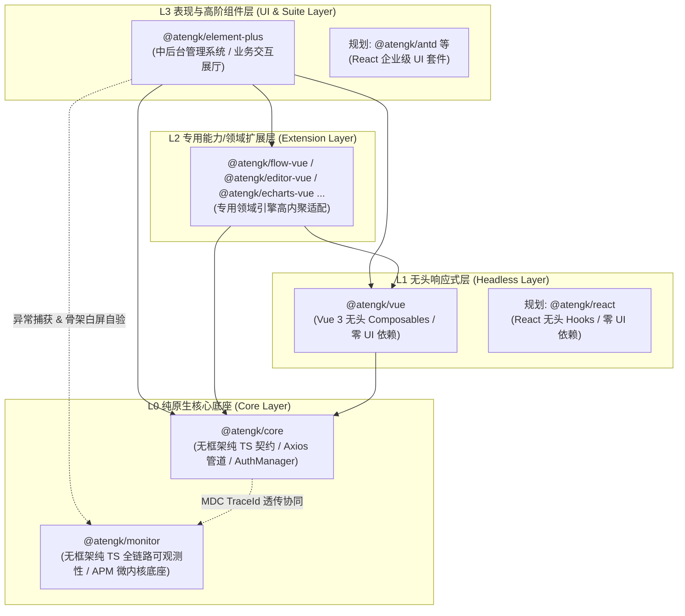
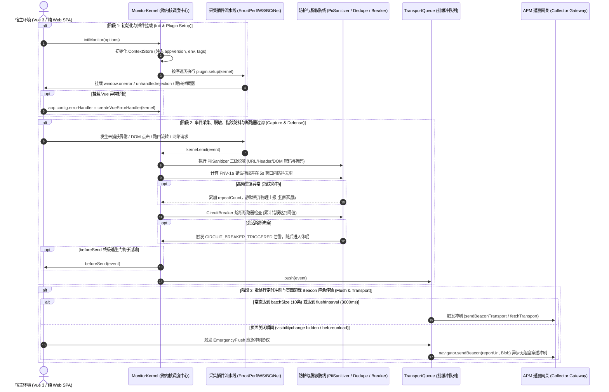

# @atengk/monitor 前端全链路可观测性与异常监控基础设施

> 面向现代 Web 应用与企业级系统的高可用纯 TypeScript 全链路前端可观测性与异常监控微内核基础设施，归属于系统四层洋葱拓扑之 **L0 纯原生核心底座 (Core Layer)**。遵循“纯 TS 驱动、强类型契约、零外部框架运行时依赖、微内核插件可插拔、极高可用性与零二次伤害”设计，深度集成运行时异常收集（同步 JS / Promise 拒付 / 静态资源 404 / console.error 代理）、Vue 3 无损组件级错误适配器、3×3 视口点阵采样白屏感知与骨架屏/Loading 白名单自愈双阶段复验、Google Core Web Vitals 官方三态体验评级、主线程长任务 (>50ms Long Task) 与 Jank 掉帧告警、定长环形用户行为轨迹时间轴 (FIFO)、原生 Fetch/XHR 网络嗅探与 `@atengk/core` Axios 拦截器分布式 MDC TraceId 协同串联；内置 URL/Header/DOM 密码与掩码容器三级数据脱敏防线、基于 FNV-1a 纳秒级特征指纹的 5 秒窗口防抖去重聚合、单会话熔断断路器、防套娃死循环调用协议，以及基于 `sendBeacon` / `fetch keepalive` / `XHR` 的三阶高可用防丢传输管道与页面卸载零丢包紧急冲刷。

---

## 0. 特性与公共 API 全景速查矩阵

依据《五维生产就绪交付模型》，下表 100% 收录本子模块对外暴露的所有微内核方法、采集器插件、高可用防线、传输管道与核心类型契约：

| 特性分类         | 特性名称               | 核心门面 / 函数 / 类型                                  | 关键参数 / Props / 返回类型                                                | 核心行为说明                                                                    | 锚定验证源头 (*Test / Sample)                                                                                                             |
| :--------------- | :--------------------- | :------------------------------------------------------ | :------------------------------------------------------------------------- | :------------------------------------------------------------------------------ | :---------------------------------------------------------------------------------------------------------------------------------------- |
| **内核调度**     | 全局监控初始化         | `initMonitor`                                           | `(options?: MonitorOptions) => MonitorKernelInstance`                      | 创建并初始化监控微内核单例，按拓扑序装载采集插件流水线                          | [kernel.test.ts](./test/kernel.test.ts) / [monitor.ts](../../apps/sample-monitor/src/monitor.ts)                                          |
| **内核调度**     | 活跃内核实例获取       | `getActiveMonitor`                                      | `() => MonitorKernelInstance \| undefined`                                 | 获取当前全局唯一活跃的微内核单例句柄                                            | [kernel.test.ts](./test/kernel.test.ts) / [ApmTerminal.vue](../../apps/sample-monitor/src/components/ApmTerminal.vue)                     |
| **内核调度**     | 全局活跃内核销毁       | `destroyActiveMonitor`                                  | `() => Promise<void>`                                                      | 逆序注销全部插件，清空上下文与队列，重置全局单例句柄                            | [kernel.test.ts](./test/kernel.test.ts)                                                                                                   |
| **内核调度**     | 监控内核类实现         | `MonitorKernel`                                         | `new MonitorKernel(options?: MonitorOptions)`                              | 微内核调度中心，管理插件拓扑、上下文、熔断器与传输队列                          | [kernel.test.ts](./test/kernel.test.ts) / [monitor.ts](../../apps/sample-monitor/src/monitor.ts)                                          |
| **上下文管理**   | 独立上下文状态存储     | `createContextStore`                                    | `(options?: MonitorOptions) => ContextStoreInstance`                       | 维护用户、租户、Tags 与系统环境快照，提供防御性克隆与快照提取                   | [context.test.ts](./test/context.test.ts) / [monitor.ts](../../apps/sample-monitor/src/monitor.ts)                                        |
| **异常捕获插件** | 运行时异常收集插件     | `createErrorPlugin`, `ErrorPluginOptions`               | `(options?: ErrorPluginOptions) => MonitorPlugin`                          | 捕获全局 JS 运行时异常、Promise 拒付、静态资源 404 与 console.error 代理        | [error.test.ts](./test/error.test.ts) / [FaultPanel.vue](../../apps/sample-monitor/src/components/FaultPanel.vue)                         |
| **异常捕获插件** | Vue 错误捕获辅助       | `captureVueError`                                       | `(kernel, err, instance?, info?) => void`                                  | 纯 TS 无损提取 Vue 组件名与生命周期阶段信息，零 Vue 物理运行时依赖              | [error.test.ts](./test/error.test.ts) / [FaultPanel.vue](../../apps/sample-monitor/src/components/FaultPanel.vue)                         |
| **异常捕获插件** | Vue 错误处理器工厂     | `createVueErrorHandler`                                 | `(kernel) => (err, instance, info) => void`                                | 便捷导出符合 Vue `app.config.errorHandler` 签名的错误处理适配器                 | [error.test.ts](./test/error.test.ts) / [main.ts](../../apps/sample-monitor/src/main.ts)                                                  |
| **DOM 与组件**   | 选择器与组件名解析     | `getElementSelector`, `getVueComponentName`             | `(el: Element) => string`, `(inst?: unknown) => string`                    | 提取格式化选择器路径与防御性提取 Vue 内部组件名称                               | [error.test.ts](./test/error.test.ts) / [BreadcrumbPanel.vue](../../apps/sample-monitor/src/components/BreadcrumbPanel.vue)               |
| **白屏感知插件** | 视口点阵白屏检测插件   | `createWhiteScreenPlugin`, `WhiteScreenPluginOptions`   | `(options?: WhiteScreenPluginOptions) => WhiteScreenPluginInstance`        | 3×3 视口点阵采样、T1/T2 两阶段防抖复验与白名单祖先追溯判定                      | [whiteScreen.test.ts](./test/whiteScreen.test.ts) / [WhiteScreenPanel.vue](../../apps/sample-monitor/src/components/WhiteScreenPanel.vue) |
| **白屏感知插件** | 视口点阵单次采样       | `sampleViewport`                                        | `(roots?, whitelists?, threshold?) => { isSuspected, points, viewport }`   | 纯几何 3×3 网格九点采样，输出各采样点根容器与白名单命中诊断                     | [whiteScreen.test.ts](./test/whiteScreen.test.ts) / [WhiteScreenPanel.vue](../../apps/sample-monitor/src/components/WhiteScreenPanel.vue) |
| **白屏感知插件** | 选择器匹配辅助         | `isDirectRootElement`, `matchesAnySelector`             | `(element, selectors) => boolean`                                          | 根挂载容器直接匹配判定与向上追溯整条祖先链的白名单匹配判定                      | [whiteScreen.test.ts](./test/whiteScreen.test.ts) / [WhiteScreenPanel.vue](../../apps/sample-monitor/src/components/WhiteScreenPanel.vue) |
| **性能感知插件** | 性能与体验指标采集插件 | `createPerformancePlugin`, `PerformancePluginOptions`   | `(options?: PerformancePluginOptions) => MonitorPlugin`                    | 采集 W3C Web Vitals、Navigation 关键阶段耗时与 >50ms 长任务卡顿告警             | [performance.test.ts](./test/performance.test.ts) / [PerformancePanel.vue](../../apps/sample-monitor/src/components/PerformancePanel.vue) |
| **性能感知插件** | Web Vitals 官方评级    | `calculateRating`                                       | `(name: string, value: number) => 'good' \| 'needs-improvement' \| 'poor'` | 依据 Google 官方阈值对 FCP/LCP/CLS/INP/TTFB/Jank 输出三态评级                   | [performance.test.ts](./test/performance.test.ts) / [PerformancePanel.vue](../../apps/sample-monitor/src/components/PerformancePanel.vue) |
| **性能感知插件** | 导航阶段耗时解析       | `extractNavigationMetrics`                              | `(entry: PerformanceNavigationTiming) => NavigationMetrics`                | 从 NavigationTiming 中解析 DNS、TCP、SSL、TTFB、Download、DOMReady 等           | [performance.test.ts](./test/performance.test.ts) / [PerformancePanel.vue](../../apps/sample-monitor/src/components/PerformancePanel.vue) |
| **行为轨迹插件** | 面包屑与虚拟路由插件   | `createBreadcrumbPlugin`, `BreadcrumbPluginOptions`     | `(options?: BreadcrumbPluginOptions) => BreadcrumbPluginInstance`          | 维护定长环形缓冲区 (FIFO)，采集 UI 点击、SPA 虚拟路由流转与控制台输出           | [breadcrumb.test.ts](./test/breadcrumb.test.ts) / [BreadcrumbPanel.vue](../../apps/sample-monitor/src/components/BreadcrumbPanel.vue)     |
| **网络嗅探插件** | 原生网络嗅探采集插件   | `createNetworkPlugin`, `NetworkPluginOptions`           | `(options?: NetworkPluginOptions) => MonitorPlugin`                        | 非侵入式包装原生 Fetch 与 XHR，嗅探请求耗时、状态码与 HTTP_ERROR                | [network.test.ts](./test/network.test.ts) / [ApmTerminal.vue](../../apps/sample-monitor/src/components/ApmTerminal.vue)                   |
| **Axios 协同**   | 全链路 TraceId 拦截器  | `createCoreAxiosMonitorInterceptor`                     | `(kernel) => CoreAxiosMonitorInterceptor`                                  | 自动从 `@atengk/core` Axios 响应体 `Result` 或 Header 提取 traceId 绑定至上下文 | [network.test.ts](./test/network.test.ts) / [ApmTerminal.vue](../../apps/sample-monitor/src/components/ApmTerminal.vue)                   |
| **敏感数据脱敏** | URL Query 参数清洗     | `sanitizeUrl`                                           | `(url: string, sensitiveKeys?) => string`                                  | 过滤清洗 URL 中的 token、secret、password 等敏感参数为 `******`                 | [sanitizer.test.ts](./test/sanitizer.test.ts) / [BreadcrumbPanel.vue](../../apps/sample-monitor/src/components/BreadcrumbPanel.vue)       |
| **敏感数据脱敏** | HTTP 请求头清洗        | `sanitizeHeaders`                                       | `(headers, sensitiveHeaders?) => Record<string, string>`                   | 对 Authorization、Cookie、X-Token 等关键敏感头进行 `******` 掩码脱敏            | [sanitizer.test.ts](./test/sanitizer.test.ts) / [ApmTerminal.vue](../../apps/sample-monitor/src/components/ApmTerminal.vue)               |
| **敏感数据脱敏** | DOM 文本与输入框脱敏   | `sanitizeDomText`, `isElementMasked`                    | `(element, customMasks?) => { text, value, isMasked }`                     | 对密码输入框及带有 `[data-monitor-mask]` 或祖先脱敏容器实施掩码                 | [sanitizer.test.ts](./test/sanitizer.test.ts) / [BreadcrumbPanel.vue](../../apps/sample-monitor/src/components/BreadcrumbPanel.vue)       |
| **高可用防线**   | 错误特征指纹生成       | `generateErrorFingerprint`, `fnv1a`                     | `(payload: ErrorPayload) => string`                                        | 基于 FNV-1a 纳秒级哈希算法提取 name+message+file+line 唯一指纹                  | [resilience.test.ts](./test/resilience.test.ts) / [FaultPanel.vue](../../apps/sample-monitor/src/components/FaultPanel.vue)               |
| **高可用防线**   | 5秒窗口去重聚合器      | `ErrorDeduplicator`                                     | `new ErrorDeduplicator(options?: { windowMs?: number })`                   | 在时间窗口内过滤重复异常，计算聚合 `repeatCount` 阻断风暴上报                   | [resilience.test.ts](./test/resilience.test.ts) / [FaultPanel.vue](../../apps/sample-monitor/src/components/FaultPanel.vue)               |
| **高可用防线**   | 单会话熔断断路器       | `CircuitBreaker`                                        | `new CircuitBreaker(options?: { maxErrors?: number })`                     | 会话累计异常达到阈值 (默认 50) 时自动触发熔断休眠，阻断主线程阻塞               | [resilience.test.ts](./test/resilience.test.ts) / [FaultPanel.vue](../../apps/sample-monitor/src/components/FaultPanel.vue)               |
| **传输通道**     | 防死循环检测协议       | `isMonitorReportRequest`, `MONITOR_SKIP_HEADER`         | `(url?, headers?, reportUrl?) => boolean`                                  | 识别 `X-Ateng-Monitor-Skip: true` 或监控自身上报端点，杜绝自死循环              | [transport.test.ts](./test/transport.test.ts) / [ApmTerminal.vue](../../apps/sample-monitor/src/components/ApmTerminal.vue)               |
| **传输通道**     | 穿透式 Beacon 上报     | `sendBeaconTransport`                                   | `(url: string, events: MonitorEvent[]) => boolean`                         | 基于 `navigator.sendBeacon` 与 application/json Blob 异步穿透卸载上报           | [transport.test.ts](./test/transport.test.ts) / [monitor.ts](../../apps/sample-monitor/src/monitor.ts)                                    |
| **传输通道**     | Fetch KeepAlive 传输   | `fetchTransport`                                        | `(url: string, events: MonitorEvent[]) => Promise<boolean>`                | 基于原生 fetch 与 `keepalive: true` 的次级兜底上报通道                          | [transport.test.ts](./test/transport.test.ts)                                                                                             |
| **传输通道**     | 原生 XHR 同步紧急传输  | `xhrTransport`                                          | `(url: string, events: MonitorEvent[]) => Promise<boolean>`                | 基于 XMLHttpRequest 的终极同步/异步兼容传输通道                                 | [transport.test.ts](./test/transport.test.ts)                                                                                             |
| **传输通道**     | 批处理防丢缓冲队列     | `TransportQueue`                                        | `new TransportQueue(options: TransportQueueOptions)`                       | 内存队列满批次 (10) 或防抖延迟 (3s) 自动冲刷，页面卸载前紧急冲刷                | [transport.test.ts](./test/transport.test.ts) / [monitor.ts](../../apps/sample-monitor/src/monitor.ts)                                    |
| **工具套件**     | 全局唯一 UUID 生成器   | `generateId`                                            | `() => string`                                                             | 基于 `crypto.randomUUID` 或高性能位移原语生成的 UUID v4 算法                    | [kernel.test.ts](./test/kernel.test.ts)                                                                                                   |
| **工具套件**     | 宿主设备环境探测       | `getDeviceContext`, `getCurrentUrl`, `getDocumentTitle` | `() => DeviceContext`, `() => string`                                      | 平台中立探测浏览器屏幕分辨率、视口尺寸、UA 及当前安全 URL                       | [context.test.ts](./test/context.test.ts) / [ApmTerminal.vue](../../apps/sample-monitor/src/components/ApmTerminal.vue)                   |
| **工具套件**     | 安全序列化格式化工具   | `safeStringify`                                         | `(value: unknown, fallback?: string) => string`                            | 防止循环引用或复杂实体导致 JSON.stringify 崩溃的安全格式化原语                  | [sanitizer.test.ts](./test/sanitizer.test.ts) / [ApmTerminal.vue](../../apps/sample-monitor/src/components/ApmTerminal.vue)               |

---

## 1. 模块定位与 pnpm 坐标

`@atengk/monitor` 归属于 `ateng-ui` 基础设施套件的 **L0 纯原生核心底座 (Core Layer)**，专注于企业级现代 Web 应用的全链路可观测性、运行时异常拦截、白屏自愈感知、性能指标打点与高可用防丢传输。

- **npm 坐标**：`@atengk/monitor`
- **源码工程**：`packages/monitor`
- **自验展厅**：`apps/sample-monitor`（固定端口 `3010`，基于 Vue 3.5 + Element Plus 构建的真实 APM 演练看板）
- **拓扑与依赖规范**：严格中立于任何前端视图框架，**零 UI 库依赖、零 Vue 依赖、零 React 物理运行时依赖**；
- **peerDependencies 契约**：纯标准 Web API 封装，`peerDependencies` 契约为零强依赖，支持直接运行于现代浏览器环境；
- **框架协同方式**：Vue 3 等特定框架的错误适配通过纯 TS 胶水工厂（`createVueErrorHandler`）按需暴露，绝不反向污染底层核心。

### 安装依赖

```bash
pnpm add @atengk/monitor
```

---

## 2. 核心架构与设计不变量

### 2.1 四层洋葱拓扑位置



### 2.2 全生命周期与交互时序图

微内核调度中心将事件生命周期严格分为“初始化装配”、“采集脱敏去重熔断”与“批处理/卸载应急传输”三大阶段：



### 2.3 核心设计不变量

立足于前端 APM 可观测性的长期可靠性与零侵入底线，确立以下 6 大不可逾越的设计不变量：

1. **平台中立与跨框架中立不变量 (Platform-Agnostic & Framework-Neutral Resilience Invariant)**：
   - `@atengk/monitor` 底座纯基于标准 TypeScript 与 W3C Web 标准 API 构建，绝对严禁物理依赖 Vue、React 或任何 UI 库；
   - 跨框架适配（如 Vue 的 `app.config.errorHandler`）采用纯 TS 无损错误桥接适配器暴露，宿主应用即使未安装 Vue 也可平稳运行。
2. **敏感数据三级脱敏不变量 (PII Data Sanitization Invariant)**：
   - 遥测事件进入传输队列前，强制经过 URL Query 正则清洗（脱敏 token、secret、password 等参数为 `******`）、敏感 HTTP Headers 清洗，以及 DOM 级敏感掩码（密码输入框与包含 `[data-monitor-mask]` 属性的节点及其全部子节点均强制脱敏），彻底阻断内存明文外泄。
3. **错误特征指纹与防风暴熔断不变量 (Error Fingerprint & Circuit Breaker Invariant)**：
   - 当页面发生高频抛错（死循环、高频 Watcher 或 RAF 循环报错）时，基于 `FNV-1a` 纳秒级哈希算法提取 `name + message + filename + lineno` 唯一特征指纹；
   - 在 5000ms 防抖窗口内，相同指纹的错误仅在首次物理派发，后续高频重复异常仅累加 `repeatCount` 计数；单会话累计错误突破阈值（默认 50 次）时触发 `CircuitBreaker` 熔断休眠保护，坚决杜绝监控成为二次灾难凶手。
4. **防套娃死循环调用协议不变量 (Anti-Loop Recursion Protection Invariant)**：
   - 凡由监控系统自身发起的上报请求，均自动注入 `X-Ateng-Monitor-Skip: true` 请求头，或显式指向 `reportUrl`；
   - 原生网络嗅探插件 `NetworkPlugin` 在拦截到底层 Fetch/XHR 时，严格执行前置卫语句检查：一旦识别到 Skip 标记或目标匹配 `reportUrl`，立即无损放行，绝不记录面包屑与派发事件，彻底阻断“上报报错 ➔ 嗅探到报错 ➔ 再次上报”的无限递归死循环。
5. **页面卸载零丢包应急冲刷不变量 (Zero-Data-Loss Emergency Flush Invariant)**：
   - 监听 `window.beforeunload` 与 `document.visibilitychange (hidden)` 事件，在用户关闭标签页或切换后台瞬间，自动将内存中积攒的未决事件通过异步无阻塞穿透通道 `navigator.sendBeacon`（或 `fetch keepalive: true`）实施紧急冲刷（`EmergencyFlush`），确保异常现场 0 丢包。
6. **双阶段白屏防抖复验与白名单豁免不变量 (Two-Phase White Screen Verification Invariant)**：
   - 采用 3×3 视口几何点阵均分九点穿透采样；
   - 探测点向上追溯命中骨架屏（`.skeleton-box`）或加载态（`.el-loading-mask`、`[data-loading]`）时直接判定为合法加载态，予以白名单豁免；
   - 初检延迟 $T_1$ 发现可疑白屏后，启动 $T_2$ 防抖延迟复验，若期间渲染恢复正常则自动静默消除误报，杜绝单页应用路由异步加载阶段的假阳性报警。

---

## 3. 监控微内核调度与上下文管理套件

监控微内核（`MonitorKernel`）作为可观测性体系的中枢调度引擎，负责统一协调采集插件装载、上下文快照富化、敏感数据三级脱敏、错误指纹聚合与传输缓冲队列。

### 3.1 微内核初始化与生命周期编排

#### ① 本节专属 TypeScript 契约与配置接口

```ts
import type { MonitorEvent, MonitorPlugin } from '@atengk/monitor';

export interface MonitorOptions {
  /** 应用发版版本号 (如 Git Commit SHA 或 Semver)，默认 '1.0.0' */
  appVersion?: string;

  /** 部署环境 (如 'prod' | 'uat' | 'test' | 'dev')，默认 'dev' */
  environment?: string;

  /** 会话标识符，默认由 SDK 基于 UUID 自动生成 */
  sessionId?: string;

  /** 多租户企业隔离标识 */
  tenantId?: string;

  /** 启用的采集插件流水线列表 */
  plugins?: MonitorPlugin[];

  /** 全局事件采样率 (0.0 ~ 1.0)，默认 1.0 全量采集 */
  sampleRate?: number;

  /** 监控数据接收网关端点 URL */
  reportUrl?: string;

  /** 自定义上报执行器 SPI，优先于默认 HTTP 传输通道调用 */
  reporter?: (events: MonitorEvent[]) => void | Promise<void>;

  /** 终极生命周期过滤与脱敏钩子，返回 false/null 予以丢弃 */
  beforeSend?: (event: MonitorEvent) => MonitorEvent | false | null;

  /** 内存队列批处理容量上限，达到该数量立即触发冲刷，默认 10 */
  batchSize?: number;

  /** 内存队列防抖刷新延迟 (毫秒)，默认 3000ms */
  flushInterval?: number;

  /** 单会话允许累计采集的最大异常数，突破后触发断路器熔断休眠，默认 50 */
  maxErrorsPerSession?: number;
}
```

#### ② 面向实战的业务 TS 代码示例

代码逆向提取自 [apps/sample-monitor/src/monitor.ts](../../apps/sample-monitor/src/monitor.ts)：

```ts
import {
  initMonitor,
  createErrorPlugin,
  createWhiteScreenPlugin,
  createPerformancePlugin,
  createBreadcrumbPlugin,
  createNetworkPlugin,
  getActiveMonitor,
  destroyActiveMonitor,
  type MonitorKernelInstance,
} from '@atengk/monitor';

// 1. 一键初始化微内核单例并挂载核心采集插件
export function setupProductionMonitor(): MonitorKernelInstance {
  return initMonitor({
    appVersion: '2.4.0',
    environment: 'prod',
    reportUrl: 'https://apm-gateway.company.com/api/v1/report',
    batchSize: 10,
    flushInterval: 3000,
    maxErrorsPerSession: 50,
    plugins: [
      createBreadcrumbPlugin({ maxBreadcrumbs: 30 }),
      createErrorPlugin({
        enableJsError: true,
        enablePromiseError: true,
        enableResourceError: true,
        enableConsoleError: true,
      }),
      createWhiteScreenPlugin({
        rootSelectors: ['html', 'body', '#app'],
        whitelistSelectors: ['.skeleton-box', '.el-loading-mask'],
        initialDelay: 3000,
      }),
      createPerformancePlugin({
        vitals: true,
        navigation: true,
        longtask: true,
        jankThreshold: 200,
      }),
      createNetworkPlugin({
        enableFetch: true,
        enableXhr: true,
        recordHttpError: true,
      }),
    ],
  });
}

// 2. 在业务任意处安全获取活跃单例
const monitor = getActiveMonitor();

// 3. 在模块卸载或热重载时进行确定性全量销毁
export async function teardownMonitor(): Promise<void> {
  await destroyActiveMonitor();
}
```

#### ③ 核心机制与生产边界说明

1. **单例模式与重入安全**：`initMonitor(options)` 会在全局注册唯一的活跃微内核单例，若重复调用 `initMonitor`，内部将自动先销毁前序活跃内核并完成资源清理后重新构建，确保全局监听器绝不产生二次重复注册；
2. **生命周期逆序清理**：调用 `destroyActiveMonitor()` 时，微内核以严格的 **LIFO 逆序** 遍历注销所有已装载插件的 `teardown()` 钩子，移除宿主 `window.onerror` 等全局物理监听器，清空内存缓冲队列与上下文，重置活跃指针为 `undefined`，杜绝微前端子应用或 SPA 频繁重载下的内存泄漏。

---

### 3.2 动态上下文管理与设备快照

#### ① 本节专属 TypeScript 契约与配置接口

```ts
export interface UserContext {
  /** 用户唯一标识主键 (如雪花大数 ID 或工号) */
  id: string | number;
  /** 脱敏用户名或账户标识 */
  username?: string;
  /** 企业用户邮箱 */
  email?: string;
  /** 附加业务画像属性 */
  [key: string]: unknown;
}

export interface ContextStoreInstance {
  /** 获取当前上下文实体 (防御性深克隆副本) */
  getContext(): MonitorContext;
  /** 获取包含宿主设备分辨率、UA、安全当前 URL 与标题的遥测快照 */
  getSnapshot(): MonitorContextSnapshot;
  /** 设置当前认证用户上下文 */
  setUser(user?: UserContext): void;
  /** 设置当前企业多租户隔离标识 */
  setTenant(tenantId?: string): void;
  /** 批量注入或覆盖业务 Tags */
  setTags(tags: Record<string, string | number | boolean>): void;
  /** 设置单项业务 Tag */
  setTag(key: string, value: string | number | boolean): void;
  /** 设置自定义业务附加信息 */
  setExtra(key: string, value: unknown): void;
  /** 重置动态上下文回滚至初始状态 */
  clear(): void;
}
```

#### ② 面向实战的业务 TS 代码示例

代码逆向提取自 [apps/sample-monitor/src/state.ts](../../apps/sample-monitor/src/state.ts) 与上下文存储实践：

```ts
import { getActiveMonitor } from '@atengk/monitor';

const monitor = getActiveMonitor()!;
const contextStore = monitor.contextStore;

// 1. 用户完成登录认证时动态注入身份画像
contextStore.setUser({
  id: 'usr_9527001',
  username: 'Ateng',
  role: 'admin',
});

// 2. 多租户切换或组织切换时注入租户隔离
contextStore.setTenant('tenant_cloud_finance');

// 3. 注入业务线与发布灰度标记
contextStore.setTags({
  businessLine: 'order-center',
  releaseChannel: 'canary-shanghai-1',
  vipUser: true,
});

// 4. 读取包含设备几何信息的当前全真遥测快照
const snapshot = contextStore.getSnapshot();
console.log('当前视口几何快照:', snapshot.device.viewport);
```

#### ③ 核心机制与生产边界说明

1. **防御性克隆与只读防突变**：`contextStore.getContext()` 与 `getSnapshot()` 返回的均为内存对象的防御性副本，外部调用方直接修改返回对象的属性绝不会污染监控内核底层的真实上下文，保障数据单向流动；
2. **环境宿主弹性降级**：`getDeviceContext()` 内置对 SSR（Node.js / Worker）与极端无头环境的平台中立守卫；在无 `window` 或 `screen` 对象的非浏览器宿主中，自动降级返回尺寸为 `0x0` 与 `UA: 'unknown'`，确保服务端渲染期间零报错崩溃。

---

### 3.3 插件生命周期契约与自定义扩展

#### ① 本节专属 TypeScript 契约与配置接口

```ts
export interface MonitorPlugin {
  /** 插件唯一命名标识 */
  readonly name: string;

  /**
   * 插件装载与初始化生命周期钩子。
   *
   * @param kernel 微内核句柄，用于挂载监听或调用 emit 派发事件
   */
  setup: (kernel: MonitorKernelInstance) => void;

  /**
   * 插件卸载与销毁生命周期钩子。
   * 必须且只能在此处执行 100% 确定性的资源清理与物理解绑。
   *
   * @param kernel 微内核句柄
   */
  teardown?: (kernel: MonitorKernelInstance) => void;
}
```

#### ② 面向实战的业务 TS 代码示例

演示编写与动态注册一个企业级“业务心跳与离线状态感知插件”：

```ts
import { initMonitor, type MonitorKernelInstance, type MonitorPlugin } from '@atengk/monitor';

export function createHeartbeatAuditPlugin(): MonitorPlugin {
  let timer: ReturnType<typeof setInterval> | null = null;
  let onlineHandler: (() => void) | null = null;

  return {
    name: 'heartbeat-audit',

    setup(kernel: MonitorKernelInstance): void {
      // 1. 定期采集在线存活指标
      timer = setInterval(() => {
        kernel.emit({
          type: 'custom',
          level: 'info',
          payload: {
            action: 'CLIENT_HEARTBEAT_TICK',
            onlineDuration: performance.now(),
          },
        });
      }, 60000);

      // 2. 监听宿主网络连通性变化
      onlineHandler = () => {
        kernel.emit({
          type: 'custom',
          level: 'warning',
          payload: { action: 'NETWORK_ONLINE_RESTORED' },
        });
      };
      window.addEventListener('online', onlineHandler);
    },

    teardown(): void {
      // 3. 100% 确定性注销物理监听与清空定时器，杜绝内存泄漏
      if (timer) {
        clearInterval(timer);
        timer = null;
      }
      if (onlineHandler) {
        window.removeEventListener('online', onlineHandler);
        onlineHandler = null;
      }
    },
  };
}

// 动态热装载与热拔插
const monitor = initMonitor();
monitor.registerPlugin(createHeartbeatAuditPlugin());

// 在微前端子应用卸载时可按需单独注销
// monitor.unregisterPlugin('heartbeat-audit');
```

#### ③ 核心机制与生产边界说明

1. **对称设计与确定性清理**：所有微内核插件严格恪守《工业级成熟度防线二：确定性生命周期与资源清理不变量》；`setup` 中注册的每一个 `addEventListener`、`setInterval` 或宿主方法劫持，必须在 `teardown` 中以完全对称的语义彻底释放；
2. **微内核动态热装配**：支持在应用运行时随时调用 `kernel.registerPlugin(plugin)` 动态热挂载领域插件，或通过 `kernel.unregisterPlugin(name)` 动态卸载，便于按需加载大体积领域扩展。

---

## 4. 运行时异常捕获与 Vue 错误桥接套件

异常收集体系覆盖 JavaScript 运行时报错、Promise 拒付、静态资源 404 加载失败、`console.error` 代理劫持，并通过纯 TS 适配器无缝桥接 Vue 3 组件树渲染异常。

### 4.1 全局未捕获异常、Promise 拒付与静态资源 404 捕获

#### ① 本节专属 TypeScript 契约与配置接口

```ts
export interface ErrorPluginOptions {
  /** 是否监听 JS 运行时异常 (window.onerror / error 事件)，默认 true */
  enableJsError?: boolean;

  /** 是否监听异步 Promise 拒付异常 (unhandledrejection)，默认 true */
  enablePromiseError?: boolean;

  /** 是否在事件捕获阶段监听静态资源 404/加载中断，默认 true */
  enableResourceError?: boolean;

  /** 是否代理并捕获 console.error 调用，默认 true */
  enableConsoleError?: boolean;
}

export interface ErrorPayload {
  /** 错误分类: 'js' | 'promise' | 'resource' | 'console' | 'vue' | 'custom' */
  category: ErrorCategory;
  /** 错误名称 (如 'TypeError', 'ReferenceError', 'ResourceLoadError') */
  name: string;
  /** 详细错误消息描述 */
  message: string;
  /** 发生异常的文件绝对或相对 URL */
  filename?: string;
  /** 出错代码行号 */
  lineno?: number;
  /** 出错代码列号 */
  colno?: number;
  /** 格式化错误堆栈信息 */
  stack?: string;
  /** 触发异常的 DOM 选择器路径 (主要针对静态资源 404) */
  selector?: string;
  /** 发生错误时关联的最近用户操作行为时间轴快照 */
  breadcrumbs?: BreadcrumbItem[];
}
```

#### ② 面向实战的业务 Vue / TS 代码示例

代码逆向提取自 [apps/sample-monitor/src/components/FaultPanel.vue](../../apps/sample-monitor/src/components/FaultPanel.vue)：

```vue
<script setup lang="ts">
import { ref } from 'vue';
import { ElButton, ElMessage } from 'element-plus';
import { getActiveMonitor } from '@atengk/monitor';

const monitor = getActiveMonitor()!;

// 1. 模拟触发同步 JS 运行时异常
const triggerSyncError = () => {
  setTimeout(() => {
    throw new ReferenceError('测试同步运行时异常: userProfile is not defined');
  }, 0);
  ElMessage.warning('已触发同步异常抛出');
};

// 2. 模拟触发异步 Promise 拒付异常 (未决 catch)
const triggerPromiseError = () => {
  Promise.reject(new Error('测试异步 Promise 未捕获异常: Network Timeout'));
  ElMessage.warning('已触发异步 Promise 拒付');
};

// 3. 模拟动态插入不存在的静态图片触发 404 崩溃
const triggerResourceError = () => {
  const img = document.createElement('img');
  img.src = 'https://cdn.company.com/assets/non-existent-banner-404.png';
  img.style.display = 'none';
  img.onerror = () => {
    setTimeout(() => img.remove(), 500); // 异常被捕获后安全回收 DOM
  };
  document.body.appendChild(img);
  ElMessage.warning('已插入 404 异常静态资源');
};
</script>

<template>
  <div class="fault-actions">
    <el-button type="danger" plain @click="triggerSyncError">模拟 JS 同步抛错</el-button>
    <el-button type="warning" plain @click="triggerPromiseError">模拟 Promise 异步拒付</el-button>
    <el-button type="info" plain @click="triggerResourceError">模拟静态资源 404</el-button>
  </div>
</template>
```

#### ③ 核心机制与生产边界说明

1. **事件捕获监听静态资源 404**：浏览器规范中，`<script>`、`<link>`、`` 资源加载失败派发的 `error` 事件**绝不冒泡**，`window.onerror` 无法捕获此类错误；`ErrorPlugin` 必须且只能在全局通过 `window.addEventListener('error', handler, true)` 开启**第三阶段事件捕获（Capture Phase）**，通过判断 `event.target !== window` 确定性识别静态资源加载中断；
2. **代理 `console.error` 的无损透传**：劫持 `console.error` 时，内部自动前置防重锁；在格式化错误并提取参数派发遥测事件后，必须且只能完整调用宿主原生 `originalConsoleError.apply(console, args)`，绝不截断或改变开发者在浏览器控制台排查问题的原始体验。

---

### 4.2 Vue 3 全局未捕获异常适配器与无损组件解析

#### ① 本节专属 TypeScript 契约与配置接口

```ts
/**
 * 便捷导出符合 Vue 3 app.config.errorHandler 签名的全局错误处理器。
 *
 * @param kernel 活跃监控内核实例
 * @returns Vue 3 全局异常处理函数
 */
export function createVueErrorHandler(
  kernel: MonitorKernelInstance,
): (err: unknown, instance: unknown, info: string) => void;

/**
 * 手动捕获并结构化上报 Vue 组件运行时异常。
 *
 * @param kernel 微内核句柄
 * @param err 捕获到的原生错误对象或未知拒付项
 * @param instance 抛错的 Vue 内部组件实例 (由 Vue 运行时自动传递)
 * @param info 错误生命周期与调用链路描述 (如 'render function', 'setup function')
 */
export function captureVueError(
  kernel: MonitorKernelInstance,
  err: unknown,
  instance?: unknown,
  info?: string,
): void;

/**
 * 从未知 Vue 内部实例对象中防御性提取组件规范命名。
 *
 * @param instance Vue 组件内部实例
 * @returns 规范组件名称，未命中时保底返回 'AnonymousComponent'
 */
export function getVueComponentName(instance?: unknown): string;
```

#### ② 面向实战的业务 Vue / TS 代码示例

代码逆向提取自 [apps/sample-monitor/src/main.ts](../../apps/sample-monitor/src/main.ts) 与 [FaultPanel.vue](../../apps/sample-monitor/src/components/FaultPanel.vue)：

```ts
// 1. 在应用入口 main.ts 中一键安装 Vue 异常适配器
import { createApp } from 'vue';
import { initMonitor, createVueErrorHandler } from '@atengk/monitor';
import App from './App.vue';

const app = createApp(App);
const monitor = initMonitor({
  appVersion: '1.0.0',
  environment: 'prod',
  reportUrl: 'https://apm-gateway.company.com/report',
});

// 纯 TS 无损桥接 Vue 3 全局异常
app.config.errorHandler = createVueErrorHandler(monitor);
app.mount('#app');
```

```vue
<!-- 2. 在业务视图组件中手动捕获局部异步异常并精准归因组件上下文 -->
<script setup lang="ts">
import { getActiveMonitor, captureVueError } from '@atengk/monitor';
import { getCurrentInstance } from 'vue';

const monitor = getActiveMonitor()!;
const vm = getCurrentInstance();

async function handleAsyncOrderSubmit(): Promise<void> {
  try {
    throw new TypeError('Cannot read properties of null (reading "payAmount")');
  } catch (err) {
    // 携带当前 Vue 实例与自定义生命周期阶段信息上报
    captureVueError(monitor, err, vm?.proxy, 'async submit callback');
  }
}
</script>
```

#### ③ 核心机制与生产边界说明

1. **L0 纯 TS 跨框架中立不变量**：`createVueErrorHandler` 与 `captureVueError` 的实现源码内**绝对严禁物理 import vue**；所有对 `instance` 的访问均基于未知对象类型推导与类型窄化（Type Guard）；
2. **多形态组件名无损推导**：`getVueComponentName` 采用四级级联查找策略（优先提取 `instance.type.__name` ➔ `instance.$options.name` ➔ `instance.type.name` ➔ 祖先 `subTree` 类型）；若全未命中，防御性保底返回 `'AnonymousComponent'`，彻底杜绝解构 `instance` 时引发的空指针二次崩溃。

---

### 4.3 选择器格式化与特征提取

#### ① 本节专属 TypeScript 契约与配置接口

```ts
/**
 * 提取目标 DOM 节点的简洁特征选择器路径。
 *
 * @param element 目标 DOM 节点
 * @returns 格式化选择器字符串，如 'div#app > img.banner-img.active'
 */
export function getElementSelector(element: Element): string;
```

#### ② 面向实战的业务 TS 代码示例

代码逆向提取自 [apps/sample-monitor/src/components/BreadcrumbPanel.vue](../../apps/sample-monitor/src/components/BreadcrumbPanel.vue)：

```ts
import { getElementSelector } from '@atengk/monitor';

// 捕获用户点击或崩溃节点时提取格式化选择器
document.addEventListener(
  'click',
  (event: MouseEvent) => {
    const target = event.target as Element | null;
    if (!target) return;

    const selector = getElementSelector(target);
    console.log('目标选择器路径:', selector);
    // 输出示例: "button#submit-btn.el-button.el-button--primary"
  },
  true,
);
```

#### ③ 核心机制与生产边界说明

1. **类名收敛与长字符串防爆**：为防止现代前端（如 TailwindCSS 或 UnoCSS）生成包含数十个 utility 类的超长 `class` 字符串撑爆遥测载荷，`getElementSelector` 仅提取前 2 个核心类名（`slice(0, 2)`），在保障选择器定位精度的同时将体积收敛至 50 字符以内；
2. **防御性空安全**：对于 `svg`、文本节点或已从 DOM 树游离的特殊节点，前置卫语句严格校验 `typeof element.tagName === 'string'`，非合法 Element 节点统一安全保底返回 `'unknown'`。

---

## 5. 3×3 视口点阵白屏感知与骨架自愈套件

针对单页应用（SPA）在路由异步加载失败、微前端加载崩塌或根容器未渲染导致的静默真白屏，`WhiteScreenPlugin` 提供了基于九点几何点阵采样与骨架屏白名单祖先追溯的工业级检测防线。

### 5.1 3×3 视口几何点阵九点穿透采样与白屏判定

#### ① 本节专属 TypeScript 契约与配置接口

```ts
export interface SamplePointDiagnostic {
  /** 采样点 X 物理视口坐标 (px) */
  x: number;
  /** 采样点 Y 物理视口坐标 (px) */
  y: number;
  /** 采样命中顶层元素的选择器路径描述 */
  target: string;
  /** 是否命中了无有效业务子节点的根挂载容器 */
  isRoot: boolean;
  /** 是否命中了骨架屏或 Loading 遮罩白名单容器 */
  isWhitelisted: boolean;
}

export interface WhiteScreenSamplingResult {
  /** 采样诊断是否判定为疑似白屏 */
  isSuspected: boolean;
  /** 9 个采样点的完整穿透诊断详情 */
  points: SamplePointDiagnostic[];
  /** 命中的所有根容器选择器集合 */
  hitSelectors: string[];
  /** 视口几何尺寸 { width, height } */
  viewport: { width: number; height: number };
}

export interface WhiteScreenPluginOptions {
  /** 根挂载容器选择器列表，默认 ['html', 'body', '#app', '#root', '.app-container', '.main-container'] */
  rootSelectors?: readonly string[];
  /** 骨架屏与 Loading 遮罩白名单选择器列表，命中则豁免告警 */
  whitelistSelectors?: readonly string[];
  /** 初检延迟时间 T1 (毫秒)，默认 3000ms */
  initialDelay?: number;
  /** 初检怀疑白屏后的二次防抖复验延迟时间 T2 (毫秒)，默认 1500ms */
  recheckDelay?: number;
  /** 是否在 window load 事件后自动启动初检，默认 true */
  autoCheckOnLoad?: boolean;
  /** 判定为白屏所需的根容器命中点数阈值 (1~9)，默认 9 */
  threshold?: number;
}
```

#### ② 面向实战的业务 Vue / TS 代码示例

代码逆向提取自 [apps/sample-monitor/src/components/WhiteScreenPanel.vue](../../apps/sample-monitor/src/components/WhiteScreenPanel.vue)：

```vue
<script setup lang="ts">
import { ref } from 'vue';
import { ElButton, ElMessage } from 'element-plus';
import { sampleViewport, getActiveMonitor, type WhiteScreenPayload } from '@atengk/monitor';

const monitor = getActiveMonitor()!;
const containerStatus = ref<'normal' | 'blank' | 'skeleton'>('normal');

// 执行 3×3 几何点阵采样诊断
const executeSample = () => {
  return sampleViewport(
    ['html', 'body', '#white-screen-sandbox', '#app'],
    ['.skeleton-box', '.at-skeleton', '.el-loading-mask'],
  );
};

// 模拟触发页面清空崩溃白屏
const simulateWhiteScreen = () => {
  containerStatus.value = 'blank';
  ElMessage.warning('视窗已清空，模拟触发白屏崩溃...');

  setTimeout(() => {
    const res = executeSample();
    if (res.isSuspected) {
      // 派发致命级别白屏异常遥测事件
      monitor.emit<WhiteScreenPayload>({
        type: 'white_screen',
        level: 'fatal',
        payload: {
          name: 'WHITE_SCREEN_ERROR',
          isWhiteScreen: true,
          samplePoints: res.points,
          hitSelectors: res.hitSelectors,
          viewport: res.viewport,
          duration: performance.now(),
        },
      });
      ElMessage.error('已精准捕获视口白屏异常并派发告警！');
    }
  }, 100);
};
</script>

<template>
  <div class="white-screen-demo">
    <el-button type="danger" @click="simulateWhiteScreen">
      模拟清空视窗 (触发白屏崩溃告警)
    </el-button>
  </div>
</template>
```

#### ③ 核心机制与生产边界说明

1. **九点几何坐标数学模型**：采样器在物理视口宽度的 $1/6$、$1/2$、$5/6$ 与高度的 $1/6$、$1/2$、$5/6$ 交叉建立 $3 \times 3$ 的 9 个均分几何网格探测点；
2. **DOM 穿透诊断**：通过浏览器原生 `document.elementsFromPoint(x, y)` 提取该坐标下向下穿透的全部图元列表；当且仅当所有 9 个点均穿透直达裸 `html`、`body` 或 `#app` 等空容器，且没有任何有效业务图元时，才判定为“可疑白屏”，有效避免单一局部空白导致的假阳性。

---

### 5.2 骨架屏白名单豁免与双阶段延迟复验自愈

#### ① 本节专属 TypeScript 契约与配置接口

```ts
/**
 * 校验指定 DOM 节点自身或向上追溯任意层级祖先是否命中白名单选择器。
 *
 * @param element 目标 DOM 节点
 * @param selectors 白名单选择器数组
 * @returns 命中返回 true，未命中返回 false
 */
export function matchesAnySelector(element: Element, selectors: readonly string[]): boolean;

/**
 * 校验指定节点是否为根挂载容器。
 *
 * @param element 目标 DOM 节点
 * @param selectors 根容器选择器列表
 */
export function isDirectRootElement(element: Element, selectors: readonly string[]): boolean;
```

#### ② 面向实战的业务 Vue / TS 代码示例

代码逆向提取自 [apps/sample-monitor/src/components/WhiteScreenPanel.vue](../../apps/sample-monitor/src/components/WhiteScreenPanel.vue)：

```vue
<script setup lang="ts">
import { ref } from 'vue';
import { ElButton, ElMessage } from 'element-plus';
import { sampleViewport } from '@atengk/monitor';

const containerStatus = ref<'normal' | 'skeleton'>('normal');

// 1. 模拟进入骨架屏加载态
const simulateSkeleton = () => {
  containerStatus.value = 'skeleton';
  ElMessage.info('展示骨架屏中 (验证白名单免报机制)...');

  setTimeout(() => {
    const res = sampleViewport(
      ['html', 'body', '#app'],
      ['.skeleton-box', '.at-skeleton', '.el-loading-mask'],
    );
    // 尽管没有真实业务内容，但因命中白名单容器，isSuspected 判定为 false
    console.log('白名单豁免生效，是否怀疑白屏:', res.isSuspected); // false
  }, 100);
};

// 2. 自愈恢复
const restoreNormal = () => {
  containerStatus.value = 'normal';
  ElMessage.success('视窗已恢复正常业务内容');
};
</script>

<template>
  <div class="skeleton-wrapper">
    <!-- 带有白名单标识的骨架屏容器 -->
    <div v-if="containerStatus === 'skeleton'" class="skeleton-box">
      <div class="skeleton-line" />
      <div class="skeleton-line" />
    </div>

    <el-button @click="simulateSkeleton">展示骨架屏 (白名单生效)</el-button>
    <el-button @click="restoreNormal">自愈恢复正常</el-button>
  </div>
</template>
```

#### ③ 核心机制与生产边界说明

1. **白名单祖先追溯机制**：只要探测点命中的元素本身或向上追溯其任意层级祖先节点（通过 `element.closest()` 或向上遍历 `parentElement`）命中 `.skeleton`、`.el-loading-mask`、`[data-loading]` 等样式类与属性，算法立即判定该点处于合法等待态，直接豁免报错；
2. **双阶段延迟复验协议 (`TwoPhaseVerification`)**：当页面初次初检 $T_1$（默认 3000ms）发现可疑白屏时，**绝不直接上报**，而是启动二次复验定时器 $T_2$（默认 1500ms）；若在此期间异步组件加载完毕或数据填充恢复正常，系统自动静默解除警报，彻底消除弱网异步加载下的假阳性误报。

---

## 6. 性能体验与 Core Web Vitals 采集套件

依托 W3C 现代 `PerformanceObserver` 标准，自动打点并系统化评级用户在客户端的真实性能体验，覆盖加载感知、交互响应与主线程卡顿。

### 6.1 Google Core Web Vitals 核心体验指标与三态评级

#### ① 本节专属 TypeScript 契约与配置接口

```ts
export interface PerformancePluginOptions {
  /** 是否启用 Web Vitals 采集 (FCP, LCP, CLS, INP, TTFB)，默认 true */
  vitals?: boolean;
  /** 是否采集 Navigation Timing 关键链路阶段耗时，默认 true */
  navigation?: boolean;
  /** 是否监听主线程 Long Tasks，默认 true */
  longtask?: boolean;
  /** 触发严重卡顿告警的耗时阈值 (毫秒)，默认 200ms */
  jankThreshold?: number;
  /** 性能事件采样率 (0.0 ~ 1.0)，默认 1.0 全量采集 */
  sampleRate?: number;
}

export interface NavigationMetrics {
  /** DNS 域名解析耗时 (ms) */
  dns: number;
  /** TCP 连接建立耗时 (ms) */
  tcp: number;
  /** SSL 安全握手耗时 (ms) */
  ssl: number;
  /** TTFB 首字节响应耗时 (ms) */
  ttfb: number;
  /** 网页内容下载传输耗时 (ms) */
  download: number;
  /** DOM 树构建就绪耗时 (ms) */
  domReady: number;
  /** 页面整体完全加载耗时 (ms) */
  load: number;
}

/**
 * 依据 Google 官方阈值计算体验评级。
 *
 * @param name 指标名称 ('FCP' | 'LCP' | 'CLS' | 'INP' | 'TTFB')
 * @param value 指标实测数值
 * @returns 评级 ('good' | 'needs-improvement' | 'poor')
 */
export function calculateRating(name: string, value: number): 'good' | 'needs-improvement' | 'poor';

/**
 * 从 PerformanceNavigationTiming 中提取全链路阶段耗时。
 */
export function extractNavigationMetrics(entry: PerformanceNavigationTiming): NavigationMetrics;
```

#### ② 面向实战的业务 Vue / TS 代码示例

代码逆向提取自 [apps/sample-monitor/src/components/PerformancePanel.vue](../../apps/sample-monitor/src/components/PerformancePanel.vue)：

```vue
<script setup lang="ts">
import { ref } from 'vue';
import { ElRow, ElCol, ElCard, ElStatistic, ElTag } from 'element-plus';
import { calculateRating } from '@atengk/monitor';

// 维护核心体验指标动态值
const metrics = ref({
  fcp: 240,
  lcp: 850,
  cls: 0.02,
  inp: 110,
  ttfb: 85,
});
</script>

<template>
  <el-row :gutter="16">
    <el-col :span="6">
      <el-card shadow="hover">
        <el-statistic title="FCP (首次内容绘制)" :value="metrics.fcp" suffix="ms" />
        <el-tag
          size="small"
          :type="calculateRating('FCP', metrics.fcp) === 'good' ? 'success' : 'warning'"
        >
          {{ calculateRating('FCP', metrics.fcp) }}
        </el-tag>
      </el-card>
    </el-col>

    <el-col :span="6">
      <el-card shadow="hover">
        <el-statistic title="LCP (最大内容绘制)" :value="metrics.lcp" suffix="ms" />
        <el-tag
          size="small"
          :type="calculateRating('LCP', metrics.lcp) === 'good' ? 'success' : 'danger'"
        >
          {{ calculateRating('LCP', metrics.lcp) }}
        </el-tag>
      </el-card>
    </el-col>
  </el-row>
</template>
```

#### ③ 核心机制与生产边界说明

1. **Google 官方阈值算法**：
   - **FCP**：$\le 1800\text{ms}$ 为 `good`，$\le 3000\text{ms}$ 为 `needs-improvement`，超过为 `poor`；
   - **LCP**：$\le 2500\text{ms}$ 为 `good`，$\le 4000\text{ms}$ 为 `needs-improvement`；
   - **CLS**：$\le 0.1$ 为 `good`，$\le 0.25$ 为 `needs-improvement`；
   - **INP**：$\le 200\text{ms}$ 为 `good`，$\le 500\text{ms}$ 为 `needs-improvement`；
2. **指标生命周期断流治理**：通过 `PerformanceObserver` 监听 `buffered: true` 获取初始化早期的指标；针对 LCP 与 CLS 在用户切换标签页或交互时自动停止监听并定稿上报，消除持续变动造成的抖动。

---

### 6.2 主线程长任务与卡顿告警

#### ① 本节专属 TypeScript 契约与配置接口

```ts
export interface LongTaskJank {
  /** 任务执行持续耗时 (毫秒) */
  duration: number;
  /** 任务起始时刻时间戳 */
  startTime: number;
  /** 发生长任务时的页面 URL */
  url: string;
  /** 浏览器探测到的长任务归因信息 (如脚本源路径) */
  attribution?: Array<{
    name?: string;
    containerSrc?: string;
    containerId?: string;
    containerName?: string;
  }>;
}
```

#### ② 面向实战的业务 TS 代码示例

代码逆向提取自 [apps/sample-monitor/src/components/PerformancePanel.vue](../../apps/sample-monitor/src/components/PerformancePanel.vue)：

```ts
import { ElMessage } from 'element-plus';

// 模拟主线程耗时密集计算，触发 >50ms Long Task 与 Jank 告警
export function triggerSimulatedLongTask(): void {
  ElMessage.warning('开始执行耗时密集计算，将阻塞主线程 220ms...');

  setTimeout(() => {
    const start = performance.now();
    while (performance.now() - start < 220) {
      // 真实 CPU 密集计算占满主线程循环
    }
    ElMessage.error('长任务阻塞完毕！PerformanceObserver 插件将自动捕获并派发 JANK_WARNING');
  }, 20);
}
```

#### ③ 核心机制与生产边界说明

1. **60 FPS 流畅度防御**：前端画面以 60FPS（约 16.6ms 每帧）运行，单次主线程任务超过 50ms 即被 W3C 定义为 Long Task 并引起掉帧；
2. **两级卡顿告警策略**：
   - **常态记录**：$>50\text{ms}$ 的长任务自动作为性能指标被采入面包屑与事件流；
   - **Jank 越级告警**：当单次长任务超过配置的 `jankThreshold`（默认 200ms）时，微内核自动将其升级为高优先级的 `JANK_WARNING` 告警事件单独派发，助力快速归因 UI 卡死根因。

---

## 7. 用户行为轨迹、网络嗅探与 MDC TraceId 协同套件

提供完整的用户操作上下文追溯能力，将分散的 DOM 点击、控制台输出、单页路由跳跃与前后端分布式链路无缝串联。

### 7.1 定长环形行为面包屑时间轴与虚拟路由流转

#### ① 本节专属 TypeScript 契约与配置接口

```ts
export interface BreadcrumbItem {
  /** 行为类别: 'click' | 'route' | 'console' | 'network' | 'custom' */
  category: string;
  /** 行为操作名称或标识 */
  action: string;
  /** 详细载荷 (已脱敏) */
  data?: Record<string, unknown>;
  /** 行为发生时刻的时间戳 (毫秒) */
  timestamp: number;
  /** 事件级别 */
  level?: 'info' | 'warning' | 'error';
}

export interface BreadcrumbPluginOptions {
  /** 环形缓冲区最大容量 (1~100)，默认 20 (Sample 设置为 30) */
  maxBreadcrumbs?: number;
  /** 是否监听全局 DOM 点击行为，默认 true */
  enableClick?: boolean;
  /** 是否监听 SPA 虚拟路由流转与耗时，默认 true */
  enableRoute?: boolean;
  /** 是否记录 console.log/info/warn 打印轨迹，默认 true */
  enableConsole?: boolean;
  /** 自定义敏感 DOM 掩码选择器列表 */
  maskSelectors?: string[];
}
```

#### ② 面向实战的业务 Vue / TS 代码示例

代码逆向提取自 [apps/sample-monitor/src/components/BreadcrumbPanel.vue](../../apps/sample-monitor/src/components/BreadcrumbPanel.vue)：

```vue
<script setup lang="ts">
import { ref } from 'vue';
import { ElButton, ElMessage } from 'element-plus';
import { getActiveMonitor, type BreadcrumbItem } from '@atengk/monitor';

const monitor = getActiveMonitor()!;
const breadcrumbs = ref<BreadcrumbItem[]>([]);

// 刷新读取当前环形缓冲区中的行为时间轴
const refreshBreadcrumbs = () => {
  const plugin = monitor.getPlugin('breadcrumb') as
    { getBreadcrumbs?: () => BreadcrumbItem[] } | undefined;
  if (plugin?.getBreadcrumbs) {
    breadcrumbs.value = plugin.getBreadcrumbs().slice().reverse();
  }
};

// 模拟触发 SPA 虚拟路由流转
const onNavigate = (path: string) => {
  window.history.pushState(null, '', path);
  ElMessage.success(`触发 SPA 虚拟路由流转 ➜ ${path}`);
  setTimeout(refreshBreadcrumbs, 80);
};
</script>

<template>
  <div class="breadcrumb-demo">
    <el-button @click="onNavigate('/dashboard/analysis')">跳转到仪表盘</el-button>
    <el-button @click="onNavigate('/order/detail?id=1001')">跳转到订单详情</el-button>
  </div>
</template>
```

#### ③ 核心机制与生产边界说明

1. **环形缓冲区 (FIFO) 零内存膨胀**：面包屑采用基于容量约束的环形队列结构，容量达到 `maxBreadcrumbs` 后自动淘汰最早的一条（先进先出），在长时间运行的后台管理系统中内存占用恒定，杜绝内存泄漏；
2. **SPA 虚拟路由耗时精准感知**：通过包装原生 `history.pushState`、`history.replaceState` 并监听 `popstate` / `hashchange`，在路由发生变化瞬间记录起始时刻，并在下一帧 `requestAnimationFrame` 渲染完成时计算稳定的路由切换耗时（`duration`），自动派发 `PAGE_VIEW` 行为面包屑。

---

### 7.2 原生网络嗅探与 `@atengk/core` Axios 拦截器 TraceId 串联

#### ① 本节专属 TypeScript 契约与配置接口

```ts
export interface NetworkPluginOptions {
  /** 是否监听原生 window.fetch 请求，默认 true */
  enableFetch?: boolean;
  /** 是否监听原生 XMLHttpRequest 请求，默认 true */
  enableXhr?: boolean;
  /** 监控自身上报网关 URL (用于防死循环过滤) */
  reportUrl?: string;
  /** 需要忽略过滤的 URL 正则或字符串黑名单列表 */
  ignoreUrls?: Array<string | RegExp>;
  /** 是否在 HTTP 响应状态码 >= 400 时自动派发 HTTP_ERROR 事件，默认 true */
  recordHttpError?: boolean;
}

export interface CoreAxiosMonitorInterceptor {
  /** 响应成功拦截处理器 */
  responseInterceptor: <T = unknown>(response: T) => T;
  /** 响应失败拦截处理器 */
  errorInterceptor: (error: unknown) => Promise<never>;
  /**
   * 一键安装拦截器至 Axios 实例，并返回对称卸载函数。
   *
   * @param axiosInstance 具备 interceptors.response 的 Axios 实例
   * @returns 卸载注销函数
   */
  install: (axiosInstance: AxiosLikeInstance) => () => void;
}
```

#### ② 面向实战的业务 TS 代码示例

代码逆向提取自 [apps/sample-monitor/src/components/ApmTerminal.vue](../../apps/sample-monitor/src/components/ApmTerminal.vue)：

```ts
import axios from 'axios';
import { getActiveMonitor, createCoreAxiosMonitorInterceptor } from '@atengk/monitor';

const monitor = getActiveMonitor()!;
const api = axios.create({ baseURL: '/api' });

// 1. 一键安装全链路追踪协同拦截器
const uninstall = createCoreAxiosMonitorInterceptor(monitor).install(api);

// 2. 发起业务请求 (支持单体模式与微服务网关模式)
async function fetchUserOrders(): Promise<void> {
  // 后端返回 Result<T> 包含 traceId，或在响应头包含 x-trace-id
  const response = await api.get('/v1/orders/list');
  // 拦截器已自动将后端分布式 traceId 提取并注入至当前 monitor.contextStore 中！
  console.log('当前监控上下文中的 TraceId:', monitor.contextStore.getContext().tags.traceId);
}

// 3. 在组件卸载时可对称注销拦截器
// uninstall();
```

#### ③ 核心机制与生产边界说明

1. **分布式链路端到端穿透**：`createCoreAxiosMonitorInterceptor` 深度适配 `@atengk/core` 标准响应契约 `Result<T>`；自动识别响应体中的 `traceId` 属性及标准响应头 `x-trace-id` / `trace-id`，提取后自动绑定到全局 `contextStore.setTag('traceId', id)`，使得随后的所有前端异常与卡顿事件均带有后端服务日志相同的 `traceId`，前后端日志排障提效 80%；
2. **防套娃死循环前置卫语句**：`NetworkPlugin` 在嗅探每个底层 HTTP 请求时，严格执行前置卫语句检查：一旦识别请求头带有 `X-Ateng-Monitor-Skip: true` 或请求地址命中 `reportUrl`，立即无损放行原生请求，绝对不拦截、不记录面包屑、不派发二次遥测，坚决杜绝死循环递归雪崩。

---

## 8. 三级数据脱敏、指纹聚合与会话熔断断路器套件

_(待工单 #280 系统交付：8.1 三级数据脱敏防线、8.2 错误指纹 FNV-1a 聚合与会话熔断断路器)_

---

## 9. 三阶高可用传输管道与页面卸载冲刷套件

_(待工单 #280 系统交付：9.1 三阶通道自适应降级与卸载紧急冲刷、9.2 防死循环调用协议与自定义通道)_

---

## 10. 完整 TypeScript 接口与配置速查清单 (全量速查附录字典)

_(待工单 #280 系统交付：全量集中收录 MonitorOptions、MonitorEvent、ErrorEventPayload 等完整 TS 源码声明)_

---

## 11. 1:1 物理排版与全维测试守护 (Evergreen & Zero-Glitch)

_(待工单 #280 系统交付：10 套单测清单与自动化全真回归命令)_
