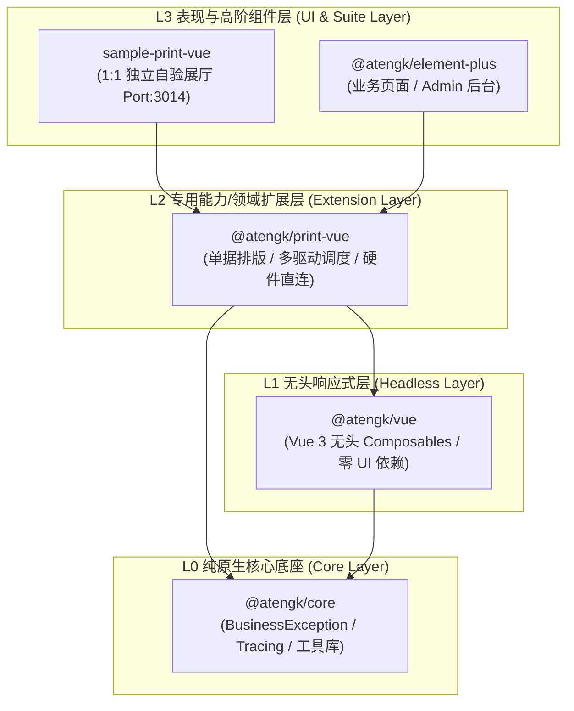
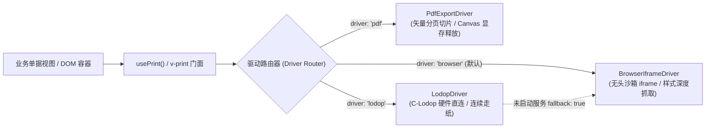

# @atengk/print-vue 企业级打印调度与单据排版扩展套件

> 面向现代 Web 应用与企业级系统的高保真单据排版、多驱动静默打印调度、长表格分页防撕裂、批量并发队列与硬件直连基础设施，归属于系统四层洋葱拓扑之 **L2 专用能力/领域扩展层 (Extension Layer)**。遵循“纯 Vue 3 驱动、SPI 插件化可替换驱动、零具体 UI 依赖、确定性生命周期治理”设计哲学，提供物理纸张高保真排版容器、毫米网格标尺与十字准星、4 大企业高频单据预设（发票结算单、热敏小票、快递面单、仓储标签）、纯矢量防伪电子印章、预印套打走纸校准器、长单据动态高度度量切片、批量并发限流队列以及 C-Lodop 硬件直连与平滑降级。

---

## 0. 特性与公共 API 全景速查矩阵

| 特性分类       | 特性名称             | 核心门面 / 组件 / Hook / 工具 | 关键参数 / Props / Options                                             | 核心行为与业务价值说明                                                                                                | 锚定验证源头 (*Test / Sample)                                                                                                                              |
| :------------- | :------------------- | :---------------------------- | :--------------------------------------------------------------------- | :-------------------------------------------------------------------------------------------------------------------- | :--------------------------------------------------------------------------------------------------------------------------------------------------------- |
| **排版容器**   | 物理单据排版容器     | `<AtengPrintSheet />`         | `preset, orientation, padding, scale, offsetX, offsetY, autoPaginate`  | 绑定 ISO 物理纸张（A4/A5/小票/连续针式二三等分），CSS Paged Media `@page` 隔离，支持毫米平移微调与动态分页切片        | [AtengPrintSheet.test.ts](./test/AtengPrintSheet.test.ts) / [StandardSheetsView.vue](../../apps/sample-print-vue/src/views/StandardSheetsView.vue)         |
| **排版容器**   | 物理毫米网格标尺     | `<AtengPrintRuler />`         | `width, height, unitSize, showCrosshair, gridLines, scale`             | 1:1 毫米刻度可视化，实时捕获鼠标坐标十字准星，提供 10mm 辅助网格，支撑高精度套打定位                                  | [AtengPrintRuler.test.ts](./test/AtengPrintRuler.test.ts) / [StandardSheetsView.vue](../../apps/sample-print-vue/src/views/StandardSheetsView.vue)         |
| **排版容器**   | 声明式强制分页符     | `<AtengPrintBreak />`         | `breakType: 'page' \| 'avoid'`                                         | 声明式断页占位符，编译为 CSS `break-after: page`，在多联存根或多页单据中强制硬换页                                    | [AtengPrintBreak.test.ts](./test/AtengPrintBreak.test.ts) / [StandardSheetsView.vue](../../apps/sample-print-vue/src/views/StandardSheetsView.vue)         |
| **单据预设**   | 销售物资结算发票     | `<AtengInvoiceSheet />`       | `title, orderNo, customer, seller, items, showSeal, #seal`             | 规范增值税及商品出库结算凭证，明细表格自适应，自动集成人民币大写金额与防伪财务印章                                    | [presets.test.ts](./test/presets.test.ts) / [StandardSheetsView.vue](../../apps/sample-print-vue/src/views/StandardSheetsView.vue)                         |
| **单据预设**   | 商业热敏连续小票     | `<AtengReceiptSheet />`       | `widthPreset: 'receipt-58' \| 'receipt-80', storeName, items, barcode` | 58mm/80mm 热敏收银排版，支持品名流水、优惠立减、支付方式、取餐条码与锯齿撕纸线                                        | [presets.test.ts](./test/presets.test.ts) / [StandardSheetsView.vue](../../apps/sample-print-vue/src/views/StandardSheetsView.vue)                         |
| **单据预设**   | 快递物流电子面单     | `<AtengWaybillSheet />`       | `expressName, trackingNo, routingCode, packageHub, sender, receiver`   | 标准快递面单（100×150mm），大字三段码分拣标识、条形码扫码区、收寄件人地址网格与签收存根                               | [presets.test.ts](./test/presets.test.ts) / [StandardSheetsView.vue](../../apps/sample-print-vue/src/views/StandardSheetsView.vue)                         |
| **单据预设**   | 仓储物料货架标签     | `<AtengLabelSheet />`         | `materialName, materialCode, spec, batchNo, location, sizePreset`      | 紧凑型热敏物料标签（小型 40×30 / 中型 60×40 / 大型 80×50），高密度排版与二维码标定块                                  | [presets.test.ts](./test/presets.test.ts) / [StandardSheetsView.vue](../../apps/sample-print-vue/src/views/StandardSheetsView.vue)                         |
| **格式工具**   | 人民币大写金额转换   | `digitUppercase(n)`           | `n: number \| string -> string`                                        | 遵循中国人民银行结算凭证规范，将阿拉伯数字转换为标准中文大写金额（如 "壹万贰仟叁佰肆拾伍元陆角柒分"），零依赖         | [presets.test.ts](./test/presets.test.ts) / [StandardSheetsView.vue](../../apps/sample-print-vue/src/views/StandardSheetsView.vue)                         |
| **走纸校准**   | 矢量防伪电子印章     | `<AtengPrintSeal />`          | `company, title, code, size, color, rotate, opacity, imageUrl`         | 纯 SVG 矢量印章（环形弧文字排版、五角星、防伪微缩码），支持印泥透明质感与自然旋转倾斜，防伪脱敏与图片模式             | [AtengPrintSeal.test.ts](./test/AtengPrintSeal.test.ts) / [LodopTerminalView.vue](../../apps/sample-sample-print-vue/src/views/LodopTerminalView.vue)      |
| **走纸校准**   | 预印套打走纸校准器   | `<AtengPrintCalibrator />`    | `v-model:offsetX, v-model:offsetY, step, maxOffset, preset`            | 交互式步进微调面板与十字平移仿真，打通硬件走纸与软件样式双向闭环，彻底根治针式打印跑偏                                | [AtengPrintCalibrator.test.ts](./test/AtengPrintCalibrator.test.ts) / [LodopTerminalView.vue](../../apps/sample-print-vue/src/views/LodopTerminalView.vue) |
| **无头状态机** | 统一打印编排门面     | `usePrint()`                  | `-> { isPrinting, print, printBatch, exportPdf }`                      | 统一调度 Hook，驱动无头 iframe 浏览器打印、PDF 矢量导出与批量并发队列，具备对称生命周期与状态响应                     | [usePrint.test.ts](./test/usePrint.test.ts) / [DriverDebugView.vue](../../apps/sample-print-vue/src/views/DriverDebugView.vue)                             |
| **无头状态机** | C-Lodop 硬件状态机   | `useLodop(options?)`          | `options -> { isServiceAvailable, printers, selectedPrinter, ... }`    | C-Lodop 端口探针嗅探、打印机硬件枚举、走纸偏移状态管理与平滑降级调度                                                  | [useLodop.test.ts](./test/useLodop.test.ts) / [LodopTerminalView.vue](../../apps/sample-print-vue/src/views/LodopTerminalView.vue)                         |
| **声明式指令** | 一键极速打印指令     | `v-print`                     | `v-print="options \| targetSelector"`                                  | 绑定到触发按钮，点击自动抓取目标区域并唤起打印，自动绑定 loading 态防重复点击                                         | [vPrint.test.ts](./test/vPrint.test.ts) / [DriverDebugView.vue](../../apps/sample-print-vue/src/views/DriverDebugView.vue)                                 |
| **声明式指令** | 行块防截断防撕裂指令 | `v-print-no-split`            | `v-print-no-split` (修饰符/无入参)                                     | 标记表格行 `tr` 或关键图文块，分页计算与 CSS 媒体查询时注入 `break-inside: avoid`，严禁行文字横向被斩断               | [vPrintNoSplit.test.ts](./test/vPrintNoSplit.test.ts) / [PaginationView.vue](../../apps/sample-print-vue/src/views/PaginationView.vue)                     |
| **驱动引擎**   | 无头 iframe 静默驱动 | `BrowserIframeDriver`         | `print(el, options)`                                                   | 基于动态隔离隐藏 iframe 渲染，拦截 `window.onafterprint`，打印结束后 100% 自动注销清理 iframe，杜绝内存泄露           | [BrowserIframeDriver.test.ts](./test/BrowserIframeDriver.test.ts) / [DriverDebugView.vue](../../apps/sample-print-vue/src/views/DriverDebugView.vue)       |
| **驱动引擎**   | PDF 光栅化导出驱动   | `PdfExportDriver`             | `exportPdf(el, options)`                                               | 逐页切片光栅化并合成 PDF，自动分步释放 Canvas 显存，具备跨域图片防污损保护                                            | [PdfExportDriver.test.ts](./test/PdfExportDriver.test.ts) / [DriverDebugView.vue](../../apps/sample-print-vue/src/views/DriverDebugView.vue)               |
| **驱动引擎**   | C-Lodop 硬件驱动     | `LodopDriver`                 | `print(el, options)`                                                   | 纳秒级脚本注入直连 8000/18000 端口，支持连续打孔纸走纸、打印机直选、静默打印与平滑降级                                | [LodopDriver.test.ts](./test/LodopDriver.test.ts) / [LodopTerminalView.vue](../../apps/sample-print-vue/src/views/LodopTerminalView.vue)                   |
| **底层核心**   | 样式保真抓取器       | `StyleHarvester`              | `StyleHarvester.harvest(options)`                                      | 深度遍历 `document.styleSheets`，提取 `<style>` 与 `<link rel="stylesheet">`，实时序列化 input/select/textarea 当前值 | [StyleHarvester.test.ts](./test/StyleHarvester.test.ts) / [DriverDebugView.vue](../../apps/sample-print-vue/src/views/DriverDebugView.vue)                 |
| **底层核心**   | 动态长表格分页引擎   | `PaginationEngine`            | `PaginationEngine.paginate(container, options)`                        | DOM 物理渲染高度度量算法，识别断页约束，产出切片模型并动态挂载页眉页脚与续表头                                        | [PaginationEngine.test.ts](./test/PaginationEngine.test.ts) / [PaginationView.vue](../../apps/sample-print-vue/src/views/PaginationView.vue)               |
| **底层核心**   | 批量并发限流调度器   | `PrintQueueCoordinator`       | `new PrintQueueCoordinator(options)`                                   | 内存队列线程池调度模型，支持限制并发数 (concurrency)、暂停/恢复/重试，响应式汇报整体进度百分比                        | [PrintQueueCoordinator.test.ts](./test/PrintQueueCoordinator.test.ts) / [BatchQueueView.vue](../../apps/sample-print-vue/src/views/BatchQueueView.vue)     |
| **底层核心**   | 硬件打印机管理器     | `PrinterManager`              | `PrinterManager.getPrinters() / getDefaultPrinter()`                   | 枚举客户端物理打印机、纸张规格列表与联机状态                                                                          | [PrinterManager.test.ts](./test/PrinterManager.test.ts) / [LodopTerminalView.vue](../../apps/sample-print-vue/src/views/LodopTerminalView.vue)             |
| **异常体系**   | 打印异常与因果链     | `PrintException`              | `code, message, context, cause`                                        | 归属标准业务异常基类，携带因果链与上下文（如驱动不可用、DOM 未找到、打印超时、队列取消）                              | [PrintException.test.ts](./test/PrintException.test.ts) / [DriverDebugView.vue](../../apps/sample-print-vue/src/views/DriverDebugView.vue)                 |
| **插件安装**   | Vue 插件注册器       | `install(app)`                | `app: App`                                                             | 显式注册全量公开单据组件与 `v-print`、`v-print-no-split` 指令，遵循受控装配原则                                       | [presets.test.ts](./test/presets.test.ts) / [main.ts](../../apps/sample-print-vue/src/main.ts)                                                             |

---

## 1. 模块定位与 pnpm 坐标

`@atengk/print-vue` 归属于 `ateng-ui` 基础设施套件的 **L2 专用能力/领域扩展层 (Extension Layer)**，专注于企业级多驱动静默打印调度与精准单据排版。

- **npm 坐标**：`@atengk/print-vue`
- **源码工程**：`packages/print-vue`
- **自验展厅**：`apps/sample-print-vue`（端口 `3014`）
- **拓扑依赖**：依赖 `@atengk/core` (L0) 与 `@atengk/vue` (L1)，严格与具体 UI 表现库解耦；消费 Element Plus 在 `sample-print-vue` (L3)；
- **peerDependencies 契约**：要求 `vue: ^3.5.0`。

### 安装依赖

```bash
pnpm add @atengk/print-vue @atengk/core @atengk/vue vue
```

---

## 2. 核心架构与设计不变量

### 2.1 四层洋葱拓扑位置



### 2.2 多驱动可替换 SPI 架构



---

## 3. 单据排版容器与毫米网格套件

### 3.1 物理单据排版纸张容器 `<AtengPrintSheet />`

#### ① 本节专属 TypeScript 契约与配置

```ts
export interface AtengPrintSheetProps {
  /** 纸张尺寸预设（默认 'a4'） */
  preset?: PaperPreset;
  /** 自定义纸张物理宽度（如 '210mm'，将覆盖 preset 预设值） */
  width?: string;
  /** 自定义纸张物理高度（如 '297mm'，将覆盖 preset 预设值） */
  height?: string;
  /** 纸张物理方向（默认 'portrait'） */
  orientation?: PaperOrientation;
  /** 物理内边距（默认 '10mm'） */
  padding?: string;
  /** 渲染缩放比例（默认 1.0） */
  scale?: number;
  /** X 轴物理微调平移偏移（毫米 mm，默认 0） */
  offsetX?: number;
  /** Y 轴物理微调平移偏移（毫米 mm，默认 0） */
  offsetY?: number;
  /** 是否启用长单据动态自动分页引擎（默认 false） */
  autoPaginate?: boolean;
}
```

#### ② 面向实战的业务 Vue SFC 代码示例

```vue
<script setup lang="ts">
import { ref } from 'vue';
import { AtengPrintSheet, AtengPrintBreak, usePrint } from '@atengk/print-vue';

const { isPrinting, print } = usePrint();

const triggerPrint = async () => {
  await print('#shipping-order-sheet');
};
</script>

<template>
  <div class="print-preview-container">
    <button :disabled="isPrinting" @click="triggerPrint">
      {{ isPrinting ? '正在调用打印机...' : '🖨️ 打印出货单' }}
    </button>

    <AtengPrintSheet
      id="shipping-order-sheet"
      preset="a4"
      orientation="portrait"
      padding="12mm"
      :offset-x="0"
      :offset-y="0"
    >
      <template #default="{ pageIndex, totalPages }">
        <div class="invoice-box">
          <h2>企业商品发货确认单</h2>
          <p>客户：上海某某精密机械制造有限公司</p>
          <p>日期：2026-11-10</p>
          <div class="order-divider"></div>

          <!-- 强制在附件处断页 -->
          <AtengPrintBreak />

          <div class="appendix">
            <h3>附件：出厂质量检验报告（第二联）</h3>
            <p>经检验，全部电气参数符合国标 GB/T 规范。</p>
          </div>

          <div class="footer-page-badge">第 {{ pageIndex }} 页 / 共 {{ totalPages }} 页</div>
        </div>
      </template>
    </AtengPrintSheet>
  </div>
</template>
```

#### ③ 核心机制与生产边界防御

1. **真实物理毫米与 CSS 媒体隔离**：通过 `@media print` 注入 `@page { size: 210mm 297mm portrait; margin: 0; }`，彻底抹平不同打印机驱动由于无边距或缩放导致的偏移变形；
2. **硬件走纸微调 `translate` 补偿**：通过 `transform: translate(offsetX, offsetY)` 修正针式打印机齿孔跑偏问题，不破坏文档流。

---

## 4. 企业高频单据预设与财务大写套件

### 4.1 4 大开箱即用高频单据与人民币大写转换

#### ① 本节专属 TypeScript 契约与配置

```ts
/** 销售结算发票明细行 */
export interface InvoiceItem {
  name: string;
  spec?: string;
  unit: string;
  qty: number;
  price: number;
  taxRate?: number;
  amount?: number;
}

/** 4 大单据组件 Props */
export interface AtengInvoiceSheetProps {
  title?: string;
  orderNo?: string;
  customer?: string;
  seller?: string;
  items?: InvoiceItem[];
  showSeal?: boolean;
}

export interface AtengReceiptSheetProps {
  widthPreset?: 'receipt-58' | 'receipt-80';
  storeName?: string;
  orderNo?: string;
  cashier?: string;
  items?: Array<{ name: string; qty: number; price: number }>;
}

export interface AtengWaybillSheetProps {
  expressName?: string;
  trackingNo?: string;
  routingCode?: string;
  packageHub?: string;
  sender?: { name: string; phone: string; address: string };
  receiver?: { name: string; phone: string; address: string };
}

export interface AtengLabelSheetProps {
  materialName?: string;
  materialCode?: string;
  spec?: string;
  batchNo?: string;
  location?: string;
  sizePreset?: 'small' | 'medium' | 'large';
}
```

#### ② 面向实战的业务 Vue SFC 代码示例

```vue
<script setup lang="ts">
import {
  AtengInvoiceSheet,
  AtengReceiptSheet,
  AtengWaybillSheet,
  AtengLabelSheet,
  digitUppercase,
  usePrint,
} from '@atengk/print-vue';

const { print } = usePrint();

// 人民币大写金额转换示例
const uppercaseText = digitUppercase(12850.5); // "壹万贰仟捌佰伍拾元伍角"
</script>

<template>
  <div class="presets-gallery">
    <!-- 1. 销售结算发票 -->
    <AtengInvoiceSheet
      id="invoice-demo"
      title="企业商品物资销售发货与结算单"
      customer="江苏智能制造有限公司"
      seller="上海蚂蚁数智科技有限公司"
      :items="[
        { name: '工业高性能伺服驱动器 24V', unit: '台', qty: 2, price: 340 },
        { name: '高柔性屏蔽电缆', unit: '米', qty: 20, price: 15 },
      ]"
      :show-seal="true"
    />

    <!-- 2. 热敏收银小票 (80mm) -->
    <AtengReceiptSheet
      id="receipt-demo"
      width-preset="receipt-80"
      storeName="星巴克臻选咖啡 (创智天地店)"
      cashier="008号 收银员"
    />

    <!-- 3. 三段码物流快递面单 -->
    <AtengWaybillSheet
      id="waybill-demo"
      expressName="顺丰特快 (标杆专运)"
      routingCode="021 - 058 - A09"
      trackingNo="SF108293810298"
    />

    <!-- 4. 仓储物料货架标签 -->
    <AtengLabelSheet
      id="label-demo"
      materialName="高精度工业光学编码器"
      materialCode="SKU-MOT-2026-088"
      location="库位: A-03-24"
      size-preset="large"
    />
  </div>
</template>
```

#### ③ 核心机制与生产边界防御

1. **中国人民银行结算凭证标准**：`digitUppercase` 纯 TS 实现，完整处理负数借贷、整数位 "整"、分角位零补全与亿/万级阶进，零重型第三方依赖；
2. **纯原生语义化排版**：预设单据 100% 采用语义化 HTML (`table`, `th`, `td`) 配合 BEM `at-*` 样式，保证跨打印驱动保真且杜绝全局样式污染。

---

## 5. 防伪印章与预印套打走纸校准套件

### 5.1 矢量电子印章 `<AtengPrintSeal />` 与校准器 `<AtengPrintCalibrator />`

#### ① 本节专属 TypeScript 契约与配置

```ts
export interface AtengPrintSealProps {
  /** 印章公司全称（绘制于顶部外环环形弧线） */
  company?: string;
  /** 印章职能名称（如 '财务专用章'、'合同专用章'） */
  title?: string;
  /** 印章防伪统一信用代码 */
  code?: string;
  /** 物理印章尺寸（单位 px，默认 120） */
  size?: number;
  /** 纯矢量印章印泥颜色（默认朱红 '#dc2626'） */
  color?: string;
  /** 自然盖印随机旋转微角度（角度 deg，默认 -12） */
  rotate?: number;
  /** 仿真油墨透印透明度（0~1，默认 0.85） */
  opacity?: number;
  /** 自定义印章图片 URL（传入时切换为图片印章渲染模式） */
  imageUrl?: string;
}

export interface AtengPrintCalibratorProps {
  /** X 轴走纸微调偏移 (mm) */
  offsetX?: number;
  /** Y 轴走纸微调偏移 (mm) */
  offsetY?: number;
  /** 步进量 (mm，默认 0.5) */
  step?: number;
  /** 最大偏移范围 (mm，默认 20) */
  maxOffset?: number;
  /** 纸张尺寸预设 (默认 'continuous-241-140') */
  preset?: PaperPreset;
}
```

#### ② 面向实战的业务 Vue SFC 代码示例

```vue
<script setup lang="ts">
import { ref } from 'vue';
import { AtengPrintSeal, AtengPrintCalibrator } from '@atengk/print-vue';

const offsetX = ref(0);
const offsetY = ref(1.5);
</script>

<template>
  <div class="seal-calibrator-demo">
    <!-- 电子印章展示 -->
    <AtengPrintSeal
      company="上海某某智能制造科技有限公司"
      title="发票结算专用章"
      code="91310115MA1H888888"
      :size="120"
      :rotate="-15"
      :opacity="0.88"
    />

    <!-- 预印套打走纸校准控制面板 -->
    <AtengPrintCalibrator
      v-model:offset-x="offsetX"
      v-model:offset-y="offsetY"
      :step="0.5"
      :max-offset="20"
      preset="continuous-241-140"
    />
  </div>
</template>
```

#### ③ 核心机制与生产边界防御

1. **纯矢量 SVG 弧形排版**：利用 SVG `<path id="text-arc">` 与 `<textPath>` 实现精确环形排版，避免 Canvas 放大模糊失真；
2. **校准闭环反馈**：校准器内置标尺与仿真平移视图，所调即所打，校准数值可持久化至本地存储或打印机配置中。

---

## 6. 多驱动 SPI 引擎与样式保真抓取

### 6.1 统一打印调度 `usePrint` 与 `StyleHarvester`

#### ① 本节专属 TypeScript 契约与配置

```ts
export interface PrintOptions {
  /** 驱动类型：'browser' 无头 iframe / 'pdf' 矢量导出 / 'lodop' 硬件直连 (默认 'browser') */
  driver?: 'browser' | 'pdf' | 'lodop';
  /** 打印文档标题 */
  documentTitle?: string;
  /** 打印目标前置等待时间 (ms，默认 250，保证字体与图表渲染完毕) */
  previewTimeout?: number;
  /** 额外注入的样式字符串 */
  extraCss?: string;
  /** 打印成功完成回调 */
  onSuccess?: () => void;
  /** 打印异常失败回调 */
  onError?: (error: PrintException) => void;
}
```

#### ② 面向实战的业务 Vue SFC 代码示例

```vue
<script setup lang="ts">
import { usePrint, vPrint } from '@atengk/print-vue';

const { isPrinting, print, exportPdf } = usePrint();

// 命令式调度打印
const handlePrint = async () => {
  await print('#printable-area', {
    driver: 'browser',
    documentTitle: '物资出库结算单',
    extraCss: '.hide-on-print { display: none !important; }',
    onSuccess: () => console.log('打印成功唤起'),
    onError: err => console.error('打印调度失败:', err.message),
  });
};

// 命令式导出 PDF
const handleExportPdf = async () => {
  await exportPdf('#printable-area', {
    filename: '物资出库单-20261110.pdf',
  });
};
</script>

<template>
  <div class="actions">
    <!-- 指令方式快捷打印 -->
    <button v-print="'#printable-area'">指令打印</button>
    <button :loading="isPrinting" @click="handlePrint">函数打印</button>
    <button @click="handleExportPdf">导出 PDF</button>
  </div>

  <div id="printable-area">
    <!-- 需要打印的内容 -->
  </div>
</template>
```

#### ③ 核心机制与生产边界防御

1. **表单状态实时捕获**：`StyleHarvester` 遍历克隆目标 DOM 树时，自动将 `<input>`、`<select>`、`<textarea>` 的当前用户输入值同步写入克隆节点的 `value` 属性与 `innerHTML`，彻底解决“界面有字、打印预览空白”的顽疾；
2. **沙箱 iframe 确定性释放**：打印结束后监听 `afterprint` 事件，在 `window.setTimeout` 异步轮询中安全销毁 `iframe` 节点，彻底杜绝高频打印时的内存泄露。

---

## 7. 长单据动态分页防撕裂截断引擎

### 7.1 `PaginationEngine` 与 `v-print-no-split`

#### ① 本节专属 TypeScript 契约与配置

```ts
export interface PaginationOptions {
  /** 物理可用页面高度（像素 px） */
  pageHeightPx: number;
  /** 页眉高度（像素 px，默认 0） */
  headerHeightPx?: number;
  /** 页脚高度（像素 px，默认 0） */
  footerHeightPx?: number;
  /** 续表头选择器（跨页时自动复制并注入表格顶端） */
  repeatHeaderSelector?: string;
}

export interface PageSlice {
  pageIndex: number;
  elements: HTMLElement[];
  totalHeight: number;
}
```

#### ② 面向实战的业务 Vue SFC 代码示例

```vue
<script setup lang="ts">
import { ref } from 'vue';
import { AtengPrintSheet, vPrintNoSplit, usePrint } from '@atengk/print-vue';

const { print } = usePrint();
const items = ref(
  Array.from({ length: 80 }, (_, i) => ({
    id: i + 1,
    name: `工业自动化传感器标准件 #${i + 1}`,
    qty: Math.floor(Math.random() * 50) + 1,
    price: (Math.random() * 200 + 10).toFixed(2),
  })),
);
</script>

<template>
  <button @click="print('#paginated-sheet')">打印多页长单据</button>

  <AtengPrintSheet id="paginated-sheet" preset="a4" :auto-paginate="true">
    <template #default="{ pageIndex, totalPages }">
      <div class="sheet-header">
        <h2>企业大型物资入库全量清单</h2>
      </div>

      <table class="data-table">
        <thead class="repeatable-header">
          <tr>
            <th>序号</th>
            <th>物料名称</th>
            <th>数量</th>
            <th>单价 (元)</th>
          </tr>
        </thead>
        <tbody>
          <!-- 关键行块防截断保护 -->
          <tr v-for="item in items" :key="item.id" v-print-no-split>
            <td>{{ item.id }}</td>
            <td>{{ item.name }}</td>
            <td>{{ item.qty }}</td>
            <td>¥{{ item.price }}</td>
          </tr>
        </tbody>
      </table>

      <div class="sheet-footer">第 {{ pageIndex }} 页 / 共 {{ totalPages }} 页</div>
    </template>
  </AtengPrintSheet>
</template>
```

#### ③ 核心机制与生产边界防御

1. **DOM 渲染高度度量**：`PaginationEngine` 在内存沙箱中遍历单据子节点，度量真实 `getBoundingClientRect().height` 与 `margin` 间距；
2. **防截断行块感知**：遇标记有 `v-print-no-split` 或 `break-inside: avoid` 的元素时，若当前页剩余高度不足以容纳该元素完整高度，自动将该元素整体移至下一页切片，杜绝文字水平拦腰截断。

---

## 8. 批量任务受控并发队列调度

### 8.1 批量并发调度器 `PrintQueueCoordinator`

#### ① 本节专属 TypeScript 契约与配置

```ts
export interface BatchPrintOptions {
  /** 最大并发通道数（默认 1，单通道受控打印） */
  concurrency?: number;
  /** 单个任务超时时间 (ms，默认 10000) */
  timeout?: number;
  /** 任务失败后最大重试次数（默认 0） */
  maxRetries?: number;
  /** 整体进度响应式回调 */
  onProgress?: (progress: BatchPrintProgress) => void;
}

export interface BatchPrintProgress {
  total: number;
  completed: number;
  failed: number;
  percent: number;
  currentTaskName?: string;
}
```

#### ② 面向实战的业务 Vue SFC 代码示例

```vue
<script setup lang="ts">
import { ref } from 'vue';
import { usePrint, type BatchPrintProgress } from '@atengk/print-vue';

const { printBatch } = usePrint();
const progress = ref<BatchPrintProgress | null>(null);

const handleBatchPrint = async () => {
  // 生成 10 张待打印单据任务
  const tasks = Array.from({ length: 10 }, (_, i) => ({
    name: `发货单-${i + 1}`,
    target: `#invoice-sheet-${i + 1}`,
  }));

  const result = await printBatch(tasks, {
    concurrency: 2, // 双通道受控并发
    maxRetries: 1, // 失败自动重试 1 次
    onProgress: p => {
      progress.value = p;
    },
  });

  console.log(`批量打印完成: 成功 ${result.successCount}, 失败 ${result.failCount}`);
};
</script>

<template>
  <div class="batch-panel">
    <button @click="handleBatchPrint">启动批量打印队列 (10 单)</button>

    <div v-if="progress" class="progress-bar">
      <span>正在打印: {{ progress.currentTaskName }}</span>
      <progress :value="progress.completed" :max="progress.total"></progress>
      <span>{{ progress.percent }}% ({{ progress.completed }}/{{ progress.total }})</span>
    </div>
  </div>
</template>
```

#### ③ 核心机制与生产边界防御

1. **防止浏览器与打印队列雪崩**：若无限制并发唤起数十次 `window.print()`，将导致浏览器挂起或崩溃。`PrintQueueCoordinator` 通过信号量机制将请求受控排队；
2. **生命周期取消感知**：组件卸载或用户点击“取消队列”时，自动广播 `AbortSignal`，停止后续待处理单据。

---

## 9. C-Lodop 硬件直连与连续走纸打孔控制

### 9.1 硬件探针与走纸控制 Hook `useLodop`

#### ① 本节专属 TypeScript 契约与配置

```ts
export interface UseLodopReturn {
  /** C-Lodop 本地驱动服务是否联机在线 */
  isServiceAvailable: Readonly<Ref<boolean>>;
  /** 当前系统中检测到的物理/虚拟打印机名称列表 */
  printers: Readonly<Ref<string[]>>;
  /** 当前选中的目标打印机 */
  selectedPrinter: Ref<string>;
  /** X 轴走纸微调偏移 (mm) */
  offsetX: Ref<number>;
  /** Y 轴走纸微调偏移 (mm) */
  offsetY: Ref<number>;
  /** 执行静默/指定打印机打印 */
  print: (target: HTMLElement | string, options?: LodopDriverOptions) => Promise<boolean>;
  /** 刷新打印机列表与重新探测硬件探针 */
  refreshPrinters: () => Promise<void>;
}
```

#### ② 面向实战的业务 Vue SFC 代码示例

```vue
<script setup lang="ts">
import { useLodop } from '@atengk/print-vue';

const { isServiceAvailable, printers, selectedPrinter, offsetX, offsetY, print } = useLodop({
  fallbackToBrowser: true, // 若未启动 C-Lodop 服务，自动平滑降级为浏览器打印
});

const handleLodopPrint = async () => {
  await print('#shipping-bill', {
    pageName: 'continuous-241-140', // 连续打孔走纸规格
  });
};
</script>

<template>
  <div class="lodop-terminal">
    <div class="status-indicator">
      服务状态：{{ isServiceAvailable ? '🟢 C-Lodop 联机在线' : '🔴 离线 (降级模式)' }}
    </div>

    <label>
      选择目标打印机：
      <select v-model="selectedPrinter">
        <option v-for="p in printers" :key="p" :value="p">{{ p }}</option>
      </select>
    </label>

    <button @click="handleLodopPrint">针式高速直连打印</button>
  </div>
</template>
```

#### ③ 核心机制与生产边界防御

1. **多端口竞速探测探针**：`LodopDriver` 并发探测 `8000`、`18000` (HTTP) 与 `8443` (HTTPS) 端口，优先连接最快响应的服务端口；
2. **平滑优雅降级**：当客户端未安装 C-Lodop 或服务崩溃退出时，`fallbackToBrowser: true` 保证业务流程不中断，自动平滑降级为无头浏览器 iframe 打印。

---

## 10. 生产环境避坑与生命周期/性能治理指南

1. **iframe 沙箱内存泄漏治理**：
   - _问题根因_：在批量打印或频繁单据切换场景下，若仅创建 `<iframe>` 而未清理，V8 引擎无法回收 iframe document 及挂载的样式表，导致页面内存一路飙升至崩溃（OOM）；
   - _解决实践_：`BrowserIframeDriver` 严格遵循“创建 ➔ 注入 ➔ 触发 ➔ `onafterprint` 捕获 ➔ 延迟销毁”确定性生命周期；在 `window.setTimeout` 回调中将 `iframe.remove()` 并在 `onScopeDispose` 钩子中释放。
2. **高 DPI 屏幕与 Canvas 显存释放**：
   - _问题根因_：`PdfExportDriver` 导出高分辨率多页文档时，`html2canvas` 产生的离屏 Canvas 会长期驻留显存；
   - _解决实践_：每完成一页光栅化切片并写入 PDF 实例后，立即显式调用 `canvas.width = 0; canvas.height = 0;` 并解除变量引用，通知垃圾回收器立即释放显存。
3. **针式打印机连续走纸跑偏（齿孔累积误差）**：
   - _问题根因_：普通 A4 纸高为 297mm，而商业两等分连续打孔纸（241mm×140mm）实际每联高度仅为 5.5 英寸（139.7mm）；若配置为 140mm，打完 10 张后将累计向下偏移 3mm，导致后续单据表头错位印在打孔线上；
   - _解决实践_：在 `@atengk/print-vue` 中严格使用精准预设 `continuous-241-140`（精确到 139.7mm）或配合 `<AtengPrintCalibrator />` 步进微调。

---

## 11. 完整 TypeScript 接口/Props/CSS 变量速查清单

### 11.1 纸张预设与尺寸类型

```ts
export type PaperPreset =
  | 'a3'
  | 'a4'
  | 'a5'
  | 'b4'
  | 'b5'
  | 'receipt-58'
  | 'receipt-80'
  | 'continuous-241-280'
  | 'continuous-241-140'
  | 'continuous-241-93';

export type PaperOrientation = 'portrait' | 'landscape';

export interface ResolvedPaperDimensions {
  width: string;
  height: string;
  widthMm: number;
  heightMm: number;
}
```

### 11.2 CSS 变量 Design Tokens

| CSS 变量名                   | 默认物理值 / 颜色     | 用途与语义说明           |
| :--------------------------- | :-------------------- | :----------------------- |
| `--at-print-sheet-bg`        | `#ffffff`             | 打印单据物理纸张底色     |
| `--at-print-ruler-color`     | `#64748b`             | 毫米标尺刻度与文本颜色   |
| `--at-print-crosshair-color` | `rgba(220,38,38,0.7)` | 十字准星红外瞄准线颜色   |
| `--at-print-seal-color`      | `#dc2626`             | 矢量电子印章印泥朱红色   |
| `--at-print-border-color`    | `#0f172a`             | 企业正式单据外框实线颜色 |
