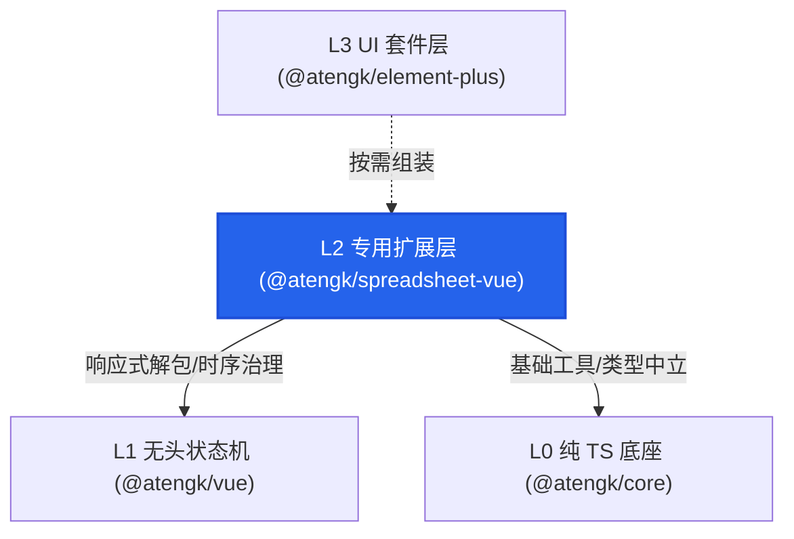
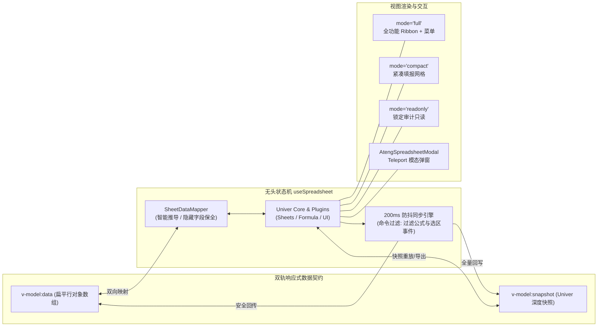

# @atengk/spreadsheet-vue 在线电子表格与批量填报

> 专注于现代 Web 企业级复杂报表、在线协作表格与矩阵批量填报场景的现代化电子表格套件。遵循四层洋葱架构之 **L2 专用能力/领域扩展层** 定位，基于行业级 Univer 引擎内核打造，提供“扁平对象数组 `v-model:data`”与“工作簿快照 `v-model:snapshot`”双轨响应式状态机，100% 物理脱耦 L3 UI 库（零 Element Plus 耦合），内置冷钛主题跟随、视口 0x0 几何自愈与原生 UTF-8 BOM CSV 导出。

---

## 0. 特性与公共 API 全景速查矩阵

| API 标识                  | 类型          | 所属领域 | 核心职责说明                                                                   | 典型场景                         |
| :------------------------ | :------------ | :------- | :----------------------------------------------------------------------------- | :------------------------------- |
| `AtengSpreadsheet`        | Vue SFC 组件  | 核心容器 | 电子表格核心容器组件，支持双轨数据绑定、三态渲染模式与完整插槽                 | 嵌入式工作簿、填报网格、只读报表 |
| `AtengSpreadsheetModal`   | Vue SFC 组件  | 弹窗扩展 | 独立脱壳模态弹窗组件，基于 Vue 3 原生 Teleport，支持全屏切换与尺寸自愈         | 批量调价弹窗、明细填报模态框     |
| `useSpreadsheet`          | Composable    | 状态机   | 无头响应式状态机 Hook，封装 Univer 实例生命周期、防抖变更与数据读写            | 定制复杂工作簿交互、无头状态编排 |
| `useSpreadsheetThemeSync` | Composable    | 样式体系 | 监听宿主 `html.dark` 变换并自动同步 Univer 配色及 CSS 变量                     | 全局暗黑模式无损热切换           |
| `SheetDataMapper`         | 工具类 / 门面 | 数据转换 | 扁平对象数组与 Univer 单元格二维矩阵的双向映射器，支持自动列推导与隐藏字段保全 | 业务 CRUD 与表格双向同步         |
| `SpreadsheetExporter`     | 工具类 / 门面 | 导出套件 | 零重型依赖导出器，支持将工作表导出为带 UTF-8 BOM 的防乱码 CSV 及 JSON 快照     | 快速导出、轻量报表归档           |
| `SpreadsheetResizeGuard`  | 工具类 / 防御 | 视口治理 | 0x0 视口折叠哨兵，监听容器从不可见到可见并触发重绘自愈                         | 弹窗、Tabs、折叠面板首次展开     |
| `excelExchangeManager`    | SPI 门面单例  | 外部扩展 | Excel 二进制导入导出 SPI 驱动管理器，遵循开闭原则按需挂载解析器                | 外部 XLSX/XLS 复杂文件读写       |
| `SPREADSHEET_VUE_VERSION` | 常量字符串    | 元数据   | 当前模块发布版本标识（`1.0.0`）                                                | 运行态版本嗅探                   |

### 0.1 组件 Props / Emits / Slots / Expose 全景速查

| 载体                    | 类别   | 属性 / 事件 / 插槽 / 方法名 | 类型 / 签名                                 | 默认值             | 核心职责说明                     |
| :---------------------- | :----- | :-------------------------- | :------------------------------------------ | :----------------- | :------------------------------- |
| `AtengSpreadsheet`      | Prop   | `v-model:data`              | `SpreadsheetRecord[]`                       | `undefined`        | 扁平业务行对象数组，变更自动同步 |
| `AtengSpreadsheet`      | Prop   | `v-model:snapshot`          | `SpreadsheetSnapshot`                       | `undefined`        | Univer 完整工作簿 JSON 快照      |
| `AtengSpreadsheet`      | Prop   | `columns`                   | `SpreadsheetColumn[]`                       | `undefined`        | 扁平填报模式下的列配置契约       |
| `AtengSpreadsheet`      | Prop   | `mode`                      | `'full' \| 'compact' \| 'readonly'`         | `'full'`           | 场景渲染模式（全功能/紧凑/只读） |
| `AtengSpreadsheet`      | Prop   | `showToolbar`               | `boolean`                                   | 根据 mode 自动推导 | 是否显示顶部 Ribbon 工具栏       |
| `AtengSpreadsheet`      | Prop   | `showFormulaBar`            | `boolean`                                   | 根据 mode 自动推导 | 是否显示公式编辑栏               |
| `AtengSpreadsheet`      | Prop   | `showSheetBar`              | `boolean`                                   | 根据 mode 自动推导 | 是否显示底部工作表标签栏         |
| `AtengSpreadsheet`      | Prop   | `readOnly`                  | `boolean`                                   | 根据 mode 自动推导 | 是否只读（锁定编辑与指令）       |
| `AtengSpreadsheet`      | Prop   | `theme`                     | `'auto' \| 'light' \| 'dark'`               | `'auto'`           | 主题模式，auto 自动跟随宿主      |
| `AtengSpreadsheet`      | Prop   | `locale`                    | `'zh-CN' \| 'en-US' \| string`              | `'zh-CN'`          | 国际化语言                       |
| `AtengSpreadsheet`      | Prop   | `height`                    | `string \| number`                          | `'100%'`           | 容器物理高度                     |
| `AtengSpreadsheet`      | Prop   | `width`                     | `string \| number`                          | `'100%'`           | 容器物理宽度                     |
| `AtengSpreadsheet`      | Prop   | `debounceWait`              | `number`                                    | `200`              | 单元格修改后向外同步的防抖毫秒数 |
| `AtengSpreadsheet`      | Emit   | `ready`                     | `(api: unknown) => void`                    | -                  | Univer 实例就绪并暴露门面        |
| `AtengSpreadsheet`      | Emit   | `change`                    | `(snapshot: SpreadsheetSnapshot) => void`   | -                  | 表格内容变更防抖抛出最新快照     |
| `AtengSpreadsheet`      | Emit   | `cell-change`               | `(payload: CellChangePayload) => void`      | -                  | 单个单元格数值变更事件           |
| `AtengSpreadsheet`      | Emit   | `selection-change`          | `(range: SpreadsheetRange \| null) => void` | -                  | 活动单元格选区几何范围变更       |
| `AtengSpreadsheet`      | Slot   | `#header`                   | `{ isReady: boolean }`                      | -                  | 顶栏插槽，覆盖整个操作栏         |
| `AtengSpreadsheet`      | Slot   | `#extra`                    | `{ isReady: boolean }`                      | -                  | 顶栏右侧额外扩展插槽             |
| `AtengSpreadsheet`      | Slot   | `#footer`                   | `{ isReady: boolean }`                      | -                  | 底部状态栏扩展插槽               |
| `AtengSpreadsheet`      | Slot   | `#loading`                  | -                                           | -                  | 自定义加载态遮罩插槽             |
| `AtengSpreadsheet`      | Slot   | `#empty`                    | -                                           | -                  | 无数据时的空状态插槽             |
| `AtengSpreadsheet`      | Expose | `getData()`                 | `() => SpreadsheetRecord[]`                 | -                  | 获取当前工作表的扁平行对象数组   |
| `AtengSpreadsheet`      | Expose | `setData()`                 | `(records, cols?) => void`                  | -                  | 重置当前工作表数据               |
| `AtengSpreadsheet`      | Expose | `getSnapshot()`             | `() => SpreadsheetSnapshot \| null`         | -                  | 获取全量工作簿快照               |
| `AtengSpreadsheet`      | Expose | `setSnapshot()`             | `(snapshot) => void`                        | -                  | 重载工作簿完整快照               |
| `AtengSpreadsheet`      | Expose | `exportCsv()`               | `(filename?) => void`                       | -                  | 导出带 BOM CSV 并触发下载        |
| `AtengSpreadsheet`      | Expose | `exportJson()`              | `(filename?) => void`                       | -                  | 导出工作簿 JSON 快照             |
| `AtengSpreadsheet`      | Expose | `resize()`                  | `() => void`                                | -                  | 强制重绘并自愈视口尺寸           |
| `AtengSpreadsheet`      | Expose | `getUniverAPI()`            | `() => unknown`                             | -                  | 获取底层 UniverAPI 逃生门        |
| `AtengSpreadsheetModal` | Prop   | `v-model:visible`           | `boolean`                                   | `false`            | 弹窗可见性双向绑定               |
| `AtengSpreadsheetModal` | Prop   | `title`                     | `string`                                    | `'电子表格填报'`   | 弹窗标题                         |
| `AtengSpreadsheetModal` | Prop   | `fullscreen`                | `boolean`                                   | `false`            | 是否开启全屏展示                 |
| `AtengSpreadsheetModal` | Emit   | `confirm`                   | `({ snapshot, data }) => void`              | -                  | 点击弹窗确认按钮触发             |
| `AtengSpreadsheetModal` | Emit   | `cancel`                    | `() => void`                                | -                  | 点击关闭或取消按钮触发           |

---

## 1. 模块定位与 pnpm 坐标

`@atengk/spreadsheet-vue` 是 `ateng-ui` 企业级套件中的专业电子表格扩展包。在四层洋葱拓扑中隶属于 **L2 专用能力/领域扩展层**：

- **向上为 L3 赋能**：可直接在业务系统或高阶业务看板中使用，或由 L3 UI 套件对其二次组装；
- **向下基于 L1 与 L0**：利用 `@atengk/vue` 的响应式机制与 `@atengk/core` 的通用工具函数，自身 **严格禁止依赖任何具体 UI 库**（如 Element Plus、Ant Design），确保纯净度与极佳的可移植性；
- **peerDependencies 宽进契约**：要求宿主环境提供 Vue `^3.5.0`。

```bash
# 在 Monorepo 或业务工程中安装
pnpm add @atengk/spreadsheet-vue
```

---

## 2. 核心架构与设计不变量

### 2.1 四层洋葱拓扑位置



### 2.2 响应式双轨状态机架构



### 2.3 关键设计不变量

1. **零 L3 依赖侵入（L2 纯净律）**：组件内部与 Composable 严禁直接导入 `el-button`、`ElMessage` 或任何 Element Plus 组件。弹窗 `<AtengSpreadsheetModal />` 原生基于 Vue 3 `<Teleport>` 驱动，按钮与交互均由冷钛 Design Tokens 绘制，支持通过 Slot 深度自定义。
2. **隐藏业务字段 100% 保全**：业务对象常常携带未在表格展示的隐式属性（如 `_id`、`token`、`auditStatus`）。`SheetDataMapper` 在表格编辑并逆向反解为对象数组时，**保证非展示字段原样保留，零属性丢失**。
3. **命令监听防抖与公式循环阻断**：Univer 内部公式求值与滚动事件会频繁触发内部 CommandExecuted。内部状态机前置过滤非数据修改指令，并结合 200ms 防抖同步，根除死循环重绘与输入卡顿。
4. **0x0 视口几何自愈**：在 Tab 切换或弹窗展开时，DOM 容器初始可能处于 `display: none`。`SpreadsheetResizeGuard` 建立 Resize 哨兵，在宽度或高度由 0 恢复正常后自适应触发引擎重绘。

---

## 3. 领域大章一：双轨数据绑定与行对象智能映射

### 3.1 业务对象数组双向绑定 (`v-model:data`)

在企业管理系统中，后端接口通常下发或接收结构化的对象数组。通过 `v-model:data`，开发者无需理解 Univer 底层的复杂单元格矩阵，直接以操作普通数组的方式驱动电子表格。

#### 专属 TypeScript 契约片段

```typescript
/**
 * 扁平轻量行对象记录契约。
 */
export type SpreadsheetRecord = Record<string, unknown>;

/**
 * 扁平填报模式下的列配置契约。
 */
export interface SpreadsheetColumn {
  /** 字段键名，对应 SpreadsheetRecord 中的属性名 */
  key: string;
  /** 列标题显示文本 */
  title: string;
  /** 列宽（像素，默认 120） */
  width?: number;
  /** 水平对齐方式 */
  align?: 'left' | 'center' | 'right';
  /** 是否必填 */
  required?: boolean;
}
```

#### 实战业务代码示例

```vue
<script setup lang="ts">
import { ref } from 'vue';
import {
  AtengSpreadsheet,
  type SpreadsheetColumn,
  type SpreadsheetRecord,
} from '@atengk/spreadsheet-vue';

// 1. 定义表格列配置
const columns: SpreadsheetColumn[] = [
  { key: 'workId', title: '工号', width: 100, align: 'center' },
  { key: 'name', title: '姓名', width: 120 },
  { key: 'department', title: '所属部门', width: 160 },
  { key: 'baseSalary', title: '基本薪资', width: 120, align: 'right' },
  { key: 'score', title: '绩效得分', width: 100, align: 'right' },
];

// 2. 绑定业务数据，包含隐藏字段 _id 与 token
const tableData = ref<SpreadsheetRecord[]>([
  {
    _id: 'snowflake_1001',
    workId: 'EMP-01',
    name: '张三',
    department: '架构设计中心',
    baseSalary: 28000,
    score: 96,
    token: 'auth_sec_1001',
  },
  {
    _id: 'snowflake_1002',
    workId: 'EMP-02',
    name: '李四',
    department: '基础设施运维部',
    baseSalary: 22000,
    score: 91,
    token: 'auth_sec_1002',
  },
]);

// 3. 追加记录
const handleAddRow = () => {
  tableData.value.push({
    _id: `snowflake_${Date.now()}`,
    workId: `EMP-${tableData.value.length + 1}`,
    name: '新员工',
    department: '研发部',
    baseSalary: 18000,
    score: 85,
    token: 'auth_sec_new',
  });
};
</script>

<template>
  <div class="table-container">
    <div class="actions">
      <button @click="handleAddRow">+ 追加员工记录</button>
      <span>当前员工数：{{ tableData.length }}</span>
    </div>

    <!-- 紧凑模式下双向绑定行数据 -->
    <AtengSpreadsheet v-model:data="tableData" :columns="columns" mode="compact" height="450px" />
  </div>
</template>

<style scoped>
.table-container {
  display: flex;
  flex-direction: column;
  gap: 12px;
}
.actions {
  display: flex;
  align-items: center;
  gap: 16px;
}
</style>
```

#### 核心机制与生产边界防御说明

1. **自动列推导与显式列契约**：若未传入 `:columns`，`SheetDataMapper.inferColumns` 会自动扫描数据首行生成默认列。但在正式生产中强烈建议显式声明 `columns`，以保证列宽、对齐与字段顺序的一致性。
2. **隐藏字段安全防护**：用户在界面中仅能看到工号、姓名、部门等显示列，编辑后触发更新时，`SheetDataMapper` 通过比对旧记录集合，将隐藏的 `_id` 和 `token` 完整合入回传的新数组中，避免由于表格编辑导致后端主键丢失报错。

---

### 3.2 深度快照工作簿绑定 (`v-model:snapshot`)

对于复杂报表、多工作表（Sheets）、自定义单元格样式与复杂公式（如跨表引用、条件格式），应使用全量快照双向绑定。

#### 专属 TypeScript 契约片段

```typescript
/**
 * Univer 完整工作簿 JSON 快照契约。
 */
export interface SpreadsheetSnapshot {
  id?: string;
  name?: string;
  locale?: string;
  sheets?: Record<string, SpreadsheetWorksheetData>;
  sheetOrder?: string[];
  styles?: Record<string, SpreadsheetCellStyle>;
  [key: string]: unknown;
}
```

#### 实战业务代码示例

```vue
<script setup lang="ts">
import { ref } from 'vue';
import { AtengSpreadsheet, type SpreadsheetSnapshot } from '@atengk/spreadsheet-vue';

// 初始带公式与多 Sheet 的工作簿快照
const workbookSnapshot = ref<SpreadsheetSnapshot>({
  id: 'workbook_budget_2026',
  name: '2026年度预算执行总表',
  sheetOrder: ['sheet_q1', 'sheet_summary'],
  sheets: {
    sheet_q1: {
      id: 'sheet_q1',
      name: '第一季度支出',
      rowCount: 30,
      columnCount: 10,
      cellData: {
        0: {
          0: { v: '预算科目', s: { bold: true } },
          1: { v: '金额 (万元)', s: { bold: true } },
        },
        1: { 0: { v: '云原生计算资源' }, 1: { v: 125 } },
        2: { 0: { v: '网络带宽与加速' }, 1: { v: 48 } },
        3: { 0: { v: '研发办公开销' }, 1: { v: 32 } },
        4: { 0: { v: '季度总计' }, 1: { f: '=SUM(B2:B4)' } },
      },
    },
    sheet_summary: {
      id: 'sheet_summary',
      name: '综合概览',
      rowCount: 20,
      columnCount: 8,
      cellData: {
        0: { 0: { v: 'Q1 执行进度' }, 1: { v: '正常受控' } },
      },
    },
  },
});

const handleSnapshotChange = (newSnapshot: SpreadsheetSnapshot) => {
  console.log('工作簿结构或数值更新：', Object.keys(newSnapshot.sheets || {}));
};
</script>

<template>
  <div class="workbook-view">
    <AtengSpreadsheet
      v-model:snapshot="workbookSnapshot"
      mode="full"
      height="600px"
      @change="handleSnapshotChange"
    />
  </div>
</template>
```

#### 核心机制与生产边界防御说明

- **Unit ID 防冲突销毁**：通过 `v-model:snapshot` 或 `setSnapshot()` 替换工作簿时，内部无头状态机会前置调用 Univer 底层的 `disposeUnit(oldUnitId)` 销毁旧工作簿单元，根除 `Cannot create a unit with the same unit id` 冲突异常。

---

## 4. 领域大章二：三态渲染分级与无头插槽反转

### 4.1 场景渲染模式 (`full` / `compact` / `readonly`)

为覆盖全量功能探索、紧凑业务报单以及财务合规审计三大核心场景，`@atengk/spreadsheet-vue` 内置三态渲染模式，一行配置即可自动决定工具栏、公式栏与编辑权限：

```typescript
export type SpreadsheetMode = 'full' | 'compact' | 'readonly';
```

| 渲染模式   | 默认 Ribbon 工具栏 | 默认公式编辑栏 | 默认 Sheet 标签栏 | 编辑权限         | 典型业务场景                   |
| :--------- | :----------------- | :------------- | :---------------- | :--------------- | :----------------------------- |
| `full`     | **显示**           | **显示**       | **显示**          | 完整可编辑       | 在线协同表格、复杂工作簿分析   |
| `compact`  | **隐藏**           | **显示**       | **隐藏**          | 完整可编辑       | 订单批量填报、员工档案填报表格 |
| `readonly` | **隐藏**           | **隐藏**       | **显示**          | **锁定禁止编辑** | 合同账目审计、历史报表归档审阅 |

> **原子化 Prop 覆盖**：若需在 `compact` 模式下临时展示底部标签栏，可直接配置 `:showSheetBar="true"`，显式传入的布尔属性优先级高于模式默认值。

---

### 4.2 顶栏/底栏插槽定制与操作扩展

组件提供了 `#header`、`#extra`、`#footer`、`#loading`、`#empty` 五大插槽，实现表现与业务逻辑的解耦反转。

#### 实战业务代码示例

```vue
<script setup lang="ts">
import { ref } from 'vue';
import { AtengSpreadsheet } from '@atengk/spreadsheet-vue';

const spreadsheetRef = ref<InstanceType<typeof AtengSpreadsheet> | null>(null);

const handleExportCsv = () => {
  spreadsheetRef.value?.exportCsv('财务审计终审表.csv');
};
</script>

<template>
  <AtengSpreadsheet ref="spreadsheetRef" mode="readonly" height="500px">
    <!-- 右侧扩展插槽：注入自定义业务操作按钮 -->
    <template #extra="{ isReady }">
      <button :disabled="!isReady" class="audit-btn" @click="handleExportCsv">
        📥 导出审计 CSV (UTF-8 BOM)
      </button>
    </template>

    <!-- 底部状态栏扩展插槽 -->
    <template #footer>
      <div class="audit-status-bar">
        <span>🔒 只读审计保护生效中</span>
        <span>•</span>
        <span>无篡改安全凭据认证通过</span>
      </div>
    </template>
  </AtengSpreadsheet>
</template>

<style scoped>
.audit-btn {
  padding: 4px 12px;
  background-color: #2563eb;
  color: #ffffff;
  border: none;
  border-radius: 4px;
  cursor: pointer;
  font-size: 13px;
}
.audit-btn:disabled {
  opacity: 0.5;
  cursor: not-allowed;
}
.audit-status-bar {
  display: flex;
  gap: 8px;
  font-size: 12px;
  color: #64748b;
  padding: 4px 12px;
  background-color: #f8fafc;
}
</style>
```

---

## 5. 领域大章三：脱壳模态弹窗与冷钛主题同步

### 5.1 `<AtengSpreadsheetModal />` 弹窗与全屏自愈

针对后台常见的“点击按钮打开表格弹窗、在线填报修改并确认提交”的场景，提供开箱即用的脱壳模态弹窗组件。

#### 专属 TypeScript 契约片段

```typescript
export interface SpreadsheetModalProps extends SpreadsheetProps {
  /** 弹窗可见性（支持 v-model:visible） */
  visible?: boolean;
  /** 弹窗标题 */
  title?: string;
  /** 弹窗宽度（非全屏时，默认 900px） */
  modalWidth?: string | number;
  /** 弹窗高度（非全屏时，默认 560px） */
  modalHeight?: string | number;
  /** 是否全屏显示 */
  fullscreen?: boolean;
  /** 是否展示全屏切换按钮 */
  showFullscreenToggle?: boolean;
}
```

#### 实战业务代码示例

```vue
<script setup lang="ts">
import { ref } from 'vue';
import { AtengSpreadsheetModal, type SpreadsheetRecord } from '@atengk/spreadsheet-vue';

const isModalOpen = ref(false);

const productData = ref<SpreadsheetRecord[]>([
  { id: 101, name: '企业级防火墙网关', currentPrice: 19800, adjustRate: '5%' },
  { id: 102, name: '分布式存储节点', currentPrice: 32000, adjustRate: '3%' },
]);

const handleModalConfirm = (payload: { data: SpreadsheetRecord[] }) => {
  console.log('用户确认提交调整后数据：', payload.data);
  productData.value = payload.data;
  isModalOpen.value = false;
};
</script>

<template>
  <div>
    <button @click="isModalOpen = true">唤起调价填报弹窗</button>

    <!-- 脱壳独立模态弹窗 -->
    <AtengSpreadsheetModal
      v-model:visible="isModalOpen"
      v-model:data="productData"
      title="核心商品价格调整单"
      mode="compact"
      modal-width="85%"
      modal-height="620px"
      show-fullscreen-toggle
      @confirm="handleModalConfirm"
      @cancel="isModalOpen = false"
    />
  </div>
</template>
```

#### 核心机制与生产边界防御说明

1. **原生 Teleport 隔离**：组件使用 `<Teleport to="body">` 挂载，彻底避免被外层容器的 `overflow: hidden` 或相对定位样式撕裂。
2. **0x0 视口几何自愈**：弹窗打开时通常伴随 CSS 渐变动画，在打开瞬间 DOM 几何尺寸可能为 0。内部集成了 `SpreadsheetResizeGuard`，在检测到弹窗尺寸渲染恢复后，自动调用 Univer 内部渲染管线的 resize 事件，杜绝白屏或尺寸错位。
3. **Esc 键与遮罩防误触**：支持按 Esc 键安全退出，遮罩点击需显式确认，防止用户误触丢失填报数据。

---

### 5.2 `useSpreadsheetThemeSync` 暗黑模式热跟随

#### 专属 TypeScript 契约与使用

```typescript
import { useSpreadsheetThemeSync } from '@atengk/spreadsheet-vue';

// 在任何业务组件或布局中初始化主题跟随
const { isDark, currentTheme, syncTheme } = useSpreadsheetThemeSync();
```

#### 机制说明

Univer 原生具有深色模式（Dark）配色。`useSpreadsheetThemeSync` 利用 `MutationObserver` 监听 `document.documentElement`（`<html>`）上的 `class` 变化。一旦检测到包含 `dark` 类，状态机自动触发底层主题切换，并将 `--at-spreadsheet-*` 变量无缝切至暗黑冷钛色系，全生命周期内自动在 `onScopeDispose` 中注销监听，零内存泄露。

---

## 6. 领域大章四：轻量导出套件与 ExcelExchangeSPI 驱动插槽

### 6.1 `SpreadsheetExporter` 原生防乱码带 BOM CSV 导出

在无需引入庞大解析库的前提下，组件内置轻量导出器 `SpreadsheetExporter`：

```typescript
import { SpreadsheetExporter } from '@atengk/spreadsheet-vue';

// 1. 将工作表数据直接导出并触发浏览器下载
SpreadsheetExporter.downloadCsv(worksheetData, '2026年首季经营报表.csv');

// 2. 将全量工作簿快照下载为 JSON
SpreadsheetExporter.downloadJson(workbookSnapshot, '工作簿备份.json');
```

#### 字符集防乱码机制

- 导出 CSV 字符串时，前置拼接 **`\uFEFF`（UTF-8 字节顺序标记 BOM）**。
- 这使得用户在 Windows 系统下直接使用 Microsoft Excel 双击打开 CSV 时，Excel 能精准识别为 UTF-8 编码，彻底根除中文字符乱码问题。
- 单元格内容若包含英文逗号 `,`、双引号 `"` 或回车换行 `\n`，自动遵循 RFC 4180 标准转义包裹。

---

### 6.2 `ExcelExchangeSPI` 可插拔二进制解析导出接口

遵循开闭原则与零臃肿底座设计，本包默认不强依赖任何重型 Excel 解析库（如 SheetJS / ExcelJS）。通过 `ExcelExchangeSPI`，开发者可在业务侧按需挂载第三方驱动：

#### SPI 契约定义与挂载

```typescript
import {
  excelExchangeManager,
  type ExcelExchangeDriver,
  type SpreadsheetSnapshot,
} from '@atengk/spreadsheet-vue';

// 1. 实现业务专属的 Excel 交换驱动
const customXlsxDriver: ExcelExchangeDriver = {
  async import(file: File | Blob): Promise<SpreadsheetSnapshot> {
    // 调用第三方解析库（如 exceljs 或服务端解析接口）转换为快照
    const snapshot = await parseBinaryExcel(file);
    return snapshot;
  },
  async export(snapshot: SpreadsheetSnapshot, filename?: string): Promise<Blob> {
    // 将快照组装并生成二进制 XLSX Blob
    const blob = await generateBinaryXlsx(snapshot);
    return blob;
  },
};

// 2. 注册为当前驱动
excelExchangeManager.registerDriver(customXlsxDriver);

// 3. 在需要的地方调用
const snapshot = await excelExchangeManager.import(excelFile);
```

---

## 7. 生产环境避坑与生命周期/性能治理指南

### 7.1 确定性生命周期销毁与多实例清理

Univer 会在 DOM 容器中注入画布、公式上下文与快捷键全局监听器。在组件卸载或路由切换时，必须确保实例彻底销毁：

- `<AtengSpreadsheet>` 在 `onUnmounted` / `onScopeDispose` 中会自动调用 `destroy()`。
- `destroy()` 会注销快捷键、解绑 DOM 监听、销毁 ResizeObserver、释放 Worker 线程引用并彻底清空挂载节点内容。

### 7.2 规避公式循环重绘陷阱

在监听 Univer 的 `CommandExecuted` 事件时，内部公式计算（`formula.mutation.*`）和选区操作（`sheet.operation.*`）会频繁派发指令。若直接无条件重发数据更新，会导致死循环或严重丢帧。内部状态机已内置指令白名单与过滤正则，外部使用 `useSpreadsheet` 时请优先使用封装好的 `onDataChange` 或 `onSnapshotChange` 回调。

### 7.3 弹窗或 Tabs 容器 0x0 视口自愈

在切换 Tab 或展开 Modal 时，若出现画布未占满容器或显示为小黑块，请调用实例暴露的 `resize()` 方法或配合 `SpreadsheetResizeGuard` 使用：

```typescript
const spreadsheetRef = ref<InstanceType<typeof AtengSpreadsheet> | null>(null);

// 在 Tab 切换动画完成后手动自愈
const onTabChange = () => {
  nextTick(() => {
    spreadsheetRef.value?.resize();
  });
};
```

---

## 8. 完整 TypeScript 接口/Props/CSS 变量速查清单

### 8.1 完整 TypeScript 类型字典

```typescript
export type SpreadsheetMode = 'full' | 'compact' | 'readonly';
export type SpreadsheetLocale = 'zh-CN' | 'en-US' | (string & {});
export type SpreadsheetTheme = 'auto' | 'light' | 'dark';

export interface SpreadsheetCellStyle {
  fontSize?: number;
  fontFamily?: string;
  bold?: boolean;
  italic?: boolean;
  underline?: boolean;
  strikethrough?: boolean;
  color?: string;
  backgroundColor?: string;
  horizontalAlign?: 'left' | 'center' | 'right';
  verticalAlign?: 'top' | 'middle' | 'bottom';
  wrapStrategy?: number;
}

export interface SpreadsheetCellData {
  v?: string | number | boolean;
  m?: string;
  f?: string;
  s?: SpreadsheetCellStyle | string;
  t?: number;
}

export interface SpreadsheetWorksheetData {
  id: string;
  name: string;
  rowCount?: number;
  columnCount?: number;
  cellData?: Record<number, Record<number, SpreadsheetCellData>>;
  rowData?: Record<number, { h?: number; hd?: boolean }>;
  columnData?: Record<number, { w?: number; hd?: boolean }>;
  mergeData?: Array<{ startRow: number; endRow: number; startColumn: number; endColumn: number }>;
}

export interface SpreadsheetSnapshot {
  id?: string;
  name?: string;
  locale?: string;
  sheets?: Record<string, SpreadsheetWorksheetData>;
  sheetOrder?: string[];
  styles?: Record<string, SpreadsheetCellStyle>;
  [key: string]: unknown;
}

export type SpreadsheetRecord = Record<string, unknown>;

export interface SpreadsheetColumn {
  key: string;
  title: string;
  width?: number;
  required?: boolean;
  align?: 'left' | 'center' | 'right';
  dataValidation?: SpreadsheetDataValidation;
  numfmt?: string;
  style?: SpreadsheetCellStyle;
}

export interface SpreadsheetRange {
  startRow: number;
  endRow: number;
  startColumn: number;
  endColumn: number;
  sheetId?: string;
}

export interface SpreadsheetExportOptions {
  format?: 'csv' | 'json';
  filename?: string;
  sheetId?: string;
  separator?: string;
}

export interface ExcelExchangeDriver {
  import(file: File | Blob): Promise<SpreadsheetSnapshot>;
  export(snapshot: SpreadsheetSnapshot, filename?: string): Promise<Blob>;
}
```

### 8.2 CSS 变量 (Design Tokens)

所有样式遵循 BEM 规范，根类名前缀为 `at-`，并对外暴露可定制的 CSS 变量：

```css
:root {
  --at-spreadsheet-border-color: #e2e8f0;
  --at-spreadsheet-bg: #ffffff;
  --at-spreadsheet-toolbar-bg: #f8fafc;
  --at-spreadsheet-text-color: #0f172a;
  --at-spreadsheet-primary-color: #2563eb;
  --at-spreadsheet-focus-ring: rgba(37, 99, 235, 0.2);
}

html.dark {
  --at-spreadsheet-border-color: #334155;
  --at-spreadsheet-bg: #0f172a;
  --at-spreadsheet-toolbar-bg: #1e293b;
  --at-spreadsheet-text-color: #f8fafc;
  --at-spreadsheet-primary-color: #3b82f6;
  --at-spreadsheet-focus-ring: rgba(59, 130, 246, 0.25);
}
```
