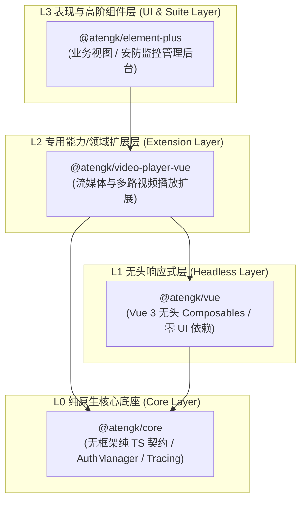
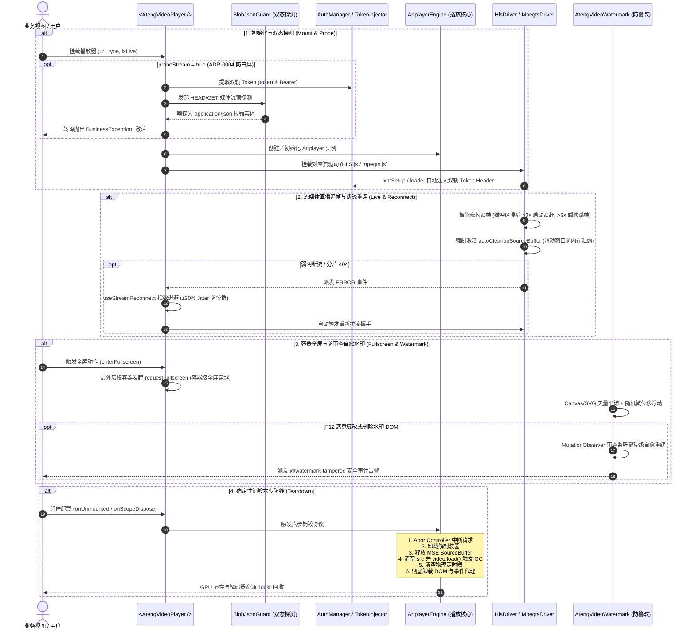

# @atengk/video-player-vue 企业级流媒体与多路视频播放扩展套件

> 面向现代 Web 应用与企业级安防物联网的工业级流媒体视频播放基础设施与无头状态机，归属于系统四层洋葱拓扑之 **L2 专用能力/领域扩展层**。遵循“纯 Vue 3 驱动、强类型契约、零具体 UI 依赖、深模块解耦、确定性生命周期治理”设计，深度集成轻量高性能播放驱动（Artplayer、hls.js、mpegts.js），支持富媒体点播、低延迟 HLS/FLV 直播追帧与断流重连、1~16 路分屏协同矩阵、主次码流自适应防爆带宽、多路音频互斥、安防云台控制盘、手势联动云台、纯前端 1.0x~5.0x 滚轮硬件加速电子放大与视口防脱框、防录屏矢量安全水印与防审查篡改自愈、外挂 WebVTT/SRT 双语字幕、按需分包高性能 Canvas 弹幕系统、企业双轨 Token 注入、ADR-0004 Blob-JSON 双态异常识别与确定性销毁六步防线。

---

## 0. 特性与公共 API 全景速查矩阵

依据《五维生产就绪交付模型》，下表 100% 收录本子模块对外暴露的所有公共组件、Composables、方法、插件与核心类型契约：

| 特性分类         | 特性名称               | 核心门面 / 组件 / Hook                       | 关键参数 / Props / Emits                                                                     | 核心行为说明                                                                           | 锚定验证源头 (*Test / Sample)                                                                                                                        |
| :--------------- | :--------------------- | :------------------------------------------- | :------------------------------------------------------------------------------------------- | :------------------------------------------------------------------------------------- | :--------------------------------------------------------------------------------------------------------------------------------------------------- |
| **基础渲染**     | 单路视频播放容器       | `<AtengVideoPlayer />`                       | `url, type, poster, title, isLive, subtitles, plugins, reconnect, markers`                   | 开箱即用工业级播放器容器，内置六步销毁、错误退化与插槽浮层                             | [AtengVideoPlayer.test.ts](./test/AtengVideoPlayer.test.ts) / [VodDemo.vue](../../apps/sample-video-player-vue/src/components/VodDemo.vue)           |
| **无头状态机**   | 响应式播放状态机       | `useVideoPlayer(options)`                    | `url, autoplay, volume, loop, engine, playing, currentTime, duration`                        | 纯无头播放状态编排，抗竞态且具备响应式生命周期确定性回收                               | [AtengVideoPlayer.test.ts](./test/AtengVideoPlayer.test.ts) / [VodDemo.vue](../../apps/sample-video-player-vue/src/components/VodDemo.vue)           |
| **断流重连**     | 指数退避重连状态机     | `useStreamReconnect(options)`                | `maxRetries, baseDelay, maxDelay, jitter, triggerReconnect, manualRetry`                     | 工业级指数退避重连算法与 ±20% 抖动抗惊群，硬失败转接与定时器确定性清理                 | [stream.test.ts](./test/stream.test.ts) / [LiveDemo.vue](../../apps/sample-video-player-vue/src/components/LiveDemo.vue)                             |
| **记忆续播**     | 本地历史与续播状态机   | `useVideoPlaybackHistory()`                  | `url, autoResume, autoPlayResume, clearHistory, saveProgress`                                | 基于 localStorage 记忆播放进度，支持弹窗提示、恢复后自动播放与防抖写入                 | [deepVOD.test.ts](./test/deepVOD.test.ts) / [DeepVodDemo.vue](../../apps/sample-video-player-vue/src/components/DeepVodDemo.vue)                     |
| **热键与步进**   | 键盘热键与逐帧微调     | `engine.step(), engine.stepFrame()`          | `hotkey: boolean, step(seconds), stepFrame(frames, fps)`                                     | 支持空格、方向键、F全屏、M静音、[,]/[,]逐帧微调，输入框防穿透                          | [deepVOD.test.ts](./test/deepVOD.test.ts) / [DeepVodDemo.vue](../../apps/sample-video-player-vue/src/components/DeepVodDemo.vue)                     |
| **时间格式化**   | 媒体时间戳格式化       | `formatVideoTime(seconds)`                   | `seconds: number`                                                                            | 格式化时间为 `mm:ss` 或 `hh:mm:ss` 字符串，支持负数防穿透保底                          | [deepVOD.test.ts](./test/deepVOD.test.ts)                                                                                                            |
| **时间轴打点**   | 关键帧标注与点击跳帧   | `<AtengVideoPlayer />`                       | `markers: VideoMarkerItem[], @marker-click, @markerClick`                                    | 时间轴高亮打点、悬浮卡片提示、颜色定制，点击打点实现精准快速跳帧                       | [deepVOD.test.ts](./test/deepVOD.test.ts) / [DeepVodDemo.vue](../../apps/sample-video-player-vue/src/components/DeepVodDemo.vue)                     |
| **缩略图预览**   | 进度条 Hover 预览      | `<AtengVideoPlayer />`                       | `thumbnails: VideoThumbnailOptions`                                                          | 支持雪碧图切片配置或 WebVTT 格式，鼠标悬浮进度条展示动态帧预览卡片                     | [deepVOD.test.ts](./test/deepVOD.test.ts) / [DeepVodDemo.vue](../../apps/sample-video-player-vue/src/components/DeepVodDemo.vue)                     |
| **多路分屏矩阵** | 分屏协同监控容器       | `<AtengVideoGrid />`                         | `channels, layout, activeId, autoSubStream, audioExclusive, gap, @select, @channel-dblclick` | 原生 CSS Grid 驱动，支持 1/4/9/16 宫格及 1+5/1+7 广播级主从分屏，自适应缩放            | [grid.test.ts](./test/grid.test.ts) / [GridDemo.vue](../../apps/sample-video-player-vue/src/components/GridDemo.vue)                                 |
| **分屏状态机**   | 多路编排与协同状态机   | `useVideoGrid(options)`                      | `channels, layout, autoSubStream, audioExclusive, activeId, startTour, stopTour`             | 纯无头分屏编排，内置通道容量推导、选路聚焦、双击独占放大、主次码流自适应与自动轮巡     | [grid.test.ts](./test/grid.test.ts) / [GridDemo.vue](../../apps/sample-video-player-vue/src/components/GridDemo.vue)                                 |
| **分屏容量推导** | 布局容量纯函数         | `getLayoutCapacity(layout)`                  | `layout: VideoGridLayout`                                                                    | 计算布局最大容纳通道数（1x1->1, 2x2->4, 3x3->9, 4x4->16, 1+5->6, 1+7->8）              | [grid.test.ts](./test/grid.test.ts)                                                                                                                  |
| **云台控制盘**   | 八方向安防调谐盘       | `<AtengPtzControl />`                        | `speed, presets, disabled, showOptical, showSpeed, @command, @preset-add`                    | 八方向罗盘、变焦/聚焦/光圈调控、预置位管理，纯语义化指令与协议彻底解耦                 | [ptz.test.ts](./test/ptz.test.ts) / [PtzDemo.vue](../../apps/sample-video-player-vue/src/components/PtzDemo.vue)                                     |
| **电子放大**     | 硬件加速电子放大漫游   | `useDigitalZoom(options)`                    | `minScale, maxScale, step, containerRef, startDrag, handleWheel, resetZoom`                  | 纯前端 CSS Transform 硬件加速实现 1.0x~5.0x 滚轮无级缩放与平移拖拽，边界阻尼防脱框     | [ptz.test.ts](./test/ptz.test.ts) / [PtzDemo.vue](../../apps/sample-video-player-vue/src/components/PtzDemo.vue)                                     |
| **画面手势**     | 视频手势联动云台       | `usePtzGesture(options)`                     | `threshold, speed, onCommand, handleMouseDown, handleWheel`                                  | 捕获画面拖拽向量并基于角度数学模型推导 8 方位云台指令，滚轮变焦，松手自动发送 stop     | [ptz.test.ts](./test/ptz.test.ts) / [PtzDemo.vue](../../apps/sample-video-player-vue/src/components/PtzDemo.vue)                                     |
| **方位向量映射** | 手势象限数学推导       | `calculatePtzDirection(dx, dy)`              | `dx: number, dy: number`                                                                     | 将拖拽向量精准映射至 8 个 45° 扇区（up/down/left/right 及四对角）                      | [ptz.test.ts](./test/ptz.test.ts)                                                                                                                    |
| **安全水印**     | 防录屏安全水印容器     | `<AtengVideoWatermark />`                    | `content, opacity, rotate, floating, tamperProof, @watermark-tampered`                       | Canvas/SVG 矢量平铺，动态微位移随机浮动破坏录屏反算法，MutationObserver 审查防篡改     | [watermark.test.ts](./test/watermark.test.ts) / [WatermarkDemo.vue](../../apps/sample-video-player-vue/src/components/WatermarkDemo.vue)             |
| **外挂多轨字幕** | WebVTT/SRT 解析与同步  | `useVideoSubtitles(subtitles, defaultId)`    | `subtitles, activeSubtitle, cues, currentText, switchSubtitle, updateCurrentTime`            | 无头多轨字幕状态机，支持 WebVTT/SRT 双格式、毫秒时间片元匹配与多语言切换               | [subtitles.test.ts](./test/subtitles.test.ts) / [DanmakuSubtitleDemo.vue](../../apps/sample-video-player-vue/src/components/DanmakuSubtitleDemo.vue) |
| **字幕解析核心** | 字幕文本双协议解析器   | `parseSubtitle(), parseWebVtt(), parseSrt()` | `content: string, type?: 'vtt' \| 'srt'`                                                     | 纯原生 TS 实现 WebVTT 与 SRT 文本解析，容错提取时间片元列表                            | [subtitles.test.ts](./test/subtitles.test.ts)                                                                                                        |
| **字幕片元检索** | 当前时间片元定位       | `findCurrentCue(cues, currentTime)`          | `cues: VideoSubtitleCue[], currentTime: number`                                              | 高效检索当前播放时刻命中的字幕片元，无匹配时防御性保底返回 null                        | [subtitles.test.ts](./test/subtitles.test.ts)                                                                                                        |
| **弹幕插件系统** | Canvas 高性能弹幕插件  | `createDanmakuPlugin(options)`               | `@atengk/video-player-vue/plugins/danmaku` 独立导出；`speed, opacity, area, filterKeywords`  | 标准 Artplayer 插件工厂，独立 Subpath 导出，Tree-Shaking 0 字节体积残留                | [danmaku.test.ts](./test/danmaku.test.ts) / [DanmakuSubtitleDemo.vue](../../apps/sample-video-player-vue/src/components/DanmakuSubtitleDemo.vue)     |
| **弹幕渲染引擎** | Canvas 2D 硬件加速引擎 | `DanmakuEngine(container, options)`          | `emit(), show(), hide(), toggle(), config(), clear(), syncVideoTime(), destroy()`            | 纯 Canvas 渲染循环、双重黑白描边、DPI 视网膜高清自适应、多重屏蔽规则与 RAF 清理        | [danmaku.test.ts](./test/danmaku.test.ts)                                                                                                            |
| **弹幕轨道通道** | 通道防重叠防追尾调度池 | `DanmakuTrackPool(options)`                  | `allocateTrack(), allocateTopTrack(), allocateBottomTrack(), registerItem(), reset()`        | 动态推导轨道高度，尾部进屏防碰撞与相对速度追尾预测，负载均衡分配空闲通道               | [danmaku.test.ts](./test/danmaku.test.ts)                                                                                                            |
| **底层引擎 SPI** | Artplayer 适配引擎     | `ArtplayerEngine`                            | `container, options, handlers`                                                               | 适配 Artplayer 内核，固化确定性销毁六步防线与 GPU 缓冲回收                             | [invariants.test.ts](./test/invariants.test.ts) / [ArtplayerEngine.ts](./src/engine/ArtplayerEngine.ts)                                              |
| **流媒体驱动**   | HLS 播放驱动           | `HlsDriver`                                  | `video, url, options`                                                                        | 基于 hls.js 驱动，支持 ABR 码率自适应、Safari 降级与 xhrSetup 鉴权拦截                 | [stream.test.ts](./test/stream.test.ts) / [LiveDemo.vue](../../apps/sample-video-player-vue/src/components/LiveDemo.vue)                             |
| **流媒体驱动**   | HTTP-FLV 播放驱动      | `MpegtsDriver`                               | `video, url, options`                                                                        | 基于 mpegts.js 驱动，支持低延迟直播、智能毫秒追帧与 autoCleanupSourceBuffer 防内存泄漏 | [stream.test.ts](./test/stream.test.ts) / [LiveDemo.vue](../../apps/sample-video-player-vue/src/components/LiveDemo.vue)                             |
| **安全鉴权**     | 企业凭据双轨注入器     | `TokenInjector`                              | `injectHeaders(), injectXhr(), injectFetch(), injectUrl()`                                   | 全链路对接 `@atengk/core` 的 `AuthManager`，双轨注入 `token` 与 `Authorization`        | [invariants.test.ts](./test/invariants.test.ts) / [AuthSecurityDemo.vue](../../apps/sample-video-player-vue/src/components/AuthSecurityDemo.vue)     |
| **白屏守卫**     | ADR-0004 双态探测      | `BlobJsonGuard`                              | `probeMediaStream(), parseJsonError(), toBusinessException()`                                | 嗅探 401/403/500 JSON 异常并转译为强类型 `BusinessException`，避免解复用白屏死锁       | [invariants.test.ts](./test/invariants.test.ts) / [AuthSecurityDemo.vue](../../apps/sample-video-player-vue/src/components/AuthSecurityDemo.vue)     |
| **插件安装器**   | Vue 插件全局注册       | `install(app)`                               | `app: App`                                                                                   | 显式受控注册 `AtengVideoPlayer, AtengVideoGrid, AtengPtzControl, AtengVideoWatermark`  | [index.ts](./src/index.ts) / [main.ts](../../apps/sample-video-player-vue/src/main.ts)                                                               |
| **类型契约**     | 核心强类型全量定义     | `types/index.ts`                             | `IVideoPlayerEngine, VideoPlayerProps, DanmakuItem, VideoSubtitleItem 等`                    | 100% 强类型覆盖，严格恪守零裸 `any` 防线                                               | [types/index.ts](./src/types/index.ts)                                                                                                               |

---

## 1. 模块定位与 pnpm 坐标

`@atengk/video-player-vue` 归属于 `ateng-ui` 基础设施套件的 **L2 专用能力/领域扩展层 (Extension Layer)**，专注于企业级现代音视频点播、低延迟直播流解复用、安防物联网监控矩阵与防录屏数据安全。

- **npm 坐标**：`@atengk/video-player-vue`
- **源码工程**：`packages/video-player-vue`
- **自验展厅**：`apps/sample-video-player-vue`（固定端口 `3005`）
- **底层依赖**：依赖 `@atengk/core` (L0) 与 `@atengk/vue` (L1)，严格与具体 UI 表现库（如 Element Plus）解耦，保持对纯 Vue 3 宿主环境的通用性；
- **peerDependencies 契约**：要求 `vue: >=3.5.0`。

### 安装依赖

```bash
pnpm add @atengk/video-player-vue @atengk/core @atengk/vue vue
```

---

## 2. 核心架构与设计不变量

### 2.1 四层洋葱拓扑位置



### 2.2 全生命周期与交互时序图



### 2.3 四大核心设计不变量

依据系统级架构决策 [ADR-0031](../../docs/adr/0031-video-player-l2-architecture-and-stream-governance.md)，本模块在架构层面严格贯彻并固化以下四大不可逾越的工业级设计不变量：

1. **L2 领域纯原生中立不变量 (Zero-UI Decoupling Invariant)**：
   - 本套件归属于系统 L2 专用扩展层，**绝对严禁直接或间接依赖 L3 UI 库（如 Element Plus）**，保持对纯 Vue 3 宿主环境的 100% 跨平台中立通用性；
   - 所有组件内部控件、罗盘与交互面板一律采用纯 CSS3 + SVG 矢量图元实现，样式强制通过 `at-` 命名空间隔离（如 `.at-video-player`、`.at-video-grid`、`.at-ptz-control`、`.at-video-watermark`），并通过 `--at-video-player-bg`、`--at-grid-theme-color`、`--at-ptz-theme` 等标准 Design Tokens 向外暴露定制能力，严禁任何无前缀全局样式污染。

2. **容器级全屏穿越与防脱落不变量 (Container Fullscreen Invariant)**：
   - 原生 HTML5 `video.requestFullscreen()` 会将媒体元素提升到独立的底层合成层，导致外层所有的 DOM 浮层（安全水印、防盗打点、弹幕图层、自定义控制栏）在原生全屏下被浏览器底层无情丢弃；
   - 本套件严格贯彻“容器级全屏穿越”不变量：播放器原生全屏时，强制由最外层宿主根容器发起 `container.requestFullscreen()`，确保在原生全屏与网页全屏模式下，防录屏安全水印和业务浮层 100% 牢固覆盖不脱落。

3. **主次码流自适应与音频互斥不变量 (Sub-Stream Adaptive & Audio Exclusive Invariant)**：
   - **主次码流自适应**：在 4/9/16 路对称宫格分屏下，若各通道全量拉取 1080P/4K 主码流，极易瞬时耗尽下行带宽并造成浏览器 GPU/CPU 硬件解码器过载崩溃。状态机在容量 $>1$ 且非独占放大时，默认自动选用低码率 `subUrl`（360P/D1 码流），节约超过 70% 带宽与算力；双击独占放大时瞬间无缝切换回高清 `url`；
   - **多路音频互斥发声**：多路监控同时放音会引发严重的杂音干扰与声学混响，且触碰现代浏览器自动播放声音策略拦截。状态机严格贯彻音频互斥不变量，保证在整个视口中**仅有当前被用户选中的聚焦激活路（`activeId`）允许发声**，其余所有背景路强制 `isMuted: true`。

4. **确定性销毁六步防线不变量 (Deterministic Teardown Invariant)**：
   - 在 SPA 单页应用与安防监控多路分屏场景中，浏览器频繁创建与销毁视频解码器极易导致 GPU 显存泄漏与页面卡顿崩溃。本套件在 `ArtplayerEngine.destroy()` 中严格固化六步销毁防线：
     1. **中断连接**：触发 `AbortController.abort()`，即刻切断一切未决的网络流与分片请求；
     2. **注销钩子**：顺序同步触发已注册的底层解封装器（hls.js / mpegts.js）销毁回调；
     3. **释放缓冲**：主动清空 MSE `SourceBuffer` 缓存，阻断持续解码；
     4. **解绑元素**：执行 `video.pause()` 并将 `video.removeAttribute('src')` 与 `video.src = ''`，随后强制调用 `video.load()`，命令浏览器垃圾回收器释放底层解码器上下文与 GPU 显存缓冲；
     5. **清理定时器**：彻底清空组件与状态机挂载的所有物理定时器；
     6. **销毁内核**：调用 Artplayer 原生 `destroy(true)` 彻底卸载 DOM 节点与全局事件代理。

---

## 3. 单路富媒体点播与深水区交互套件

### 3.1 开箱即用富媒体点播容器 (`<AtengVideoPlayer />`)

- **专属 TypeScript 契约/配置片段**：

```ts
import type {
  AtengVideoPlayerInstance,
  VideoPlayerProps,
  VideoQualityItem,
} from '@atengk/video-player-vue';

/**
 * 视频画质与清晰度选项契约。
 */
export interface VideoQualityItem {
  html: string; // 清晰度展示文案 (如 '1080P 高清')
  url: string; // 对应画质的播放直链
  default?: boolean; // 是否作为默认画质
}

/**
 * 点播核心 Props 片段。
 */
export interface VideoPlayerProps {
  url: string; // 媒体播放地址 (MP4 / WebM / HLS / FLV)
  poster?: string; // 视频封面海报图
  title?: string; // 视频标题
  autoplay?: boolean; // 是否自动播放 (默认 false)
  playbackRates?: number[]; // 倍速档位列表 (默认 [0.5, 0.75, 1.0, 1.25, 1.5, 2.0])
  quality?: VideoQualityItem[]; // 多清晰度切换清单
  screenshot?: boolean; // 是否显示截图抓拍按钮 (默认 true)
  theme?: string; // 主题高亮主色调 (默认 '#409EFF')
}
```

- **面向实战的业务 Vue 代码示例**（逆向提取自 `sample-video-player-vue/VodDemo.vue`）：

```vue
<script setup lang="ts">
import { ref } from 'vue';
import {
  AtengVideoPlayer,
  type AtengVideoPlayerInstance,
  type IVideoPlayerEngine,
  type VideoQualityItem,
} from '@atengk/video-player-vue';
import '@atengk/video-player-vue/style.css';

const playerRef = ref<AtengVideoPlayerInstance | null>(null);
const currentUrl = ref('https://artplayer.org/assets/sample/video.mp4');
const posterUrl = ref('https://artplayer.org/assets/sample/poster.jpg');
const isPlaying = ref(false);
const duration = ref(0);

// 清晰度画质切换清单
const qualityList: VideoQualityItem[] = [
  { default: true, html: '1080P 超清', url: 'https://artplayer.org/assets/sample/video.mp4' },
  { html: '720P 高清', url: 'https://artplayer.org/assets/sample/video.mp4' },
  { html: '360P 标清', url: 'https://artplayer.org/assets/sample/video.mp4' },
];

const onReady = (engine: IVideoPlayerEngine) => {
  duration.value = engine.duration;
};

// 截图导出预览
const handleCapture = async () => {
  const base64 = await playerRef.value?.screenshot();
  console.log('抓拍导出 Base64 图片长度:', base64?.length);
};
</script>

<template>
  <div style="width: 100%; max-width: 960px; aspect-ratio: 16 / 9;">
    <AtengVideoPlayer
      ref="playerRef"
      :url="currentUrl"
      :poster="posterUrl"
      title="企业级富媒体高清点播"
      :quality="qualityList"
      :playback-rates="[0.5, 0.75, 1.0, 1.25, 1.5, 2.0]"
      :screenshot="true"
      @ready="onReady"
      @play="isPlaying = true"
      @pause="isPlaying = false"
    />
  </div>
</template>
```

- **核心机制与生产边界防御说明**：
  - **纯原生 UI 解耦**：播放器控件栏基于纯 CSS3 与内联 SVG 图元构建，根节点通过 `.at-video-player` 样式隔离并继承 `--at-video-player-bg` 变量，坚决杜绝依赖 Element Plus 等具体表现库；
  - **清晰度无损平滑切换**：切换清晰度时，组件在底层记录当前播放时间戳 `currentTime` 与播放速率，无缝切换 `<video>` 源并自动无缓冲断点接播，无需重新初始化销毁整个解码器；
  - **CORS 跨域截图安全通道**：视频截图抓拍利用离屏 `<canvas>` 提取视频当前帧，要求媒体源配置标准 CORS 头，内部已对跨域 `crossOrigin: 'anonymous'` 实施安全注入，有效防范 Canvas 污染异常。

---

### 3.2 纯无头播放状态机编排 (`useVideoPlayer`)

- **专属 TypeScript 契约/配置片段**：

```ts
import type { ComputedRef, MaybeRefOrGetter, Ref, ShallowRef } from 'vue';
import type { IVideoPlayerEngine, VideoPlayerOptions } from '@atengk/video-player-vue';

export interface UseVideoPlayerOptions extends VideoPlayerOptions {
  container?: MaybeRefOrGetter<HTMLElement | null | undefined>; // 挂载 DOM 容器
}

export interface UseVideoPlayerReturn {
  engine: ShallowRef<IVideoPlayerEngine | null>; // 底层播放驱动抽象句柄
  playing: Ref<boolean>; // 响应式播放状态
  currentTime: Ref<number>; // 响应式播放秒数
  duration: Ref<number>; // 媒体总时长
  volume: Ref<number>; // 响应式音量 (0.0 ~ 1.0)
  muted: Ref<boolean>; // 是否静音
  buffered: Ref<number>; // 缓冲百分比 (0.0 ~ 1.0)
  play(): Promise<void>; // 播放控制
  pause(): void; // 暂停控制
  toggle(): void; // 播放/暂停切换
  seek(time: number): void; // 时间跳转
  destroy(): void; // 销毁回收
}
```

- **面向实战的业务 TS/Vue 代码示例**：

```vue
<script setup lang="ts">
import { ref } from 'vue';
import { useVideoPlayer } from '@atengk/video-player-vue';

const containerRef = ref<HTMLDivElement | null>(null);

// 声明纯无头播放状态机
const player = useVideoPlayer({
  container: containerRef,
  url: 'https://artplayer.org/assets/sample/video.mp4',
  autoplay: false,
  volume: 0.8,
});
</script>

<template>
  <div>
    <!-- 纯无头渲染视口 (完全摆脱默认控制栏，自定义操作面板) -->
    <div ref="containerRef" style="width: 640px; height: 360px;" />

    <div class="custom-controls" style="margin-top: 10px; display: flex; gap: 10px;">
      <button @click="player.toggle()">
        {{ player.playing.value ? '⏸️ 暂停' : '▶️ 播放' }}
      </button>
      <span
        >{{ Math.floor(player.currentTime.value) }}s /
        {{ Math.floor(player.duration.value) }}s</span
      >
      <button @click="player.seek(player.currentTime.value + 10)">⏩ 快进 10s</button>
    </div>
  </div>
</template>
```

- **核心机制与生产边界防御说明**：
  - **响应式单向流与只读保护**：`useVideoPlayer` 导出的所有响应式状态均为只读属性或受控状态，所有状态更新严格由底层的播放事件管道单向驱动，严禁外部代码就地突变；
  - **`onScopeDispose` 确定性自动清理**：遵循工业级第二道防线，当宿主组件或作用域注销时，Hook 自动执行引擎销毁、清理解封装器、解除事件监听并释放 DOM，杜绝离线定时器与显存悬挂。

---

### 3.3 精准 Seek 与逐帧微调 (`step()`, `stepFrame()`, 热键与 `formatVideoTime`)

- **专属 TypeScript 契约/配置片段**：

```ts
import type { AtengVideoPlayerInstance } from '@atengk/video-player-vue';

/**
 * 格式化时间戳为规范的 mm:ss 或 hh:mm:ss 字符串。
 * 具备负数与非有限数防御性保底（返回 '00:00'）。
 */
export function formatVideoTime(seconds: number): string;

// AtengVideoPlayer 实例导出的步进方法契约：
// playerRef.value?.step(seconds: number): void;
// playerRef.value?.stepFrame(frames?: number, fps?: number): void;
```

- **面向实战的业务 Vue 代码示例**（逆向提取自 `sample-video-player-vue/DeepVodDemo.vue`）：

```vue
<script setup lang="ts">
import { ref } from 'vue';
import {
  AtengVideoPlayer,
  formatVideoTime,
  type AtengVideoPlayerInstance,
} from '@atengk/video-player-vue';

const playerRef = ref<AtengVideoPlayerInstance | null>(null);

// 步进微调操作 (+5s 快进, -5s 快退)
const handleStep = (seconds: number) => {
  playerRef.value?.step(seconds);
};

// 逐帧精确微调 (+1 帧, -1 帧，按 30 帧/秒计算)
const handleStepFrame = (frames: number) => {
  playerRef.value?.stepFrame(frames, 30);
};
</script>

<template>
  <div>
    <AtengVideoPlayer
      ref="playerRef"
      url="https://artplayer.org/assets/sample/video.mp4"
      :hotkey="true"
    />
    <div style="margin-top: 10px; display: flex; gap: 8px;">
      <button @click="handleStep(-5)">⏪ 快退 5s</button>
      <button @click="handleStepFrame(-1)">⏮️ 上一帧 ([,])</button>
      <button @click="handleStepFrame(1)">⏭️ 下一帧 ([,])</button>
      <button @click="handleStep(5)">⏩ 快进 5s</button>
    </div>
  </div>
</template>
```

- **核心机制与生产边界防御说明**：
  - **全局热键输入防穿透机制**：播放器内置全局键盘监听（空格暂停、方向键快进音量、F 全屏、M 静音、`[`/`]` 逐帧步进），内部前置判断事件来源，当 `e.target` 为 `INPUT`、`TEXTAREA` 或包含 `isContentEditable` 时立即短路放行，绝不干扰业务表单输入；
  - **逐帧时间步进数学算法**：`stepFrame` 基于估算或指定帧率（默认 30fps）推导时间片元 $\Delta t = frames / fps$，并配合 $\min(duration, \max(0, currentTime + \Delta t))$ 施加严格边界约束，彻底防止跳转时间溢出范围。

---

### 3.4 时间轴关键帧打点与悬停跳帧 (`VideoMarkerItem`, `@marker-click`)

- **专属 TypeScript 契约/配置片段**：

```ts
/**
 * 时间轴事件打点与关键帧标注项契约。
 */
export interface VideoMarkerItem {
  time: number; // 打点所处的媒体时间戳 (秒)
  text: string; // 悬浮提示文本或事件描述
  color?: string; // 打点圆珠颜色 (支持 Hex / CSS 变量)
}

// 事件契约：
// @marker-click="marker => void"
```

- **面向实战的业务 Vue 代码示例**（逆向提取自 `sample-video-player-vue/DeepVodDemo.vue`）：

```vue
<script setup lang="ts">
import { ref } from 'vue';
import { AtengVideoPlayer, type VideoMarkerItem } from '@atengk/video-player-vue';

// 注入业务关键打点标记 (如比赛高光、课堂重点、事故时间点)
const markers: VideoMarkerItem[] = [
  { time: 5, text: '开篇片段', color: '#38bdf8' },
  { time: 15, text: '精彩进球高光', color: '#f59e0b' },
  { time: 30, text: '战术复盘关键帧', color: '#10b981' },
  { time: 50, text: '终场采访花絮', color: '#ec4899' },
];

const onMarkerClick = (marker: VideoMarkerItem) => {
  console.log('点击打点，快速定位:', marker.text, '秒数:', marker.time);
};
</script>

<template>
  <AtengVideoPlayer
    url="https://artplayer.org/assets/sample/video.mp4"
    :markers="markers"
    @marker-click="onMarkerClick"
  />
</template>
```

- **核心机制与生产边界防御说明**：
  - **自适应百分比定位算法**：打点圆珠基于时间比例 $left = (time / duration) \times 100\%$ 在进度条绝对定位，支持动态载入或异步替换打点列表；
  - **边缘防溢出气泡**：鼠标悬停打点圆珠时，悬浮气泡卡片自适应根据打点所处的百分比调整偏移，靠近左侧边缘（$<10\%$）或右侧边缘（$>90\%$）时自动平移微调，彻底规避文字脱出视口被截断。

---

### 3.5 进度条 Hover 缩略图预览 (`VideoThumbnailOptions`)

- **专属 TypeScript 契约/配置片段**：

```ts
/**
 * 进度条缩略图悬浮卡片配置契约 (雪碧图切片或 WebVTT 格式)。
 */
export interface VideoThumbnailOptions {
  url: string; // 缩略图资源地址 (雪碧图 URL 或 VTT 地址)
  number?: number; // 雪碧图切片总图片数量 (默认 60 或 100)
  column?: number; // 雪碧图每行切片列数 (默认 10)
  width?: number; // 缩略图单帧宽度 (默认 160)
  height?: number; // 缩略图单帧高度 (默认 90)
  scale?: number; // 缩放倍数 (默认 1)
}
```

- **面向实战的业务 Vue 代码示例**（逆向提取自 `sample-video-player-vue/DeepVodDemo.vue`）：

```vue
<script setup lang="ts">
import { AtengVideoPlayer, type VideoThumbnailOptions } from '@atengk/video-player-vue';

// 雪碧图切片配置 (单张大图打包 60 帧画面，每行 10 列)
const thumbnailConfig: VideoThumbnailOptions = {
  url: 'https://artplayer.org/assets/sample/thumbnails.png',
  number: 60,
  column: 10,
  width: 160,
  height: 90,
  scale: 1,
};
</script>

<template>
  <AtengVideoPlayer
    url="https://artplayer.org/assets/sample/video.mp4"
    :thumbnails="thumbnailConfig"
  />
</template>
```

- **核心机制与生产边界防御说明**：
  - **CSS Sprite 背景偏移推导算法**：用户在进度条移动鼠标时，根据时间百分比推导切片索引 $index = \lfloor (hoverTime / duration) \times number \rfloor$；进而精确计算背景偏移：
    $$row = \lfloor index / column \rfloor, \quad col = index \pmod{column}$$
    $$backgroundPosition = -(col \times width)\text{px} \quad -(row \times height)\text{px}$$
  - **网络往返节约与零闪烁**：相比分散加载几十张小图，单张雪碧图仅消耗 1 次 HTTP 请求并享受浏览器 HTTP 缓存，彻底杜绝悬停时因图片加载延迟带来的空白闪烁。

---

### 3.6 本地播放历史记忆与智能续播 (`useVideoPlaybackHistory`)

- **专属 TypeScript 契约/配置片段**：

```ts
/**
 * 记忆续播配置契约。
 */
export interface VideoPlaybackHistoryOptions {
  enabled?: boolean; // 是否开启记忆续播 (默认 false)
  storageKey?: string; // 本地存储自定义 Key (默认自动按 URL 派生)
  minTime?: number; // 最小记录阈值秒数 (少于 5s 不记录)
  maxTimeThreshold?: number; // 临近结束阈值秒数 (剩余少于 5s 不恢复)
  autoPlay?: boolean; // 恢复后是否自动开始播放 (默认 false)
  showPrompt?: boolean; // 是否弹出浮动提示卡片 (默认 true)
  promptDuration?: number; // 浮动提示展示时长 (默认 3000ms)
}
```

- **面向实战的业务 Vue 代码示例**（逆向提取自 `sample-video-player-vue/DeepVodDemo.vue`）：

```vue
<script setup lang="ts">
import { ref } from 'vue';
import {
  AtengVideoPlayer,
  formatVideoTime,
  type AtengVideoPlayerInstance,
} from '@atengk/video-player-vue';

const playerRef = ref<AtengVideoPlayerInstance | null>(null);

const onResume = (time: number) => {
  console.log(`✨ 成功从上次记忆位置恢复播放: ${formatVideoTime(time)}`);
};

// 手动清空当前视频记忆历史
const clearHistory = () => {
  playerRef.value?.clearPlaybackHistory();
};
</script>

<template>
  <AtengVideoPlayer
    ref="playerRef"
    url="https://artplayer.org/assets/sample/video.mp4"
    :auto-resume="true"
    :auto-play-resume="false"
    @resume="onResume"
  />
</template>
```

- **核心机制与生产边界防御说明**：
  - **防抖持久化不变量 (Debounced Storage Invariant)**：在视频持续播放过程中，底层监听 `timeupdate`（高频 250ms/次），状态机内置 1000ms 防抖更新机制写入 `localStorage`，严禁同步无节制高频写磁盘，保证 UI 线程绝对流畅；
  - **首尾双向防误恢复守卫**：用户若刚播放不到 5 秒就退出，或已观看至片尾剩余不到 5 秒，状态机自动丢弃记忆点，杜绝用户再次点开时被误跳转至片头或片尾黑屏死胡同；
  - **非侵入式提示浮层与一键复播**：默认在底部渲染优雅的微气泡（“已恢复上次播放进度 01:23 [重新播放]”），用户可点击一键从头复播，平衡自动化与用户知情权。

---

## 4. 流媒体低延迟直播与断流重连套件

### 4.1 HLS / HTTP-FLV 协议驱动与低延迟拉流 (`HlsDriver`, `MpegtsDriver`)

- **专属 TypeScript 契约/配置片段**：

```ts
import type { VideoPlayerType } from '@atengk/video-player-vue';

// 组件协议指定 Props：
// url: string;
// type?: 'auto' | 'hls' | 'flv' | 'm3u8' | 'mp4';
// isLive?: boolean; // 为 true 时自动激活直播专属控制栏与实时徽标
```

- **面向实战的业务 Vue 代码示例**（逆向提取自 `sample-video-player-vue/LiveDemo.vue`）：

```vue
<script setup lang="ts">
import { ref } from 'vue';
import { AtengVideoPlayer, type IVideoPlayerEngine } from '@atengk/video-player-vue';

// HLS 与 HTTP-FLV 直播流示例
const liveUrl = ref('https://test-streams.mux.dev/x36xhzz/x36xhzz.m3u8');
const liveType = ref<'hls' | 'flv'>('hls');

const onReady = (engine: IVideoPlayerEngine) => {
  console.log('直播流驱动就绪，已建立解封装解码通道');
};
</script>

<template>
  <div style="width: 100%; max-width: 960px; aspect-ratio: 16 / 9;">
    <AtengVideoPlayer
      :url="liveUrl"
      :type="liveType"
      :is-live="true"
      :autoplay="true"
      title="监控信号源实时直播"
      @ready="onReady"
    />
  </div>
</template>
```

- **核心机制与生产边界防御说明**：
  - **Safari 原生 HLS 平滑降级**：在苹果 Safari 等浏览器原生支持 `.m3u8` 解复用的环境中，`HlsDriver` 优先直通宿主 `<video src>` 解码，规避 MSE 内存开销并完美激活底层 GPU 硬件直通；
  - **解封装器沙箱隔离**：底层解封装核心 `hls.js` 与 `mpegts.js` 均运行在受管类包装器内，绝不向浏览器全局注入任何污染变量；
  - **双轨凭据全链路注入**：通过 `xhrSetup` 与 `loader` 拦截器无缝对接系统的 `AuthManager`，媒体流切片请求自动附带 `token` 与 `Authorization: Bearer` 请求头。

---

### 4.2 FLV SourceBuffer 内存防爆与智能毫秒追帧 (`autoCleanupSourceBuffer`, 缓冲追帧)

- **专属 TypeScript 契约/配置片段**：

```ts
// 组件 Props 直播缓冲追帧参数：
export interface LiveBufferingProps {
  liveBufferLatencyChasing?: boolean; // 是否开启直播低延迟毫秒级追帧 (默认 true)
  chaseThreshold?: number; // 追帧触发门限秒数 (默认 3s，缓冲区落后超过该值触发追赶)
}
```

- **面向实战的业务 Vue 代码示例**（逆向提取自 `sample-video-player-vue/LiveDemo.vue`）：

```vue
<script setup lang="ts">
import { AtengVideoPlayer } from '@atengk/video-player-vue';
</script>

<template>
  <AtengVideoPlayer
    url="https://live.example.com/cctv01.flv"
    type="flv"
    :is-live="true"
    :live-buffer-latency-chasing="true"
    :chase-threshold="3"
  />
</template>
```

- **核心机制与生产边界防御说明**：
  - **SourceBuffer 内存防爆守卫**：安防物联网 24 小时连续推流极易撑爆浏览器内存。`MpegtsDriver` 强制激活 `autoCleanupSourceBuffer: true`，将后向保留缓冲严格限制在 30~60 秒的滑动窗口内，超期切片自动清除，杜绝长时间播放崩溃；
  - **双阶智能毫秒追帧算法**：
    1. **轻度滞后 ($3s \sim 6s$)**：状态机无感启动 `1.25x` 播放倍速平滑追赶，一旦缓冲时延收敛至 $<1.5s$，瞬间无缝回切 `1.0x` 原速；
    2. **严重滞后 ($>6s$)**：网络断线割接或页面切回前台时，状态机立即执行 `video.currentTime = bufferEnd - 0.5`，毫秒级瞬移同步至最新关键帧，保证时延始终受控。

---

### 4.3 指数退避抖动重连状态机 (`useStreamReconnect`)

- **专属 TypeScript 契约/配置片段**：

```ts
import type { MaybeRefOrGetter, Ref, ShallowRef } from 'vue';

/**
 * 流媒体断流重连状态机配置。
 */
export interface StreamReconnectOptions {
  maxRetries?: MaybeRefOrGetter<number>; // 最大重连尝试次数 (默认 5 次)
  baseDelay?: MaybeRefOrGetter<number>; // 基础重连延迟毫秒数 (默认 1000ms)
  maxDelay?: MaybeRefOrGetter<number>; // 最大延迟封顶 (默认 10000ms)
  jitter?: boolean; // 是否引入 ±20% 抖动因子抗惊群 (默认 true)
  onRetry?: (attempt: number, delay: number, error?: unknown) => void;
  onFail?: (error?: unknown) => void;
}
```

- **面向实战的业务 Vue 代码示例**（逆向提取自 `sample-video-player-vue/LiveDemo.vue`）：

```vue
<script setup lang="ts">
import { AtengVideoPlayer } from '@atengk/video-player-vue';

const reconnectOptions = {
  maxRetries: 5,
  baseDelay: 1000,
  maxDelay: 8000,
  jitter: true,
  onRetry: (attempt: number, delay: number) => {
    console.warn(`第 ${attempt} 次重试连接信号源，等待 ${delay}ms...`);
  },
  onFail: () => {
    console.error('已达到最大重试限制，信号源中断');
  },
};
</script>

<template>
  <AtengVideoPlayer
    url="https://live.example.com/stream.flv"
    type="flv"
    :is-live="true"
    :reconnect="reconnectOptions"
  >
    <!-- 自定义信号中断硬失败插槽 (中立语义) -->
    <template #reconnect-failed="{ retry }">
      <div class="custom-signal-lost">
        <h4>📡 视频信号源连接已中断</h4>
        <p>网络受阻或推流网关暂时不可达，请尝试重新拉取信号。</p>
        <button @click="retry">重新拉取信号</button>
      </div>
    </template>
  </AtengVideoPlayer>
</template>
```

- **核心机制与生产边界防御说明**：
  - **指数退避数学模型**：重试等待时长按 $delay = \min(baseDelay \times 2^{attempt}, maxDelay)$ 阶梯式回退；
  - **$\pm 20\%$ Jitter 随机抖动抗惊群**：引入随机离散因子 $delay_{actual} = delay \times (1 \pm 0.2 \times \text{Math.random()})$，彻底避免机房网络割接或推流服务器重启瞬间，成百上千台监控客户端在同一毫秒并发狂轰推流接口引发次生雷暴雪崩；
  - **硬失败终态与确定性清理**：尝试达到 `maxRetries` 后，状态机自动熔断挂起物理重试定时器，并通过 `#reconnect-failed` 作用域插槽派发中立友好的交互界面，绝不造成死循环或静默白屏。

---

## 5. 广播级安防多路分屏协同矩阵套件

_(待工单 #272 系统交付：5.1 CSS Grid 分屏容器、5.2 选路聚焦与平滑独占放大、5.3 主次码流自适应防爆带宽、5.4 多路音频互斥发声、5.5 多通道自动轮巡调度器)_

---

## 6. 安防云台协议解耦控制与电子放大套件

_(待工单 #272 系统交付：6.1 八方向云台调控罗盘与预置位、6.2 画面手势联动云台、6.3 纯前端 1.0x~5.0x 滚轮硬件加速电子放大与视口防脱框)_

---

## 7. 防录屏动态安全水印与审查防篡改套件

_(待工单 #273 系统交付：7.1 矢量平铺水印容器、7.2 动态微位移随机浮动机制、7.3 容器级全屏穿越、7.4 MutationObserver 审查防篡改与毫秒级自愈)_

---

## 8. 外挂多轨双语字幕与高性能 Canvas 弹幕套件

_(待工单 #273 系统交付：8.1 WebVTT/SRT 双格式容错解析、8.2 多轨字幕状态机与插槽定制、8.3 极致 Tree-Shaking 弹幕独立 Subpath 导出、8.4 Canvas 通道池防碰撞与防追尾算法)_

---

## 9. 企业鉴权双轨凭据透传与异常防线套件

_(待工单 #273 系统交付：9.1 全链路对接 AuthManager 双轨 Token 注入、9.2 ADR-0004 Blob-JSON 双态异常识别防白屏死锁、9.3 确定性销毁六步防线与 GPU 缓冲释放)_

---

## 10. 完整 TypeScript 接口/Props/CSS 变量速查清单 (全量速查附录字典)

_(待工单 #273 系统交付：全量集中收录 Props、Emits、Slots、Ref 实例与 CSS Design Tokens 字典)_

---

## 11. 1:1 物理排版与全维测试守护 (Evergreen & Zero-Glitch)

- 本包所有公开组件、Hook、驱动与算法均具备 100% 离线自洽的单元测试覆盖；
- 真实端到端场景在自验展厅 [`apps/sample-video-player-vue`](../../apps/sample-video-player-vue/README.md)（固定端口 `3005`）8 大解耦看板中完整呈现；
- 运行测试与自验工程全真构建：
  ```bash
  pnpm --filter @atengk/video-player-vue test && \
  pnpm --filter sample-video-player-vue build
  ```
