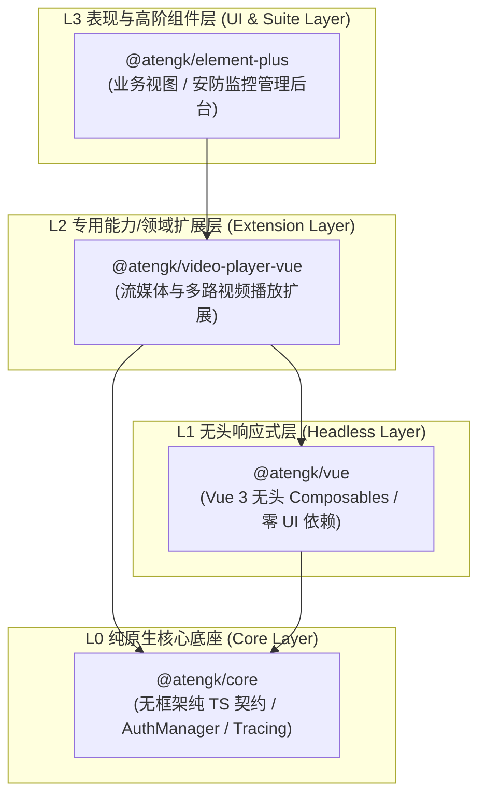
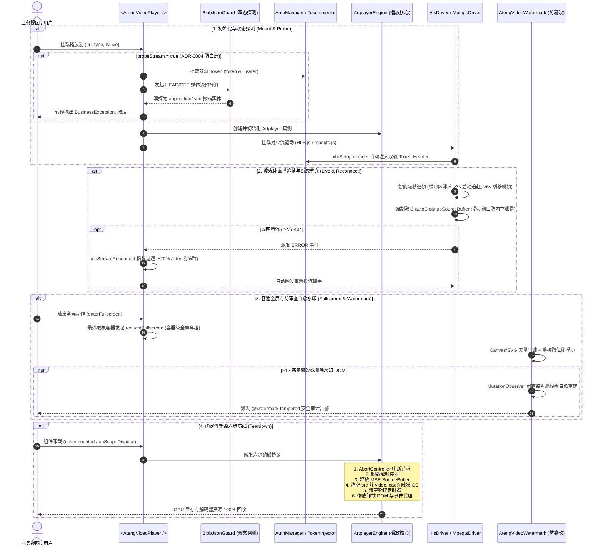

# @atengk/video-player-vue 企业级流媒体与多路视频播放扩展套件

> 面向现代 Web 应用与企业级安防物联网的工业级流媒体视频播放基础设施与无头状态机，归属于系统四层洋葱拓扑之 **L2 专用能力/领域扩展层**。遵循“纯 Vue 3 驱动、强类型契约、零具体 UI 依赖、深模块解耦、确定性生命周期治理”设计，深度集成轻量高性能播放驱动（Artplayer、hls.js、mpegts.js），支持富媒体点播、低延迟 HLS/FLV 直播追帧与断流重连、1~16 路分屏协同矩阵、主次码流自适应防爆带宽、多路音频互斥、安防云台控制盘、手势联动云台、纯前端 1.0x~5.0x 滚轮硬件加速电子放大与视口防脱框、防录屏矢量安全水印与防审查篡改自愈、外挂 WebVTT/SRT 双语字幕、按需分包高性能 Canvas 弹幕系统、企业双轨 Token 注入、ADR-0004 Blob-JSON 双态异常识别与确定性销毁六步防线。

---

## 0. 特性与公共 API 全景速查矩阵

依据《五维生产就绪交付模型》，下表 100% 收录本子模块对外暴露的所有公共组件、Composables、方法、插件与核心类型契约：

| 特性分类         | 特性名称               | 核心门面 / 组件 / Hook                       | 关键参数 / Props / Emits                                                                     | 核心行为说明                                                                           | 锚定验证源头 (*Test / Sample)                                                                                                                        |
| :--------------- | :--------------------- | :------------------------------------------- | :------------------------------------------------------------------------------------------- | :------------------------------------------------------------------------------------- | :--------------------------------------------------------------------------------------------------------------------------------------------------- |
| **基础渲染**     | 单路视频播放容器       | `<AtengVideoPlayer />`                       | `url, type, poster, title, isLive, subtitles, plugins, reconnect, markers`                   | 开箱即用工业级播放器容器，内置六步销毁、错误退化与插槽浮层                             | [AtengVideoPlayer.test.ts](./test/AtengVideoPlayer.test.ts) / [VodDemo.vue](../../apps/sample-video-player-vue/src/components/VodDemo.vue)           |
| **无头状态机**   | 响应式播放状态机       | `useVideoPlayer(options)`                    | `url, autoplay, volume, loop, engine, playing, currentTime, duration`                        | 纯无头播放状态编排，抗竞态且具备响应式生命周期确定性回收                               | [AtengVideoPlayer.test.ts](./test/AtengVideoPlayer.test.ts) / [VodDemo.vue](../../apps/sample-video-player-vue/src/components/VodDemo.vue)           |
| **断流重连**     | 指数退避重连状态机     | `useStreamReconnect(options)`                | `maxRetries, baseDelay, maxDelay, jitter, triggerReconnect, manualRetry`                     | 工业级指数退避重连算法与 ±20% 抖动抗惊群，硬失败转接与定时器确定性清理                 | [stream.test.ts](./test/stream.test.ts) / [LiveDemo.vue](../../apps/sample-video-player-vue/src/components/LiveDemo.vue)                             |
| **记忆续播**     | 本地历史与续播状态机   | `useVideoPlaybackHistory()`                  | `url, autoResume, autoPlayResume, clearHistory, saveProgress`                                | 基于 localStorage 记忆播放进度，支持弹窗提示、恢复后自动播放与防抖写入                 | [deepVOD.test.ts](./test/deepVOD.test.ts) / [DeepVodDemo.vue](../../apps/sample-video-player-vue/src/components/DeepVodDemo.vue)                     |
| **热键与步进**   | 键盘热键与逐帧微调     | `engine.step(), engine.stepFrame()`          | `hotkey: boolean, step(seconds), stepFrame(frames, fps)`                                     | 支持空格、方向键、F全屏、M静音、[,]/[,]逐帧微调，输入框防穿透                          | [deepVOD.test.ts](./test/deepVOD.test.ts) / [DeepVodDemo.vue](../../apps/sample-video-player-vue/src/components/DeepVodDemo.vue)                     |
| **时间格式化**   | 媒体时间戳格式化       | `formatVideoTime(seconds)`                   | `seconds: number`                                                                            | 格式化时间为 `mm:ss` 或 `hh:mm:ss` 字符串，支持负数防穿透保底                          | [deepVOD.test.ts](./test/deepVOD.test.ts)                                                                                                            |
| **时间轴打点**   | 关键帧标注与点击跳帧   | `<AtengVideoPlayer />`                       | `markers: VideoMarkerItem[], @marker-click, @markerClick`                                    | 时间轴高亮打点、悬浮卡片提示、颜色定制，点击打点实现精准快速跳帧                       | [deepVOD.test.ts](./test/deepVOD.test.ts) / [DeepVodDemo.vue](../../apps/sample-video-player-vue/src/components/DeepVodDemo.vue)                     |
| **缩略图预览**   | 进度条 Hover 预览      | `<AtengVideoPlayer />`                       | `thumbnails: VideoThumbnailOptions`                                                          | 支持雪碧图切片配置或 WebVTT 格式，鼠标悬浮进度条展示动态帧预览卡片                     | [deepVOD.test.ts](./test/deepVOD.test.ts) / [DeepVodDemo.vue](../../apps/sample-video-player-vue/src/components/DeepVodDemo.vue)                     |
| **多路分屏矩阵** | 分屏协同监控容器       | `<AtengVideoGrid />`                         | `channels, layout, activeId, autoSubStream, audioExclusive, gap, @select, @channel-dblclick` | 原生 CSS Grid 驱动，支持 1/4/9/16 宫格及 1+5/1+7 广播级主从分屏，自适应缩放            | [grid.test.ts](./test/grid.test.ts) / [GridDemo.vue](../../apps/sample-video-player-vue/src/components/GridDemo.vue)                                 |
| **分屏状态机**   | 多路编排与协同状态机   | `useVideoGrid(options)`                      | `channels, layout, autoSubStream, audioExclusive, activeId, startTour, stopTour`             | 纯无头分屏编排，内置通道容量推导、选路聚焦、双击独占放大、主次码流自适应与自动轮巡     | [grid.test.ts](./test/grid.test.ts) / [GridDemo.vue](../../apps/sample-video-player-vue/src/components/GridDemo.vue)                                 |
| **分屏容量推导** | 布局容量纯函数         | `getLayoutCapacity(layout)`                  | `layout: VideoGridLayout`                                                                    | 计算布局最大容纳通道数（1x1->1, 2x2->4, 3x3->9, 4x4->16, 1+5->6, 1+7->8）              | [grid.test.ts](./test/grid.test.ts)                                                                                                                  |
| **云台控制盘**   | 八方向安防调谐盘       | `<AtengPtzControl />`                        | `speed, presets, disabled, showOptical, showSpeed, @command, @preset-add`                    | 八方向罗盘、变焦/聚焦/光圈调控、预置位管理，纯语义化指令与协议彻底解耦                 | [ptz.test.ts](./test/ptz.test.ts) / [PtzDemo.vue](../../apps/sample-video-player-vue/src/components/PtzDemo.vue)                                     |
| **电子放大**     | 硬件加速电子放大漫游   | `useDigitalZoom(options)`                    | `minScale, maxScale, step, containerRef, startDrag, handleWheel, resetZoom`                  | 纯前端 CSS Transform 硬件加速实现 1.0x~5.0x 滚轮无级缩放与平移拖拽，边界阻尼防脱框     | [ptz.test.ts](./test/ptz.test.ts) / [PtzDemo.vue](../../apps/sample-video-player-vue/src/components/PtzDemo.vue)                                     |
| **画面手势**     | 视频手势联动云台       | `usePtzGesture(options)`                     | `threshold, speed, onCommand, handleMouseDown, handleWheel`                                  | 捕获画面拖拽向量并基于角度数学模型推导 8 方位云台指令，滚轮变焦，松手自动发送 stop     | [ptz.test.ts](./test/ptz.test.ts) / [PtzDemo.vue](../../apps/sample-video-player-vue/src/components/PtzDemo.vue)                                     |
| **方位向量映射** | 手势象限数学推导       | `calculatePtzDirection(dx, dy)`              | `dx: number, dy: number`                                                                     | 将拖拽向量精准映射至 8 个 45° 扇区（up/down/left/right 及四对角）                      | [ptz.test.ts](./test/ptz.test.ts)                                                                                                                    |
| **安全水印**     | 防录屏安全水印容器     | `<AtengVideoWatermark />`                    | `content, opacity, rotate, floating, tamperProof, @watermark-tampered`                       | Canvas/SVG 矢量平铺，动态微位移随机浮动破坏录屏反算法，MutationObserver 审查防篡改     | [watermark.test.ts](./test/watermark.test.ts) / [WatermarkDemo.vue](../../apps/sample-video-player-vue/src/components/WatermarkDemo.vue)             |
| **外挂多轨字幕** | WebVTT/SRT 解析与同步  | `useVideoSubtitles(subtitles, defaultId)`    | `subtitles, activeSubtitle, cues, currentText, switchSubtitle, updateCurrentTime`            | 无头多轨字幕状态机，支持 WebVTT/SRT 双格式、毫秒时间片元匹配与多语言切换               | [subtitles.test.ts](./test/subtitles.test.ts) / [DanmakuSubtitleDemo.vue](../../apps/sample-video-player-vue/src/components/DanmakuSubtitleDemo.vue) |
| **字幕解析核心** | 字幕文本双协议解析器   | `parseSubtitle(), parseWebVtt(), parseSrt()` | `content: string, type?: 'vtt' \| 'srt'`                                                     | 纯原生 TS 实现 WebVTT 与 SRT 文本解析，容错提取时间片元列表                            | [subtitles.test.ts](./test/subtitles.test.ts)                                                                                                        |
| **字幕片元检索** | 当前时间片元定位       | `findCurrentCue(cues, currentTime)`          | `cues: VideoSubtitleCue[], currentTime: number`                                              | 高效检索当前播放时刻命中的字幕片元，无匹配时防御性保底返回 null                        | [subtitles.test.ts](./test/subtitles.test.ts)                                                                                                        |
| **弹幕插件系统** | Canvas 高性能弹幕插件  | `createDanmakuPlugin(options)`               | `@atengk/video-player-vue/plugins/danmaku` 独立导出；`speed, opacity, area, filterKeywords`  | 标准 Artplayer 插件工厂，独立 Subpath 导出，Tree-Shaking 0 字节体积残留                | [danmaku.test.ts](./test/danmaku.test.ts) / [DanmakuSubtitleDemo.vue](../../apps/sample-video-player-vue/src/components/DanmakuSubtitleDemo.vue)     |
| **弹幕渲染引擎** | Canvas 2D 硬件加速引擎 | `DanmakuEngine(container, options)`          | `emit(), show(), hide(), toggle(), config(), clear(), syncVideoTime(), destroy()`            | 纯 Canvas 渲染循环、双重黑白描边、DPI 视网膜高清自适应、多重屏蔽规则与 RAF 清理        | [danmaku.test.ts](./test/danmaku.test.ts)                                                                                                            |
| **弹幕轨道通道** | 通道防重叠防追尾调度池 | `DanmakuTrackPool(options)`                  | `allocateTrack(), allocateTopTrack(), allocateBottomTrack(), registerItem(), reset()`        | 动态推导轨道高度，尾部进屏防碰撞与相对速度追尾预测，负载均衡分配空闲通道               | [danmaku.test.ts](./test/danmaku.test.ts)                                                                                                            |
| **底层引擎 SPI** | Artplayer 适配引擎     | `ArtplayerEngine`                            | `container, options, handlers`                                                               | 适配 Artplayer 内核，固化确定性销毁六步防线与 GPU 缓冲回收                             | [invariants.test.ts](./test/invariants.test.ts) / [ArtplayerEngine.ts](./src/engine/ArtplayerEngine.ts)                                              |
| **流媒体驱动**   | HLS 播放驱动           | `HlsDriver`                                  | `video, url, options`                                                                        | 基于 hls.js 驱动，支持 ABR 码率自适应、Safari 降级与 xhrSetup 鉴权拦截                 | [stream.test.ts](./test/stream.test.ts) / [LiveDemo.vue](../../apps/sample-video-player-vue/src/components/LiveDemo.vue)                             |
| **流媒体驱动**   | HTTP-FLV 播放驱动      | `MpegtsDriver`                               | `video, url, options`                                                                        | 基于 mpegts.js 驱动，支持低延迟直播、智能毫秒追帧与 autoCleanupSourceBuffer 防内存泄漏 | [stream.test.ts](./test/stream.test.ts) / [LiveDemo.vue](../../apps/sample-video-player-vue/src/components/LiveDemo.vue)                             |
| **安全鉴权**     | 企业凭据双轨注入器     | `TokenInjector`                              | `injectHeaders(), injectXhr(), injectFetch(), injectUrl()`                                   | 全链路对接 `@atengk/core` 的 `AuthManager`，双轨注入 `token` 与 `Authorization`        | [invariants.test.ts](./test/invariants.test.ts) / [AuthSecurityDemo.vue](../../apps/sample-video-player-vue/src/components/AuthSecurityDemo.vue)     |
| **白屏守卫**     | ADR-0004 双态探测      | `BlobJsonGuard`                              | `probeMediaStream(), parseJsonError(), toBusinessException()`                                | 嗅探 401/403/500 JSON 异常并转译为强类型 `BusinessException`，避免解复用白屏死锁       | [invariants.test.ts](./test/invariants.test.ts) / [AuthSecurityDemo.vue](../../apps/sample-video-player-vue/src/components/AuthSecurityDemo.vue)     |
| **插件安装器**   | Vue 插件全局注册       | `install(app)`                               | `app: App`                                                                                   | 显式受控注册 `AtengVideoPlayer, AtengVideoGrid, AtengPtzControl, AtengVideoWatermark`  | [index.ts](./src/index.ts) / [main.ts](../../apps/sample-video-player-vue/src/main.ts)                                                               |
| **类型契约**     | 核心强类型全量定义     | `types/index.ts`                             | `IVideoPlayerEngine, VideoPlayerProps, DanmakuItem, VideoSubtitleItem 等`                    | 100% 强类型覆盖，严格恪守零裸 `any` 防线                                               | [types/index.ts](./src/types/index.ts)                                                                                                               |

---

## 1. 模块定位与 pnpm 坐标

`@atengk/video-player-vue` 归属于 `ateng-ui` 基础设施套件的 **L2 专用能力/领域扩展层 (Extension Layer)**，专注于企业级现代音视频点播、低延迟直播流解复用、安防物联网监控矩阵与防录屏数据安全。

- **npm 坐标**：`@atengk/video-player-vue`
- **源码工程**：`packages/video-player-vue`
- **自验展厅**：`apps/sample-video-player-vue`（固定端口 `3005`）
- **底层依赖**：依赖 `@atengk/core` (L0) 与 `@atengk/vue` (L1)，严格与具体 UI 表现库（如 Element Plus）解耦，保持对纯 Vue 3 宿主环境的通用性；
- **peerDependencies 契约**：要求 `vue: >=3.5.0`。

### 安装依赖

```bash
pnpm add @atengk/video-player-vue @atengk/core @atengk/vue vue
```

---

## 2. 核心架构与设计不变量

### 2.1 四层洋葱拓扑位置



### 2.2 全生命周期与交互时序图



### 2.3 四大核心设计不变量

依据系统级架构决策 [ADR-0031](../../docs/adr/0031-video-player-l2-architecture-and-stream-governance.md)，本模块在架构层面严格贯彻并固化以下四大不可逾越的工业级设计不变量：

1. **L2 领域纯原生中立不变量 (Zero-UI Decoupling Invariant)**：
   - 本套件归属于系统 L2 专用扩展层，**绝对严禁直接或间接依赖 L3 UI 库（如 Element Plus）**，保持对纯 Vue 3 宿主环境的 100% 跨平台中立通用性；
   - 所有组件内部控件、罗盘与交互面板一律采用纯 CSS3 + SVG 矢量图元实现，样式强制通过 `at-` 命名空间隔离（如 `.at-video-player`、`.at-video-grid`、`.at-ptz-control`、`.at-video-watermark`），并通过 `--at-video-player-bg`、`--at-grid-theme-color`、`--at-ptz-theme` 等标准 Design Tokens 向外暴露定制能力，严禁任何无前缀全局样式污染。

2. **容器级全屏穿越与防脱落不变量 (Container Fullscreen Invariant)**：
   - 原生 HTML5 `video.requestFullscreen()` 会将媒体元素提升到独立的底层合成层，导致外层所有的 DOM 浮层（安全水印、防盗打点、弹幕图层、自定义控制栏）在原生全屏下被浏览器底层无情丢弃；
   - 本套件严格贯彻“容器级全屏穿越”不变量：播放器原生全屏时，强制由最外层宿主根容器发起 `container.requestFullscreen()`，确保在原生全屏与网页全屏模式下，防录屏安全水印和业务浮层 100% 牢固覆盖不脱落。

3. **主次码流自适应与音频互斥不变量 (Sub-Stream Adaptive & Audio Exclusive Invariant)**：
   - **主次码流自适应**：在 4/9/16 路对称宫格分屏下，若各通道全量拉取 1080P/4K 主码流，极易瞬时耗尽下行带宽并造成浏览器 GPU/CPU 硬件解码器过载崩溃。状态机在容量 $>1$ 且非独占放大时，默认自动选用低码率 `subUrl`（360P/D1 码流），节约超过 70% 带宽与算力；双击独占放大时瞬间无缝切换回高清 `url`；
   - **多路音频互斥发声**：多路监控同时放音会引发严重的杂音干扰与声学混响，且触碰现代浏览器自动播放声音策略拦截。状态机严格贯彻音频互斥不变量，保证在整个视口中**仅有当前被用户选中的聚焦激活路（`activeId`）允许发声**，其余所有背景路强制 `isMuted: true`。

4. **确定性销毁六步防线不变量 (Deterministic Teardown Invariant)**：
   - 在 SPA 单页应用与安防监控多路分屏场景中，浏览器频繁创建与销毁视频解码器极易导致 GPU 显存泄漏与页面卡顿崩溃。本套件在 `ArtplayerEngine.destroy()` 中严格固化六步销毁防线：
     1. **中断连接**：触发 `AbortController.abort()`，即刻切断一切未决的网络流与分片请求；
     2. **注销钩子**：顺序同步触发已注册的底层解封装器（hls.js / mpegts.js）销毁回调；
     3. **释放缓冲**：主动清空 MSE `SourceBuffer` 缓存，阻断持续解码；
     4. **解绑元素**：执行 `video.pause()` 并将 `video.removeAttribute('src')` 与 `video.src = ''`，随后强制调用 `video.load()`，命令浏览器垃圾回收器释放底层解码器上下文与 GPU 显存缓冲；
     5. **清理定时器**：彻底清空组件与状态机挂载的所有物理定时器；
     6. **销毁内核**：调用 Artplayer 原生 `destroy(true)` 彻底卸载 DOM 节点与全局事件代理。

---

## 3. 单路富媒体点播与深水区交互套件

_(待工单 #271 系统交付：3.1 基础容器、3.2 播放状态机、3.3 精准 Seek/逐帧、3.4 时间轴打点、3.5 缩略图预览、3.6 本地历史续播)_

---

## 4. 流媒体低延迟直播与断流重连套件

_(待工单 #271 系统交付：4.1 HLS/FLV 驱动与 Safari 降级、4.2 FLV SourceBuffer 内存防爆与智能追帧、4.3 指数退避抖动重连状态机)_

---

## 5. 广播级安防多路分屏协同矩阵套件

_(待工单 #272 系统交付：5.1 CSS Grid 分屏容器、5.2 选路聚焦与平滑独占放大、5.3 主次码流自适应防爆带宽、5.4 多路音频互斥发声、5.5 多通道自动轮巡调度器)_

---

## 6. 安防云台协议解耦控制与电子放大套件

_(待工单 #272 系统交付：6.1 八方向云台调控罗盘与预置位、6.2 画面手势联动云台、6.3 纯前端 1.0x~5.0x 滚轮硬件加速电子放大与视口防脱框)_

---

## 7. 防录屏动态安全水印与审查防篡改套件

_(待工单 #273 系统交付：7.1 矢量平铺水印容器、7.2 动态微位移随机浮动机制、7.3 容器级全屏穿越、7.4 MutationObserver 审查防篡改与毫秒级自愈)_

---

## 8. 外挂多轨双语字幕与高性能 Canvas 弹幕套件

_(待工单 #273 系统交付：8.1 WebVTT/SRT 双格式容错解析、8.2 多轨字幕状态机与插槽定制、8.3 极致 Tree-Shaking 弹幕独立 Subpath 导出、8.4 Canvas 通道池防碰撞与防追尾算法)_

---

## 9. 企业鉴权双轨凭据透传与异常防线套件

_(待工单 #273 系统交付：9.1 全链路对接 AuthManager 双轨 Token 注入、9.2 ADR-0004 Blob-JSON 双态异常识别防白屏死锁、9.3 确定性销毁六步防线与 GPU 缓冲释放)_

---

## 10. 完整 TypeScript 接口/Props/CSS 变量速查清单 (全量速查附录字典)

_(待工单 #273 系统交付：全量集中收录 Props、Emits、Slots、Ref 实例与 CSS Design Tokens 字典)_

---

## 11. 1:1 物理排版与全维测试守护 (Evergreen & Zero-Glitch)

- 本包所有公开组件、Hook、驱动与算法均具备 100% 离线自洽的单元测试覆盖；
- 真实端到端场景在自验展厅 [`apps/sample-video-player-vue`](../../apps/sample-video-player-vue/README.md)（固定端口 `3005`）8 大解耦看板中完整呈现；
- 运行测试与自验工程全真构建：
  ```bash
  pnpm --filter @atengk/video-player-vue test && \
  pnpm --filter sample-video-player-vue build
  ```
