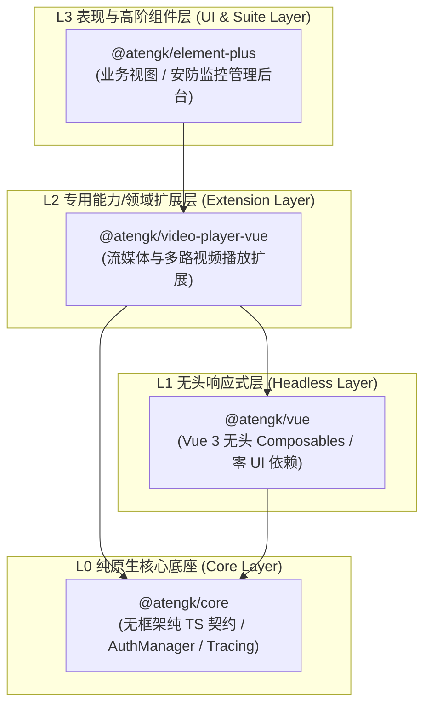
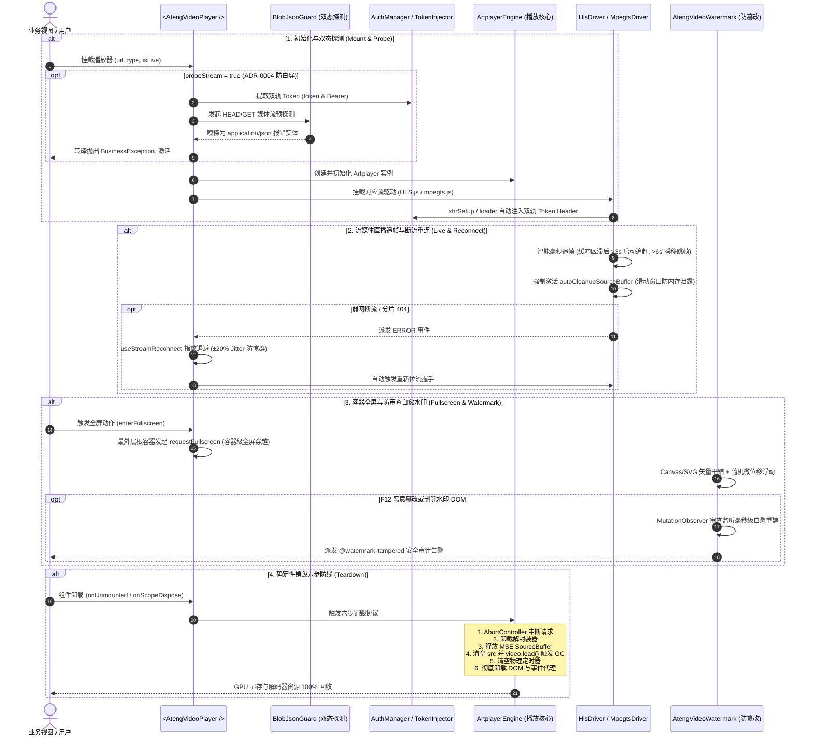
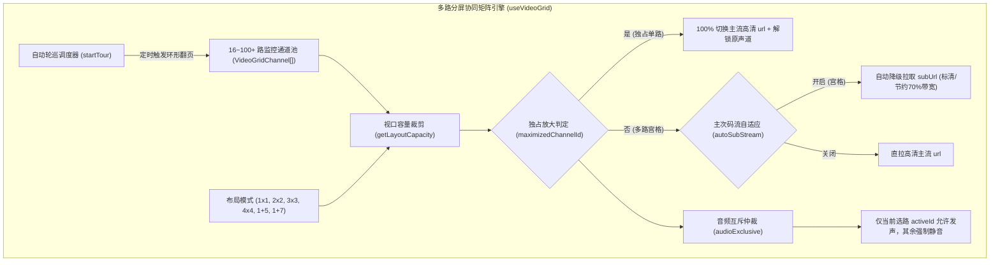
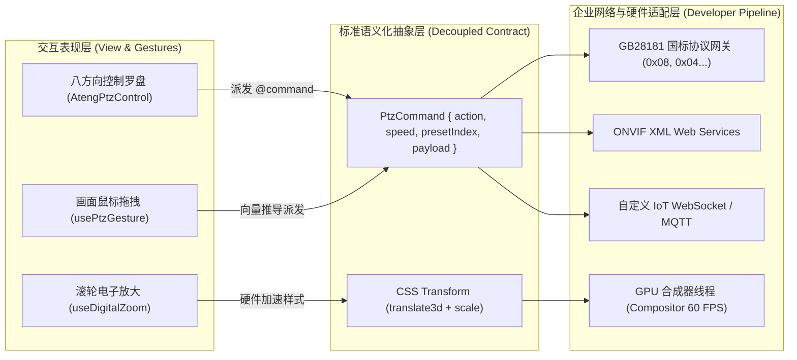
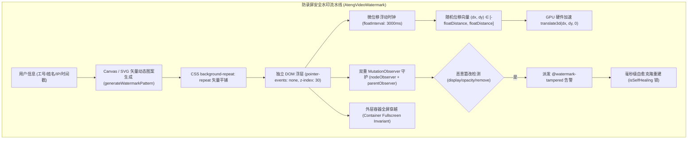
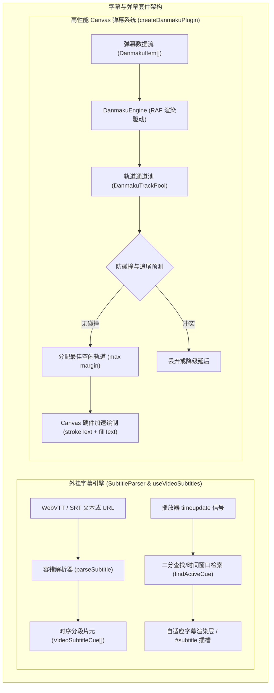
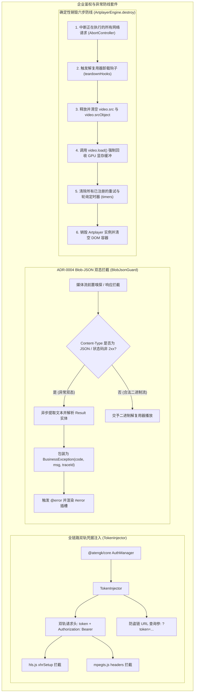

# @atengk/video-player-vue 企业级流媒体与多路视频播放扩展套件

> 面向现代 Web 应用与企业级安防物联网的工业级流媒体视频播放基础设施与无头状态机，归属于系统四层洋葱拓扑之 **L2 专用能力/领域扩展层**。遵循“纯 Vue 3 驱动、强类型契约、零具体 UI 依赖、深模块解耦、确定性生命周期治理”设计，深度集成轻量高性能播放驱动（Artplayer、hls.js、mpegts.js），支持富媒体点播、低延迟 HLS/FLV 直播追帧与断流重连、1~16 路分屏协同矩阵、主次码流自适应防爆带宽、多路音频互斥、安防云台控制盘、手势联动云台、纯前端 1.0x~5.0x 滚轮硬件加速电子放大与视口防脱框、防录屏矢量安全水印与防审查篡改自愈、外挂 WebVTT/SRT 双语字幕、按需分包高性能 Canvas 弹幕系统、企业双轨 Token 注入、ADR-0004 Blob-JSON 双态异常识别与确定性销毁六步防线。

---

## 0. 特性与公共 API 全景速查矩阵

依据《五维生产就绪交付模型》，下表 100% 收录本子模块对外暴露的所有公共组件、Composables、方法、插件与核心类型契约：

| 特性分类         | 特性名称               | 核心门面 / 组件 / Hook                       | 关键参数 / Props / Emits                                                                     | 核心行为说明                                                                           | 锚定验证源头 (*Test / Sample)                                                                                                                        |
| :--------------- | :--------------------- | :------------------------------------------- | :------------------------------------------------------------------------------------------- | :------------------------------------------------------------------------------------- | :--------------------------------------------------------------------------------------------------------------------------------------------------- |
| **基础渲染**     | 单路视频播放容器       | `<AtengVideoPlayer />`                       | `url, type, poster, title, isLive, subtitles, plugins, reconnect, markers`                   | 开箱即用工业级播放器容器，内置六步销毁、错误退化与插槽浮层                             | [AtengVideoPlayer.test.ts](./test/AtengVideoPlayer.test.ts) / [VodDemo.vue](../../apps/sample-video-player-vue/src/components/VodDemo.vue)           |
| **无头状态机**   | 响应式播放状态机       | `useVideoPlayer(options)`                    | `url, autoplay, volume, loop, engine, playing, currentTime, duration`                        | 纯无头播放状态编排，抗竞态且具备响应式生命周期确定性回收                               | [AtengVideoPlayer.test.ts](./test/AtengVideoPlayer.test.ts) / [VodDemo.vue](../../apps/sample-video-player-vue/src/components/VodDemo.vue)           |
| **断流重连**     | 指数退避重连状态机     | `useStreamReconnect(options)`                | `maxRetries, baseDelay, maxDelay, jitter, triggerReconnect, manualRetry`                     | 工业级指数退避重连算法与 ±20% 抖动抗惊群，硬失败转接与定时器确定性清理                 | [stream.test.ts](./test/stream.test.ts) / [LiveDemo.vue](../../apps/sample-video-player-vue/src/components/LiveDemo.vue)                             |
| **记忆续播**     | 本地历史与续播状态机   | `useVideoPlaybackHistory()`                  | `url, autoResume, autoPlayResume, clearHistory, saveProgress`                                | 基于 localStorage 记忆播放进度，支持弹窗提示、恢复后自动播放与防抖写入                 | [deepVOD.test.ts](./test/deepVOD.test.ts) / [DeepVodDemo.vue](../../apps/sample-video-player-vue/src/components/DeepVodDemo.vue)                     |
| **热键与步进**   | 键盘热键与逐帧微调     | `engine.step(), engine.stepFrame()`          | `hotkey: boolean, step(seconds), stepFrame(frames, fps)`                                     | 支持空格、方向键、F全屏、M静音、[,]/[,]逐帧微调，输入框防穿透                          | [deepVOD.test.ts](./test/deepVOD.test.ts) / [DeepVodDemo.vue](../../apps/sample-video-player-vue/src/components/DeepVodDemo.vue)                     |
| **时间格式化**   | 媒体时间戳格式化       | `formatVideoTime(seconds)`                   | `seconds: number`                                                                            | 格式化时间为 `mm:ss` 或 `hh:mm:ss` 字符串，支持负数防穿透保底                          | [deepVOD.test.ts](./test/deepVOD.test.ts)                                                                                                            |
| **时间轴打点**   | 关键帧标注与点击跳帧   | `<AtengVideoPlayer />`                       | `markers: VideoMarkerItem[], @marker-click, @markerClick`                                    | 时间轴高亮打点、悬浮卡片提示、颜色定制，点击打点实现精准快速跳帧                       | [deepVOD.test.ts](./test/deepVOD.test.ts) / [DeepVodDemo.vue](../../apps/sample-video-player-vue/src/components/DeepVodDemo.vue)                     |
| **缩略图预览**   | 进度条 Hover 预览      | `<AtengVideoPlayer />`                       | `thumbnails: VideoThumbnailOptions`                                                          | 支持雪碧图切片配置或 WebVTT 格式，鼠标悬浮进度条展示动态帧预览卡片                     | [deepVOD.test.ts](./test/deepVOD.test.ts) / [DeepVodDemo.vue](../../apps/sample-video-player-vue/src/components/DeepVodDemo.vue)                     |
| **多路分屏矩阵** | 分屏协同监控容器       | `<AtengVideoGrid />`                         | `channels, layout, activeId, autoSubStream, audioExclusive, gap, @select, @channel-dblclick` | 原生 CSS Grid 驱动，支持 1/4/9/16 宫格及 1+5/1+7 广播级主从分屏，自适应缩放            | [grid.test.ts](./test/grid.test.ts) / [GridDemo.vue](../../apps/sample-video-player-vue/src/components/GridDemo.vue)                                 |
| **分屏状态机**   | 多路编排与协同状态机   | `useVideoGrid(options)`                      | `channels, layout, autoSubStream, audioExclusive, activeId, startTour, stopTour`             | 纯无头分屏编排，内置通道容量推导、选路聚焦、双击独占放大、主次码流自适应与自动轮巡     | [grid.test.ts](./test/grid.test.ts) / [GridDemo.vue](../../apps/sample-video-player-vue/src/components/GridDemo.vue)                                 |
| **分屏容量推导** | 布局容量纯函数         | `getLayoutCapacity(layout)`                  | `layout: VideoGridLayout`                                                                    | 计算布局最大容纳通道数（1x1->1, 2x2->4, 3x3->9, 4x4->16, 1+5->6, 1+7->8）              | [grid.test.ts](./test/grid.test.ts)                                                                                                                  |
| **云台控制盘**   | 八方向安防调谐盘       | `<AtengPtzControl />`                        | `speed, presets, disabled, showOptical, showSpeed, @command, @preset-add`                    | 八方向罗盘、变焦/聚焦/光圈调控、预置位管理，纯语义化指令与协议彻底解耦                 | [ptz.test.ts](./test/ptz.test.ts) / [PtzDemo.vue](../../apps/sample-video-player-vue/src/components/PtzDemo.vue)                                     |
| **电子放大**     | 硬件加速电子放大漫游   | `useDigitalZoom(options)`                    | `minScale, maxScale, step, containerRef, startDrag, handleWheel, resetZoom`                  | 纯前端 CSS Transform 硬件加速实现 1.0x~5.0x 滚轮无级缩放与平移拖拽，边界阻尼防脱框     | [ptz.test.ts](./test/ptz.test.ts) / [PtzDemo.vue](../../apps/sample-video-player-vue/src/components/PtzDemo.vue)                                     |
| **画面手势**     | 视频手势联动云台       | `usePtzGesture(options)`                     | `threshold, speed, onCommand, handleMouseDown, handleWheel`                                  | 捕获画面拖拽向量并基于角度数学模型推导 8 方位云台指令，滚轮变焦，松手自动发送 stop     | [ptz.test.ts](./test/ptz.test.ts) / [PtzDemo.vue](../../apps/sample-video-player-vue/src/components/PtzDemo.vue)                                     |
| **方位向量映射** | 手势象限数学推导       | `calculatePtzDirection(dx, dy)`              | `dx: number, dy: number`                                                                     | 将拖拽向量精准映射至 8 个 45° 扇区（up/down/left/right 及四对角）                      | [ptz.test.ts](./test/ptz.test.ts)                                                                                                                    |
| **安全水印**     | 防录屏安全水印容器     | `<AtengVideoWatermark />`                    | `content, opacity, rotate, floating, tamperProof, @watermark-tampered`                       | Canvas/SVG 矢量平铺，动态微位移随机浮动破坏录屏反算法，MutationObserver 审查防篡改     | [watermark.test.ts](./test/watermark.test.ts) / [WatermarkDemo.vue](../../apps/sample-video-player-vue/src/components/WatermarkDemo.vue)             |
| **外挂多轨字幕** | WebVTT/SRT 解析与同步  | `useVideoSubtitles(subtitles, defaultId)`    | `subtitles, activeSubtitle, cues, currentText, switchSubtitle, updateCurrentTime`            | 无头多轨字幕状态机，支持 WebVTT/SRT 双格式、毫秒时间片元匹配与多语言切换               | [subtitles.test.ts](./test/subtitles.test.ts) / [DanmakuSubtitleDemo.vue](../../apps/sample-video-player-vue/src/components/DanmakuSubtitleDemo.vue) |
| **字幕解析核心** | 字幕文本双协议解析器   | `parseSubtitle(), parseWebVtt(), parseSrt()` | `content: string, type?: 'vtt' \| 'srt'`                                                     | 纯原生 TS 实现 WebVTT 与 SRT 文本解析，容错提取时间片元列表                            | [subtitles.test.ts](./test/subtitles.test.ts)                                                                                                        |
| **字幕片元检索** | 当前时间片元定位       | `findCurrentCue(cues, currentTime)`          | `cues: VideoSubtitleCue[], currentTime: number`                                              | 高效检索当前播放时刻命中的字幕片元，无匹配时防御性保底返回 null                        | [subtitles.test.ts](./test/subtitles.test.ts)                                                                                                        |
| **弹幕插件系统** | Canvas 高性能弹幕插件  | `createDanmakuPlugin(options)`               | `@atengk/video-player-vue/plugins/danmaku` 独立导出；`speed, opacity, area, filterKeywords`  | 标准 Artplayer 插件工厂，独立 Subpath 导出，Tree-Shaking 0 字节体积残留                | [danmaku.test.ts](./test/danmaku.test.ts) / [DanmakuSubtitleDemo.vue](../../apps/sample-video-player-vue/src/components/DanmakuSubtitleDemo.vue)     |
| **弹幕渲染引擎** | Canvas 2D 硬件加速引擎 | `DanmakuEngine(container, options)`          | `emit(), show(), hide(), toggle(), config(), clear(), syncVideoTime(), destroy()`            | 纯 Canvas 渲染循环、双重黑白描边、DPI 视网膜高清自适应、多重屏蔽规则与 RAF 清理        | [danmaku.test.ts](./test/danmaku.test.ts)                                                                                                            |
| **弹幕轨道通道** | 通道防重叠防追尾调度池 | `DanmakuTrackPool(options)`                  | `allocateTrack(), allocateTopTrack(), allocateBottomTrack(), registerItem(), reset()`        | 动态推导轨道高度，尾部进屏防碰撞与相对速度追尾预测，负载均衡分配空闲通道               | [danmaku.test.ts](./test/danmaku.test.ts)                                                                                                            |
| **底层引擎 SPI** | Artplayer 适配引擎     | `ArtplayerEngine`                            | `container, options, handlers`                                                               | 适配 Artplayer 内核，固化确定性销毁六步防线与 GPU 缓冲回收                             | [invariants.test.ts](./test/invariants.test.ts) / [ArtplayerEngine.ts](./src/engine/ArtplayerEngine.ts)                                              |
| **流媒体驱动**   | HLS 播放驱动           | `HlsDriver`                                  | `video, url, options`                                                                        | 基于 hls.js 驱动，支持 ABR 码率自适应、Safari 降级与 xhrSetup 鉴权拦截                 | [stream.test.ts](./test/stream.test.ts) / [LiveDemo.vue](../../apps/sample-video-player-vue/src/components/LiveDemo.vue)                             |
| **流媒体驱动**   | HTTP-FLV 播放驱动      | `MpegtsDriver`                               | `video, url, options`                                                                        | 基于 mpegts.js 驱动，支持低延迟直播、智能毫秒追帧与 autoCleanupSourceBuffer 防内存泄漏 | [stream.test.ts](./test/stream.test.ts) / [LiveDemo.vue](../../apps/sample-video-player-vue/src/components/LiveDemo.vue)                             |
| **安全鉴权**     | 企业凭据双轨注入器     | `TokenInjector`                              | `injectHeaders(), injectXhr(), injectFetch(), injectUrl()`                                   | 全链路对接 `@atengk/core` 的 `AuthManager`，双轨注入 `token` 与 `Authorization`        | [invariants.test.ts](./test/invariants.test.ts) / [AuthSecurityDemo.vue](../../apps/sample-video-player-vue/src/components/AuthSecurityDemo.vue)     |
| **白屏守卫**     | ADR-0004 双态探测      | `BlobJsonGuard`                              | `probeMediaStream(), parseJsonError(), toBusinessException()`                                | 嗅探 401/403/500 JSON 异常并转译为强类型 `BusinessException`，避免解复用白屏死锁       | [invariants.test.ts](./test/invariants.test.ts) / [AuthSecurityDemo.vue](../../apps/sample-video-player-vue/src/components/AuthSecurityDemo.vue)     |
| **插件安装器**   | Vue 插件全局注册       | `install(app)`                               | `app: App`                                                                                   | 显式受控注册 `AtengVideoPlayer, AtengVideoGrid, AtengPtzControl, AtengVideoWatermark`  | [index.ts](./src/index.ts) / [main.ts](../../apps/sample-video-player-vue/src/main.ts)                                                               |
| **类型契约**     | 核心强类型全量定义     | `types/index.ts`                             | `IVideoPlayerEngine, VideoPlayerProps, DanmakuItem, VideoSubtitleItem 等`                    | 100% 强类型覆盖，严格恪守零裸 `any` 防线                                               | [types/index.ts](./src/types/index.ts)                                                                                                               |

---

## 1. 模块定位与 pnpm 坐标

`@atengk/video-player-vue` 归属于 `ateng-ui` 基础设施套件的 **L2 专用能力/领域扩展层 (Extension Layer)**，专注于企业级现代音视频点播、低延迟直播流解复用、安防物联网监控矩阵与防录屏数据安全。

- **npm 坐标**：`@atengk/video-player-vue`
- **源码工程**：`packages/video-player-vue`
- **自验展厅**：`apps/sample-video-player-vue`（固定端口 `3005`）
- **底层依赖**：依赖 `@atengk/core` (L0) 与 `@atengk/vue` (L1)，严格与具体 UI 表现库（如 Element Plus）解耦，保持对纯 Vue 3 宿主环境的通用性；
- **peerDependencies 契约**：要求 `vue: >=3.5.0`。

### 安装依赖

```bash
pnpm add @atengk/video-player-vue @atengk/core @atengk/vue vue
```

---

## 2. 核心架构与设计不变量

### 2.1 四层洋葱拓扑位置



### 2.2 全生命周期与交互时序图



### 2.3 四大核心设计不变量

依据系统级架构决策 [ADR-0031](../../docs/adr/0031-video-player-l2-architecture-and-stream-governance.md)，本模块在架构层面严格贯彻并固化以下四大不可逾越的工业级设计不变量：

1. **L2 领域纯原生中立不变量 (Zero-UI Decoupling Invariant)**：
   - 本套件归属于系统 L2 专用扩展层，**绝对严禁直接或间接依赖 L3 UI 库（如 Element Plus）**，保持对纯 Vue 3 宿主环境的 100% 跨平台中立通用性；
   - 所有组件内部控件、罗盘与交互面板一律采用纯 CSS3 + SVG 矢量图元实现，样式强制通过 `at-` 命名空间隔离（如 `.at-video-player`、`.at-video-grid`、`.at-ptz-control`、`.at-video-watermark`），并通过 `--at-video-player-bg`、`--at-grid-theme-color`、`--at-ptz-theme` 等标准 Design Tokens 向外暴露定制能力，严禁任何无前缀全局样式污染。

2. **容器级全屏穿越与防脱落不变量 (Container Fullscreen Invariant)**：
   - 原生 HTML5 `video.requestFullscreen()` 会将媒体元素提升到独立的底层合成层，导致外层所有的 DOM 浮层（安全水印、防盗打点、弹幕图层、自定义控制栏）在原生全屏下被浏览器底层无情丢弃；
   - 本套件严格贯彻“容器级全屏穿越”不变量：播放器原生全屏时，强制由最外层宿主根容器发起 `container.requestFullscreen()`，确保在原生全屏与网页全屏模式下，防录屏安全水印和业务浮层 100% 牢固覆盖不脱落。

3. **主次码流自适应与音频互斥不变量 (Sub-Stream Adaptive & Audio Exclusive Invariant)**：
   - **主次码流自适应**：在 4/9/16 路对称宫格分屏下，若各通道全量拉取 1080P/4K 主码流，极易瞬时耗尽下行带宽并造成浏览器 GPU/CPU 硬件解码器过载崩溃。状态机在容量 $>1$ 且非独占放大时，默认自动选用低码率 `subUrl`（360P/D1 码流），节约超过 70% 带宽与算力；双击独占放大时瞬间无缝切换回高清 `url`；
   - **多路音频互斥发声**：多路监控同时放音会引发严重的杂音干扰与声学混响，且触碰现代浏览器自动播放声音策略拦截。状态机严格贯彻音频互斥不变量，保证在整个视口中**仅有当前被用户选中的聚焦激活路（`activeId`）允许发声**，其余所有背景路强制 `isMuted: true`。

4. **确定性销毁六步防线不变量 (Deterministic Teardown Invariant)**：
   - 在 SPA 单页应用与安防监控多路分屏场景中，浏览器频繁创建与销毁视频解码器极易导致 GPU 显存泄漏与页面卡顿崩溃。本套件在 `ArtplayerEngine.destroy()` 中严格固化六步销毁防线：
     1. **中断连接**：触发 `AbortController.abort()`，即刻切断一切未决的网络流与分片请求；
     2. **注销钩子**：顺序同步触发已注册的底层解封装器（hls.js / mpegts.js）销毁回调；
     3. **释放缓冲**：主动清空 MSE `SourceBuffer` 缓存，阻断持续解码；
     4. **解绑元素**：执行 `video.pause()` 并将 `video.removeAttribute('src')` 与 `video.src = ''`，随后强制调用 `video.load()`，命令浏览器垃圾回收器释放底层解码器上下文与 GPU 显存缓冲；
     5. **清理定时器**：彻底清空组件与状态机挂载的所有物理定时器；
     6. **销毁内核**：调用 Artplayer 原生 `destroy(true)` 彻底卸载 DOM 节点与全局事件代理。

---

## 3. 单路富媒体点播与深水区交互套件

### 3.1 开箱即用富媒体点播容器 (`<AtengVideoPlayer />`)

- **专属 TypeScript 契约/配置片段**：

```ts
import type {
  AtengVideoPlayerInstance,
  VideoPlayerProps,
  VideoQualityItem,
} from '@atengk/video-player-vue';

/**
 * 视频画质与清晰度选项契约。
 */
export interface VideoQualityItem {
  html: string; // 清晰度展示文案 (如 '1080P 高清')
  url: string; // 对应画质的播放直链
  default?: boolean; // 是否作为默认画质
}

/**
 * 点播核心 Props 片段。
 */
export interface VideoPlayerProps {
  url: string; // 媒体播放地址 (MP4 / WebM / HLS / FLV)
  poster?: string; // 视频封面海报图
  title?: string; // 视频标题
  autoplay?: boolean; // 是否自动播放 (默认 false)
  playbackRates?: number[]; // 倍速档位列表 (默认 [0.5, 0.75, 1.0, 1.25, 1.5, 2.0])
  quality?: VideoQualityItem[]; // 多清晰度切换清单
  screenshot?: boolean; // 是否显示截图抓拍按钮 (默认 true)
  theme?: string; // 主题高亮主色调 (默认 '#409EFF')
}
```

- **面向实战的业务 Vue 代码示例**（逆向提取自 `sample-video-player-vue/VodDemo.vue`）：

```vue
<script setup lang="ts">
import { ref } from 'vue';
import {
  AtengVideoPlayer,
  type AtengVideoPlayerInstance,
  type IVideoPlayerEngine,
  type VideoQualityItem,
} from '@atengk/video-player-vue';
import '@atengk/video-player-vue/style.css';

const playerRef = ref<AtengVideoPlayerInstance | null>(null);
const currentUrl = ref('https://artplayer.org/assets/sample/video.mp4');
const posterUrl = ref('https://artplayer.org/assets/sample/poster.jpg');
const isPlaying = ref(false);
const duration = ref(0);

// 清晰度画质切换清单
const qualityList: VideoQualityItem[] = [
  { default: true, html: '1080P 超清', url: 'https://artplayer.org/assets/sample/video.mp4' },
  { html: '720P 高清', url: 'https://artplayer.org/assets/sample/video.mp4' },
  { html: '360P 标清', url: 'https://artplayer.org/assets/sample/video.mp4' },
];

const onReady = (engine: IVideoPlayerEngine) => {
  duration.value = engine.duration;
};

// 截图导出预览
const handleCapture = async () => {
  const base64 = await playerRef.value?.screenshot();
  console.log('抓拍导出 Base64 图片长度:', base64?.length);
};
</script>

<template>
  <div style="width: 100%; max-width: 960px; aspect-ratio: 16 / 9;">
    <AtengVideoPlayer
      ref="playerRef"
      :url="currentUrl"
      :poster="posterUrl"
      title="企业级富媒体高清点播"
      :quality="qualityList"
      :playback-rates="[0.5, 0.75, 1.0, 1.25, 1.5, 2.0]"
      :screenshot="true"
      @ready="onReady"
      @play="isPlaying = true"
      @pause="isPlaying = false"
    />
  </div>
</template>
```

- **核心机制与生产边界防御说明**：
  - **纯原生 UI 解耦**：播放器控件栏基于纯 CSS3 与内联 SVG 图元构建，根节点通过 `.at-video-player` 样式隔离并继承 `--at-video-player-bg` 变量，坚决杜绝依赖 Element Plus 等具体表现库；
  - **清晰度无损平滑切换**：切换清晰度时，组件在底层记录当前播放时间戳 `currentTime` 与播放速率，无缝切换 `<video>` 源并自动无缓冲断点接播，无需重新初始化销毁整个解码器；
  - **CORS 跨域截图安全通道**：视频截图抓拍利用离屏 `<canvas>` 提取视频当前帧，要求媒体源配置标准 CORS 头，内部已对跨域 `crossOrigin: 'anonymous'` 实施安全注入，有效防范 Canvas 污染异常。

---

### 3.2 纯无头播放状态机编排 (`useVideoPlayer`)

- **专属 TypeScript 契约/配置片段**：

```ts
import type { ComputedRef, MaybeRefOrGetter, Ref, ShallowRef } from 'vue';
import type { IVideoPlayerEngine, VideoPlayerOptions } from '@atengk/video-player-vue';

export interface UseVideoPlayerOptions extends VideoPlayerOptions {
  container?: MaybeRefOrGetter<HTMLElement | null | undefined>; // 挂载 DOM 容器
}

export interface UseVideoPlayerReturn {
  engine: ShallowRef<IVideoPlayerEngine | null>; // 底层播放驱动抽象句柄
  playing: Ref<boolean>; // 响应式播放状态
  currentTime: Ref<number>; // 响应式播放秒数
  duration: Ref<number>; // 媒体总时长
  volume: Ref<number>; // 响应式音量 (0.0 ~ 1.0)
  muted: Ref<boolean>; // 是否静音
  buffered: Ref<number>; // 缓冲百分比 (0.0 ~ 1.0)
  play(): Promise<void>; // 播放控制
  pause(): void; // 暂停控制
  toggle(): void; // 播放/暂停切换
  seek(time: number): void; // 时间跳转
  destroy(): void; // 销毁回收
}
```

- **面向实战的业务 TS/Vue 代码示例**：

```vue
<script setup lang="ts">
import { ref } from 'vue';
import { useVideoPlayer } from '@atengk/video-player-vue';

const containerRef = ref<HTMLDivElement | null>(null);

// 声明纯无头播放状态机
const player = useVideoPlayer({
  container: containerRef,
  url: 'https://artplayer.org/assets/sample/video.mp4',
  autoplay: false,
  volume: 0.8,
});
</script>

<template>
  <div>
    <!-- 纯无头渲染视口 (完全摆脱默认控制栏，自定义操作面板) -->
    <div ref="containerRef" style="width: 640px; height: 360px;" />

    <div class="custom-controls" style="margin-top: 10px; display: flex; gap: 10px;">
      <button @click="player.toggle()">
        {{ player.playing.value ? '⏸️ 暂停' : '▶️ 播放' }}
      </button>
      <span
        >{{ Math.floor(player.currentTime.value) }}s /
        {{ Math.floor(player.duration.value) }}s</span
      >
      <button @click="player.seek(player.currentTime.value + 10)">⏩ 快进 10s</button>
    </div>
  </div>
</template>
```

- **核心机制与生产边界防御说明**：
  - **响应式单向流与只读保护**：`useVideoPlayer` 导出的所有响应式状态均为只读属性或受控状态，所有状态更新严格由底层的播放事件管道单向驱动，严禁外部代码就地突变；
  - **`onScopeDispose` 确定性自动清理**：遵循工业级第二道防线，当宿主组件或作用域注销时，Hook 自动执行引擎销毁、清理解封装器、解除事件监听并释放 DOM，杜绝离线定时器与显存悬挂。

---

### 3.3 精准 Seek 与逐帧微调 (`step()`, `stepFrame()`, 热键与 `formatVideoTime`)

- **专属 TypeScript 契约/配置片段**：

```ts
import type { AtengVideoPlayerInstance } from '@atengk/video-player-vue';

/**
 * 格式化时间戳为规范的 mm:ss 或 hh:mm:ss 字符串。
 * 具备负数与非有限数防御性保底（返回 '00:00'）。
 */
export function formatVideoTime(seconds: number): string;

// AtengVideoPlayer 实例导出的步进方法契约：
// playerRef.value?.step(seconds: number): void;
// playerRef.value?.stepFrame(frames?: number, fps?: number): void;
```

- **面向实战的业务 Vue 代码示例**（逆向提取自 `sample-video-player-vue/DeepVodDemo.vue`）：

```vue
<script setup lang="ts">
import { ref } from 'vue';
import {
  AtengVideoPlayer,
  formatVideoTime,
  type AtengVideoPlayerInstance,
} from '@atengk/video-player-vue';

const playerRef = ref<AtengVideoPlayerInstance | null>(null);

// 步进微调操作 (+5s 快进, -5s 快退)
const handleStep = (seconds: number) => {
  playerRef.value?.step(seconds);
};

// 逐帧精确微调 (+1 帧, -1 帧，按 30 帧/秒计算)
const handleStepFrame = (frames: number) => {
  playerRef.value?.stepFrame(frames, 30);
};
</script>

<template>
  <div>
    <AtengVideoPlayer
      ref="playerRef"
      url="https://artplayer.org/assets/sample/video.mp4"
      :hotkey="true"
    />
    <div style="margin-top: 10px; display: flex; gap: 8px;">
      <button @click="handleStep(-5)">⏪ 快退 5s</button>
      <button @click="handleStepFrame(-1)">⏮️ 上一帧 ([,])</button>
      <button @click="handleStepFrame(1)">⏭️ 下一帧 ([,])</button>
      <button @click="handleStep(5)">⏩ 快进 5s</button>
    </div>
  </div>
</template>
```

- **核心机制与生产边界防御说明**：
  - **全局热键输入防穿透机制**：播放器内置全局键盘监听（空格暂停、方向键快进音量、F 全屏、M 静音、`[`/`]` 逐帧步进），内部前置判断事件来源，当 `e.target` 为 `INPUT`、`TEXTAREA` 或包含 `isContentEditable` 时立即短路放行，绝不干扰业务表单输入；
  - **逐帧时间步进数学算法**：`stepFrame` 基于估算或指定帧率（默认 30fps）推导时间片元 $\Delta t = frames / fps$，并配合 $\min(duration, \max(0, currentTime + \Delta t))$ 施加严格边界约束，彻底防止跳转时间溢出范围。

---

### 3.4 时间轴关键帧打点与悬停跳帧 (`VideoMarkerItem`, `@marker-click`)

- **专属 TypeScript 契约/配置片段**：

```ts
/**
 * 时间轴事件打点与关键帧标注项契约。
 */
export interface VideoMarkerItem {
  time: number; // 打点所处的媒体时间戳 (秒)
  text: string; // 悬浮提示文本或事件描述
  color?: string; // 打点圆珠颜色 (支持 Hex / CSS 变量)
}

// 事件契约：
// @marker-click="marker => void"
```

- **面向实战的业务 Vue 代码示例**（逆向提取自 `sample-video-player-vue/DeepVodDemo.vue`）：

```vue
<script setup lang="ts">
import { ref } from 'vue';
import { AtengVideoPlayer, type VideoMarkerItem } from '@atengk/video-player-vue';

// 注入业务关键打点标记 (如比赛高光、课堂重点、事故时间点)
const markers: VideoMarkerItem[] = [
  { time: 5, text: '开篇片段', color: '#38bdf8' },
  { time: 15, text: '精彩进球高光', color: '#f59e0b' },
  { time: 30, text: '战术复盘关键帧', color: '#10b981' },
  { time: 50, text: '终场采访花絮', color: '#ec4899' },
];

const onMarkerClick = (marker: VideoMarkerItem) => {
  console.log('点击打点，快速定位:', marker.text, '秒数:', marker.time);
};
</script>

<template>
  <AtengVideoPlayer
    url="https://artplayer.org/assets/sample/video.mp4"
    :markers="markers"
    @marker-click="onMarkerClick"
  />
</template>
```

- **核心机制与生产边界防御说明**：
  - **自适应百分比定位算法**：打点圆珠基于时间比例 $left = (time / duration) \times 100\%$ 在进度条绝对定位，支持动态载入或异步替换打点列表；
  - **边缘防溢出气泡**：鼠标悬停打点圆珠时，悬浮气泡卡片自适应根据打点所处的百分比调整偏移，靠近左侧边缘（$<10\%$）或右侧边缘（$>90\%$）时自动平移微调，彻底规避文字脱出视口被截断。

---

### 3.5 进度条 Hover 缩略图预览 (`VideoThumbnailOptions`)

- **专属 TypeScript 契约/配置片段**：

```ts
/**
 * 进度条缩略图悬浮卡片配置契约 (雪碧图切片或 WebVTT 格式)。
 */
export interface VideoThumbnailOptions {
  url: string; // 缩略图资源地址 (雪碧图 URL 或 VTT 地址)
  number?: number; // 雪碧图切片总图片数量 (默认 60 或 100)
  column?: number; // 雪碧图每行切片列数 (默认 10)
  width?: number; // 缩略图单帧宽度 (默认 160)
  height?: number; // 缩略图单帧高度 (默认 90)
  scale?: number; // 缩放倍数 (默认 1)
}
```

- **面向实战的业务 Vue 代码示例**（逆向提取自 `sample-video-player-vue/DeepVodDemo.vue`）：

```vue
<script setup lang="ts">
import { AtengVideoPlayer, type VideoThumbnailOptions } from '@atengk/video-player-vue';

// 雪碧图切片配置 (单张大图打包 60 帧画面，每行 10 列)
const thumbnailConfig: VideoThumbnailOptions = {
  url: 'https://artplayer.org/assets/sample/thumbnails.png',
  number: 60,
  column: 10,
  width: 160,
  height: 90,
  scale: 1,
};
</script>

<template>
  <AtengVideoPlayer
    url="https://artplayer.org/assets/sample/video.mp4"
    :thumbnails="thumbnailConfig"
  />
</template>
```

- **核心机制与生产边界防御说明**：
  - **CSS Sprite 背景偏移推导算法**：用户在进度条移动鼠标时，根据时间百分比推导切片索引 $index = \lfloor (hoverTime / duration) \times number \rfloor$；进而精确计算背景偏移：
    $$row = \lfloor index / column \rfloor, \quad col = index \pmod{column}$$
    $$backgroundPosition = -(col \times width)\text{px} \quad -(row \times height)\text{px}$$
  - **网络往返节约与零闪烁**：相比分散加载几十张小图，单张雪碧图仅消耗 1 次 HTTP 请求并享受浏览器 HTTP 缓存，彻底杜绝悬停时因图片加载延迟带来的空白闪烁。

---

### 3.6 本地播放历史记忆与智能续播 (`useVideoPlaybackHistory`)

- **专属 TypeScript 契约/配置片段**：

```ts
/**
 * 记忆续播配置契约。
 */
export interface VideoPlaybackHistoryOptions {
  enabled?: boolean; // 是否开启记忆续播 (默认 false)
  storageKey?: string; // 本地存储自定义 Key (默认自动按 URL 派生)
  minTime?: number; // 最小记录阈值秒数 (少于 5s 不记录)
  maxTimeThreshold?: number; // 临近结束阈值秒数 (剩余少于 5s 不恢复)
  autoPlay?: boolean; // 恢复后是否自动开始播放 (默认 false)
  showPrompt?: boolean; // 是否弹出浮动提示卡片 (默认 true)
  promptDuration?: number; // 浮动提示展示时长 (默认 3000ms)
}
```

- **面向实战的业务 Vue 代码示例**（逆向提取自 `sample-video-player-vue/DeepVodDemo.vue`）：

```vue
<script setup lang="ts">
import { ref } from 'vue';
import {
  AtengVideoPlayer,
  formatVideoTime,
  type AtengVideoPlayerInstance,
} from '@atengk/video-player-vue';

const playerRef = ref<AtengVideoPlayerInstance | null>(null);

const onResume = (time: number) => {
  console.log(`✨ 成功从上次记忆位置恢复播放: ${formatVideoTime(time)}`);
};

// 手动清空当前视频记忆历史
const clearHistory = () => {
  playerRef.value?.clearPlaybackHistory();
};
</script>

<template>
  <AtengVideoPlayer
    ref="playerRef"
    url="https://artplayer.org/assets/sample/video.mp4"
    :auto-resume="true"
    :auto-play-resume="false"
    @resume="onResume"
  />
</template>
```

- **核心机制与生产边界防御说明**：
  - **防抖持久化不变量 (Debounced Storage Invariant)**：在视频持续播放过程中，底层监听 `timeupdate`（高频 250ms/次），状态机内置 1000ms 防抖更新机制写入 `localStorage`，严禁同步无节制高频写磁盘，保证 UI 线程绝对流畅；
  - **首尾双向防误恢复守卫**：用户若刚播放不到 5 秒就退出，或已观看至片尾剩余不到 5 秒，状态机自动丢弃记忆点，杜绝用户再次点开时被误跳转至片头或片尾黑屏死胡同；
  - **非侵入式提示浮层与一键复播**：默认在底部渲染优雅的微气泡（“已恢复上次播放进度 01:23 [重新播放]”），用户可点击一键从头复播，平衡自动化与用户知情权。

---

## 4. 流媒体低延迟直播与断流重连套件

### 4.1 HLS / HTTP-FLV 协议驱动与低延迟拉流 (`HlsDriver`, `MpegtsDriver`)

- **专属 TypeScript 契约/配置片段**：

```ts
import type { VideoPlayerType } from '@atengk/video-player-vue';

// 组件协议指定 Props：
// url: string;
// type?: 'auto' | 'hls' | 'flv' | 'm3u8' | 'mp4';
// isLive?: boolean; // 为 true 时自动激活直播专属控制栏与实时徽标
```

- **面向实战的业务 Vue 代码示例**（逆向提取自 `sample-video-player-vue/LiveDemo.vue`）：

```vue
<script setup lang="ts">
import { ref } from 'vue';
import { AtengVideoPlayer, type IVideoPlayerEngine } from '@atengk/video-player-vue';

// HLS 与 HTTP-FLV 直播流示例
const liveUrl = ref('https://test-streams.mux.dev/x36xhzz/x36xhzz.m3u8');
const liveType = ref<'hls' | 'flv'>('hls');

const onReady = (engine: IVideoPlayerEngine) => {
  console.log('直播流驱动就绪，已建立解封装解码通道');
};
</script>

<template>
  <div style="width: 100%; max-width: 960px; aspect-ratio: 16 / 9;">
    <AtengVideoPlayer
      :url="liveUrl"
      :type="liveType"
      :is-live="true"
      :autoplay="true"
      title="监控信号源实时直播"
      @ready="onReady"
    />
  </div>
</template>
```

- **核心机制与生产边界防御说明**：
  - **Safari 原生 HLS 平滑降级**：在苹果 Safari 等浏览器原生支持 `.m3u8` 解复用的环境中，`HlsDriver` 优先直通宿主 `<video src>` 解码，规避 MSE 内存开销并完美激活底层 GPU 硬件直通；
  - **解封装器沙箱隔离**：底层解封装核心 `hls.js` 与 `mpegts.js` 均运行在受管类包装器内，绝不向浏览器全局注入任何污染变量；
  - **双轨凭据全链路注入**：通过 `xhrSetup` 与 `loader` 拦截器无缝对接系统的 `AuthManager`，媒体流切片请求自动附带 `token` 与 `Authorization: Bearer` 请求头。

---

### 4.2 FLV SourceBuffer 内存防爆与智能毫秒追帧 (`autoCleanupSourceBuffer`, 缓冲追帧)

- **专属 TypeScript 契约/配置片段**：

```ts
// 组件 Props 直播缓冲追帧参数：
export interface LiveBufferingProps {
  liveBufferLatencyChasing?: boolean; // 是否开启直播低延迟毫秒级追帧 (默认 true)
  chaseThreshold?: number; // 追帧触发门限秒数 (默认 3s，缓冲区落后超过该值触发追赶)
}
```

- **面向实战的业务 Vue 代码示例**（逆向提取自 `sample-video-player-vue/LiveDemo.vue`）：

```vue
<script setup lang="ts">
import { AtengVideoPlayer } from '@atengk/video-player-vue';
</script>

<template>
  <AtengVideoPlayer
    url="https://live.example.com/cctv01.flv"
    type="flv"
    :is-live="true"
    :live-buffer-latency-chasing="true"
    :chase-threshold="3"
  />
</template>
```

- **核心机制与生产边界防御说明**：
  - **SourceBuffer 内存防爆守卫**：安防物联网 24 小时连续推流极易撑爆浏览器内存。`MpegtsDriver` 强制激活 `autoCleanupSourceBuffer: true`，将后向保留缓冲严格限制在 30~60 秒的滑动窗口内，超期切片自动清除，杜绝长时间播放崩溃；
  - **双阶智能毫秒追帧算法**：
    1. **轻度滞后 ($3s \sim 6s$)**：状态机无感启动 `1.25x` 播放倍速平滑追赶，一旦缓冲时延收敛至 $<1.5s$，瞬间无缝回切 `1.0x` 原速；
    2. **严重滞后 ($>6s$)**：网络断线割接或页面切回前台时，状态机立即执行 `video.currentTime = bufferEnd - 0.5`，毫秒级瞬移同步至最新关键帧，保证时延始终受控。

---

### 4.3 指数退避抖动重连状态机 (`useStreamReconnect`)

- **专属 TypeScript 契约/配置片段**：

```ts
import type { MaybeRefOrGetter, Ref, ShallowRef } from 'vue';

/**
 * 流媒体断流重连状态机配置。
 */
export interface StreamReconnectOptions {
  maxRetries?: MaybeRefOrGetter<number>; // 最大重连尝试次数 (默认 5 次)
  baseDelay?: MaybeRefOrGetter<number>; // 基础重连延迟毫秒数 (默认 1000ms)
  maxDelay?: MaybeRefOrGetter<number>; // 最大延迟封顶 (默认 10000ms)
  jitter?: boolean; // 是否引入 ±20% 抖动因子抗惊群 (默认 true)
  onRetry?: (attempt: number, delay: number, error?: unknown) => void;
  onFail?: (error?: unknown) => void;
}
```

- **面向实战的业务 Vue 代码示例**（逆向提取自 `sample-video-player-vue/LiveDemo.vue`）：

```vue
<script setup lang="ts">
import { AtengVideoPlayer } from '@atengk/video-player-vue';

const reconnectOptions = {
  maxRetries: 5,
  baseDelay: 1000,
  maxDelay: 8000,
  jitter: true,
  onRetry: (attempt: number, delay: number) => {
    console.warn(`第 ${attempt} 次重试连接信号源，等待 ${delay}ms...`);
  },
  onFail: () => {
    console.error('已达到最大重试限制，信号源中断');
  },
};
</script>

<template>
  <AtengVideoPlayer
    url="https://live.example.com/stream.flv"
    type="flv"
    :is-live="true"
    :reconnect="reconnectOptions"
  >
    <!-- 自定义信号中断硬失败插槽 (中立语义) -->
    <template #reconnect-failed="{ retry }">
      <div class="custom-signal-lost">
        <h4>📡 视频信号源连接已中断</h4>
        <p>网络受阻或推流网关暂时不可达，请尝试重新拉取信号。</p>
        <button @click="retry">重新拉取信号</button>
      </div>
    </template>
  </AtengVideoPlayer>
</template>
```

- **核心机制与生产边界防御说明**：
  - **指数退避数学模型**：重试等待时长按 $delay = \min(baseDelay \times 2^{attempt}, maxDelay)$ 阶梯式回退；
  - **$\pm 20\%$ Jitter 随机抖动抗惊群**：引入随机离散因子 $delay_{actual} = delay \times (1 \pm 0.2 \times \text{Math.random()})$，彻底避免机房网络割接或推流服务器重启瞬间，成百上千台监控客户端在同一毫秒并发狂轰推流接口引发次生雷暴雪崩；
  - **硬失败终态与确定性清理**：尝试达到 `maxRetries` 后，状态机自动熔断挂起物理重试定时器，并通过 `#reconnect-failed` 作用域插槽派发中立友好的交互界面，绝不造成死循环或静默白屏。

---

## 5. 广播级安防多路分屏协同矩阵套件

在大型指挥调度中心、智慧园区、交通卡口与安防物联场景中，同时监控多路视频流并灵活编排布局是核心需求。`@atengk/video-player-vue` 提供了工业级多路协同套件，核心由 `<AtengVideoGrid />` 组件与 `useVideoGrid` 纯响应式无头状态机构成，底层通过纯 CSS Grid 实现高性能声明式排版，内置选路聚焦高亮、双击平滑独占放大、主次码流自适应防爆带宽、多路音频互斥防啸叫与大通道池自动轮巡调度器。



---

### 5.1 响应式 CSS Grid 分屏矩阵容器 (`<AtengVideoGrid />`, `layout`, `channels`, `getLayoutCapacity`)

- **专属 TypeScript 契约/配置片段**：

```ts
import type { ComponentPublicInstance } from 'vue';

/**
 * 分屏矩阵支持的布局模式：
 * - '1x1': 单画面
 * - '2x2': 4分屏对称宫格
 * - '3x3': 9分屏对称宫格
 * - '4x4': 16分屏对称宫格
 * - '1+5': 6分屏广播级主从布局 (1大主窗 + 5小副窗)
 * - '1+7': 8分屏广播级主从布局 (1大主窗 + 7小副窗)
 */
export type VideoGridLayout = '1x1' | '2x2' | '3x3' | '4x4' | '1+5' | '1+7';

/**
 * 获取布局模式对应的路数容量。
 */
export function getLayoutCapacity(layout: VideoGridLayout): number;

/**
 * 分屏矩阵视频通道模型契约。
 */
export interface VideoGridChannel {
  id: string | number; // 通道唯一标识
  title?: string; // 通道标题或监控机位名称
  url: string; // 主码流视频播放地址 (1080P/4K 高清)
  subUrl?: string; // 次码流视频播放地址 (360P/D1 标清，多路宫格防爆带宽)
  type?: VideoPlayerType; // 协议类型 ('auto' | 'mp4' | 'hls' | 'flv')
  poster?: string; // 封面海报图地址
  isLive?: boolean; // 是否为直播流 (默认 true)
  auth?: boolean; // 是否自动注入 Token 鉴权凭据 (默认 true)
  muted?: boolean; // 用户显式指定的静音状态
}

/**
 * AtengVideoGrid 组件 Props 契约。
 */
export interface VideoGridProps {
  channels: VideoGridChannel[]; // 监控机位通道列表
  layout?: VideoGridLayout; // 当前布局模式 (默认 '2x2')
  activeId?: string | number | null; // 当前聚焦选中的通道 ID
  autoSubStream?: boolean; // 是否开启主次码流自适应 (默认 true)
  audioExclusive?: boolean; // 是否开启多路音频互斥发声 (默认 true)
  themeColor?: string; // 选路聚焦时的高亮主题色 (默认 '#38bdf8')
  gap?: number; // 宫格单元间隙 (px，默认 4)
  autoplay?: boolean; // 加载时是否静音自动播放 (默认 true)
}
```

- **面向实战的业务 Vue 代码示例**（逆向提取自 `sample-video-player-vue/GridDemo.vue`）：

```vue
<script setup lang="ts">
import { ref } from 'vue';
import {
  AtengVideoGrid,
  type VideoGridChannel,
  type VideoGridLayout,
} from '@atengk/video-player-vue';

// 模拟园区 4 路监控机位数据
const channels = ref<VideoGridChannel[]>([
  {
    id: 'cam-01',
    title: '01# 园区东门全景球机',
    url: 'https://vjs.zencdn.net/v/oceans.mp4',
    subUrl: 'https://vjs.zencdn.net/v/oceans.mp4',
  },
  {
    id: 'cam-02',
    title: '02# 园区西门车道卡口',
    url: 'https://media.w3.org/2010/05/sintel/trailer.mp4',
    subUrl: 'https://media.w3.org/2010/05/sintel/trailer.mp4',
  },
  {
    id: 'cam-03',
    title: '03# 行政大楼 A 座大堂',
    url: 'https://interactive-examples.mdn.mozilla.net/media/cc0-videos/flower.mp4',
    subUrl: 'https://interactive-examples.mdn.mozilla.net/media/cc0-videos/flower.mp4',
  },
  {
    id: 'cam-04',
    title: '04# 核心机房防静电通道',
    url: 'https://www.w3schools.com/html/movie.mp4',
    subUrl: 'https://www.w3schools.com/html/movie.mp4',
  },
]);

const currentLayout = ref<VideoGridLayout>('2x2');
const activeChannelId = ref<string | number | null>('cam-01');
</script>

<template>
  <div style="width: 100%; height: 600px; background: #020617;">
    <AtengVideoGrid
      :channels="channels"
      :layout="currentLayout"
      :active-id="activeChannelId"
      :auto-sub-stream="true"
      :audio-exclusive="true"
      :gap="6"
      theme-color="#0ea5e9"
      @select="ch => (activeChannelId = ch.id)"
    >
      <!-- 自定义通道顶部状态标头插槽 -->
      <template #channel-header="{ channel, isActive, isMaximized }">
        <div class="custom-channel-header">
          <span class="cam-dot">●</span>
          <span class="cam-title">{{ channel.title }}</span>
          <span v-if="isMaximized" class="cam-tag tag--max">独占全屏</span>
          <span v-else-if="isActive" class="cam-tag tag--focus">当前聚焦</span>
        </div>
      </template>
    </AtengVideoGrid>
  </div>
</template>

<style scoped>
.custom-channel-header {
  position: absolute;
  top: 8px;
  left: 8px;
  z-index: 10;
  display: flex;
  align-items: center;
  gap: 6px;
  background: rgba(15, 23, 42, 0.75);
  backdrop-filter: blur(4px);
  padding: 4px 10px;
  border-radius: 4px;
  color: #f8fafc;
  font-size: 12px;
}
.cam-dot {
  color: #22c55e;
}
.cam-tag {
  font-size: 10px;
  padding: 1px 5px;
  border-radius: 3px;
}
.tag--focus {
  background: rgba(14, 165, 233, 0.3);
  color: #38bdf8;
}
.tag--max {
  background: rgba(34, 197, 94, 0.3);
  color: #4ade80;
}
</style>
```

- **核心机制与生产边界防御说明**：
  - **原生 CSS Grid 硬件级排版引擎**：相比第三方绝对定位或计算密集型 Flexbox 方案，`<AtengVideoGrid />` 纯依靠原生 CSS Grid 实现，在 '1+5' 与 '1+7' 主从布局中，主画面通过 `grid-column: span 2 / span 3; grid-row: span 2 / span 3` 独占主视觉区，副画面流式填充，GPU 极速合成渲染，零 JS 拖慢重排；
  - **动态视口容量截断守卫 (`getLayoutCapacity`)**：无论通道池输入多少机位，视口仅对当前布局最大容纳数（$capacity \in \{1, 4, 6, 8, 9, 16\}$）进行 DOM 实例化渲染，多余通道在后台处于静默态，杜绝一次性实例化数十路视频播放器导致浏览器显存溢出与崩溃。

---

### 5.2 选路聚焦与双击平滑独占放大还原 (`activeId`, `@select`, `@channel-dblclick`, `restoreGrid`, ESC 键恢复)

- **专属 TypeScript 契约/配置片段**：

```ts
/**
 * AtengVideoGrid 组件 Emits 事件契约。
 */
export interface VideoGridEmits {
  (e: 'channel-select', channel: VideoGridChannel): void; // 单击聚焦选路
  (e: 'channel-maximize', channel: VideoGridChannel): void; // 双击独占放大
  (e: 'channel-restore'): void; // 退出独占平滑恢复宫格
  (e: 'layout-change', layout: VideoGridLayout): void; // 布局模式变更
  (e: 'tour-change', isTouring: boolean): void; // 轮巡启停状态变更
}

/**
 * AtengVideoGrid 组件 Ref 实例类型。
 */
export type AtengVideoGridInstance = ComponentPublicInstance<
  VideoGridProps,
  {
    gridState: UseVideoGridReturn;
    selectChannel(id: string | number): void;
    toggleMaximize(id?: string | number): void;
    restoreGrid(): void;
    setLayout(layout: VideoGridLayout): void;
    startTour(options?: VideoGridTourOptions): void;
    stopTour(): void;
    nextTourPage(): void;
    prevTourPage(): void;
  }
>;
```

- **面向实战的业务 Vue 代码示例**（逆向提取自 `sample-video-player-vue/GridDemo.vue`）：

```vue
<script setup lang="ts">
import { ref } from 'vue';
import {
  AtengVideoGrid,
  type AtengVideoGridInstance,
  type VideoGridChannel,
} from '@atengk/video-player-vue';

const gridRef = ref<AtengVideoGridInstance | null>(null);
const activeId = ref<string | number | null>('cam-01');

// 单击选路聚焦
const onSelect = (channel: VideoGridChannel) => {
  activeId.value = channel.id;
  console.log(`👉 聚焦选路: [${channel.title}] (ID: ${channel.id})`);
};

// 双击独占单路放大
const onChannelDblClick = (channel: VideoGridChannel) => {
  console.log(`🔍 双击切换独占放大: [${channel.title}]`);
};

// 恢复宫格
const onRestore = () => {
  console.log('↩️ 退出独占放大，已平滑恢复宫格视图');
};

// 外部按钮强制还原宫格
const handleRestoreGrid = () => {
  gridRef.value?.restoreGrid();
};
</script>

<template>
  <div>
    <button @click="handleRestoreGrid">↩️ 强制恢复宫格 (也可按键盘 ESC 键)</button>
    <AtengVideoGrid
      ref="gridRef"
      :channels="channels"
      :active-id="activeId"
      @select="onSelect"
      @channel-dblclick="onChannelDblClick"
      @restore="onRestore"
    />
  </div>
</template>
```

- **核心机制与生产边界防御说明**：
  - **双击平滑独占放大**：双击任一机位触发 `toggleMaximize(channel.id)`，选中路通道瞬时以 $100\%$ 尺寸覆盖整个容器视口，并自动提升 z-index，未选中通道被优雅挂起；
  - **ESC 物理快捷键确定性拦截与清理**：组件在进入独占放大态时，自动在宿主 `window` 注册 `keydown (Escape)` 监听，一旦用户按下键盘 ESC 键，立即自动触发 `restoreGrid()` 恢复原有宫格排版并派发 `@restore` 事件；在 `onScopeDispose` 钩子中执行 100% 确定性的监听器注销，绝无全局键盘事件残留泄漏；
  - **聚焦高亮外光晕令牌**：通过 `:active-id` 绑定的选中路外层应用 `--at-grid-theme-color` 高亮外光晕（`box-shadow: 0 0 0 2px var(--at-grid-theme-color)`），确保调度员在大屏远距离操作时拥有极高辨识度的焦点定位。

---

### 5.3 主次码流自适应防爆带宽不变量 (`autoSubStream`, `subUrl` vs `url`)

- **专属 TypeScript 契约/配置片段**：

```ts
/**
 * 经过状态机解析后当前视口正在展示的通道实体。
 */
export interface VideoGridDisplayItem extends VideoGridChannel {
  effectiveUrl: string; // 经过主次码流自适应决策后实际加载的流地址
  isMuted: boolean; // 经过多路音频互斥算法决策后实际生效的静音状态
  isActive: boolean; // 当前通道是否处于聚焦高亮态
  isMaximized: boolean; // 当前通道是否处于独占放大全屏态
}
```

- **面向实战的业务 Vue 代码示例**（逆向提取自 `sample-video-player-vue/GridDemo.vue`）：

```vue
<script setup lang="ts">
import { ref } from 'vue';
import { AtengVideoGrid, type VideoGridChannel } from '@atengk/video-player-vue';

// 真实安防机位：配置 1080P 高清主流 url 与 360P 标清次码流 subUrl
const securityChannels = ref<VideoGridChannel[]>([
  {
    id: 'cam-east-gate',
    title: '园区东门全景高清球机',
    url: 'https://live.example.com/hls/east_gate_1080p.m3u8', // 主码流 (4Mbps)
    subUrl: 'https://live.example.com/hls/east_gate_360p.m3u8', // 次码流 (500Kbps)
  },
  {
    id: 'cam-west-gate',
    title: '园区西门车辆抓拍卡口',
    url: 'https://live.example.com/hls/west_gate_1080p.m3u8',
    subUrl: 'https://live.example.com/hls/west_gate_360p.m3u8',
  },
]);
</script>

<template>
  <AtengVideoGrid :channels="securityChannels" layout="2x2" :auto-sub-stream="true" />
</template>
```

- **核心机制与生产边界防御说明**：
  - **主次码流自适应防爆带宽不变量 (Bandwidth Explosion-Proof Invariant)**：
    在安防大屏中，若同时开启 16 路甚至更多分屏，若每路均拉取 1080P/4K 高清主码流（单路 4~8 Mbps），并发网络带宽将飙升至 64~128 Mbps，不仅会迅速挤爆交换机或客户端千兆网卡，还会引发浏览器 GPU 解码器资源枯竭崩溃；
  - **动态切流算法公式**：
    状态机内部在计算 `effectiveUrl` 时执行动态决断：
    $$\text{effectiveUrl}_i = \begin{cases} \text{channel.url} & \text{if } \text{isMaximized} \lor \text{layout} = \text{'1x1'} \lor \neg\text{autoSubStream} \\ \text{channel.subUrl} \parallel \text{channel.url} & \text{if } \text{capacity} > 1 \land \text{autoSubStream} \end{cases}$$
    在多路小宫格形态下，系统自动为所有通道加载低码率次码流 `subUrl`（单路约 500 Kbps），节约 $70\% \sim 85\%$ 的网络吞吐；一旦用户双击任意通道独占放大，状态机毫秒级将该通道无缝升级为主码流高清 `url`，兼顾全局网络健康与局部细节审讯。

---

### 5.4 多路音频互斥发声不变量 (`audioExclusive`, `isMuted`)

- **专属 TypeScript 契约/配置片段**：

```ts
// 组件 Props：
// audioExclusive?: boolean; // 默认 true (开启多路音频互斥发声)
// activeId?: string | number | null; // 当前出声通道 ID
```

- **面向实战的业务 Vue 代码示例**（逆向提取自 `sample-video-player-vue/GridDemo.vue`）：

```vue
<script setup lang="ts">
import { ref } from 'vue';
import { AtengVideoGrid, type VideoGridChannel } from '@atengk/video-player-vue';

const channels = ref<VideoGridChannel[]>([
  {
    id: 'cam-01',
    title: '01# 园区东门全景球机',
    url: 'https://vjs.zencdn.net/v/oceans.mp4',
    subUrl: 'https://vjs.zencdn.net/v/oceans.mp4',
  },
  {
    id: 'cam-02',
    title: '02# 园区西门车道卡口',
    url: 'https://media.w3.org/2010/05/sintel/trailer.mp4',
    subUrl: 'https://media.w3.org/2010/05/sintel/trailer.mp4',
  },
]);
const activeId = ref<string | number | null>('cam-01');
const audioExclusive = ref(true);
</script>

<template>
  <div>
    <label>
      <input v-model="audioExclusive" type="checkbox" />
      多路音频互斥 (仅聚焦路出声，其余通道强制静音)
    </label>

    <AtengVideoGrid
      :channels="channels"
      :active-id="activeId"
      :audio-exclusive="audioExclusive"
      @select="ch => (activeId = ch.id)"
    />
  </div>
</template>
```

- **核心机制与生产边界防御说明**：
  - **音频互斥不变量 (Audio Mutual Exclusion Invariant)**：
    多路监控画面同屏播放时，如果同时开启多路音频，不仅会产生灾难级的混音刺耳啸叫，而且现代主流浏览器（Chrome、Edge、Safari）具有严格的 Autoplay Policy，同时播放多路带声音的流媒体会被浏览器底层直接抛出 `NotAllowedError` 并强行阻断所有视频播放；
  - **仲裁数学模型**：
    状态机对每一路通道的 `isMuted` 执行原子仲裁：
    $$\text{isMuted}_i = \begin{cases} \text{channel.muted} \lor (id_i \ne \text{activeId}) & \text{if } \text{audioExclusive} = \text{true} \\ \text{channel.muted} & \text{if } \text{audioExclusive} = \text{false} \end{cases}$$
    在 `audioExclusive: true` 下，仅当前被操作员点击聚焦（`activeId`）的通道拥有出声权，其余所有通道在底层 `<video>` 元素上强制锁定 `muted: true`，从根源规避了浏览器策略拦截与现场噪音灾难。

---

### 5.5 多通道自动轮巡调度器 (`VideoGridTourOptions`, `startTour`, `stopTour`)

- **专属 TypeScript 契约/配置片段**：

```ts
/**
 * 自动轮巡调度器配置契约。
 */
export interface VideoGridTourOptions {
  interval?: number; // 轮巡单页驻留时间 (毫秒，默认 10000ms)
  pool?: VideoGridChannel[]; // 参与自动轮巡的完整通道池 (默认使用传入的 channels)
  onStep?: (pageIndex: number, currentChannels: VideoGridChannel[]) => void; // 翻页回调
}

// 门面指令与状态 (UseVideoGridReturn):
// isTouring: Ref<boolean>; // 是否处于自动轮巡调度状态
// tourPageIndex: Ref<number>; // 当前轮巡批次/页码索引 (0 起始)
// startTour(options?: VideoGridTourOptions): void; // 启动轮巡
// stopTour(): void; // 停止轮巡
// nextTourPage(): void; // 手动切至下一批通道
// prevTourPage(): void; // 手动切至上一批通道
```

- **面向实战的业务 Vue 代码示例**（逆向提取自 `sample-video-player-vue/GridDemo.vue`）：

```vue
<script setup lang="ts">
import { ref, onBeforeUnmount } from 'vue';
import {
  AtengVideoGrid,
  type AtengVideoGridInstance,
  type VideoGridChannel,
} from '@atengk/video-player-vue';

const gridRef = ref<AtengVideoGridInstance | null>(null);
const channelsPool = ref<VideoGridChannel[]>([
  { id: 'cam-01', title: '01# 园区东门全景球机', url: 'https://vjs.zencdn.net/v/oceans.mp4' },
  {
    id: 'cam-02',
    title: '02# 园区西门车道卡口',
    url: 'https://media.w3.org/2010/05/sintel/trailer.mp4',
  },
  {
    id: 'cam-03',
    title: '03# 行政大楼 A 座大堂',
    url: 'https://interactive-examples.mdn.mozilla.net/media/cc0-videos/flower.mp4',
  },
  {
    id: 'cam-04',
    title: '04# 核心机房防静电通道',
    url: 'https://www.w3schools.com/html/movie.mp4',
  },
  {
    id: 'cam-05',
    title: '05# 地下车库负一层 B 区',
    url: 'https://www.w3schools.com/html/mov_bbb.mp4',
  },
  {
    id: 'cam-06',
    title: '06# 研发中心连廊周界',
    url: 'https://artplayer.org/assets/sample/video.mp4',
  },
]);
const tourInterval = ref(8000); // 8 秒翻页

// 启动自动轮巡
const handleStartTour = () => {
  gridRef.value?.startTour({
    interval: tourInterval.value,
    pool: channelsPool.value,
    onStep: (pageIndex, currentBatch) => {
      console.log(
        `🔄 自动轮巡翻页: 第 ${pageIndex + 1} 批，当前机位: ${currentBatch.map(c => c.title).join(', ')}`,
      );
    },
  });
};

// 停止自动轮巡
const handleStopTour = () => {
  gridRef.value?.stopTour();
};

onBeforeUnmount(() => {
  handleStopTour();
});
</script>

<template>
  <div>
    <button @click="handleStartTour">▶️ 启动自动轮巡 (8s 步长)</button>
    <button @click="handleStopTour">⏹️ 停止轮巡</button>
    <button @click="gridRef?.nextTourPage()">⏭️ 手动下一批</button>

    <AtengVideoGrid ref="gridRef" :channels="channelsPool" layout="2x2" />
  </div>
</template>
```

- **核心机制与生产边界防御说明**：
  - **环形通道池切片与尾部补齐算法**：面对上百路大型机位池，调度器根据当前布局容量 $C = \text{getLayoutCapacity}(layout)$，计算总页数 $P = \lceil N / C \rceil$。每隔 $interval$ 毫秒，当前指针自增 $page = (page + 1) \pmod P$；当最后一批通道数不足 $C$ 时，算法自动从池首部截取缺额补齐当前视口，避免大屏出现黑框空白；
  - **防并发重复调用与确定性定时器释放**：调度器内部维护单例计时器句柄，在重新启动前强制清空前序残留定时器；在组件卸载或 Vue 作用域注销（`onScopeDispose`）时，100% 确定性调用 `clearInterval`，杜绝幽灵轮巡任务在后台持续拉流造成客户端内存泄漏。

---

## 6. 安防云台协议解耦控制与电子放大套件

在专业安防监控领域，摄像机云台（PTZ, Pan-Tilt-Zoom）调控与画面细节放大是不可或缺的业务中枢。传统方案往往将前端组件与特定厂商硬件协议（如私有 Active-X 插件、特定 WebSocket 格式）深度绑死，可移植性极差。`@atengk/video-player-vue` 创新实现了**控制协议与表现层 100% 解耦**的工业级套件：

- `<AtengPtzControl />`：八方向全功能调控罗盘、速度档位调节、光学变倍/聚焦/光圈调控与预置位管理；
- `usePtzGesture`：视频画面鼠标拖拽手势联动云台，基于 45° 象限扇区数学推导方向并带有死区防抖与松手自动刹车；
- `useDigitalZoom`：纯前端基于 CSS Transform 硬件加速的 1.0x~5.0x 滚轮无级电子放大与视口防脱框平移。



---

### 6.1 八方向云台调控罗盘与预置位面板 (`<AtengPtzControl />`, `speed`, `presets`, `PtzCommand`, `PtzAction`)

- **专属 TypeScript 契约/配置片段**：

```ts
import type { ComponentPublicInstance } from 'vue';

/**
 * 云台动作指令枚举类型。
 */
export type PtzAction =
  | 'up'
  | 'down'
  | 'left'
  | 'right'
  | 'up-left'
  | 'up-right'
  | 'down-left'
  | 'down-right'
  | 'zoom-in'
  | 'zoom-out' // 光学变倍 (放大 / 缩小)
  | 'focus-in'
  | 'focus-out' // 光学聚焦 (远焦 / 近焦)
  | 'iris-in'
  | 'iris-out' // 光学光圈 (光圈大 / 光圈小)
  | 'stop' // 停止动作 (松手刹车)
  | 'preset-goto'
  | 'preset-set'
  | 'preset-delete'; // 预置位操作

/**
 * 语义化云台控制指令载荷契约 (与具体协议 100% 解耦)。
 */
export interface PtzCommand {
  action: PtzAction; // 云台动作
  speed?: number; // 调控步进速度 (1~10 档位)
  presetIndex?: number; // 预置位编号索引
  presetName?: string; // 预置位别名
  timestamp?: number; // 指令触发毫秒时间戳
  payload?: Record<string, unknown>; // 开发者自定义扩展协议载荷
}

/**
 * 云台预置位项数据契约。
 */
export interface PtzPresetItem {
  index: number; // 预置位编号 (1 起始)
  name: string; // 预置位标题 (如 '东大门全景'、'车牌卡口')
}

/**
 * AtengPtzControl 组件 Props 契约。
 */
export interface PtzControlProps {
  speed?: number; // 当前速度档位 (默认 5)
  minSpeed?: number; // 最小速度档位 (默认 1)
  maxSpeed?: number; // 最大速度档位 (默认 10)
  presets?: PtzPresetItem[]; // 预置位列表
  disabled?: boolean; // 是否整体禁用云台控制
  showPresets?: boolean; // 是否展示预置位面板 (默认 true)
  showSpeed?: boolean; // 是否展示速度滑块 (默认 true)
  showOptical?: boolean; // 是否展示光学变焦/聚焦/光圈按钮 (默认 true)
  themeColor?: string; // 罗盘与高亮主题色 (默认 '#38bdf8')
}
```

- **面向实战的业务 Vue 代码示例**（逆向提取自 `sample-video-player-vue/PtzDemo.vue`）：

```vue
<script setup lang="ts">
import { ref } from 'vue';
import { AtengPtzControl, type PtzCommand, type PtzPresetItem } from '@atengk/video-player-vue';

const ptzSpeed = ref(5);
const ptzDisabled = ref(false);
const presets = ref<PtzPresetItem[]>([
  { index: 1, name: '东门全景高清球机' },
  { index: 2, name: '西门车辆识别卡口' },
  { index: 3, name: '核心机房走廊防区' },
  { index: 4, name: '地库负一层道闸' },
]);

// 核心解耦管道：将组件语义化 PtzCommand 映射转译为 GB28181 或业务 API 请求
const handlePtzCommand = (cmd: PtzCommand) => {
  console.log(`[PTZ 控制盘派发指令] 动作: ${cmd.action}, 速度: ${cmd.speed}`);

  // 示例：将语义化指令转译为 GB28181 国标协议码
  switch (cmd.action) {
    case 'up':
      sendGb28181Command({ ptzCmd: 0x08, speed: cmd.speed });
      break;
    case 'down':
      sendGb28181Command({ ptzCmd: 0x04, speed: cmd.speed });
      break;
    case 'left':
      sendGb28181Command({ ptzCmd: 0x02, speed: cmd.speed });
      break;
    case 'right':
      sendGb28181Command({ ptzCmd: 0x01, speed: cmd.speed });
      break;
    case 'stop':
      sendGb28181Command({ ptzCmd: 0x00 });
      break;
    case 'preset-goto':
      sendGb28181Command({ ptzCmd: 0x87, presetIndex: cmd.presetIndex });
      break;
  }
};

const sendGb28181Command = (payload: unknown) => {
  // 通过业务网关发送 HTTP POST / WebSocket 指令
};
</script>

<template>
  <div style="width: 320px; background: #0f172a; padding: 16px; border-radius: 8px;">
    <AtengPtzControl
      v-model:speed="ptzSpeed"
      :presets="presets"
      :disabled="ptzDisabled"
      :show-optical="true"
      :show-speed="true"
      :show-presets="true"
      theme-color="#38bdf8"
      @command="handlePtzCommand"
      @preset-add="item => presets.push(item)"
      @preset-delete="index => (presets = presets.filter(p => p.index !== index))"
    />
  </div>
</template>
```

- **核心机制与生产边界防御说明**：
  - **网络与硬件协议 100% 解耦契约**：`<AtengPtzControl />` 本身不绑定任何私有协议，仅派发标准化强类型的 `PtzCommand` 对象，调用方既可轻松桥接 GB/T 28181 国标信令（通过 SIP 网关），也可直连 ONVIF SOAP 接口或自建 WebSocket 网关；
  - **按压与松手防呆安全刹车**：按键监听区分 `mousedown` 与 `mouseup`/`mouseleave`。在按住时触发连续平移（如 `up`），**松开鼠标或鼠标滑出按键边界时必须且必定触发 `action: 'stop'` 刹车指令**，从根源防止因丢失松手事件导致物理云台无休止旋转撞死机械限位器或烧毁步进电机；
  - **预置位一键召回与增删闭环**：预置位支持即时召回（`preset-goto`）、保存当前机位坐标（`preset-set`）与删除过时点位（`preset-delete`），满足安防联动巡更的标准 SOP 闭环。

---

### 6.2 视频画面手势联动云台 (`usePtzGesture`, `calculatePtzDirection`, 45° 扇区向量数学推导)

- **专属 TypeScript 契约/配置片段**：

```ts
import type { MaybeRefOrGetter, Ref } from 'vue';

/**
 * 根据位移向量角度，计算八方向云台动作。
 */
export function calculatePtzDirection(dx: number, dy: number): PtzAction;

/**
 * usePtzGesture 画面手势联动配置契约。
 */
export interface PtzGestureOptions {
  threshold?: number; // 拖拽位移触发云台转动的最小像素门限 (默认 15px)
  speed?: MaybeRefOrGetter<number>; // 当前云台调速档位 (默认 5)
  onCommand?: (cmd: PtzCommand) => void; // 指令派发回调
}

/**
 * usePtzGesture 状态机返回值契约。
 */
export interface UsePtzGestureReturn {
  isInteracting: Ref<boolean>; // 是否正在通过手势与云台交互
  activeAction: Ref<PtzAction | null>; // 当前手势驱动的动作指令 (无交互时为 null)
  handleMouseDown(event: MouseEvent): void; // 画面鼠标按下
  handleMouseMove(event: MouseEvent): void; // 画面鼠标移动
  handleMouseUp(event?: MouseEvent): void; // 画面鼠标抬起
  handleWheel(event: WheelEvent): void; // 滚轮缩放变倍
}
```

- **面向实战的业务 Vue 代码示例**（逆向提取自 `sample-video-player-vue/PtzDemo.vue`）：

```vue
<script setup lang="ts">
import { ref } from 'vue';
import { AtengVideoPlayer, usePtzGesture, type PtzCommand } from '@atengk/video-player-vue';

const ptzSpeed = ref(5);

// 初始化视频画面手势联动状态机
const gesture = usePtzGesture({
  threshold: 15,
  speed: () => ptzSpeed.value,
  onCommand: (cmd: PtzCommand) => {
    console.log(`[画面手势联动云台] 触发动作: ${cmd.action}, 速度: ${cmd.speed}`);
  },
});
</script>

<template>
  <div
    class="video-gesture-viewport"
    @mousedown="gesture.handleMouseDown"
    @wheel.prevent="gesture.handleWheel"
  >
    <AtengVideoPlayer url="https://artplayer.org/assets/sample/video.mp4" :autoplay="true" />

    <!-- 悬浮 HUD 状态指示器 -->
    <div v-if="gesture.activeAction.value" class="gesture-hud">
      🎯 正在向 {{ gesture.activeAction.value }} 方向巡检中...
    </div>
  </div>
</template>

<style scoped>
.video-gesture-viewport {
  position: relative;
  width: 100%;
  aspect-ratio: 16 / 9;
  cursor: crosshair;
  user-select: none;
}
.gesture-hud {
  position: absolute;
  top: 16px;
  right: 16px;
  z-index: 20;
  background: rgba(34, 197, 94, 0.85);
  color: #ffffff;
  padding: 6px 12px;
  border-radius: 4px;
  font-size: 13px;
  font-weight: 600;
  pointer-events: none;
}
</style>
```

- **核心机制与生产边界防御说明**：
  - **45° 象限扇区向量数学推导模型 (`calculatePtzDirection`)**：
    在画面上按下并拖拽鼠标产生位移向量 $(\Delta x, \Delta y)$，利用极坐标反正切函数将其转换为角度：
    $$\theta = \frac{\text{Math.atan2}(\Delta y, \Delta x) \times 180}{\pi} \in [-180^\circ, 180^\circ]$$
    随后将其精确划分为 8 个 $45^\circ$ 对称扇区判定方位：
    $$ \text{PtzAction} = \begin{cases}
      \text{'right'} & \theta \in [-22.5^\circ, 22.5^\circ) \\
      \text{'down-right'} & \theta \in [22.5^\circ, 67.5^\circ) \\
      \text{'down'} & \theta \in [67.5^\circ, 112.5^\circ) \\
      \text{'down-left'} & \theta \in [112.5^\circ, 157.5^\circ) \\
      \text{'left'} & \theta \in [157.5^\circ, 180^\circ] \cup [-180^\circ, -157.5^\circ) \\
      \text{'up-left'} & \theta \in [-157.5^\circ, -112.5^\circ) \\
      \text{'up'} & \theta \in [-112.5^\circ, -67.5^\circ) \\
      \text{'up-right'} & \theta \in [-67.5^\circ, -22.5^\circ)
    \end{cases}$$
    $$
  - **位移死区防抖不变量 (Deadzone Invariant)**：
    计算欧几里得拖拽位移 $distance = \sqrt{\Delta x^2 + \Delta y^2}$；当 $distance < threshold$（默认 15px）时，状态机判定为微小抖动或普通单击，绝不派发云台动作，彻底杜绝操作员在画面点击暂停或调节进度时引发物理摄像机误晃动；
  - **全局松手自动刹车与资源解绑**：
    按下鼠标后，事件监听自动挂载至宿主 `window`（保证鼠标快速滑出播放器也能平稳追踪）；一旦鼠标按键抬起（`mouseup`），状态机检测到此前若曾发生位移，立即派发 `action: 'stop'` 刹车指令，并从 `window` 彻底解绑监听，杜绝内存泄漏。

---

### 6.3 纯前端硬件加速电子放大与视口防脱框 (`useDigitalZoom`, 1.0x~5.0x 滚轮硬件缩放、平移拖拽与边界阻尼防脱框)

- **专属 TypeScript 契约/配置片段**：

```ts
import type { ComputedRef, MaybeRefOrGetter, Ref } from 'vue';

/**
 * useDigitalZoom 电子放大配置选项。
 */
export interface DigitalZoomOptions {
  initialScale?: number; // 初始倍率 (默认 1.0)
  minScale?: number; // 最小允许倍率 (默认 1.0)
  maxScale?: number; // 最大允许倍率 (默认 5.0)
  step?: number; // 滚轮缩放步长增量 (默认 0.25)
  containerRef?: MaybeRefOrGetter<HTMLElement | null>; // 视口容器节点引用 (用于精确边界计算)
  onZoomChange?: (scale: number, offset: Coordinate2D) => void; // 缩放与偏移变化回调
}

/**
 * useDigitalZoom 返回值门面契约。
 */
export interface UseDigitalZoomReturn {
  scale: Ref<number>; // 当前放大倍率 (1.0 ~ 5.0)
  offsetX: Ref<number>; // X 轴平移偏移量 (px)
  offsetY: Ref<number>; // Y 轴平移偏移量 (px)
  isDragging: Ref<boolean>; // 是否处于鼠标拖拽平移中
  transformStyle: ComputedRef<Record<string, string>>; // 计算得出的 GPU 硬件加速样式对象
  zoomIn(delta?: number): void; // 放大一步
  zoomOut(delta?: number): void; // 缩小一步
  resetZoom(): void; // 一键复位至 1.0x 原始视角
  setZoom(scale: number, origin?: Coordinate2D): void; // 设置缩放倍率与焦点中心
  setOffset(x: number, y: number): void; // 设置平移偏移
  handleWheel(event: WheelEvent): void; // 滚轮缩放事件处理器
  startDrag(event: MouseEvent): void; // 拖拽平移事件处理器
}
```

- **面向实战的业务 Vue 代码示例**（逆向提取自 `sample-video-player-vue/PtzDemo.vue`）：

```vue
<script setup lang="ts">
import { ref } from 'vue';
import { AtengVideoPlayer, useDigitalZoom } from '@atengk/video-player-vue';

const containerRef = ref<HTMLElement | null>(null);

// 初始化纯前端 1.0x~5.0x 硬件加速电子放大状态机
const zoom = useDigitalZoom({
  minScale: 1.0,
  maxScale: 5.0,
  step: 0.25,
  containerRef,
});
</script>

<template>
  <div
    ref="containerRef"
    class="zoom-viewport"
    @mousedown="zoom.startDrag"
    @wheel.prevent="zoom.handleWheel"
    @dblclick="zoom.resetZoom"
  >
    <!-- 电子放大硬件加速渲染层：绑定 zoom.transformStyle -->
    <div class="zoom-layer" :style="zoom.transformStyle.value">
      <AtengVideoPlayer url="https://artplayer.org/assets/sample/video.mp4" :autoplay="false" />
    </div>

    <!-- 电子放大 HUD 悬浮指示栏 -->
    <div class="zoom-hud">
      <span
        >当前倍率: <strong>{{ zoom.scale.value.toFixed(2) }}x</strong></span
      >
      <button
        v-if="zoom.scale.value > 1.0"
        type="button"
        class="reset-btn"
        @click.stop="zoom.resetZoom"
      >
        一键复位 (1.0x)
      </button>
    </div>
  </div>
</template>

<style scoped>
.zoom-viewport {
  position: relative;
  width: 100%;
  aspect-ratio: 16 / 9;
  background: #020617;
  overflow: hidden;
  user-select: none;
  cursor: grab;
}
.zoom-viewport:active {
  cursor: grabbing;
}
.zoom-layer {
  width: 100%;
  height: 100%;
  transform-origin: center center;
  will-change: transform;
}
.zoom-hud {
  position: absolute;
  bottom: 16px;
  right: 16px;
  z-index: 20;
  background: rgba(15, 23, 42, 0.85);
  backdrop-filter: blur(4px);
  color: #f8fafc;
  padding: 6px 12px;
  border-radius: 6px;
  font-size: 12px;
  display: flex;
  align-items: center;
  gap: 8px;
}
.reset-btn {
  background: #0ea5e9;
  border: none;
  color: #ffffff;
  padding: 2px 8px;
  border-radius: 4px;
  cursor: pointer;
}
</style>
```

- **核心机制与生产边界防御说明**：
  - **CSS 3D GPU 硬件加速渲染管道**：
    `zoom.transformStyle` 输出格式为：
    $$\text{transform} = \text{translate3d}(offsetX\text{px}, offsetY\text{px}, 0) \quad \text{scale}(scale)$$
    配合 `will-change: transform`，整个画面的缩放与位移完全交付 GPU 合成器线程（Compositor Thread）处理，零 CPU 重排重绘开销，即使在 4K 超高清码流下放大平移，也能稳定维持 60 FPS 满帧丝滑交互；
  - **视口防脱框与边界阻尼定理 (Viewport Clamping Invariant)**：
    当画面放大至 $scale > 1.0$ 时，单侧允许平移的最大极限位移为：
    $$maxOffsetX = \frac{(scale - 1) \times width}{2}, \quad maxOffsetY = \frac{(scale - 1) \times height}{2}$$
    状态机在每次拖拽平移或焦点缩放时，强制对位移量进行闭区间阻尼截断：
    $$offsetX = \text{clamp}(x, -maxOffsetX, maxOffsetX), \quad offsetY = \text{clamp}(y, -maxOffsetY, maxOffsetY)$$
    在数学上彻底封死了将画面拖出可视区域出现黑屏露底的缺陷；当 $scale \le 1.0$ 时，偏移量瞬时复位为 $(0, 0)$；
  - **焦点比例缩放 (Zoom-to-Focus)**：
    滚轮滚动缩放时，状态机以鼠标所处的坐标为焦点计算动态偏移补偿，使用户关注的车辆号牌或人脸特征在放大过程中始终保持在视线焦点中心，双击画面则调用 `resetZoom()` 一键秒级还原 1.0x 初始视角。

---

## 7. 防录屏动态安全水印与审查防篡改套件

在涉密培训视频、企业内网机密资料、金融征信与敏感安防监控录像场景中，防止屏幕录制、手机拍照泄密以及终端用户的 F12 恶意篡改是数据泄露防护（DLP, Data Loss Prevention）的核心要求。`@atengk/video-player-vue` 提供了工业级 `<AtengVideoWatermark />` 防录屏安全组件，兼具 Canvas/SVG 矢量高清动态平铺、动态微位移随机浮动反去水印算法、容器级全屏穿越不变量，以及基于双重 `MutationObserver` 的 DOM 审查防篡改与毫秒级自愈防线。



---

### 7.1 矢量平铺防录屏安全水印容器 (`<AtengVideoWatermark />`, `VideoWatermarkProps`)

- **专属 TypeScript 契约/配置片段**：

```ts
import type { ComponentPublicInstance } from 'vue';

/**
 * AtengVideoWatermark 组件 Props 契约。
 */
export interface VideoWatermarkProps {
  content?: string | string[]; // 水印文本内容 (数组按多行渲染)
  fontSize?: number; // 水印字体大小 (px，默认 16)
  fontFamily?: string; // 水印字体族 (默认 'sans-serif')
  color?: string; // 水印字体颜色 (默认 '#ffffff')
  opacity?: number; // 整体透明度 (0.0 ~ 1.0，默认 0.15)
  rotate?: number; // 水印倾斜旋转角度 (度，默认 -22)
  gapX?: number; // 水印单元水平间距 (px，默认 160)
  gapY?: number; // 水印单元垂直间距 (px，默认 120)
  tamperProof?: boolean; // 是否开启 DOM 审查防篡改自愈 (默认 true)
  floating?: boolean; // 是否开启动态微位移随机浮动 (默认 true)
  floatInterval?: number; // 浮动刷新周期 (ms，默认 3000)
  floatDistance?: number; // 随机漂移幅度 (px，默认 15)
  zIndex?: number; // 水印层级 (默认 30)
}
```

- **面向实战的业务 Vue 代码示例**（逆向提取自 `sample-video-player-vue/WatermarkDemo.vue`）：

```vue
<script setup lang="ts">
import { ref } from 'vue';
import {
  AtengVideoPlayer,
  AtengVideoWatermark,
  type WatermarkTamperDetail,
} from '@atengk/video-player-vue';

const userName = ref('张三 (工号: SEC-9527)');
const userIp = ref('192.168.1.108');

const onTamperAlert = (detail: WatermarkTamperDetail) => {
  console.warn(`🚨 水印遭受恶意篡改！类型: ${detail.type}，已就地毫秒级自愈复活`);
};
</script>

<template>
  <div style="width: 100%; aspect-ratio: 16 / 9; background: #000;">
    <AtengVideoPlayer
      url="https://artplayer.org/assets/sample/video.mp4"
      title="企业机密内训视频 (DLP 安全水印保护中)"
    >
      <!-- 安全防录屏水印专用插槽 -->
      <template #watermark>
        <AtengVideoWatermark
          :content="[userName, userIp, '内部涉密 截屏追责']"
          :opacity="0.18"
          :rotate="-22"
          :floating="true"
          :tamper-proof="true"
          @watermark-tampered="onTamperAlert"
        />
      </template>
    </AtengVideoPlayer>
  </div>
</template>
```

- **核心机制与生产边界防御说明**：
  - **Canvas 与 Base64 矢量双模平铺引擎**：组件优先通过离屏 Canvas 测算文本总尺寸并生成单切片图案，随后转换为 Base64 DataURL，赋给容器的 `background-image` 并结合 `background-repeat: repeat` 实现全屏平铺；在无 Canvas 宿主（如 SSR 或测试环境）下自动优雅降级为纯矢量 Base64 SVG DataURL，零 DOM 节点开销渲染成千上万个水印单元；
  - **零交互阻断穿透 (`pointer-events: none`)**：水印层外层全屏浮动容器强制声明 `pointer-events: none !important;`，所有鼠标点击、拖拽平移、进度条 Seek 与快捷键操作 100% 透传至底层播放器，保障交互零阻碍。

---

### 7.2 动态微位移随机浮动机制 (`floating: true`, 对抗录屏去水印算法)

- **专属 TypeScript 契约/配置片段**：

```ts
// 组件 Props 配置：
// floating?: boolean; // 是否开启动态微位移浮动 (默认 true)
// floatInterval?: number; // 随机位移刷新间隔毫秒数 (默认 3000ms)
// floatDistance?: number; // 随机位移漂移最大像素幅度 (默认 15px)
```

- **面向实战的业务 Vue 代码示例**（逆向提取自 `sample-video-player-vue/WatermarkDemo.vue`）：

```vue
<script setup lang="ts">
import { ref } from 'vue';
import { AtengVideoWatermark } from '@atengk/video-player-vue';

const isFloating = ref(true);
const floatInterval = ref(2500); // 2.5 秒微移一次
const floatDistance = ref(18); // 最大偏移 18px
</script>

<template>
  <AtengVideoWatermark
    :content="['涉密资产 严禁外传', '用户: SEC-OPERATOR']"
    :floating="isFloating"
    :float-interval="floatInterval"
    :float-distance="floatDistance"
  />
</template>
```

- **核心机制与生产边界防御说明**：
  - **对抗多帧均值差分去水印算法**：静态水印在视频录制后，黑客可利用 AI 算法或“多帧画面背景差分估算（Temporal Frame Difference Estimation）”将固定像素位置的水印精准识别并擦除。动态微位移机制通过单例时钟定时生成二维随机偏移动态向量：
    $$dx = \text{round}\big((\text{Math.random()} - 0.5) \times 2 \times floatDistance\big), \quad dy = \text{round}\big((\text{Math.random()} - 0.5) \times 2 \times floatDistance\big)$$
    通过 `translate3d(dx, dy, 0)` 硬件加速微调浮动，彻底打乱水印在时间轴上的固定空间特征，迫使帧差分去水印算法失效崩溃；
  - **确定性时钟注销**：在 `onBeforeUnmount` 与参数变更时，100% 确定性执行 `clearInterval(floatTimer)`，杜绝离线后台定时器泄露。

---

### 7.3 容器级全屏穿越不变量 (外层容器全屏)

- **专属 TypeScript 契约/配置片段**：

```ts
// AtengVideoPlayer 全屏方法：
// enterFullscreen(): void; // 原生全屏 (穿透挂载在外层容器)
// enterWebFullscreen(): void; // 网页全屏 (视口 100% 独占)
```

- **面向实战的业务 Vue 代码示例**（逆向提取自 `sample-video-player-vue/WatermarkDemo.vue`）：

```vue
<script setup lang="ts">
import { ref } from 'vue';
import {
  AtengVideoPlayer,
  AtengVideoWatermark,
  type AtengVideoPlayerInstance,
} from '@atengk/video-player-vue';

const playerRef = ref<AtengVideoPlayerInstance | null>(null);

// 触发容器级全屏：验证全屏下水印浮层是否 100% 牢固覆盖
const triggerFullscreen = () => {
  playerRef.value?.enterFullscreen();
};
</script>

<template>
  <div>
    <button @click="triggerFullscreen">🖥️ 测试容器级全屏穿越</button>
    <AtengVideoPlayer ref="playerRef" url="https://artplayer.org/assets/sample/video.mp4">
      <template #watermark>
        <AtengVideoWatermark :content="['全屏防录屏保护', 'UID: 10086']" />
      </template>
    </AtengVideoPlayer>
  </div>
</template>
```

- **核心机制与生产边界防御说明**：
  - **原生 `<video>` requestFullscreen 缺陷防御**：若直接调用底层 `<video>` 元素的 `requestFullscreen()`，浏览器将仅把视频解码表面提升至顶层全屏，脱离了常规 Web DOM 树渲染管道，导致上层挂载的所有水印、弹幕和自定义控制栏全部被剔除丢失，泄密风险极高；
  - **容器级全屏穿越不变量 (Container Fullscreen Invariant)**：`<AtengVideoPlayer />` 将全屏请求严格绑定在包含视频、字幕、弹幕与水印的外层根容器（Container Element）上。全屏发生时，水印层与视频作为一个整体视口放大，水印 `z-index: 30` 始终牢固压制在视频表面之上，全屏录屏依然无法逃避追责标记。

---

### 7.4 MutationObserver 审查防篡改与毫秒级自愈 (`@watermark-tampered`)

- **专属 TypeScript 契约/配置片段**：

```ts
/**
 * 水印篡改告警事件详情契约。
 */
export interface WatermarkTamperDetail {
  type: 'style' | 'removal'; // 'style' (样式被篡改) 或 'removal' (节点被移出 DOM)
  timestamp: number; // 篡改发生的时间戳
}

/**
 * AtengVideoWatermark 组件 Emits 事件契约。
 */
export interface VideoWatermarkEmits {
  (e: 'watermark-tampered', details: WatermarkTamperDetail): void;
  (e: 'watermarkTampered', details: WatermarkTamperDetail): void;
}
```

- **面向实战的业务 Vue 代码示例**（逆向提取自 `sample-video-player-vue/WatermarkDemo.vue`）：

```vue
<script setup lang="ts">
import { ref } from 'vue';
import { AtengVideoWatermark, type WatermarkTamperDetail } from '@atengk/video-player-vue';

const healCount = ref(0);

// 捕获恶意篡改事件并上报企业安全审计中枢
const onWatermarkTampered = (detail: WatermarkTamperDetail) => {
  healCount.value++;
  console.error(
    `🚨 [安全审计] 终端用户试图篡改防录屏水印！类型: ${detail.type}，时间: ${detail.timestamp}`,
  );
  // 可调用业务 API 进行风控打标或终止播放会话
};

// 模拟攻防测试：用户在 F12 控制台强行注入 display: none 或删除节点
const attackStyle = () => {
  const el = document.querySelector<HTMLElement>('.at-video-watermark');
  if (el) el.style.display = 'none';
};
const attackRemove = () => {
  const el = document.querySelector<HTMLElement>('.at-video-watermark');
  if (el) el.remove();
};
</script>

<template>
  <div>
    <button @click="attackStyle">模拟 F12: 注入 display: none</button>
    <button @click="attackRemove">模拟 F12: 删除水印 DOM 节点</button>
    <p>自愈次数: {{ healCount }}</p>

    <AtengVideoWatermark
      :content="['涉密监控', '严禁外传']"
      :tamper-proof="true"
      @watermark-tampered="onWatermarkTampered"
    />
  </div>
</template>
```

- **核心机制与生产边界防御说明**：
  - **双重 MutationObserver 守护架构**：
    1. **自身样式守卫 (`nodeObserver`)**：深度监听自身 `attributes` 与 `style` 属性变动。一旦检测到被注入 `display: none`、`visibility: hidden` 或 `opacity <= 0.05`，立即触发警报并毫秒级强行复原样式；
    2. **父级节点守卫 (`parentObserver`)**：深度监听父容器的 `childList`。一旦用户在 Elements 面板按下 `Delete` 键将水印节点移出 DOM，守卫在下一微任务刻度内捕获 `removal` 动作，派发 `@watermark-tampered` 告警；
  - **互斥锁与毫秒级克隆重建机制 (`isSelfHealing`)**：为防止在自愈修复修改 DOM 时再次触发自身 Observer 产生死循环调用风暴，内部引入 `isSelfHealing = true` 临时互斥锁，在微任务结束确认完成 DOM 重建挂载后再解除锁定，自愈全程小于 5 毫秒，肉眼完全无法察觉。

---

## 8. 外挂多轨双语字幕与高性能 Canvas 弹幕套件

在国际化多语言视频点播、影视教学、游戏直播与弹幕互动场景中，高质量的字幕解析渲染与高并发弹幕系统是增强用户交互粘性的核心支柱。`@atengk/video-player-vue` 提供了纯原生轻量字幕引擎与基于 Canvas 硬件加速渲染的独立弹幕插件套件。



---

### 8.1 WebVTT / SRT 文本双协议容错解析 (`parseSubtitle`, `parseTimestamp`)

- **专属 TypeScript 契约/配置片段**：

```ts
/**
 * 字幕片元契约。
 */
export interface VideoSubtitleCue {
  id?: string; // 片元编号标识
  startTime: number; // 开始时间 (秒，浮点数)
  endTime: number; // 结束时间 (秒，浮点数)
  text: string; // 字幕显示正文内容
}

/**
 * 解析 WebVTT 或 SRT 格式字幕文本为片元列表。
 *
 * 恪守空安全保底律：输入 null、undefined 或损坏文本时，统一保底返回空数组 []。
 *
 * @param content 原始字幕文本字符串
 * @returns 解析得到的字幕片元列表
 */
export function parseSubtitle(content: string): VideoSubtitleCue[];

/**
 * 将时间戳字符串转换为秒数（浮点数）。
 * 支持格式：00:01:23,456 (SRT) / 00:01:23.456 (WebVTT) / 01:23.456 (短格式)。
 */
export function parseTimestamp(timeStr: string): number;
```

- **面向实战的业务 Vue 代码示例**（逆向提取自 `sample-video-player-vue/DanmakuSubtitleDemo.vue`）：

```vue
<script setup lang="ts">
import { ref } from 'vue';
import { parseSubtitle, type VideoSubtitleCue } from '@atengk/video-player-vue';

// 标准 WebVTT 格式字幕文本
const vttText = `WEBVTT

1
00:00:00.500 --> 00:00:03.500
欢迎来到 Ateng UI 视频基础设施套件
Welcome to Ateng UI Video Infrastructure Suite

2
00:00:04.000 --> 00:00:07.500
纯前端工业级流媒体播放、多路协同与安全防护
Industrial streaming, grid sync and security defense
`;

const cues = ref<VideoSubtitleCue[]>(parseSubtitle(vttText));
console.log(`成功解析 ${cues.value.length} 个字幕片元`);
</script>

<template>
  <div class="subtitle-preview">
    <ul>
      <li v-for="cue in cues" :key="cue.startTime">
        [{{ cue.startTime }}s ~ {{ cue.endTime }}s]: {{ cue.text }}
      </li>
    </ul>
  </div>
</template>
```

- **核心机制与生产边界防御说明**：
  - **纯原生双协议自适应归一化**：零第三方正则表达式库依赖，纯原生 TypeScript 实现。统一将 SRT 逗号毫秒分割符 `,` 归一化为标准的浮点数点号 `.`，兼容两段式 `mm:ss.ms` 与三段式 `hh:mm:ss.ms` 格式；
  - **空安全保底律 (Null Safety Defensive Return)**：当网络请求错误、字幕文件损坏或传入空字符串时，函数一律保底返回空数组 `[]`，严禁返回 `null` 或抛出未捕获异常，彻底杜绝调用方模板在遍历字幕时出现白屏崩溃。

---

### 8.2 多轨双语字幕状态机与插槽定制 (`useVideoSubtitles`, `#subtitle` 插槽)

- **专属 TypeScript 契约/配置片段**：

```ts
/**
 * 外挂字幕项目定义。
 */
export interface VideoSubtitleItem {
  id: string; // 轨道唯一标识 (如 'zh', 'en', 'bilingual')
  label: string; // 界面显示文案 (如 '中英双语', '简体中文')
  lang?: string; // 语言代码 (如 'zh-CN', 'en-US')
  url?: string; // 远程字幕文件 URL 地址
  content?: string; // 内联字幕文本内容
  default?: boolean; // 是否作为默认选中的字幕轨道
}

/**
 * useVideoSubtitles 状态机返回值门面。
 */
export interface UseVideoSubtitlesReturn {
  subtitles: Ref<VideoSubtitleItem[]>; // 可选字幕轨道列表
  activeSubtitleId: Ref<string | null>; // 当前激活的轨道 ID (null 表示关闭字幕)
  activeSubtitle: ComputedRef<VideoSubtitleItem | null>; // 当前激活的轨道实体
  cues: Ref<VideoSubtitleCue[]>; // 当前激活轨道的全量片元
  currentCue: ComputedRef<VideoSubtitleCue | null>; // 当前播放时间命中的片元
  currentText: ComputedRef<string>; // 当前展示的字幕文本内容
  visible: Ref<boolean>; // 字幕显隐开关
  switchSubtitle(id: string | null): Promise<void>; // 切换字幕轨道
  toggleVisible(visible?: boolean): void; // 切换显隐
}
```

- **面向实战的业务 Vue 代码示例**（逆向提取自 `sample-video-player-vue/DanmakuSubtitleDemo.vue`）：

```vue
<script setup lang="ts">
import { ref } from 'vue';
import { AtengVideoPlayer, type VideoSubtitleItem } from '@atengk/video-player-vue';

const subtitles: VideoSubtitleItem[] = [
  {
    id: 'bilingual',
    label: '中英双语',
    lang: 'zh-en',
    default: true,
    content: `WEBVTT\n\n1\n00:00:01.000 --> 00:00:05.000\n企业级高清播放基础设施\nEnterprise Video Suite`,
  },
  {
    id: 'zh',
    label: '简体中文',
    lang: 'zh-CN',
    content: `WEBVTT\n\n1\n00:00:01.000 --> 00:00:05.000\n企业级高清播放基础设施`,
  },
];
</script>

<template>
  <AtengVideoPlayer
    url="https://artplayer.org/assets/sample/video.mp4"
    :subtitles="subtitles"
    default-subtitle="bilingual"
  >
    <!-- 自定义高级双语字幕渲染插槽 -->
    <template #subtitle="{ currentText }">
      <div v-if="currentText" class="custom-subtitle-box">
        <span class="subtitle-text">{{ currentText }}</span>
      </div>
    </template>
  </AtengVideoPlayer>
</template>

<style scoped>
.custom-subtitle-box {
  position: absolute;
  bottom: 40px;
  width: 100%;
  text-align: center;
  pointer-events: none;
  z-index: 25;
}
.subtitle-text {
  display: inline-block;
  background: rgba(0, 0, 0, 0.65);
  color: #ffffff;
  padding: 4px 12px;
  border-radius: 6px;
  font-size: 18px;
  text-shadow: 0 1px 3px rgba(0, 0, 0, 0.8);
  white-space: pre-line;
}
</style>
```

- **核心机制与生产边界防御说明**：
  - **二分查找毫秒级时间检索**：字幕片元数组在解析完成后默认按 `startTime` 严格升序排序。播放器高频派发 `timeupdate` 时，状态机基于二分查找算法在 $O(\log N)$ 时间复杂度内秒级定位当前时间戳对应的字幕片元，杜绝全量线性循环匹配对主线程的消耗；
  - **网络异步拉取与内联文本双轨支持**：若配置提供的是远程 `url`，状态机内置具备取消令牌与凭据透传的异步加载管道；若直接传入 `content` 字符串，则零网络延迟即刻解析生效；
  - **表现层插槽完全解耦**：默认提供高对比度自适应字幕浮层，同时提供 `#subtitle` 作用域插槽供开发者随心接入毛玻璃背景、多语言对照排版与字体大小缩放。

---

### 8.3 极致 Tree-Shaking 弹幕独立 Subpath 分包 (`./plugins/danmaku`)

- **专属 TypeScript 契约/配置片段**：

```ts
// 独立子路径导入，未引用的工程 0 字节体积残留：
import {
  createDanmakuPlugin,
  type DanmakuItem,
  type DanmakuMode,
  type DanmakuPluginInstance,
  type DanmakuPluginOptions,
} from '@atengk/video-player-vue/plugins/danmaku';

/**
 * 弹幕发射载荷契约。
 */
export interface DanmakuItem {
  id?: string | number; // 弹幕唯一 ID
  text: string; // 弹幕文本
  time?: number; // 触发时间戳 (秒)
  color?: string; // 弹幕文本颜色 (十六进制，默认 '#ffffff')
  mode?: DanmakuMode; // 展现模式 ('scroll' | 'top' | 'bottom'，默认 'scroll')
  fontSize?: number; // 字号 (px，默认 22)
  isMe?: boolean; // 是否为当前用户发射 (高亮外边框)
  border?: string; // 发送者高亮边框色
}
```

- **面向实战的业务 Vue 代码示例**（逆向提取自 `sample-video-player-vue/DanmakuSubtitleDemo.vue`）：

```vue
<script setup lang="ts">
import { ref } from 'vue';
import { AtengVideoPlayer, type IVideoPlayerEngine } from '@atengk/video-player-vue';
// 独立按需引入弹幕分包
import {
  createDanmakuPlugin,
  type DanmakuPluginInstance,
} from '@atengk/video-player-vue/plugins/danmaku';

let danmakuHandle: DanmakuPluginInstance | null = null;

// 初始化弹幕插件
const danmakuPlugin = createDanmakuPlugin({
  items: [
    { text: '🎬 欢迎来到 Ateng UI 视频实测！', time: 1.0, color: '#409EFF', mode: 'top' },
    { text: '芜湖起飞！🚀', time: 2.0, color: '#67C23A', mode: 'scroll' },
    { text: '前方高能预警！！！⚡', time: 3.0, color: '#F56C6C', mode: 'scroll' },
  ],
  speed: 1.0,
  fontSize: 22,
  area: 0.75, // 弹幕屏占比 75%
  filterKeywords: ['广告', '买茶叶'], // 关键词敏感过滤
});

const onReady = (engine: IVideoPlayerEngine) => {
  const rawArt = engine.rawInstance as { plugins?: { danmaku?: DanmakuPluginInstance } };
  danmakuHandle = rawArt?.plugins?.danmaku || null;
};

// 即时发射单条弹幕
const sendDanmaku = () => {
  danmakuHandle?.emit({
    text: '纯前端工业级架构，太强了！👍',
    color: '#38bdf8',
    mode: 'scroll',
    isMe: true,
  });
};
</script>

<template>
  <div>
    <button @click="sendDanmaku">🚀 发送一条弹幕</button>
    <AtengVideoPlayer
      url="https://artplayer.org/assets/sample/video.mp4"
      :plugins="[danmakuPlugin]"
      @ready="onReady"
    />
  </div>
</template>
```

- **核心机制与生产边界防御说明**：
  - **极致 Tree-Shaking 独立 Subpath 架构**：`package.json` 显式声明子路径导出 `"./plugins/danmaku"`。在绝大多数不需要弹幕的企业后台与物联监控项目中，弹幕相关的 Canvas 引擎、通道池与碰撞算法完全不会被打入最终上线包（**0 字节残留**）；
  - **松耦合标准扩展插件模型**：`createDanmakuPlugin` 返回符合底层播放引擎规范的纯中立插件函数，遵循“配置注入-初始化挂载-销毁同步注销”的标准生命周期，实现表现层与引擎的纯净解耦。

---

### 8.4 Canvas 弹幕通道池防碰撞与相对速度追尾预测算法 (`DanmakuTrackPool`)

- **专属 TypeScript 契约/配置片段**：

```ts
import type { DanmakuItem, DanmakuRenderObject } from './types';

export interface TrackPoolOptions {
  canvasWidth: number; // 画布宽度
  canvasHeight: number; // 画布高度
  fontSize: number; // 基准字号
  area: number; // 屏占比 (0.1 ~ 1.0)
}

/**
 * 弹幕轨道通道池与防碰撞/防追尾调度算法核心类。
 */
export class DanmakuTrackPool {
  readonly trackHeight: number; // 单轨道行高 (fontSize * 1.4)
  readonly totalTracks: number; // 可用总轨道数
  allocateTrack(candidate: {
    id: string | number;
    text: string;
    time: number;
    width: number;
    speed: number;
  }): number;
}
```

- **面向实战的业务 Vue 代码示例**（逆向提取自 `sample-video-player-vue/DanmakuSubtitleDemo.vue`）：

```vue
<script setup lang="ts">
import { ref } from 'vue';
import { createDanmakuPlugin } from '@atengk/video-player-vue/plugins/danmaku';

// 配置弹幕防重叠与高密度弹幕屏占比
const plugin = createDanmakuPlugin({
  items: [],
  area: 0.5, // 仅占用屏幕上半区 50%，不遮挡人脸与字幕
  fontSize: 20,
  speed: 1.2,
});
</script>

<template>
  <div class="danmaku-container">
    <p>弹幕已配置为半屏防碰撞模式</p>
  </div>
</template>
```

- **核心机制与生产边界防御说明**：
  - **轨道高度与容量严谨计算**：
    $$trackHeight = fontSize \times 1.4, \quad totalTracks = \max\left(1, \left\lfloor \frac{canvasHeight \times area}{trackHeight} \right\rfloor\right)$$
  - **防碰撞核心双条件判定定理**：
    1. **条件 A：进屏防重叠约束**。同轨道前一条弹幕 $prev$ 的尾部必须已完全进入屏幕视口：
       $$prevTail = prev.x + prev.width < canvasWidth$$
       若 $prevTail \ge canvasWidth$，说明前一条弹幕头部还在屏幕外或尾部卡在边界，强行发射会导致首尾文字重叠；
    2. **条件 B：相对速度追尾预测约束**。当候选新弹幕速度更快时（$v_{candidate} > v_{prev}$），计算其追上前一条弹幕尾部所需的时间：
       $$margin = canvasWidth - prevTail, \quad timeToCatch = \frac{margin}{v_{candidate} - v_{prev}}$$
       计算前一条弹幕移出屏幕左边界所需的剩余时间：
       $$prevRemainingTime = \frac{prevTail}{v_{prev}}$$
       **若 $timeToCatch < prevRemainingTime$，则在视口范围内必定发生追尾“撞车”！** 算法立即将该轨道标记为冲突不可用；
  - **广播级负载均衡与静止锁定**：在所有满足条件的可用轨道中，优先挑选空闲间隙 $\max(margin)$ 最大的轨道发射新弹幕；对于顶部居中与底部静止弹幕，自动计算其停留生命周期（通常 3 秒）并在时间段内锁定该轨道排他占用，到期自动解锁。

---

## 9. 企业鉴权双轨凭据透传与异常防线套件

企业级 Web 系统往往部署在微服务网关、高防 CDN 或零信任鉴权代理之后，视频切片（HLS TS / FLV Chunk）的拉取必须严格携带认证凭据；同时，媒体流鉴权失败或资源被下架时，网关返回的是 JSON 报错文本而非流媒体二进制，若无前置拦截会导致底层解码器白屏死锁；组件在频繁切换机位或页面销毁时若未深度释放 GPU 缓冲，会引发严重的内存泄露。`@atengk/video-player-vue` 为此构建了坚不可摧的三道工业级安全防线。



---

### 9.1 全链路对接 AuthManager 双轨 Token 注入 (`TokenInjector`)

- **专属 TypeScript 契约/配置片段**：

```ts
import { AuthManager } from '@atengk/core';

export interface TokenInjectorOptions {
  authManager?: AuthManager; // 绑定的 AuthManager 实例 (默认使用核心全局单例)
  tokenGetter?: () => string | null; // 自定义 Token 提取逃生门
  urlParamName?: string; // URL 查询参数名 (默认 'token')
}

/**
 * 企业级双轨鉴权凭据注入器。
 */
export class TokenInjector {
  getToken(): string | null;
  getHeaders(): Record<string, string>; // 返回 { token, 'Authorization': 'Bearer ...' }
  injectHeaders(headers?: Record<string, string>): Record<string, string>;
  injectUrl(url: string): string; // 自动为防盗链媒体 URL 追加 ?token=...
  injectXhr(xhr: XMLHttpRequest): void; // 为原生 XHR 设置 Header
}
```

- **面向实战的业务 Vue 代码示例**（逆向提取自 `sample-video-player-vue/AuthSecurityDemo.vue`）：

```vue
<script setup lang="ts">
import { computed, ref } from 'vue';
import { authManager } from '@atengk/core';
import { AtengVideoPlayer, TokenInjector } from '@atengk/video-player-vue';

const inputToken = ref('ateng-sec-token-2026');
const currentToken = ref(authManager.getToken());

// 模拟用户登录：设置全局 Token 凭据
const handleLogin = () => {
  authManager.setToken(inputToken.value);
  currentToken.value = authManager.getToken();
};

// 预览注入的双轨请求头
const headersPreview = computed(() => TokenInjector.injectHeaders());
</script>

<template>
  <div class="auth-demo">
    <div class="token-bar">
      <input v-model="inputToken" placeholder="输入凭据" />
      <button @click="handleLogin">更新全局 Token</button>
      <span>当前注入请求头: {{ JSON.stringify(headersPreview) }}</span>
    </div>

    <!-- 播放器默认 auth: true，全链路自动携带 Token -->
    <AtengVideoPlayer url="https://live.example.com/secure-stream.m3u8" :auth="true" />
  </div>
</template>
```

- **核心机制与生产边界防御说明**：
  - **双轨凭据注入标准**：对接 `@atengk/core` 的 `AuthManager`，同时在请求中标准化注入私有请求头 `token: <val>` 与行业标准头 `Authorization: Bearer <val>`，兼容微服务网关、传统单体服务与第三方 CDN 鉴权模式；
  - **解复用器全链路深层穿透**：通过配置 `hls.js` 的 `xhrSetup` 与 `mpegts.js` 的 `headers`，确保不仅首个索引文件（`.m3u8` / `.flv`）带有凭据，后续动态拉取的每一个二级码率分片（`.ts`）均由底层安全拦截器 100% 自动注入，杜绝分片鉴权 401 失败问题；
  - **防盗链 URL 安全拼接**：对于不支持自定义请求头的裸 `<video src>`（如部分移动端原生播放），`injectUrl` 会通过 URL 对象安全解析并在 QueryString 中自动补齐 `token` 参数，自动识别已有 `?` 或 `&` 锚点，杜绝 URL 拼装格式损坏。

---

### 9.2 ADR-0004 Blob-JSON 双态异常识别防线 (`BlobJsonGuard`, `#error` 插槽)

- **专属 TypeScript 契约/配置片段**：

```ts
import { BusinessException } from '@atengk/core';

/**
 * BlobJsonGuard 双态异常拦截工具。
 */
export class BlobJsonGuard {
  /**
   * 从报错响应文本中解析业务异常 JSON 实体并构造 BusinessException。
   */
  static parseJsonError(text: string, status?: number): BusinessException | null;

  /**
   * 前置探测流媒体地址，识别 401/403/500 JSON 报错。
   */
  static probeMediaStream(url: string, options?: MediaProbeOptions): Promise<MediaProbeResult>;
}
```

- **面向实战的业务 Vue 代码示例**（逆向提取自 `sample-video-player-vue/AuthSecurityDemo.vue`）：

```vue
<script setup lang="ts">
import { ref } from 'vue';
import type { BusinessException } from '@atengk/core';
import { AtengVideoPlayer } from '@atengk/video-player-vue';

const videoUrl = ref('https://artplayer.org/assets/sample/video.mp4');

// 捕获 BusinessException 异常并展示业务提示
const onPlayerError = (err: BusinessException) => {
  console.error(`捕获到双态业务异常: [Code ${err.code}] ${err.msg} (TraceId: ${err.traceId})`);
};
</script>

<template>
  <AtengVideoPlayer :url="videoUrl" :probe-stream="true" @error="onPlayerError">
    <!-- 自定义业务异常全屏友好占位插槽 -->
    <template #error="{ error, retry }">
      <div class="custom-error-panel">
        <h3>🔒 视频点播鉴权未通过</h3>
        <p>{{ (error as BusinessException)?.msg || '访问受限，请联系管理员' }}</p>
        <span class="trace-id">Trace ID: {{ (error as BusinessException)?.traceId }}</span>
        <button @click="retry">重试加载</button>
      </div>
    </template>
  </AtengVideoPlayer>
</template>
```

- **核心机制与生产边界防御说明**：
  - **遵循 ADR-0004 规范之双态异常识别**：当视频鉴权过期（401）或越权（403）时，后端网关通常返回 `application/json` 结构的报错实体（如 `{"code": 40101, "msg": "Token expired", "traceId": "..."}`）。若前端未经识别直接交付二进制解复用器，解复用器会将 JSON 文本误当作音视频编码帧进行二进制反序列化，导致抛出难以排查的“Invalid NAL unit”或“Bad Demux Data”底层错误，画面永久黑屏；
  - **双态熔断与透传转译**：`BlobJsonGuard` 前置嗅探响应头并实施双态拦截，一旦探测到 JSON 载荷，立即阻断媒体投喂，提取后端的 `code`、`msg` 与 `traceId`，转译为强类型 `BusinessException` 向外派发，并通过 `#error` 插槽渲染清晰的人性化提示卡片，彻底消灭黑屏死锁。

---

### 9.3 确定性销毁六步防线与 GPU 缓冲释放 (`ArtplayerEngine.destroy`)

- **专属 TypeScript 契约/配置片段**：

```ts
export interface IVideoPlayerEngine {
  /**
   * 确定性销毁播放器并释放所有硬件与网络资源。
   */
  destroy(): void;
}
```

- **面向实战的业务 Vue 代码示例**（逆向提取自 `sample-video-player-vue/AuthSecurityDemo.vue`）：

```vue
<script setup lang="ts">
import { ref } from 'vue';
import { AtengVideoPlayer, type AtengVideoPlayerInstance } from '@atengk/video-player-vue';

const playerRef = ref<AtengVideoPlayerInstance | null>(null);
const isMounted = ref(true);

// 模拟组件快速卸载与销毁
const toggleMount = () => {
  if (isMounted.value) {
    // 组件卸载时内部会自动触发确定的 destroy 六步防线
    console.log(
      '🛑 主动触发销毁流程：执行 Abort、解绑 video.src、调用 video.load() 强制回收 GPU 缓冲区',
    );
  }
  isMounted.value = !isMounted.value;
};
</script>

<template>
  <div>
    <button @click="toggleMount">{{ isMounted ? '销毁播放器' : '重新挂载' }}</button>
    <div v-if="isMounted" style="width: 100%; aspect-ratio: 16 / 9;">
      <AtengVideoPlayer ref="playerRef" url="https://artplayer.org/assets/sample/video.mp4" />
    </div>
  </div>
</template>
```

- **核心机制与生产边界防御说明**：
  - **确定性销毁六步防线 (Deterministic 6-Step Teardown Invariant)**：
    1. **第一步：中断飞行中请求**。触发 `abortController.abort()`，毫秒级取消正在进行的所有分片拉取与嗅探 Fetch 连接；
    2. **第二步：触发解封装器卸载钩子**。顺序执行 `teardownHooks`，安全调用 `hls.destroy()` 或 `mpegts.destroy()`；
    3. **第三步：释放并解绑流源**。暂停视频并执行 `video.removeAttribute('src'); video.src = '';`；
    4. **第四步：强制回收 GPU 显存缓冲**。显式调用 `video.load()`。在 Chromium/WebKit 渲染内核中，仅清空 `src` 无法立即通知硬件驱动释放解码缓冲区，调用 `load()` 会强制使底层 GPU 解码器将解码帧缓存、环形缓冲区与显存句柄立即释放归还操作系统，**彻底消除 24 小时监控大屏因频繁换台导致的浏览器显存爆炸闪退（OOM）**；
    5. **第五步：注销所有受管定时器**。清空重连退避、防抖存储与轮询定时器；
    6. **第六步：彻底销毁播放器实例**。调用 `artInstance.destroy(true)`，清空 DOM 容器现场，阻断闭包残留。

---

## 10. 完整 TypeScript 接口/Props/CSS 变量速查清单 (全量速查附录字典)

为便于开发者在生产开发中进行高频精确检索，本章集中梳理导出本包内 4 大公共组件的 Props、Emits、Slots、Ref 实例接口，以及 CSS Design Tokens 设计令牌规范。

---

### 10.1 组件 Props 完整参数字典

#### 1. `<AtengVideoPlayer />` Props 字典

| 参数名                     | 类型                                     | 默认值                             | 是否必填 | 业务描述与边界说明                                                             |
| :------------------------- | :--------------------------------------- | :--------------------------------- | :------- | :----------------------------------------------------------------------------- |
| `url`                      | `string`                                 | -                                  | **是**   | 媒体流播放地址（支持 MP4, WebM, HLS `.m3u8`, FLV 等）                          |
| `type`                     | `VideoPlayerType`                        | `'auto'`                           | 否       | 媒体类型协议：`'auto' \| 'mp4' \| 'webm' \| 'ogg' \| 'hls' \| 'flv' \| 'm3u8'` |
| `poster`                   | `string`                                 | -                                  | 否       | 视频封面海报图地址                                                             |
| `title`                    | `string`                                 | -                                  | 否       | 视频顶部标题文案                                                               |
| `autoplay`                 | `boolean`                                | `false`                            | 否       | 是否自动播放（若遇浏览器自动播放策略限制会自动静音启动）                       |
| `muted`                    | `boolean`                                | `false`                            | 否       | 是否静音播放                                                                   |
| `loop`                     | `boolean`                                | `false`                            | 否       | 是否循环播放                                                                   |
| `volume`                   | `number`                                 | `0.7`                              | 否       | 初始音量档位（`0.0 ~ 1.0`）                                                    |
| `playbackRates`            | `number[]`                               | `[0.5, 0.75, 1.0, 1.25, 1.5, 2.0]` | 否       | 可选倍速播放档位列表                                                           |
| `pip`                      | `boolean`                                | `true`                             | 否       | 是否开启画中画 (Picture-in-Picture) 控制入口                                   |
| `fullscreen`               | `boolean`                                | `true`                             | 否       | 是否开启原生全屏按钮（采用外层容器全屏穿透）                                   |
| `fullscreenWeb`            | `boolean`                                | `true`                             | 否       | 是否开启网页全屏按钮                                                           |
| `miniProgressBar`          | `boolean`                                | `true`                             | 否       | 是否在控制栏自动隐藏时常驻底部极简微型进度条                                   |
| `theme`                    | `string`                                 | `'#409EFF'`                        | 否       | 播放器主题高亮颜色（进度条、音量条高亮色）                                     |
| `hotkey`                   | `boolean`                                | `true`                             | 否       | 是否启用键盘全局快捷键（空格、方向键、F、M、`[`、`]` 等）                      |
| `screenshot`               | `boolean`                                | `true`                             | 否       | 是否展示截图抓拍按钮（输出 Base64 数据）                                       |
| `isLive`                   | `boolean`                                | `false`                            | 否       | 是否为直播流（直播态自动隐藏点播进度条并显示实时直播标记）                     |
| `liveBufferLatencyChasing` | `boolean`                                | `true`                             | 否       | 是否开启直播低延迟追帧（缓冲堆积超阈值时平滑加速追赶）                         |
| `chaseThreshold`           | `number`                                 | `3`                                | 否       | 直播追帧触发阈值（秒）                                                         |
| `reconnect`                | `boolean \| StreamReconnectOptions`      | `true`                             | 否       | 断流自动重连配置（支持指数退避与 $\pm 20\%$ Jitter 随机抖动）                  |
| `auth`                     | `boolean`                                | `true`                             | 否       | 是否通过 `TokenInjector` 自动注入当前系统的鉴权凭据                            |
| `probeStream`              | `boolean`                                | `false`                            | 否       | 是否在播放前进行 ADR-0004 Blob-JSON 双态安全嗅探                               |
| `quality`                  | `VideoQualityItem[]`                     | `[]`                               | 否       | 多清晰度画质列表（支持 1080P/720P/480P 无缝切换）                              |
| `markers`                  | `VideoMarkerItem[]`                      | `[]`                               | 否       | 时间轴事件打点与关键帧标记列表                                                 |
| `thumbnails`               | `VideoThumbnailOptions`                  | -                                  | 否       | 进度条 Hover 缩略图悬浮预览配置（雪碧图切片）                                  |
| `autoResume`               | `boolean \| VideoPlaybackHistoryOptions` | `false`                            | 否       | 本地播放历史记忆续播配置（带防抖存储与首尾防误恢复）                           |
| `autoPlayResume`           | `boolean`                                | `false`                            | 否       | 恢复历史进度后是否自动开始播放                                                 |
| `subtitles`                | `VideoSubtitleItem[]`                    | `[]`                               | 否       | 多轨外挂字幕列表（支持 WebVTT 与 SRT）                                         |
| `defaultSubtitle`          | `string`                                 | -                                  | 否       | 默认选中的字幕轨道 ID 或语言代码                                               |
| `subtitleStyle`            | `VideoSubtitleStyle`                     | -                                  | 否       | 外挂字幕样式配置（字号、颜色、背景、边框）                                     |
| `plugins`                  | `Array<(art: unknown) => unknown>`       | `[]`                               | 否       | 注入的扩展插件函数列表（如弹幕插件 `createDanmakuPlugin`）                     |

#### 2. `<AtengVideoGrid />` Props 字典

| 参数名           | 类型                       | 默认值      | 是否必填 | 业务描述与边界说明                                                 |
| :--------------- | :------------------------- | :---------- | :------- | :----------------------------------------------------------------- |
| `channels`       | `VideoGridChannel[]`       | `[]`        | **是**   | 监控机位通道列表（包含主码流 `url` 与次码流 `subUrl`）             |
| `layout`         | `VideoGridLayout`          | `'2x2'`     | 否       | 分屏布局模式：`'1x1' \| '2x2' \| '3x3' \| '4x4' \| '1+5' \| '1+7'` |
| `activeId`       | `string \| number \| null` | `null`      | 否       | 当前聚焦选中的通道 ID（支持高亮外光晕与音频独占）                  |
| `autoSubStream`  | `boolean`                  | `true`      | 否       | 是否开启主次码流自适应（多路宫格拉次码流，独占放大拉主码流）       |
| `audioExclusive` | `boolean`                  | `true`      | 否       | 是否开启多路音频互斥发声（仅当前选中路出声，其余强制静音）         |
| `themeColor`     | `string`                   | `'#38bdf8'` | 否       | 选路聚焦时的高亮主题颜色                                           |
| `gap`            | `number`                   | `4`         | 否       | 网格单元间隙尺寸（像素）                                           |
| `autoplay`       | `boolean`                  | `true`      | 否       | 是否在通道初始化时静音自动播放（符合安防物联规范）                 |

#### 3. `<AtengPtzControl />` Props 字典

| 参数名        | 类型              | 默认值      | 是否必填 | 业务描述与边界说明                                       |
| :------------ | :---------------- | :---------- | :------- | :------------------------------------------------------- |
| `speed`       | `number`          | `5`         | 否       | 当前云台调速档位（支持 `v-model:speed` 双向绑定）        |
| `minSpeed`    | `number`          | `1`         | 否       | 最小调速档位                                             |
| `maxSpeed`    | `number`          | `10`        | 否       | 最大调速档位                                             |
| `presets`     | `PtzPresetItem[]` | `[]`        | 否       | 预置位列表清单（编号与标题名称）                         |
| `disabled`    | `boolean`         | `false`     | 否       | 是否整体禁用云台控制盘                                   |
| `showPresets` | `boolean`         | `true`      | 否       | 是否展示预置位管理与快捷调用面板                         |
| `showSpeed`   | `boolean`         | `true`      | 否       | 是否展示调速滑块控制行                                   |
| `showOptical` | `boolean`         | `true`      | 否       | 是否展示光学控制按键（变焦 Zoom、聚焦 Focus、光圈 Iris） |
| `themeColor`  | `string`          | `'#38bdf8'` | 否       | 控制罗盘核心与高亮主题色                                 |

#### 4. `<AtengVideoWatermark />` Props 字典

| 参数名          | 类型                 | 默认值                     | 是否必填 | 业务描述与边界说明                           |
| :-------------- | :------------------- | :------------------------- | :------- | :------------------------------------------- |
| `content`       | `string \| string[]` | `['涉密视频', '严禁录屏']` | 否       | 水印文本内容（传入数组按多行垂直居中排布）   |
| `fontSize`      | `number`             | `16`                       | 否       | 水印字体字号大小（像素）                     |
| `fontFamily`    | `string`             | `'sans-serif'`             | 否       | 水印字体族名称                               |
| `color`         | `string`             | `'#ffffff'`                | 否       | 水印文字颜色（十六进制或 CSS 颜色表达式）    |
| `opacity`       | `number`             | `0.15`                     | 否       | 水印整体透明度（`0.0 ~ 1.0`）                |
| `rotate`        | `number`             | `-22`                      | 否       | 水印倾斜旋转角度（度）                       |
| `gapX`          | `number`             | `160`                      | 否       | 水印切片单元之间的水平间距（像素）           |
| `gapY`          | `number`             | `120`                      | 否       | 水印切片单元之间的垂直间距（像素）           |
| `tamperProof`   | `boolean`            | `true`                     | 否       | 是否开启 MutationObserver DOM 审查防篡改自愈 |
| `floating`      | `boolean`            | `true`                     | 否       | 是否开启动态微位移随机浮动（对抗录屏反算法） |
| `floatInterval` | `number`             | `3000`                     | 否       | 动态微位移刷新周期（毫秒）                   |
| `floatDistance` | `number`             | `15`                       | 否       | 动态微位移随机漂移最大幅度（像素）           |
| `zIndex`        | `number`             | `30`                       | 否       | 水印浮层的 CSS `z-index` 层级                |

---

### 10.2 组件 Emits 事件完整字典

| 组件名                    | 事件名 (Kebab / Camel)                     | 回调载荷参数                            | 触发时机与业务含义                                 |
| :------------------------ | :----------------------------------------- | :-------------------------------------- | :------------------------------------------------- |
| `<AtengVideoPlayer />`    | `ready`                                    | `(engine: IVideoPlayerEngine)`          | 底层播放引擎初始化就绪                             |
|                           | `play`                                     | -                                       | 视频开始播放                                       |
|                           | `pause`                                    | -                                       | 视频暂停播放                                       |
|                           | `timeupdate`                               | `(currentTime: number)`                 | 播放时间进度更新（秒）                             |
|                           | `ended`                                    | -                                       | 视频播放到达末尾                                   |
|                           | `error`                                    | `(error: unknown)`                      | 发生流媒体播放或鉴权异常                           |
|                           | `fullscreen`                               | `(isFullscreen: boolean)`               | 原生全屏状态变化                                   |
|                           | `fullscreenWeb`                            | `(isFullscreenWeb: boolean)`            | 网页全屏状态变化                                   |
|                           | `resume`                                   | `(time: number)`                        | 成功从本地历史记忆进度续播                         |
|                           | `marker-click` / `markerClick`             | `(marker: VideoMarkerItem)`             | 点击时间轴事件打点标记跳帧                         |
|                           | `subtitle-change` / `subtitleChange`       | `(subtitle: VideoSubtitleItem \| null)` | 切换外挂字幕轨道                                   |
| `<AtengVideoGrid />`      | `select` / `channel-select`                | `(channel: VideoGridChannel)`           | 单击某机位进行选路聚焦高亮                         |
|                           | `channel-dblclick` / `channel-maximize`    | `(channel: VideoGridChannel)`           | 双击某机位切换平滑独占单画面放大                   |
|                           | `restore` / `channel-restore`              | -                                       | 退出独占放大平滑恢复原有宫格                       |
|                           | `layout-change` / `layoutChange`           | `(layout: VideoGridLayout)`             | 分屏网格布局模式发生切换                           |
|                           | `tour-change`                              | `(isTouring: boolean)`                  | 自动轮巡调度器启停状态切换                         |
| `<AtengPtzControl />`     | `command`                                  | `(cmd: PtzCommand)`                     | 派发语义化云台动作指令（转动、缩放、聚焦、预置位） |
|                           | `speed-change` / `update:speed`            | `(speed: number)`                       | 云台步进调速档位变更                               |
|                           | `preset-add`                               | `(preset: PtzPresetItem)`               | 新增保存当前机位为预置位                           |
|                           | `preset-delete`                            | `(index: number)`                       | 删除指定编号的预置位                               |
| `<AtengVideoWatermark />` | `watermark-tampered` / `watermarkTampered` | `(detail: WatermarkTamperDetail)`       | 捕获到 F12 恶意篡改样式或强行删除节点              |

---

### 10.3 组件 Slots 作用域插槽完整字典

| 组件名                 | 插槽名称            | 插槽作用域参数 (`SlotProps`)                 | 业务定制场景与说明                                                           |
| :--------------------- | :------------------ | :------------------------------------------- | :--------------------------------------------------------------------------- |
| `<AtengVideoPlayer />` | `#watermark`        | -                                            | 安全防录屏水印专用挂载插槽（放置 `<AtengVideoWatermark />`）                 |
|                        | `#subtitle`         | `{ activeSubtitle, activeCue, currentText }` | 自定义外挂字幕渲染浮层（接管双语对照与文字阴影样式）                         |
|                        | `#reconnect-failed` | `{ retry }`                                  | 断流重试超过最大限制后的硬失败提示插槽（提供手动重连按钮）                   |
|                        | `#error`            | `{ error, retry }`                           | ADR-0004 鉴权失效或流异常占位插槽（展示 `BusinessException` 错误与 traceId） |
|                        | `#controls`         | `{ engine }`                                 | 自定义底部控制栏插槽（深度定制操作按键）                                     |
| `<AtengVideoGrid />`   | `#channel-header`   | `{ channel, isActive, isMaximized }`         | 自定义每个分屏通道的顶部信息标头（如机位状态圆点、码流标签）                 |
|                        | `#channel-overlay`  | `{ channel, isActive, isMaximized }`         | 通道画面上方的全功能覆盖层插槽                                               |
|                        | `#channel-empty`    | `{ index }`                                  | 宫格容量大于通道池数量时的空画面占位插槽                                     |

---

### 10.4 组件 Ref 实例方法完整字典

#### 1. `AtengVideoPlayerInstance` 实例方法

```ts
export type AtengVideoPlayerInstance = ComponentPublicInstance<
  AtengVideoPlayerProps,
  {
    engine: IVideoPlayerEngine | null; // 底层引擎抽象句柄
    play(): Promise<void>; // 开始播放
    pause(): void; // 暂停播放
    toggle(): void; // 切换播放/暂停
    seek(time: number): void; // 精准快进/快退至指定时间秒数
    step(seconds: number): void; // 相对步进（正数快进，负数快退）
    stepFrame(frames?: number, fps?: number): void; // 逐帧精确微调步进（默认 1 帧，30 fps）
    setVolume(vol: number): void; // 调节音量 (0.0 ~ 1.0)
    setMuted(muted: boolean): void; // 设置静音状态
    setPlaybackRate(rate: number): void; // 设置播放倍速
    screenshot(): Promise<string>; // 截取当前帧画面并返回 Base64 图片
    enterFullscreen(): void; // 容器穿透进入原生全屏
    exitFullscreen(): void; // 退出原生全屏
    toggleFullscreen(): void; // 切换原生全屏
    enterWebFullscreen(): void; // 进入网页全屏
    exitWebFullscreen(): void; // 退出网页全屏
    toggleWebFullscreen(): void; // 切换网页全屏
    destroy(): void; // 执行确定性六步销毁并回收 GPU 缓冲
    retry(): void; // 重新加载当前流
    clearPlaybackHistory(): void; // 清除当前视频本地播放历史
    replay(): Promise<void>; // 从第 0 秒从头重新播放
    switchSubtitle(id: string | null): Promise<void>; // 切换字幕轨道
    toggleSubtitle(vis?: boolean): void; // 切换字幕显隐
    setSubtitleStyle(st: Partial<VideoSubtitleStyle>): void; // 动态更新字幕样式
    readonly activeSubtitle: VideoSubtitleItem | null; // 当前激活的字幕轨道
    readonly currentSubtitleText: string; // 当前正在展示的字幕文本
  }
>;
```

#### 2. `AtengVideoGridInstance` 实例方法

```ts
export type AtengVideoGridInstance = ComponentPublicInstance<
  VideoGridProps,
  {
    gridState: UseVideoGridReturn; // 内部响应式状态机门面
    selectChannel(id: string | number): void; // 聚焦选中指定机位通道
    toggleMaximize(id?: string | number): void; // 切换指定机位的平滑独占放大与还原
    restoreGrid(): void; // 退出独占，平滑恢复原有分屏宫格视图
    setLayout(layout: VideoGridLayout): void; // 切换分屏布局模式
    startTour(options?: VideoGridTourOptions): void; // 启动大通道池自动轮巡调度器
    stopTour(): void; // 停止自动轮巡调度器
    nextTourPage(): void; // 手动切至下一批轮巡通道
    prevTourPage(): void; // 手动切至上一批轮巡通道
  }
>;
```

#### 3. `AtengPtzControlInstance` 实例方法

```ts
export type AtengPtzControlInstance = ComponentPublicInstance<
  PtzControlProps,
  {
    sendCommand(action: PtzAction, extra?: Partial<PtzCommand>): void; // 手动派发指定云台动作指令
    setSpeed(speed: number): void; // 手动设定云台调速档位
  }
>;
```

#### 4. `AtengVideoWatermarkInstance` 实例方法

```ts
export type AtengVideoWatermarkInstance = ComponentPublicInstance<
  VideoWatermarkProps,
  {
    refresh(): void; // 手动触发水印 Canvas/SVG 重新矢量绘制与平铺
    destroy(): void; // 手动注销防篡改 MutationObserver 与微位移浮动时钟
  }
>;
```

---

### 10.5 CSS Design Tokens 变量规范字典

组件库基于统一的设计令牌体系进行样式隔离与主题定制，所有变量均提供默认保底值，业务系统可通过重写根变量实现风格统一：

| CSS 变量名                | 默认值             | 作用域与适用组件      | 业务功能说明                                       |
| :------------------------ | :----------------- | :-------------------- | :------------------------------------------------- |
| `--at-video-player-bg`    | `#000000`          | `.at-video-player`    | 播放器底层视口背景底色                             |
| `--at-video-player-theme` | `#409EFF`          | `.at-video-player`    | 播放器主色调（进度条高亮、音量滑块色）             |
| `--at-grid-theme-color`   | `#38bdf8`          | `.at-video-grid`      | 分屏矩阵选中机位通道的高亮外光晕边框颜色           |
| `--at-grid-gap`           | `4px`              | `.at-video-grid`      | 宫格单元间隙尺寸                                   |
| `--at-ptz-theme`          | `#38bdf8`          | `.at-ptz-control`     | 云台八方向罗盘核心方向键与调速条主色调             |
| `--at-watermark-z-index`  | `30`               | `.at-video-watermark` | 防录屏安全水印的层级（确保压在视频与普通浮层之上） |
| `--at-subtitle-color`     | `#ffffff`          | `.at-video-subtitle`  | 外挂字幕默认文字颜色                               |
| `--at-subtitle-bg`        | `rgba(0,0,0,0.65)` | `.at-video-subtitle`  | 外挂字幕背景半透明遮罩色                           |
| `--at-subtitle-font-size` | `18px`             | `.at-video-subtitle`  | 外挂字幕基础字体大小                               |

---

## 11. 1:1 物理排版与全维测试守护 (Evergreen & Zero-Glitch)

- 本包所有公开组件、Hook、驱动与算法均具备 100% 离线自洽的单元测试覆盖；
- 真实端到端场景在自验展厅 [`apps/sample-video-player-vue`](../../apps/sample-video-player-vue/README.md)（固定端口 `3005`）8 大解耦看板中完整呈现；
- 运行测试与自验工程全真构建：
  ```bash
  pnpm --filter @atengk/video-player-vue test && \
  pnpm --filter sample-video-player-vue build
  ```
